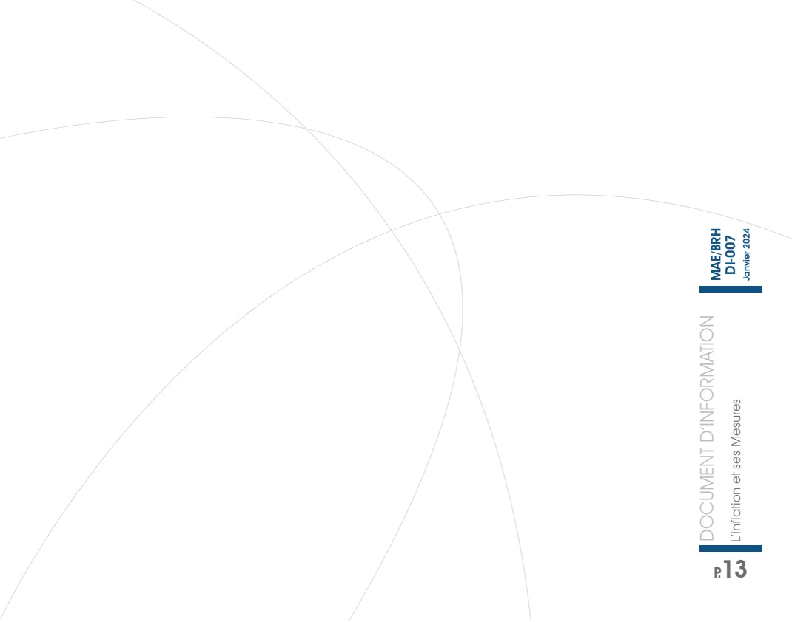

<!-- page 1 -->

| Category | Value |
| --- | --- |
| Document | 100 |
| Information | 60 |
| Information1 | 25 |
| Information2 | 25 |
| Information3 | 25 |
| Information4 | 25 |
| Information5 | 25 |
| Information6 | 25 |
| Information7 | 25 |
| Information8 | 25 |
| Information9 | 25 |
| Information10 | 25 |

## DOCUMENT D'INFORMATION

L'Inflation et ses Mesures

| Category | Value |
| --- | --- |
| Red |   |
| Blue |   |
| Green |   |

<!-- page 2 -->

<!-- page 3 -->

# L'INFLATION : ORIGINE, CAUSES ET CONSÉQUENCES

## I – DÉFINITION ET MESURES DE L'INFLATION

L'inflation désigne une augmentation généralisée et durable du niveau des prix dans l'économie. Elle entraîne une baisse du pouvoir d'achat de la monnaie puisqu'avec un même revenu, les consommateurs achètent moins de biens et de services qu'auparavant. Elle conduit ainsi à un déséquilibre important qui pèse sur le revenu des ménages, sur les coûts des entreprises et dans certains cas, sur la croissance économique. De ce fait, la maîtrise de l'inflation demeure l'un des objectifs premiers de toute Banque centrale, auquel s'ajoutent souvent la croissance et la réduction du chômage.

En Haïti, l'une des principales missions de la Banque Centrale consiste à défendre la valeur interne et externe de la monnaie nationale. Si la valeur externe de la gourde correspond au taux de change, sa valeur interne est déterminée par le niveau général des prix donc l'inflation. Ainsi, la présentation de cet indicateur macroéconomique revêt une importance toute particulière pour la Banque de la République d'Haïti (BRH). D'où la présentation de ce document d'information par la BRH qui vise à aider le public à mieux cerner les concepts entourant l'inflation, ses causes et ses conséquences dans l'économie.

## MESURES DE L'INFLATION

Il existe différentes mesures du niveau des prix. On peut citer, entre autres, l'indice des prix à la consommation (IPC), l'indice des prix à la consommation harmonisée (IPCH), l'indice des prix à la consommation personnelle des dépenses (ou indice des prix PCE) ou encore le déflateur du Produit intérieur brut (PIB) $ ^{1} $. Le choix de la formule dépendra de la disponibilité des données et des objectifs des agences statistiques nationales.

En Haïti, l’Institut Haïtien de Statistique et d’Informatique (IHSI), qui a la charge de collecter, de traiter et publier les statistiques sur les prix et leur évolution, calcule l’inflation à partir de l’indice des prix à la consommation (IPC). En effet, l’IPC permet de suivre l’évolution du niveau des prix d’un ensemble fixe de biens et de services achetés par un consommateur moyen au cours d’une période donnée. Il est mesuré en tenant compte de différentes divisions de consommation qui constituent

<!-- page 4 -->

des regroupements de sous-divisions (alimentation, habillement, transport, etc.) et chaque produit est pondéré, dans l'indice global, proportionnellement à son importance dans le panier de consommation des ménages. De ce fait, si l'IPC augmente, le consommateur devra dépenser plus d'argent pour consommer la même quantité de biens et de services.

Ainsi, le taux d'inflation correspond à la variation en pourcentage de l'IPC d'une période à l'autre. Par exemple, si l'IPC passe de 100 en mai 2007 à 110 en mai 2008, le taux d'inflation en glissement annuel en mai 2008 est de 10 %. Par ailleurs, s'il est établi à 109,5 en avril 2008, le taux d'inflation en variation mensuelle en mai 2008 sera de 0,46 %.

L'inflation, calculée à partir de l'IPC, tient compte à la fois des produits dont les prix sont susceptibles de connaître de fortes fluctuations et de ceux dont les variations dans le temps sont moins fréquentes et importantes. La variation des prix de la seconde catégorie de produits permet alors de déterminer la tendance de long terme de l'inflation, laquelle exclut les produits dont les prix sont plus volatils.

## INFLATION SOUS-JACENTE

L'inflation sous-jacente (Core inflation en anglais) est l'indicateur de prix le plus suivi par les banques centrales. Il exclut principalement les produits dont les prix subissent des variations importantes et fréquentes dues à des facteurs liés à l'offre ou à la demande, ou des produits règlementés ne répondant donc pas à une pratique de marché. Par exemple, en période de sécheresse, la récolte de riz est grandement affectée. Ce dernier devient rare et son prix augmente. Cela aura un impact direct sur l'IPC, lequel aura tendance à augmenter. Ainsi, l'inflation sous-jacente permet d'avoir la tendance lourde de l'inflation en enlevant de l'IPC les produits dont les prix sont volatils en raison des mouvements saisonniers ou des chocs d'offre et de demande. Parmi ces produits, sont également exclus ceux qui subissent des variations dues aux tensions sur les marchés mondiaux tels les produits dérivés du pétrole. Cet indicateur est donc plus adapté à l'analyse des tensions inflationnistes, puisqu'il permet de dégager la tendance de long terme de l'évolution des prix, laquelle reflète mieux l'évolution de la masse monétaire.

## MESURES DE L'INFLATION

Suivant l'évolution du rythme de croissance des prix, l'inflation peut donner lieu à différents phénomènes tels la :

<!-- page 5 -->

## Désinflation

La désinflation désigne le ralentissement du rythme de progression des prix. Tout en restant positif, le taux peut évoluer à la baisse et constituer un objectif de politique économique. Certains pays peuvent également mener des politiques de désinflation compétitive afin de relancer l'économie. En effet, en maintenant les prix à des niveaux inférieurs par rapport à ceux des pays compétiteurs, les autorités favorisent la compétitivité de la production nationale, ce qui contribue à l'augmentation des exportations et par ricochet à l'amélioration de la balance commerciale.

## Déflation

La déflation est caractérisée par une baisse continue du niveau général des prix, ce qui freine l'activité économique et augmente le taux de chômage. Pour les ménages, elle inciterait à différer leur consommation et leur investissement dans le futur puisque la valeur de la monnaie risque de s'apprécier. Pour ce qui est des entreprises, cette situation leur laisse peu de possibilité pour augmenter leurs marges puisque celles-ci ne peuvent réduire leurs coûts aussi vite que la baisse de l'activité économique. De ce fait, ces dernières peuvent être portées à réduire leur niveau de production et parfois à procéder au licenciement de leurs employés. Conséquemment, la déflation peut entraîner une diminution des salaires, un accroissement du chômage et dans certains cas, une baisse de la consommation.

## Hyperinflation

Selon l'économiste Phillip Cagan, on parle d'hyperinflation quand le niveau d'inflation se maintient au-dessus de 50 % par mois. Elle peut être due à un déficit de la balance commerciale. Avec des importations qui excèdent les exportations, la monnaie se déprécie, ce qui, à son tour, renchérit le prix des importations et accélère l'inflation. Elle peut aussi être attribuée au déficit budgétaire. En effet, avec des dépenses qui dépassent largement les recettes, l'État se trouve dans l'obligation de se financer auprès de la Banque centrale. Suite à cette augmentation de la masse monétaire non concurrencée par une évolution similaire de la production de biens et de services, le rythme d'augmentation des prix va en s'accélérant, ce qui renvoie à la théorie quantitative de la monnaie.

L'hyperinflation a des effets très néfastes sur la valeur de la monnaie nationale et les pays qui ont subi une crise hyper-inflationniste sont souvent obligés de recourir à la dollarisation pour stabiliser le système de paiement et rétablir la confiance du public dans la politique économique du gouvernement.

<!-- page 6 -->

## Stagflation

La stagflation est caractérisée par une stagnation de l'activité économique et une forte inflation. Elle s'accompagne en général d'un taux de chômage élevé. Deux raisons peuvent expliquer une stagflation. D'une part, elle peut être causée par l'augmentation du prix d'un produit stratégique importé comme le pétrole ou autres matières premières. D'autre part, elle peut résulter d'une offre excessive de monnaie, comme la monétisation du déficit budgétaire. Ces phénomènes, combinés à un ralentissement de l'activité économique, engendrent la stagflation.

Les causes économiques de l'inflation sont diverses. On distingue l'inflation par les coûts, l'inflation par la demande et l'inflation monétaire.

## II - LES CAUSES DE L'INFLATION

## L'INFLATION PAR LES COÛTS

Elle résulte d'un accroissement des coûts de production liés à plusieurs facteurs tels :

L'augmentation du coût de la main d'œuvre (salaires) ;

L'augmentation du prix des matières premières ;

Des mesures gouvernementales (comme l'accroissement des prélèvements sociaux) ;

■ Des politiques commerciales menées par les entreprises (dépenses en matière de publicité, promotion).

La hausse des coûts des facteurs de production est répercutée sur les prix de vente des produits et services fournis, ce qui entraîne par ricochet une augmentation du niveau général des prix et ce type d'inflation contient un risque de spirale inflationniste.

## L'inflation monétaire

La théorie quantitative de la monnaie établit une causalité entre les variations de la quantité de monnaie en circulation et celles du niveau général des prix en se basant sur l'équation de Fisher :  $ M \times V = P \times T $ (avec M = stock de monnaie en circulation, P = niveau général des prix, V = vitesse de circulation de la monnaie et T = volume des transactions). Selon les monétaristes, en considérant le plein emploi des facteurs de production, toute variation de la quantité de monnaie implique une variation des prix, la vitesse de circulation de la monnaie et le volume de transaction restant constants. L'inflation dans une économie est donc le résultat d'une émission de monnaie trop importante qui dépasse la valeur des biens produits

<!-- page 7 -->

(volume de production) au cours d'une période donnée. En d'autres termes, l'inflation monétaire résulte d'une inadéquation entre la quantité de monnaie et le volume de biens et services dans l'économie.

## L'inflation par la demande

Elle est due au déséquilibre entre l'offre et la demande, laquelle peut résulter, soit de la hausse de la demande par rapport à une offre existante, soit d'une baisse de l'offre face à la demande actuelle du marché. En effet, la hausse de la demande peut être attribuable à une augmentation des salaires, du crédit, des dépenses publiques ou de la demande extérieure. Les prix, dans ce cas, auront tendance à augmenter car l'ajustement de la production (offre) ne peut se faire à très court terme. Par ailleurs, l'offre peut également se réduire à cause d'une pénurie de matières premières, d'énergie, de main d'œuvre qualifiée ou de l'absence de capitaux. Cette situation peut se produire si les entreprises fonctionnent à pleine capacité et n'ont pas encore réalisé les investissements leur permettant d'accroître leurs capacités de production. De ce fait, l'impossibilité d'augmenter de l'offre à court terme entraîne ainsi une rareté du produit dans un contexte d'amplification de la demande, laquelle fait accroître les prix.

## III - CONSÉQUENCES DE L'INFLATION

##  $ \underline{\text{Avantages}} $

## POUR LES ENTREPRISES

Les conséquences de l'inflation ne sont pas toujours négatives. Par exemple, elle améliore la rentabilité financière des entreprises. Ces dernières sont d'autant plus incitées à recourir au financement externe que leurs taux de profit internes sont supérieurs au taux d'intérêt des capitaux empruntés. Les entreprises se trouvent stimulées par les perspectives de gain, ce qui les incite à investir. Une telle situation augmente la rentabilité de leurs fonds propres (effet de levier). Ceci induit alors une croissance de la production et de l'emploi en favorisant les investissements car elle croît la marge d'autofinancement et allège la charge de remboursement (en cas d'emprunts à taux fixes).

## POUR LES MÉNAGES

L'inflation allège les dettes des agents économiques en cas d'emprunts à taux fixes. En effet, elle diminue le coût réel de l'endettement en fonction de la différence

<!-- page 8 -->

entre le niveau des taux d'intérêt nominales et le niveau général des prix. De ce fait, les ménages sont bénéficier de taux d'intérêt réels faibles et dans certains cas, négatifs. En augmentant la valeur des biens immobiliers, l'inflation bénéficie aux détenteurs d'actifs. Les ménages rembourseront d'autant moins en valeur réelle quand l'inflation est plus élevée.

L'inflation entraîne une diminution du pouvoir d'achat du revenu des ménages. Avec le renchérissement des prix des produits, les ménages se retrouvent à utiliser une partie plus importante de leur revenu pour consommer la même quantité de biens et de services. En d'autres termes, quand l'inflation augmente, la valeur réelle de la monnaie diminue. Donc, on peut acheter moins de biens avec la même quantité de monnaie. Dans de telles situations, les agents économiques ont alors tendance à ne pas utiliser leurs liquidités (ils consomment moins) au profit d'investissements dans les biens immobiliers, devises fortes, etc.

## Inconvénients

## POUR LES MÉNAGES

## POUR L'ACTIVITÉ ÉCONOMIQUE

Une inflation peut conduire, lorsqu'elle est forte, à un ralentissement de la croissance économique et à une détérioration de l'emploi. Aussi, une variation accélérée et persistante des prix est-elle de nature à avoir des impacts négatifs sur l'économie.

- Elle perturbe la répartition macroéconomique des revenus, car la plupart des agents économiques ne peuvent pas ajuster leurs revenus au même rythme que l'inflation.

- Elle rend l'avenir plus incertain. En rendant incertaine l'évolution des valeurs nominales des revenus et des prix, l'inflation rend difficile les anticipations sur des variables macroéconomiques telles que la consommation, l'investissement, et rend par conséquent, la croissance économique plus hypothétique.

Elle réduit la compétitivité-prix de l'économie et conduit à procéder à des réajustements monétaires. Elle minimise également la compétitivité-produit provoquant une augmentation du taux d'intérêt, ce qui renchérit le coût des investissements des entreprises. Le niveau des investissements étant inversement proportionnel au taux d'intérêt, plus le taux est élevé, plus les investissements sont faibles, et réciproquement. Les produits locaux exportables devenant moins compétitifs, se vendent moins et par conséquent, les parts de marché régressent et la croissance ralentit.

<!-- page 9 -->

# IV- IMPACTS DE CERTAINES VARIABLES MACROÉCONOMIQUES SUR L'INFLATION

## LE FINANCEMENT MONÉTAIRE DU DÉFICIT BUDGÉTAIRE

Lorsque les dépenses de l'État sont plus importantes que ses recettes, il en résulte un déficit public. Ce déficit, lorsqu'il est financé par la création monétaire, entraîne une augmentation de la quantité de monnaie en circulation dans l'économie et alimente l'inflation.

## LE TAUX DE CHANGE

Dans un pays qui dépend fortement des importations, la perte de valeur de la monnaie nationale a un impact significatif sur les prix. En effet, la dépréciation de la monnaie peut entrainer une inflation importée puisqu'il faut plus de monnaie locale pour acheter le même bien produit à l'étranger. Les produits que le pays importe deviennent alors plus chers, d'où une hausse généralisée des prix sur le marché national.

## LES TAUX D'INTÉRÊT

Une baisse des taux d'intérêt peut induire une accélération des prix alors que le mouvement contraire des taux d'intérêt est un moyen pour lutter contre une inflation excessive. Dans une période de récession, les banques centrales baissent leurs taux directeurs afin de stimuler la demande et ainsi relancer l'économie. Cela permet d'accroître les investissements des agents économiques (ménages et entreprises), de dynamiser le crédit et de relancer la consommation. En période de forte croissance, l'inflation a tendance à augmenter et conséquemment, on assiste plutôt à un relèvement des taux directeurs par la Banque centrale afin d'éviter une surchauffe économique.

## LE TAUX DE CHÔMAGE

En économie, la courbe de Phillips permet de mettre en exergue la relation négative qui existe entre le taux d'inflation et le taux de chômage. En effet, lorsque le taux de chômage diminue, les salaires s'accroissent et les entreprises augmentent les prix pour rétablir leurs marges, ce qui va entrainer une hausse de l'inflation. Inversement, l'inflation se replie lorsque le taux de chômage augmente. En d'autres termes, une diminution prolongée de l'inflation peut découager les entreprises à faire de nouveaux investissements et les conduire dans certains cas, à réduire leur effectif.

<!-- page 10 -->

## ACTIONS SUR LA DEMANDE

Les politiques de lutte contre l'inflation visant à réguler la demande sont caractérisées par des mesures prises au niveau budgétaire, monétaire et des revenus.

## Si l'inflation est d'origine monétaire

La politique monétaire vise alors à restreindre l'accroissement de la masse monétaire en circulation, en contraignant l'accès aux crédits octroyés par les banques commerciales. Pour ce faire, la Banque centrale a recours à une politique monétaire restrictive à travers la hausse des taux d'intérêt ou celle des coefficients de réserves obligatoires. Conséquement, elle contribue à réduire le volume de crédit devant alimenter la demande de biens et de services dans l'économie et par conséquent, les pressions inflationnistes y relatives. Toutefois, la faiblesse du crédit alloué à l'économie ne permet de stimuler ni la consommation de ménages, ni l'investissement des entreprises. Ainsi, l'application d'une telle politique entraîne comme effet négatif le ralentissement de l'activité économique.

## Si l'inflation est due à un excès de la demande

Les pouvoirs publics peuvent alors utiliser la politique budgétaire en baissant les revenus distribués par l'État (limitation de la progression des revenus des fonctionnaires, réduction des programmes de travaux publics...) et en augmentant les recettes publiques (impôts, taxes...). L'objectif est de réduire le revenu disponible à la consommation et donc de rétablir l'équilibre entre l'offre et la demande.

## Si l'inflation est due aux coûts de production

Le contrôle des prix et la politique des revenus sont dans ce cas les instruments utilisés. Le Gouvernement peut ainsi inciter les entreprises à modérer la hausse des prix, il peut surveiller ou même restreindre certains revenus pendant une durée déterminée (interdiction d'indexer les salaires sur le taux d'inflation, contrôle de la redistribution des revenus de transferts).

## ACTION SUR L'OFFRE

La difficulté d'obtenir des résultats satisfaisants avec les instruments de politique visant à réguler la demande peut amener les autorités monétaires et budgétaires

<!-- page 11 -->

à utiliser des moyens de lutte à plus long terme, en développement principalement la concurrence par les prix, c'est-à-dire en incitant les entreprises à mieux maîtriser leurs coûts de production (amélioration de la compétitivité) et à diminuer leurs marges bénéficiaires pour conserver leurs parts de marché.

## VI- PERSPECTIVES ET CONCLUSION

Une évolution rapide du taux d'inflation traduit un déséquilibre interne de l'économie. Plusieurs causes peuvent expliquer une accélération de l'inflation : une augmentation des coûts de production, un excès de la demande ou une croissance de la monnaie en circulation, etc. Afin de pallier ce problème, les autorités disposent des moyens d'actions à court terme tels que la politique budgétaire, la politique monétaire et la politique des revenus. Un taux d'inflation faible et stable renforce l'efficacité de la politique monétaire à travers un ancrage des anticipations et permet aux agents économiques de faire des projections pour leurs besoins futurs de consommation et d'investissement.

Au regard de l'évolution des politiques non-conventionnelles, la Banque centrale d'Haïti a ajusté sa politique monétaire de sorte que les mesures et programmes mis en place visent aussi à adresser les origines d'ordre structurel de l'inflation, notamment la faiblesse de la production. Cette politique monétaire dite pro-croissance s'inscrit dans la mouvance des banques centrales du XXle siècle, laquelle consiste à se démarquer légèrement de l'approche purement monétariste et aller vers la coordination des politiques économiques visant la relance des secteurs à haute valeur ajoutée, et dont les retombées pour l'économie iront au-delà de la stabilité des prix.

<!-- page 12 -->

## GLOSSAIRE

• Appréciation de la monnaie : Augmentation de la valeur d'une monnaie par rapport à une devise forte.

• Dépréciation de la monnaie : Perte de valeur d'une monnaie par rapport à une devise forte.

• Politique monétaire : Ensemble d'instruments utilisés afin d'agir sur l'offre de monnaie dans le but d'assurer la stabilité des prix et de contribuer à la création des conditions favorables à la croissance de la production et de l'emploi.

• Glissement annuel : Variation par rapport à la même période de l'année antérieure. Par exemple, une variation d'une variable en glissement annuel observé en juillet 2019 renvoie à la variation du niveau de cette dernière en juillet 2019 par rapport à son niveau en juillet 2018

• Variation mensuelle : Variation par rapport au mois précédent.

• Politique budgétaire : Ensemble de mesures prises par un gouvernement afin d'agir sur la conjoncture économique d'un pays à travers la taxation et les dépenses publiques.

• Indice des prix à la consommation Harmonisé (IPCH) : Calculé pour chacun des pays de l'Union Européenne (UE) et quelques autres pays européens, est l'indicateur conçu à des fins de comparaison internationale et permettant d'apprécier le critère de convergence de la stabilité des prix des pays de l'UE

• Indice des prix à la consommation personnelle des dépenses (ou indice des prix PCE) : Mesure qui capture l'évolution des dépenses (ou la déflation) d'un large éventail de biens de consommation. Elle reflète aussi les changements de comportement des consommateurs car elle est mise à jour chaque année.

• Déflateur implicite du Produit intérieur brut (PIB) : Outil qui permet de mesurer les prix de tous les biens et services produits dans une économie. En d'autres termes, cet instrument étudie la variation du PIB d'une année à une autre due à l'évolution des prix. Il se calcule en divisant le PIB nominal (valeur du PIB mesurée aux prix de l'année courante) au PIB réel (valeur du PIB mesurée aux prix d'une année de référence).

• Planche à billet : Création monétaire dont le but principal est de financer la dette de l'État.

<!-- page 13 -->

<!-- page 14 -->

Banque de la République D'Haiti

www.brh.ht

Direction Monnaie et Analyse Economique

Angle rues Pavée et du Quai / Port-au-Prince, Haiti W.I.

Boite Postale 1570

Téléphone: (509) 22.99.11.64

Fax: (509)22.99.11.92
