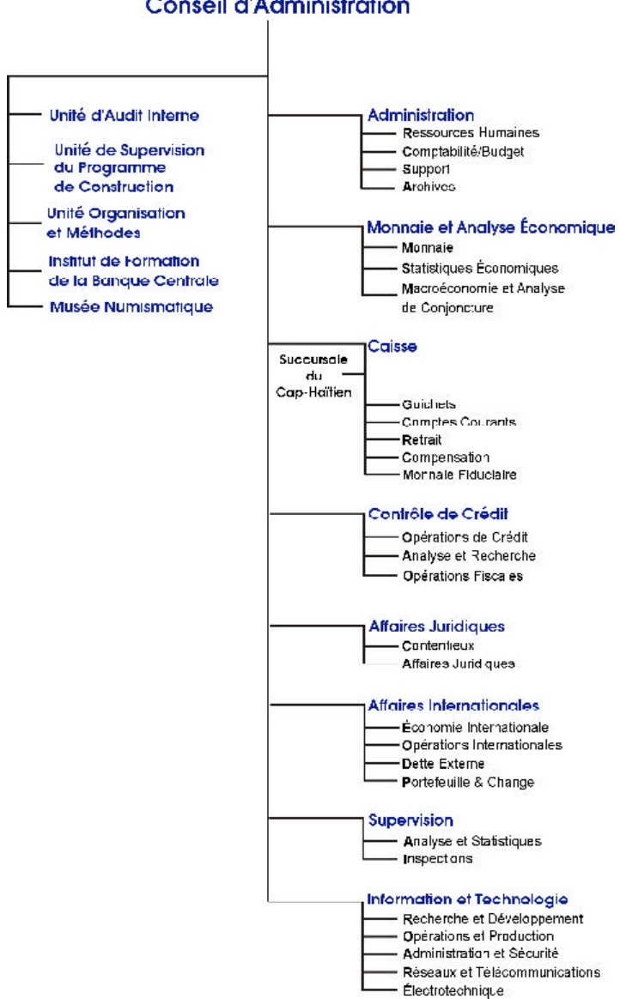
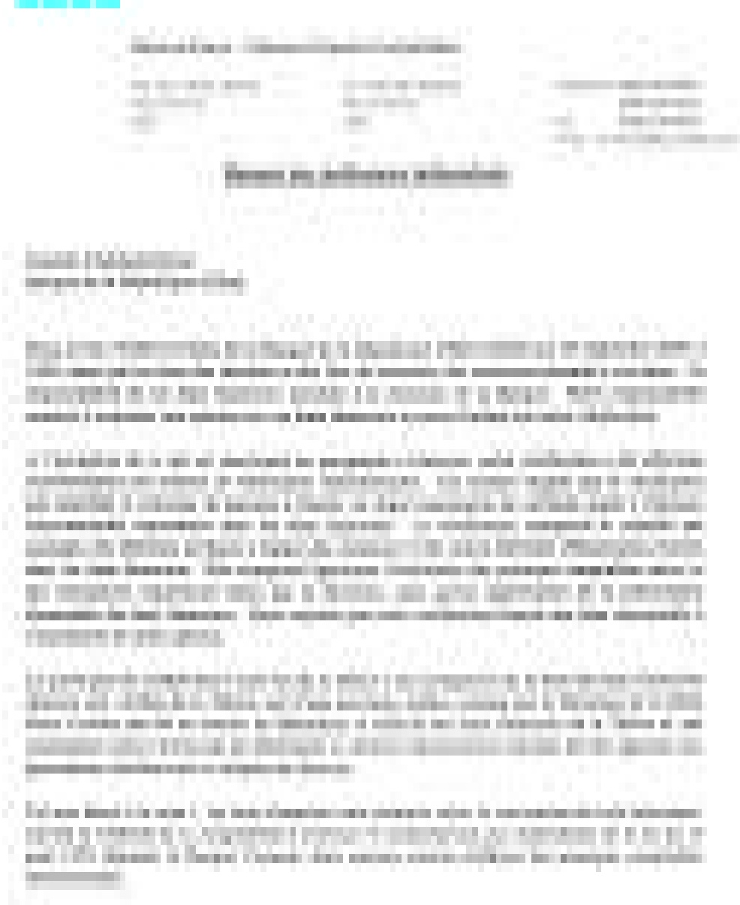

<!-- page 1 -->

Banque de la République d'Haïti

<!-- page 2 -->

## CONSEIL D'ADMINISTRATION

FRITZ JEAN

Gouverneur

ROLAND PIERRE

Gouverneur-Adjoint

HENRY CASSION

Directeur Général

VÉNEL JOSEPH

Membre

MAX ÉTIENNE

Membre

<!-- page 3 -->

## ORGANIGRAMME

## Conseil d'Administration

<!-- page 4 -->

## TABLE DES MATIÈRES

### A. L'ACTIVITÉ ÉCONOMIQUE EN 2000

I. LE CADRE DE PRODUCTION ..... 15
I.1 Introduction ..... 15
I.2 Valeur ajoutée par secteur d'activité ..... 17
I.3 Prix et Salaires ..... 20
I.4 Situation de l'emploi ..... 21
II. LA MONNAIE ET LE FINANCEMENT DE L'ÉCONOMIE ..... 22
II.1 La politique monétaire en 2000 ..... 23
II.2 Les résultats intermédiaires ..... 28
II.3 Les résultats finals ..... 29
II.4 Évolution des agrégats monétaires ..... 32
II.5 Contrepartie de M3 et financement de l'économie ..... 33
III. FINANCES PUBLIQUES ..... 34
III.1 Recettes ..... 35
III.2 Dépenses ..... 37
III.3 Financement ..... 38
IV. BALANCE DES PAIEMENTS ..... 42
IV.1 Les transactions courantes ..... 42
IV.2 Mouvements de capitaux ..... 47
B. ÉVOLUTION DU SYSTÈME BANCAIRE EN 2000
V. LE SYSTÈME BANCAIRE : VUE D'ENSEMBLE ..... 53
V.1 Le système bancaire ..... 55
V.2 Structure du système bancaire ..... 57
V.3 Distribution du crédit ..... 60
V.4 Parts de marché individuelles ..... 64
VI. LES ACTIVITÉS ET RÉSULTATS DU SYSTÈME BANCAIRE ..... 66
VI.1 Activités bancaires ..... 66
VI.2 Structure financière et Qualité de l'actif ..... 75
VI.3 Résultats ..... 77
VI.4 Effectif des banques et Productivité ..... 83
VII. LA SURVEILLANCE DES BANQUES ..... 85
VII.1 Mission de surveillance ..... 85
VII.2 Exercice de surveillance ..... 85
VII.3 Réglementation prudentielle ..... 85
VII.4 Activités de surveillance ..... 88
VII.5 Demande d'agrément ..... 88

### C. LA BRH EN 2000

VIII. MONNAIE FIDUCIAURE ET MONNAIE SCRIPTURALE .....95
VIII.1 Billets et monnaie divisionnaire .....95
VIII.2 Les Chèques .....98

<!-- page 5 -->

VIII.3 Dépôts et tirages des banques commerciales .....101
VIII.4 Services à l'État .....101
IX. EFFORTS LIÉS À LA MISE EN ŒUVRE DE LA POLITIQUE MONÉTAIRE .....103
IX.1 De l'utilisation des opérations de change par la BRH .....103
IX.2 Gestion des avoirs extérieurs de la BRH .....104
X. ORGANISATION ET MÉTHODES .....105
XI. ACTIVITÉS DE DÉVELOPPEMENT TECHNOLOGIQUE .....106
XI.1 Continué de service .....106
XI.2 Les interventions sectorielles .....107
XI.3 Les projets techniques .....108
XI.4 Le passage réussi à l'an 2000 .....109
XI.5 Projets internes .....109
XI.6 Ressources humaines de la BRH .....113
D. ÉTATS FINANCIERS ET ANNEXE JURIDIQUE
XII. ÉTATS FINANCIERS .....125
XIII. ANNEXE JURIDIQUE .....148

### E. ANNEXE STATISTIQUE

<!-- page 6 -->

## AVANT-PROPOS DU GOUVERNEUR

Le Conseil d'Administration, conformément à la loi, prend plaisir à vous présenter le rapport annuel de la Banque de la République d'Haïti (BRH) pour la période fiscale 1999-2000. Ce rapport analyse la conduite de la politique monétaire, la gestion des finances publiques ainsi que le déroulement de l'activité économique. Il présente également l'évolution du système bancaire et les opérations de gestion de la BRH.

L'activité économique a subi les contraintes d'un environnement international marqué par la flambée des cours du pétrole et celles d'une situation interne de crise politique aiguë qui a nourri les anticipations pessimistes des opérateurs économiques. En raison de ces conditions défavorables à la relance de la production, les efforts déployés par l'État en matière d'investissements publics n'ont pas eu l'effet d'entraînement souhaité sur les activités du secteur privé. De fait, la croissance n'a été que de 1,12 %, en déclin par rapport à la moyenne de 2,38 % enregistrée sur les quatre exercices précédents. Ainsi, au regard du taux estimé de croissance naturelle de la population (2,08 %), le produit intérieur brut par tête d'habitant aura connu une croissance négative en 1999-2000.

Le choc externe, constitué par la forte augmentation des cours du pétrole, s'est manifesté par un manque à gagner substantiel au niveau des recettes du Trésor. Ce choc a contribué à l'augmentation du besoin de financement du secteur public suite au choix du gouvernement d'absorber les coûts liés à l'augmentation de la facture pétrolière en maintenant constant les prix à la pompe des produits pétroliers sur les onze premiers mois de l'exercice fiscal. De même, la forte croissance de la valeur des importations de ces produits pétroliers a conduit, contrairement aux deux exercices précédents, à un solde négatif du compte courant de la balance des paiements, en dépit de la progression des transferts courants.

Cet environnement particulièrement difficile a pesé lourd sur le cadre de mise en œuvre de la politique monétaire. Le crédit au secteur public a très tôt dévié du sentier défini dans le cadre du programme-relais convenu en début d'exercice avec le Fonds Monétaire International (FMI). De même, le protocole d'accord, portant sur un programme de cash-management signé avec le Ministère de l'Économie et des Finances, n'a pas permis de contenir suffisamment les avances au Trésor Public en raison notamment de la faiblesse de l'assistance externe en appui au budget. Conséquemment, la banque centrale a dû déployer un effort continu de resserrement des conditions monétaires tout en opérant un arbitrage serré entre le besoin de contrer les pressions inflationnistes et celui de préserver la bonne santé du système bancaire.

Au regard des conditions de mise en œuvre de la politique monétaire, les résultats obtenus en matière d'inflation et de comportement du taux de change se sont révélés satisfaisants jusqu'au mois de juillet. La croissance, en rythme annuel, du niveau général des prix a été maintenue dans des limites proches de la fourchette définie dans le programme-relais (9 %-11 %), et la dépréciation de la gourde, contenue dans des proportions moins élevées que ne laissaient présager le financement du déficit budgétaire et les incertitudes qui prévalaient sur les marchés.

<!-- page 7 -->

Toutefois, à la fin de l'exercice fiscal, le renforcement des anticipations des agents économiques a provoqué une hausse brutale du taux de change. Combinée à cette dépréciation, l'augmentation substantielle des prix des produits pétroliers sur le marché local a porté l'inflation à 15,32 % en septembre 2000.

La BRH a modulé la conduite de la politique monétaire en combinant les interventions sur le marché des changes et l'utilisation des coefficients de réserves obligatoires avec l'adjudication de bons BRH. Le relèvement, à trois reprises, des coefficients de réserves, a permis de réduire l'effort financier capable d'éponger les positions excédentaires des banques. Les pressions inflationnistes de l'exercice précédent ayant érodé le rendement réel des bons BRH, la banque centrale a relevé à plusieurs reprises les taux d'intérêts servis sur cet instrument de façon à le rendre plus attractif. Cette mesure a été renforcée par l'élargissement du différentiel de taux servis sur les bons de différentes maturités, ce qui a modifié la composition du portefeuille de bons BRH en faveur des instruments à 91 jours.

En 1999 – 2000, la Banque de la République d'Haïti a été particulièrement active en tant que régulateur du système bancaire. La dégradation de l'environnement des affaires au cours des dix dernières années et les risques macroprudentiels inhérents à une conjoncture défavorable ont motivé les efforts déployés dans la gestion des activités de surveillance des banques. Les mesures prises pour garantir un fonctionnement institutionnel sain et prémunir le système bancaire contre les risques technologiques ainsi que celles visant au respect des normes prudentielles ont permis aux banques de mieux faire face aux problèmes rencontrés.

Le système bancaire, avec l'encadrement de la banque centrale, a opéré sans heurt le passage à l'an 2000. Certaines banques, technologiquement parmi les moins avancées, en ont profité pour moderniser leurs infrastructures informatiques. La BRH s'est attachée à sensibiliser davantage les banques au problème de blanchiment de capitaux en émettant la circulaire 95 sur la provenance de fonds. À cet effet, les modalités d'adhésion d'Haïti au Groupe d'Action Financière de la Caraïbe (GAFIC) sur le blanchiment de capitaux sont à l'étude et la Banque de la République d'Haïti est en train de jouer un rôle actif dans la promotion des stratégies de lutte contre le recyclage de fonds provenant de trafics illicites. La BRH a également mis en vigueur, en fin d'exercice, une circulaire fixant à 50 % le ratio maximum que les établissements bancaires doivent maintenir entre les prêts et les dépôts en devises.

La BRH a réalisé de multiples projets de gestion interne en 1999-2000. Les activités définies dans le cadre de ces projets visent à inscrire dans la durée le vaste programme de modernisation enclenché depuis trois ans en vue d'améliorer la capacité de gestion de la banque centrale. Les processus administratifs de chacune des directions de la BRH ont été révisés, sont désormais documentés et font l'objet d'amélioration continue. La consolidation de l'existant en matière technologique, la mise en place de nouvelles structures physiques de fonctionnement et le perfectionnement des ressources humaines ont guidé les choix d'investissements du Conseil d'Administration.

<!-- page 8 -->

Des investissements importants ont été consentis pour sécuriser le matériel et les données informatiques. L'idée qui sous-tend les actions entreprises est de créer un cadre de contingence qui permette de prévoir les défaillances techniques et d'éviter ainsi les interruptions de services. De même, les quatre modules, qui gèrent respectivement les états de compte, le taux de change, la centrale des risques et la centrale des impayés, ont été developpés et testés de façon satisfaisante. La mise en place de ces modules représente la première étape du projet de Système d'Informations Financières (SIF) auquel les banques commerciales pourront accéder à partir du Réseau Télématique Financier (RTF). De plus, la Banque de la République d'Haïti a accueilli la Xlième Conférence des Spécialistes en Système d'Information des Banques Centrales de la Caraïbe.

La banque centrale a achevé le processus de rénovation des immeubles existants en attendant qu'arrivent à terme les travaux de construction, commencés en mai 2000, de deux bâtiments modernes pour loger son siège central à Port-au-Prince et sa succursale au Cap-Haïtien.

Dans le domaine de la formation et de la culture, la Banque de la République d'Haïti a procédé à la création du musée numismatique. Cette nouvelle unité a pour objectifs de préserver et de mettre en valeur le patrimoine numismatique, d'éveiller l'intérêt culturel du public en général et de la jeunesse en particulier. Elle a également restructuré l'Institut de Formation de la Banque Centrale (I.F.B.C.) qui travaille au perfectionnement des ressources humaines de l'institution. La politique adoptée couvre la formation continue, généralement de courte durée, et la formation longue qui vise à améliorer à moyen terme le potentiel du personnel, notamment à travers la poursuite du programme d'études supérieures au profit des lauréats d'universités haïtiennes. Au titre des activités réalisées en Haïti, deux importants séminaires sur les systèmes de paiement et la supervision bancaire ont été organisés avec le concours du Centre d'Études Monétaires Latino-Américaines (CEMLA), à l'intention des cadres de la BRH et de ceux des banques commerciales. De plus, dans le cadre de la coopération avec la Banque de France, deux autres séminaires ont été organisés au profit des employés de la BRH.

Au seuil du nouveau millénaire, la Banque de la République d'Haïti vient de boucler la première année de sa troisième décennie d'activités avec le sentiment d'avoir relevé les défis de la modernisation et de l'adaptation technologique. L'expérience accumulée, le potentiel technologique et de gestion développé au cours des récentes années constituent des atouts majeurs dans la réalisation, pour la société Haïtienne, des objectifs de développement qui participent nécessairement de la promotion d'une gouvernance efficace. Dans ce contexte, l'action du Conseil d'Administration aura été de préparer l'institution à jouer sa partition dans le mouvement d'ensemble qui devra porter l'économie sur un sentier de croissance durable.

The

Fritz Jean

<!-- page 9 -->

### A. L'ACTIVITÉ ÉCONOMIQUE EN 2000

L'exercice fiscal 1999-2000 s'est achevé sur une croissance de 1,12 % du PIB, confirmant ainsi l'impact négatif des évolutions internes et externes. Sur le plan interne, le prolongement de la crise politique a constitué un obstacle majeur au déblocage de l'aide externe nécessaire à la réalisation des projets d'investissement et de développement. Sur le plan externe, la flambée des cours du pétrole a gonflé les importations et provoqué un manque à gagner important pour le Trésor public, ce qui a contribué à alimenter les anticipations pessimistes des agents économiques. Le processus de décélération de la croissance observé depuis 1998 s'est donc poursuivi en dépit de l'augmentation substantielle des dépenses d'investissement du gouvernement central réalisées à partir des ressources locales.

Le secteur réel a été affecté par de nombreux facteurs au sein desquels on peut isoler la sécheresse, les maladies animales, la contraction de l'investissement privé et le blocage de l'aide externe. En revanche, le dynamisme du sous-secteur “Bâtiments et Travaux Publics”, l'essor des technologies de l'information et de la communication ainsi que les emplois créés dans la micro-finance ont apporté une contribution à la valeur ajoutée sans laquelle l'économie aurait enregistré un taux de croissance nul ou négatif.

Le doublement de la facture pétrolière et le recul des exportations ont contribué à aggraver le déficit commercial.

La baisse de 50 % du cours du café cette année a été plus déterminante que la croissance des exportations de

mangues et de cacao dans ce déficit.

La politique monétaire, définie sur la base de l'objectif de stabilité interne et externe de la monnaie, a eu une efficacité limitée en raison des mauvais résultats obtenus sur le plan des finances publiques dès le premier trimestre. Les efforts de correction des autorités fiscales et monétaires se sont manifestés à travers le programme de cash-management et le resserrement des conditions monétaires. L'ajustement des prix internes, consécutif à la hausse soutenue des cours du pétrole, a provoqué une poussée inflationniste en fin d'exercice et l'accumulation des déficits a été sanctionnée par la dépréciation de la monnaie nationale.

<!-- page 10 -->

### I. LE CADRE DE PRODUCTION

### I. 1 Introduction

La politique économique du gouvernement s'est inscrite cette année¹ dans le cadre d'un programme qui devait permettre aux autorités fiscales et monétaires de réduire les déséquilibres macroéconomiques et d'accomplir des progrès additionnels dans le domaine des réformes structurelles en attendant la mise en place d'un nouveau gouvernement dans la perspective des élections législatives et présidentielles.

L'exercice antérieur s'étant achevé sur une croissance de 2,34 % du PIB, un taux d'inflation inférieur à 10 % et un taux de change relativement stable et proche de 17 gourdes pour un dollar ÊU, l'objectif pour 1999-2000 était de créer les conditions favorables à la reprise de l'investissement et de poursuivre l'effort d'ajustement nécessaire au retour de la stabilité macroéconomique. Les conditions semblaient réunies pour que l'économie haïtienne puisse profiter de la croissance de l'économie américaine et du développement des nouvelles technologies de l'information et de la communication².

Mais, il est apparu dès le premier trimestre de cette année, au vu de l'évolution des finances publiques et des cours du pétrole, que les déséquilibres macroéconomiques s'accentueraient à mesure que l'on s'approchait des échéances électorales. En effet, l'ampleur du déficit du premier trimestre (819 MG), avant même la réalisation des élections, augurait déjà du cadre macroéconomique difficile dans lequel allait se dérouler la politique des pouvoirs publics. Ce déficit budgétaire était de nature à compromettre la croissance puisqu'il alimentait les anticipations pessimistes des agents économiques sur le taux de change et l'inflation. De plus, les contraintes inhérentes à la reconduction du budget de 1996-1997, le blocage de l'assistance externe et la persistance des incertitudes liées au climat politique constituaient déjà autant de facteurs compromettants pour la reprise de l'activité économique.

Face aux perspectives défavorables en matière de stabilité des prix et de croissance, les autorités monétaires sont intervenues pour contenir les effets inflationnistes du déficit en utilisant les principaux instruments de reprise de la liquidité : les ventes de devises, les réserves obligatoires et les bons BRH. De concert avec la BRH, le Ministère de l'Économie et des Finances avait mis en place des mécanismes de contrôle des dépenses qui ont donné des résultats encourageants entre janvier et mars 2000 sans toutefois arriver au renversement de la situation qui prévalait au premier trimestre. Contrairement aux années précédentes, le programme-relais convenu avec le FMI pour 1999-2000 n'a pas fait l'objet d'un accord formel³ avec les autorités haïtiennes, mais il a permis d'évaluer périodiquement l'action du gouvernement dans une conjoncture particulièrement difficile.

<!-- page 11 -->

L'économie aura donc subi, au cours de l'exercice 1999-2000, les contraintes d'un environnement international marqué par la flambée des cours du pétrole et d'une crise politique interne qui a accentué sa vulnérabilité. Dans ce contexte, et en dépit du resserrement continu de la politique monétaire, l'ajustement du prix des produits pétroliers, relayé par la hausse des prix des produits alimentaires et amplifié par la dépréciation de la gourde, a provoqué une forte poussée inflationniste à la fin de l'exercice fiscal. Les efforts de correction des pouvoirs publics se sont heurtés au blocage de la situation politique et l'accumulation des déficits a été sanctionnée par la dépréciation accélérée de la monnaie nationale $ ^{4} $ et un taux d'inflation de l'ordre de 15,32 % en rythme annuel.

La publication des résultats des comptes nationaux pour l'exercice 1999-2000 confirme la tendance au ralentissement de la croissance observée après l'embellie de 1995. En effet, le rythme de l'activité économique s'est encore affaibli avec un taux de croissance de 1,12 % du PIB contre 2,34 % pour 1998-1999.

Graphique 1 Produit Intérieur Brut (PIB) réel (base 1976)

| Year | x. de cross. annuelle (%) | 115 annuel en voce (%) |
| --- | --- | --- |
| 1981 | -2.8 | 5.2 |
| 1982 | -3.2 | 4.8 |
| 1983 | 0.8 | 5.0 |
| 1984 | 0.2 | 5.1 |
| 1985 | 0.5 | 5.2 |
| 1986 | -0.5 | 5.1 |
| 1987 | -1.0 | 5.0 |
| 1988 | 0.1 | 5.1 |
| 1989 | 1.2 | 5.2 |
| 1990 | 0.1 | 5.2 |
| 1991 | 0.2 | 5.2 |
| 1992 | -3.2 | 4.6 |
| 1993 | -2.2 | 4.5 |
| 1994 | -8.2 | 4.1 |
| 1995 | 4.5 | 4.4 |
| 1996 | 2.8 | 4.6 |
| 1997 | 1.2 | 4.8 |
| 1998 | 3.2 | 5.0 |
| 1999 | 2.2 | 5.2 |
| 2000 | 1.2 | 5.3 |

Le secteur primaire est passé d'un taux de croissance de 1,62 % à -0,19 % en 2000. Sa contribution dans la valeur ajoutée globale continue de stagner, passant de 29,94 % à 29,20 % au cours de l'exercice 2000. En dépit de la faible croissance du PIB, le secteur secondaire s'est plutôt bien comporté. Sa production s'est légèrement améliorée mais elle reste largement inférieure à celle de l'exercice antérieur en termes relatifs (1,74 % contre 5,52 %). Le secteur tertiaire n'a pas montré les signes d'une véritable reprise; sa croissance s'est toutefois améliorée, en passant de 0,88 % en 1999 à 1,41 % en 2000.

<!-- page 12 -->

### I. 2 Valeur ajoutée par secteur d'activité

## Agriculture

Après la timide reprise amorcée en 1998 (2,19 %) et poursuivie en 1999 (1,10 %), le secteur agricole a connu une contraction au cours de l'exercice 1999-2000 en affichant un taux de croissance négatif (-1,52 %). La contribution de cette branche au PIB continue de régresser, passant de 23,13 % à 22,48 % entre 1999 et 2000. La faiblesse de la production dans cette branche est imputable à la baisse de la production végétale au niveau de l'ensemble du pays. Celle-ci a été affectée par une forte sécheresse qui a provoqué une diminution sensible des rendements à l'hectare dans une proportion variant entre 25% et 50 % en fonction des cultures et des régions pour l'ensemble de la production végétale.

En dehors de la faiblesse de la pluviométrie dans certaines régions, la production agricole a été affectée par l'apparition d'un insecte dénommé "la bruche" qui détruit en général jusqu'à 60 % de la récolte de café dans le Nord-Est et dans le Sud-Est $ ^{5} $. Quant à la production rizicole, elle reste encore profondément marquée par la maladie de la paille noire et l'absence de curage systématique des canaux d'irrigation après le passage du cyclone Georges dans la région du Bas-Artibonite en 1998.

En revanche, la production de mangues et de bananes est en augmentation constante. Elle s'est encore améliorée en franchissant cette année la barre des 300 mille tonnes pour les mangues et 290 mille tonnes pour les bananes $ ^{6} $. L'augmentation de la production bananière est due aux efforts consentis par le Ministère de l'Agriculture pour moderniser le système d'irrigation de la plaine de l'Arcahaie, l'une des principales régions de culture de cette denrée. De plus, suite à un don du gouvernement japonais, 200 mille sacs d'engrais ont été distribués aux opérateurs impliqués dans la commercialisation des fertilisants chimiques comme les organisations paysannes, les commerçants et les organisations non gouvernementales.

## Autres branches du secteur primaire

Le sous-secteur “Sylviculture, Élevage, Pêche” a connu une régression de 1,26 % alors qu'un an auparavant il avait progressé de 1,49 %. Outre les insuffisances structurelles liées au caractère rudimentaire des moyens utilisés, le sous-secteur “Sylviculture, Élevage, Pêche” a subi les conséquences de deux contraintes majeures qui ont limité sa croissance : la faiblesse des investissements et les maladies animales. La plupart des projets de production animale ont été financés par de maigres budgets à partir de fonds provenant du Trésor Public. Les crédits budgétaires ont été alloués aux activités de dépistage de maladies contagieuses et à la lutte contre la maladie de la “Varroase” qui a affecté la production apicole dans le Nord-Est en détruisant cette année plus de 70 % de la production.

<!-- page 13 -->

Les industries extractives, notamment les carrières de sable, ont enregistré un ralentissement de leur rythme de croissance qui est passé de 5,26 % en 1999 à 4 % en 2000. Néanmoins, leur contribution au PIB, quoique de faible importance, s'est accrue durant les cinq dernières années en passant de 0,17 % en 1995 à 0,22 % pour l'exercice 1999-2000. La contribution de cette branche à l'économie résulte du dynamisme accru observé dans le sous-secteur “Bâtiments et Travaux publics” depuis 1995.

## Le secteur secondaire

Entre 1995 et 2000, la valeur ajoutée du secteur secondaire s'est améliorée de 37 % et sa contribution à la croissance est passée de 17,32 % à 21,36 % du PIB. Le sous-secteur "Bâtiments et Travaux Publics" représente le principal soutien de ce secteur avec un taux moyen de croissance de 10,12 % par an pour la période.

Graphique 2 Valeur ajoutée des secteurs d'activité (en pourcentage)

|   | 1982 | 1983 | 1984 | 1985 | 1986 | 1987 | 1988 | 1989 | 1990 | 1991 | 1992 | 1993 | 1994 | 1995 | 1996 | 1997 | 1998 | 1999 | 2000 |
| --- | --- | --- | --- | --- | --- | --- | --- | --- | --- | --- | --- | --- | --- | --- | --- | --- | --- | --- | --- |
| Agriculture | 30.04 | 28.44 | 23.41 | 23.36 | 29.36 | 30.27 | 30.71 | 31.43 | 30.96 | 23.33 | 30.29 | 35.08 | 32.04 | 30.06 | 35.10 | 24.33 | 20.61 | 28.43 | 28.19 |
| Industries manufacturières | 16.05 | 16.80 | 15.17 | 15.53 | 15.34 | 14.87 | 14.72 | 14.75 | 14.75 | 15.13 | 12.15 | 7.70 | 6.85 | 7.26 | 7.03 | 10.49 | 7.19 | 7.18 | 7.12 |
| Bâ:iments et travaux publics | 5.14 | 5.47 | 5.43 | 6.15 | 5.80 | 5.36 | 6.06 | 6.06 | 5.81 | 5.30 | 5.40 | 7.03 | 6.84 | 7.30 | 9.19 | 10.53 | 10.32 | 10.89 | 10.33 |
| Autres | 31.70 | 31.62 | 32.27 | 31.82 | 31.40 | 31.23 | 30.73 | 31.35 | 32.16 | 35.64 | 38.66 | 41.15 | 44.19 | 44.67 | 44.46 | 44.26 | 43.78 | 43.47 | 43.50 |

## Industries manufacturières

En 1999-2000, la valeur ajoutée de cette branche est passée à 7,18 % contre 7,12 % pour l'exercice précédent. La production dans ce sous-secteur est restée largement tributaire des industries de la sous-traitance dont les activités ont repris timidement après la période du coup d'État. Entre 1995 et 2000, elle a connu une croissance relativement stable. Sa contribution à la croissance du PIB s'est stabilisée autour de 7,2 % sur les cinq dernières années et son taux de croissance tourne autour d'une moyenne de 2 % par an. Le développement de cette branche a été favorisé par le maintien de certaines activités de sous-traitance, l'essor de la production artisanale et la création de nouvelles activités financées à travers la micro-finance.

<!-- page 14 -->

Le sous-secteur “Bâtiments et Travaux Publics” a connu une croissance régulière sur les cinq dernières années. En dépit du ralentissement de son rythme de croissance cette année (4,64 % contre 7,99 % en 1999), imputable au comportement de l'investissement privé dans l'immobilier, il reste le principal moteur de l'activité économique en général et du secteur secondaire en particulier. La contribution de cette branche d'activité au PIB cette année est de 13,33 %, ce qui représente 62,4 % de la contribution du secteur secondaire.

Comme pour les années précédentes, la croissance de ce secteur a été favorisée par les investissements du secteur public qui ont atteint plus de 1,8 milliard de gourdes. Durant l'année 2000, en dehors des grands travaux d'infrastructure, des fonds publics importants provenant des prêts concessionnels de Taiwan ont été investis dans de nouveaux projets de logements sociaux. Cependant, en dépit de l'importance croissante de l'investissement public dans l'investissement total, l'effet d'entraînement attendu des dépenses publiques d'infrastructure reste très limité.

Le sous-secteur “Electricité et Eau” avait affiché une certaine reprise durant les deux dernières années avec des taux de croissance de 0,96 % en 1998 et 1,66 % en 1999. En 2000, ce taux est tombé à -3,5 %. Ce résultat reflète l'insuffisance des investissements publics dans ce sous-secteur, l'augmentation des coûts d'acquisition du mazout et du gasoil et la faiblesse du financement externe disponible pour le secteur secondaire depuis 1997.

## Les services

La valeur ajoutée du secteur tertiaire s'est tassée avec un taux d'accroissement de 1,5 %. Sa contribution au PIB est estimée à 45,4 % contre 45,2 % en 1998-1999. Au regard des contributions passées (45,9 % en 1998, 46,3 % en 1997 et 46,7 % en 1996), ce résultat peut être imputé au manque de dynamisme des "Services non marchands", lesquels ont progressé de seulement 0,5 % après avoir régressé de 1,68 % durant l'exercice précédent. Ces services sont fournis par l'État, les organisations non gouvernementales et les organismes à but non lucratif et leur part relative dans la croissance du PIB est estimée à 17 %, c'est-à-dire le poids le plus important de toutes les composantes du secteur tertiaire. Cependant, la faiblesse des "Services non marchands" a été contrebalancée par la contribution d'autres branches telles que "Transports et Communications", "Commerce, Restaurants et Hôtels" qui ont accusé des hausses respectives de 5,9 %, 2 % et 1,8 %. Le dynamisme observé au niveau de la branche "Transports et Communications" est attribuable aux efforts d'investissement consentis par les compagnies de téléphone fixe et mobile pour offrir à leur clientèle une gamme de services dans la technologie de pointe, tandis que le regain d'activité du sous-secteur de la restauration et de l'hôtellerie résulte des efforts de rénovation entrepris par le gouvernement dans le domaine du Tourisme.

<!-- page 15 -->

## La répartition des prêts par secteur

La répartition sectorielle des prêts explique l'évolution de l'activité au niveau du secteur réel. Elle est largement dominée par les branches des secteurs secondaire et tertiaire qui ont compté respectivement pour près de 41,0 et 50,0 % de l'encours du crédit en 1999/2000. Les prêts à la consommation en ont représenté 9,6 % tandis que le portefeuille détenu sur le secteur primaire, 0,1 %. Le Commerce de gros et de détail ainsi que les prêts aux particuliers ont bénéficié de 52 % environ des prêts accordés entre octobre 1999 et septembre 2000. Suivent les industries manufacturières, le sous-secteur "Électricité, gaz et eau" (20 %) et l'ensemble qui regroupe l'immobilier, les bâtiments et travaux publics, les transports, les entrepôts et la communication (18 %). Le crédit à l'agriculture a diminué de 4 % environ.

### I. 3 Prix et salaires

En dépit du resserrement des conditions monétaires, la tendance au ralentissement de la hausse des prix observée depuis 1996 a été interrompue cette année sous l'effet de la croissance des prix des produits alimentaires et de la dépréciation de la gourde. L'exercice 1999-2000 a été marqué par une accélération des prix au sein des différents secteurs de consommation qui a provoqué une reprise graduelle de l'inflation. En effet, le taux d'inflation en glissement annuel a atteint 15,32 % en septembre 2000 contre 9,92 % un an plus tôt. L'évolution de l'IPC a été largement influencée par l'augmentation d'environ 74 % du prix moyen CIF des produits pétroliers.

L'inflation, mesurée par la variation de l'indice² des prix à la consommation, avait d'abord connu un ralentissement entre septembre (0,76 %) et novembre 1999 (0,45 %) pour commencer à progresser à partir de décembre (0,93 %) et atteindre 2,05 % en mars 2000. Le même phénomène s'est reproduit au cours de la seconde moitié de l'exercice, mais avec cette fois une accélération à partir du mois de juillet pour aboutir à un pic en septembre 2000 (3,26 %) reflétant l'ajustement des prix des produits pétroliers effectué durant cette période.

L'accroissement des prix s'est manifesté dans toutes les composantes de l'indice, mais au quatrième trimestre, il a été surtout ressenti dans trois groupes de dépenses ayant une pondération relativement élevée. Les groupes de dépenses : "Alimentation, boisson, tabac", "Loyer du logement, énergie et eau" et "Transport" ont enregistré des taux de croissance de 4,30 %, 7,28 % et 17,85 % respectivement.

La hausse mensuelle de 16,88 % de l'indice des prix du groupe "Transport" en septembre 2000 s'est répercutée sur celui du groupe "Alimentation, boisson, tabac" qui est passé de 0,76 % en août à 2,24 % en septembre 2000. L'accélération des prix des produits alimentaires reflète également les augmentations des prix du riz $ ^{8} $ et du maïs $ ^{9} $

<!-- page 16 -->

sur cette période. Ces hausses de prix résultent de la contraction de l'offre de ces produits consécutive à la baisse de leur production, elle-même causée par la forte sécheresse qui a frappé le pays cette année. En effet, selon les estimations du Ministère de l'Agriculture, sur la période allant d'octobre 1999 à juillet 2000, à cause de la sécheresse, la production de maïs dans les zones du Bas Artibonite et de la Grande-Anse a diminué de 76 %^{10} et la production rizicole dans le Bas Artibonite de 16 %^{11}.

Le renforcement des pressions inflationnistes sur le secteur "Transport" s'est manifesté en septembre 2000 par une nette accélération de la variation mensuelle de l'indice du groupe (16,88 %), alors que la croissance mensuelle moyenne sur l'ensemble de l'exercice n'a atteint que 1,76 %. Cette accélération provient de l'ajustement des prix de l'essence et du gasoil qui ont crû de 37,86 % par rapport au mois d'août, suite à la décision du gouvernement de réduire les subventions implicites accordées aux consommateurs de produits pétroliers en septembre 2000.

Compte tenu de l'absence de données exhaustives et fiables sur la rémunération des forces productives, l'analyse de la progression des salaires dans l'économie se limite à l'évolution du salaire minimum légal. Après avoir diminué de 67 % environ en termes réels entre octobre 1984 et mai 1995, le salaire minimum journalier a augmenté de 88 % en juin 1995 en passant officiellement à 36 gourdes. Considéré comme l'un des plus bas de la région, il est resté nominalement inchangé depuis cette date. Son pouvoir d'achat par rapport à 1995 a été réduit de 51,64 % en l'an 2000. Ce pouvoir d'achat représente 84,68 % de sa valeur de 1999 et 48,36 % de sa valeur de 1995.

### I. 4 Situation de l'emploi

L'analyse de la situation de l'emploi se limite à l'industrie de la sous-traitance, à la micro-finance et au système bancaire. Selon les données disponibles au Ministère du Commerce et de l'Industrie, la baisse du nombre d'emplois dans le secteur de la sous-traitance, commencée l'année dernière, s'est poursuivie cette année. Pour l'exercice 1999-2000, la création de 3 378 emplois générés par 165 nouvelles entreprises $ ^{12} $ dans ce secteur n'a pas pu contrebalancer la perte de 3 629 emplois. Notons que 75 % des salariés de la sous-traitance se retrouvent dans les entreprises du secteur textile.

Par ailleurs, selon les enquêtes de la DAI-FINNET $ ^{13} $, le nombre d'emplois dans le secteur de la micro-finance s'est élevé à 59 367 au cours du premier semestre de l'exercice 1999-2000. Au cours de cette période, sur un ensemble de 95 institutions $ ^{14} $ de micro finance, 93 d'entre elles, regroupant des coopératives, des ONG $ ^{15} $,

<!-- page 17 -->

associations, sociétés privées, fondations et institutions religieuses, ont accordé un total de 54 137 prêts à des agents économiques évoluant dans la micro finance. Les autres institutions de micro finance, soit deux banques commerciales, ont octroyé 3 487 prêts à des petits entrepreneurs individuels. Les résultats de ces enquêtes ont aussi montré que chaque prêt accordé par une institution de micro finance crée un emploi et chaque prêt octroyé par une banque commerciale à un micro entrepreneur crée environ deux emplois.

Dans le secteur bancaire, le nombre total d'emplois a augmenté de 8,31 % entre septembre 1999 et juin 2000, soit une création nette de 221 nouveaux emplois. Ces créations d'emplois ont été surtout favorisées par l'augmentation des succursales des principaux leaders du système qui ont fourni 77,9 % du total des nouveaux emplois. De plus, l'entrée d'une nouvelle banque d'épargne et de logement, la Banque Haïtienne de Développement (BHD), a donné lieu à la création de 18 nouveaux emplois dans le secteur bancaire.

### II. LA MONNAIE ET LE FINANCEMENT DE L'ECONOMIE $ ^{16} $

La politique monétaire a été conduite dans un contexte international particulièrement difficile pour l'économie haïtienne en 1999-2000. La forte augmentation des cours du pétrole sur la période qui remonte au dernier trimestre de l'exercice précédent a contribué à la détérioration de la situation des finances publiques. Ce choc externe s'est amplifié avec la dépréciation de la gourde en diminuant les recettes mobilisables du Trésor $ ^{17} $, fortement tributaires des taxes prélevées sur les produits pétroliers. En effet, les prix à la pompe, déterminés par l'État, ont été maintenus à leur niveau de février 1996 jusqu'en août 2000; ce qui a entraîné une baisse substantielle des recettes au titre des droits d'accises. Cette évolution des finances publiques a eu de sérieuses conséquences sur la situation macroéconomique caractérisée par le ralentissement des activités économiques et la remontée de l'inflation.

Face aux dépenses de financement des élections et à l'accroissement des dépenses publiques d'investissement, un important déficit budgétaire, financé par le recours au crédit de la banque centrale, a été enregistré. Il est à noter que ce crédit a couvert le besoin de financement sur les dépenses strictement internes et sur celles occasionnées par les paiements nets au titre de la dette externe. Les controverses liées aux élections législatives de mai ont contribué à renforcer les anticipations pessimistes engendrées par les déséquilibres macroéconomiques et exposé la gourde à de plus fortes poussées spéculatives.

<!-- page 18 -->

Pour contrer l'impact inflationniste de ce financement et calmer le marché des changes, la BRH a déployé un effort soutenu de resserrement des conditions monétaires en recourant à des augmentations successives des coefficients de réserves obligatoires. Ces mesures, en réduisant les liquidités libres du système bancaire, ont permis d'atténuer le coût des adjudications de bons BRH sur lesquels les intérêts servis ont plus que doublé.

L'effort consenti par l'autorité monétaire s'est révélé payant jusqu'en juillet 2000. En effet, malgré la conjonction de problèmes économiques et sociaux importants qui ont contraint la croissance du PIB à 1,12 %, l'inflation mesurée en rythme annuel a été maintenue autour d'une moyenne de 10,92 % pour les dix premiers mois de l'exercice fiscal, c'est-à-dire à l'intérieur de la fourchette 9 – 11 % ciblée dans le programme financier discuté avec le Fonds Monétaire International (FMI). Cependant, vers le mois d'août, suite à une longue période de turbulences du marché des changes et à l'ajustement à la hausse en septembre des prix à la pompe des produits pétroliers, l'inflation a franchi la barre des 11 %.

### II. 1 La politique monétaire en 2000

Sur l'ensemble de l'exercice fiscal, la banque centrale a relevé à trois reprises les coefficients de réserves obligatoires avant d'exiger la constitution de ces dernières sur une base contemporaine. Elle a modifié à la hausse, en trois occasions, les taux servis sur les bons à 91 jours et, en deux occasions, ceux servis sur les bons à 28 jours et à 7 jours. La BRH est intervenue également sur le marché des changes en vendant 16,750 millions de dollars ÉU à l'ensemble du marché et 15,175 millions au Ministère de l'Économie et des Finances pour le compte des compagnies importatrices de pétrole.

Au premier trimestre, la situation des finances publiques s'est révélée alarmante. Les avances nettes à l'État ont dépassé les prévisions établies pour l'exercice fiscal dans le programme financier, soit 800 MG. De plus l'environnement macroéconomique a hérité des mouvements à la hausse des prix amorcés au second semestre de l'exercice précédent, et le marché des changes a montré des signes de nervosité dans un contexte agravé par les préoccupations que soulevait le bogue de l'an 2000.

Pour resserrer les conditions monétaires, la BRH, dès la fin du mois d'octobre 1999, a augmenté de 2,5 points de pourcentage les coefficients de réserves obligatoires sur les passifs libellés en dollars. Ces réserves, constituées en gourdes, ont été établies à 15 % et 14,5 % pour les banques créatrices de monnaie et les banques d'épargne et de logement (BEL) respectivement. Dans le même temps, elle a vendu 1,25 million de dollars ÉU sur le marché des changes.

Cet ensemble de mesures s'est traduit par la réduction de la position excédentaire de réserves des banques qui ont dû recourir aux ressources du marché interbancaire et à des mises en pension de bons BRH. Dès lors, la

<!-- page 19 -->

banque centrale à pu, pour un encours moindre de bons, capter les liquidités libres du système à un coût financier moins élevé que celui qui aurait été nécessaire si l'encours de septembre 1999 (3 105 MG) avait été maintenu ou avait augmenté. C'est ainsi que la BRH a pu accommoder la hausse des taux d'intérêt servis sur les bons avec une baisse substantielle de leur encours qui est passé à 2 335 MG à la fin du premier trimestre. Les taux sur les instruments à 7, 28 et 91 jours ont été relevés de plusieurs points de pourcentage et portés à 10, 12 et 18 % respectivement en novembre. Par la suite, pour éponger des liquidités sur une période plus longue, la BRH a élargi davantage le différentiel entre la rémunération de l'instrument à échéance la plus longue et celle des autres, portant le taux servi sur les bons à 91 jours à 21 % en décembre 1999.

Dans le contexte des anticipations pessimistes qui ont entouré les décisions des agents économiques, les effets des déséquilibres budgétaires ont amoindri l'efficacité des mesures jusqu'ici adoptées. Les signes de nervosité du marché des changes ayant repris à la fin du mois de décembre et s'étant confirmés au début de janvier 2000, la banque centrale a dû recourir à un nouveau train de mesures dont certaines ont pris effet au début du troisième trimestre.

Pour harmoniser les recettes aux dépenses publiques, limitant ainsi les avances consenties au Trésor, la BRH de concert avec le Ministère de l'Économie et des Finances, a mis en place un programme de cash-management au tout début du second trimestre. En outre, elle a procédé à deux interventions de vente de dollars sur le marché des changes totalisant 10,5 millions de dollars ÉU et 5 millions de dollars ÉU en janvier et en février respectivement.

Le programme de cash management n'ayant pas permis de réduire suffisamment les avances consenties à l'Etat, il s'est avéré difficile de contenir le financement monétaire dans les limites nouvellement définies par deux corrections portées au programme financier et qui ont ajusté l'objectif de financement monétaire à 950 MG en février puis à 1 100 MG en avril 2000. Au cours du second trimestre les avances à l'État ont dépassé la moyenne mensuelle des 140 MG pour s'établir à 1 173 MG pour les six premiers mois de l'exercice. Suite à une forte dépréciation de la gourde au début de la deuxième quinzaine de mars, la BRH a décidé d'augmenter, pour la deuxième fois, les taux servis sur les bons de différentes maturities. Les bons à 91 jours, dont le rendement nominal passa à 22,0 %, ont bénéficié de la plus forte augmentation. Dans le même temps, la banque centrale a relevé de 1,5 point et de 2 points de pourcentage, les coefficients de réserves obligatoires sur les passifs en gourdes et en dollars respectivement. Cette mesure qui est entrée en application le 16 avril 2000 a été accompagnée de la réduction, d'un mois à quinze jours, de la période de constitution des réserves obligatoires de façon à contraindre les banques commerciales à une gestion plus rigoureuse de leur trésorerie. Le calcul des pénalités destinées à sanctionner les positions de réserves déficitaires est désormais effectué sur une base contemporaine au taux de 1,5 % par quinzaine.

<!-- page 20 -->

Au troisième trimestre, les avances à l'Etat ont été en moyenne de 91 MG par mois. Elles ont ensuite progressé selon une moyenne mensuelle de 180 MG au cours du dernier trimestre pour totaliser 2 milliards de gourdes environ au terme de l'exercice fiscal. La gourde s'est fortement dépréciée dans un environnement de crise exacerbée par les controverses qui ont entouré les élections législatives de mai 2000. Le taux de change a présenté une forte variabilité avant d'afficher une pente positive pour atteindre 22,30 gourdes le 1er septembre. Dès lors le marché s'est emballé pour porter le taux à 28,35 gourdes le 29 septembre.

La BRH augmenta alors de 3 points de pourcentage les coefficients de réserves obligatoires sur les passifs en gourdes du système, de 4 et de 3 points de pourcentage les coefficients sur les passifs en dollars des banques créatrices de monnaie et des BEL respectivement. Ces nouvelles mesures, qui sont entrées en application les  $ 1^{er} $ et 16 septembre 2000, ont fait passer la position de réserves du système bancaire à un niveau négatif à la fin de l'exercice.

Graphique 3 Coefficients de réserves obligatoires sur les passifs en monnaie locale

| Time | Banques commerciales et filla es | Banques d'épargne et de logement |
| --- | --- | --- |
| oct-39 | 25.7% | 0.5% |
| nov-33 | 25.7% | 0.5% |
| dec-39 | 25.7% | 0.5% |
| janv-00 | 25.7% | 0.5% |
| fév-00 | 25.7% | 0.5% |
| mars-00 | 25.7% | 0.5% |
| 16-avr-00 | 28.0% | 0.7% |
| mai-00 | 28.0% | 0.7% |
| juni-00 | 28.0% | 0.7% |
| juil-00 | 28.0% | 0.7% |
| août-00 | 28.0% | 0.7% |
| 01-sept-00 | 29.5% | 0.9% |
| 15-sept-00 | 30.5% | 10.0% |
| 30-sept-00 | 30.5% | 10.0% |

<!-- page 21 -->

26 Banque de la République d'Haiti

| Periode | Banques commerciale et filiales | Banques d'épargne et de l'égement |
| --- | --- | --- |
| sept-99 | 12.5% | 12.0% |
| juli-00 | 12.5% | 12.0% |
| juli-09 | 15.0% | 14.5% |
| juni-09 | 15.0% | 14.5% |
| juni-00 | 15.0% | 14.5% |
| febr-00 | 15.0% | 14.5% |
| febr-09 | 16.5% | 15.5% |
| mai-00 | 16.5% | 15.5% |
| mai-09 | 16.5% | 15.5% |
| juli-00 | 16.5% | 15.5% |
| sept-09 | 16.5% | 15.5% |
| 01 sept-00 | 18.5% | 16.5% |
| 12 sept-00 | 20.0% | 17.5% |
| 00 sept-00 | 20.0% | 17.5% |

L'effet taux de change $ ^{18} $ a renforcé l'impact des derniers relèvements de coefficients sur la position de réserves des banques. En effet, la constitution en gourdes de l'ensemble des réserves obligatoires sur les passifs libellés en dollars a fait fortement augmenter le montant de gourdes à détenir à titre de réserves pour un même niveau de passifs en dollars, lorsque le taux de change est à la hausse. C'est ainsi que les banques les plus dollarisées ont fait face à des déficits de réserves beaucoup plus importants que le déficit moyen du système et recouru aux avances libres de la banque centrale et aux mises en pension de bons pour réduire la pénalisation encourue.

Graphique 5 Position moyenne de réserve des banques (en MG)

| Month | Value |
| --- | --- |
| Oct. 99 | 134.23 |
| Nov. 99 | 143.99 |
| Dec. 99 | 70.28 |
| Jan. 00 | 190.58 |
| Feb. 00 | 190.96 |
| Mars 00 | 95.1 |
| April 02 | 2.22 |
| May 00 | 174.77 |
| June 00 | 127.62 |
| July 00 | 97.66 |
| August 02 | 50.66 |
| September 02 | -84.20 |

<!-- page 22 -->

Sur l'ensemble de l'exercice, les modifications des taux d'intérêts se sont accompagnées d'un élargissement du différentiel existant entre les taux d'intérêt servis sur les différentes maturities de bons. Ainsi, de 3,5 points de pourcentage en septembre 1999, l'écart de taux entre les échéances de 91 et de 7 jours est passé à 12,7 points douze mois plus tard. Ce signal lancé par la Banque Centrale à travers l'établissement de prix planchers a fait passer à 93,30 % la part des bons à 91 jours dans l'encours total de bons en fin d'exercice contre 61 % un an plus tôt $ ^{19} $.

Graphique 6 Taux moyens pondérés (TMP) des bons BRH de différentes maturities

| Month | TMP 7 jours | TMP 28 jours | TMP 91 jours |
| --- | --- | --- | --- |
| Oct. 99 | 7.50% | 1.10% | 11.50% |
| Nov. 99 | 10.00% | 1.50% | 17.50% |
| Dec. 99 | 10.00% | 1.50% | 21.00% |
| Jan. 00 | 10.50% | 1.50% | 21.00% |
| Feb. 00 | 10.50% | 1.50% | 21.00% |
| Mar. 00 | 11.00% | 1.50% | 21.50% |
| Apr. 100 | 12.50% | 1.50% | 23.50% |
| May. 00 | 12.50% | 4.00% | 23.50% |
| Jun. 100 | 12.50% | 4.00% | 23.50% |
| Jul. 00 | 12.50% | 4.00% | 23.50% |
| Aug. 100 | 12.50% | 4.00% | 24.00% |
| Sep. 00 | 15.00% | 4.00% | 26.50% |

Graphique 7 Composition de l'encours total des Bons-BRH (enpourcentage)

|   | 9' j | 28j | 7j |
| --- | --- | --- | --- |
| sees-99 | 1.9 | 0 | 13.0 |
| sees-99 | 1.9 | 0 | 14.5 |
| sees-99 | 1.5 | 0 | 18.5 |
| noes-99 | 2.0 | 0 | 7.4 |
| noes-99 | 2.0 | 0 | 3.0 |
| cees-99 | 2.0 | 0 | 1.3 |
| jars-99 | 1.5 | 0 | 18.4 |
| jars-99 | 1.5 | 0 | 2.5 |
| fars-99 | 1.5 | 0 | 7.0 |
| mars-99 | 2.0 | 0 | 2.9 |
| mars-99 | 2.0 | 0 | 5.4 |
| mars-99 | 1.5 | 0 | 100.0 |
| mars-00 | 1.5 | 0 | 100.0 |
| mars-00 | 1.5 | 0 | 20.7 |
| mars-00 | 1.5 | 0 | 2.2 |
| mars-00 | 1.5 | 0 | 77.0 |
| mars-00 | 1.5 | 0 | 89.7 |
| mars-00 | 1.5 | 0 | 94.5 |
| mars-00 | 1.5 | 0 | 100.0 |
| mars-00 | 1.5 | 0 | 93.3 |

 $ ^{19} $ Pour faire ressortir l'effet de cette mesure sur la composition de l'encours des bons BRH, le graphique correspondant, contrairement aux autres graphiques du rapport, inclut le mois de septembre 1999.

<!-- page 23 -->

### II. 2 Les résultats intermédiaires

La base monétaire²² a crû selon une moyenne mensuelle de 2 % sur l'exercice. Les plus fortes croissances ont été enregistrées aux premier et quatrième trimestres qui correspondent aux périodes de financement monétaire les plus importantes du déficit budgétaire. Les deux périodes de croissance de la monnaie en circulation correspondent également à ces deux trimestres. Sur une augmentation de 32,43 % de cet agrégat, 23 % ont été enregistrés au seul mois de décembre. L'effet saisonnier des fêtes de fin d'année, renforcé par les préoccupations liées au bogue de l'an 2000, a donc été particulièrement important.

Les relèvements des taux de réserves obligatoires ont fait croître substantiellement les dépôts des banques à la BRH, compensant ainsi, de façon plus que proportionnelle, l'effet de la réduction drastique de l'encours des bons sur la base monétaire. C'est ainsi que la part de ces dépôts dans les réserves locales est passée de 45,38 % en octobre à 74,75 % en septembre 2000. Il est cependant important de noter que l'augmentation enregistrée est tributaire en partie de l'effet taux de change, principalement au dernier mois de l'exercice, en raison de son impact sur la composante constituée en dollars de ces réserves. Au total, la base monétaire a progressé de 2 818 MG sur les douze mois de l'exercice (24,94 %) contre 1 589 MG sur la période qui couvre les onze premiers mois (14,07 %).

Graphique 8 La base monétaire et ses composantes (Milliards de gourdes)

|   | Bons BRH | Depôts et encaisses | Monna e en circulation |
| --- | --- | --- | --- |
| Oct. 99 | 2.97 | 4.63 | 3.96 |
| Nov. 99 | 2.52 | 5.28 | 4.00 |
| Dec. 99 | 2.34 | 4.19 | 4.50 |
| Jan. 00 | 2.26 | 5.25 | 4.55 |
| Feb. 00 | 2.07 | 5.87 | 4.45 |
| Mars 00 | 2.21 | 5.76 | 4.64 |
| Ari 00 | 1.86 | 5.57 | 4.76 |
| Nai 00 | 1.73 | 5.04 | 4.60 |
| Jui 00 | 1.28 | 5.17 | 4.74 |
| Jui.02 | 1.04 | 5.21 | 4.84 |
| Acut 02 | 1.34 | 5.69 | 4.08 |
| Sext. 02 | 1.30 | 7.03 | 5.26 |

<!-- page 24 -->

Les avances au Gouvernement Central, qui ont représenté en moyenne 70,97 % de la progression des sources de la base, ont augmenté de 25,97 %, portant à 9 700,8 MG, les créances nettes sur l'Administration Centrale. Les avoirs extérieurs nets de la BRH, l'autre source importante de la base, ont subi l'effet de la forte dépréciation de la gourde. Elles ont affiché une croissance en gourdes de 36,48 % alors que leur encours a diminué de 40,1 millions de dollars ÉU.

Le multiplicateur monétaire de M3 est passé de 1,95 au début de l'exercice à 2,16 en juin avant de baisser à 2,14 en septembre 2000. La croissance de cet indicateur a donc été contenue par les mesures de resserrement monétaire adoptées par la BRH. Conséquement, l'augmentation de la base monétaire a contribué à la progression du taux de liquidité de l'économie à un rythme modéré.

### II. 3 Les résultats finals

Les contraintes exercées sur les liquidités des banques commerciales et le relèvement des taux d'intérêt servis sur les bons BRH ont imprimé à la hausse le comportement des taux d'intérêt pratiqués sur le marché interbancaire. La hausse de ces taux a été très marquée en septembre, mois au cours duquel les conditions monétaires ont été particulièrement serrées et pour lequel le taux d'intérêt pratiqué sur le marché interbancaire a gagné 7,4 points de pourcentage. Sur l'ensemble de la période fiscale, la rémunération des prêts consentis sur ce marché est passée d'un taux d'intérêt inférieur à 10 % au début d'octobre 1999 à 25,9 % en fin d'exercice s'alignant ainsi sur l'augmentation dans les mêmes proportions du taux sur les bons à 91 jours.

Cet accroissement des taux du marché monétaire s'est transmise, cependant, timidement à la chaîne des taux d'intérêt créditeurs et débiteurs. Les taux d'intérêt moyens sur les dépôts à terme en gourdes qui sont passés à 10 % en janvier 2000 ont crû de 3,25 points de pourcentage par rapport aux taux pratiqués au début du mois d'octobre 1999 alors que les taux directeurs de la banque centrale doublaient sur la même période. Ils ont ensuite faiblement progressé pour rester, jusque vers juillet 2000, proches du taux atteint en janvier. Par contre, pour les deux derniers mois de l'exercice, au moment où les bons à 91 jours gagnaient 3 points de pourcentage, le taux moyen servi sur les dépôts à terme en gourdes est passé de 12,25 % à 15 %, révélant ainsi pour cette période une meilleure transmission des taux du marché monétaire aux taux créditeurs du marché bancaire.

<!-- page 25 -->

Banque de la République d'Haïti

Graphique 9 Taux d'intérêt moyens pratiqués par les banques commerciales et taux d'inflation en rythme annuel (instruments en gourdes)

| Período | Depôts d'épargne | Dépôts à Terme | Prêts | Inflation en gliss. annuel |
| --- | --- | --- | --- | --- |
| Oct. 99 | 0.28% | 0.45% | 22.8% | 0.00% |
| Nov. 99 | 0.28% | 0.75% | 23.0% | -0.05% |
| Dec. 99 | 0.35% | 0.95% | 22.0% | -0.05% |
| Jan. 00 | 0.30% | 1.00% | 23.5% | 0.00% |
| Feb. 00 | 0.28% | 0.95% | 21.5% | 0.10% |
| Mar. 00 | 0.28% | 0.98% | 24.5% | 0.20% |
| Apr. 00 | 0.28% | 1.10% | 24.8% | 0.20% |
| May. 00 | 0.28% | 1.00% | 25.0% | 0.15% |
| Jun. 00 | 0.28% | 1.05% | 24.5% | 0.15% |
| Jul. 00 | 0.30% | 1.10% | 24.5% | 0.15% |
| Aug. 00 | 0.30% | 1.25% | 25.5% | 0.20% |
| Sep. 00 | 0.30% | 1.45% | 27.0% | 0.25% |

— Dépôts d'épargne — Dépôts à Terme — P'êts — In’lation en gliss. annuel

Graphique 10 Taux d'intérêt moyens pratiqués par les banques commerciales (instruments en dollars ÉU)

|   | Dépôts d'éloignement | Dépôts à terme | Prêts |
| --- | --- | --- | --- |
| Oct. 99 | 180% | 420% | 220% |
| Nov. 99 | 200% | 520% | 280% |
| Dec. 99 | 200% | 620% | 360% |
| Jan. 00 | 120% | 480% | 340% |
| Feb. 00 | 200% | 500% | 360% |
| Mar. 00 | 150% | 440% | 360% |
| Apr. 100 | 200% | 410% | 430% |
| May. 00 | 200% | 440% | 360% |
| Jun. 100 | 150% | 480% | 410% |
| Jul. 100 | 150% | 450% | 360% |
| Aug. 100 | 180% | 400% | 360% |
| Sep. 100 | 180% | 520% | 560% |

Les taux minima pratiqués sur les prêts en gourdes sont passés de 15 % en octobre 1999 à 17 % en septembre 2000 alors que les taux maxima ont stagné autour de 30 % avant de gagner 2 points de pourcentage au cours des deux derniers mois de l'exercice. Les taux moyens pratiqués sur les prêts en gourdes ont donc connu une

<!-- page 26 -->

progression modérée. Ayant varié entre 22,5 % et 25,5 %, il s'en est suivi un rétrécissement de la marge moyenne de taux d'intérêt par rapport aux dépôts à terme en gourdes.

Le taux d'intérêt moyen sur les dépôts à terme en dollars ÉU a stagné autour de 4,5 % environ si l'on fait exception des taux de 5,3 %, 6,3 % et 5,3 % atteints en novembre, décembre 1999 et septembre 2000 respectivement. Quant aux taux sur les prêts en dollars, ils sont passés d'une moyenne de 12,5 % au premier trimestre à 15,5 % en fin d'exercice. Les différentiels constatés entre les taux pratiqués sur les crédits et les dépôts libellés en gourdes et ceux libellés en dollars ont donc été largement expliqués par les anticipations de dépréciation de la gourde laquelle semble avoir accusé les effets d'un sur ajustement du taux de change en septembre 2000.

En effet, en dépit de la conjonction de facteurs internes et externes défavorables, la progression du taux de change a été maintenue dans la fourchette des 17,11 gourdes – 19,94 gourdes, entre octobre 1999 et mai 2000, gagnant 0,35 gourde en moyenne mensuelle. Le taux a enregistré alors une augmentation moyenne de 0,60 gourde sur les trois mois suivants avant d'augmenter de 7 gourdes environ pour le seul mois de septembre.

Graphique 11 Évolution du taux de change (G/$)

| Date | Value |
| --- | --- |
| 01-oct-33 | 17.2 |
| 12-oct-33 | 17.2 |
| 21-oct-33 | 17.8 |
| 03-nov-33 | 18.0 |
| 12-nov-33 | 18.2 |
| 24-nov-33 | 18.5 |
| 23-dec-33 | 18.0 |
| 14-dec-33 | 18.2 |
| 23-dec-33 | 18.5 |
| 04-jan-00 | 19.0 |
| 13-jan-00 | 19.5 |
| 24-jan-00 | 19.8 |
| 02-febr-00 | 19.5 |
| 11-febr-00 | 19.8 |
| 22-febr-00 | 19.8 |
| 32-mar-00 | 20.0 |
| 16-mar-00 | 20.8 |
| 27-mar-00 | 20.5 |
| 05-apr-00 | 20.0 |
| 14-apr-00 | 19.8 |
| 26-apr-00 | 20.2 |
| 08-mai-00 | 20.8 |
| 17-mai-00 | 20.5 |
| 29-mai-00 | 20.2 |
| 07-jun-00 | 20.5 |
| 20-jun-00 | 20.8 |
| 30-jun-00 | 21.0 |
| 11-jul-00 | 21.2 |
| 20-jul-00 | 21.5 |
| 31-jul-00 | 21.8 |
| 09-wkt-00 | 22.0 |
| 21-wkt-00 | 22.5 |
| 00-wkt-00 | 22.8 |
| 00-opt-00 | 23.2 |
| 13-opt-00 | 23.8 |
| 25-opt-00 | 24.5 |

L'inflation a été maintenue en moyenne dans la fourchette 9 % – 11 % jusqu'en juillet 2000 même si elle est passée d'une moyenne de 9,97 % à 11,75 % en mars. L'augmentation de près de 40 % des prix à la pompe des produits pétroliers en septembre 2000 a affaibli les efforts de politique monétaire jusqu'ici déployés pour contenir la croissance du niveau général des prix et les dépréciations trop fortes de la gourde. Au cours des deux derniers mois de l'exercice fiscal, l'inflation en glissement annuel s'est accélérée pour atteindre 15,32 % en septembre.

<!-- page 27 -->

Ce mouvement à la hausse du niveau général des prix a réduit davantage la moyenne des intérêts réels servis sur les dépôts d'épargne et à terme en gourdes, lesquels dépôts ont été rémunérés à des taux d'intérêts réels, en moyenne, négatifs sur toute la période de l'exercice.

### II. 4 Évolution des agrégats monétaires

L'augmentation de la masse monétaire M3 (36,90 %) a été le double de celle de M2 (18,45 %). Cette croissance de M3 est due à l'effet taux de change qui a compté pour plus de trois quart dans la progression des dépôts en dollars.²¹ Cet effet, quoique étalé sur l'ensemble de la période sous étude, s'est fait particulièrement sentir au dernier mois de l'exercice fiscal. En effet, exprimée en gourdes, la composante en devises de M3 a augmenté de 25,33 % pour le seul mois de septembre 2000, malgré le repli de 4,3 % enregistré dans la valeur en dollars de cette composante au cours de la même période.

Graphique 12 Évolution des agrégats monétaires (Milliards de gourdes)

|   | M3 | M2 | M1 |
| --- | --- | --- | --- |
| Oct. 99 | 22.50 | 16.67 | 7.39 |
| Nov. 99 | 22.98 | 16.86 | 7.44 |
| Dec. 99 | 24.16 | 17.67 | 8.15 |
| Jan. 100 | 24.50 | 17.75 | 7.99 |
| Jan. 00 | 24.87 | 17.71 | 7.78 |
| Mars 00 | 25.63 | 18.12 | 7.95 |
| Ven. 00 | 25.97 | 18.25 | 8.02 |
| Ms. 00 | 26.19 | 18.24 | 7.81 |
| Cui. 00 | 27.05 | 18.67 | 8.05 |
| Jul. 100 | 27.17 | 18.77 | 8.18 |
| Aug. 100 | 27.43 | 18.79 | 8.19 |
| Sept. 100 | 30.19 | 19.27 | 8.63 |

La dollarisation, mesurée par le ratio des dépôts en dollars sur l'ensemble des dépôts dans les banques commerciales, n'a pas échappé à l'effet taux de change. Ce ratio est passé de 31,56 % en octobre 1999 à 43,46 % en septembre 2000 et aurait connu une évolution moins marquée sans la forte dépréciation la gourde sur l'exercice fiscal.

L'ensemble des dépôts à terme et d'épargne libellés en gourdes a augmenté de 17,49 %. Ils ont varié respectivement de 764,2 et de 834,9 MG et leurs taux de croissance respectifs ont atteint 13,82 % et 23,13 %. Quant aux dépôts à vue, ils n'ont progressé que de 123,9 MG (3,85 %). Il s'ensuit que la forte croissance de

<!-- page 28 -->

1 417,9 MG de M1 (19,66 %) provient essentiellement de la progression de 1 293,8 MG de la monnaie en circulation (32,43 %).

### II. 5 Contrepartie de M3 et financement de l'économie

L'effet taux de change a fortement influencé les composantes libellées en dollars des contreparties de la masse monétaire, gonflant, particulièrement au dernier mois de l'exercice fiscal, les montants convertis en gourdes des réserves de change nettes du système bancaire et ceux des créances en dollars du crédit intérieur net. S'agissant des réserves nettes de change, près de la moitié de la croissance a été enregistrée au mois de septembre : 32,0 % contre 78,2 % sur les douze mois de l'exercice. Dans le cas du crédit intérieur net, plus du tiers de la croissance : 23,7 % contre 64,7 %.

Hors effet taux de change, les réserves de change nettes du système bancaire ont crû de 6,6 %. Cette évolution a été la résultante de la forte hausse des avoirs extérieurs nets des banques commerciales. Exprimées en dollars, les réserves de change nettes de ces banques ont augmenté de 57,7 % alors que celles de la banque centrale ont diminué de 18,4 %.

Graphique 13 Les contreparties de M3 (Milliards de gourdes)

|   | Series 1 | Series 2 | Series 3 | Series 4 |
| --- | --- | --- | --- | --- |
| Oct. 99 | 5.67 | 7.05 | 10.10 |   |
| Nov. 99 | 5.93 | 8.33 | 10.47 |   |
| Dec. 99 | 6.43 | 8.00 | 10.40 |   |
| Jan. 00 | 6.33 | 8.22 | 10.77 |   |
| Feb. 02 | 6.88 | 8.19 | 11.01 |   |
| Mars DC | 7.37 | 8.29 | 11.31 |   |
| Avri CD | 7.00 | 8.47 | 11.45 |   |
| Mai DC | 8.98 | 9.60 | 11.42 |   |
| Jui 20 | 7.26 | 8.90 | 11.54 |   |
| Jul. 02 | 7.30 | 8.83 | 11.64 |   |
| Aok 00 | 7.49 | 9.13 | 12.13 |   |
| Sept. 00 | 9.28 | 9.80 | 13.11 |   |

ruvé

Le crédit intérieur net, calculé comme la somme des créances nettes sur les secteurs privé et public, a progressé de 32,02 %. Les deux tiers (2/3) de cette progression sont imputables à la croissance du crédit au secteur privé

<!-- page 29 -->

(37,21 %), lequel, en raison de la composante libellée en dollars, est gonflé par l'effet taux de change. Malgré la diminution de 1,45 % du crédit libellé en dollars ÉU, le montant de son encours, converti en monnaie locale, a augmenté de 64,77 %.

Le crédit libellé en gourdes a progressé de 1 223,5 MG (20,02 %) impliquant que l'augmentation de 3 692 MG (37,21 %) des créances nettes sur le secteur privé est due pour plus de 66 % à l'effet taux de change. De ce fait, l'augmentation de la part du crédit libellé en dollars dans l'ensemble du crédit au secteur privé, qui est passé de 38,50 % en octobre 1999 à 46,13 % en septembre 2000, est totalement tributaire de la forte dépréciation de la gourde dont l'effet aura été particulièrement marqué au dernier mois de l'exercice, vu le taux de 40,60 % affiché par ce ratio, un mois auparavant.

Le crédit au secteur public a augmenté de 1 859,2 MG. Cette progression est entièrement imputable à celle de 2 034,1 MG des créances nettes sur le Trésor. Cette plus forte croissance de la composante principale du crédit au secteur public a été compensée par un désengagement de 193,3 MG des entreprises publiques qui ont vu leurs créances nettes passer d'un encours positif à un encours négatif. Les créances nettes sur les collectivités locales ont connu une augmentation de 18,4 MG sans conséquence notable sur le comportement du crédit au secteur public. Libellée exclusivement en gourdes, cette portion du crédit intérieur n'est pas influencée par l'effet taux de change de telle sorte que, malgré une progression de 25,07 %, sa part dans le crédit total est passée de 42,78 % en 1999 à 40,53 % cette année.

### III. FINANCES PUBLIQUES

La politique budgétaire de l'exercice 1999-2000 s'est exercée dans le cadre d'une reconduction du budget général de 1996-1997 et d'un programme-relais négocié à trois reprises entre l'Etat Haïtien et le Fonds Monétaire International (FMI). Dans un contexte de manque à gagner substantiel au titre des recettes sur les produits pétroliers, de financement externe très limité et d'un climat électoral tendu, la situation des finances publiques a été caractérisée par un recours significatif du gouvernement central, par rapport aux exercices antérieurs, au financement de la BRH. En effet, au premier trimestre, le financement monétaire du déficit a atteint 819,6 MG soit un peu plus que le montant programmé de concert avec le MEF pour l'exercice. Afin de contrôler la croissance des dépenses publiques, un programme de cash-management a été établi le 3 janvier 2000 sous forme d'un protocole d'accord entre le MEF et la BRH modifié par un avenant daté du 29 février 2000. Des mesures de redressement furent prises au niveau des comptes du Trésor. Néanmoins, ce programme qui assurait une synchronisation entre les dépenses budgétaires et les recettes fiscales n'a pas abouti aux résultats escomptés en raison de l'augmentation des retraits des entités du secteur public sur les comptes courants. Le solde de ces

<!-- page 30 -->

comptes qui atteignait 1 713,6 MG avant la signature du protocole a totalisé 1 139,1 MG à la fin de l'exercice. Le financement monétaire s'est élevé 1 988,3 MG en septembre 2000 contre 1 100 MG prévus dans le programme.

Graphique 14 Financement BRH du déficit budgétaire (en % du PIB et en MG)

| Period | en % du PIB | en MG |
| --- | --- | --- |
| 1981-82 | 4.91 | 400 |
| 1983-84 | 4.50 | 155 |
| 1984-85 | 1.83 | 250 |
| 1985-86 | 1.25 | 150 |
| 1986-87 | 0.64 | 50 |
| 1987-88 | 1.57 | 200 |
| 1988-89 | 1.78 | 250 |
| 1989-90 | 1.69 | 250 |
| 1990-91 | 0.71 | 100 |
| 1991-92 | 3.10 | 500 |
| 1992-93 | 2.70 | 550 |
| 1993-94 | 3.30 | 1000 |
| 1994-95 | -0.66 | -200 |
| 1995-06 | 1.90 | 800 |
| 1996-97 | -0.20 | -200 |
| 1997-00 | 0.05 | 600 |
| 1998-00 | 1.69 | 1200 |
| 1999-00 | 2.60 | 2000 |

Durant tous les trimestres de l'exercice, le financement consenti par la BRH au gouvernement central a été toujours supérieur aux prévisions du programme financier. Il est à noter que ce programme n'a pas été officialisé en raison des déviations successives des indicateurs macroéconomiques par rapport aux objectifs convenus et de l'absence de progrès significatif dans l'exécution des réformes structurelles.

### III. 1 Recettes

En raison de la faible croissance économique et du manque à gagner au titre des droits d'accise, résultant de la hausse soutenue du prix du pétrole sur le marché international et de la dépréciation de la gourde, les recettes ont diminué de 2 % par rapport à l'exercice précédent et de 4 % par rapport aux prévisions établies pour se chiffrer à 6 169,6 MG. Cette contre-performance peut être attribuée directement au comportement des droits d'accises (diminution de 75,3 %), étant donné que les recettes douanières et toutes les autres composantes des recettes internes ont augmenté. Les droits d'accises ont représenté 4 % des recettes totales contre 16 % pour les deux

<!-- page 31 -->

derniers exercices. La pression fiscale, définie comme le rapport des recettes au PIB, s'est établie à 8 % contre 9 % l'exercice écoulée. Notons que le potentiel fiscal de l'économie haïtienne est de 13 % alors que la moyenne des pays en développement à faible revenu s'élève à 18 %.

Les recettes totales de l'exercice 1999-2000 sont constituées principalement de 57,02 % d'impôts indirects sur la consommation dont la TCA (Taxe sur Chiffre d'Affaires) sur les importations (20,68 %) et les droits d'accises (4,14 %) et de 19,5 % d'impôts directs sur le revenu net des entreprises et des personnes physiques. La baisse substantielle des recettes au titre des droits d'accises sur les produits pétroliers a modifié la structure des recettes courantes en faveur des recettes douanières qui en ont représenté le quart au cours de l'exercice contre 21 % en 1999 et environ le cinquième en 1998.

L'ensemble des recettes perçues au niveau des directions régionales a presque doublé (13 %) par rapport à l'exercice 1998-1999. Cette performance peut être attribuée principalement au déploiement d'inspecteurs fiscaux dans les villes de provinces.

## Recettes internes

A la fin de l'exercice 1999-2000, les recettes internes (69,8 % des recettes courantes) ont totalisé 4 294,1 MG, soit une baisse de 8,75 % par rapport à l'exercice précédent. De ces recettes, près de 27 % ont été collectées pour le compte de la Direction Générale des Impôts (DGI) par l'Unité de Gestion et de Contrôle Fiscal (UGCF) contre 30 % au cours de l'exercice précédent. Cette baisse, imputable au manque à gagner au titre des droits d'accises sur les produits pétroliers, intervient en dépit des efforts déployés pour informatiser le système de traitement de données et renforcer l'application des procédures relatives au quitus fiscal.

Les recettes provenant de l'impôt sur le revenu (ISR) et la TCA se sont élevées respectivement à 1 265 MG et 1 736 MG. Ces impôts représentent les deux champs de taxation les plus performants des services de perception de la DGI. En effet, l'ISR a augmenté de 40,24 % et la TCA de 13,3 % par rapport à l'exercice antérieur. La performance de l'ISR reflète l'élargissement de sa base de taxation. Elle est aussi attribuable à l'imposition, pour la première fois, des professionnels autonomes, et aux soixante six (66) vérifications sur place (incluant les importateurs des produits pétroliers et les banques commerciales) effectuées par l'UGCF.

Les droits d'accises, totalisant 255 MG, soit une réduction de 75,3 %, ne représentent plus la deuxième source de recettes fiscales en raison de leur structure. En effet, la contribution des droits d'accises sur les produits pétroliers a été négligeable pour ce champ d'imposition alors qu'ils ont constitué près de 85 % du total des accises en 1998-1999. A la suite de la hausse du prix du pétrole sur le marché international et de la dépréciation de la gourde, le gouvernement a consenti des pertes de recettes en vue de maintenir le prix constant à la pompe. Cette politique a conduit le Fisc à diminuer progressivement, à partir de juillet 2000, le montant des accises

<!-- page 32 -->

variables perçu par gallon sur tous les produits pétroliers jusqu'à l'élimination de ce droit sur le kérosène en août

2000. Les autorités fiscales ont également renoncé à percevoir les droits d'accises fixes à partir de novembre

1999 sur le kérosène et à partir de février 2000 sur le gasoil et la gazoline. En outre, des crédits d'impôts ont été

octroyés sur le kérosène à partir de novembre 1999 et sur le gasoil à partir de mai 2000.

## Recettes douanières

Les recettes douanières (24,8 % des recettes courantes) constituées à 48,2 % de droits de douane et à 34 % des frais de vérification, se sont élevées à 1 526,3 MG, soit une augmentation de 16,9 % par rapport à l'exercice précédent. Cette progression s'est réalisée essentiellement sous la poussée des droits de douane (18,4 %) étant donné que les frais de vérification ont connu une baisse de 5,45 %.

Cette hausse est attribuable notamment à une meilleure exploitation des informations contenues dans les bordereaux de douane grâce à une plus grande maîtrise du système Sydney, à la réduction de la contrebande, au renforcement du système de surveillance douanière et à la dépréciation de la gourde.

### III. 2 Dépenses

En matière de dépenses publiques, l'action du gouvernement central pour l'exercice 1999-2000 s'est déroulée dans le cadre du budget de 1996-1997 reconduit, du protocole d'accord MEF/BRH, en tenant compte des contraintes liées au financement des dépenses extraordinaires pour les élections. La politique du gouvernement visait à favoriser les dépenses d'investissement dans les domaines des travaux publics tout en essayant de stabiliser la part relative de la masse salariale dans les dépenses courantes.

Les dépenses de l'administration centrale n'ont pas été contenues dans les limites prévues. Elles ont totalisé 8 140,7 MG en 1999-2000 contre 7 905,9 MG en 1998-1999, soit une augmentation de 3 % par rapport aux prévisions établies. Ce résultat est imputable principalement aux dépenses d'investissement qui ont progressé de 23 % durant l'exercice.

En dépit des efforts déployés, il s'est avéré très difficile pour le gouvernement haïtien de limiter les dépenses totales mensuelles à 550 MG comme il a été stipulé dans le protocole d'accord signé par le MEF et la BRH. Conséquement, le gouvernement a accumulé des arriérés d'environ 86 MG sur les salaires et de 577 MG sur sa dette totale.

<!-- page 33 -->

## Dépenses courantes

Les dépenses courantes du gouvernement central pour la période fiscale 1999-2000 ont totalisé 6 310,7 MG, soit une diminution de 1,7 % essentiellement due à des arriérés nets d'intérêt sur la dette de 522 MG.

Les dépenses de salaires ont atteint une moyenne mensuelle de 284,6 MG contre 229 MG l'exercice précédent. Le poids de la masse salariale dans les dépenses courantes s'est élevé à 54 %, soit une augmentation de 24 % par rapport à l'exercice 1998-1999. Cependant, dans le PIB, ce poids est resté stable par rapport à l'exercice passé, soit 4 %. Les dépenses en salaires ont totalisé 3 415,4 MG contre 3 345 MG prévus au programme.

Les intérêts payés sur la dette publique et les subventions comptent respectivement pour 6 % et 6,4 % des dépenses courantes de l'exercice 1999-2000. Les intérêts ont totalisé 376,9 MG, soit une diminution de 34,2 % par rapport à l'exercice antérieur. De leur côté, les subventions qui se sont élevées à 401,5 MG pour l'exercice ont accusé une croissance de 9 %.

## Dépenses d'investissement

Les dépenses d'investissement effectuées par l'État haïtien se sont élevées à 1 830 MG, représentant une croissance de 23 % par rapport à l'exercice fiscal antérieur et de 6 % par rapport aux prévisions du programme. Depuis 1996, la part des dépenses d'investissement dans le PIB a augmenté de façon continue jusqu'à atteindre 1,75 % en 1998-1999 et 2 % en 1999-2000. Ces débours ont été prioritairement consacrés au financement des travaux publics incluant la construction de routes, d'écoles et l'amélioration des services de transport.

### III. 3 Financement

Les opérations financières du gouvernement central ont accusé un déficit global de 1 688,2 MG, soit 2,2 % du PIB en raison des facteurs suivants :

- Une baisse significative des recettes fiscales durant le dernier trimestre de l'exercice liée notamment aux manques à gagner au niveau des droits d'accises qui auraient dû être perçus sur les produits pétroliers. Au 30 septembre, les droits concédés au titre de la subvention des produits pétroliers étaient estimés à 1,079 MG.

- Une augmentation des dépenses budgétaires à partir de mai 2000 (notamment en mai et en août 2000). A noter que sur les 352 MG engagés durant l'exercice pour les élections parlementaires, 230 MG ont été dépensées durant le second semestre.

L'appui externe au budget a été très faible au cours de l'exercice fiscal 1999-2000, quoiqu'il ait doublé par rapport à l'exercice précédent en passant de 114,7 MG à 239 MG. La majeure partie de cette aide a été reçue sous forme de dons en provenance de l'Union Européenne (197,2 MG) et

<!-- page 34 -->

d'un prêt de la République de Chine (41,8 MG). Les amortissements de la dette externe ont totalisé 431,3 MG et les arriérés externes 171,5 MG.

Le financement de ce déficit a été assuré principalement par la BRH pour un montant de 1 988,3 MG et par l'accumulation des arriérés de paiements. Au cours de cet exercice, l'État haïtien a, d'une part, enregistré des arriérés de paiement s'élevant à 688 MG et d'autre part réglé des arriérés de l'ordre de 467 MG, d'où une accumulation nette de 221 MG.

## Produits Pétroliers : Prix, Taxation et Déficit Budgétaire

La po بte que de prix des produits dervives du petrole appliquée par l'Etat haïten a joue cette année un rô e de première importance dans l'évolution des recettes fiscales. Cela s'explique principalement par le poids de la fiscalité pétrolière dans la fixation des prix à la pompe (voir graphiques). La réglementation en vigueur actuellement, particulièrement en ce qui a tra t à la structure des prix et à la taxation. date de 1995. Toutefois, des dispositions adm nistratives sont venues au cours des armées modifier l'application de certaines lois telles que le tanif duuanier applicable à la gazoline, les montants de droits d'accises fixes, le calcul des droits d'accises variables. En principe, es prox à la pompe sont sensés être déterminés par l'addition des prix CIF convertis en gourdes, des marges des intermédiaires, de différents frais et taxes de l'Etat. Ils contiennent donc des éléments cont les montants varient soit parce que, mère lorsqu'ils sont fixes en $ É.U, ils sont tribula res du taux de change scit, parce qu'ils sont ac valore m ou tout simplement à bases flexibles. Cependant, dans la pratique :

1. Lesprix à la porpe sont restés fixes depuis évrier 1996 :

gazoline 95 : 37 gourdes/gallon

gazoline 91 : 33.50 gourdes/gallon

Gasol : 22.50 gourdes/gallon

Kérosène : 18 gourdes/gallon

2. Pour maintenir la fixité de ces prix à la compte, l'État haïtien depuis l'exercice 1995-1996 modifie à la baisse ou à la hausse le montant des taxes perçues par gallon au titre des droits d'accises variables et récemmen:, au titre des droits d'accise fixes de manière à cortrecarer l'effet des variations des prix CIF des différents produits pétroliers et/ou celles du taux de change.

3. Les autres droits percus sont des frais de vérification à raison de 4 % de la valeur et douane ( Prix CIF+ frais financiers) et les droits de douane qui sont applicables uniquement à la gazoline.

4. Les marges des compagnies pétrolières et des distibuteurs sont fixées depuis 1905 en $ ÉU car gallon et part type de produits.

Duran: les exercices 1986-1997 et 1997-1998 les recettes pétricières cnt representé respectivement 9 % et 7 % du total des recettes fiscales. En 1998-1999, le fisc, profitant de la chute des prix sur le marché international et la relative stabilité du taux de change, a pu caoter 18 % de ses recettes à partir des produits pétroliers. Ce résultat a été obtenu surtout à partir d'une hausse très imortante des accises variables, dont 90 % provenaient des produits pétroliers au cours de l'exercice 1998-99.

Au début de l'exercice fiscal 1999-2000, les impôts, taxes et droits perçus sur les produits pétroliers oscillaient entre 41 % et 45 % tant pour la gazoline 91 % que pour r a gazoline 95. Ces pourcentages ont chuté de façon accéléré pour atteindre leur niveau e plus bas en mai i entre 17 % et 23 % ) à partir de la décision prise par les autorités d'accorder des crédits d'impôts à la vente du kéroscho et du gasoil dans le but de maintenir la fixé dès prix à la pompe. Ce dégrèvement des deux types de gazoline et l'abattement: fiscal du gasoil et du kérosene représentent un manque a gagner. Ce rnaque, évalué à 1079 MG a contribué à aggraver la situation des finances publiques et a entraîné un déficit global de : 688,2 MG pour l'exercice : 999-2000.

<!-- page 35 -->

Graphique 15 Part relative du prix CIF et des prélèvements obligatoires dans le prix à la pompe

15a Gasoline 91

| Month | Private OIF/Eco- & Income | Immediate Taxes / Private & the Domingue |
| --- | --- | --- |
| Oct. 98 | 0.26 | 0.55 |
| Nov. 98 | 0.22 | 0.59 |
| Dec. 98 | 0.18 | 0.64 |
| Jan. 99 | 0.19 | 0.62 |
| Feb. 99 | 0.20 | 0.61 |
| Mar. 99 | 0.25 | 0.56 |
| Apr. 00 | 0.28 | 0.52 |
| May 00 | 0.31 | 0.50 |
| Jun. 00 | 0.28 | 0.54 |
| Jul. 99 | 0.32 | 0.50 |
| Aug. 99 | 0.35 | 0.46 |
| Sept. 00 | 0.38 | 0.43 |
| Oct. 99 | 0.36 | 0.44 |
| Nov. 99 | 0.40 | 0.41 |
| Dec. 99 | 0.42 | 0.36 |
| Jan. 00 | 0.45 | 0.33 |
| Feb. 00 | 0.49 | 0.28 |
| Mar. 00 | 0.60 | 0.17 |
| Apr. 00 | 0.47 | 0.30 |
| May 00 | 0.53 | 0.23 |
| Jun. 00 | 0.67 | 0.08 |
| Jul. 00 | 0.55 | 0.20 |
| Aug. 00 | 0.62 | 0.12 |
| Sept. 00 | 0.60 | 0.16 |

15b Gasoline 95

| Date | Value |
| --- | --- |
| Oct-30 | 0.55 |
| Nov-00 | 0.59 |
| Dec-00 | 0.63 |
| Jan-00 | 0.62 |
| Feb-00 | 0.60 |
| Mar-00 | 0.56 |
| Apr-00 | 0.53 |
| May-00 | 0.51 |
| Jun-00 | 0.54 |
| Jul-00 | 0.50 |
| Aug-00 | 0.47 |
| Sep-00 | 0.45 |
| Oct-00 | 0.44 |
| Nov-00 | 0.42 |
| Dec-00 | 0.38 |
| Jan-00 | 0.35 |
| Feb-00 | 0.30 |
| Mar-00 | 0.19 |
| Apr-00 | 0.31 |
| May-00 | 0.18 |
| Jun-00 | 0.11 |
| Jul-00 | 0.22 |
| Aug-00 | 0.14 |
| Sep-00 | 0.25 |

Prix CIF/Prix à la Pompe Impôts - Taxes / Prix à la Pompe

<!-- page 36 -->

| Date | Gasoil | Value |
| --- | --- | --- |
| Oct. 98 | 0.38 | 4.0 |
| Nov. 98 | 0.34 | 4.2 |
| Dec. 98 | 0.28 | 5.0 |
| Jan. 99 | 0.29 | 4.8 |
| Feb. 99 | 0.30 | 4.6 |
| Mar. 00 | 0.32 | 4.4 |
| Apr. 00 | 0.36 | 4.0 |
| May. 00 | 0.38 | 4.2 |
| Jun. 99 | 0.34 | 4.0 |
| Jul. 99 | 0.38 | 3.8 |
| Aug. 99 | 0.42 | 3.6 |
| Sep. 99 | 0.45 | 3.4 |
| Oct. 99 | 0.50 | 3.2 |
| Nov. 00 | 0.52 | 2.8 |
| Dec. 00 | 0.54 | 2.4 |
| Jan. 00 | 0.56 | 2.0 |
| Feb. 00 | 0.60 | 1.8 |
| Mar. 00 | 0.64 | 0.8 |
| Apr. 00 | 0.62 | 0.2 |
| May. 00 | 0.64 | 0.6 |
| Jun. 00 | 0.68 | 0.0 |
| Jul. 00 | 0.70 | -0.4 |
| Aug. 00 | 0.72 | -0.6 |
| Sep. 00 | 0.74 | -0.6 |
| Oct. 00 | 0.76 | 0.0 |
| Nov. 00 | 0.78 | 0.0 |
| Dec. 00 | 0.80 | 0.0 |
| Jan. 01 | 0.82 | 0.0 |
| Feb. 01 | 0.84 | 0.0 |
| Mar. 01 | 0.86 | 0.0 |
| Apr. 01 | 0.88 | 0.0 |
| May. 01 | 0.90 | 0.0 |
| Jun. 01 | 0.90 | 0.0 |
| Jul. 01 | 0.88 | 0.0 |
| Aug. 01 | 0.86 | 0.0 |
| Sep. 01 | 0.84 | 0.0 |
| Oct. 01 | 0.96 | 0.0 |

| Date | Prix CIF/Prix à la Pompe | Impôts + Taxes / Prix à la Pompe |
| --- | --- | --- |
| Oct. 00 | 0.48 | 0.25 |
| Nov. 00 | 0.45 | 0.28 |
| Dec. 00 | 0.38 | 0.38 |
| Jan. 00 | 0.38 | 0.38 |
| Feb. 00 | 0.38 | 0.35 |
| Mar. 00 | 0.42 | 0.30 |
| Apr. 00 | 0.48 | 0.25 |
| May. 00 | 0.48 | 0.22 |
| Jun. 00 | 0.45 | 0.28 |
| Jul. 00 | 0.52 | 0.20 |
| Aug. 00 | 0.58 | 0.15 |
| Sep. 00 | 0.62 | 0.08 |
| Oct. 00 | 0.60 | 0.05 |
| Nov. 00 | 0.70 | 0.00 |
| Dec. 00 | 0.78 | -0.05 |
| Jan. 00 | 0.85 | -0.15 |
| Feb. 00 | 0.95 | -0.25 |
| Mar. 00 | 1.02 | -0.35 |
| Apr. 00 | 0.82 | -0.20 |
| May. 00 | 0.95 | -0.30 |
| Jun. 00 | 1.00 | -0.40 |
| Jul. 00 | 1.05 | -0.45 |
| Aug. 00 | 1.15 | -0.55 |
| Sep. 00 | 1.10 | -0.45 |

<!-- page 37 -->

### IV. BALANCE DES PAIEMENTS

Au cours de l'année 2000, la balance des paiements d'Haïti a évolué dans un contexte d'incertitude caractérisé par un important recul des décaissements au titre de l'assistance externe et par une progression significative des avoirs extérieurs du secteur bancaire. Elle a également été affectée par les aléas de l'environnement international marqué par une crise pétrolière manifestée par la hausse du cours mondial des produits pétroliers. Il en est résulté un solde global négatif de 45,67 millions de dollars ÉU, comparativement à un excédent de 21,36 millions au cours de l'exercice précédent. Ce résultat s'explique par une détérioration des comptes courants et des comptes d'opérations financières.

### IV. 1 Les transactions courantes

Le compte courant a affiché un déficit de 86,03 millions de dollars en 2000 contre un excédent de 6,29 millions de dollars en 1999. Cette évolution de la balance courante est tributaire du déficit des biens et services qui a crû de 18,10 %. L'ampleur du déficit courant a été atténuée par la progression de 3,77 % des transferts courants sans contrepartie.

Le solde des revenus, constitué principalement de paiements d'intérêts au titre de la dette externe, est passé de -12,61 à -11,83 millions de dollars. Cette légère baisse du solde négatif des revenus exprime une accumulation de 1,38 millions de dollars d'arriérés de paiements au titre des intérêts sur la dette externe.

Graphique 16 Solde courant de la balance des paiements (Millions de dollars ÉU)

| Year | Value |
| --- | --- |
| 1995 | -12 |
| 1996 | -48 |
| 1997 | -38 |
| 1998 | 88 |
| 1999 | 5 |
| 2000 | -85 |

<!-- page 38 -->

Tableau 1 Résumé de la balance des paiements d'Haïti (Millions de dollars ÉU, sauf indication contraire)

<table><tr><td></td><td></td><td>1997</td><td>1998(P)</td><td>1999(P)</td><td>2000 (P)</td></tr><tr><td>A. COMPTE DE TRANSACTIONS COURANTES</td><td>-36,26</td><td>52,55</td><td>6,29</td><td>-86,03</td></tr><tr><td>Biens et services</td><td>-500,59</td><td>-542,30</td><td>-654,70</td><td>-773,20</td></tr><tr><td></td><td>Crédit</td><td>379,12</td><td>479,34</td><td>518,21</td><td>497,53</td></tr><tr><td></td><td>Débit</td><td>-879,71</td><td>-1021,64</td><td>-1172,91</td><td>-1270,73</td></tr><tr><td>Biens</td><td>-497,83</td><td>-522,69</td><td>-590,93</td><td>-687,27</td></tr><tr><td></td><td>Crédit</td><td>205,45</td><td>299,36</td><td>348,65</td><td>327,12</td></tr><tr><td></td><td>Débit</td><td>-703,28</td><td>-822,05</td><td>-939,58</td><td>-1014,39</td></tr><tr><td>Services</td><td>-2,76</td><td>-19,61</td><td>-63,77</td><td>-85,93</td></tr><tr><td></td><td>Crédit</td><td>173,67</td><td>179,98</td><td>169,56</td><td>170,41</td></tr><tr><td></td><td>Débit</td><td>-176,43</td><td>-199,59</td><td>-233,33</td><td>-256,34</td></tr><tr><td>Revenus</td><td>-13,57</td><td>-11,65</td><td>-12,61</td><td>-11,83</td></tr><tr><td></td><td>Crédit</td><td></td><td></td><td></td><td></td></tr><tr><td></td><td>Débit</td><td>-13,57</td><td>-11,65</td><td>-12,61</td><td>-11,83</td></tr><tr><td>Transferts courants</td><td>477,90</td><td>606,50</td><td>673,60</td><td>699,00</td></tr><tr><td></td><td>Crédit</td><td>477,90</td><td>606,50</td><td>673,60</td><td>699,00</td></tr><tr><td></td><td>Débit</td><td>-</td><td>-</td><td>-</td><td>-</td></tr><tr><td>Dont transferts privés</td><td>258,00</td><td>327,30</td><td>422,00</td><td>506,00</td></tr><tr><td>B. COMPTE DE CAPITAL</td><td>0,00</td><td>0,00</td><td>0,00</td><td>0,00</td></tr><tr><td></td><td>Crédit</td><td>0,00</td><td>0,00</td><td>0,00</td><td>0,00</td></tr><tr><td></td><td>Débit</td><td>0,00</td><td>0,00</td><td>0,00</td><td>0,00</td></tr><tr><td>C. COMPTE D'OPERATIONS FINANCIERES</td><td>79,08</td><td>187,78</td><td>103,47</td><td>-24,23</td></tr><tr><td></td><td>Investissements directs</td><td>4,00</td><td>10,76</td><td>30,00</td><td>14,10</td></tr><tr><td></td><td>Autres Investissements</td><td>75,08</td><td>177,02</td><td>73,47</td><td>-38,33</td></tr><tr><td></td><td>Secteur des Administrations publiques (net)</td><td>55,20</td><td>37,7</td><td>71,82</td><td>26,34</td></tr><tr><td></td><td>Secteur bancaire (net)</td><td>15,92</td><td>-1,72</td><td>-3,91</td><td>-62,25</td></tr><tr><td></td><td>Secteur non bancaire (net)</td><td>20,00</td><td>140,00</td><td>-15,00</td><td>-8,00</td></tr><tr><td></td><td>Autres avoirs et engagements(nets)</td><td>-16,04</td><td>1,04</td><td>20,56</td><td>5,58</td></tr><tr><td>D. ERREURS ET OMISSIONS NETTES</td><td>-12,45</td><td>-205,86</td><td>-88,40</td><td>64,59</td></tr><tr><td>BALANCE GLOBALE (A+B+C+D)</td><td>30,37</td><td>34,47</td><td>21,36</td><td>-45,67</td></tr><tr><td>E. FINANCEMENT</td><td>-30,37</td><td>-34,47</td><td>-21,36</td><td>45,67</td></tr><tr><td>Avoirs de réserve 1/</td><td>-50,16</td><td>-29,10</td><td>-33,61</td><td>57,07</td></tr><tr><td>Utilisation des crédits et prêts du FMI</td><td>18,23</td><td>-5,32</td><td>11,53</td><td>-15,5</td></tr><tr><td>Autres Engagements 2/</td><td>1,56</td><td>-0,05</td><td>0,72</td><td>0,15</td></tr><tr><td>Variation des Arrières de paiement 3/</td><td>0,00</td><td>0,00</td><td>0,00</td><td>3,95</td></tr><tr><td>Récécheonnement obtenu</td><td>0,00</td><td>0,00</td><td>0,00</td><td>0,00</td></tr><tr><td>Pour mémoire</td><td></td><td></td><td></td><td></td></tr><tr><td>Assistance externe</td><td>295,33</td><td>311,58</td><td>334,95</td><td>203,84</td></tr><tr><td>Dons officiels 4/</td><td>221,9</td><td>279,2</td><td>251,8</td><td>193,00</td></tr><tr><td>Prêts nets</td><td>73,43</td><td>32,38</td><td>83,35</td><td>10,84</td></tr></table>

Source : Banque de la République d'Haiti (BRH)

Banque des Réglements Internationaux (BRI)

(E): Données estimées

(P): Données proviscoires

1/ Variation des avoirs de réserve bruts

Le signe (-) singifie une augmentation

2/ Engagements à court terme envers les Organisations financières internationales

3/ Sans signe = accumulation; (-) = remboursement

4/ Transfers publics (appellation des anciennes éditions du Manuel de BDP)

Enregistrés maintenant dans la rubrique Transfers courants.

<!-- page 39 -->

## Balance commerciale

Le déficit commercial a atteint 687,27 millions de dollars ÉU en 2000. En hausse de 16,30 %, il a été principalement influencé d'une part par l'augmentation de la facture pétrolière, laquelle a entraîné une progression de 7,96 % des importations, et d'autre part par un important recul des recettes d'exportations de café. L'évolution de ces dernières a été à l'origine d'un recul de 6,18 % des exportations totales.

## Exportations

Les recettes d'exportations sont passées de 348,65 à 327,12 millions de dollars entre les exercices 1999 et 2000. Ce repli s'explique par les diminutions respectives de 10,30 %, 2,23 % et de 36,29 % des exportations de produits primaires, d'articles manufacturés de la sous-traitance et de la petite industrie. L'évolution des produits primaires résulte d'une baisse de 25,44 % de la valeur des exportations de café qui ont subi les effets de certaines maladies dues aux attaques de la bruche²² au cours des trois dernières années. L'effet de ces maladies sur le volume exporté, qui est passé de 84 000 à 60 000 sacs, a été amplifié par la baisse du cours mondial du café de 0,84 à 0, 64 dollar ÉU la livre²³.

La branche “articles manufacturés” a accusé un certain fléchissement (23 %) imputable à une légère contraction de la composante textile $ ^{24} $ de 258,25 à 254,10 millions de dollars due à une réduction de la demande américaine pour les sous-vêtements. Ce recul est également attribuable aux ajustements de structures qui ont été opérés dans le secteur en vue de satisfaire les nouvelles normes de production requises par l'Initiative du Bassin de la Caraïbe (CBI). Cette initiative accorde aux opérateurs du secteur des conditions préférentielles d'accès au marché américain. Toutefois, ces derniers, assujettis à de nouvelles normes de production, procèdent à de nouveaux investissements en capital de façon à satisfaire ces nouveaux critères. Le non-respect de ces critères impliquerait pour le secteur des pertes de parts de marché au profit d'États concurrents tels que la République Dominicaine et Porto Rico qui se sont déjà adaptés à ces nouvelles normes.

Les principales composantes des exportations ont connu un recul sensible contrebalancé par la progression des “autres produits industriels”, du cacao et des mangues qui ont crû respectivement de 47 %, 9 % et 18,37 %. Au cours des trois dernières années, les exportations de mangues ont évolué à la hausse dans une fourchette de 5 à 7 millions de dollars ÉU²⁵. Pendant l'année 2000, elles ont été stimulées par une progression de la demande en provenance des Etats-Unis et de l'Angleterre²⁶.

Par ailleurs, les exportations de cacao ont crû de 9,6 % en raison de l'accroissement de la quantité produite

résultant des efforts visant à organiser le secteur en coopératives de production, bien que le cours mondial ait

poursuivi son évolution à la baisse amorcée en 1999.

<!-- page 40 -->

Graphique 17 Part relative des principales exportations (en pourcentage du total)

|   | 1985 | 1990 | 1997 | 1998 | 1999(P) | 2000(P) |
| --- | --- | --- | --- | --- | --- | --- |
| Café | 0.17 | 0.17 | 0.09 | 0.07 | 0.05 | 0.04 |
| Petite industrie | 0.07 | 0.06 | 0.07 | 0.07 | 0.04 | 0.03 |
| Mangue | 0.05 | 0.03 | 0.03 | 0.0 | 0.02 | 0.02 |
| Articles manufacturées | 0.20 | 0.24 | 0.26 | 0.27 | 0.29 | 0.31 |

Importations

Les importations (f.o.b) sont en hausse de 7,96 % par rapport à 1999 et ont atteint 1,01 milliard de dollars ÉU. Le choc pétrolier enregistré au cours de l'exercice a été le principal facteur explicatif de la progression des importations. Il a été à l'origine de l'augmentation du groupe "combustibles minéraux" composé à 85 % de produits pétroliers et dont les importations sont passées de 83,21 à 186,65 millions de dollars ÉU. Cette progression résulte de l'augmentation de 73,6 % du prix moyen cif de ces produits $ ^{27} $ et de 26,30 % du volume importé qui a atteint 4,6 millions de barils. Cette catégorie d'importations est devenue la troisième composante en importance par rapport au total de produits importés, reléguant ainsi les importations de machinerie et de matériel de transport au quatrième rang.

Toutefois, les importations de machinerie et de matériel de transport, sont passées de 164,85 millions en 1999 à 171,54 millions en 2000. Cette évolution traduit une hausse de la composante "machinerie", vu que les importations de véhicules automobiles neuf, classées dans la catégorie des matériels de transport, ont régressé de 23 % en 2000.

Le comportement des importations a également été influencé par la progression de 18 % de la composante

“articles manufacturés”, seconde en importance par rapport au total, qui a poursuivi un mouvement de croissance

amorcé depuis 1995, pour atteindre 237,41 millions de dollars en 2000.

<!-- page 41 -->

Les importations de “produits alimentaires” qui représentent près du tiers du total, ont reculé de 11 %. Cette baisse a ramené ces importations à leur niveau moyen d'avant 1999, année où elles avaient augmenté considérablement en raison de l'impact de l'ouragan Georges sur la production de denrées agricoles plus particulièrement sur la production rizicole. Elle traduit également une diminution des importations de farine $ ^{28} $, mouvement qui a été enclenché depuis la privatisation de la Minoterie d'Haïti et qui s'est poursuivi en 2000.

Finalement les importations d'huile et de graisse, de produits manufacturés et d'articles divers ont connu des baisses respectives de 34 %, 7 % et 11 %.

Graphique 18 Part relative des principales importations (en pourcentage du total)

|   | 1995 | 1996 | 1997 | 1998 | 1999 (P) | 2000 (P) |
| --- | --- | --- | --- | --- | --- | --- |
| Importations Alimentaires | 4075 | 4434 | 3778 | 5881 | 3503 | 3092 |
| Machines & matériels | 2106 | 2507 | 2266 | 2211 | 2247 | 2467 |
| Combustibles Minéraux | 1422 | 1593 | 1338 | 1258 | 1134 | 2249 |
| Articles manufacturés | 1754 | 2218 | 2193 | 2646 | 2747 | 2549 |

## Services

Le compte des services s'est soldé par un déficit de 85,93 millions de dollars ÊU, ce qui représente une détérioration de 34,75 % par rapport à l'exercice précédent. Ce résultat est attribuable à l'accroissement des dépenses en billets d'avion de 133,37 à 165,62 millions de dollars ÊU, à la réduction des recettes provenant des services de télécommunication de 51,63 à 34,64 millions de dollars  $ ^{29} $, à la progression de 6,51 % des services de fret et d'assurance dont l'évolution est corrélée au volume des importations, et au léger repli des recettes de voyages qui sont passées de 111 à 109,94 millions de dollars ÊU.

La hausse des dépenses en billets d'avions est imputable essentiellement à l'augmentation du nombre de résidents ayant quitté le territoire national, étant donné que les prix des billets ont très peu varié. Le nombre de visiteurs à

<!-- page 42 -->

destination d'Haïti a atteint 151 000 en 2000. Il est en stagnation par rapport à l'année précédente et explique le faible mouvement enregistré au niveau des recettes de voyages.

## Transferts courants

Les transferts courants se sont élevés à 699 millions de dollars ÊU en 2000, correspondant à une augmentation de 3,77 %. Cette croissance est le résultat du comportement des transferts privés qui ont crû de 19,91 % pour atteindre 506 millions de dollars ÊU. La tendance à la hausse de cette catégorie de transferts, amorcée en 1996, a été renforcée en 1999 où elle a enregistré un taux de croissance de 29 % expliqué, en grande partie, par l'apport plus soutenu des haïtiens vivant à l'étranger suite à l'ouragan Georges.

Les transferts publics ou dans au titre de l'assistance externe de 193 millions de dollars ÉU en 2000, ont quant à eux régressé de 23 %. Ce recul est en partie imputable aux réductions opérées dans le budget de certaines agences bilatérales de coopération.

### IV. 2 Mouvement de capitaux

## Opérations financières

Le compte d'Opérations financières a enregistré un déficit de 24,23 millions de dollars ÊU contre un excédent de 103,4 millions en 1999. Ce mouvement traduit une rupture de tendance, le dernier déficit (53 millions) enregistré au niveau de ce compte remontant à 1994. L'évolution des Opérations financières en 2000 doit son origine à la non ratification des accords de prêts par le Parliament et au blocage de l'assistance externe qui a résulté en un important recul des décaissements nets qui sont passés de 71,8 à 26,3 millions de dollars ÊU. Cette situation a empêché l'approbation de nouveaux prêts par les bailleurs multilatéraux et a contribué à une réduction substantielle des appuis au Budget fournis généralement par des partenaires bilatéraux.

Les incertitudes, résultant de la crise socio-politique, combinées à la hausse des taux d'intérêts sur le marché américain, ont favorisé une augmentation des avoirs extérieurs des banques commerciales de 62,2 millions de dollars ÉU en 2000 contre 3,9 millions de dollars ÉU en 1999.

La situation politique a aussi affecté les flux d'investissements directs $ ^{30} $ qui sont passés de 30 à 14,1 millions de dollars ÉU. Au cours de l'année précédente, cette catégorie d'investissements avait été caractérisée par des flux importants dans le secteur des télécommunications.

<!-- page 43 -->

## Financement

Le déficit de 45,67 millions de dollars ÉU de la balance globale a résulté principalement de l'impact de l'augmentation de la facture pétrolière sur le compte courant, de la réduction des décaissements au titre de l'assistance externe et de la hausse des avoirs extérieurs des banques commerciales. Il a été financé du côté des avoirs par la baisse de 57 millions des réserves brutes détenues par les autorités monétaires. Cette évolution des réserves officielles renvoie à un recul de 67,10 millions des dépôts à vue à l'étranger de la BRH.
Du côté des engagements, le financement de la balance des paiements a été caractérisé par une accumulation de 3,95 millions d'arriérés de paiement au titre de la dette externe $ ^{31} $ et un fléchissement de 15,5 millions de dollars des engagements envers le Fonds Monétaire International.

<!-- page 44 -->

### B. ÉVOLUTION DU SYSTÈME BANCAIRE EN 2000

Le monde bancaire haïtien a subi de profonds changements sur le double plan des innovations technologiques et des marchés concurrentiels durant la deuxième moitié de la décennie 1990. Parallèlement, la persistance de la crise socio-politique, l'atonie de l'activité économique et l'accroissement des risques liés à l'affaiblissement de la capacité financière des ménages ont rendu l'environnement des affaires des banques plus incertain. En dépit de ce contexte mouvant et difficile, le système bancaire a connu une évolution favorable au cours de l'année 2000.

En effet, l'activité bancaire s'est inscrite en progression par rapport à l'exercice antérieur même s'il convient de remarquer qu'elle a été aussi favorisée par la dépréciation marquée de la gourde vis à vis du dollar ÊU en fin d'exercice. En outre, les bénéfices dégagés par l'industrie bancaire ont plus que doublé améliorant ainsi de manière significative les indicateurs de rentabilité.

La mise en place, par les banques, de plans de contingence appropriés et l'encadrement de la BRH leur ont permis d'effectuer sans difficultés le passage à l'an 2000. En sus des défis technologiques posés par cette échéance, les banques ont été contraintes, pour se moderniser et conserver leurs parts de marché, d'assurer une meilleure répartition géographique de l'offre de services bancaires et d'innover en offrant à leur clientèle une gamme de produits financiers plus diversifiée.

Sur le plan prudentiel, le dispositif de contrôle auquel sont soumises les banques s'est renforcé avec l'adoption de la circulaire n° 97 portant sur le ratio maximal entre les prêts en devises et les passifs de même nature, et le resserrement des ratios de suffisance de fonds propres en fin d'exercice. Finalement, la circulaire n° 95 sur la déclaration de provenance de fonds, autre élément nouveau du dispositif prudentiel, fait exigence aux établissements bancaires, aux agents de change et aux maisons de transfert de demander à leurs clients de documenter la provenance des fonds.

Le relèvement des taux de réserves obligatoires et le renforcement du contrôle prudentiel ont fait augmenter les besoins de liquidités des banques, mais la BRH a joué son rôle de prêteur en dernier ressort lorsque les demandes étaient justifiées. Tout en accordant beaucoup d'importance à l'occurrence des phénomènes d'aléa de moralité ou d'antisélection, la BRH a préféré investir dans le préventif pour éviter que les problèmes de liquidité ne se transforment en problèmes de solvabilité.

<!-- page 45 -->

### V. Le système bancaire: vue d'ensemble

Le système bancaire a connu, au cours de l'année 2000, une évolution positive, notamment, du point de vue des soldes intermédiaires de gestion, de la gestion de l'information et de l'assise financière. Toutefois, la tendance à la dégradation de l'environnement des affaires amorcée depuis les années 1990, en raison de la persistance de la crise socio-politique, de l'ation de l'activité économique et de l'accroissement des risques liés à l'affaiblissement de la capacité financière des ménages et des entreprises, a continué d'alimenter les anticipations pessimistes des opérateurs économiques. Dans ce contexte, la BRH a pris un ensemble de mesures visant à minimiser l'impact de ces contraintes sur la sécurité et la santé du système bancaire.

L'évolution positive qu'a connue le système bancaire se reflète au niveau des points suivants:

- Sur le plan financier, le système bancaire a dégagé des résultats exceptionnels. En effet, le bénéfice net a progressé de 118,8 %, passant de 196,6 MG en 1999 à 430,2 MG en 2000. Le niveau atteint par le bénéfice net au cours de cette année repose sur un ensemble de faits:

L'appréciation (55,3 %, 296,2 MG) des Autres Revenus sous l'effet de l'amélioration significative des gains de change, découlant des opérations de change et de la réévaluation en monnaie locale des comptes monétaires exprimés en devises étrangère;

- la progression de 343,4 MG (32,5 %) de la marge d'intermédiation provenant principalement de la croissance des revenus d'intérêt de 569,4 MG (32,4 %) contrebalancée partiellement par l'augmentation des charges de 226,0 MG (32,3 %) liées à la rémunération des ressources collectées auprès de la clientèle;

l'évolution plus modérée des frais d'exploitation (26,0 %, 319,5 MG) par rapport au produit net bancaire (40,2 %, 639,6 MG).

Les indicateurs de rendement et de rentabilité ont maintenu la tendance à la hausse amorcée en 1999. Le rendement de l'actif (ROA) s'est établi à 1,7 % contre 1,0 % en 1999 tandis que le retour sur les capitaux investis (ROE), bénéficiant aussi du renforcement de l'effet de levier, atteignait son niveau le plus élevé au cours des cinq dernières années, soit 32,8 %.

Le secteur bancaire a connu, également, un niveau d'activité élevé au cours de l'exercice. L'actif bancaire a progressé de 42,7 % passant de 21 097,1 MG à 30 109,2 MG. Ce résultat s'explique essentiellement par l'accroissement des actifs en devises convertis en gourdes dans la structure du bilan des banques commerciales suite à la forte dépréciation de la Gourde vis-à-vis du Dollar ÉU, particulièrement en fin d'exercice. L'encours des bons BRH s'est fortement contracté, passant d'un niveau de 3 099,6 MG au 30

<!-- page 46 -->

septembre 1999 à 1 180,2 MG au 30 septembre 2000. L'évolution du portefeuille de prêts bruts a été tributaire de celle des prêts en devises convertis en gourdes qui ont accusé une progression de 65,0 % comparativement à 19,9 % pour les prêts en gourdes. Cependant en isolant l'effet taux de change, les prêts en devises ont reculé de 1,4 %.

L'assise financière des banques, même si elle ne s'est pas renforcée, s'est du moins stabilisée. Exprimé en pourcentage de l'actif, l'Avoir des actionnaires a subi un léger recul pour se situer à 5,1 %, un poids comparable à celui de 1999 (5,2 %). Toutefois, d'un point de vue prudentiel, les rapports de conformité sur la suffisance des fonds propres indiquent que, dans l'ensemble, le système bancaire dispose d'une meilleure assise financière. En effet, le ratio fonds propres sur actifs à risque s'est établi à 12,0 % au 30 septembre 2000 contre 9,4 % à la même date de l'exercice précédent.

- Sur le plan informatique, le système bancaire, avec l'encadrement de la BRH, a opéré sans encombre le passage à l'an 2000. Les actions mises en oeuvre par les banques en vue de faire face à cette échéance ont aussi occasionné, pour plusieurs d'entre elles, la modernisation de leur infrastructure informatique.

- Sur le plan institutionnel, les banques se sont montrées plus sensibles au problème international que représente le blanchiment de capitaux par le renforcement de leur structure de contrôle. La mise en application de la circulaire n° 95 sur la déclaration de provenance de fonds a incité davantage les instances dirigeantes des établissements bancaires à plus de vigilance afin qu'elles évident que leurs organisations servent d'intermédiaires pour la réalisation d'opérations (transferts ou dépôts de fonds) d'origine criminelle.

Malgré certaines difficultés, l'année bancaire 2000 s'est, dans l'ensemble bien déroulée. Toutefois, la BRH, tout comme les établissements bancaires, demeure préoccupée par la détérioration de l'environnement des affaires. Dans un tel contexte, il faudra que les établissements bancaires se montrent prudents et vigilants en évitant d'accroître leur exposition aux risques et en renforçant davantage leur système de contrôle interne.

<!-- page 47 -->

Tableau 2 Indicateurs financiers clés

(au 30 septembre ou pour l'exercice terminé le 30 septembre)

<table><tr><td>(en millions de gourdes)</td><td>2000</td><td>1999</td><td>1998</td><td>1997</td><td>1996</td></tr><tr><td>BILAN</td><td></td><td></td><td></td><td></td><td></td></tr><tr><td>Actif</td><td>30 109,2</td><td>21 097,2</td><td>18 210,9</td><td>15 617,1</td><td>13 100,4</td></tr><tr><td>Bons BRH  $ ^{1} $</td><td>1 180,2</td><td>3 099,6</td><td>1 629,0</td><td>954,0</td><td>-</td></tr><tr><td>Prêts nets</td><td>11 888,2</td><td>8 546,4</td><td>7 963,4</td><td>6 936,7</td><td>5 010,9</td></tr><tr><td>Dépôts</td><td>25 006,4</td><td>18 196,5</td><td>15 348,4</td><td>13 036,2</td><td>10 652,7</td></tr><tr><td>Avoir des actionnaires</td><td>1 536,5</td><td>1 088,5</td><td>1 039,4</td><td>848,3</td><td>598,9</td></tr><tr><td>RÉSULTATS</td><td></td><td></td><td></td><td></td><td></td></tr><tr><td>Revenus nets d'intérêts</td><td>1 400,0</td><td>1 056,6</td><td>1 021,3</td><td>790,8</td><td>543,9</td></tr><tr><td>Autres revenus</td><td>831,8</td><td>535,5</td><td>413,2</td><td>325,7</td><td>325,4</td></tr><tr><td>Dotation à la Provision pour Créances douteuses</td><td>146,9</td><td>106,3</td><td>144,4</td><td>38,1</td><td>35,8</td></tr><tr><td>Frais d'exploitation</td><td>1 549,0</td><td>1 229,5</td><td>1 124,6</td><td>842,9</td><td>652,2</td></tr><tr><td>Bénéfice net (perte nette)</td><td>430,2</td><td>196,7</td><td>95,6</td><td>203,4</td><td>146,4</td></tr><tr><td>(en pourcentage)</td></tr><tr><td>STRUCTURE FINANCIÈRE</td><td></td><td></td><td></td><td></td><td></td></tr><tr><td>Avoir des actionnaires en % de l'actif</td><td>5,10 %</td><td>5,16</td><td>5,71</td><td>5,43</td><td>4,57</td></tr><tr><td>Dépôts en % de l'actif</td><td>83,05 %</td><td>86,25</td><td>84,28</td><td>83,47</td><td>81,32</td></tr><tr><td>QUALITÉ DE L'ACTIF</td><td></td><td></td><td></td><td></td><td></td></tr><tr><td>Prêts improductifs bruts en % des prêts bruts  $ ^{2} $</td><td>6,76 %</td><td>7,93</td><td>8,59</td><td>4,87</td><td>4,74</td></tr><tr><td>Provisions pour créances douteuses en % des prêts improductifs bruts  $ ^{2} $</td><td>62,57 %</td><td>62,31</td><td>56,23</td><td>79,50</td><td>95,84</td></tr><tr><td>Prêts improductifs nets en % de l'avoir des actionnaires  $ ^{2} $</td><td>20,45 %</td><td>24,69</td><td>30,26</td><td>8,49</td><td>1,73</td></tr><tr><td>RENTABILITÉ</td><td></td><td></td><td></td><td></td><td></td></tr><tr><td>Rendement de l'actif (ROA)</td><td>1,68 %</td><td>1,00</td><td>0,57</td><td>1,42</td><td>1,16</td></tr><tr><td>Rendement de l'avoir des actionnaires (ROE)</td><td>32,78 %</td><td>18,48</td><td>10,15</td><td>28,11</td><td>25,91</td></tr><tr><td>Revenus nets d'intérêts en % des revenus d'intérêt</td><td>60,20 %</td><td>60,17</td><td>55,75</td><td>59,34</td><td>55,62</td></tr><tr><td>Rendement moyen des prêts</td><td>16,43 %</td><td>16,50</td><td>19,31</td><td>19,49</td><td>20,64</td></tr><tr><td>Rémunération moyenne des dépôts</td><td>4,28 %</td><td>4,17</td><td>5,71</td><td>4,57</td><td>4,35</td></tr><tr><td>Dépenses d'exploitation en % du produit net bancaire  $ ^{3} $</td><td>69,41 %</td><td>77,22</td><td>78,40</td><td>75,49</td><td>75,02</td></tr><tr><td>Produit net bancaire par employé (en milliers de gourdes)</td><td>793,37</td><td>606,52</td><td>594,61</td><td>634,35</td><td>427,82</td></tr><tr><td>Nombre d'emploivés</td><td>2 989</td><td>2 659</td><td>2 591</td><td>2 234</td><td>2 032</td></tr></table>

1): La BRH a commencé à procéder à des opérations d'adjudication de Bons BRH en novembre 1996.

2): A partir du mois de mars 1998, les prêts improductifs désignent les prêts dont le principal et/ou les intérêts sont dus et impayés depuis 90 jours ou plus. Avant cette date, les prêts échus de 15 jours et plus étaient considérés comme tels.

3): Le ratio dépenses d'exploitation sur produit net bancaire (81,95 %) apparaissant au rapport annuel de l'exercice 1998 est surévalué étant donné qu'une banque avait, par erreur, enregistré des charges de provisions de 50,9 MG au niveau des dépenses d'exploitation contribuant ainsi à l'amplification de ces dernières. Le ratio révisé est de 78,4 %.

### V. 1 Le système bancaire

## entiel

## Établissements

Au cours de l'exercice 1999-2000, le nombre de banques opérant dans le système est passé de douze (12) à treize (13) suite au démarrage, en novembre 1999, des activités de la Banque Haïtienne de Développement, une

<!-- page 48 -->

nouvelle banque d'épargne et de logement. Au 30 septembre 2000, le système bancaire haïtien présente la configuration suivante: deux banques commerciales $ ^{32} $ d'État, sept banques commerciales à capitaux privés haïtiens, deux succursales de banques étrangères et deux banques d'épargne et de logement $ ^{33} $ à capitaux privés haïtiens. Le tableau ci-dessous présente un répertoire des banques fonctionnant en Haïti, selon l'origine des capitaux et le type d'activité.

Tableau 3 Établissements bancaires fonctionnant en Haiti (au 30 septembre 2000)

<table><tr><td>Banques commerciales d'État</td><td>Banque Nationale de Crédit (BNC)</td></tr><tr><td>Banque Populaire Haïtienne (BPH)</td></tr><tr><td>Banques commerciales à capitaux privés haïtiens</td><td>Capital Bank</td></tr><tr><td>Banque Industrielle et Commerciale d'Haïti (BICH)</td></tr><tr><td>Banque de l'Union Haïtienne (BUH)</td></tr><tr><td>Banque de Promotion Commerciale et Industrielle (Promobank)</td></tr><tr><td>Société Caraïbienne de Banque (Socabank)</td></tr><tr><td>Société Générale Haïtienne de Banque (Sogebank)</td></tr><tr><td>Unibank</td></tr><tr><td>Succursales de banques commerciales étrangères</td><td>Bank of Nova Scotia (Scotiabank)</td></tr><tr><td>Citibank N.A. (CBNA)</td></tr><tr><td>Banques d'épargne et de logement à capitaux privés haïtiens</td><td>Banque Haïtienne de Développement (BHD)</td></tr><tr><td>Société Générale Haïtienne de Banque d'Epargne et de Logement (Sogebel)  $ ^{a} $</td></tr></table>

 $ ^{a} $La Sogebank détient une participation globale de 40 % dans le capital-actions de cette banque, soit une participation directe de 20 % et une participation indirecte de 20 % à travers la Sogefac, filiale à 100 % de la Sogebank.

## Environnement concurrentiel

La tendance à la consolidation et au regroupement amorcée au cours de l'exercice précédent avec l'acquisition de la BIDC et de sa filiale, la BMH, par la Sogebank a semblé se confirmer. En effet, les dirigeants de la Socabank et ceux de la BUH ont entamé, au cours de l'exercice, des pourparlers en vue d'un rapprochement éventuel des deux banques par voie de fusion.

La concurrence à laquelle se livrent les banques pour la conquête de nouvelles parts de marché sur les villes de province s'est accentuée, traduisant ainsi la tendance à la dispersion géographique observée au cours de l'année précédente. Sur un total de quatorze (14) demandes d'ouverture de succursales agréées par la BRH, huit (8) portent sur des villes de province.

<!-- page 49 -->

Le nombre de succursales autorisées par la BRH s'est inscrit en légère hausse par rapport à l'année précédente. Ce nombre est passé de douze (12) en 1999 à quatorze (14) pour le présent exercice. Bien que l'évolution des dernières années ait favorisé un remodelage progressif du paysage bancaire en termes de répartition géographique, Port-au-Prince et les régions périphériques continuent de bénéficier d'une plus large couverture bancaire. En effet, environ 69,0 % (79) des succursales et agences de banques effectivement en opération sont localisées dans cette zone contre 31,0 % (35) disséminées dans les principales villes de province.

Tableau 4 Évolution du nombre de succursales autorisées par établissement bancaire

<table><tr><td>Etablissements</td><td>2000\nNombre de succursales\net agences autorisées</td><td>1999\nNombre de succursales\net agences autorisées</td><td>Variation</td></tr><tr><td>P-au-P & environs $ ^{1} $</td><td>Villes de province</td><td>P-au-P & environs $ ^{1} $</td><td>Villes de province</td><td>P-AU-P &\nenvirons $ ^{1} $</td><td>Villes de province</td></tr><tr><td>BHD $ ^{2} $</td><td>1</td><td>0</td><td>0</td><td>0</td><td>+1</td><td>0</td></tr><tr><td>BICH</td><td>1</td><td>0</td><td>1</td><td>0</td><td>0</td><td>0</td></tr><tr><td>BNC</td><td>4</td><td>12</td><td>4</td><td>12</td><td>0</td><td>0</td></tr><tr><td>BPH</td><td>4</td><td>0</td><td>3</td><td>0</td><td>+1</td><td>0</td></tr><tr><td>BUH</td><td>5</td><td>7</td><td>5</td><td>7</td><td>0</td><td>0</td></tr><tr><td>Capitalbank</td><td>9</td><td>1</td><td>6</td><td>0</td><td>+3</td><td>+1</td></tr><tr><td>Citibank</td><td>3</td><td>0</td><td>3</td><td>0</td><td>0</td><td>0</td></tr><tr><td>Promobank</td><td>6</td><td>2</td><td>6</td><td>2</td><td>0</td><td>0</td></tr><tr><td>Scotiabank</td><td>3</td><td>0</td><td>3</td><td>0</td><td>0</td><td>0</td></tr><tr><td>Socabank</td><td>9</td><td>5</td><td>8</td><td>4</td><td>+1</td><td>+1</td></tr><tr><td>Sogebank</td><td>20</td><td>2</td><td>20</td><td>2</td><td>0</td><td>0</td></tr><tr><td>Sogebel</td><td>3</td><td>0</td><td>3</td><td>0</td><td>0</td><td>0</td></tr><tr><td>Unibank</td><td>17</td><td>7</td><td>15</td><td>3</td><td>+2</td><td>+4</td></tr><tr><td>TOTAL</td><td>85</td><td>36</td><td>77</td><td>30</td><td>+8</td><td>+6</td></tr></table>

1: Englobe la ville de Port-au-Prince et les régions périphériques: Pétion-ville, Laboule, Delmas, Carrefour, la Plaine du cul-de-sac et Croix-des-bouquets.

2: En réalité la BHD a reçu l'autorisation de fonctionnement au cours de l'exercice 98-99; cependant elle a démarré ses opérations au cours de l'exercice 99-00.

Le marché des dépôts a connu une activité intense dans un contexte marqué par la hausse des taux directeurs de la BRH et la montée de l'inflation. Le taux d'intérêt moyen mensuel sur les dépôts à terme en gourdes a enregistré une nette tendance à la hausse au cours de l'exercice s'établissant à 15,0 % à la fin de septembre 2000, contre 6,8 % à la fin de septembre 1999.

### V. 2 Structure du système bancaire

Depuis l'exercice précédent, on assiste à un accroissement des parts de marché des établissements les plus importants, comme en témoigne l'évolution des statistiques portant sur les éléments suivants:

le poids des principaux établissements bancaires;

le poids des différentes catégories d'établissements bancaires;

l'indicateur de concentration Herfindhal-Hirschman;

<!-- page 50 -->

## Poids des principaux établissements bancaires

La concentration s'est accentuée sur l'ensemble des marchés considérés, en particulier au niveau des dépôts

totaux et du portefeuille de crédit où le poids des trois premiers établissements s'est accru respectivement de 4,3

points et 4,1 points. Ce renforcement est imputable essentiellement à la progression des parts de marché de la

Unibank et de la Socabank; la Sogebank accusant une érosion de ses parts à tous les niveaux.

Tableau 5 Poids des principaux établissements bancaires (au 30 septembre) (enpourcentage)

<table><tr><td></td><td>Actif total</td><td>Portefeuille de prêts</td><td>Dépôts totaux</td><td>Dépôts en dollars ÉU</td></tr><tr><td>2000 (13 établissements)</td></tr><tr><td>Les trois premiers établissements</td><td>55,0</td><td>54,9</td><td>57,3</td><td>66,0</td></tr><tr><td>Les cinq premiers établissements</td><td>71,7</td><td>73,3</td><td>72,8</td><td>82,1</td></tr><tr><td>Les huit premiers établissements</td><td>90,7</td><td>90,3</td><td>90,5</td><td>95,6</td></tr><tr><td>1999 (12 établissements)</td></tr><tr><td>Les trois premiers établissements</td><td>51,5</td><td>50,8</td><td>53,0</td><td>63,8</td></tr><tr><td>Les cinq premiers établissements</td><td>70,4</td><td>67,6</td><td>70,9</td><td>81,6</td></tr><tr><td>Les huit premiers établissements</td><td>89,3</td><td>87,2</td><td>89,4</td><td>96,1</td></tr><tr><td>Variation 2000/1999</td></tr><tr><td>Les trois premiers établissements</td><td>3,5</td><td>4,1</td><td>4,3</td><td>2,1</td></tr><tr><td>Les cinq premiers établissements</td><td>1,4</td><td>5,7</td><td>1,9</td><td>0,5</td></tr><tr><td>Les huit premiers établissements</td><td>1,4</td><td>3,2</td><td>1,1</td><td>-0,6</td></tr></table>

## Poids des différentes catégories d'établissements bancaires

La part de l'actif total détenue par les banques commerciales privées a connu la plus forte progression (1,6 point) pour s'établir à 75,0% contre 73,4 % en 1999. Cette progression s'est effectuée au détriment de la part relative des banques d'État qui a accusé une forte contraction (-3,1 points). La position des banques commerciales privées s'est nettement renforcée au niveau du portefeuille de prêts et des dépôts mais s'est affaiblie au niveau des dépôts en dollar ÉU.

<!-- page 51 -->

Tableau 6 Poids des différentes catégories d'établissements bancaires (au 30 septembre) (en pourcentage)

<table><tr><td>Catégories de banques</td><td>Actif total</td><td>Portefeuille de prêts</td><td>Dépôts totaux</td><td>Dépôts en dollars ÉU</td></tr><tr><td>2000</td></tr><tr><td>7 Banques commerciales privées haïtiennes</td><td>75,0</td><td>75,5</td><td>77,0</td><td>84,6</td></tr><tr><td>2 Succursales des banques étrangères</td><td>12,6</td><td>14,8</td><td>11,1</td><td>10,8</td></tr><tr><td>2 Banques d'État</td><td>9,8</td><td>5,9</td><td>9,4</td><td>2,3</td></tr><tr><td>2 Banque d'épargne et de logement privée haïtienne</td><td>2,6</td><td>3,7</td><td>2,5</td><td>2,2</td></tr><tr><td></td><td>100,0</td><td>100,0</td><td>100,0</td><td>100,0</td></tr><tr><td>1999</td></tr><tr><td>7 Banques commerciales privées haïtiennes</td><td>73,4</td><td>73,0</td><td>74,4</td><td>85,0</td></tr><tr><td>2 Succursales des banques étrangères</td><td>11,3</td><td>14,2</td><td>11,5</td><td>11,2</td></tr><tr><td>2 Banques d'État</td><td>12,9</td><td>9,0</td><td>11,7</td><td>2,2</td></tr><tr><td>1 Banque d'épargne et de logement privée haïtienne</td><td>2,4</td><td>3,8</td><td>2,3</td><td>1,7</td></tr><tr><td></td><td>100,0</td><td>100,0</td><td>100,0</td><td>100,0</td></tr><tr><td>1998</td></tr><tr><td>8 Banques commerciales privées haïtiennes</td><td>69,2</td><td>66,2</td><td>71,1</td><td>81,2</td></tr><tr><td>2 Succursales des banques étrangères</td><td>10,2</td><td>13,4</td><td>10,3</td><td>11,4</td></tr><tr><td>2 Banques d'État</td><td>14,4</td><td>12,3</td><td>13,0</td><td>2,0</td></tr><tr><td>2 Banques d'épargne et de logement privées haïtiennes</td><td>6,2</td><td>8,2</td><td>5,7</td><td>5,4</td></tr><tr><td></td><td>100,0</td><td>100,0</td><td>100,0</td><td>100,0</td></tr><tr><td>1997</td></tr><tr><td>8 Banques commerciales privées haïtiennes</td><td>66,7</td><td>66,8</td><td>68,6</td><td>82,7</td></tr><tr><td>2 Succursales des banques étrangères</td><td>10,8</td><td>11,9</td><td>10,7</td><td>10,7</td></tr><tr><td>2 Banques d'État</td><td>16,9</td><td>14,0</td><td>15,4</td><td>2,3</td></tr><tr><td>2 Banques d'épargne et de logement privées haïtiennes</td><td>5,6%</td><td>7,3</td><td>5,3</td><td>4,3</td></tr><tr><td></td><td>100,0</td><td>100,0</td><td>100,0</td><td>100,0</td></tr><tr><td>1996</td></tr><tr><td>7 Banques commerciales privées haïtiennes</td><td>55,7</td><td>51,0</td><td>59,2</td><td>79,3</td></tr><tr><td>3 Succursales des banques étrangères</td><td>18,4</td><td>22,6</td><td>19,8</td><td>16,7</td></tr><tr><td>2 Banques d'État</td><td>20,7</td><td>18,0</td><td>16,4</td><td>2,0</td></tr><tr><td>2 Banques d'épargne et de logement privées haïtiennes</td><td>5,2</td><td>8,4</td><td>4,6</td><td>2,0</td></tr><tr><td></td><td>100,0</td><td>100,0</td><td>100,0</td><td>100,0</td></tr></table>

Les succursales de banques étrangères ont, quant à elles, enregistré une performance mitigée, améliorant leurs parts de marché sur l'actif total et sur le portefeuille de prêts mais subissant une faible érosion de parts au niveau des dépôts.

En ce qui concerne les banques d'Etat, la tendance à la baisse de leurs parts de marché, amorcée depuis 1996, s'est poursuivi exception faite du marché des dépôts en dollars ÉU.

À l'exception du portefeuille de prêts, le poids des banques d'épargne et de logement (BEL) est en légère progression sur les différents marchés considérés, grâce, en partie, à l'augmentation de leur nombre au cours de l'exercice.

<!-- page 52 -->

## Indicateur de concentration Herfindhal-Hirschman

L'indice Herfindhal-Hirschman (HHI), présenté dans le tableau ci-dessous, confirme un renforcement du degré de concentration au niveau de l'actif et des dépôts totaux depuis 1998. Ce raffermissement de l'indice HHI, qui a porté dès 1999 sur l'ensemble des marchés considérés, s'est poursuivi au cours de l'année 2000. Il convient, toutefois, de noter que la progression de l'indice HHI s'effectue à un rythme décroissant même si l'on prévoit que la tendance au regroupement et à la consolidation qui traverse le système bancaire devrait favoriser son accroissement au cours des prochaines années.

Tableau 7 Indicateur de concentration Herfindhal-Hirschman $ ^{3} $ (au 30 septembre)

<table><tr><td></td><td>Actif total</td><td>Portefeuille de prêts</td><td>Dépôts totaux</td><td>Dépôts EU</td></tr><tr><td>2000</td></tr><tr><td>HHI</td><td>1 348,3</td><td>1 307,1</td><td>1 420,8</td><td>1 712,7</td></tr><tr><td>1999</td></tr><tr><td>HHI</td><td>1 320,4</td><td>1 205,7</td><td>1 355,6</td><td>1 686,6</td></tr><tr><td>1998</td></tr><tr><td>HHI</td><td>1 132,1</td><td>1 003,6</td><td>1 169,0</td><td>1 497,2</td></tr><tr><td>1997</td></tr><tr><td>HHI</td><td>1 082,4</td><td>1 012,2</td><td>1 119,0</td><td>1 594,0</td></tr><tr><td>1996</td></tr><tr><td>HHI</td><td>1 172,0</td><td>1 021,5</td><td>1 169,5</td><td>1 650,9</td></tr></table>

### V. 3 Distribution du crédit

La répartition du crédit par secteur d'activité au 30 septembre 2000 indique une légère diminution de la concentration du crédit au niveau des (3) trois secteurs les plus importants (Commerce de Gros et de Détail, Industries Manufacturières et Services). Toutefois, analysé sous l'angle de la distribution par tranche et par échéance, le portefeuille de prêts présente une plus forte concentration par rapport à l'exercice précédent.

## Distribution de l'encours des prêts par secteur d'activité

La répartition du crédit par secteur d'activité indique que la part du crédit bancaire allouée aux trois secteurs d'activité les plus importants a enregistré une baisse de 0,6 point, passant de 69,1 % de l'encours global des prêts au 30 septembre 1999 à 68,5 % au 30 septembre 2000. La proportion des prêts totaux destinée au secteur

<!-- page 53 -->

"Services et autres", bien qu'accusant une légère diminution par rapport à l'exercice précédent, a été plus importante que celle attribuée au secteur "Immobilier résidentiel et commercial". De ce fait, pour l'année 2000, cette dernière catégorie a été exclue – au profit du secteur "Services et autres" — du calcul visant à apprécier le poids des trois plus importants secteurs d'activité dans l'enveloppe globale de prêts.

Le secteur “ Commerce de gros et de détail ” a été, une fois de plus, le principal bénéficiaire de l’expansion du crédit au cours de cette année. La part des crédits allouée à ce secteur s’est établie à 36,5 % des crédits totaux, soit une hausse de 1,5 point par rapport à 1999. Les autres secteurs qui ont progressé au niveau de la structure des prêts totaux sont les suivants: “Transport, entrepôt et communication” (1,4 point), “Electricité, gaz et eau” (0,9 point) et “Prêts aux particuliers” (0,1 point). Les autres secteurs ont diminué en importance au niveau de la composition des prêts totaux. Par ailleurs, “ l’Immobilier résidentiel et commercial ”, en dépit d’une progression de 157,0 MG de son encours, a présenté le recul le plus prononcé, son poids étant passé de 14,3 % au 30 septembre 1999 à 12,2 % au 30 septembre 2000.

Tableau 8 Distribution de l'encours des prêts par secteur d'activité (au 30 septembre) (en millions de gourdes)

<table><tr><td>Secteurs d'activité $ ^{1} $</td><td>2000</td><td>1999</td></tr><tr><td>Montant $ ^{1} $</td><td>%</td><td>Montant $ ^{1} $</td><td>%</td></tr><tr><td>Commerce de Gros et Détail</td><td>4 707,2</td><td>36,5</td><td>3 464,8</td><td>35,0</td></tr><tr><td>Industries manufacturières</td><td>2 432,0</td><td>18,9</td><td>1 958,7</td><td>19,8</td></tr><tr><td>Services et autres</td><td>1 687,2</td><td>13,1</td><td>1 349,4</td><td>13,6</td></tr><tr><td>Immobilier résidentiel et commercial</td><td>1 572,4</td><td>12,2</td><td>1 415,4</td><td>14,3</td></tr><tr><td>Prêts aux particuliers</td><td>1 235,9</td><td>9,6</td><td>940,7</td><td>9,5</td></tr><tr><td>Transport, Entrepôt et Communication</td><td>619,4</td><td>4,8</td><td>339,3</td><td>3,4</td></tr><tr><td>Bâtiments et travaux publics</td><td>455,3</td><td>3,5</td><td>362,6</td><td>3,7</td></tr><tr><td>Électricité, Gaz et Eau</td><td>175,0</td><td>1,4</td><td>46,3</td><td>0,5</td></tr><tr><td>Agriculture, Sylviculture et Pêche</td><td>17,0</td><td>0,1</td><td>17,7</td><td>0,2</td></tr><tr><td>Total</td><td>12 901,4</td><td>100,0</td><td>9 894,9</td><td>100,0</td></tr></table>

1 Comprend aussi des engagements hors-bilan. N'inclut pas les données de la BHD.

## Distribution de l'encours des prêts par tranche

Cette section porte sur les prêts dont l'encours global est supérieur à 75 000 gourdes au 30 septembre 2000. Elle fait ressortir le taux de concentration par tranche d'emprunteurs pour la population considérée. S'établissant à 11 800 MG, l'encours de ces prêts représentait 95,2 % des prêts bruts totaux du système bancaire contre 92,1 % au 30 septembre 1999.

Le nombre d'en prunteurs dont l'encours individuel de prêts est supérieur à 5 MG a augmenté de manière significative pour s'établir à 483 contre 361 en 1999, soit une augmentation de 34,0 % par rapport à l'exercice précédent. Après s'être stabilisée à 6,0 % au cours des trois dernières années, la proportion d'emprunteurs

<!-- page 54 -->

appartenant à cette catégorie (5 MG et plus) a représenté une part plus importante du nombre total d'emprunteurs (8,0 %). Le montant des prêts dont l'encours se situe dans cette tranche se chiffrait à 8 333,5 MG au 30 septembre 2000, soit plus de 70,0 % de l'encours global des prêts considérés contre 61,0 % au 30 septembre 1999.

Exprimé en pourcentage du total, l'encours de toutes les autres tranches de prêts s'est contracté en moyenne d'un point et demi par rapport à l'année 1999. Dans le même temps, la catégorie des 5 MG et plus a gagné plus de 9 points de pourcentage comme l'indique le tableau suivant :

<!-- page 55 -->

Tableau 9 Distribution de l'encours des prêts par tranche (au 30 septembre)

<table><tr><td>Tranches de prêts</td><td>Nombre d'emprunteurs</td><td>Nombre d'emprunteurs, en %</td><td>Encours des prêts, en millions de gaurdes</td><td>Encours des prêts, en %</td></tr><tr><td>2000</td></tr><tr><td>75 000 à 249 999</td><td>2 954</td><td>46</td><td>387,9</td><td>3</td></tr><tr><td>250 000 à 499 999</td><td>1 133</td><td>18</td><td>409,9</td><td>4</td></tr><tr><td>500 000 à 999 999</td><td>833</td><td>13</td><td>597,1</td><td>5</td></tr><tr><td>1 000 000 à 2 499 999</td><td>681</td><td>11</td><td>1 059,6</td><td>9</td></tr><tr><td>2 500 000 à 4 999 999</td><td>297</td><td>5</td><td>1 034,8</td><td>9</td></tr><tr><td>5 000 000 ou plus</td><td>483</td><td>8</td><td>8 333,5</td><td>70</td></tr><tr><td>Total</td><td>6 381</td><td>100</td><td>11 822,7</td><td>100</td></tr><tr><td>1999</td></tr><tr><td>75 000 à 249 999</td><td>2937</td><td>49</td><td>390,4</td><td>5</td></tr><tr><td>250 000 à 499 999</td><td>1107</td><td>18</td><td>392,1</td><td>5</td></tr><tr><td>500 000 à 999 999</td><td>715</td><td>12</td><td>515,6</td><td>6</td></tr><tr><td>1 000 000 à 2 499 999</td><td>618</td><td>10</td><td>957,6</td><td>12</td></tr><tr><td>2 500 000 à 4 999 999</td><td>260</td><td>4</td><td>928,8</td><td>11</td></tr><tr><td>5 000 000 ou plus</td><td>361</td><td>6</td><td>5 098,0</td><td>61</td></tr><tr><td>Total</td><td>5998</td><td>100</td><td>8 282,5</td><td>100</td></tr><tr><td>1998</td></tr><tr><td>75 000 à 249 999</td><td>2 448</td><td>46</td><td>346,6</td><td>5</td></tr><tr><td>250 000 à 499 999</td><td>1 017</td><td>19</td><td>357,3</td><td>5</td></tr><tr><td>500 000 à 999 999</td><td>736</td><td>14</td><td>523,6</td><td>7</td></tr><tr><td>1 000 000 à 2 499 999</td><td>564</td><td>10</td><td>882,7</td><td>11</td></tr><tr><td>2 500 000 à 4 999 999</td><td>244</td><td>5</td><td>850,4</td><td>11</td></tr><tr><td>5 000 000 ou plus</td><td>334</td><td>6</td><td>4 645,2</td><td>61</td></tr><tr><td>Total</td><td>5 343</td><td>100</td><td>7 605,8</td><td>100</td></tr><tr><td>1997</td></tr><tr><td>75 000 à 249 999</td><td>2 031</td><td>48</td><td>294,4</td><td>5</td></tr><tr><td>250 000 à 499 999</td><td>812</td><td>19</td><td>287,7</td><td>5</td></tr><tr><td>500 000 à 999 999</td><td>528</td><td>12</td><td>370,9</td><td>7</td></tr><tr><td>1 000 000 à 2 499 999</td><td>409</td><td>10</td><td>632,1</td><td>12</td></tr><tr><td>2 500 000 à 4 999 999</td><td>209</td><td>5</td><td>710,4</td><td>13</td></tr><tr><td>5 000 000 ou plus</td><td>242</td><td>6</td><td>3 224,8</td><td>58</td></tr><tr><td>Total</td><td>4 231</td><td>100</td><td>5 520,3</td><td>100</td></tr><tr><td>1996</td></tr><tr><td>75 000 à 249 999</td><td>1 254</td><td>49</td><td>179,0</td><td>4</td></tr><tr><td>250 000 à 499 999</td><td>527</td><td>20</td><td>185,3</td><td>5</td></tr><tr><td>500 000 à 999 999</td><td>321</td><td>12</td><td>226,0</td><td>5</td></tr><tr><td>1 000 000 à 2 499 999</td><td>257</td><td>10</td><td>402,6</td><td>10</td></tr><tr><td>2 500 000 à 4 999 999</td><td>100</td><td>4</td><td>355,1</td><td>9</td></tr><tr><td>5 000 000 ou plus</td><td>137</td><td>5</td><td>2 724,0</td><td>67</td></tr><tr><td>Total</td><td>2 596</td><td>100</td><td>4 072,0</td><td>100</td></tr></table>

## Répartition de l'encours des prêts par échéance et par nombre d'emprunteurs

Au 30 septembre 2000, sur une enveloppe globale de 11 800 MG (données portant sur les prêts dont l'encours est supérieur à 75 000 gourdes) le système bancaire a consenti 6 900 MG de prêts à court terme à 1 980 emprunteurs, 2 300 MG de prêts à moyen terme à 2 329 emprunteurs et 2 600 MG de prêts à long terme à 2 072 emprunteurs. Cette allocation se différencie de celle de l'année antérieure surtout au niveau des prêts à moyen

<!-- page 56 -->

terme dont la proportion a diminué de 5 points au profit principalement des prêts à court terme qui ont vu leur part passer à 59,0 % contre 56,0 % en 1999. Les prêts à long terme ont aussi progressé de deux points dans la structure des prêts totaux pour se situer à 22,0 % au 30 septembre 2000. La distribution des prêts est très concentrée, 8 % de la population totale d'emprunteurs détient 70 % de l'encours total des prêts tandis que la majorité des emprunteurs représentant 46 % de la population ne dispose que de 3 % de l'encours total des prêts.

Graphique 19 Répartition de l'encours des prêts par échéance (prêts de 75 000 gourdes ou plus) (au 30 septembre)

| Type | Percentage | Number | Percentage |
| --- | --- | --- | --- |
| court terme | 59% | 2000 |   |
| moyen terme | 19% | 1000 | 22% |

| Type | Percentage | Number | Percentage |
| --- | --- | --- | --- |
| court terme | 56% | 1999 |   |
| moyen terme | 24% | 100% | 20% |

### V. 4 Parts de Marché Individuelles

La classification des banques selon l'actif indique une progression importante de la Citibank (CBNA) qui, de la septième position en 1999 (avec 6,89 % de parts de marché), est passée à la quatrième place (avec 8,66 % de parts de marché). De son côté, la Banque Nationale de Crédit continue de perdre des parts de marché, passant de la cinquième à la sixième place. Bien que la Sogebank ait conservé la première place, ses parts de marché ont diminué d'environ deux points de pourcentage par rapport à l'année précédente.

S'agissant des prêts bruts, les trois premières banques du système sont par ordre d'importance la Socabank, la Sogebank et la Unibank. La Socabank, ayant enregistré une progression significative de parts de marché (18,84 % contre 14,07 % en 1999), s'est positionnée en première place. Elle devance ainsi la Sogebank (18,32 %) et la Unibank (17,74 %) dont les dépôts et l'actif sont plus importants. La Sogebel a gagné des parts de marché au niveau des prêts bruts pour se situer en neuvième position, surclassant ainsi la BNC.

Au niveau des dépôts totaux, la Sogebank, la Unibank et la Socabank ont conservé leur position respective. La CBNA a gagné des parts de marché au niveau des dépôts totaux pour se situer en cinquième position, devançant ainsi la BNC et la Promobank. La Capital Bank a progressé d'un rang.

<!-- page 57 -->

Le classement des banques au niveau des dépôts en dollars É.U n'a pas accusé de changement significatif au cours de l'année 2000. À l'exception de la Sogebel, de la Scotiabank et de la BICH, les autres banques du système ont conservé leur classement de l'année antérieure.

Tableau 10 Parts de marché et rang / actif total et portefeuille de prêts bruts (au 30 septembre)

<table><tr><td>Établissements</td><td>Actif Total</td><td>Prêts Bruts</td><td></td></tr><tr><td>2000</td><td>1999</td><td>1998</td><td>2000</td><td>1999</td><td>1998</td><td></td></tr><tr><td>%</td><td>Rang</td><td>%</td><td>Rang</td><td>%</td><td>Rang</td><td>%</td><td>Rang</td><td>%</td><td>Rang</td><td></td></tr><tr><td>Sogebank</td><td>22,52</td><td>1</td><td>24,54</td><td>1</td><td>20,50</td><td>1</td><td>18,32</td><td>2</td><td>19,73</td><td>1</td><td>15,47</td></tr><tr><td>Unibank</td><td>19,55</td><td>2</td><td>16,12</td><td>2</td><td>15,64</td><td>2</td><td>17,74</td><td>3</td><td>17,03</td><td>2</td><td>15,09</td></tr><tr><td>Socabank</td><td>12,93</td><td>3</td><td>10,87</td><td>3</td><td>8,24</td><td>5</td><td>18,82</td><td>1</td><td>14,07</td><td>3</td><td>10,39</td></tr><tr><td>CBNA</td><td>8,66</td><td>4</td><td>6,89</td><td>7</td><td>6,07</td><td>8</td><td>10,30</td><td>4</td><td>8,54</td><td>4</td><td>8,10</td></tr><tr><td>BUH</td><td>8,08</td><td>5</td><td>9,81</td><td>4</td><td>9,91</td><td>4</td><td>6,87</td><td>6</td><td>8,20</td><td>6</td><td>8,37</td></tr><tr><td>BNC</td><td>7,08</td><td>6</td><td>9,03</td><td>5</td><td>10,20</td><td>3</td><td>3,30</td><td>10</td><td>5,30</td><td>9</td><td>8,82</td></tr><tr><td>Promobank</td><td>7,03</td><td>7</td><td>7,15</td><td>6</td><td>7,32</td><td>6</td><td>8,15</td><td>5</td><td>8,23</td><td>5</td><td>9,24</td></tr><tr><td>Capitalbank</td><td>4,86</td><td>8</td><td>4,88</td><td>8</td><td>3,78</td><td>11</td><td>5,58</td><td>7</td><td>5,72</td><td>7</td><td>4,56</td></tr><tr><td>Scotiabank</td><td>3,95</td><td>9</td><td>4,36</td><td>9</td><td>4,15</td><td>10</td><td>4,54</td><td>8</td><td>5,63</td><td>8</td><td>5,27</td></tr><tr><td>BPH</td><td>2,72</td><td>10</td><td>3,89</td><td>10</td><td>4,16</td><td>9</td><td>2,65</td><td>11</td><td>3,71</td><td>11</td><td>3,45</td></tr><tr><td>Sogebel</td><td>2,27</td><td>11</td><td>2,41</td><td>11</td><td>2,44</td><td>12</td><td>3,62</td><td>9</td><td>3,81</td><td>10</td><td>3,63</td></tr><tr><td>$ BHD^{1} $</td><td>0,32</td><td>12</td><td>-</td><td>-</td><td>-</td><td>-</td><td>0,08</td><td>12</td><td>-</td><td>-</td><td>-</td></tr><tr><td>BICH</td><td>0,04</td><td>13</td><td>0,05</td><td>12</td><td>0,06</td><td>14</td><td>0,03</td><td>13</td><td>0,04</td><td>12</td><td>0,04</td></tr><tr><td>$ BIDC^{2} $</td><td>-</td><td>-</td><td>-</td><td>13</td><td>7,21</td><td>7</td><td>-</td><td>-</td><td>-</td><td>-</td><td>7,47</td></tr><tr><td>$ BMH^{2} $</td><td>-</td><td>-</td><td>-</td><td>14</td><td>0,33</td><td>13</td><td>-</td><td>-</td><td>-</td><td>-</td><td>0,09</td></tr><tr><td></td><td>100</td><td>100</td><td></td><td>100</td><td></td><td>100</td><td></td><td>100</td><td></td><td>100</td><td></td></tr></table>

1: La BHD a démarré ses opérations en novembre 1999.

2: Cette banque a été absorbée par la Sogebank en juin 1999.

Tableau 11 Parts de marché et rang sous le rapport des dépôts totaux et des dépôts en dollars ÉU (au 30 septembre)

<table><tr><td>Établissements</td><td>Dépôts totaux</td><td>Dépôts en dollars ÉU</td></tr><tr><td>2000</td><td>1999</td><td>1998</td><td>2000</td><td>1999</td><td>1998</td></tr><tr><td>%</td><td>Rang</td><td>%</td><td>Rang</td><td>%</td><td>Rang</td><td>%</td><td>Rang</td><td>%</td><td>Rang</td><td>%</td><td>Rang</td></tr><tr><td>Sogebank</td><td>23,99</td><td>1</td><td>25,13</td><td>1</td><td>21,21</td><td>1</td><td>22,55</td><td>2</td><td>23,21</td><td>2</td><td>19,89</td><td>2</td></tr><tr><td>Unibank</td><td>20,59</td><td>2</td><td>16,81</td><td>2</td><td>16,46</td><td>2</td><td>26,92</td><td>1</td><td>26,34</td><td>1</td><td>25,21</td><td>1</td></tr><tr><td>Socabank</td><td>12,67</td><td>3</td><td>11,09</td><td>3</td><td>8,72</td><td>5</td><td>16,50</td><td>3</td><td>14,28</td><td>3</td><td>12,73</td><td>3</td></tr><tr><td>BUH</td><td>8,71</td><td>4</td><td>10,00</td><td>4</td><td>10,29</td><td>3</td><td>5,98</td><td>6</td><td>7,59</td><td>6</td><td>8,93</td><td>6</td></tr><tr><td>CBNA</td><td>6,84</td><td>5</td><td>6,62</td><td>7</td><td>5,70</td><td>8</td><td>8,90</td><td>4</td><td>9,32</td><td>4</td><td>9,52</td><td>4</td></tr><tr><td>BNC</td><td>6,69</td><td>6</td><td>7,91</td><td>5</td><td>8,90</td><td>4</td><td>1,08</td><td>11</td><td>1,06</td><td>11</td><td>0,85</td><td>12</td></tr><tr><td>Promobank</td><td>6,33</td><td>7</td><td>6,98</td><td>6</td><td>7,28</td><td>6</td><td>7,22</td><td>5</td><td>8,43</td><td>5</td><td>9,18</td><td>5</td></tr><tr><td>Capitabank</td><td>4,72</td><td>8</td><td>4,41</td><td>9</td><td>3,37</td><td>11</td><td>5,44</td><td>7</td><td>5,14</td><td>7</td><td>3,91</td><td>8</td></tr><tr><td>Scotiabank</td><td>2,67</td><td>9</td><td>4,86</td><td>8</td><td>4,59</td><td>9</td><td>1,94</td><td>9</td><td>1,84</td><td>8</td><td>1,91</td><td>9</td></tr><tr><td>BPH</td><td>2,35</td><td>11</td><td>3,83</td><td>10</td><td>4,08</td><td>10</td><td>1,24</td><td>10</td><td>1,15</td><td>10</td><td>1,11</td><td>11</td></tr><tr><td>Sogebel</td><td>0,12</td><td>12</td><td>2,34</td><td>11</td><td>2,31</td><td>12</td><td>2,06</td><td>8</td><td>1,65</td><td>9</td><td>1,49</td><td>10</td></tr><tr><td>$ BHD^{1} $</td><td>0,02</td><td>13</td><td>0,02</td><td>-</td><td>-</td><td>-</td><td>0,18</td><td>12</td><td>-</td><td>-</td><td>-</td><td>-</td></tr><tr><td>$ BHD^{1} $</td><td>-</td><td>-</td><td>-</td><td>12</td><td>0,03</td><td>14</td><td>0,00</td><td>13</td><td>0,00</td><td>12</td><td>0,00</td><td>14</td></tr><tr><td>$ BICH^{1} $</td><td>-</td><td>-</td><td>-</td><td>-</td><td>6,86</td><td>7</td><td>-</td><td>-</td><td>-</td><td>13</td><td>5,11</td><td>7</td></tr><tr><td>$ BIDC^{2} $</td><td>-</td><td>-</td><td>-</td><td>-</td><td>0,20</td><td>13</td><td>-</td><td>-</td><td>-</td><td>14</td><td>0,17</td><td>13</td></tr><tr><td>$ BMH^{2} $</td><td></td><td></td><td></td><td></td><td></td><td></td><td></td><td></td><td></td><td></td><td></td><td></td></tr><tr><td></td><td>100</td><td></td><td>100</td><td></td><td>100</td><td></td><td>100</td><td></td><td>100</td><td></td><td>100</td><td></td></tr></table>

1: La BHD a démarré ses opérations en novembre 1999.

2: Cette banque a été absorbée par la Sogebank en juin 1999.

<!-- page 58 -->

### VI. Les Activités et Résultats du Système Bancaire

### VI. 1 Activités Bancaires

## Évolution de l'activité globale

Au cours de l'année 2000, les établissements bancaires ont encore subi les soubresauts d'une conjoncture économique instable caractérisée notamment par le comportement erratique, particulièrement en fin d'exercice, du taux de change et par la tendance à la hausse de l'indice des prix à la consommation. En outre, ils ont dû s'adapter avec les mesures prises par la BRH qui, face à l'évolution des agrégats macroéconomiques, a été amenée à resserrer les conditions monétaires. Dans le cadre de cette politique, la BRH a procédé au relèvement, à trois reprises, des taux de réserves obligatoires, au changement de la méthode de constitution de ces réserves et à l'ajustement à la hausse des taux d'intérêt sur les bons BRH. La tendance à la consolidation, amorcée en 1999, s'est poursuivie au cours de cette année suite aux discussions engagées par les instances dirigeantes de la BUH et de la Socabank sur un éventuel rapprochement des deux institutions par voie de fusion. Corollaire de la dépréciation du taux de change au cours du dernier trimestre de l'exercice, l'actif des banques, constitué à 41,7 % par des éléments libellés en devises convertis en gourdes, a subi une forte variation par rapport à l'année précédente. Il en est de même des gains de change qui ont progressé de 152,3 % améliorant ainsi de manière significative les résultats du système.

## Évolution du bilan

De 21 097,2 MG au 30 septembre 1999, l'actif total a atteint 30 109,2 MG à la fin de septembre 2000, soit une augmentation de 42,7 %, la plus forte depuis les cinq dernières années. Une telle croissance de l'actif des banques est en grande partie attribuable à la forte hausse du taux de change de la gourde par rapport au dollar ÉU. Ainsi, la réévaluation des comptes en devises libellés en gourdes représentant plus de 40,0 % de l'actif a contribué au gonflement de ce dernier.

<!-- page 59 -->

Tableau 12 Bilan du système bancaire (au 30 septembre) (en millions de gourdes)

|   | 2000 | 1999 | 1998 | 1997 | 1996 |
| --- | --- | --- | --- | --- | --- |
| Disponibilités | 11 196,5 | 5 911,7 | 5 810,7 | 5 054,9 | 6 354,7 |
| Bons BRH | 1 180,2 | 3 099,6 | 1 629,0 | 954,0 | - |
| Autres placements | 2 999,2 | 1 369,2 | 1 066,9 | 1 060,3 | 512,8 |
| Prêts nets | 11 888,2 | 8 546,4 | 7 963,4 | 6 936,7 | 5 010,9 |
| Immobilisations nettes | 1 504,2 | 1 207,8 | 1 021,3 | 827,1 | 636,4 |
| Autres actifs | 1 340,8 | 962,5 | 719,6 | 784,1 | 585,6 |
| Actif total | 30 109,2 | 21 097,2 | 18 210,9 | 15 617,1 | 13 100,4 |
| Dépôts | 25 006,4 | 18 196,5 | 15 348,4 | 13 036,2 | 10 652,7 |
| Obligations à vue | 1 755,2 | 1 259,2 | 1 249,9 | 1 092,6 | 1 454,6 |
| Obligations à terme | 1 138,3 | 333,1 | 304,9 | 336,0 | 246,7 |
| Autres passifs | 672,7 | 219,9 | 268,3 | 304,0 | 147,5 |
| Passif total | 28 572,7 | 20 008,7 | 17 171,5 | 14 768,8 | 12 501,5 |
| Avoir des actionnaires | 1 536,5 | 1 088,5 | 1 039,4 | 848,3 | 598,9 |
| Passif et avoir des actionnaires | 30 109,2 | 21 097,2 | 18 210,9 | 15 617,1 | 13 100,4 |

À l'exception de l'actif des banques commerciales d'État qui a accusé une croissance modérée (8,3 %), celui des autres catégories de banques a enregistré une progression significative par rapport à 1999. En effet, l'actif des banques commerciales privées a augmenté de 45,8 %, celui des succursales de banques étrangères de 60,0 % et celui des Banques d'épargne et de logement de 52,8 %.

Tableau 13 Taux de variation des postes du bilan du système bancaire (au 30 septembre)

|   | Variation 00/99 | Variation 99/98 | Variation 98/97 | Variation 97/96 | Variation 96/95 |
| --- | --- | --- | --- | --- | --- |
| Disponibilités | 89,4 % | 1,7 % | 15,0 % | -20,5 % | 0,6 % |
| Bons BRH | -61,9 % | 90,3 % | 70,8 % | 100,0 % | - |
| Autres placements | 119,1 % | 28,3 % | 0,6 % | 106,8 % | 6,0 % |
| Prêts nets | 39,1 % | 7,3 % | 14,8 % | 38,4 % | 21,4 % |
| Immobilisations nettes | 24,5 % | 18,3 % | 23,5 % | 30,0 % | 55,5 % |
| Autres actifs | 39,3 % | 33,7 % | -8,2 % | 33,9 % | -16,9 % |
| Actif total | 42,7 % | 15,8 % | 16,6 % | 19,2 % | 8,7 % |
| Dépôts | 37,4 % | 18,6 % | 17,7 % | 22,4 % | 14,4 % |
| Obligations à vue | 39,4 % | 0,7 % | 14,4 % | -24,9 % | -5,7 % |
| Obligations à terme | 241,7 % | 9,2 % | -9,2 % | 36,2 % | -38,4 % |
| Autres passifs | 206,0 % | -18,0 % | -11,8 % | 106,1 % | -43,8 % |
| Passif total | 42,8 % | 16,5 % | 16,3 % | 18,1 % | 8,5 % |
| Avoir des actionnaires | 41,2 % | 4,7 % | 22,5 % | 41,6 % | 12,8 % |
| Passif et avoir des actionnaires | 42,7 % | 15,8 % | 16,6 % | 19,2 % | 8,7 % |

L'encours des Bons BRH a diminué de 61,9 %, passant de 3 099,6 MG à 1 180,2 MG, à cause de la hausse des coefficients de réserves obligatoires, et malgré l'ajustement à la hausse des taux d'intérêt sur les bons dont la moyenne pour l'année s'est située à 11,0 %, 12,7 % et 21,5 %, respectivement pour les bons à échéance de 7 jours, 28 jours et 91 jours.

<!-- page 60 -->

Le poste "Autres placements" a connu une croissance de 119,1 % occasionnée par la décision prise par certaines banques d'augmenter leurs investissements dans des instruments libellés en devises qui ont d'ailleurs subi un accroissement de 48,1%. Ainsi, sous l'effet de l'envolée du taux de change de la gourde par rapport au dollar ÉU en fin d'exercice, les placements en devises convertis en gourdes se sont accrus de 147,6 % par rapport à 79,8 % pour ceux en gourdes. Affecté également par l'augmentation du taux de change en fin de période, l'encours des prêts bruts a enregistré une forte progression, soit 38,1 % contre 7,4 % en 1999.

Les dépôts ont enregistré une croissance de 37,4% au cours de l'exercice, la plus forte depuis les cinq dernières années. Cette importante augmentation est la résultante de la hausse de 13,9 % des dépôts en dollars ÉU dont l'équivalent en monnaie locale a été fortement amplifié par l'effet taux de change.

Après le ralentissement de son taux de croissance au cours des deux dernières années, l'avoir des actionnaires a connu une hausse soutenue de 40,3 % (448,0 MG) au cours de l'exercice. Cette évolution n'a cependant pas induit une amélioration de la couverture des actifs en terme de fonds propres étant donné que ceux-ci ont crû plus modérément que les actifs (42,7 %).

Tableau 14 Composition des postes du bilan du système bancaire (au 30 septembre)

|   | 2000 | 1999 | 1998 | 1997 | 1996 |
| --- | --- | --- | --- | --- | --- |
| Disponibilités | 37,1 % | 28,0 % | 31,8 % | 32,4 % | 48,5 % |
| Bons BRH | 3,9 % | 14,7 % | 9,0 % | 6,1 % | - |
| Autres placements | 10,0 % | 6,5 % | 5,9 % | 6,8 % | 3,9 % |
| Prêts nets | 39,5 % | 40,5 % | 43,7 % | 44,4 % | 38,2 % |
| Immobilisations nettes | 5,0 % | 5,7 % | 5,6 % | 5,3 % | 4,9 % |
| Autres actifs | 4,5 % | 4,6 % | 4,0 % | 5,0 % | 4,5 % |
| Actif total | 100,0 % | 100,0 % | 100,0 % | 100,0 % | 100,0 % |
| Dépôts | 83,1 % | 86,2 % | 84,3 % | 83,5 % | 81,3 % |
| Obligations à vue | 5,8 % | 6,0 % | 6,9 % | 7,0 % | 11,1 % |
| Obligations à terme | 3,8 % | 1,6 % | 1,6 % | 2,2 % | 1,9 % |
| Autres passifs | 2,2 % | 1,0 % | 1,5 % | 1,9 % | 1,1 % |
| Passif total | 94,9 % | 94,8 % | 94,3 % | 94,6 % | 95,4 % |
| Avoir des actionnaires | 5,1 % | 5,2 % | 5,7 % | 5,4 % | 4,6 % |
| Passif et avoir des actionnaires | 100,0 % | 100,0 % | 100,0 % | 100,0 % | 100,0 % |

Des changements remarquables se sont opérés au niveau de la composition du bilan. En effet, les Disponibilités

dont la part relative, dans la structure de l'actif, se situait à 28,0 % au 30 septembre 1999, ont représenté 37,2 %

de l'actif total au 30 septembre 2000, soit une progression d'environ 9 points de pourcentage. De même, les

"Autres Placements" sont passés de 6,5 % de l'actif en 1999 à 10,0 % en 2000. L'augmentation en proportion de

ces deux postes s'est réalisée au détriment des Bons BRH dont le poids s'est amenuisé considérablement pour

se situer à 3,9 % de l'actif total contre 14,7 % en 1999.

<!-- page 61 -->

Liquidités

Graphique 20 Liquidités du système bancaire (au 30 septembre) (en MG)

| Year | (en MG) |
| --- | --- |
| 1996 | 6354.7 |
| 1997 | 6008.9 |
| 1998 | 7439.6 |
| 1999 | 9011.3 |
| 2000 | 12378.7 |

Les liquidités du système ont atteint 12 376,7 MG, soit une augmentation de 37,3 % par rapport à 1999, la plus importante depuis les cinq dernières années. Cette évolution est attribuable essentiellement à la variation positive de 89,4 % des Disponibilités, laquelle a été favorisée, dans une certaine mesure, par la décision prise par la BRH de relever, à trois reprises, les taux de réserves obligatoires au cours de l'année. L'encours des bons BRH a par contre reculé de 61,9 %.

Tableau 15 Composition des liquidités du système bancaire (au 30 septembre) (en millions de gourdes et en pourcentage)

<table><tr><td></td><td>2000</td><td>1999</td><td>1998</td><td>1997</td><td>1996</td></tr><tr><td>Encaisse</td><td>1 552,3</td><td>12,5</td><td>1 059,5</td><td>11,8</td><td>961,2</td><td>12,9</td><td>882,5</td><td>14,7</td><td>1 045,0</td><td>16,4</td></tr><tr><td>Avoirs à la BRH</td><td>6 504,9</td><td>52,6</td><td>3 271,7</td><td>36,3</td><td>3 289,3</td><td>44,2</td><td>2 619,1</td><td>43,6</td><td>3 346,3</td><td>52,7</td></tr><tr><td>Avoirs à l'étranger</td><td>2 482,4</td><td>20,1</td><td>872,1</td><td>9,7</td><td>904,6</td><td>12,2</td><td>872,2</td><td>14,5</td><td>1 315,4</td><td>20,7</td></tr><tr><td>Avoirs dans bques locales</td><td>91,3</td><td>0,7</td><td>240,3</td><td>2,7</td><td>230,3</td><td>3,1</td><td>267,3</td><td>4,4</td><td>399,3</td><td>6,3</td></tr><tr><td>Autres</td><td>565,6</td><td>4,6</td><td>468,1</td><td>5,2</td><td>425,2</td><td>5,7</td><td>413,9</td><td>6,9</td><td>248,7</td><td>3,9</td></tr><tr><td>Disponibilités</td><td>11 196,5</td><td>90,5</td><td>5 911,7</td><td>65,6</td><td>5 810,6</td><td>78,1</td><td>5 054,9</td><td>84,1</td><td>6 354,7</td><td>100</td></tr><tr><td>Bons BRH</td><td>1 180,2</td><td>9,5</td><td>3 099,6</td><td>34,4</td><td>1 629,0</td><td>21,9</td><td>954,0</td><td>15,9</td><td>-</td><td>-</td></tr><tr><td>Liquidités</td><td>12 376,7</td><td>100</td><td>9 011,3</td><td>100</td><td>7 439,6</td><td>100</td><td>6 008,9</td><td>100</td><td>6 354,7</td><td>100</td></tr></table>

Le poids des "Disponibilités" a augmenté, au cours de l'année, dans la composition des liquidités. D'une proportion de 65,6 % dans les liquidités au 30 septembre 1999, elles sont passées à 90,5 % au 30 septembre 2000, au détriment des bons BRH qui sont passés de 34,4 % à 9,5 %.

<!-- page 62 -->

Tableau 16 Liquidités du système bancaire, en pourcentage de l'actif total (au 30 septembre) (en pourcentage de l'actif total)

|   | 2000 | 1999 | 1998 | 1997 | 1996 |
| --- | --- | --- | --- | --- | --- |
| Disponibilités | 37,2 | 28,0 | 31,9 | 32,4 | 48,5 |
| Bons_BRH | 3,9 | 14,7 | 9,0 | 6,1 | - |
| Liquidités totales, en % de l'actif total | 41,1 | 42,7 | 40,9 | 38,5 | 48,5 |

Les liquidités en pourcentage de l'actif ont reculé de 1,5 point par rapport à 1999, mais se situent au-dessus du niveau de 1998 (40,9 %). Il convient de signaler que les Bons BRH sont passés de 14,7 % de l'actif à 3,9 % en 2000 alors que les Disponibilités en ont représenté 37,2 % contre 28,0 % en 1999.

## Opérations interbancaires

Les opérations interbancaires se sont intensifiées particulièrement à la fin de l'année fiscale 2000 au cours de laquelle la BRH, dans le cadre de la politique monétaire, a procédé au troisième relèvement des taux de réserves obligatoires pour l'exercice. Les prêts et les emprunts interbancaires ont totalisé 355,5 MG, ce qui représente une augmentation de 2 991,3 % par rapport à 1999. La moyenne annuelle des opérations interbancaires a atteint 122,3 MG, soit une augmentation de 395,6 % par rapport à celle de 1999 (24,7 MG).

Tableau 17 Position nette interbancaire du système bancaire (en MG)

|   | Au 30/9/00 | Au 30/9/99 | Variation\nau 30/9/99 | Moyenne\nmensuelle\n2000 | Moyenne\nmensuelle\n1999 | Variation\n00/99 |
| --- | --- | --- | --- | --- | --- | --- |
| Prêts | 355,5 | 11,5 | 2991,3 % | 122,3 | 24,7 | 395,6 % |
| Emprunts | 355,5 | 11,5 | 2991,3 % | 122,3 | 24,7 | 395,6 % |

## Opérations avec la clientèle

## Ressources

Les dépôts ont enregistré leur plus forte croissance depuis les cinq dernières années, passant de 18 196,5 MG à 25 006,4 MG (+37,4 %).

<!-- page 63 -->

Graphique 21 Croissance des dépôts du système bancaire (au 30 septembre) (en MG)

| Year | Value (en MG) |
| --- | --- |
| 1996 | 10652.7 |
| 1997 | 13036.2 |
| 1998 | 15348.4 |
| 1999 | 18196.5 |
| 2000 | 25006.4 |

Les trois catégories de dépôts ont varié positivement mais dans des proportions différentes. En effet, les dépôts à vue, qui avaient enregistré en 1999 une variation de 20,3 %, ont augmenté de 28,1 %, passant de 4 560,7 MG à 5 842,4 MG. Les dépôts d'épargne, en hausse de 29,2 % par rapport à 1999, ont atteint 10 005,0 MG contre 7 746,8 MG en 1999. La plus forte variation a été enregistrée au niveau des dépôts à terme qui sont passés de 5 888,9 MG en 1999 à 9 158,2 MG en 2000, soit une augmentation de 55,5 %.

Tableau 18 Croissance des dépôts du système bancaire (au 30 septembre)

| Catégorie | Variation\n00/99 | Variation\n99/98 | Variation\n98/97 | Variation\n97/96 |
| --- | --- | --- | --- | --- |
| Dépôts à vue | 28,1 % | 20,3 % | 12,4 % | 11,6 % |
| Dépôts d'épargne | 29,2 % | 19,6 % | 7,8 % | 14,1 % |
| Dépôts à terme | 55,5 % | 15,9 % | 39,0 % | 54,5 % |
|   | 37,4 % | 18,6 % | 17,7 % | 22,4 % |

La proportion des dépôts à terme dans les dépôts totaux s'est accrue tandis que celle des dépôts à vue et d'épargne s'est repliée. De 32,0 % des dépôts totaux en 1999, les dépôts à terme ont représenté 37,0 % en 2000, tandis que les dépôts à vue et d'épargne ont respectivement représenté 23,0 % et 40,0 % contre 25,0 % et 43 % en 1999. L'accroissement de l'importance des dépôts à terme dans la structure des dépôts s'est réalisé à la faveur de taux d'intérêt plus rémunéateurs offerts sur ces types de dépôts.

<!-- page 64 -->

## 72 Banque de la République d'Haiti

Tableau 19 Composition des dépôts du système bancaire (au 30 septembre) (en MG)

| Catégorie | 2000 | 1999 | 1998 | 1997 | 1996 |
| --- | --- | --- | --- | --- | --- |
| Dépôts à vue | 5 842,4 | 23 % | 4 560,7 | 25 % | 3 791,2 |
| Dépôts d'épargne | 10 005,0 | 40 % | 7 746,8 | 43 % | 6 477,2 |
| Dépôts à terme | 9 159,0 | 37% | 5 888,9 | 32 % | 5 080,0 |
|   |   |   |   | 33 % | 3 655,1 |
|   |   |   |   | 28 % | 2 366,0 |
|   | 25 006,4 | 100% | 18 196,5 | 100% | 15 348,4 |
|   |   |   |   | 100 % | 13 036,2 |
|   |   |   |   | 100 % | 10 652,7 |

La tendance à la dollarisation du système bancaire s'est poursuivie au cours de l'exercice 2000. Les dépôts à vue sont passés de 76,8 millions de dollars É.U à 90,0 millions de dollars ÉU, alors que les dépôts d'épargne et à terme ont atteint respectivement 128,7 et 167,2 millions de dollars ÉU en 2000 contre respectivement 127,5 et 134,4 millions de dollars ÉU en 1999.

Tableau 20 Progression des dépôts en dollars ÉU du système bancaire (au 30 septembre)

<table><tr><td>Catégorie de dépôts</td><td>2000</td><td>1999</td></tr><tr><td>Dépôts Dollars ÉU</td><td>Dépôts dollars ÉU convertis $ ^{1} $</td><td>Dépôts Toutaux</td><td>Dépôts Dollars Convertis/Dépôts totaux</td><td>Dépôts dollars ÉU</td><td>Dépôts Dollars ÉU Convertis $ ^{1} $</td><td>Dépôts Toutaux</td><td>% dépôts dollars Convertis/dépôts totaux</td></tr><tr><td>À vue</td><td>90,0</td><td>2 548,9</td><td>5 842,4</td><td>43,6 %</td><td>76,8</td><td>1 301,5</td><td>4 560,7</td><td>28,5 %</td></tr><tr><td>D'épargne</td><td>128,7</td><td>3 647,4</td><td>10 005,0</td><td>36,5 %</td><td>127,5</td><td>2 159,9</td><td>7 746,8</td><td>27,9 %</td></tr><tr><td>À terme</td><td>167,2</td><td>4 737,7</td><td>9 159,0</td><td>51,7 %</td><td>134,4</td><td>2 277,5</td><td>5 888,9</td><td>38,7 %</td></tr><tr><td></td><td>385,9</td><td>10 934,0</td><td>25 006,4</td><td>43,7 %</td><td>338,8</td><td>5 738,9</td><td>18 196,5</td><td>31,5 %</td></tr></table>

¹ Les taux de conversion étaient de 28,333 et 16,941 au 30 septembre 2000 et 1999 respectivement.

Par ailleurs, il convient de signaler que les dépôts dollars convertis ont représenté 43,7% des dépôts totaux au 30 septembre 2000 contre 31,5 % en 1999. La progression des dépôts convertis dans la composition des dépôts totaux s'explique par leur croissance plus soutenue (90,5 %) que celle des dépôts en gourdes (13,0 %). Cette croissance exceptionnelle est essentiellement attribuable à la hausse de 67,2 % du taux de référence que les banques utilisent pour la conversion en gourdes de leurs actifs et engagements en dollar ÊU.

## Emplois

Au cours de l'année 2000, on a enregistré un essor considérable de l'encours des prêts bruts. D'un niveau de 8 990,8 MG en 1999, il est passé à 12 413,5 MG, soit une augmentation de 38,1 %. La raison majeure expliquant cette augmentation est la hausse du taux de change, étant donné que les prêts bruts en gourdes ont seulement crû de 19,9 % alors que les prêts bruts en dollars ÉU (i.e. non convertis en gourdes) ont replié de 1,4 %.

<!-- page 65 -->

Graphique 22 Portefeuille de prêts bruts du système bancaire (au 30 septembre) (en MG et en taux de croissance)

| Year | en MG et en taux de croissance |
| --- | --- |
| 1996 | 52493 |
| 1997 | 72159 |
| 1998 | 83875 |
| 1999 | 89608 |
| 2000 | 124135 |

## Bons BRH

Les Bons BRH ont subi une importante baisse au cours de l'exercice 2000. D'un encours de 3 099,6 MG en 1999, les Bons BRH ont diminué de 61,9 % atteignant ainsi 1 180,2 MG, un niveau avoisinant celui de l'exercice 1997 au début duquel ils ont été introduits sur le marché.

## Autres Placements

Le poste "Autres Placements" a connu une variation positive de 119,1 %, passant de 1 369,2 MG à 2 999,2 MG. Cette augmentation résulte de la forte croissance des placements en devises converties en gourdes (147,6 %) soutenue par la progression plus modérée des placements en gourdes (79,8 %). Ainsi, la composition des placements a changé au cours de l'exercice 2000. De 57,8 % du total au 30 septembre 1999, les placements en devises converties ont atteint 65,4 % au 30 septembre 2000.

## Opérations de change

Les établissements bancaires interviennent sur le marché des changes tant pour satisfaire les besoins de leurs clients que pour effectuer des transactions pour leur propre compte.

<!-- page 66 -->

## Transactions avec la clientèle

Le volume des opérations de change a diminué par rapport à 1999. En effet, les achats de dollar É.U par les banques ont totalisé 956,5 millions tandis que les ventes de dollar ÉU ont porté sur un volume de 951,6 millions, soit une contraction respective de 8,4 % et de 10,1 %. Au cours de l'année 1999, les transactions d'achat et de vente de devises ont totalisé respectivement 1 043,9 et 1 058,3 millions de dollars ÉU. À noter qu'au cours du mois de décembre 99, les opérations d'achat et de vente ont atteint leur plus haut niveau au cours de l'exercice. Pour ce seul mois, les banques ont acheté environ 103,4 millions de dollars ÉU contre des ventes totalisant 95,0 millions de dollars ÉU.

Graphique 23 Volume des achats et des ventes de dollars ÉU (en millions de dollars ÉU)

|   | Achilles | Verres |
| --- | --- | --- |
| Oct. 99 | 93.3 | 88.8 |
| Nov. 99 | 79.5 | 78.2 |
| Dec. 99 | 103.4 | 95.6 |
| Jan. 00 | 87.6 | 85.3 |
| Feb. 00 | 78.3 | 75.8 |
| Mars. 00 | 88.4 | 94.6 |
| Av. 99 | 82.1 | 82.7 |
| Ma. 00 | 76.7 | 88.7 |
| Jun. 00 | 73.6 | 73.7 |
| Jul. 00 | 68.7 | 68.9 |
| Aug. 00 | 76.5 | 80.9 |
| Sep. 00 | 80.8 | 74.8 |

Transactions pour compte propre

Les transactions de change réalisées par les banques pour leur propre compte se sont effectuées en conformité avec les règles édictées par la BRH en la matière. Le ratio position nette sur fonds propres du système était de 15,3 % au 30 septembre 2000, en dessous de son niveau de l'année précédente (15,5 %) et de la norme de 40% fixée par la circulaire 81-2 sur la gestion du risque de change (voir graphique).

<!-- page 67 -->

Graphique 24 Position nette en devises du système bancaire en pourcentage des fonds propres (au 30 septembre)

| Year | Value (%) |
| --- | --- |
| 1996 | 30.7 |
| 1997 | 7.3 |
| 1998 | 18.7 |
| 1999 | 15.6 |

### VI. 2 Structure Financière et Qualité de l'Actif

## Assise financière et fonds propres

Les fonds propres du système bancaire ont connu un accroissement de 448,0 MG (41,2 %) passant de 1 088,5 MG en 1999 à 1 536,5 MG en 2000, le plus important depuis 1997 où ils avaient atteint 41,7 %. Cette évolution est provoquée principalement par l'augmentation de 118,8 % du bénéfice net – laquelle a induit une variation de 74,7 % des bénéfices non répartis — combinée à des hausses de 32,9 % et 97,9 % enregistrées respectivement au niveau du capital versé et des réserves.

Graphique25 Croissance des fonds propres du système bancaire (au 30 septembre) (en MG et en taux de croissance)

| Year | Value (%) |
| --- | --- |
| 1990 | 598.9 |
| 1997 | 848.3 |
| 1998 | 1039.4 |
| 1999 | 1088.5 |
| 2000 | 1536.5 |

<!-- page 68 -->

Comme prévu par la circulaire 88 sur la suffisance des fonds propres, la deuxième phase d'application des normes d'adéquation du capital est entrée en vigueur le 30 septembre 2000. Le tableau ci-dessous indique qu'au 30 septembre 2000, le système bancaire, dans son ensemble, s'est conformé aux limites réglementaires. Cependant, les banques commerciales d'État continuent de présenter une capitalisation insuffisante. En effet, elles ont atteint 48,10 pour le multiple actif sur fonds propres et 7,3 % pour le ratio fonds propres sur actifs à risque.

Tableau 21 Respect des normes de suffisance de fonds propres (au 30 septembre)

<table><tr><td>Catégories d'établissement</td><td>Actif / fonds propres</td><td>Fonds propres / actif à risque</td></tr><tr><td>2000 Max: 22</td><td>1999 Max: 25</td><td>2000 Min: 10 %</td><td>1999 Min: 8 %</td></tr><tr><td>Banques à capitaux privés haïtiens (9 banques) $ ^{1} $</td><td>18,25</td><td>19,66</td><td>11,74</td><td>10,57</td></tr><tr><td>Banques commerciales d'État (2 banques)</td><td>48,10</td><td>62,05</td><td>7,33</td><td>4,74</td></tr><tr><td>Succursales de banques étrangères (2 banques)</td><td>16,11</td><td>72,19</td><td>17,76</td><td>3,60</td></tr><tr><td>Système</td><td>19,07</td><td>23,62</td><td>12,09</td><td>9,35</td></tr></table>

 $ ^{1} $ nombre de banques au 30 septembre 2000.

## Qualité de l'actif

Les prêts improductifs bruts ont représenté 6,8 % du portefeuille de crédit brut, un niveau inférieur à celui de 1999 (7,9 %). La baisse de ce ratio s'explique par la croissance plus soutenue des prêts bruts (38,1 %) par rapport à celle des prêts improductifs (17,7 %).

Tableau 22 Arrérages du portefeuille de prêts bruts du système bancaire (au 30 septembre) (en MG et en pourcentage)

|   | 2000 | var. | 1999 | var. | 1998 | var. | 1997 | var. | 1996 |
| --- | --- | --- | --- | --- | --- | --- | --- | --- | --- |
| Prêts improductifs bruts | 839,5 | 17,7% | 713,2 | -0,8% | 718,6 | 104,6% | 51,2 | 41,2% | 248,8 |
| Prêts bruts totaux | 12 413,5 | 38,1% | 8 990,8 | 7,5% | 8 367,5 | 16,0% | 7 215,9 | 37,5% | 5 249,3 |
| Taux d'arréage | 6,8 % |   | 7,9 % |   | 8,6 % |   | 4,9 % |   | 4,7 % |

Le portefeuille de crédit du système a bénéficié d'une couverture à peu près égale à celle de 1999. La relative stabilité du ratio de couverture est due principalement au faible écart constaté entre la croissance des provisions pour créances douteuses (18,2 %) et celle des prêts improductifs bruts (17,7 %), appuyé par une légère amélioration de la qualité du portefeuille de crédit dont le taux d'arréage a enregistré une baisse au cours de l'exercice.

<!-- page 69 -->

Tableau 23 Couverture des prêts improductifs bruts par les provisions pour créances douteuses (au 30 septembre) (en MG)

|   | 2000 | 1999 | 1998 | 1997 | 1996 |
| --- | --- | --- | --- | --- | --- |
| Provisions pour créances douteuses | 525,1 | 444,4 | 404,1 | 279,2 | 238,4 |
| Prêts improductifs bruts | 839,5 | 713,2 | 718,6 | 351,2 | 248,8 |
| Taux de couverture | 62 6 % | 62 3 % | 56 2 % | 79 5 % | 95 8 % |

Rapportés aux fonds propres, les prêts improductifs non couverts par les provisions ont diminué, passant de 24,7 % au 30 septembre 1999 à 20,5 % au 30 septembre 2000. L'amélioration de ce ratio s'explique par une croissance plus faible des prêts improductifs nets par rapport à l'avoir des actionnaires. En effet, les prêts improductifs nets ont crû de 16,9 % au cours de l'exercice alors que l'avoir des actionnaires a augmenté de 41,2 %.

Tableau 24 Prêts improductifs nets en pourcentage des fonds propres (au 30 septembre)

|   | 2000 | 1999 | 1998 | 1997 | 1996 |
| --- | --- | --- | --- | --- | --- |
| Prêts improductifs bruts | 839,5 | 713,2 | 718,6 | 351,2 | 248,8 |
| moins : provisions pour créances douteuses | 525,1 | 444,4 | 404,1 | 279,2 | 238,4 |
| Prêts improductifs nets | 314,3 | 268,8 | 314,5 | 72,0 | 10,4 |
| Fonds Propres | 1 526,6 | 1 088,5 | 1 039,4 | 848,3 | 598,9 |
| Proportion des prêts improductifs nets par rapport aux fonds propres | 20,6 % | 24,7 % | 30,2 % | 8,5 % | 1,7 % |

### VI. 3 Résultats

## Rentabilité

Au cours de l'exercice clos le 30 septembre 2000, les différents soldes intermédiaires de gestion du système bancaire ont tous augmenté, améliorant nettement les indices de rentabilité. Le rendement de l'actif (ROA) et celui de l'avoir des actionnaires (ROE) ont atteint leur niveau le plus élevé au cours des cinq dernières années. Pour le second exercice consécutif, les bénéfices dégagés par l'industrie bancaire ont plus que doublé passant de 196,7 MG en 1999 à 430,2 MG en 2000.

<!-- page 70 -->

78 Banque de la République d'Haiti

| Year | Croissance du Bénéfice (au 30 septembre) (en MG et en taux de croissance) |
| --- | --- |
| 1996 | 146.4 |
| 1997 | 203.4 |
| 1998 | 95.6 |
| 1999 | 199.7 |
| 2000 | 430.2 |

Cette performance peut s'expliquer par le fait que la croissance des dépenses d'exploitation (26,0 %) a pu être contenue à un niveau moins élevé que celle des revenus nets d'intérêts (32,5 %) et surtout par l'apport des autres revenus (55,3 %). Il faut toutefois signaler l'impact important de l'effet taux de change qui a contribué à l'augmentation significative des gains de change.

Graphique 27 Rendement de l'actif (ROA) (au 30 septembre)

| Year | Value |
| --- | --- |
| 1996 | 116 |
| 1997 | 142 |
| 1998 | 057 |
| 1999 | 100 |
| 2000 | 188 |

Suite à la hausse des résultats nets (118,8 %) et celle moins marquée de l'actif (42,7 %), le ROA s'est établi à 1,68 %. La rentabilité de l'avoir des actionnaires a varié de 77,4 %, passant de 18,5 % en 1999 à 32,8 % en

<!-- page 71 -->

2000. Ces variations sont dues surtout à l'augmentation de la marge de profit qui est passée de 8,6 % à 13,7 % et, dans une moindre mesure, à une légère augmentation du levier financier, la productivité de l'actif étant restée relativement stable.

Graphique 28 Rendement de l'avoir des actionnaires (ROE) (au 30 septembre)

| Year | Value |
| --- | --- |
| 1996 | 25.91% |
| 1997 | 28.11% |
| 1998 | 10.13% |
| 1999 | 18.48% |
| 2000 | 32.78% |

Revenus nets d'intérêts

Après une modeste croissance de 3,5 % en 1999, les revenus d'intermédiation du système bancaire ont connu une augmentation de plus de 343,4 MG passant de 1 056,6 MG à 1 400,0 MG soit une variation positive de 32,5 %.

Les revenus d'intérêt qui avaient accusé une certaine contraction (-4,1 %) en 1999 ont crû de 32,4 % au cours du dernier exercice. Même si le rendement moyen des prêts a chuté à son plus faible niveau depuis 1996, les revenus sur prêts ont néanmoins crû de 22,8 %, passant de 1 432 MG en 1999 à 1 758,4 MG en 2000. Les intérêts perçus sur les bons BRH constituent une part de plus en plus importante des revenus des banques (15,0 % en 2000 contre 12,9 % en 1999 et 9,4 % en 1998). Cependant, ce sont surtout les autres revenus d'intérêt qui ont connu la variation la plus marquée (122,5 %) passant de 97,6 MG à 217,2 MG.

Après une décélération sensible (-13,7 %) en 1999, les dépenses d'intérêt ont repris leur tendance à la hausse avec un taux de croissance similaire à celui des revenus d'intérêts (32,3 %). Cette augmentation est due non seulement à la croissance des dépôts (37,4 %) mais aussi à la progression de la part relative des dépôts à terme (DAT) dans la structure des dépôts. Les DAT qui sont rémunérés à des taux d'intérêt plus élevés ont représenté une part plus importante des ressources des banques (30,4 % en 2000 contre 27,9 % l'exercice précédent).

<!-- page 72 -->

Tableau 25 Revenus nets d'intérêts (au 30 septembre) (en MG)

|   | 2000 | 1999 | 1998 | 1997 | 1996 |
| --- | --- | --- | --- | --- | --- |
| Revenus d'intérêt |   |   |   |   |   |
| Prêts | 1 758,4 | 1 432,0 | 1 504,8 | 1 156,2 | 939,7 |
| Intérêts sur bons BRH | 349,8 | 226,3 | 172,8 | -- | -- |
| Autres | 217,2 | 97,6 | 154,2 | 176,5 | 38,3 |
|   | 2 325,4 | 1 755,9 | 1 831,8 | 1 332,7 | 978,0 |
| Dépenses d'intérêt | 925,4 | 699,3 | 810,6 | 541,9 | 434,1 |
| Revenus nets d'intérêts | 1 400,0 | 1 056,6 | 1 021,4 | 790,8 | 543,9 |
| Revenus nets d'intérêts en % des revenus d'intérêt | 60,2% | 60,2% | 55,8% | 59,3% | 55,6% |

## Autres revenus

Les autres revenus se sont élevés à 831,8 MG en hausse de 55,3 % par rapport à l'exercice précédent. Cette évolution qui constitue la plus forte progression depuis 1996 s'explique principalement par les gains sur change. Ceux-ci ont enregistré une progression de 152,3 %, passant de 184,5 MG à 465,4 MG. Les commissions ont connu une croissance plus modeste (15,1 %). Les autres composantes du poste Autres revenus ont accusé une décélération de 16,3 % poursuivant la tendance à la baisse amorcée depuis 1998.

Graphique 29 Autres revenus (au 30 septembre) (en MG)

| (enMG) | 1996 | 1997 | 1998 | 1999 | 2000 |
| --- | --- | --- | --- | --- | --- |
| Change | 132.0 | 132.6 | 119.0 | 105.6 | 184.5 |
| Commissions | 143.3 | 143.5 | 154.5 | 183.2 | 231.3 |
| Altres | 50.1 | 52.2 | 413.2 | 535.5 | 831.8 |

<!-- page 73 -->

## Produit net bancaire et Provisions pour mauvaises créances

Grâce aux résultats provenant de l'intermédiation bancaire et surtout de la progression sensible des Autres Revenus, le système bancaire a pu dégager une marge bénéficiaire brute de 2 231,7 MG soit un accroissement de 40,2 % par rapport à 1999. Cette évolution est la plus significative enregistrée au cours des cinq dernières années.

Les dotations pour mauvaises créances se sont élevées à 146,9 MG en hausse de 38,2 % par rapport à l'exercice précédent. Ce montant de provision a été particulièrement important au quatrième trimestre au cours duquel cinq banques ont comptabilisé 77,2 MG de dotation.

Tableau 26 Produit net bancaire (au 30 septembre) (en MG)

|   | 2000 | var. | 1999 | var. | 1998 | var. | 1997 | var. | 1996 | var. |
| --- | --- | --- | --- | --- | --- | --- | --- | --- | --- | --- |
| Revenus nets d'intérêts | 1 399,9 | 62,7 % | 1 056,6 | 66,4 % | 1 021,3 | 71,2 % | 790,8 | 70,8 % | 543,9 | 62,6 % |
| Autres revenus | 831,8 | 37,3 % | 535,5 | 33,6 % | 413,2 | 28,8 % | 325,7 | 29,2 % | 325,4 | 37,4 % |
| Produit net bancaire | 2 231,7 | 100,0 % | 1 592,1 | 100,0 % | 1 434,5 | 100,0 % | 1 116,4 | 100,0 % | 869,4 | 100,0 % |
| Provisions pour créances douteuses | 146,9 |   | 106,3 |   | 144,4 |   | 38,1 |   | 35,8 |   |
| Bénéfice avant dépenses d'exploitation et impôts | 2 084,8 |   | 1 485,8 |   | 1 290,1 |   | 1 078,3 |   | 833,6 |   |

## Dépenses d'exploitation

Les dépenses d'exploitation se sont élevées à 1 549 MG en 2000. Le coefficient d'exploitation a baissé à 69,4 % se rapprochant du seuil des 67 % considéré comme le maximum acceptable au niveau international. Cette performance peut être interprétée comme un meilleur contrôle des dépenses dont le taux de croissance (26,0 %) a été inférieur à celui du produit net bancaire (PNB, 40,2 %).

<!-- page 74 -->

82 Banque de la République d'Haiti

| Dépenses d'exploitation | 1996 | 1997 | 1998 | 1999 | 2000 |
| --- | --- | --- | --- | --- | --- |
| Autres | 227.6 | 287.0 | 427.4 | 466.3 | 616.2 |
| Locaux et amortissement | 104.4 | 145.4 | 181.2 | 209.6 | 277.2 |
| Salaires et avantages sociaux | 320.2 | 410.5 | 516.0 | 553.6 | 655.0 |
| Total | **652.2** | **842.0** | **1124.6** | **1229.5** | **1549.0** |

La croissance des salaires et des avantages sociaux a pu être maintenue à 18,4 % en 2000, poursuivant ainsi la tendance amorcée en 1999. Cependant, les frais de locaux ont augmenté de 29,5 % alors que cette variation avait atteint seulement 2,9 % au cours de l'exercice précédent.

## Taux de rendement moyen des prêts et rémunération moyenne des dépôts

Le coût de captation des dépôts s'est stabilisé au cours de l'exercice. Cette relative stabilité cache des variations importantes au niveau de la rémunération des divers types de dépôts. En moyenne, les taux d'intérêt offerts sur les dépôts d'épargne ont en effet chuté passant de 4,1 % à 3,4 % sur les gourdes et de 2,2 % à 1,8 % sur les devises alors que les taux d'intérêt pour les nouveaux dépôts à terme ont enregistré une tendance à la hausse passant de 8,1 % à 10,4 % pour les DAT en gourdes et de 4,3 % à 4,6 % pour les DAT en devises.

Tableau 27 Rémunération moyenne des dépôts (au 30 septembre) (en MG et en pourcentage)

|   | Dépôts moyens $ ^{{1}} $ | Dépenses d'intérêts | Taux moyen de rémunération |
| --- | --- | --- | --- |
| 1996 | 6 986,2 | 434,0 | 6,2% |
| 1997 | 8 647,5 | 541,9 | 6,3% |
| 1998 | 10 610,2 | 810,6 | 7,6% |
| 1999 | 12 596,5 | 699,3 | 5,6% |
| 2000 | 16 399,9 | 925,4 | 5,6% |

1 Les dépôts moyens sont calculés en faisant la moyenne arithmétique des dépôts à la fin de la période et des dépôts en début de la période. À noter que les dépôts à vue sont non compris.

<!-- page 75 -->

Les taux d'intérêt chargés aux emprunteurs ont varié à la hausse (23,1 % en 1999 et 23,9 % en 2000 pour les prêts en gourdes; 12,5 % en 1999 et 13,5 % en 2000 pour les prêts en devises). Cependant, la part des prêts en devises ayant augmenté dans le bilan des banques, le taux de rendement moyen des prêts a reculé de 16,50 % à 16,43 %.

Tableau 28 Rendement moyen des prêts (au 30 septembre) (en MG et en pourcentage)

|   | Prêts bruts | Revenus d'intérêts $ ^{{1}} $ | Taux moyen de rendement |
| --- | --- | --- | --- |
|   | Moyens |   |   |
| 1995 | 3 757,3 | 556,8 | 14,8 % |
| 1996 | 4 786,5 | 939,7 | 19,6 % |
| 1997 | 6 232,6 | 1 156,2 | 18,6 % |
| 1998 | 7 791,7 | 1 504,8 | 19,3 % |
| 1999 | 8 679,2 | 1 432,0 | 16,5 % |
| 2000 | 10 702,6 | 1 758,2 | 16,4 % |

1 Les autres revenus d'intérêts non compris.

### VI. 4 Effectif des banques et Productivité

Le personnel des banques est passé de 2 659 employés au 30 septembre 1999 à 2 989 employés au 30 septembre 2000, soit une hausse d'environ 12,41 %. La Banque Nationale de Crédit, poursuivant son processus de restructuration, a encore réduit son effectif. Le personnel des succursales de banques étrangères représente moins de 5 % de l'effectif du système bancaire.

Graphique 31 Nombre d'employés du système bancaire (Au 30 septembre)

| Year | Value |
| --- | --- |
| 1996 | 2032 |
| 1997 | 2234 |
| 1998 | 2501 |
| 1999 | 2659 |
| 2000 | 2989 |

<!-- page 76 -->

La productivité des banques s'est nettement améliorée en 2000. La part du produit net bancaire absorbée par les dépenses d'exploitation est passée à 69,4 %, alors que pour les cinq exercices précédents elle n'avait jamais évolué en-dessous de 75,0 %. L'amélioration de ce ratio s'explique par l'évolution du produit net bancaire (40,2 %) qui a connu une progression plus soutenue que celle des frais généraux (26,0 %). Le ratio de couverture des dépenses d'exploitation par les revenus nets d'intérêts s'est également amélioré. Il a, en effet, atteint 90,4 % renversant ainsi la tendance à la baisse amorcée en 1998.

Tableau 29 Ratios de productivité (au 30 septembre)

|   | 2000 | 1999 | 1998 | 1997 | 1996 |
| --- | --- | --- | --- | --- | --- |
| $ Coefficient d'exploitation ^{1} $ |   |   |   |   |   |
| (Dépenses d'exploitation / produit net bancaire) | 69,4 % | 77,2 % | 78,4 % | 75,5 % | 75,0 |
| Ratio de couverture des dépenses d'exploitation |   |   |   |   |   |
| par les revenus nets d'intérêts |   |   |   |   |   |
| (Revenus nets d'intérêts / dépenses d'exploitation) | 90,4 % | 85,9 % | 90,8 % | 94,0 % | 83,0 |

Le ratio dépenses d'exploitation sur produit net bancaire (81,95%) et le ratio de couverture des dépenses d'exploitation (86,9%) apparaissent au rapport annuel de l'exercice 1998 sont révisés étant donné qu'une banque avait, par erreur, enregistré des charges de provisions de 50,9 MG au niveau des dépenses d'exploitation contribuant ainsi à l'amplification de ces dernières. Les ratios rectifiés sont respectivement de 78,4% et 90,8%.

La productivité des banques a également augmenté sur le plan de l'utilisation des ressources humaines. À l'exception des prêts, tous les agrégats (voir tableau 30) par employé ont augmenté. D'une manière générale, ces ratios sont plus élevés pour les succursales des banques étrangères.

Tableau 30 Productivité par employé (au 30 septembre) (en milliers de gourdes et en pourcentage)

|   | 2000 | var. | 1999 | var. | 1998 | var. | 1997 | var. | 1996 |
| --- | --- | --- | --- | --- | --- | --- | --- | --- | --- |
| ctif/employés | 10 073.3 | +27.0% | 7 934.2 | +12.9% | 7 028.5 | +0.5% | 6 990.7 | +8.4% | 8 447.1 |
| rêts bruts/employé | 4 153.1 | +22.8% | 3 381.3 | +4.7% | 3 229.5 | 0.0% | 3 230.0 | +25.0% | 2 583.3 |
| épôts/employé | 8 366.1 | +22.3% | 6 843.4 | +15.5% | 5 923.7 | +1.5% | 5 835.4 | +11.3% | 5 242.5 |
| NB/employé | 746.7 | +24.7% | 598.8 | +8.2% | 553.6 | +10.8% | 499.8 | +16.8% | 427.8 |
| énéfice/employé | 143.9 | +94.6% | 74.0 | +100.5% | 36.9 | -59.5% | 91.0 | +26.4% | 72.1 |

<!-- page 77 -->

### VII. LA SURVEILLANCE DES BANQUES

### VII. 1 Mission de Surveillance

La loi du 17 août 1979 portant création de la BRH en son article 2 alinéa 7 inclut, parmi les missions de la Banque Centrale, la surveillance de l'application des dispositions légales et réglementaires relatives aux institutions financières. Cette surveillance s'exerce à travers le Département de la Supervision des Banques et des Institutions Financières (article 19). Le Décrit du 14 Novembre 1980 réglementant le fonctionnement des banques et les activités bancaires sur le territoire de la République d'Haïti, en ses articles 51 à 56, renforce le pouvoir de la BRH en matière de supervision et de contrôle bancaire.

La protection des fonds des déposants et, de manière globale, le maintien de la confiance du public à l'endroit du système bancaire constituent les principaux déterminants de la mission de surveillance confiée à la BRH, mission matérialisée à travers des travaux d'inspection, de surveillance et de normalisation prudentielle.

### VII. 2 Exercice de Surveillance

Dans le cadre de sa mission de surveillance, la BRH effectue un contrôle permanent du système bancaire (contrôle sur pièces), procède à des inspections régulières des banques (contrôle sur place), émet des normes prudentielles et autres directives par le biais de circulaires. L'efficacité de ces contrôles requiert une bonne connaissance des activités des établissements bancaires et des contacts soutenus avec leurs dirigeants.

Le nouveau cadre de surveillance, élaboré au cours de l'exercice 1997, expose les méthodes de travail privilégiées par la Direction de la Supervision dans l'exercice de sa mission. Jusqu'au premier trimestre de l'exercice 1998-1999, la Direction de la Supervision utilisait la méthodologie CAMEL (Capital, Actif, Management, Bénéfice ou "Earnings" et Liquidité) lors des inspections générales. Par la suite, elle a renforcé cette méthodologie en mettant davantage l'accent sur le "Management" à travers des facteurs tels que "l'Organisation et le Contrôle" (CAMEL/COM).

### VII. 3 Réglementation Prudentielle

La BRH a poursuivi les travaux entrepris en 1995 relativement à la mise en place d'un programme de normes prudentielles en mettant en application deux nouvelles normes:

- La première (circulaire n° 95), mise en vigueur le 1e août 2000, porte sur la déclaration de provenance de fonds pour toute transaction en espèces dépassant 200 mille gourdes, ou l'équivalent en monnaie étrangère, effectuée au niveau du système bancaire, des agents de change et des maisons de transfert. La mise en

<!-- page 78 -->

application de cette norme s'inscrit dans le cadre des actions menees par la BRH tout au cours de l'exercice en vue de porter les instances dirigeantes des banques à protéger davantage leurs institutions contre des agents qui pourraient chercher à les utiliser pour effectuer des opérations de blanchiment de fonds. La BRH a aussi encouragé les établissements bancaires à renforcer leur système de contrôle interne par la mise en place de procédures et de système de surveillance. Sur un autre plan, ces actions rentrent dans le cadre des efforts entrepris à l'échelle internationale dans la lutte contre le blanchiment. Toujours dans cette perspective, la BRH a accompagné le gouvernement haïtien dans ses démarches en vue de l'adhésion d'Haïti au GAfic.
- La deuxième norme (circulaire n° 97), mise en application le 18 septembre 2000, établit le coefficient maximal que les banques ne doivent pas dépasser en ce qui concerne le rapport entre les prêts en devises et les passifs de même nature.
À la fin de l'exercice 2000, un comité a été formé au sein de la Direction de la Supervision avec pour tâche d'adapter les normes prudentielles à l'évolution de l'environnement bancaire et d'en favoriser une meilleure application par les banques. En résumé, ce travail consiste à :
1. établir une uniformisation des concepts utilisés dans différentes normes;
2. présenter avec plus de précision les différentes étapes à suivre au niveau de l'application de certaines normes;
3. corriger les incohérences liées aux délais de soumission et aux dépassements de limites à prendre en compte au niveau de l'application de certaines circulaires;
4. Enlever les dispositions transitoires dont les délais sont arrivés à leur terme.

Le Tableau suivant présente le contenu du Programme des normes prudentielles à la fin de l'exercice 1999-2000 et donne une brève explication de l'objectif visé par chacune de ces normes.

<!-- page 79 -->

Tableau 31 Programme des normes prudentielles

| Gestion du risque de change\nVise à limiter les positions de change courtes ou longues maintenues par les établissements bancaires et à responsabiliser la Direction de ces établissements quant à la mise en place de politiques et de systèmes de gestion et de contrôle appropriés. | Mise vigueur le $ 1^{{e}} $ octobre 1996 |
| --- | --- |
| Limites relatives à la propriété croisée du capital\nVise à diversifier l'actionnariat du système bancaire afin que deux ou plusieurs établissements bancaires ne soient pas contrôlés, de façon importante, par les mêmes actionnaires. | Mise en vigueur le $ 1^{{e}} $ avril 1997 |
| Limites relatives à la concentration du risque de crédit\nVise à limiter les risques de crédit à l'égard des emprunteurs importants, des emprunteurs liés à un établissement bancaire et des secteurs d'activité. | Mise en vigueur le $ 1^{{e}} $ juin 1997 |
| Règles en matière de classification des prêts, de provisions pour créances douteuses et de comptabilisation des intérêts courus sur les prêts non productifs\nVise à fournir une méthodologie permettant d'uniformiser la comptabilisation des prêts non productifs et le processus de constitution des provisions, ainsi qu’à assurer un niveau suffisant de provisions et à énoncer des règles en matière de comptabilisation des intérêts courus sur les prêts non productifs. | Mise en vigueur le $ 1^{{e}} $ oct. 1997 |
| Transmission d'états financiers à la BRH\nNorme établissant les instructions générales et spécifiques que les banques doivent suivre lors de la préparation des formulaires de déclaration - bilan et état des résultats - à soumettre à la BRH. Vise à uniformiser les formulaires de déclaration que les banques transmettent à la BRH | Mise en vigueur le $ 1^{{e}} $ janv. 1998 |
| Règles concernant la vérification des états financiers, la certification des informations statutaires soumises à la BRH et les relations entre la BRH et les vérificateurs indépendants\nVise à assurer que les établissements bancaires préparent leurs états financiers selon les principes comptables généralement reconnus sur le plan international; à garantir que les formulaires de déclaration Bilan et États des résultats soumis à la BRH ont été complétés en conformité avec la réglementation régissant la matière et reflètent fidèlement les données financières indiquées dans les livres et registres comptables; et à évaluer, lors des inspections, si la BRH peut s'appuyer sur la vérification indépendante afin d'éviter le dédoublement des travaux de même nature. | Mise en vigueur le $ 1^{{e}} $ mai 1998 |
| Règles minimales de contrôle interne\nVise à exiger des établissements bancaires qu'ils implantent un système et une fonction de contrôle interne adaptés à la taille et à la nature de leurs activités. | Mise en vigueur le $ 1^{{e}} $ mai 1998 |
| Surveillance consolidée des opérations des banques\nPermet à la BRH de surveiller un établissement bancaire et les entités que celui-ci contrôle en vue de connaître la situation financière et les résultats d'ensemble du groupe comme s'il s'agissait d'une seule entité. | Mise en vigueur le $ 1^{{e}} $ mai 1998 |
| Règles en matière de suffisance des fonds propres\nVise à mettre en place des normes en matière de suffisance des fonds propres afin d'assurer une capitalisation adéquate des établissements bancaires et de renforcer ainsi la solidité du système bancaire. | Mise en vigueur le 10 déc. 1998 |
| Déclaration de provenance de fonds\nFixe, pour toute transaction en espèces, le montant à partir duquel une banque doit faire signer par un client une déclaration de provenance de fonds. | Mise en vigueur le $ 1^{{e}} $ août 2000 |
| Limites relatives au rapport entre les prêts et passifs en devises\nFixe le ratio maximum à maintenir, par les établissements bancaires, entre les prêts et les passifs en devises. Vise à protéger les intérêts des déposants et à préserver la stabilité du système bancaire. | Mise en vigueur le 18 sept. 2000 |

<!-- page 80 -->

### VII. 4 Activités de Surveillance

Les activités de surveillance menées au cours de l'exercice 1999-2000 se résument en des inspections sur place et des contrôles sur pièces:

## Inspections sur place

Au niveau de la surveillance sur place, la BRH a procédé à deux inspections ponctuelles liées à l'évolution de la situation financière de la BUH et de la Promobank et deux autres inspections portant sur l'évaluation des portefeuilles de crédit de la BUH et de la Socabank.

Quatre banques ont fait l'objet d'inspections générales au cours de l'exercice; il s'agit de la Capital Bank, de la BPH, de la BHD et de la Unibank.

La BRH a évalué des plans de contingence soumis par les banques dans le cadre des travaux de préparation du passage à l'an 2000. Elle a aussi effectué des visites d'information dans toutes les banques en vue de s'assurer que le système bancaire a opéré avec succès le passage à l'an 2000.

## Contrôle sur pièces

La BRH opère un contrôle sur pièces à partir des formulaires provenant des différents établissements bancaires.

Ce contrôle donne lieu à la production de deux types de rapports:

les rapports externes, dont le Rapport Statistiques et Indicateurs Financiers et le Rapport Indicateurs Financiers en Graphes, produits sur une base trimestrielle et distribués à l'ensemble des décideurs du système financier.

- Les autres rapports sont internes à la BRH et constituent des études analytiques des tendances observées pour le système bancaire et pour chaque établissement.

### VII. 5 Demandes d'agrément

La BRH a reçu, au cours de l'exercice 1999-2000, les demandes d'agrément à titre d'agents de change de MM.

Frantz Lafontant et Norman Acra. Par ailleurs, M. Michel G. Lescouflair a cessé d'exercer la profession d'agent de change au cours de cet exercice. En ce qui a traité aux maisons de transfert, la société Mélis S.A. a sollicité et obtenu le retrait de son agrément.

<!-- page 81 -->

Après évaluation et analyse du dossier de la Socabel, une Banque d'Épargne et de Logement (BEL) en formation, la BRH a émis un avis favorable au Ministère de l'Économie et des Finances qui a délivré à cette société l'agrément l'autorisant à fonctionner en tant que BEL en octobre 2000.

## Ouverture de succursales ou de comptoirs

La BRH a autorisé l'ouverture des succursales et comptoirs suivants : BPH (Aéroport), Capital Bank (Cap-Haïtien, rue du Quai, Carrefour, Carrefour-Feuilles), Socabank (Légâne et Croix-des-Bouquets), Unibank (St. Marc, Port-de-Paix, Jacmel, Cayes, Turgeau, Croix-des-Bouquets).

## Pénalisation

Le montant des pénalités encourues par les établissements bancaires assujettis au contrôle de la BRH s'est élevé à 3 194,3 mille gourdes, contre 1 271,3 mille gourdes l'année dernière. Les montants prélevés sur les banques à titre de pénalités se répartissent comme suit: 636,5 mille gourdes pour violation de la norme prudentielle sur la gestion du risque de change; 1 612,3 mille gourdes pour déficit de réserves; 945,5 mille gourdes pour retard dans la transmission de rapports à la BRH.

## Intérêts payés $ ^{36} $

La BRH a versé des intérêts s'élevant à 359 336,9 mille gourdes à titre de rémunération des Bons BRH, contre 234 823,6 mille gourdes l'année précédente, soit une augmentation de 50,0 %. Ces dépenses d'intérêt avaient enregistré une baisse de 2,61% en 1999.

<!-- page 82 -->

# Chronologie des principaux faits marquants de l'exercice

## octobre 1999

Augmentation de 2 points de pourcentage des coefficients de réserves obligatoires sur les passifs libellés en monnaies étrangères des banques et de leurs filiales non bancaires;

• Évaluation des plans de contingence soumis par les banques dans le cadre des préparatifs du passage à l'an 2000;

• Organisation par la BRH et le Centre d'Études Monétaires Latino-américaines (CEMLA) d'un séminaire international sur la supervision bancaire et sur la gestion des risques financiers. Ont participé à ce séminaire des cadres de la BRH, des représentants du secteur bancaire haïtien et de Banques Centrales de divers pays de la Caraïbe.

## novembre 1999

- Lancement officiel des opérations de la Banque Haïtienne de Développement (BHD), autorisée à fonctionner, depuis novembre 1998, en tant que Banque d'Epargne et de Logement. Avec l'ouverture de cet établissement financier, le nombre de banques opérant dans le système passe à treize. Ce nombre était porté à douze après l'acquisition de la BIDC et de la BMH par la Sogebank au cours de l'exercice 1999;

## décembre 1999

- Poursuite par la BRH des travaux de suivi du système bancaire en vue de s'assurer que l'ensemble des établissements bancaires maîtrisent les risques technologiques liés au passage à l'an 2000.

## janvier 2000

Le Conseil d'Administration de la BRH annonce que le système bancaire a effectué sans heurt le passage à l'an 2000.

## mars 2000

- Examen d'un projet de fusion de deux établissements bancaires, la BUH et la Socabank. L'entité issue de ce regroupement deviendrait la deuxième banque du système par la taille de son actif (données au 31 mars 2000);

- Relèvement des coefficients de réserves obligatoires; cette augmentation affecte à la fois les passifs en gourdes et ceux libellés en monnaies étrangères;

<!-- page 83 -->

- Retour à la méthode contemporaine de calcul des réserves obligatoires effectives des banques. Cette méthode élimine le décalage de 15 jours accordé aux banques pour l'ajustement du niveau de réserves effectives à celui des réserves obligatoires du mois précédent.

## juillet 2000

• Rencontre entre la BRH et le Ministère de la Justice sur les mesures conjointes à adopter dans le cadre de la lutte contre le blanchiment de capitaux.

## août 2000

- Mise en vigueur de la circulaire n° 95 par laquelle la BRH fait obligation aux établissements bancaires, agents de change et maisons de transfert de recueillir les déclarations de provenance de fonds de tous clients effectuant une transaction en espèces d'un montant supérieur ou égal à 200 000 Gourdes ou l'équivalent en monnaie étrangère.

- Une délégation de la BRH se rend à Trinidad et à la Barbade en vue d'étudier les modalités d'adhésion d'Haïti au Groupe d'Action Financière sur le Blanchiment de Capitaux de la Caraïbe (GAFIC). Cet organisme a pour objectif d'élaborer et de promouvoir des stratégies de lutte contre le blanchiment de capitaux.

• Un cadre de Citigroup effectue une présentation à la BRH et au système bancaire sur le blanchiment de capitaux et sur les dispositions légales et réglementaires en vigueur aux États-Unis visant à empêcher l'utilisation du système financier à des fins criminelles.

## septembre 2000

- Nouvelle modification à la hausse des coefficients de réserves obligatoires auxquels sont assujettis les passifs des banques et de leurs filiales non bancaires. A la fin de l'exercice les taux de réserves obligatoires sur les passifs en gourdes sont établis comme suit: 31 % pour les banques commerciales, 19,5 % pour les banques d'épargne et de logement et 31 % pour les filiales non bancaires des banques; pour les passifs en monnaies étrangères 21 % pour les banques commerciales, 19 % pour les banques d'épargne et de logement et 21 % pour les filiales non bancaires des banques;

- Mise en vigueur de la circulaire n° 97 faisant obligation aux établissements bancaires de ne pas dépasser un ratio de 50 % entre le montant des prêts en devises et celui des passifs en devises. Cette disposition entre en application à partir du 1er janvier 2001;

Le taux de change de la gourde par rapport au dollar ÉU accuse une nette dépréciation et une forte volatilité au cours du mois de septembre. De 21,6345 gourdes pour un dollar É.U. à la fin du mois d'août 2000, le taux de référence calculé à la BRH a atteint le niveau record de 28,3337 gourdes à la fin de l'exercice.

<!-- page 84 -->

### C. LA BRH EN 2000

Au cours de l'exercice 1999-2000, la BRH a assuré le suivi des projets en cours et s'est engagée dans la mise en oeuvre de nouveaux projets. Après avoir réussi son passage à l'an 2000, elle a confirmé son avancée technologique en organisant la XIème Conférence des Spécialistes en Système d'information des Banques Centrales de la Caraïbe. Elle a inauguré, comme prévu, la succursale du Cap-Haïtien et le Musée de la Monnaie. Ces activités se sont inscrites dans le cadre de l'extension du système de compensation à la ville la plus bancarisée après Port-au-Prince.

La BRH s'est évertuée à adapter sa politique à l'évolution des moyens de paiement tout en continuant à jouer son rôle de banquier de l'État. Elle a géré au mieux ses avoirs extérieurs et procédé, dès le premier trimestre, à des interventions d'orientation pour calmer les tensions observées sur le marché des changes.

Pour mieux répondre aux exigences de modernisation d'une banque centrale, la BRH a signé avec la firme française Bouygues Bâtiments un contrat "clés en main" pour la construction de son siège central à Port-au-Prince et la restauration de l'immeuble Ex-Altiéri au Cap-Haïtien où seront définitivement logés la succursale et le musée. La banque centrale a poursuivi la mise à jour de son site internet dans le but de fournir aux agents économiques une information de moins en moins décalée par rapport à l'actualité.

L'Institut de Formation de la Banque Centrale (IFBC) a été restructuré pour affronter avec plus d'efficacité les nouveaux défis et assurer aux cadres une formation plus en phase avec les besoins de la BRH.

Les activités de développement technologique, la formation continue et les travaux immobiliers auront été les principaux domaines d'intervention de la banque centrale à l'échelle de l'exercice fiscal 1999-2000.

<!-- page 85 -->

### VIII. MONNAIE FIDUCIAIRE ET MONNAIE SCRIPTURALE

Parmi les moyens de paiement généralement utilisés comme intermédiaires des échanges, deux sont privilégiés en Haïti : les billets et pièces de monnaie émis par la BRH qui constituent la monnaie fiduciaire, et les chèques qui forment une partie de la monnaie scripturale. L'introduction dans l'économie haïtienne, au cours de ces dernières années, de cartes de débit et de crédit, de transferts, de virements bancaires et de cartes-chèques ainsi que l'accroissement sensible du taux de bancarisation n'ont pas fortement influencé les habitudes de paiement des agents économiques. Pour régler les transactions en l'an 2000, ces derniers ont utilisé 30,7 % plus de billets et de pièces de monnaie qu'en 1999, ce qui a porté à 61,3 % le poids de la monnaie fiduciaire dans la masse monétaire M1 contre 55,3 % l'exercice écoulé.

### VIII. 1 Billets et monnaie divisionnaire

## Émission et remplacement de la monnaie

Au cours de l'exercice 1999-2000, 19,2 millions de billets représentant 1,5 milliards de gourdes ont été émis pour répondre aux besoins des agents. Les coupures de 10, 25 et 100 gourdes ont respectivement représenté 21 %, 28 % et 22 % des billets émis, tandis que les 30 % restants ont été constitués de coupures de 50 gourdes (19 %), 250 gourdes (7 %) et 500 gourdes (4 %).

Par suite du retrait progressif des coupures de 1gourde, de 2 gourdes et de 5 gourdes qui représentaient plus de 50 % du volume des billets en circulation au cours des années antérieures, le volume de billets broyés et remplacés à baissé de 19,30 %. Quoique la majorité des billets détruits soit constituée de coupures de 1 gourde, de 10 gourdes et de 25 gourdes (35 %, 19 % et 17 %, respectivement), 26 % moins de billets de 1 gourde ont été broyés. Les coupures de 2 gourdes et de 5 gourdes, en volume cumulé, ont représenté 2 % des billets détruits contre 16 % l'an dernier. Par contre, 11,61 % plus de billets de 50, 100, 250 et 500 gourdes ont été broyés et ces billets ont représenté 28 % des opérations de broyage contre 20 % l'an dernier.

Les billets de 10, 25 et 50 gourdes ont représenté 73 % des coupures remplacées contre 31 % en 1999. Leur pourcentage dans le volume de coupures détruites a atteint 52 % contre 36 % en 1999. La part des billets de 100 gourdes dans les activités de remplacement a plus que doublé cette année, tandis que celle des billets de 250 et 500 gourdes cumulés a plus que quadruplé.

<!-- page 86 -->

Tableau 32 Destruction, remplacement et émission de la monnaie

| Coupure | Destruction Quantité | % | Remplacement Quantité | % | Emission Quantité | % |
| --- | --- | --- | --- | --- | --- | --- |
| Billets gourdes |   |   |   |   |   |   |
| 1 | 26,306,000 | 35% | - | 0% | - | 0% |
| 2 | 502,000 | 1% | - | 0% | - | 0% |
| 5 | 995,000 | 1% | - | 0% | - | 0% |
| 10 | 14,217,000 | 19% | 8,500,000.00 | 26% | 4,000,000.00 | 21% |
| 25 | 12,549,000 | 17% | 7,000,000.00 | 22% | 5,280,000.00 | 28% |
| 50 | 12,136,000 | 16% | 8,020,000.00 | 25% | 3,680,000.00 | 19% |
| 100 | 6,952,250 | 9% | 6,200,000.00 | 19% | 4,140,000.00 | 22% |
| 250 | 1,293,000 | 2% | 1,620,000.00 | 5% | 1,280,000.00 | 7% |
| 500 | 495,000 | 1% | 1,140,000.00 | 4% | 820,000.00 | 4% |
| Total billets | 75,445,250 | 100% | 32,480,000.00 | 100% | 19,200,000.00 | 100% |
| Pièces |   |   |   |   |   |   |
| 0.05 |   |   | 7,200,000.00 | 13% |   |   |
| 0.2 |   |   | 2,100,000.00 | 4% |   |   |
| 0.5 |   |   | 4,557,000.00 | 9% |   |   |
| 1 |   |   | 27,479,000.00 | 51% |   |   |
| 5 |   |   | 12,080,000.00 | 23% |   |   |
| total pièces |   |   | 53,416,000.00 | 100% |   |   |

Par ailleurs, 53,4 millions de pièces métalliques de dénomination diverse ont remplacé cette année une partie des billets détruits. Le volume des pièces de 1 gourde remplacées à plus que quintuplé, et celui des pièces de 5 gourdes a sensiblement augmenté, passant de 8 millions environ en 1999 à plus de 12 millions en l'an 2000. De plus, la part cumulée des pièces de 1 gourde et de 5 gourdes dans l'ensemble des pièces remplacées est passée de 60 % en 1999 à 74 % en l'an 2000. Par contre, la part des pièces de 20 centimes et 50 centimes dans le volume de pièces remplacées est passé de 40 % en 1999 à 13 % en l'an 2000.

Graphique 32 Remplacement de billets et composition de l'encours par coupure :

Remplacement

| Color | Percentage |
| --- | --- |
| Red | 25% |
| Orange | 22% |
| Yellow | 25% |
| Grey | 25% |
| Yellow | 19% |
| Grey | 10% |
| Yellow | 5% |
| Grey | 4% |

Composition de l'encours

| Category | Value | Percentage |
| --- | --- | --- |
| 1.0 | 24% | 24% |
| 2.0 | 18% | 18% |
| 1.0 G | 15% | 15% |
| 2.5 G | 7% | 7% |
| 5.0 G | 12% | 12% |
| 100 G | 16% | 16% |
| 250 & 500 G | 8% | 8% |

<!-- page 87 -->

## La circulation fiduciaire au sens strict

La circulation fiduciaire au sens strict, qui est le montant global de la monnaie hors chambres fortes de la BRH diminué de l'encaisse des banques, a atteint 5 529,3 MG en septembre 2000 après 3 989,9 MG en septembre 1999. Son rythme de croissance a, en conséquence, plus que doublé (38,58 %) par rapport à l'an dernier (13,47 %).

## La circulation fiduciaire au sens large

Le volume de la monnaie hors chambres fortes de la BRH $ ^{37} $ s'est accru de 31,24 % contre 0,5 % en 1999. Cette croissance est essentiellement due à la hausse de 30,69 % de l'encours des billets et de 50,51 % de l'encours de la monnaie divisionnaire.

En l'an 2000, un quart de la masse de billets en circulation a été constitué de coupures d'une gourde. Celles de 2 gourdes et de 25 gourdes ont représenté ensemble un autre quart de cette masse, soit respectivement 18 % et 7 %. Par ailleurs, du volume des billets qui ont circulé cette année, 31 % sont composés de coupures de 100 gourdes (16 %) et de 10 gourdes (15 %). Celles de 50 gourdes, de 250 gourdes et de 500 gourdes ont formé respectivement 12 %, 4 % et 3 % de la gamme des dénominations de la monnaie fiduciaire haïtienne qui exclut les coupures de 5 gourdes du fait de leur élimination et de leur remplacement par des pièces de même valeur.

## Composition de l'encours par coupure

Tandis qu'en 1999 la part des coupures d'une gourde dans l'ensemble des billets avait crû de 62,5 %, en l'an 2000 elle a baissé de 35,9 %. De même, contrastant avec l'évolution de la composition de l'encours en 1999 où la part de presque tous les billets dans l'encours total avait diminué par rapport à 1998, celle-ci a augmenté en l'an 2000. En effet, de septembre 1999 à septembre 2000, des hausses respectives de 45,45 %, 100 % et 50 % ont été observées dans les parts des billets de 100 gourdes, de 250 gourdes et de 500 gourdes dans l'encours total. Celles des coupures de 2 gourdes, de 10 gourdes, de 25 gourdes et de 50 gourdes ont respectivement crû de 12,5 %, 7,14 %, 16,67 % et 20 % sur cette période.

<!-- page 88 -->

<table><tr><td></td><td>Tableau 33 Billets et pieces de montante (Valeur totale, fin d'exercice) (en milliers de gourdes)</td></tr><tr><td>Dont:</td><td></td><td></td><td></td><td></td><td></td></tr><tr><td></td><td>Bilets de 500 G</td><td>1,114,740</td><td>866,240</td><td>1,225,240</td><td>1,967,740</td></tr><tr><td></td><td>Bilets de 250 G</td><td>819,900</td><td>644,400</td><td>812,650</td><td>1,224,400</td></tr><tr><td></td><td>Bilets de 100 G</td><td>1,566,880</td><td>1,441,080</td><td>1,571,830</td><td>1,910,605</td></tr><tr><td></td><td>Bilets de 50 G</td><td>767,531</td><td>706,431</td><td>713,181</td><td>691,381</td></tr><tr><td></td><td>Bilets de 25 G</td><td>255,920</td><td>240,420</td><td>204,120</td><td>197,395</td></tr><tr><td></td><td>Bilets de 10 G</td><td>190,113</td><td>136,713</td><td>191,383</td><td>174,213</td></tr><tr><td></td><td>Bilets de 5 G</td><td>-35,582</td><td>-79,798</td><td>-73,018</td><td>-27,288</td></tr><tr><td></td><td>Bilets de 2 G</td><td>58,794</td><td>58,959</td><td>43,504</td><td>42,500</td></tr><tr><td></td><td>Bilets de 1 G</td><td>29,800</td><td>48,085</td><td>54,417</td><td>28,111</td></tr><tr><td>Plèces de monnaie émises</td><td></td><td>85,055</td><td>525,447</td><td>134,437</td><td>202,278</td></tr><tr><td>Encours de monnaie fidulaire</td><td></td><td>4,853,151</td><td>4,587,977</td><td>4,877,744</td><td>6,401,334</td></tr></table>

## Billets contrefaits retenus aux guichets de la BRH

Le volume de faux billets en gourdes retenus aux guichets de la BRH cette année a augmenté de 23,46 % et celui des faux billets en dollars américains de 4,1 %. Selon les statistiques relatives au nombre de billets contrefaits dont 7 % sont constitués de billets en dollars, les coupures de 100 dollars représentent près de 78 % du lot des faux billets en dollars. De plus, 55 % du total des faux billets en gourdes saisis cette année sont constitués de coupures de 50 gourdes.

### VIII. 2 Les chèques

## Les opérations de la chambre de compensation

La baisse observée l'année dernière dans le nombre de chèques en gourdes compensés par la BRH s'est poursuivie cette année. Ce nombre a en effet diminué de 2,5 %, passant de 2,9 MG en 1999 à 2,8 MG en l'an 2000. La valeur globale de ces chèques n'a crû que de 0,66 % contre une progression de 18 % l'an dernier. Il en résulte une baisse de 1,68 % du solde final de la compensation en gourdes.

<!-- page 89 -->

Tableau 34 Résultat de la compensation par banque

|   | Debit | Credit | Solde débiteur | Solde créditeur |
| --- | --- | --- | --- | --- |
| BRH | 6 440 786 383,28 | 6 779 005 298,49 | 0,00 | 338 218 915,21 |
| BNC | 2 901 111 742,78 | 3 183 301 555,91 | 0,00 | 282 189 813,13 |
| SGHB | 10 359 542 279,91 | 9 533 448 703,43 | 826 093 576,48 | 0,00 |
| BPH | 1 834 707 256,72 | 1 560 880 936,03 | 273 526 320,69 | 0,00 |
| BUH | 4 523 374 849,29 | 3 547 351 985,54 | 976 022 863,75 | 0,00 |
| BNS | 2 262 738 867,43 | 2 222 866 214,54 | 39 872 652,89 | 0,00 |
| CBNA | 5 828 082 487,01 | 5 682 940 273,82 | 145 142 213,19 | 0,00 |
| PMB | 3 353 851 753,20 | 3 668 986 207,76 | 0,00 | 315 134 454,56 |
| CAPITAL | 2 946 809 459,56 | 4 035 216 726,31 | 0,00 | 1 088 407 266,75 |
| SGBL | 749 314 042,86 | 840 227 573,22 | 0,00 | 90 913 530,36 |
| BICH | 71 411 397,47 | 71 337 137,22 | 74 260,25 | 0,00 |
| UNB | 9 457 601 790,51 | 8 389 873 361,40 | 67 728 429,11 | 0,00 |
| SOCA | 5 407 506 576,65 | 5 610 670 989,91 | 0,00 | 203 164 413,26 |
| BHD | 28 122 574,41 | 38 554 497,50 | 0,00 | 10 431 923,09 |
| Total | 56 164 961 461,08 | 56 164 961 461,08 | 2 328 460 316,36 | 2 328 460 316,36 |

Tableau 35 Résultat de la compensation par banque (en gourdes)

|   | Débit | Crédit | Solde Débiteur | Solde Créditeur |
| --- | --- | --- | --- | --- |
| Oct. 1999 | 4 922 510 240,11 | 4 922 510 240,11 | 241 297 765,67 | 241 297 765,67 |
| Nov. | 4 668 793 274,73 | 4 668 793 274,73 | 225 181 424,98 | 225 181 424,98 |
| Déc. | 4 999 157 485,89 | 4 999 157 485,89 | 197 223 901,95 | 197 223 901,95 |
| Jan. 2000 | 4 602 481 152,09 | 4 602 481 152,09 | 353 057 710,78 | 353 057 710,78 |
| Fév. | 4 376 668 701,77 | 4 376 668 701,77 | 209 248 798,87 | 209 248 798,87 |
| Mars | 4 685 281 746,93 | 4 685 281 746,93 | 276 783 710,71 | 276 783 710,71 |
| Avril | 4 120 019 305,54 | 4 120 019 305,54 | 203 308 236,40 | 203 308 236,40 |
| Mai | 4 973 683 199,87 | 4 973 683 199,87 | 323 855 344,53 | 323 855 344,53 |
| Juin | 4 365 361 647,28 | 4 365 361 647,28 | 253 380 385,78 | 253 380 385,78 |
| Juil. | 4 711 373 456,86 | 4 711 373 456,86 | 274 592 910,91 | 274 592 910,91 |
| Août | 5 045 783 314,33 | 5 045 783 314,33 | 351 961 258,44 | 351 961 258,44 |
| Sept. | 4 693 847 935,68 | 4 693 847 935,68 | 380 338 372,77 | 380 338 372,77 |
|   | 0,00 | 0,00 | 0,00 | 0,00 |
| Total | 56 164 961 461,08 | 56 164 961 461,08 | 3 290 229 821,79 | 3 290 229 821,79 |

<!-- page 90 -->

Tableau 36 Résultat de la compensation par banque

|   | Débit | Crédit | Solde Débiteur | Solde Créditeur |
| --- | --- | --- | --- | --- |
| BRH | 20 630 649,44 | 14 582 601,65 | 6 048 047,79 | 0,00 |
| BNC | 29 349 509,33 | 15 036 277,43 | 14 313 231,90 | 0,00 |
| SGHB | 123 814 577,98 | 199 865 420,50 | 0,00 | 76 050 842,52 |
| BPH | 17 932 052,61 | 18 079 484,80 | 0,00 | 147 432,19 |
| BUH | 84 644 716,19 | 51 193 927,79 | 33 450 788,40 | 0,00 |
| BNS | 26 337 367,77 | 32 541 144,94 | 0,00 | 6 203 777,17 |
| CBNA | 88 170 656,13 | 95 182 757,51 | 0,00 | 7 012 101,38 |
| PMB | 84 277 220,58 | 66 610 055,92 | 17 667 164,66 | 0,00 |
| CAPITAL | 61 522 380,83 | 69 777 016,96 | 0,00 | 8 254 636,13 |
| SGBL | 5 746 869,04 | 11 397 791,27 | 0,00 | 5 650 922,23 |
| BICH | 0,00 | 0,00 | 0,00 | 0,00 |
| UNB | 140 241 871,19 | 140 548 519,72 | 0,00 | 306 648,53 |
| SCB | 132 649 826,92 | 100 157 703,55 | 32 492 123,37 | 0,00 |
| BHD | 713 209,40 | 1 058 205,37 | 0,00 | 344 995,97 |
| Total | 816 030 907,41 | 816 030 907,41 | 103 971 358,12 | 103 971 358,12 |

Tableau 37 Résultat de la compensation par mois par banque

|   | Débit | Crédit | solde débiteur | solde créditeur |
| --- | --- | --- | --- | --- |
| Oct. 1999 | 98 167 047,97 | 98 167 047,97 | 11 611 368,26 | 11 611 368,26 |
| Nov. | 96 464 077,01 | 96 464 077,01 | 10 583 504,76 | 10 583 504,76 |
| Déc. | 66 341 028,73 | 66 341 028,73 | 12 052 118,54 | 12 052 118,54 |
| Jan. 2000 | 52 408 763,73 | 52 408 763,73 | 9 658 557,80 | 9 658 557,80 |
| Fév. | 59 836 978,22 | 59 836 978,22 | 9 486 450,98 | 9 486 450,98 |
| Mars | 60 945 837,08 | 60 945 837,08 | 10 177 283,51 | 10 177 283,51 |
| Avril | 57 517 973,58 | 57 517 973,58 | 9 096 518,30 | 9 096 518,30 |
| Mai | 67 175 559,71 | 67 175 559,71 | 7 935 172,44 | 7 935 172,44 |
| Juin | 60 717 301,74 | 60 717 301,74 | 10 960 350,22 | 10 960 350,22 |
| Juil. | 66 744 602,19 | 66 744 602,19 | 9 016 640,51 | 9 016 640,51 |
| Août | 66 458 972,01 | 66 458 972,01 | 10 965 311,86 | 10 965 311,86 |
| Sept. | 63 252 765,44 | 63 252 765,44 | 7 672 329,84 | 7 672 329,84 |
| Total | 816 030 907,41 | 816 030 907,41 | 119 215 607,02 | 119 215 607,02 |

Quoique l'on ait enregistré une augmentation de 10,77 % de chèques en dollars ÉU à la compensation cette année, le solde final de la compensation en dollars a diminué de 38,14 %. Ce ralentissement provient de la baisse de 7,73 % de la valeur totale des chèques en dollars compensés.

Les frais prélevés par la BRH sur les chèques en gourdes compensés, cinquante centimes de gourde par chèque, sont restés cette année à leur niveau de 1999, soit 1,4 MG. Ceux prélevés sur les chèques en dollars ÉU, dix centimes de dollars par chèque, ont crû de 11,54 %.

<!-- page 91 -->

Au cours de l'exercice 1999-2000, 137 212 chèques en gourdes et 9 871 chèques en dollars ÊU non standardisés ont été rejetés par le lecteur-trieur de chèques, chèques sur lesquels la BRH a prélevé 68 606 gourdes et 987,10 dollars ÊU de pénalités. En moyenne, 11 434 chèques en gourdes et 822 chèques en dollars ont été rejetés chaque mois par le lecteur-trieur de chèques au cours de cet exercice.

### VIII. 3 Dépôts et tirages des banques commerciales

Atteignant 5 373 MG en l'an 2000, les dépôts par chèques en gourdes effectués par les banques commerciales à la BRH ont crû de 36,57 %. Par contre, ceux effectués en dollars ÉU ont diminué de 83,26 %, passant de 53,5 millions de dollars ÉU en 1999 à 8,9 millions de dollars ÉU en l'an 2000. En outre, le volume des dépôts gourdes en espèces des banques commerciales à la BRH s'est accru de 7,91 %, se fixant à 3 402 MG, tandis que le volume constitué en dollars s'est chiffré à 248 millions de dollars ÉU, baissant ainsi de 0,43 %.

Les tirages en gourdes des banques commerciales sur leurs comptes détenus à la BRH ont crû de 59,92 % contre 46 % l'an dernier. Ceux effectués en dollars ont augmenté de 15,70 % après avoir baissé de 42 % au cours de l'exercice passé.

### VIII. 4 Encaissement de bordereaux de douane et paiement de chèques du Trésor Public

Un total de 51 302 bordereaux de douane et 250 871 avis de cotisation de la Direction Générale des Impôts ont été encaissés aux guichets de la BRH pour des valeurs respectives de 2 941 MG et 2 828 MG. Quant aux chèques du Trésor Public payés à ces guichets, 180 408 ont été honorés pour un montant total de 2 642 MG, soit une diminution en valeur de 22 %.

#### VIII. 4.1 Service à l'État

Un total de 51 302 bordereaux de douane et 250 871 avis de cotisation de la Direction Générale des Impôts ont été encaissés aux guichets de la BRH pour des valeurs respectives de 2 941 MG et 2 828 MG. Quant aux chèques du Trésor Public payés à ces guichets, 180 408 ont été honorés pour un montant total de 2 642 MG, soit une diminution en valeur de 22 %.

<!-- page 92 -->

#### VIII. 4.2 Banquier de l'État

##### VIII. 4.2.1 Gardien de titres

Selon les dispositions de l'article 39 de la loi organique de la BRH, cette dernière assure la garde des titres appartenant à l'Etat, aux Institutions et Collectivités publiques. Sous cette rubrique, le bilan des activités de la Banque de la République d'Haïti au cours de l'exercice 1999-2000 se résume à huit sorties de titres résultant du recouvrement de créances sur certains clients de l'ex-BNDAI.

##### VIII. 4.2.2 Caissier de l'État

A ce titre, la BRH assure principalement la gestion du Compte Général du Trésor dont le solde traduit la situation comptable des activités de l'Etat portant sur les ressources disponibles et les dépenses effectivement réglées.

Les recettes globales encaissées par le Service des Guichets (internes et externes) de la BRH du 1er Octobre1999 au 30 Septembre 2000 s'élèvent à 5 769,2 MG et comprennent 3 899,6 MG de recettes internes; 1 293,3 MG de recettes douanières et 46,7 MG de recettes diverses. Le Service des Guichets a payé également pour compte du gouvernement un nombre de chèques totalisant 5 144,2 MG.

Durant l'exercice fiscal 1999-2000, le Service des Opérations Fiscales, à travers les six guichets de la BRH localisés aux différents bureaux de l'AGD (Port ,Aéroport, Malpasse), à la Direction Générale des Impôts (DGI centrale,UGCF-Unité de Gestion et de Contrôle Fiscal) et au siège central de la BRH, a effectué les transactions et opérations suivantes :

- validation et traitement de 302 173 documents de perception, soit 51 302 bordereaux de douane et 250 871 avis de cotisation de la DGI;

• ventilation des recettes collectées par bureau de perception en recettes internes et douanières;

• transmission à la DGI, à l'AGD et au MEF des rapports périodiques indiquant les ressources disponibles pour les dépenses du Trésor.

Le Service des Opérations Fiscales a également crédité les comptes suivants du secteur public pour les montants respectifs qui les accompagnent :

<!-- page 93 -->

| —Trésor Public | 5 246,8 | MG |
| --- | --- | --- |
| —CST | 274,2 | MG |
| —CFGDCT | 168,8 | MG |
| —CT - DGI | 79,0 | MG |
| —CAS ou FDU | 0,2 | MG |

Le service des opérations de crédit a alimenté le compte du Trésor Public pour l'exercice considéré d'un montant de 197 254,4 mille gourdes représentant une partie importante de l'aide externe en appui au budget.

Ce service a également exécuté 526 ordres de virement représentant des avances sur comptes courants à partir du compte du Trésor Public pour un montant total de 2 774 271,4 mille gourdes.

### IX. EFFORTS LIÉS À LA MISE EN OEUVRE DE LA POLITIQUE MONÉTAIRE

### IX. 1 De l'utilisation des opérations de change par la BRH

Les crises financière et politique des années 1991-1994 ont été marquées par de fortes dépréciations de la gourde qui a perdu plus de deux tiers de sa valeur. Cette situation a porté la BRH à utiliser, à partir du milieu de la décennie, de nouveaux instruments de politique monétaire en vue de contrôler la liquidité et de stabiliser le taux de change (interventions sur le marché des changes et bons BRH). Parallèlement, de nouvelles règles prudentielles ont été prises pour garantir la stabilité et la solvabilité du système bancaire.

Ăn 1998, à partir du troisième trimestre, la BRH disposait de trois types d'interventions sur le marché des changes:

des interventions de routine, ayant pour objectif d'assurer la présence de la BRH sur le marché des changes

des interventions pour compte de la clientèle

des interventions d'orientation

Sous cette dernière rubrique se retrouvent les opérations de change destinées à corriger des situations de marché caractérisées par une flambée des taux et des attaques spéculatives contre la gourde. De ce fait, ces interventions sont ponctuelles. Elles ont lieu selon le besoin et ont pour but essentiellement de concourir à la stabilité du taux de change.

Une forte dépréciation de la gourde a été enregistrée depuis la fin de l'exercice 1998-99. Le taux de change à la vente s'est graduellement et fortement déprécié au cours de l'exercice 2000 quoique à un rythme différencié d'une période à l'autre. Trois facteurs peuvent expliquer ce comportement :

l'augmentation du financement du déficit des finances publiques par la BRH depuis le tarissement des flux

<!-- page 94 -->

d'assistance externe à partir de 1997;

les anticipations négatives liées aux incertitudes politiques; et

- la réduction des flux de devises sur le marché local.

Durant l'exercice 1999-2000, la BRH a dû donc suspendre la politique d'accumulation de réserves de change qu'elle avait menée en 1999 et qui s'était soldée à fin août 1999, par l'achat net de 36,2 millions de dollars EU via les interventions pour compte de la clientèle et les interventions de routine. Celles-ci n'ont plus été pratiquées. Face à la dépréciation de la gourde, ne pouvant plus intervenir à l'achat sur le marché de devises, la BRH a non seulement puisé dans ses réserves pour faire face aux dépenses du secteur public mais elle a dû également vendre des devises sur le marché pour calmer les tensions observées dès le premier trimestre de l'exercice.

### IX. 2 Gestion des avoirs extérieurs de la BRH

Les avoirs extérieurs bruts de la banque centrale permettent de résorber ou de diminuer l'ampleur des déséquilibres de court terme de la balance des paiements. Ils peuvent être utilisés dans le cadre d'interventions sur le marché des changes pour atténuer les variations trop prononcées de la gourde vis-à-vis du dollar ÉU. De septembre 1999 à septembre 2000, ils sont passés de 275 millions de dollars ÉU à 210 millions de dollars ÉU, soit une baisse de 24 %. Par comparaison, les avoirs extérieurs bruts étaient à 178 millions de dollars en décembre 1995, contre 163 millions en septembre 1996 et 239 millions en septembre 1998.

Cette diminution des avoirs extérieurs bruts de la BRH au cours de l'exercice 1999-2000 se manifeste surtout au niveau des dépôts à vue à l'étranger faisant l'objet d'opérations de prises en pension (Comptes repos). Ces derniers ont connu une baisse de 50 % de septembre 1999 à septembre 2000.

## Composition des avoirs extérieurs

Les avoirs extérieurs bruts de la BRH sont constitués en grande majorité de dépôts à vue libellés en dollars ÉU et d'instruments obligataires à court/moyen term e^{38} des marchés monétaire et financier américains.

La composition du portefeuille reflète l'optique de maximisation de la rentabilité sous contrainte des niveaux de risque faible et de liquidité élevée imposés par le statut de banque centrale. Ainsi, 12 % du portefeuille ont été alloués à des titres obligataires d'entreprises de notation A à AAA, tels que des obligations de société privées (corporate bonds), des titres émis en représentation de créances (asset-backed securities) et des titres émis en représentation de créances hypothécaires (mortgage-backed securities); tandis que 19 % ont été alloués à des bons du trésor américains, 27 % à des titres émis par les agences fédérales et 36 % à des opérations de prise en pension (repurchase agreement ou REPOS).

<!-- page 95 -->

Au 30 septembre 2000, les titres obligataires d'entreprises s'élevaient à 27,56 millions de dollars ÊU, les titres émis par les agences fédérales et les bons du trésor américain respectivement à 61,18 millions de dollars ÊU et à 53,97 millions de dollar ÊU. Soit un total de 151,53 millions de dollars ÊU pour les titres à court/moyen terme contre 143,11 millions en octobre 1999, représentant ainsi une croissance de 6 %. Les opérations de prise en pension ont quant à elles diminué de 50 % en passant à 55,70 millions de dollars ÊU.

### X. Organisation et méthodes

À travers l'Unité Organisation et Méthodes (UOM), la BRH a réalisé un grand effort de formalisation des processus administratifs dans toutes ses directions. Toutes les procédures administratives et opérationnelles sont désormais cataloguées et décrites dans un même manuel d'opérations et d'administration. En plus d'être un guide d'opérations pour les employés actuels et futurs, ce manuel est un repère pour l'audit interne.

Cette documentation est également une première étape vers la réalisation de projets d'amélioration continue de l'efficience organisationnelle de la BRH. Les opérations documentées feront l'objet de révision en vue de les adapter continuellement aux besoins de la BRH en particulier et aux meilleures pratiques de gestion de l'industrie bancaire d'une manière générale.

Dans le cadre des efforts de modernisation du système financier haïtien et dans le but de contribuer à l'assainissement du système financier, la Banque de la République d'Haïti (BRH), en concertation avec le système bancaire haïtien, a initié un projet d'établissement d'un Bureau de Crédit National. Pour mener à bien ce projet requérant des spécialités rares, la BRH a lancé un appel d'offres international restreint pour une prestation de services auprès des quelques firmes reconnues mondialement pour leur expertise et leur savoir-faire technologique pour délivrer les services requis. Ces services professionnels assureront l'implantation d'un Bureau de Crédit National, couvriront tant les aspects organisationnels (processus, mode fonctionnement du Bureau, cadre juridique), juridiques, que technologiques (système d'informations du crédit et systèmes de télécommunications pour partager ces informations) et se limiteront aux éléments requis afin d'implanter une solution permettant de collecter, d'organiser, de transmettre, d'archiver et de consulter le profil et l'historique judiciaire et de crédit d'un particulier ou d'une entreprise en Haïti. L'analyse des offres de services et le choix de la firme gagnante ont été confiés et exécutés par un comité d'orientation et de suivi du projet où sont représentées les banques et la BRH. Les frais de consultation seront financés à partir des ressources d'une assistance technique de la Banque Interaméricaine de Développement (BID).

Bien que le projet soit nouveau par sa spécialisation et son envergure, il faut signaler qu'au sein de la banque centrale, il existe depuis 1980 une section “Centrale des risques” relevant de la Direction de la Supervision des

<!-- page 96 -->

Banques et Institutions Financières et recevant déjà des banques, des informations sur l'expérience de crédit de tout individu ou entreprise dont le montant initial de la dette est supérieur à soixante quinze mille (75,000) gourdes. La banque centrale dispose donc d'une base d'informations qu'il faudra compléter et enrichir afin qu'elle réponde aux besoins propres du Bureau de Crédit.

### XI. ACTIVITÉS DE DÉVELOPPEMENT TECHNOLOGIQUE

### XI.1 Continuité de service

Tout au cours de cette année, la BRH s'est évertuée à assurer la continuité de service après le passage réussi à l'an 2000 pour tout le système bancaire. Après trois années de modernisation et d'implémentations accélérées, elle s'est attachée à sécurité le matériel informatique et les informations qui s'y trouvent.

Cette nouvelle politique s'est concrétisée par :

- la création de modules de contingence permettant de prévoir toute défaillance au sein des systèmes de la banque, et éviter ainsi une rupture de service;

- le remaniement de la configuration du réseau interne pour qu'il englobe désormais la succursale du Cap-Haïtien;

- la mise en service d'un plus grand nombre d'adresses IP pour l'internet en incorporant au passage encore une fois le Cap-Haïtien;

- la généralisation du logiciel de gestion du matériel GESMAT pour tous les matériels techniques de la BRH.

Cette année encore, il faut noter que le temps d'indisponibilité du système des Guichets et Comptes Courants au service de la clientèle a été inférieur à une journée de travail soit moins de huit heures (temps cumulé sur toute l'année). Les systèmes entretenus par les techniciens de la BRH comme le logiciel de comptabilité, le logiciel de gestion des ressources humaines, les impayés et risques, les bons BRH ainsi que la compensation automatique, ont eux aussi connu des temps d'indisponibilité si faibles qu'ils ont eu un impact négligeable sur la bonne marche des services.

<!-- page 97 -->

### XI.2 Les interventions sectorielles

#### XI.2.1 L'Administration

## La Comptabilité

La production des rapports de suivi des comptes du Trésor public a fait l'objet d'une étude en vue de l'intégration de ces rapports au logiciel comptable. Le module de génération de ces rapports est en développement et passera en production au cours de l'exercice 2001.

#### XI.2.2 Les Affaires Internationales

## Les Opérations Internationales

La BRH a commencé le développement d'une application devant permettre au service des Opérations Internationales de:

• résoudre les problèmes de gestion identifiés: demandes bloquées, suivi et traitement des transactions ;

• produire des rapports de gestion suivant les besoins et demandes des “clients” (autres directions de la Banque, organismes gouvernementaux, collectivités publiques) ;

- faciliter les recherches sur les transactions déjà effectuées ;

• réaliser des statistiques :

- aider à la prise de décision.

Cette application sera opérationnelle au cours de l'exercice 2001.

#### XI.2.3 La Supervision des Banques

## Le Système d'Informations Financières

Les quatre modules de la première étape de ce projet (gestion des états de compte, gestion du taux de change, centrale des risques, centrale des impayés) ont été développés et testés à l'interne. Ces modules doivent passer en production au cours de l'année 2001. Les banques commerciales accéderont à ces modules directement à partir du Réseau Télématique Financier (RTF).

Selon le calendrier de développement, le premier module concernant la supervision bancaire sera opérationnel au cours de la prochaine année fiscale.

<!-- page 98 -->

### XI.3 Les projets techniques

#### XI.3.1 Réseau interne

La topologie du réseau interne a été modifiée pour accompoder la succursale du Cap-Haïtien d'une part, et pour rendre disponible d'autres adresses IP d'autre part. Un certain nombre de réseaux virtues ont été créés. Un réseau virtuel est un mécanisme permettant de grouper les ports d'un ou de plusieurs commutateurs dans des réseaux distincts. Le groupe de ports est traité comme un réseau local logique distinct. Cette caractéristique favorise une meilleure gestion de la bande passante disponible et est plus sécuritéaire.

De même, un autre domaine BRHCAP a été créé sur le serveur de la succursale du Cap. L'établissement de relations d'approbation entre les deux serveurs a permis aux utilisateurs autorisés de bénéficier des ressources sur les deux domaines. Cette méthode permet également de gérer d'une manière centralisée toutes les interactions entre les utilisateurs des deux réseaux locaux.

Le réseau local du Cap, constitué de 13 ordinateurs dont un serveur, a la même topologie que celui du siège central. En plus, grâce à la programmation d'un réseau virtuel de six ports, certains utilisateurs peuvent accéder en toute sécurité à l'internet via l'infrastructure de la BRH à Port-au-Prince.

La possibilité d'exploiter le réseau de données entre la succursale du Cap et le siège central de la BRH pour faire de la téléphonie (voice over IP) peut être envisagée. Cela contribuera à diminuer les coûts des appels interurbains entre ces deux entités et servirait de backup en cas de problèmes des centraux de la Téléco. Toutefois, il faut attendre une étude comparative des coûts pour mieux évaluer l'opportunité d'utiliser une telle technologie.

#### XI.3.2 Internet

La mise en exploitation du Port Master 3 a permis à la BRH d'augmenter comme prévu les possibilités d'accès au système Internet. Le nombre de lignes est passé de 30 à 90 suite à la mise en service des deux E1 fournis par la Téléco. Le cap est mis désormais sur l'achèvement de la deuxième phase du projet qui consiste à créer un code utilisateur pour tous les collaborateurs de la BRH et à installer des postes d'accès à Internet avec le système d'exploitation Linux dans tous les services.

Les possibilités d'accès à Internet ont été étendues cette année à la succursale du Cap-Haïtien via l'une des liaisons dédiées de la Téléco. L'idée est de permettre aux collaborateurs du département du Nord de bénéficier des mêmes services offerts au siège central de la BRH. Pour l'instant, l'accès par dial-up n'est pas encore implémenté. Seuls les utilisateurs sur le réseau interne de la succursale peuvent se connecter.

<!-- page 99 -->

### XI.4 Le passage réussi à l'an 2000

En septembre 1999, la BRH avait atteint la dernière phase de son projet de passage réussi à l'an 2000. Le comité interne et le comité de supervision des banques coordonnaient leurs actions pour la vérification et les tests des plans de contingence au niveau de chaque institution (y compris la BRH) et du système bancaire dans sa globalité. Dans ce cadre, le comité de la BRH pour la supervision des Banques avait recueilli tous les dossiers concernant les plans de continuité de service mis en œuvre dans les institutions bancaires de la place. Une équipe a analysé ces plans et produit des recommandations concernant chaque institution. Une cellule de crise avait été mise en place pour faire le suivi de tous les événements et préparer le cas échéant un avis motivé au Conseil d'Administration.

Les plans d'urgence, tant au niveau de l'institution qu'au niveau du système bancaire tout entier, ont été par la suite testés. Les 21 et 22 novembre 1999, la BRH a testé en interne son plan de contingence. Le 14 décembre, les tests ont été effectués par toutes les banques du système.

Grâce à sa bonne préparation et à l'organisation mise en place, la BRH et tout le système bancaire haïtien ont passé avec succès le cap de l'an 2000.

## Participation au Comité Multisectoriel

Comme annoncé dans le rapport annuel 1999, la BRH avait constitué en janvier 1999 un comité multisectoriel regroupant les principaux secteurs de la vie nationale afin de débattre sur les impacts possibles du bogue de l'an 2000 et d'échanger des informations sur l'avancement des travaux de chaque secteur représenté.

Coordonnateur du Comité Multisectoriel, la BRH a activement participé à une campagne nationale de motivation et d'information entre septembre et décembre 1999. A ce titre, elle a également participé à divers programmes internationaux de sensibilisation. Sa position de leader dans la préparation du passage à l'an 2000 a fait de la Banque de la République d'Haïti l'interface privilégiée entre les institutions internationales et l'administration nationale.

### XI.5 PROJETS INTERNES

#### XI.5.1 La sécurité des programmes et des données

En matière de sécurité de l'information, de nouveaux pas ont été franchis au cours de cet exercice dans l'optique d'avoir une banque centrale tout à fait conforme aux normes actuellement en vigueur. Au nombre des actions

<!-- page 100 -->

entreprises, on peut citer : l'énoncé d'une politique globale de sécurité par le Conseil d'Administration, l'élaboration progressive et continue de procédures touchant les différents compartiments de la sécurité de l'information, l'utilisation d'enveloppes sécurisées pour tous les mots de passe de systèmes sensibles, la poursuite des séances de sensibilisation pour toutes les Directions et la mise en place d'un système intégré de sécurité physique pour détecter les intrusions non autorisées.

##### XI.5.1.1 Énoncé de la politique globale de sécurité

Il n'existait à date aucun document approuvé par le Conseil qui énonçait une politique globale de sécurité de l'information. Un énoncé de politique globale de sécurité serait un support officiel du Conseil d'Administration aux efforts en la matière. C'est aussi l'une des premières recommandations qu'il y avait à implémenter suite à l'évaluation de la sécurité du système d'information à la banque. La considération de l'information au plus haut niveau comme ressource stratégique de la banque devrait faciliter la mise en place d'un programme de sécurité.

L'objectif poursuivi était d'établir le cadre régissant l'utilisation de tout actif informatique et de télécommunication pour :

sensibiliser aux risques pesant sur les systèmes d'information et aux moyens disponibles pour s'en prémunir ;

• promouvoir l'élaboration et la mise en œuvre de règles, consignes et procédures ;

- faciliter l'usage des systèmes d'information pour tous les utilisateurs autorisés ;

- susciter la confiance dans les systèmes d'information de la banque.

En mai 2000, le Conseil d'Administration approuva l'énoncé suivant :

“ La Banque de la République d'Haïti reconnaît l'importance fondamentale de la protection de l'information dans toutes ses fonctions et procédures. Les informations concernant les clients, le personnel, les procédures internes et les procédures de sécurité doivent être protégées en tout temps. La protection de l'information fait partie intrinsèque du travail de chacun à la BRH et les évaluations du personnel doivent inclure leur degré de collaboration avec les efforts déployés dans ce domaine.”

##### XI.5.1.2 Finalisation du manuel de sécurité

Le manuel de sécurité des systèmes d'information de la BRH, élaboré en 1999, a pour objectif d'identifier les valeurs de l'entreprise, leur niveau de vulnérabilité en fonction des menaces et les risques de perte pesant sur ces valeurs. Ce manuel indique aussi aux techniciens ce qu'ils peuvent faire pour réduire les risques ou les éliminer. Le manuel de sécurité sera transmis à l'Unité Organisation et Méthode pour étude et mise en application en attendant son implementation définitive.

<!-- page 101 -->

##### XI.5.1.3 Sensibilisation à la sécurité des systèmes d'information

Depuis l'approbation de l'énoncé de la politique globale de sécurité, des séances de sensibilisation ont été tenues pour les différentes Directions, Services et Unités à la Banque. L'objectif est de rendre tous les employés conscients des risques liés à l'utilisation des Systèmes d'Information, et de leur indiquer ce qu'ils peuvent faire pour les réduire ou les éliminer.

Le document de présentation de la sensibilisation a été conçu de façon simple et était basé sur :

- une approche centrée sur les besoins des utilisateurs ;

• le choix d'exemples vivants pour montrer l'importance de la sécurité aux employés de la BRH.

Pour s'assurer que la sécurité de l'information reste au premier niveau, la question sera soulevée périodiquement (une fois tous les six mois environ) en reprenant les séances de sensibilisation.

#### XI.5.2 La sécurité physique

Le système intégré de sécurité a été mis en place au siège de la BRH cette année, comme annoncé dans le rapport de l'exercice 1999. Il permet de détecter les intrusions non autorisées et limite les accès des salles de serveurs aux personnes autorisées. A tout moment, il sera possible de sortir des rapports qui permettront de retracer les entrées et sorties des salles informatiques pour des besoins d'audit par exemple.

Ce système comporte les composantes suivantes :

- une composante d'émission et d'impression de badges d'identification ;

- une composante de contrôle des accès par les badges émis par le système ;

- une composante de surveillance des postes stratégiques à l'aide de caméras et de magnétoscopes.

Pour l'instant, seuls les accès aux salles des serveurs sont contrôlés par badges.

#### XI.5.3 La gestion du matériel informatique et électrotechnique

La gestion du matériel informatique de la banque a fait l'objet du développement d'un logiciel, GESMAT. L'évolution de l'environnement technologique de la BRH a conduit à la nécessité de modifier l'application GESMAT pour prendre en compte la gestion de tous les matériels techniques. Une nouvelle version de ce logiciel a donc été produite et est déjà mise en opération.

<!-- page 102 -->

#### XI.5.4 Organisation de la Xlème Conférence des Spécialistes en Système d'information des Banques Centrales de la Caraïbe

Sur le plan régional, l'organisation de la Xlème Conférence des Spécialistes en Système d'Information des Banques Centrales de la Caraïbe a permis cette année à la Banque de la République d'Haïti de confirmer son avancée dans le domaine des technologies de l'information et de partager avec ses pairs les résultats de ses recherches et expériences.

Cette conférence, tenue cette année du 12 au 16 juin 2000 à l'hôtel Montana, réunit chaque année des cadres supérieurs des départements informatiques des banques centrales de la région afin de partager leurs expériences dans le domaine des technologies d'information.

Onze (11) banques centrales y ont participé : Aruba, Barbade, Bahamas, Belize, Eastern Caribbean, Guyana, Haïti, Jamaïque, Antilles Néerlandaises, Surinam, Trinidad and Tobago. Le thème principal de la Conférence a été : “Le Rôle des systèmes d'information dans les banques centrales de la Caraïbe au cours du 21e siècle”.

Onze (11) conférences au total ont été présentées au cours de la semaine. A cela, il faut ajouter les présentations de la journée du mardi 13 juin 2000 consacrée à l'atelier de travail sur le thème " Commerce électronique". La liste des sujets comprend :

a) Réseaux étendus (WAN) avec les technologies ATM et Frame Relay.

b) Base de données Multimédia.

c) Nouvelles infrastructures de télécommunication à la Banque Centrale de Surinam.

d) Influence des Technologies de l'information sur les pratiques bancaires.

e) Mise en œuvre d'un système de gestion de trésorerie et de Valeurs mobilières.

f) Rôle et fonctions des banques centrales dans un environnement de commerce électronique.

g) Mise en œuvre d'un marché des valeurs mobilières dans le Eastern Caribbean.

h) Nouvelle infrastructure de réseau à la Banque centrale de la Barbade.

i) Avantages et inconvénients de la programmation Orientée Objet.

j) Renforcement de la productivité dans le domaine du développement des logiciels avec la technologie Orientée Objet.

k) Architecture de logiciels dans un environnement informatique fonctionnant en réseau.

## Le projet Extranet Régional

L’un des points importants de la Conférence a été la constitution d’une équipe de projet pour la mise en place d’un réseau d’échanges d’informations et le partage de ressources entre les institutions membres que sont les

<!-- page 103 -->

banques centrales de la Caraïbe. Ce projet, baptisé Extranet Régional, a vu la BRH s'engager à y apporter sa participation en termes de ressources humaines et techniques ainsi que d'infrastructure internet.

### XI.6 Ressources Humaines de la BRH

## Mouvement et Répartition de l'effectif

Au terme de l'exercice fiscal 1999-2000 l'effectif des employés au service de la BRH, toutes catégories confondues, se chiffre à 522, comparé à l'exercice précédent 1998-1999 qui s'est terminé avec un effectif de 453.

| Categorie | Effectif 30/09/99 | Diminution de l'effectif Ex. 99-00 | Augmentation de l'effectif Ex.99-00 | Effectif 30/09/00 |
| --- | --- | --- | --- | --- |
| C | 5 |   | - | 5 |
| D | 71 | - | 19 | 90 |
| E | 232 | - | 3 | 235 |
| S | 74 | 3 | - | 71 |
| C | 58 | - | 55 | 114 |
| CF | - | - | - | - |
| E | - | - | - | - |
| S | - | - | - | - |
| EES | 13 | 5 | - | 8 |
|   | 453 | 8 | 77 | 522 |

Hormis le Conseil d'Administration dont le mandat est de 3 ans et les contractuels dont la durée du contrat est limitée, la répartition de l'ensemble du personnel en fonction de son ancienneté se présente comme suit:

• 0 à 5 ans de service → 101 employés, soit 25,51%

• 5 à 10 ans de service → 57 employés, soit 14,40%

• 10 à 15 ans de service → 86 employés, soit 21,71 %

• 15 à 20 ans de service → 125 employés, soit 31,56%

• 20 à 25 ans de service → 27 employés, soit 6,82%

## Nouvelles Structures

Au cours de l'exercice 1999-2000, le Conseil d'Administration a approuvé les projets suivants :

1- L'implantation d'une succursale au Cap-Haïtien ayant la structure de base de la Direction de la Caisse

2- La reprise des activités de l'Institut de Formation de la Banque Centrale (I.F.B.C) qui fonctionne avec trois (3) unités principales

<!-- page 104 -->

114 Banque de la République d'Haiti

L'Unité de Programmation et d'Etudes

L'Unité Administrative et Financière

• L'Unité de Recherche, d'Information et de Documentation

3- La Création de l'Unité Numismatique qui a pour objectifs de :

• Préserver et mettre en valeur le patrimoine numismatique du pays

• Identifier et éveiller l'intérêt culturel du public, en général, et de la jeunesse en particulier

• Faciliter la promotion de la monnaie Haïtienne à l'étranger à des fins d'échanges culturels

4- La restructuration de la Direction Monnaie et Analyse Economique (M.A.E) dont la mission principale peut se résumer comme suit :

Produire des statistiques monétaires exhaustives et compiler les données nécessaires à la compréhension du cadre macroéconomique

• Seconder et éclairer la politique monétaire par la production d'analyses et d'études sur l'évolution de la situation monétaire et économique

Contribuer au maintien de la crédibilité de la BRH en renforçant la visibilité (exposure) comme Banque Centrale

La structure opérationnelle à travers laquelle cette direction va oeuvrer pour atteindre ses objectifs comprend trois (3) services et trois (3) Unités spécialisées :

Services : * Service de la Monnaie

• Service des statistiques économiques

• Service “Macroéconomie et Analyse de conjoncture”

Unités : * Unité de Publication et d'édition

• Unité de documentation

• Unité de Supervision du site internet

5- La révision de la politique salariale touchant les contractuels devant offrir leurs services à l'Institution à titre de :

Sécurité – Chauffeur – Messager – Entretien

6- La mise sous tutelle de la succursale du Cap-Haïtien.

<!-- page 105 -->

## Formation des Cadres

Au niveau institutionnel, le Conseil d'Administration de la BRH a autorisé la reprise des activités de l'Institut de Formation de la Banque Centrale (IFBC), fermé en 1995. La mission principale de l'IFBC consiste à rationaliser et systématiser la politique de formation du personnel de la BRH.

Au cours de l'exercice, la formation du personnel s'est poursuivie suivant deux grands axes :

a) la formation continue (formation de courte durée) qui a rapport avec le perfectionnement du personnel à travers la mise sur pied de cours de mise à niveau, de cours spécialisés, de stages et de séminaires sur demande;

b) la formation longue qui vise le renforcement à moyen terme du potentiel des membres du personnel de l'institution.

## Formation continue

Les cadres de la BRH ont participé à des séminaires tenus tant en Haïti qu'à l'étranger dans les disciplines suivantes : Informatique-Risk/Management-Comptabilité-Droit-Techniques Bancaires- Supervision Bancaire - Finances - Audit - Leadership et Gestion de ressources humaines.

En Haïti, un important séminaire BRH/CEMLA s'est tenu du 25 au 29 octobre 1999 à l'intention des cadres supérieurs de la BRH et de ceux des banques commerciales. De plus, dans le cadre de la coopération de la Banque Centrale d'Haïti avec la Banque Centrale de France, deux autres séminaires ont été tenus à Port-au-Prince à l'intention des employés de la BRH.

Au cours de cet exercice, plusieurs cadres ont participé à des séminaires et à des conférences en Europe, en Amérique du Nord et dans la Caraïbe sur des sujets concernant les métiers bancaires en général et de banque centrale en particulier.

Tableau 38 Répartition des participants aux séminaires tenus en Haïti et à l'étranger (1999 - 2000)

|   | Extrérieur | Haiti |
| --- | --- | --- |
| Conseil | 2 | - |
| Administration | 10 | 4 |
| Affaires internationales | 3 | - |
| Affaires juridiques | 4 | 4 |
| Supervision des banques | 7 | - |
| Caisse | 1 | - |
| Monnaie et Analyse économique | 2 | - |
| Audit Interne | 4 | 2 |
| Organisation et Méthodes | 1 | 1 |
| Institut de Formation de la Banque Centrale | 1 | 1 |

<!-- page 106 -->

## Formation longue

La BRH a poursuivi son programme de formation de longue durée axé essentiellement sur des études de second cycle (niveau maîtrise) à l'étranger dans les domaines pertinents pour ses opérations. Dans le cadre de ce programme, plusieurs employés de la BRH aussi bien des jeunes recrutés dans le cadre du Programme des lauréats sont partis étudier pendant l'exercice.

## Programme des lauréats

La BRH a repris son programme de formation de lauréats issus des universités haïtiennes. Ce programme, commencé en 1996, se propose d'assurer la relève au sein de l'institution. En septembre 2000, 27 étudiants venant de différentes universités/facultés haïtiennes ont été recrutés. Suite à des entrevues tenues au début du mois d'octobre 2000 avec la Commission Académique de la BRH, 11 d'entre eux seront habilités à intégrer le programme des lauréats. Comme leurs prédécesseurs, ils bénéficieront de bourses pour la réalisation de maîtrise en Europe et en Amérique du Nord. Pour cela, ils devront satisfaire aux exigences de performance académique d'une année de mise à niveau organisée à leur intention au sein de la Banque même.

## Boursiers de la BRH en formation à l'extérieur

Au cours de l'exercice 1999-2000, la BRH a bénéficié du support du Service de Coopération et d'Action Culturelle de l'Ambassade de France en Haïti. C'est ainsi que quatre étudiants dont deux du Programme des lauréats, ont bénéficié de son financement pour des études de second cycle.

Au début de l'exercice 1999-2000, 15 boursiers se trouvaient en formation à l'étranger dans le cadre d'un programme de maîtrise, 13 autres sont partis au cours de l'année. Onze boursiers ont réintégré la banque en cours d'exercice à la fin de leur programme d'études. De 1995 à 2000, 59 boursiers de la BRH ont bénéficié d'une formation à l'extérieur.

<!-- page 107 -->

Tableau 39 Boursiers de la BRH en 1999 - 2000

| Institution | Effectif | Program m e de forma tion |
| --- | --- | --- |
| University of Rochester | 5 | Administration des Affaires,\nAffaires publiques |
| Université de Montréal | 3 | Économie |
| University of Indiana (Bloomington) | 6 | Affaires publiques, Économie |
| University of Indiana (Southbend) | 1 | Administration des affaires |
| Polytechnic University | 2 | Sciences informatiques |
| Georgia Tech University | 2 | Computer Engineering |
| University of Illinois | 2 | Administration des Affaires |
| Columbia University | 2 | Droit, Administration des Affaires |
| CERAM – Université de Nice | 1 | Base de données et Intégration de systèmes |
| École Nationale des Ponts et Chaussées | 1 | Administration des Affaires |
| Université de Toulouse 1 | 1 | Finance - Économie |
| Institut International d'Administration Publique (IIAP) | 1 | Cycle long IIAP |
| Université Henry Pointcarré | 1 | Audit et Conception de systèmes d'information |

## Les Travaux immobiliers

Dans le cadre du programme de construction et d'aménagement des espaces, les dépenses encourues pour les travaux immobiliers au cours de l'exercice 1999-2000 sont réparties à travers les projets suivants:

## Bâtiment existant

La dernière phase de ce projet a pris en compte l'aménagement des espaces logeant la Direction des Affaires Internationales, la salle d'accueil, le Service des Comptes Courants, la Direction des Affaires Juridiques et la Direction du Contrôle de Crédit. Les coûts relatifs à cette étape se chiffrent à 4 299,6 mille gourdes.

## Bâtiment Principal

La BRH a signé un contrat avec la firme française Bouygues Bâtiment S.A. le 23 mars 2000. L'entrepreneur s'engage à remettre l'ouvrage dans un délai de douze (12) mois. Les coûts déjà encourus pour l'exercice s'élèvent à 148 023,9 mille gourdes.

<!-- page 108 -->

## Guichets externes

Dès le premier trimestre de l'exercice, un contrat a été signé pour l'aménagement des guichets de la BRH à la Direction Générale des Impôts (DGI). Les travaux suspendus en raison de certaines contraintes ont repris et sont maintenant en voie d'achèvement. Le montant dépensé jusqu'à la fin de l'exercice est de 1 733,5 mille gourdes.

## Restauration Immeuble Ex-Altiéri (Cap-Haïtien)

La restauration de l'immeuble Ex-Altiéri destinée à loger définitivement la succursale de la BRH au Cap-Haïtien fait également partie du contrat de conception-construction (clés en main) passé avec Bouygues Bâtiment S.A.

A l'étage de l'immeuble sera installé le musée de la monnaie. La durée d'exécution du contrat est de onze (11)

mois. Les montants versés durant l'exercice totalisent 57 779,7 mille gourdes.

## Aménagement espace BNC/BRH (Cap-Haïtien)

Pour s'installer dans la Métropole du Nord, la BRH a dû, dès septembre 1999, entamer les travaux d'aménagement provisoire à l'espace cédé par la BNC (étage de l'immeuble de la succursale BNC au Cap-Haïtien). Les travaux, exécutés en régie avec le concours de l'ISPAN, ont été réalisés sur une période de deux mois et demi, ce qui a permis l'ouverture de la succursale à la mi-décembre. Les coûts engagés sont de l'ordre de 4 065,6 mille gourdes.

## Liaison des bâtiments voisins avec la BRH

Pour agir sur l'environnement et renforcer l'aspect sécurité, la BRH a pu acquérir les bâtiments limitrophes à son siège central. De plus, il a été décidé de lier ces bâtiments avec la BRH et d'aménager une aire de stationnement. Le montant dépensé pour réaliser ces travaux se chiffre à 1 480,9 mille gourdes.

Comme indiqué dans le tableau 40, la BRH a décaissé un montant total de 217 454,9 mille gourdes pour l'exercice en question.

<!-- page 109 -->

Tableau 40 Unité de Supervision du Programme de Construction Coûts encourus (Octobre 1999 - Septembre 2000) (en Gourdes)

<table><tr><td>Projets</td></tr><tr><td>Bâtiment existant</td><td>4 299 604,46</td></tr><tr><td>Génie Civil</td><td>1 930 159,21</td><td></td></tr><tr><td>Ameublement</td><td>1 879 214,36</td><td></td></tr><tr><td>Vitrerie</td><td>490 230,89</td><td></td></tr><tr><td>Bâtiment Principal</td><td>148 023 951,30</td></tr><tr><td>Etudes (suivi des recommandations)</td><td>247 672,60</td><td></td></tr><tr><td>Frais de reproduction</td><td>3 285,00</td><td></td></tr><tr><td>Assistance technique avant signature contrat</td><td>415 832,97</td><td></td></tr><tr><td>Déplacement de lignes par EDH</td><td>164 993,90</td><td></td></tr><tr><td>Phase exécution</td><td>147 192 166,83</td><td></td></tr><tr><td>Entrepreneur (Bouygues) G</td><td>134 519 348,95</td><td></td></tr><tr><td>Superviseur (Gespro) G</td><td>12 672 817,88</td><td></td></tr><tr><td>Guichets externes</td><td>1 733 485,14</td></tr><tr><td>DGI</td><td>1 692 865,32</td></tr><tr><td>Génie Civil</td><td>709 225,86</td><td></td></tr><tr><td>Equipement et installation</td><td>983 639,46</td><td></td></tr><tr><td></td><td></td><td>$ ^{{**}} $ 40 619,82</td></tr><tr><td>Restauration Immeuble Ex-Altiéri (Cap-Haïtien)</td><td>57 779 684,69</td></tr><tr><td>Etudes</td><td>2 122 195,40</td><td></td></tr><tr><td>Frais de reproduction</td><td>4 800,00</td><td></td></tr><tr><td>Phase Exécution</td><td>55 652 689,29</td><td></td></tr><tr><td>Entrepreneur (Bouygues) G</td><td>52 163 174,04</td><td></td></tr><tr><td>Superviseurs (Beta) G</td><td>3 026 445,00</td><td></td></tr><tr><td>(ISPAN) G</td><td>463 070,25</td><td></td></tr><tr><td>Aménagement espace BNC/BRH (Cap-Haïtien)</td><td>4 065 561,32</td></tr><tr><td>Génie Civil</td><td>2 401 997,95</td><td></td></tr><tr><td>Ameublement</td><td>697 635,00</td><td></td></tr><tr><td>Equipement et installation</td><td>940 928,37</td><td></td></tr><tr><td>Frais de transport</td><td>25 000,00</td><td></td></tr><tr><td>Liaison bâtiments voisins avec la BRH</td><td>1 480 904,90</td></tr><tr><td>Génie Civil</td><td>1 480 904,90</td><td></td></tr><tr><td>Aménagement immeuble Ex-DOBACO</td><td>71 750,00</td></tr><tr><td>Evaluation des dégâts causés à l'immeuble Total</td><td>71 750,00</td><td>217 454 941,81</td></tr></table>

**Frais de douane payés pour des équipements commandés en 1997 pour les guichets**

externes de la BRH à la Douane du Port et à l'Aéroport.

 $ ^{1} $ La circulation fiduciaire au sens large autrement dit.

 $ ^{2} $Opérations de prise en pension

court terme: concerne des titres ayant une maturité inférieure à un an; moyen terme: concerne les titres ayant une maturité de deux ans et plus.

<!-- page 110 -->

D. ÉTATS FINANCIERS ET ANNEXE JURIDIQUE

<!-- page 111 -->

<!-- page 112 -->

In entre cons, il l'enspouse de l'Ordin de consommateurs qui non envoient par� par� abassement à leur vitesse est en renseau d'avant en retour d'enseau par le rôle du plaisirment de l'Ordin, sur dans l'exposition gestionale l'abord, à non âgés expértsons, le chaleur frenuiter le de l'Ordin au 30 septembre 2001-et 1990, ainsi que les chaleurs de non expéritions ou les chas les abassées pour les enseaux encom�és à son lotus, aîner les principes correspondants d'enscourment.

Four Third Column of Spirit Supported.

<!-- page 113 -->

# XII. ÉTATS FINANCIERS BANQUE DE LA RÉPUBLIQUE D'HAÎTI (BRH) Bilans 30 septembre 2000 et 1999 (Exprimés en milliers de gourdes haïtiennes)

|   | Notes | 2000 | 1999 |
| --- | --- | --- | --- |
| Actif |   |   |   |
| LIQUIDITÉS |   |   |   |
| Encaisse en gourdes | G | 313,532 | 216,795 |
| Avoirs en devises | 2 | 1,889,295 | 2,122,956 |
|   |   | 2,202,827 | 2,339,751 |
| PLACEMENTS |   |   |   |
| Placements en devises | 3 | 4,425,218 | 2,602,190 |
| Avoirs en or | 4 | 10,138 | 6,623 |
| Disponibilités en DTS | 5 | 9,841 | 10,347 |
|   |   | 4,445,197 | 2,619,160 |
| PARTICIPATIONS DANS LES ORGANISMES |   |   |   |
| FINANCIERS INTERNATIONAUX | 6 | 3,629,325 | 2,262,367 |
| PRÊTS ET AVANCES |   |   |   |
| Crédits à l'État Haïtien | 7 | 10,114,491 | 7,482,727 |
| Prêts et avances au personnel et aux autres institutions | 8 | 344,814 | 289,592 |
| Prêts et avances aux banques créatrices de monnaie et aux institutions financières non bancaires | 9 | 1,024,707 | 30,056 |
|   |   | 11,484,012 | 7,802,375 |
| IMMOBILISATIONS |   |   |   |
| Immobilisations, au coût | 10 | 618,560 | 361,389 |
| Moins: amortissement cumulé |   | (82,868) | (61,834) |
|   |   | 535,692 | 299,555 |
| AUTRES |   |   |   |
| Placement à la Téléco | 11 | 1,923,380 | 1,818,600 |
| Autres éléments d'actif | 12 | 558,958 | 208,010 |
|   |   | 2,482,338 | 2,026,610 |
|   | G | 24,779,391 | 17,349,818 |

Voir les notes aux états financiers

<!-- page 114 -->

# BANQUE DE LA RÉPUBLIQUE D'HAÎTI (BRH) Bilans (suite) 30 septembre 2000 et 1999 (Exprimés en milliers de gourdes haïtiennes)

|   | Notes | 2000 | 1999 |
| --- | --- | --- | --- |
| PASSIF, CAPITAL ET RÉSERVES |   |   |   |
| BILLETS ET MONNAIE EN CIRCULATION | 13 | G 6,401,333 | 4,864,217 |
| ENGAGEMENTS EN DEVISES | 14 | 463,939 | 183,814 |
| CONTRIBUTIONS ET ENGAGEMENTS ENVERS LES ORGANISMES |   |   |   |
| FINANCIERS INTERNATIONAUX | 15 | 5,059,267 | 3,265,319 |
| ENGAGEMENTS EN MONNAIE LOCALE |   |   |   |
| Engagements envers les banques |   |   |   |
| créatrices de monnaie et les |   |   |   |
| institutions financières non bancaires | 16 | 7,362,431 | 6,138,020 |
| Engagements envers les autres |   |   |   |
| institutions | 17 | 57,216 | (1,001) |
| Autres éléments du passif | 18 | 233,722 | 194,836 |
|   |   | 7,653,369 | 6,331,855 |
| CAPITAL ET RÉSERVES |   |   |   |
| Capital |   | 50,000 | 50,000 |
| Allocations en DTS | 19 | 503,694 | 322,003 |
| Réserve de réévaluation |   | 2,606,448 | 295,882 |
| Réserves spéciales | 21 | 1,966,888 | 1,962,890 |
| Réserve légale | 22 | 74,453 | 73,838 |
|   |   | 5,201,483 | 2,704,613 |
| ENGAGEMENTS | 24, 25 |   |   |
|   |   | G 24,779,391 | 17,349,818 |

Voir les notes aux états financiers

<!-- page 115 -->

# BANQUE DE LA RÉPUBLIQUE D'HAÎTI (BRH) États des Résultats Exercices terminés les 30 septembre 2000 et 1999 (Exprimés en milliers de gourdes haïtiennes)

|   | Note | 2000 | 1999 |
| --- | --- | --- | --- |
| REVENUS |   |   |   |
| Produits des placements, prêts et avances à l’État Haïtien | G | 249,378 | 250,043 |
| Produits des opérations avec l’étranger |   | 294,581 | 219,947 |
| Revenus – Participation à Téléco |   | 104,780 | 94,000 |
| Produits des opérations de crédit |   | 35,934 | 25,086 |
| Autres produits | 23 | 49,316 | 26,366 |
|   |   | 733,989 | 615,442 |
| DÉPENSES |   |   |   |
| Intérêts débiteurs et frais financiers |   | 360,475 | 238,648 |
| Rémunérations et charges sociales |   | 192,559 | 216,006 |
| Dépenses administratives |   | 98,270 | 71,284 |
| Coût de fabrication des billets et des pièces de monnaie |   | 33,895 | 50,556 |
| Dotation aux amortissements |   | 33,273 | 23,393 |
| Dépenses relatives à la gestion des actifs |   | 9,366 | 8,191 |
|   |   | 727,838 | 608,078 |
| RÉSULTAT NET | G | 6,151 | 7,364 |

Voir les notes aux états financiers

<!-- page 116 -->

BANQUE DE LA RÉPUBLIQUE D'HAÎTI (BRH) États des Flux de Trésorerie Exercices terminés les 30 septembre 2000 et 1999 (Exprimés en milliers de gourdes haïtiennes)

<table><tr><td></td><td>2000</td><td>1999</td></tr><tr><td>ACTIVITÉS D'EXPLOITATION</td></tr><tr><td>Résultat net de l'exercice</td><td>G 6,151</td><td>7,364</td></tr><tr><td>Éléments de conciliation du résultat net de l'exercice aux liquidités résultant des activités d'exploitation:</td><td></td><td></td></tr><tr><td>Dotation aux amortissements</td><td>33,274</td><td>23,393</td></tr><tr><td>Quote part aux résultats de Téléco</td><td>(104,780)</td><td>(94,000)</td></tr><tr><td>Changements dans les autres éléments d'actif, de passif et de réserves</td><td>2,178,657</td><td>88,113</td></tr><tr><td>Liquidités provenant des activités d'exploitation</td><td>2,113,302</td><td>24,870</td></tr><tr><td>ACTIVITÉS D'INVESTISSEMENT</td></tr><tr><td>Augmentation de la participation aux organismes financiers internationalaux</td><td>(1,366,958)</td><td>(46,725)</td></tr><tr><td>Augmentation des contributions et engagements internationaux</td><td>1,793,948</td><td>225,902</td></tr><tr><td>Augmentation des placements, disponibilités DTS et avoirs en or</td><td>(1,826,037)</td><td>(209,679)</td></tr><tr><td>Décaissements nets des prêts et avances</td><td>(3,681,637)</td><td>(1,287,087)</td></tr><tr><td>Acquisition d'immobilisations, net</td><td>(269,411)</td><td>(162,660)</td></tr><tr><td>Liquidités utilisées dans des activités d'investissement</td><td>(5,350,095)</td><td>(1,480,249)</td></tr><tr><td>ACTIVITÉS DE FINANCEMENT</td></tr><tr><td>Augmentation de billets et monnaie en circulation</td><td>1,537,116</td><td>312,966</td></tr><tr><td>Augmentation des engagements en devises</td><td>280,125</td><td>58,725</td></tr><tr><td>Augmentation des engagements envers les banques créatrices de monnaie</td><td>1,224,411</td><td>1,405,102</td></tr><tr><td>Augmentation (diminution) des engagements envers les autres institutions</td><td>58,217</td><td>(116,219)</td></tr><tr><td>Liquidités provenant des activités de financement</td><td>3,099,869</td><td>1,660,574</td></tr><tr><td>(Diminution) Augmentation nette des liquidités</td><td>(136,924)</td><td>205,195</td></tr><tr><td>Liquidités au début de l'exercice</td><td>912,099</td><td>2,125,081</td></tr><tr><td>Incidence de change sur les liquidités</td><td>1,427,652</td><td>9,475</td></tr><tr><td>Liquidités à la fin de l'exercice</td><td>G 2,202,827</td><td>2,339,751</td></tr></table>

Voir les notes aux états financiers

<!-- page 117 -->

# BANQUE DE LA RÉPUBLIQUE D'HAÎTI (BRH) Notes aux États Financiers 30 septembre 2000 et 1999

La Banque de la République d'Haïti (BRH) est une institution dont le capital appartient à l'État et qui remplit le rôle de Banque Centrale. Son organisation est régie par la loi du 17 août 1979.

Les responsabilités fondamentales de la Banque Centrale sont de fixer les lois et règlements régissant le système bancaire et financier du pays; de définir la politique monétaire du pays; de garder et d'administrer les réserves externes de l'État Haïtien; et d'agir comme agent financier et fiscal de l'État Haïtien pour ses opérations de caisse et de crédit.

La Banque de la République d'Haïti est seule habilitée à émettre les billets et monnaie reçus comme monnaie légale sur le territoire d'Haïti.

Le Conseil d'Administration de la BRH est aussi celui de la Banque Populaire Haïtienne appartenant à l'État et du Fonds de Développement Industriel, une société créée par l'État, destinée à fournir un financement à moyen et long terme aux secteurs productifs de l'économie. Le Gouverneur de la BRH est le Président du Conseil d'Administration de la Téléco dont la BRH détient 97% des actions.

La très grande majorité des éléments d'actifs de la Banque sur la localisation du risque ultime est située sur le territoire haïtien.

## (1) PRINCIPALES CONVENTIONS COMPTABLES

(a) Les états financiers sont préparés selon la convention de coût historique et suivant la méthode de la comptabilité d'exercice et conformément aux dispositions de la loi du 17 août 1979 régissant la Banque Centrale, dont certains articles différent des principes comptables internationaux en ce qui a trait au traitement des gains et pertes de change résultant de la réévaluation des avoirs et engagements de la BRH détenus en devises tel que décrit à la note 1 (j).

Lors de la préparation de ces états financiers, la direction doit faire des estimations et formuler des hypothèses qui affectent les montants des éléments d'actif et du passif déclarés et la présentation de l'actif et du passif éventuel à la date des états financiers ainsi que les revenus de l'exercice. De l'avis de la direction, les états financiers ont été préparés adéquatement en faisant preuve de jugement dans les limites raisonnables de l'importance relative et dans le cadre des conventions comptables résumées ci-après.

(À suivre)

<!-- page 118 -->

# BANQUE DE LA RÉPUBLIQUE D'HAÎTI (BRH) Notes aux États Financiers

## (1) PRINCIPALES CONVENTIONS COMPTABLES (SUITE)

## (b) Placement Télécommunication d'Haïti SAM (TÉLÉCO)

La BRH détient 97% des actions de la Téléco et le Gouverneur de la BRH est le président du Conseil d'Administration de cette institution. Cependant, le Directeur Général de la Téléco quoique dépendant fonctionnellement du Président du Conseil d'Administration est nommé par l'État. De plus, les décisions stratégiques de la Téléco doivent être prises en concert avec l'État qui dispose d'un appui budgétaire annuel de cette institution. En raison de ce qui est mentionné ci-dessus et vu également la nature différente des activités de la Téléco, les états financiers de la Téléco ne sont pas consolidés avec ceux de la BRH

Au cours de l'exercice 1999, la BRH a décidé de modifier la méthode de comptabilisation du placement à la Téléco. Ce placement qui était présenté au coût d'acquisition jusqu'au 30 septembre 1998 est présenté à la valeur de consolidation dans ces états financiers. Ce changement de méthode qui est conforme aux principes comptables internationaux consiste à comptabiliser l'investissement à la valeur d'acquisition en y ajoutant sa quote-part des résultats enregistrés par l'entité émettrice et en y déduisant sa quote-part des dividendes déclarés ou versés. (note 11)

## (c) Conversion des comptes exprimés en devises

Les éléments d'actif et de passif exprimés en devises étrangères sont convertis en gourdes haïtiennes aux taux de change prévalant à la date du bilan.

Les comptes détenus avec le FMI ont été convertis aux taux officiel du DTS par rapport à la gourde prévalant. Les taux de change du dollar US aux 30 septembre 2000 et 1999 étaient de 28.3337 et 16.9411 gourdes haïtiennes pour un dollar US, respectivement. Les taux de change du DTS étaient de 0,0271931 et 0,04254 DTS pour une gourde haïtienne aux 30 septembre 2000 et 1999 tel que publié par le FMI.

Les transactions effectuées en monnaies étrangères sont converties au taux de change du marché à la date de la transaction.

Les gains et pertes de change résultant de ces conversions sont inscrits à la réserve de réévaluation (note 1j), tel que prescrit par la loi, à l'exception des éléments dont les fluctuations de change sont supportées par la BRH et qui sont inscrits à l'état de résultats. Les comptes relatifs au FMI sont les principaux éléments dont les gains ou pertes de change sont supportés par l'État Haïtien (note 7).

(A suivre)

<!-- page 119 -->

# BANQUE DE LA RÉPUBLIQUE D'HAÎTI (BRH) Notes aux États Financiers

## (1) PRINCIPALES CONVENTIONS COMPTABLES (SUITE)

## d)  $ \underline{\text{Avoirs en or}} $

L'or est valorisé au cours en vigueur à la date du bilan. Les gains et les pertes résultant de cette valorisation sont inscrits à la réserve de réévaluation (note 1j). Les intérêts gagnés sur les dépôts en or sont réinvestis automatiquement aux dépôts.

## (e)  $ \underline{\text{Placements en devises}} $

Les placements en devises maintenus à l'extérieur du pays sont composés principalement de comptes en marché monétaire, de bons du trésor, d'obligations à court-terme et des valeurs mobilières représentant la participation de la BRH dans des institutions financières étrangères. Les placements et valeurs mobilières sont comptabilisés au coût. Les obligations sont reflétées à leurs valeurs amorties.

Les gains et les pertes réalisés lors de la vente des placements, ainsi que les dévaluations constatées par rapport à la valeur d'origine qui reflètent les baisses durables de valeurs, sont imputés à l'état des résultats de l'exercice au cours duquel ils se produisent.

La Banque a la capacité et l'intention de garder ces placements à échéance, par conséquent, les plus - values et moins - values non réalisées sur les placements gardés à échéance ne sont pas comptabilisées.

## (f) Prêts et Avances à l'État Haïtien

Les prêts et avances à l'Etat Haïtien représentent un financement du Secteur Public et comprennent les prêts et les avances en comptes courants au gouvernement, aux collectivités locales et aux entreprises publiques.

Les revenus d'intérêts sur Prêts et Avances sont comptabilisés sur une base d'exercice.

La BRH ne provisionne pas les Prêts et Avances à l'Etat Haïtien et aux entreprises publiques à moins de désaccord spécifique.

## (g) Terrains, Immeubles et Équipements

Les terrains, immeubles et équipements ont été enregistrés au coût.

A l'exception des terrains, des constructions en cours et des aménagements, ils sont amortis selon la méthode de l'amortissement linéaire sur la durée estimative de leur vie utile. Les aménagements sont amortis sur la durée des contrats de bail selon la méthode d'amortissement linéaire.

(A suivre)

<!-- page 120 -->

# BANQUE DE LA RÉPUBLIQUE D'HAÎTI (BRH) Notes aux États Financiers

## (1) PRINCIPALES CONVENTIONS COMPTABLES (SUITE)

## (g) Terrains, Immeubles et Équipements (suite)

Les dépenses importantes d'amélioration et de reconditionnement sont capitalisées, alors que les frais d'entretien et de réparation sont imputés aux dépenses.

Les taux d'amortissement en vigueur pour les principales catégories d'immobilisation sont comme suit:

Immeubles et bâtisses

5%

Matériel et équipement

20% à 25%

Aménagements

20%

## (h) Frais d'impression des billets

Les frais d'impression des billets et pièces de monnaie neuve sont enregistrés à la dépense. Les coûts des stocks de billets commandés et non encore reçus sont inscrits aux autres actifs.

## (i) Billets et monnaies en circulation

Le montant des billets et monnaie figurant au passif du bilan de la BRH correspond aux billets et pièces de monnaie en circulation et détenues par l'ensemble des agents économiques.

## (j) Réserve de réévaluation

L'article 56 de la loi organique de La BRH précise que les gains et les pertes, qui résultent de la réévaluation des avoirs ou des engagements de la BRH détenus en devises ou en or, doivent être comptabilisés à un compte dénommé «Réserve de réévaluation» regroupé au bilan dans le poste «Capital et réserves».

## (k) Contrat de location-vente

La BRH, à titre de bailleur, a cédé pratiquement tous les avantages et les risques inhérents à la propriété d'un immeuble qu'elle possédait. Les revenus de financement découlant du contrat de location-vente sont enregistrés aux résultats. L'investissement dans le contrat de location se compose de paiements minimum nets et exigibles en vertu du contrat de location diminué du revenu de financement non gagné.

<!-- page 121 -->

# BANQUE DE LA RÉPUBLIQUE D'HAÎTI (BRH) Notes aux États Financiers

## (1) PRINCIPALES CONVENTIONS COMPTABLES (SUITE)

## (l) Impôts et taxes

Conformément à l'article 63 de la loi régissant la Banque Centrale, la BRH est exonérée du paiement des droits et taxes de l'État ou des communes à l'occasion de toutes opérations qui lui sont propres.

## (m)  $ \underline{\text{Distribution des profits nets}} $

Selon l'article 59 de la loi régissant la BRH, les résultats nets de la Banque doivent être distribués de la manière suivante: 25% au Trésor Public, 10% à la réserve légale et le solde à des réserves spéciales destinées aux fins d'investissement, de placement, d'extension et autres, tel que fixé par le Conseil d'Administration.

## (n) Opérations avec l'État Haïtien

La loi du 17 août 1979 régissant la BRH mentionne à l'article 2 alinéa 10, que cette dernière exerce toutes les activités de banquier, d'agent financier et fiscal de l'État Haïtien.

Certains postes figurant au bilan de la BRH sont en fait des opérations de l'État Haïtien. Il s'agit notamment des participations, contributions et effets à payer aux Organismes Internationaux. (notes 6 et 14)

Les autres dettes de l'État garanties par la BRH sont gérées en postes hors bilan du fait qu'elles ne deviennent une obligation qu'en cas de défaut de l'État Haïtien. (note 26)

## (o)  $ \underline{\text{Fonds de retraite}} $

La BRH a institué un fonds de retraite qui est alimenté par des contributions de la BRH et des cotisations de l'employé.

Suite à une résolution du Conseil de la BRH en 1993, les bénéfices du fonds de retraite sont payés, à partir de cette date, en fonction des contributions fixées par le Conseil. La dépense annuelle de retraite correspond aux contributions au titre des services courants.

Les soldes dus éventuellement sur les services passés ne sont pas reflétés aux états financiers.

(À suivre)

<!-- page 122 -->

# BANQUE DE LA RÉPUBLIQUE D'HAÎTI (BRH) Notes aux États Financiers

## (1) PRINCIPALES CONVENTIONS COMPTABLES (SUITE)

## (p) Juste valeur des éléments financiers

A l'exception des placements dont la juste valeur est divulguée séparément, la juste valeur des autres éléments financiers est pratiquement égale au coût.

## (2) AVOIRS EN DEVISES

Les avoirs en devises sont composés de:

| En milliers de gourdes | 2000 | 1999 |
| --- | --- | --- |
| Encaisse en dollars US | G 304,007 | 49,419 |
| Effets en transit | 23,469 | 2,789 |
| Dépôts à vue à l'étranger – US dollars | 1,561,819 | 2,070,748 |
|   | G 1,889,295 | 2,122,956 |

Les dépôts à vue sont composés de fonds placés à un jour et sont rémunérés à des taux d'intérêt moyen de 5.75% à 4.5% et de 5.75% à 3% en 2000 et 1999, respectivement.

## (3) PLACEMENTS EN DEVISES

Les placements en devises sont:

| En milliers de gourdes | 2000 | 1999 |
| --- | --- | --- |
| Placements (a) | 4,283,845 | 2,426,121 |
| Dépôts à terme (b) | 127,502 | 38,778 |
| Valeurs mobilières:\nCitiFunds Institutional | 1,051 | 131,419 |
| Banco Latino Américano de |   |   |
| Exportaciones (Bladex) | 12,106 | 5,445 |
| Banque Arabe Amérique (BAA) | 714 | 427 |
|   | 4,425,218 | 2,602,190 |

<!-- page 123 -->

# BANQUE DE LA RÉPUBLIQUE D'HAÎTI (BRH) Notes aux États Financiers

## (3) PLACEMENTS EN DEVISES (SUITE)

(a) Les placements comprennent:

<table><tr><td>En milliers de gourdes</td><td>2000</td><td>1999</td></tr><tr><td></td><td>Valeur</td><td>Valeur</td></tr><tr><td></td><td>au</td><td>Valeur</td><td>au</td><td>Valeur</td></tr><tr><td></td><td>Coût</td><td>marchande</td><td>Coût</td><td>marchande</td></tr><tr><td>Comptes en marché monétaire</td><td>G 141,220</td><td>141,220</td><td>411,703</td><td>411,419</td></tr><tr><td>Bons du trésor des États-Unis</td><td>1,532,124</td><td>1,536,785</td><td>1,622,601</td><td>1,616,040</td></tr><tr><td>Autres obligations</td><td>2,610,501</td><td>2,615,270</td><td>391,817</td><td>390,961</td></tr><tr><td></td><td>G 4,283,845</td><td>4,293,275</td><td>2,426,121</td><td>2,418,420</td></tr><tr><td>Plus-value (moins-value)</td><td></td><td></td><td></td><td></td></tr><tr><td>non réalisée sur placements</td><td></td><td></td><td></td><td></td></tr><tr><td>gardés jusqu'à échéance</td><td>-</td><td>9,430</td><td>-</td><td>(7,701)</td></tr></table>

Les bons du trésor et autres obligations portent en moyenne un taux d'intérêt allant de 6.5% à 3.5% en 2000 et 1999. Ils ont des échéances allant de 1 mois à 5 ans. La BRH a l'intention et la capacité de garder ces placements jusqu'à échéance.

(b) Ce compte représente deux gages espèces de US$ 2,250,000 chacun auprès d'une banque étrangère en garantie d'une lettre de crédit souscrite par la BRH sur requête du MEF pour le compte du Ministère de l'Intérieur pour une durée d'un an renouvelable sur 5 ans. Le premier gage-espèces émis en 1999 pour US$ 2,250,000 a été renouvelé jusqu'au 23 novembre 2000 au taux de 6.4375% et le second gage a été émis le 23 juin 2000 au taux de 7.10% l'an.

## (4) $ \underline{\text{AVOIRS EN OR}} $

Les réserves d'or sont valorisées à leur valeur marchande aux 30 septembre 2000 et 1999 et se présentent comme suit:

<table><tr><td>En milliers de gourdes</td><td>2000</td><td>1999</td></tr><tr><td></td><td>Quantité en</td><td>Quantité en</td></tr><tr><td></td><td>Onces</td><td>Valeur</td><td>Onces</td><td>Valeur</td></tr><tr><td>Federal Reserve Bank of New-York</td><td>1,308</td><td>10,138</td><td>1,308</td><td>6,623</td></tr></table>

Ces réserves détenues à la Federal Reserve Bank of New-York ne portent pas d'intérêt.

<!-- page 124 -->

# BANQUE DE LA RÉPUBLIQUE D'HAÎTI (BRH) Notes aux États Financiers

## (5) DISPONIBILITÉS EN DROITS DE TIRAGES SPÉCIAUX (DTS)

Ce compte représente les avoir en compte courant exprimés en DTS au Fonds Monétaire International (FMI).

Aux 30 septembre 2000 et 1999, les Droits de Tirages Spéciaux étaient respectivement de 267,606 DTS et 440,110 DTS.

## (6) PARTICIPATIONS DANS LES ORGANISMES FINANCIERS INTERNATIONAUX

Conformément à l'article 2, alinéa 10, et l'article 61, alinéa 2 de la loi du 17 août 1979, la BRH a enregistré dans ses livres les participations de la République d'Haïti dans les différents organismes internationaux. En contrepartie de ces participations, la BRH enregistre un passif intitulé contributions et engagements envers les organismes financiers internationaux (note 15).

Les participations dans les organismes financiers internationaux se présentent comme suit.

<table><tr><td>En milliers de gourdes</td><td>2000</td><td>1999</td></tr><tr><td>Fonds Monétaire International (FMI) (a)</td><td>G 2,232,184</td><td>1,426,997</td></tr><tr><td>Autres organismes internationaux:\nBanque Intéraméricaine de Développement (BID)\nBanque Internationale pour la Reconstruction\net le Développement (BIRD)</td><td>1,117,915</td><td>668,417</td></tr><tr><td>Association Internationale de Développement (IDA)\nSociété Interaméricaine d'Investissement (SII)\nSociété Internationale de Financement (IFC)\nAgence de Garantie des Investissements\nMultilatéraux (MIGA)</td><td>195,947</td><td>117,159</td></tr><tr><td>28,756</td><td>17,195</td></tr><tr><td>26,634</td><td>15,924</td></tr><tr><td>23,290</td><td>13,925</td></tr><tr><td>4,599</td><td>2,750</td></tr><tr><td>1,397,141</td><td>835,370</td></tr><tr><td></td><td>G 3,629,325</td><td>2,262,367</td></tr></table>

(a) La participation de l'État Haïtien au FMI est de 60,700,000 DTS aux 30 septembre 2000 et 1999.

<!-- page 125 -->

# BANQUE DE LA RÉPUBLIQUE D'HAÎTI (BRH) Notes aux États Financiers

## (7) CRÉDITS A L'ÉTAT HAÏTIEN

Les crédits à l'Etat Haïtien sont constitués de placements, de prêts et avances:

| En milliers de gourdes | 2000 | 1999 |
| --- | --- | --- |
| Prêts et avances -selon accord (a) | G 5,487,967 | 5,489,505 |
| Placements en monnaie locale (b) | 1,217,101 | 1,217,101 |
| Déficit du Trésor Public (c) | 2,879,193 | 831,981 |
| Avances aux collectivités locales | 1,115 | 2,251 |
| Effet de change - FMI (note 1c) | 529,115 | (58,111) |
|   | G 10,114,491 | 7,482,727 |

(a) Un accord a été signé entre l'État Haïtien et la BRH le 20 décembre 1996, renouvelé le 3 janvier 2000 reconnaissant les créances de l'État envers la BRH s'élevant à G 5,487,967,000 et G 5,489,505,000 respectivement aux 30 septembre 2000 et 1999. Selon l'accord, un montant de G 20.5 millions de gourdes devrait être versé mensuellement au cours des exercices 2000 et 1999 au titre d'intérêt sur la dette publique interne. L'accord ne prévoit ni un échéancier pour le repaiement du principal ni une estimation des intérêts éventuels à payer au cours des exercices subséquents à 2000. Cependant, les intérêts n'ont pas été versés depuis janvier 2000 et les intérêts à recevoir s'élèvent à G 147,805,320 au 30 septembre 2000 (note 12). Les montants suivants ont été appliqués en réduction de ces avances au cours des exercices 2000 et 1999.

| En milliers de gourdes |   | 2000 | 1999 |
| --- | --- | --- | --- |
| Distribution au Trésor Public (note 21) | G | 1,538 | 1,841 |

(b) Les placements sont composés de:

| En milliers de gourdes | 2000 | 1999 |
| --- | --- | --- |
| Bons du Trésor | G 1,165,101 | 1,165,101 |
| Obligations et titres | 52,000 | 52,000 |
|   | G 1,217,101 | 1,217,101 |

<!-- page 126 -->

# BANQUE DE LA RÉPUBLIQUE D'HAÎTI (BRH) Notes aux États Financiers

## (7) CRÉDITS A L'ÉTAT HAÏTIEN (SUITE)

Les Bons du Trésor et obligations et titres portent intérêt à des taux allant de 1% à 5% l'an. Leurs dates d'échéance vont de 1996 à 2008. Certains bons et obligations sont arrivés à échéance mais n'ont pas été honorés.

| En milliers de gourdes | 2000 | 1999 |
| --- | --- | --- |
| Bons du Trésor |   |   |
| A échoir | G 575,101 | 722,601 |
| Échus | 590,000 | 442,500 |
|   | 1,165,101 | 1,165,101 |
| Obligations et titres |   |   |
| A échoir | - | - |
| Échus | 52,000 | 52,000 |
|   | 52,000 | 52,000 |
|   | G 1,217,101 | 1,217,101 |

(c) La BRH tient les comptes courants du Trésor Public. Ces comptes ne portent pas d'intérêt et se présentent comme suit:

| En milliers de gourdes | 2000 | 1999 |
| --- | --- | --- |
| Recettes publiques – Trésor Public | G (5,918,067) | (6,044,585) |
| Dépenses de fonctionnement - Trésor Public | 5,129,525 | 5,944,455 |
| Fonds de financement – Trésor Public | 2,261,757 | 1,760,682 |
| Allocations aux entreprises publiques | (16,200) | (6,000) |
| Déficit – Exercice 1999-2000 | 1,457,015 | 1,654,552 |
| Déficit – Exercices antérieurs | 2,801,832 | 1,147,280 |
| Déficit brut à la fin de la période | 4,258,847 | 2,801,832 |
| Dépôts du Gouvernement Central | (1,219,423) | (1,387,303) |
| Autres comptes du Trésor Public | (160,231) | (582,548) |
|   | G 2,879,193 | 831,981 |

## (8) PRÊTS ET AVANCES AU PERSONNEL ET AUX AUTRES INSTITUTIONS

Les prêts et avances aux particuliers et aux autres institutions sont:

| En milliers de gourdes | 2000 | 1999 |
| --- | --- | --- |
| Employés | G 343,373 | 288,151 |
| Entreprises publiques | 1,441 | 1,441 |
|   | G 344,814 | 289,592 |

<!-- page 127 -->

# BANQUE DE LA RÉPUBLIQUE D'HAÎTI (BRH) Notes aux États Financiers

## (8) PRÊTS ET AVANCES AU PERSONNEL ET AUX AUTRES INSTITUTIONS (SUITE)

Les avances aux employés portent intérêt de 4% à 6% l'an. Les avances aux entreprises publiques ne portent pas d'intérêt.

## (9) PRÊTS ET AVANCES AUX BANQUES CRÉATRICES DE MONNAIE ET AUX INSTITUTIONS FINANCIÈRES NON BANCAIRES

Les prêts et avances aux banques créatrices de monnaie et aux institutions financières non bancaires sont:

| En milliers de gourdes | 2000 | 1999 |
| --- | --- | --- |
| Banques créatrices de monnaie - | G | 965,000 |
| Bons BRH pris en pension (note 16) |   | 30,000 |
| Avances à la BNC et BPH |   | 29,000 |
| Institution financière non bancaire | 707 | 1,056 |
|   | G | 1,024,707 |
|   |   | 30,056 |

Des avances ont été accordées à des banques créatrices de monnaie pour une période ne dépassant pas trois (3) mois. Ces avances portent un taux d'intérêt de 30% au 30 septembre 2000.

Les avances à la Banque Nationale de Crédit (BNC) et à la Banque Populaire Haïtienne (BPH) bénéficient d'un moratoire sur le paiement des intérêts et le remboursement du principal.

## (10) TERRAINS, IMMEUBLES ET ÉQUIPEMENTS

Les immobilisations au coût ont ainsi évolué au cours de l'exercice:

| En milliers de gourdes | Solde au 30/09/99 | Additions | Retraits | Transferts | Solde au 30/09/00 |
| --- | --- | --- | --- | --- | --- |
| Terrains | 19,837 | - | - | - | 19,837 |
| Immeubles et bâtisses | 142,258 | 51,280 | - | (76,119) | 117,419 |
| Matériel et équipement | 105,462 | 27,523 | (12,149) | - | 120,836 |
| Aménagement | 14,293 | 3,931 | (91) | - | 18,133 |
|   | 281,850 | 82,734 | (12,240) | (76,119) | 276,225 |
| Construction en cours | 79,539 | 186,677 | - | 76,119 | 342,335 |
|   | 361,389 | 269,411 | (12,240) | - | 618,560 |

<!-- page 128 -->

# BANQUE DE LA RÉPUBLIQUE D'HAÎTI (BRH) Notes aux États Financiers

## (10) TERRAINS, IMMEUBLES ET ÉQUIPEMENTS (SUITE)

L'amortissement cumulé a ainsi évolué au cours de l'exercice:

<table><tr><td>En milliers de gourdes</td><td>Solde au</td><td>Solde au</td></tr><tr><td>30/09/99</td><td>Dépréciation</td><td>(Retraits)</td><td>30/09/00</td></tr><tr><td>Terrains</td><td>G</td><td>-</td><td>-</td><td>-</td><td>-</td></tr><tr><td>Immeubles et bâtisses</td><td>8,158</td><td>4,122</td><td>-</td><td>12,280</td></tr><tr><td>Matériel et équipement</td><td>47,122</td><td>26,103</td><td>(12,149)</td><td>61,076</td></tr><tr><td>Aménagement</td><td>6,554</td><td>3,049</td><td>(91)</td><td>9,512</td></tr><tr><td></td><td>G</td><td>61,834</td><td>33,274</td><td>(12,240)</td><td>82,868</td></tr></table>

## (11) PARTICIPATION - TÉLÉCO

La participation à la Téléco se présente comme suit, à la valeur de consolidation:

| En milliers de gourdes | 2000 | 1999 |
| --- | --- | --- |
| Valeur au coût d'acquisition | 13,600 | 13,600 |
| Quote-part des profits antérieurs à l'exercice\nenregistrés par la BRH, nets\nde la provision (a) | 1,805,000 | 1,711,000 |
| Solde au début de l'exercice | 1,818,600 | 1,724,600 |
| Quote-part de l'exercice 2000 des profits de la Téléco, net de la provision (a) | 104,780 | 94,000 |
|   | 1,923,380 | 1,818,600 |

(a) La quote-part de la BRH dans les résultats et l'actif net de la Téléco a été enregistrée sur la base d'états financiers internes non vérifiés soumis par la Téléco pour les exercices 2000 et 1999. La Direction de la BRH a évalué à la baisse la valeur de ce placement en diminuant sa quote-part des résultats nets et de l'actif net de la Téléco d'une provision d'environ 40%.

Les opérations de la Téléco se résument comme suit.

| En milliers de gourdes | 2000 | 1999 |
| --- | --- | --- |
| Résultats net | G 180,000 | 161,000 |
| Actif net | G 3,104,000 | 3,125,000 |

<!-- page 129 -->

# BANQUE DE LA RÉPUBLIQUE D'HAÎTI (BRH) Notes aux États Financiers

## (11) AUTRES ÉLÉMENTS D'ACTIF

Les autres éléments d'actif sont:

| En milliers de gourdes | 2000 | 1999 |
| --- | --- | --- |
| Caution – Droit de douane sur construction | G | 100,000 |
| Avances à TÉLÉCO pour le réseau télématique financier |   | 77,029 |
| Stock de billets neufs en transit |   | 74,677 |
| Intérêts payés d'avance - Bons BRH (note 16) |   | 41,730 |
| Effets collectés à recevoir – BNC |   | 38,860 |
| Dépôt à terme – Fonds CERA (BNDAI) (note 20) |   | 12,000 |
| Contrats de location-vente (a) |   | 11,760 |
| Intérêt à recevoir - Avances à l'État Haïtien |   | 147,805 |
| Intérêt à recevoir - Titres État Haïtien |   | 19,105 |
| Autres |   | 35,992 |
|   | G | 558,958 |
|   |   | 208,010 |

(a) L'investissement net dans le contrat de location-vente est constitué ainsi:

|   | Échéancier | Durée | Taux |
| --- | --- | --- | --- |
| Contrat avec l'ONA | 30/11/2005 | 60 mois | 12% l'an |

L'ONA effectue des versements mensuels réguliers de G 256,224, incluant principal et intérêt. Ainsi, des intérêts pour des montants de G 1,56 millions et G 1,69 millions ont été respectivement reçus durant les exercices terminés les 30 septembre 2000 et 1999.

Les titres de propriété seront transférés à l'ONA à l'échéance du contrat.

## (13) BILLETS ET MONNAIE EN CIRCULATION

Les billets et monnaie en circulation sont:

| En milliers de gourdes | 2000 | 1999 |
| --- | --- | --- |
| Billets et monnaie émis | G 6,466,190 | 4,966,190 |
| Moins: Billets et monnaie hors circulation | (64,857) | (101,973) |
|   | G 6,401,333 | 4,864,217 |

<!-- page 130 -->

# BANQUE DE LA RÉPUBLIQUE D'HAÎTI (BRH) Notes aux États Financiers

## (13) BILLETS ET MONNAIE EN CIRCULATION (SUITE)

Le plafond d'émission autorisé de billets et monnaie est de G 6.575 milliards aux 30 septembre 2000 et 1999. L'émission autorisée représente la garantie que donne la BRH pour les billets et monnaie émis à ce jour. Les billets et monnaie hors circulation représentent les montants détenus par la BRH dans son caveau à ces dates. Au cours de l'exercice 2000, un montant total de G 1.5 milliards a été émis par la BRH.

## (14) ENGAGEMENTS EN DEVISES

Les engagements en devises se présentent comme suit.

| En milliers de gourdes | 2000 | 1999 |
| --- | --- | --- |
| Banques créatrices de monnaie (a) | 265,026 | 160,227 |
| Dépôts des entreprises publiques | 63,143 | 20,854 |
| Institutions financières non-bancaires | 264 | 1,587 |
| Autres | 135,506 | 1,146 |
|   | 463,939 | 183,814 |

(a) Les engagements des banques créatrices de monnaie représentent surtout des réserves statutaires en devises requises par la BRH. Ces réserves ne portent pas d'intérêts.

## (15) CONTRIBUTIONS ET ENGAGEMENTS ENVERS LES ORGANISMES FINANCIERS INTERNATIONAUX

Les contributions et engagements envers les organismes financiers internationaux se présentent comme suit:

| En milliers de gourdes | 2000 | 1999 |
| --- | --- | --- |
| Fonds Monétaire International (FMI) (a) | 2,788,436 | 1,882,513 |
| Autres organismes internationaux: |   |   |
| Banque Interaméricaine de Développement (BID) | 1,117,915 | 668,417 |
| Banque Internationale pour la Reconstruction et le Développement (BIRD) | 195,946 | 117,159 |
| Association Internationale de Développement (IDA) | 28,756 | 17,194 |
| Société Interaméricaine d'Investissement (SII) | 26,634 | 15,925 |
| Société Internationale de Financement (IFC) | 23,290 | 13,925 |
| Agence de Garantie des Investissements Multilatéraux (MIGA) | 4,599 | 2,750 |
|   | 1,397,140 | 835,370 |
| Dépôts des organismes internationaux | 861,935 | 541,353 |
| Emprunt - BID 990/SF-HA (b) | 11,756 | 6,083 |
|   | G 5,059,267 | 3,265,319 |

<!-- page 131 -->

# BANQUE DE LA RÉPUBLIQUE D'HAÎTI (BRH) Notes aux États Financiers

## (15) CONTRIBUTIONS ET ENGAGEMENTS ENVERS LES ORGANISMES FINANCIERS INTERNATIONAUX (SUITE)

(a) Les contributions et engagements envers le Fonds Monétaire Internationale (FMI) incluent des engagements relatifs à des opérations de l'État Haïtien et de la BRH.

b) La BRH a signé un contrat de prêt no. 990/SF-HA avec la Banque Interaméricaine de Développement (BID). Dans le cadre de ce contrat, la BID finance l'exécution du Programme de Renforcement Institutionnel que la BRH s'est engagée à mettre en place. Le coût total prévu du programme est équivalent à la contre-valeur US$ 2,745,000 et son financement devrait être assuré à concurrence de US$ 2,495,000 par la BID. Des montants de US$ 261,845 et de US$ 154,904, équivalent à 5.6 millions et 2.5 millions de gourdes ont été utilisés, respectivement, au cours des exercices 2000 et 1999. Ce prêt porte intérêt capitalisable aux taux de 1% l'an jusqu'au 20 janvier 2007 et, ensuite, de 2% l'an au-delà de cette date sur les soldes dûs. Ce prêt est remboursable au moyen de 60 tranches semestrielles consécutives dont la première devra être versée le 20 juillet 2007 et la dernière au plus tard le 20 janvier 2037.

## (16) ENGAGEMENTS ENVERS LES BANQUES CRÉATRICES DE MONNAIE ET LES INSTITUTIONS NON BANCAIRES

Les engagements en monnaie locale envers les banques créatrices de monnaie et les institutions non bancaires se présentent comme suit:

| En milliers de gourdes | 2000 | 1999 |
| --- | --- | --- |
| Banques créatrices de monnaie (a) | 6,058,055 | 3,029,470 |
| Bons BRH (b) | 1,301,000 | 3,105,000 |
| Institutions financières non bancaires | 3,376 | 3,550 |
|   | 7,362,431 | 6,138,020 |

(a) Les engagements des banques créatrices de monnaie sont détenus principalement pour fins de réserve statutaire requise par la BRH. Ces réserves ne rapportent pas d'intérêts.

(b) Les bons BRH portent un taux d'intérêt allant de 6.6 % à 26.7% en 2000 et de 5.8% à 21% en 1999 ont des échéances de 7, 28 et 91 jours.

En cas d'insuffisance de liquidités des banques, la BRH consent à prendre en pension des bons présentés par ces institutions à des taux variant entre 18% à 30%. Les bons pris en pension sont reportés aux avances effectuées aux institutions financières (note 9).

(À suivre)

<!-- page 132 -->

# BANQUE DE LA RÉPUBLIQUE D'HAÎTI (BRH) Notes aux États Financiers

## (17) ENGAGEMENTS ENVERS LES AUTRES INSTITUTIONS

Les engagements envers les autres institutions sont les suivants:

| En milliers de gourdes | 2000 | 1999 |
| --- | --- | --- |
| Dépôts (découverts) des entreprises publiques | G 34,292 | (25,285) |
| Chèques certifiés émis en monnaie locale | 14,826 | 9,027 |
| Divers | 8,098 | 15,257 |
|   | G 57,216 | (1,001) |

## (18) AUTRES ÉLÉMENTS DU PASSIF

Les autres éléments du passif se présentent comme suit.

| En milliers de gourdes | 2000 | 1999 |
| --- | --- | --- |
| Dépôt de garantie – lettres de crédit | G 92,843 | 48,131 |
| Provisions pour charges sociales |   | 69,681 |
| Fournisseurs et autres comptes à payer | 24,995 | 18,874 |
| Chèques de Direction BRH | 13,440 | 5,390 |
| Contrepartie dépôt à terme CERA (BNDAI) | 12,000 | 12,000 |
| Dépôts employés et autres comptes du personnel | 8,788 | 12,062 |
| Dépôts de cautionnement | 6,116 | 6,322 |
| Valeurs collectées pour compte BNDAI | 533 | 6,854 |
| Valeurs à régulariser | 37,280 | 15,522 |
|   | G 233,722 | 194,836 |

## (19) ALLOCATIONS EN DROITS DE TIRAGES SPÉCIAUX - FMI

Ce compte représente les réserves de la BRH relatives au DTS qui lui ont été alloués par le FMI. Cette allocation ne change pas, à moins d'annulations ou d'allocation additionnelle. Les changements en monnaie locale proviennent de fluctuations de change.

<table><tr><td>En milliers de gourdes</td><td>(DTS'000)</td><td>2000</td><td>1999</td></tr><tr><td>Balance au début de l'exercice</td><td>13,697</td><td>G</td><td>322,003</td><td>314,617</td></tr><tr><td>Effet de change du DTS</td><td>-</td><td></td><td>181,691</td><td>7,386</td></tr><tr><td>Balance à la fin de l'exercice</td><td>13,697</td><td>G</td><td>503,694</td><td>322,003</td></tr></table>

<!-- page 133 -->

# BANQUE DE LA RÉPUBLIQUE D'HAÎTI (BRH) Notes aux États Financiers

## (20) FONDS DÉTENUS POUR TIERS

Dans le cadre du décret du 14 novembre 1980 réglementant le fonctionnement des banques et des activités bancaires sur le territoire de la République D'Haïti, la BRH gère la liquidation de la Banque Nationale de Développement Agricole et Industriel (BNDAI). A ce titre, elle comptabilise à son bilan un passif lié à la collection des obligations de tiers envers la BNDAI. De même, la BRH effectue certains débours pour compte de la BNDAI dans le cadre de cette gestion. Selon la politique de la banque, ces débours sont débités directement aux obligations collectées pour le compte de la BNDAI.

Aux 30 septembre 2000 et 1999, les soldes des transactions enregistrées dans le cadre de la gestion de liquidation de la BNDAI sont comme suit:

| En milliers de gourdes | 2000 | 1999 |
| --- | --- | --- |
| Autres éléments d'actif: |   |   |
| Dépot à terme détenu pour BNDAI | G 12,000 | 12,000 |
| Autres éléments de passif: |   |   |
| Contrepartie dépot à terme BNDAI |   | (12,000) |
| Valeurs collectées pour compte BNDAI, net | (533) | (6,854) |
|   | G (533) | (6,854) |

## (21) RÉSERVES SPÉCIALES

Les mouvements de ce poste sont comme suit:

| En milliers de gourdes | 2000 | 1999 |
| --- | --- | --- |
| Solde au début de l'exercice | 1,962,890 | 1,958,103 |
| Transfert du résultat net de l'exercice (a) | 6,151 | 7,364 |
| Distribution au Trésor Public (b) (note 7) | (1,538) | (1,841) |
| Virement à la réserve légale (note 22) | (615) | (736) |
| Solde à la fin de l'exercice | 1,966,888 | 1,962,890 |

Un fonds de réserves spéciales est maintenu par la BRH:

(a) auquel est transféré le résultat net à la fin de l'exercice.

(b) duquel est déduit le montant réparti au Trésor Public et à la réserve légale. Selon l'article 59 de la loi du 17 août 1979, la BRH doit verser au Trésor Public ou créditer à son compte 25% du revenu net de ses exercices et virer 10% à la réserve légale.

Les distributions des résultats nets réalisés lors des exercices 2000 et 1999 ont été présentées en réduction des avances de l'État tel que décrit à la note 7 (a). (À suivre)

<!-- page 134 -->

# BANQUE DE LA RÉPUBLIQUE D'HAÎTI (BRH) Notes aux États Financiers

## (22) RÉSERVE LÉGALE

Les mouvements dans ce poste sont les suivants:

| En milliers de gourdes | 2000 | 1999 |
| --- | --- | --- |
| Balance au début de l'exercice | G 73,838 | 73,102 |
| Virement des réserves spéciales (note 21) | 615 | 736 |
| Balance à la fin de l'exercice | G 74,453 | 73,838 |

## (23) AUTRES PRODUITS

Les autres produits comprennent surtout les commissions et les pénalités prélevées des opérations bancaires propres et des activités de surveillance du système financier.

## (24) FONDS DE RETRAITE

La dépense annuelle pour fonds de retraite correspond aux contributions à ce fonds selon le taux fixé par la BRH s'élevant à G 6,875,863 et G 20,219,235, respectivement aux 30 septembre 2000 et 1999.

Suite à une décision de Conseil en 1993, les bénéfices du fonds de retraite sont payés, à partir de cette date, en fonction des contributions fixées par le Conseil. La direction de la Banque estime que les montants éventuellement dès sur les services passés ne sont pas d'importance matérielle et ils ne sont pas reflétés aux états financiers.

## (25) ENGAGEMENTS

La Banque de la République d'Haïti s'est engagée envers des entreprises de construction pour l'aménagement du siège social, de la succursale du Cap-Haïtien et du site de contingence pour un montant total de US$ 26.8 millions équivalent à G 760 millions. Au 30 septembre 2000, un montant total de G 203 millions a été dépensé sur ces contrats.

Au 30 septembre 2000, la BRH traite de certaines affaires en instance de litige par ou contre quelques tiers. Selon l'évaluation des faits à jours, de l'avis de conseillers juridiques, les positions prises par la BRH sont bien fondées. On ne prévoit pas qu'un règlement éventuel des poursuites soit d'importance à la situation financière de la BRH.

<!-- page 135 -->

# BANQUE DE LA RÉPUBLIQUE D'HAÎTI (BRH) Notes aux États Financiers

## (26) POSTES HORS BILAN

Les postes hors bilan comprennent:

| En milliers de gourdes | 2000 | 1999 |
| --- | --- | --- |
| Prêts de la BID à l'État Haïtien\ngarantis par la BRH:\nStocks de billets et pièces\nchez les fournisseurs:\n | G 7,648,954 | 6,787,603 |
|   | G 3,280,773 | 5,607,067 |

## (27) CHIFFRES CORRESPONDANTS

Certains montants de 1999 ont été reclassifiés pour fins de présentation seulement.

<!-- page 136 -->

# XIII. ANNEXE JURIDIQUE Conseils d'Administration Banque Nationale de la République d'Haïti (BNRH)

Moniteur # 84 du 25 Septembre 1947

Arrêté du 25 septembre 1947 nommant pour 5 ans à partir du 1er octobre 1947 :

Gaston Margon

C.E. Van Waterschoodt

Emmanuel Thézan *

Christian Aimé *

A.M. Herres

Moniteur # 27 du 21 mars 1949

Arrêté du 21 mars 1949 nommant M. Victor M. Coicou *, membre du Conseil d'Administration de la Banque Nationale de la République d'Haïti pour une durée finissant le 30 septembre 1952 afin de combler la vacance produite par la mise à la retraite de M. Chs. Van Waterschoodt.

## Moniteur # 22 du 4 Mars 1952

Arrêté du 3 mars 1952 nommant M. Arsène E. Magloire Membre du Conseil d'Administration de la BNRH pour une durée finissant le 30 septembre 1952 afin de combler la vacance produite par le décès de M. Gaston Margron.

Moniteur # 93 du 29 Septembre 1952

Arrêté du 29 septembre 1952 nommant pour 5 ans à partir du 1er octobre 1952:

Christian F. Aimé *

Arthur M. Herres

Victor M. Coicou *

Arsène E. Magloire

J. Frédéric Magny *

Moniteur # 23 du 11 Mars 1957

Arrêté du 11 mars 1957 nommant pour 5 ans à partir du 11 mars 1957 :

Silvère Pilié *

Maurice Télémaque *

François Auguste *

Jean Méhu

Robert Bonhomme

## Moniteur # 114 du 17 Octobre 1957

Arrêté nommant M. Benjamin Prophète, Membre du Conseil d'Administration de la Banque Nationale de la République d'Haiti en remplacement de M. Robert Bonhomme, démissionnaire.

<!-- page 137 -->

## Moniteur #2 du 4 Janvier 1958

Arrêté du 31 décembre 1957 nommant pour 5 ans :

Maurice Télémaque *

Antonio André *

François Auguste *

Marcel Vaval

Jean Pierre Mompoint

Moniteur # 8 du 23 Janvier 1960

Arrêté du 23 janvier 1960 nommant pour 5 ans :

Antonio André *

Joseph Chatelain *

Louis Smith *

Vilfort Beauvoir

Lebert Jean Pierre

Moniteur # 113 du 27 novembre 1960

Arrêté du 26 novembre 1960 nommant pour 5 ans :

Antonio André $ ^{*} $

Vilfort Beauvoir

François Murat  $ ^{*} $

Noé Fourcand

Jean Magloire

Moniteur # 110 du 26 Novembre 1965

Arrêté du 26 novembre 1965 nommant pour 5 ans :

Antonio André *ʒ*, Président et Directeur Général

Vilfort Beauvoir, Vice-Président et Directeur

François Murat *, Membre et Directeur Commercial

Noé Fourcand, Membre

Jean Magloire, Membre

Moniteur # 82 du 5 Octobre 1970

Arrêté du 4 octobre 1970 nommant pour 5 ans :

Antonio André *Léon Mirambeau René Adrien *Noé Fourcand Jean Magloire

Moniteur # 75 du 30 Octobre 1975

Arrêté du 3 octobre 1970 nommant pour 5 ans :

François Murat *

Adrien Bonnefil *

Franck Bouchereau *

Léon Mirambeau

Donasson Alphonse

<!-- page 138 -->

Moniteur # 69-A du 9 Septembre 1976

Arrêté du 8 Septembre 1976 nommant pour 5 ans :

Antonio André *, Président-Directeur Général

Adrien Bonnefil *

Franck Bouchereau *

Donasson Alphonse

Léon Mirambeau

## Banque de la République d'Haïti

Moniteur # 76-B du 27 Septembre 1979

Arrêté du 26 septembre 1979 nommant pour 3 ans :

Antonio André, Gouverneur *

Edouard Racine, Gouverneur Adjoint *

René Lafontant, Directeur Général *

Lameck Georges, Membre *

Allan Nolté, Membre *

Moniteur # 42 du 21 Juillet 1980

Arrêté du 18 juillet 1980 nommant pour 3 ans :

Gérard Martineau, Gouverneur *

Raoul Berret, Gouverneur Adjoint

René Lafontant, Directeur Général *

Lameck Georges, Membre *

Allan Nolté, Membre *

Moniteur # 12 du 8 Février 1982

Arrêté du 8 février 1982 nommant pour 3 ans :

Marcel Léger, Gouverneur *

Allan Nolté, Gouverneur Adjoint *

Jean Claude Sanon, Directeur Général *

Lameck Georges, Membre *

Bonivert Claude, Membre *

Moniteur # 51 du 14 Juillet 1982

Arrêté du 12 juillet 1982 nommant pour 3 ans :

Antonio André, Gouverneur *

Allan Nolté, Gouverneur Adjoint *

Jean Claude Sanon, Directeur Général *

Lameck Georges, Membre *

Bonivert Claude, Membre *

<!-- page 139 -->

Moniteur # 87-A du 16 Décembre 1982

Arrêté du 14 décembre 1982 nommant pour 3 ans :

Antonio André, Gouverneur *

Allan Nolté, Gouverneur Adjoint *

Jean Claude Sanon, Directeur Général *

Lameck Georges, Membre *

André Josaphat, Membre *

Moniteur # 26 du 18 Avril 1983

Arrêté du 6 avril 1983 nommant pour 3 ans :

Allan Nolté, Gouverneur *

Ludner Ulysse, Vice-Gouverneur *

Jean Claude Sanon, Directeur Général *

André Josaphat, Membre *

Stanley Théard, Membre

Moniteur # 70 du 6 Octobre 1983

Arrêté du 31 août 1983 nommant pour 3 ans :

Allan Nolté, Gouverneur *

Luckner Ulysse, Vice-Gouverneur *

Jean Claude Sanon, Directeur Général *

André Josaphat, Membre *

Gérard Pierre-Louis, Membre

Moniteur # 43 du 20 Juin 1985

Arrêté du 11 juin 1985 nommant pour 3 ans :

Jean Claude Sanon, Gouverneur *

Jacques Joubert, Gouverneur Adjoint *

Félix Gaston, Directeur Général *

Stanley Théard, Membre

Bonivert Claude, Membre *

Moniteur # 19 du 27 Février 1986

Arrêté du 27 février 1986 nommant pour 3 ans :

Onill Millet, Gouverneur *

Félix Gaston, Gouverneur Adjoint *

Sully Belancourt, Directeur Général *

Joseph Lagroue, Membre *

Guy A. Douyon, Membre

Moniteur # 57 du 30 Juin 1988

Arrêté du 23 juin 1988 nommant :

<!-- page 140 -->

Moniteur # 71-A du 11 Août 1988

Arrêté du 3 août 1988 nommant :

Joseph Lagroue *, Directeur Général en remplacement de Sully Belancourt, démissionnaire et M. Gérard Noël *, Membre.

Moniteur # 85-A du 29 Septembre 1988

Arrêté du 26 septembre 1988 nommant pour 3 ans :

Ernest Ricot, Gouverneur

Félix Gaston, Gouverneur Adjoint *

Eddy V. Etienne, Directeur Général *

Yvon Guirand, Membre

Ernst Nicolas, Membre *

Moniteur # 48 du 26 Juin 1989

Arrêté du 22 juin 1989 nommant pour 3 ans :

Jacques Vilgrain, Gouverneur

Félix Gaston, Gouverneur Adjoint *

Charles Beaulieu, Directeur Général *

Fritz Viala, Membre

Fritz Laurenceau, Membre *

Moniteur # 30 du 29 mars 1990

Arrêté du 26 mars 1990 nommant Serge Pothel, Gouverneur

Moniteur # 68-A du 6 Août 1990

Arrêté du 3 août 1990 nommant :

Charles Beaulieu, Gouverneur *

Fritz Laurenceau, Gouverneur Adjoint *

Joachim Noel, Directeur Général *

Fritz Viala, Membre

René Durand, Membre *

Moniteur # 28-A du 1er Avril 1991

Arrêté du 21 mars 1991 nommant :

Roger Pérodin, Gouverneur *

Dumas Benjamin, Gouverneur Adjoint *

Monique Ph. Thébaud, Directeur Général *

Marie Thérèse O. Narcisse, Membre *

Vénel Joseph, Membre *

Moniteur # 94-A du 2 décembre 1991

Arrêté du 25 novembre 1991

Bonivert Claude, Gouverneur *

Fritzner Beauzile, Vice Président *

Monique Ph. Thébaud, Directeur Général *

Marie Thérèse O. Narcisse, Membre *

Serge Pérodin, Membre *

<!-- page 141 -->

Moniteur d'Octobre 1994

Arrêté d'Octobre 1994 nommant la Commission Provisoire de Gestion de la Banque de la République d'Haiti :

Roger Pérodin, Président *

Bonivert Claude, Membre *

Monique Ph. Thébaud, Membre *

Vénel Joseph, Membre *

Dumas Benjamin, Membre *

Moniteur # 99 du 15 Décembre 1994

Arrêté du 8 décembre 1994 nommant :

Leslie Delatour, Gouverneur

Fred Joseph, Vice-Gouverneur

Roland Pierre, Directeur Général

Vénel Joseph, Membre *

Henry Cassion, Membre

Moniteur # 9 du 31 Janvier 1996

Arrêté du 16 janvier 1996 nommant :

Fritz Jean, Gouverneur Adjoint en remplacement de Fred Joseph.

Moniteur # 12 du 12 février 1998

Arrêté du 9 février 1998 nommant :

Fritz Jean, Gouverneur

Roland Pierre, Gouverneur Adjoint

Henry Cassion, Directeur Général

Venel Joseph, Membre *

Max Etienne, Membre *

 $ ^{*} $ Cadre de la BNRH ou de la BRH.

<!-- page 142 -->

Liste des Circulaires

| Date de Parution | Objet | Date d'entrée en vigueur |
| --- | --- | --- |
| 27 mars 2000 | circulaire No. 78-1 sur les réserves obligatoires | 16 avril 2000 |
| 1er août 2000 | circulaire No. 95 sur la déclaration de provenance de fonds | 1er août 2000 |
| 22 août 2000 | circulaire No. 86-11 sur les coefficients de réserves obligatoires sur les passifs libellés en monnaie nationale et en monnaies étrangères | 1er septembre 2000 |
| 18 septembre 2000 | circulaire No. 83-4 sur les limites régissant la concentration des risques de crédit | 30 septembre 2000 |

<!-- page 143 -->

E. Annexe Statistique

<!-- page 144 -->

<table><tr><td>Product reference class per baseline (Analyst's score)</td></tr><tr><td>(per-million-city) ground-to-city ratio(%)</td></tr><tr><td></td><td>1989</td><td>1990</td><td>1991</td><td>1992</td><td>1993</td><td>1994</td><td>1995</td><td>1996</td><td>1997</td><td>2000</td></tr><tr><td>Data/key/data(4)</td><td>100000000</td><td>100000000</td><td>100000000</td><td>100000000</td><td>100000000</td><td>100000000</td><td>100000000</td><td>100000000</td><td>100000000</td><td>100000000</td></tr><tr><td>Nippon</td><td>100000000</td><td>100000000</td><td>100000000</td><td>100000000</td><td>100000000</td><td>100000000</td><td>100000000</td><td>100000000</td><td>100000000</td><td>100000000</td></tr><tr><td>Nippon</td><td>100000000</td><td>100000000</td><td>100000000</td><td>100000000</td><td>100000000</td><td>100000000</td><td>100000000</td><td>100000000</td><td>100000000</td><td>10000000</td></tr></table>

<!-- page 145 -->

Tableau1

<table><tr><td>Sample-de-product intérieur but:</td></tr><tr><td>(in millions the provides - in 100s)</td></tr><tr><td></td><td>1991</td><td>1992</td><td>1993</td><td>1994</td><td>1995</td><td>1996</td><td>1997</td><td>1998</td><td>1999</td><td>2000</td></tr><tr><td>PDB</td><td>5.343.0</td><td>4.628.0</td><td>4.525.0</td><td>4.152.0</td><td>4.334.0</td><td>4.457.0</td><td>4.511.0</td><td>4.653.0</td><td>4.735.0</td><td>4.888.0</td></tr><tr><td>Importations</td><td>2.187.0</td><td>1.391.0</td><td>2.887.0</td><td>1.850.0</td><td>3.333.0</td><td>3.424.0</td><td>3.575.0</td><td>4.068.0</td><td>4.335.0</td><td>4.432.0</td></tr><tr><td>Restaurants</td><td>8.336.0</td><td>6.939.0</td><td>6.672.0</td><td>6.000.0</td><td>7.686.0</td><td>7.888.0</td><td>8.384.0</td><td>8.131.0</td><td>9.675.0</td><td>9.340.0</td></tr><tr><td>Consumption</td><td>5.158.0</td><td>4.675.0</td><td>5.354.0</td><td>4.000.0</td><td>5.843.0</td><td>5.791.0</td><td>5.653.0</td><td>6.091.0</td><td>6.383.0</td><td>6.408.0</td></tr><tr><td>Unemployment</td><td>921.0</td><td>500.0</td><td>482.0</td><td>428.0</td><td>832.0</td><td>799.0</td><td>133.0</td><td>849.0</td><td>982.0</td><td>914.0</td></tr><tr><td>Excessive taxes</td><td>2.255.0</td><td>784.0</td><td>798.0</td><td>670.0</td><td>1011.0</td><td>1385.0</td><td>1.684.0</td><td>1.789.0</td><td>1.880.0</td><td>1.918.0</td></tr><tr><td>Employees</td><td>8.336.0</td><td>6.939.0</td><td>6.672.0</td><td>6.000.0</td><td>7.686.0</td><td>7.885.0</td><td>8.384.0</td><td>8.131.0</td><td>9.675.0</td><td>9.340.0</td></tr><tr><td>Source: HDS</td></tr><tr><td>1. Generalist</td><td></td><td></td><td></td><td></td><td></td><td></td><td></td><td></td><td></td><td></td></tr><tr><td>2. Process</td><td></td><td></td><td></td><td></td><td></td><td></td><td></td><td></td><td></td><td></td></tr><tr><td>3. Estimation</td><td></td><td></td><td></td><td></td><td></td><td></td><td></td><td></td><td></td><td></td></tr></table>

<!-- page 146 -->

Tablam L2

2023年1月1日

<table><tr><td>(an relations de groupes à prix courants)</td></tr><tr><td></td><td>1991</td><td>1993</td><td>1995</td><td>1994</td><td>1995</td><td>1996</td><td>1997</td><td>1998</td><td>1999</td><td>2000</td></tr><tr><td>P/B</td><td>15 817,3</td><td>15 200,0</td><td>15 884,3</td><td>20 228,3</td><td>25 285,0</td><td>42 744,3</td><td>21 278,0</td><td>16 020,3</td><td>83 500,0</td><td>79 464,3</td></tr><tr><td>Importations</td><td>15 336,3</td><td>2 202,0</td><td>4 848,3</td><td>4 171,3</td><td>11 804,0</td><td>13 258,3</td><td>10 860,0</td><td>16 883,3</td><td>15 450,0</td><td>21 785,3</td></tr><tr><td>Résultats</td><td>11 253,3</td><td>18 942,0</td><td>24 740,3</td><td>26 111,0</td><td>46 888,0</td><td>54 002,3</td><td>65 584,0</td><td>79 938,3</td><td>88 280,0</td><td>101 129,0</td></tr><tr><td>Consommation</td><td>15 278,3</td><td>15 201,0</td><td>21 344,3</td><td>28 302,3</td><td>28 187,0</td><td>44 445,3</td><td>50 194,0</td><td>60 043,3</td><td>79 980,0</td><td>81 337,0</td></tr><tr><td>Investement</td><td>2 281,3</td><td>1 075,0</td><td>1 487,3</td><td>1 867,0</td><td>4 887,0</td><td>6 279,0</td><td>8 402,0</td><td>1 086,0</td><td>8 824,0</td><td>10 068,0</td></tr><tr><td>Exportations</td><td>2 783,3</td><td>1 246,0</td><td>1 812,3</td><td>1 943,0</td><td>3 840,0</td><td>5 278,0</td><td>5 900,0</td><td>7 788,0</td><td>8 517,0</td><td>5 923,0</td></tr><tr><td>Emplois</td><td>11 264,3</td><td>18 942,0</td><td>24 740,3</td><td>26 111,0</td><td>46 888,0</td><td>56 002,3</td><td>65 584,0</td><td>75 838,3</td><td>88 210,0</td><td>101 129,0</td></tr><tr><td>Source : H&S</td></tr><tr><td>1 Tons de moutier</td></tr><tr><td>2 Protéine</td></tr><tr><td>3 Estimation</td></tr></table>

<!-- page 147 -->

Frederik den pito in die bestimmte Eintritt-Wertwärend der Wert

|   | Re 超标值 | Out (100) | Non (100) | Data (100) | Lime (100) | Max (100) | Max (100) | Min (100) | Max (100) | Min (100) | Max (100) |
| --- | --- | --- | --- | --- | --- | --- | --- | --- | --- | --- | --- |
| Re 超标值 | K000000 | K000000 | K000000 | K000000 | 1000.00 | 1000.70 | 1000.00 | 1000.00 | 1000.00 | 1000.00 | 1000.00 |
| Adenovirus (non-Adenovirus) | -40.47% | 107.00 | K000000 | 107.00 | 1000.70 | 1000.00 | 100.00 | 100.00 | 100.00 | 100.00 | 100.40 |
| Inosine (non-Inosine) | 0.0000 | 100.00 | 100.00 | 1000.00 | 1000.00 | 1000.00 | 100.00 | 100.00 | 100.00 | 100.00 | 100.00 |
| Lupus (non-Lupus) | 50000 | 100000 | 100000 | 100000 | 100000 | 100000 | 100.00 | 100.00 | 100.00 | 100.00 | 100.00 |
| Adenovirus (non-Adenovirus) | -40000 | 100000 | 100000 | 100000 | 100000 | 100000 | 100.00 | 100.00 | 100.00 | 100.00 | 100.00 |
| Tarsus | 100000 | 100000 | 100000 | 100000 | 100000 | 100000 | 100.00 | 100.00 | 100.00 | 100.00 | 100.00 |
| Transport | 100000 | 100000 | 100000 | 100000 | 100000 | 100000 | 100.00 | 100.00 | 100.00 | 100.00 | 100.00 |
| Luteus (non-Luteus) | 0.0000 | 100000 | 100000 | 100000 | 100000 | 100000 | 100.00 | 100.00 | 100.00 | 100.00 | 100.00 |
| Adenovirus (non-Adenovirus) | 0.0000 | 100000 | 100000 | 100000 | 100000 | 100000 | 100.00 | 100.00 | 100.00 | 100.00 | 100.00 |

<table><tr><td>Exposure (mm/100)</td></tr><tr><td></td><td>Exposure</td><td>Day-Day</td><td>Day-Day</td><td>Day-Day</td><td>Day-Day</td><td>Day-Day</td><td>Day-Day</td><td>Day-Day</td><td>Day-Day</td><td>Day-Day</td></tr><tr><td>Indica general</td><td>1980/05</td><td>280.01</td><td>238.70</td><td>49.08</td><td>79.07</td><td>80.04</td><td>87.32</td><td>194.85</td><td>92.040</td><td>100.275</td></tr><tr><td>Acupuncture/ acupoint values</td><td>45.42%</td><td>200.00</td><td>240.40</td><td>40.08</td><td>71.01</td><td>80.04</td><td>87.32</td><td>193.01</td><td>124.025</td><td>120.025</td></tr><tr><td>Kidney/kidney acidification</td><td>10.80%</td><td>200.00</td><td>237.00</td><td>40.07</td><td>100.07</td><td>80.12</td><td>88.40</td><td>102.25</td><td>122.041</td><td>144.000</td></tr><tr><td>Kidney/kidney damage etc.</td><td>10.00%</td><td>200.70</td><td>280.00</td><td>48.40</td><td>100.00</td><td>80.04</td><td>87.32</td><td>102.25</td><td>144.71</td><td>150.000</td></tr><tr><td>Acupuncture/ acidation/ acid�ation</td><td>-0.00%</td><td>240.01</td><td>237.70</td><td>58.20</td><td>80.01</td><td>80.04</td><td>87.31</td><td>102.051</td><td>102.007</td><td>100.275</td></tr><tr><td>Acupuncture</td><td>-0.00%</td><td>200.00</td><td>-40.01</td><td>400.00</td><td>70.01</td><td>81.70</td><td>88.07</td><td>100.007</td><td>107.780</td><td>140.70</td></tr><tr><td>Transport</td><td>10.70%</td><td>200.40</td><td>238.00</td><td>40.00</td><td>71.01</td><td>80.04</td><td>87.32</td><td>102.051</td><td>100.20</td><td>117.10</td></tr><tr><td>Urinary acidification/به انجام آن</td><td>7.90%</td><td>140.00</td><td>170.00</td><td>40.00</td><td>100.07</td><td>80.12</td><td>88.40</td><td>100.007</td><td>102.00</td><td>142.00</td></tr><tr><td>Acupuncture/ acupoint</td><td>10.00%</td><td>200.70</td><td>238.40</td><td>48.40</td><td>100.00</td><td>80.04</td><td>87.32</td><td>100.001</td><td>110.025</td><td>130.000</td></tr></table>

<!-- page 148 -->

-1

1

<table><tr><td></td><td>2021-08</td><td>2021-09</td><td>2021-10</td><td>2021-11</td><td>2021-12</td><td>2022-01</td></tr><tr><td>Position (mm)</td><td>Proportion (mm)</td><td>Position (mm)</td><td>Proportion (mm)</td><td>Position (mm)</td><td>Proportion (mm)</td><td>Position (mm)</td><td>Proportion (mm)</td><td>Position (mm)</td><td>Proportion (mm)</td><td>Position (mm)</td><td>Proportion (mm)</td></tr><tr><td>mature gas/mm</td><td>0.75</td><td>50.00</td><td>4.48</td><td>8.00</td><td>5.02</td><td>5.00</td><td>8.19</td><td>10.00</td><td>11.70</td><td>10.40</td><td>10.89</td><td>10.00</td></tr><tr><td>utilization (m/min/m³/min)</td><td><1.00</td><td>40.00</td><td>2.48</td><td>4.00</td><td><0.001</td><td>24.40</td><td>1.00</td><td>2.000</td><td>1.20</td><td>1.37</td><td>1.54</td><td>2.000</td></tr><tr><td>Replacement time in days/mm</td><td>3.70</td><td>10.50</td><td>1.58</td><td>10.00</td><td>21.16</td><td>10.00</td><td>3.15</td><td>22.10</td><td>1.00</td><td>22.00</td><td>3.43</td><td>22.00</td></tr><tr><td>Lung for failure at 10 days</td><td>0.001</td><td>11.00</td><td>0.00</td><td>11.00</td><td>4.00</td><td>14.00</td><td>0.00</td><td>10.70</td><td>0.00</td><td>11.70</td><td>2.00</td><td>11.00</td></tr><tr><td>Replacement time in days/mm</td><td>7.00</td><td>10.00</td><td>0.70</td><td>14.00</td><td><1.00</td><td>13.00</td><td>0.00</td><td>15.00</td><td>1.00</td><td>16.00</td><td>4.27</td><td>18.00</td></tr><tr><td>Vessels</td><td>0.001</td><td>10.00</td><td>0.00</td><td>10.00</td><td>0.00</td><td>14.00</td><td>1.00</td><td>14.00</td><td>1.00</td><td>14.00</td><td>0.00</td><td>10.00</td></tr><tr><td>Temperature</td><td>7.00</td><td>10.00</td><td>0.00</td><td>10.00</td><td>0.00</td><td>10.00</td><td>0.00</td><td>10.00</td><td>0.00</td><td>10.00</td><td>0.00</td><td>10.00</td></tr><tr><td>Lung operation on asphyxiable intubation</td><td>0.001</td><td>20.00</td><td>1.10</td><td>20.00</td><td>13.07</td><td>21.00</td><td>0.00</td><td>20.00</td><td>0.00</td><td>23.00</td><td>1.10</td><td>24.00</td></tr><tr><td>Lung injury at 10 days</td><td>0.00</td><td>11.00</td><td>0.10</td><td>10.00</td><td>1.00</td><td>10.00</td><td>0.00</td><td>10.70</td><td>1.00</td><td>11.70</td><td>0.00</td><td>10.00</td></tr></table>

The image is too blurry to recognize any text content.

<table><tr><td></td><td>Size (sq. ft.)</td><td>Size (sq. ft.)</td><td>Size (sq. ft.)</td><td>Size (sq. ft.)</td><td>Size (sq. ft.)</td><td>Size (sq. ft.)</td></tr><tr><td>Transmission</td><td>Transmission price, per share</td><td>Transmission price, per share</td><td>Transmission price, per share</td><td>Transmission price, per share</td><td>Transmission price, per share</td><td>Transmission price, per share</td><td>Transmission price, per share</td><td>Transmission price, per share</td><td>Transmission price, per share</td><td>Transmission price, per share</td><td></td></tr><tr><td>Indiana general function-level-to-FVC transmission/management</td><td>7.61</td><td>13.29</td><td>5.04</td><td>91.08</td><td>9.80</td><td>11.40</td><td>7.08</td><td>91.08</td><td>7.44</td><td>11.40</td><td>1.08</td><td>90.87</td></tr><tr><td>Association, Definition of WBC</td><td>1.04</td><td>18.80</td><td>3.08</td><td>8.09</td><td>-1.81</td><td>4.40</td><td>1.04</td><td>8.09</td><td>0.36</td><td>4.40</td><td>1.04</td><td>66.27</td></tr><tr><td>Healthcare financial estimates</td><td>0.87</td><td>23.87</td><td>2.08</td><td>26.00</td><td>0.81</td><td>23.83</td><td>2.08</td><td>26.04</td><td>1.33</td><td>24.23</td><td>1.42</td><td>20.78</td></tr><tr><td>Upper-income, foreign, index</td><td>2.79</td><td>25.80</td><td>3.02</td><td>78.00</td><td>10.01</td><td>11.20</td><td>3.07</td><td>70.04</td><td>4.45</td><td>11.54</td><td>1.44</td><td>99.67</td></tr><tr><td>Infrastructure at transition risk (segment)</td><td>1.24</td><td>26.10</td><td>3.10</td><td>69.06</td><td>0.23</td><td>10.07</td><td>1.03</td><td>20.07</td><td>0.44</td><td>19.20</td><td>1.07</td><td>20.07</td></tr><tr><td>Total</td><td>0.80</td><td>13.28</td><td>3.02</td><td>70.06</td><td>10.21</td><td>11.20</td><td>3.79</td><td>70.03</td><td>1.81</td><td>54.90</td><td>1.18</td><td>54.95</td></tr><tr><td>Unfin</td><td>0.24</td><td>14.84</td><td>3.10</td><td>7.04</td><td>0.04</td><td>-4.41</td><td>0.07</td><td>4.40</td><td>0.30</td><td>-4.30</td><td>10.08</td><td>21.83</td></tr><tr><td>Labor, capitalized, non-financial-level</td><td>-0.21</td><td>23.40</td><td>3.02</td><td>27.32</td><td>0.20</td><td>11.47</td><td>0.72</td><td>70.00</td><td>0.80</td><td>11.06</td><td>1.79</td><td>77.97</td></tr><tr><td>Income from services</td><td>0.84</td><td>11.04</td><td>2.00</td><td>50.00</td><td>0.84</td><td>13.80</td><td>1.07</td><td>50.00</td><td>2.00</td><td>14.00</td><td>1.04</td><td>50.00</td></tr></table>

11-1

The image is too blurry to recognize any text content.

| Variable | Group A | Group B | Group C | Group D | Group E | Group F | Group G | Group H | Group I |
| --- | --- | --- | --- | --- | --- | --- | --- | --- | --- |
| Number of SACs (per g) | 1000 | 1000 | 1000 | 1000 | 1000 | 1000 | 1000 | 1000 | 1000 |
| Number of gated | 1000 | 1000 | 1000 | 1000 | 1000 | 1000 | 1000 | 1000 | 1000 |
| Number of gated | 1000 | 1000 | 1000 | 1000 | 1000 | 1000 | 1000 | 1000 | 1000 |
| Number of gated | 1000 | 1000 | 1000 | 1000 | 1000 | 1000 | 1000 | 1000 | 1000 |
| Number of gated | 1000 | 1000 | 1000 | 1000 | 1000 | 1 |   |   |   |

<!-- page 149 -->

<table><tr><td>(generalization) (2)</td></tr><tr><td></td><td>194.181</td><td>New 198</td><td>194.181</td><td>194.181</td><td>194.181</td><td>194.181</td><td>194.181</td><td>194.181</td><td>194.181</td><td>194.181</td><td>194.181</td></tr><tr><td>Material information $ ^{{**}} $</td><td></td><td></td><td></td><td></td><td></td><td></td><td></td><td></td><td></td><td></td><td></td></tr><tr><td>Alcohol</td><td>17.2451</td><td>17.4276</td><td>17.9627</td><td>18.0498</td><td>18.8964</td><td>19.0874</td><td>18.4385</td><td>19.7877</td><td>19.0481</td><td>20.1912</td><td>21.0798</td></tr><tr><td>Air quality</td><td>15.2994</td><td>17.7236</td><td>18.7781</td><td>19.7806</td><td>19.2911</td><td>20.2840</td><td>20.2878</td><td>20.4742</td><td>20.7421</td><td>20.8728</td><td>21.0822</td></tr><tr><td>Material information $ ^{{**}} $</td><td></td><td></td><td></td><td></td><td></td><td></td><td></td><td></td><td></td><td></td><td></td></tr><tr><td>Air traffic</td><td>17.3947</td><td>17.6200</td><td>17.8221</td><td>18.0234</td><td>18.2627</td><td>19.2058</td><td>18.3781</td><td>19.0116</td><td>19.0764</td><td>20.2148</td><td>21.0211</td></tr><tr><td>Air quality</td><td>15.8074</td><td>17.7873</td><td>18.7754</td><td>19.8298</td><td>19.2657</td><td>20.3802</td><td>20.2884</td><td>20.3411</td><td>20.2781</td><td>20.8987</td><td>21.7802</td></tr><tr><td>Trash management</td><td>17.1884</td><td>17.5842</td><td>17.8475</td><td>18.0578</td><td>18.2844</td><td>19.0225</td><td>18.5275</td><td>19.7836</td><td>19.8241</td><td>20.2812</td><td>21.0873</td></tr><tr><td>Air quality</td><td>15.4482</td><td>17.0822</td><td>17.2884</td><td>18.2800</td><td>18.4348</td><td>19.7873</td><td>20.2482</td><td>20.2832</td><td>20.2021</td><td>20.8078</td><td>21.0242</td></tr><tr><td>Surface water pollution</td><td>17.0000</td><td></td><td></td><td></td><td></td><td></td><td></td><td></td><td></td><td></td><td></td></tr></table>

<!-- page 150 -->

<table><tr><td>Correspondence to postprogrammations in English English註</td></tr><tr><td>註：註錄</td></tr><tr><td></td><td>1981</td><td>1982</td><td>1983</td><td>1984</td><td>1985</td><td>1986</td><td>1987</td><td>1988</td><td>1989</td><td>1990</td></tr><tr><td>English註</td><td></td><td></td><td></td><td></td><td></td><td></td><td></td><td></td><td></td><td></td></tr><tr><td>English NCI</td><td>100024</td><td>1140796</td><td>1140796</td><td>1140796</td><td>1140796</td><td>1140796</td><td>1140796</td><td>1140796</td><td>1140796</td><td>1140796</td></tr><tr><td>EnglishNCI</td><td>100024</td><td>1140796</td><td>1140796</td><td>1140796</td><td>1140796</td><td>1140796</td><td>1140796</td><td>1140796</td><td>1140796</td><td>1140796</td></tr><tr><td>EnglishNCI</td><td>2178146</td><td>2057244</td><td>2045228</td><td>1955218</td><td>1922175</td><td>1822175</td><td>1821102</td><td>1821102</td><td>1721520</td><td>1622180</td></tr><tr><td>EnglishNCI</td><td>1000046</td><td>1000046</td><td>1000046</td><td>1000046</td><td>1000046</td><td>1000046</td><td>1000046</td><td>1000046</td><td>1000046</td><td>1000046</td></tr><tr><td>EnglishNCI</td><td>10175</td><td>102246</td><td>102246</td><td>102246</td><td>102246</td><td>102246</td><td>102246</td><td>102246</td><td>102246</td><td>102246</td></tr><tr><td>EnglishNCI</td><td>2000271</td><td>2000276</td><td>2000276</td><td>2000276</td><td>2000276</td><td>2000276</td><td>2000276</td><td>2000276</td><td>2000276</td><td>2000276</td></tr><tr><td>EnglishNCI</td><td>1000277</td><td>1000277</td><td>1000277</td><td>1000277</td><td>1000277</td><td>1000277</td><td>1000277</td><td>1000277</td><td>1000277</td><td>1000277</td></tr></table>

<!-- page 151 -->

| Item name (for example) | Value | Value | Value | Value | Value | Value | Value | Value | Value |
| --- | --- | --- | --- | --- | --- | --- | --- | --- | --- |
| Biodiversity | 1280.08 | 1195.02 | 11291.70 | 11284.07 | 11484.03 | 11261.24 | 11784.30 | 11284.71 | 11130.68 |
| Biomass and biocatalytic | 1238.68 | 1188.08 | 11917.70 | 11854.40 | 11783.80 | 11051.44 | 11044.71 | 1114.34 | 1188.05 |
| Biomass also has amounts | 1108.78 | 1258.08 | 1192.47 | 11455.04 | 1181.94 | 1180.28 | 1185.58 | 1185.28 | 1188.08 |
| Atmospheric carbon dioxide | 1238.68 | 1188.08 | 11247.30 | 11455.04 | 11004.03 | 1114.84 | 1188.73 | 11782.04 | 11180.70 |
| Environmental temperature at sea | 1188.68 | 1258.08 | 1185.21 | 11854.71 | 1182.32 | 1168.54 | 1127.64 | 1152.31 | 1158.88 |
| 1010 (800-1010) | - | - | - | - | - | - | 1014.50 | 1028.52 | 1100.03 |
| Biomass Dispersion | 282.00 | 2454.40 | 111.87 | 43.73 | 104.88 | 104.53 | 108.75 | 142.10 | 141.75 |
| Dispersal by aquatic assets location | 288 | 21.70 | 7.80 | 3.25 | 13.23 | 13.22 | 25.75 | 182.94 | 40.20 |
| Dispersal by ecosystem如是 | 282.00 | 117.00 | 20.75 | 20.23 | 20.75 | 125.75 | 179.88 | 179.27 | 140.80 |
| Dispersal of biomass | 20.00 | 16.00 | 14.80 | 10.64 | 16.03 | 11.74 | 15.78 | 20.47 | 20.71 |
| Dispersal by water sources | - | - | - | - | - | - | - | 2.07 | 2.07 |
| Dispersal of soil, plantations and farmlands (of农民) | 407 | 58.80 | 8.30 | 16.24 | 16.45 | 1.75 | 1.98 | 25.10 | 100.80 |
| Biomass | 1180.00 | 1100.00 | 1171.37 | 1184.07 | 1148.43 | 1128.25 | 1178.02 | 1120.71 | 11107.00 |
| Biomass biocatalytic rates | 181 | 18.20 | 1754.20 | 18.40 | 1575.21 | 2021.83 | 2148.02 | 2187.41 | 1880.77 |
| Atmospheric carbon dioxide | 107.34 | 107.84 | 1102.18 | 1187.43 | 1107.58 | 2248.84 | 1888.41 | 1889.24 | 1170.80 |
| Biomass also has amounts | 1010.50 | 1258.00 | 11180.80 | 11880.00 | 11282.73 | 11213.21 | 11758.13 | 11808.08 | 111870.72 |
| Biomass also has some characteristics | 1144.00 | 1104.07 | 1148.14 | 11850.33 | 1184.33 | 11194.52 | 11879.24 | 11480.00 | 1140.04 |
| Biomass also has no potential to cause | 1184.00 | 1178.70 | 1140.78 | 1200.13 | 11825.88 | 11807.88 | 11815.88 | 11400.12 | 11780.64 |
| Biomass also has certain causes | 117.00 | 18.20 | 26.73 | 31.28 | 10.48 | 15.80 | 10.0 | 5.47 | 1.23 |
| Biomass also has�urningsites and plants | 280.00 | 280.21 | 521.24 | 188.33 | 171.82 | 178.58 | 187.47 | 185.80 | 120.83 |
| Biomass also has instructions and properties | 1021 | 10.00 | 380.73 | 1078.88 | 10.48 | 10.88 | 10.78 | 179.00 | 180.77 |
| Atmospheric carbon dioxide | 107.34 | 107.84 | 26.73 | 104.88 | 104.54 | 108.75 | 108.75 | 107.34 | 110.00 |

<!-- page 152 -->

| Variable | Observation | Mean | SD | SD | SD | SD | <nl> |
| --- | --- | --- | --- | --- | --- | --- | --- |

<!-- page 153 -->

L

| Acute 상태의 빛이 | 1987 | 2003 | 2008 | 2014 | 2019 | 2024 | 2029 | 2034 | 2039 | 2044 |
| --- | --- | --- | --- | --- | --- | --- | --- | --- | --- | --- |
| Pituitary | 1486.80 | 2108.75 | 2178.86 | 2231.45 | 41994.80 | 41114.30 | 41096.04 | 41412.23 | 41214.40 | 31407.49 |
| Systolic blood pressure | 1280.90 | 1167.35 | 2373.00 | 2187.35 | 3380.00 | 3190.00 | 2107.13 | 3380.34 | 3328.00 | 4180.00 |
| Excessive or moderate diabetes | 186.00 | 107.00 | 308.36 | 346.36 | 846.20 | 102.40 | 627.50 | 750.26 | 754.00 | 435.14 |
| Systolic BP | - | - | - | - | - | - | 864.00 | 1889.26 | 3100.00 | 1300.00 |
| Psychiatric file model | 1187.90 | 2108.75 | 2188.35 | 2024.90 | 4180.20 | 5130.28 | 7108.80 | 8180.70 | 18207.20 | 13171.00 |
| Cold and hot blood pressure | -20.35 | -4.25 | -56.40 | 20.40 | -82.10 | -40.00 | -0.24 | 0.24 | 100.00 | 100.00 |
| Cold or other pain | 1184.20 | 2107.40 | 2170.50 | 2102.40 | 41875.00 | 51348.07 | 7102.20 | 8180.24 | 18807.87 | 13140.70 |
| Complete in capital | -200.30 | -200.30 | -200.00 | -400.00 | -400.70 | -400.00 | -400.10 | -400.47 | -1000.00 | 1000.00 |
| Addressing non-smoking | 201.90 | 400.00 | 420.90 | 100.00 | 213.00 | 420.00 | 1300.00 | 1484.20 | 1187.87 | 2140.00 |
| Total cost | 5754.00 | 6179.00 | 8408.70 | 7700.00 | 10380.00 | 11110.70 | 10079.00 | 10880.11 | 10887.10 | 20807.20 |
| Engagement process in life | 10.00 | - | - | - | 10.50 | 67.00 | 71.00 | 50.54 | 30.20 | 480.00 |
| Engagement process in the life process | - | - | - | - | - | - | 10.48 | 20.11 | 10.47 | 1000.00 |
| Engagement process in the other process | 10700.00 | 4177.00 | 8408.70 | 7700.00 | 10284.00 | 11110.70 | 10078.70 | 10280.40 | 10100.04 | 24000.00 |
| Engage in activities | 20807.00 | 4000.70 | 8000.00 | 7101.00 | 10280.00 | 10480.00 | 10074.40 | 10480.21 | 11301.04 | 14000.00 |
| Engage in activities | 27.40 | 54.00 | 100.50 | 700.50 | 1001.50 | 10504.10 | 1004.50 | 1400.71 | 11800.00 | 10807.95 |
| Engagement process in other process | - | - | - | - | - | - | 400.00 | 100.10 | 407.00 | 580.00 |
| Total cost | 3754.00 | 4177.00 | 8408.70 | 7700.00 | 10380.00 | 11110.70 | 10079.00 | 10880.11 | 10881.70 | 20807.00 |
| Total expense of the group (in $) |   |   |   |   |   |   |   |   |   |   |
| 171 companies in the group (in $) in 1987 |   |   |   |   |   |   |   |   |   |   |
| 20 companies in the group (in $) in 1987 |   |   |   |   |   |   |   |   |   |   |

<!-- page 154 -->

5

| Location name (km) | 2018 | 2019 | 2020 | 2021 | 2022 | 2023 | 2024 | 2025 | 2026 | 2027 | 2028 | 2029 |
| --- | --- | --- | --- | --- | --- | --- | --- | --- | --- | --- | --- | --- |
| Bengal shanghai | 1 948.40 | 1 948.08 | 1 947.00 | 1 947.75 | 1 947.75 | 1 947.75 | 1 947.75 | 1 947.75 | 1 947.75 | 1 947.75 | 1 947.75 | 1 947.75 |
| Bengal shanghai | 1 712.82 | 1 747.00 | 1 747.00 | 1 747.00 | 1 747.00 | 1 747.00 | 1 747.00 | 1 747.00 | 1 747.00 | 1 747.00 | 1 747.00 | 1 747.00 |
| Chadau in India | 5 048.81 | 5 048.02 | 5 047.00 | 4 912.00 | 4 912.00 | 4 912.00 | 4 912.00 | 4 912.00 | 4 912.00 | 4 912.00 | 4 912.00 | 4 912.00 |
| Chadau in India | 3 198.21 | 3 000.00 | 3 000.00 | 3 000.00 | 3 000.00 | 3 000.00 | 3 000.00 | 3 000.00 | 3 000.00 | 3 000.00 | 3 000.00 | 3 000.00 |
| Chadau in India | 2 947.00 | 2 947.00 | 2 947.00 | 2 947.00 | 2 947.00 | 2 947.00 | 2 947.00 | 2 947.00 | 2 947.00 | 2 947.00 | 2 947.00 | 2 947.00 |
| Pengalou shanghai | 10 015.81 | 10 017.78 | 10 018.18 | 10 018.18 | 10 018.18 | 10 018.18 | 10 018.18 | 10 018.18 | 10 018.18 | 10 018.18 | 10 018.18 | 10 018.18 |
| Chadau in India | 108.27 | 108.00 | 108.00 | 108.00 | 108.00 | 108.00 | 108.00 | 108.00 | 108.00 | 108.00 | 108.00 | 108.00 |
| Chadau in India | 9462.21 | 10 028.68 | 10 028.68 | 10 028.68 | 10 028.68 | 10 028.68 | 10 028.68 | 10 028.68 | 10 028.68 | 10 028.68 | 10 028.68 | 10 028.68 |
| Chengdu shanghai | -1 071.07 | -1 004.00 | -1 001.75 | -1 001.75 | -1 001.75 | -1 001.75 | -1 001.75 | -1 001.75 | -1 001.75 | -1 001.75 | -1 001.75 | -1 001.75 |
| Chengdu shanghai | 1 008.81 | 1 008.00 | 1 008.18 | 1 008.18 | 1 008.18 | 1 008.18 | 1 008.18 | 1 008.18 | 1 008.18 | 1 008.18 | 1 008.18 | 1 008.18 |
| Chengdu shanghai | 10 008.81 | 10 008.00 | 10 008.18 | 10 008.18 | 10 008.18 | 10 008.18 | 10 008.18 | 10 008.18 | 10 008.18 | 10 008.18 | 10 008.18 | 10 008.18 |
| Chengdu shanghai | 10.10 | 10.00 | 10.00 | 10.00 | 10.00 | 10.00 | 10.00 | 10.00 | 10.00 | 10.00 | 10.00 | 10.00 |
| Chengdu shanghai | 108.71 | 107.00 | 107.00 | 107.00 | 107.00 | 107.00 | 107.00 | 107.00 | 107.00 | 107.00 | 107.00 | 107.00 |
| Chengdu shanghai | 10 041.10 | 10 019.18 | 10 020.00 | 10 020.00 | 10 020.00 | 10 020.00 | 10 020.00 | 10 020.00 | 10 020.00 | 10 020.00 | 10 020.00 | 10 020.00 |
| Chengdu shanghai | 10 112.00 | 10 008.00 | 10 008.00 | 10 008.00 | 10 008.00 | 10 008.00 | 10 008.00 | 10 008.00 | 10 008.00 | 10 008.00 | 10 008.00 | 10 008.00 |
| Cheng |   |   |   |   |   |   |   |   |   |   |   |   |

<!-- page 155 -->

$ \underset{x=1}{2} $

<table>
  <thead><tr><th>Country</th><th>1992</th><th>1995</th><th>1998</th><th>2000</th><th>2002</th><th>2004</th><th>2006</th><th>2008</th><th>2010</th></tr></thead>
  <tbody>
    <tr><td>Australia</td><td>1.00E-04</td><td>1.00E-04</td><td>1.00E-04</td><td>1.00E-04</td><td>1.00E-04</td><td>1.00E-04</td><td>1.00E-04</td><td>1.00E-04</td><td>1.00E-04</td></tr>
    <tr><td>Belgium</td><td>1.00E-04</td><td>1.00E-04</td><td>1.00E-04</td><td>1.00E-04</td><td>1.00E-04</td><td>1.00E-04</td><td>1.00E-04</td><td>1.00E-04</td><td>1.00E-04</td></tr>
    <tr><td>Canada</td><td>1.00E-04</td><td>1.00E-04</td><td>1.00E-04</td><td>1.00E-04</td><td>1.00E-04</td><td>1.00E-04</td><td>1.00E-04</td><td>1.00E-04</td><td>1.00E-04</td></tr>
    <tr><td>Chile</td><td>1.00E-04</td><td>1.00E-04</td><td>1.00E-04</td><td>1.00E-04</td><td>1.00E-04</td><td>1.00E-04</td><td>1.00E-04</td><td>1.00E-04</td><td>1.00E-04</td></tr>
    <tr><td>Finland</td><td>1.00E-04</td><td>1.00E-04</td><td>1.00E-04</td><td>1.00E-04</td><td>1.00E-04</td><td>1.00E-04</td><td>1.00E-04</td><td>1.00E-04</td><td>1.00E-04</td></tr>
    <tr><td>France</td><td>1.00E-04</td><td>1.00E-04</td><td>1.00E-04</td><td>1.00E-04</td><td>1.00E-04</td><td>1.00E-04</td><td>1.00E-04</td><td>1.00E-04</td><td>1.00E-04</td></tr>
    <tr><td>Germany</td><td>1.00E-04</td><td>1.00E-04</td><td>1.00E-04</td><td>1.00E-04</td><td>1.00E-04</td><td>1.00E-04</td><td>1.00E-04</td><td>1.00E-04</td><td>1.00E-04</td></tr>
    <tr><td>India</td><td>1.00E-04</td><td>1.00E-04</td><td>1.00E-04</td><td>1.00E-04</td><td>1.00E-04</td><td>1.00E-04</td><td>1.00E-04</td><td>1.00E-04</td><td>1.00E-04</td></tr>
    <tr><td>Ireland</td><td>1.00E-04</td><td>1.00E-04</td><td>1.00E-04</td><td>1.00E-04</td><td>1.00E-04</td><td>1.00E-04</td><td>1.00E-04</td><td>1.00E-04</td><td>1.00E-04</td></tr>
    <tr><td>Japan</td><td>1.00E-04</td><td>1.00E-04</td><td>1.00E-04</td><td>1.00E-04</td><td>1.00E-04</td><td>1.00E-04</td><td>1.00E-04</td><td>1.00E-04</td><td>1.00E-04</td></tr>
    <tr><td>Mexico</td><td>1.00E-04</td><td>1.00E-04</td><td>1.00E-04</td><td>1.00E-04</td><td>1.00E-04</td><td>1.00E-04</td><td>1.00E-04</td><td>1.00E-04</td><td>1.00E-04</td></tr>
    <tr><td>Netherlands</td><td>1.00E-04</td><td>1.00E-04</td><td>1.00E-04</td><td>1.00E-04</td><td>1.00E-04</td><td>1.00E-04</td><td>1.00E-04</td><td>1.00E-04</td><td>1.00E-04</td></tr>
    <tr><td>Norway</td><td>1.00E-04</td><td>1.00E-04</td><td>1.00E-04</td><td>1.00E-04</td><td>1.00E-04</td><td>1.00E-04</td><td>1.00E-04</td><td>1.00E-04</td><td>1.00E-04</td></tr>
    <tr><td>Poland</td><td>1.00E-04</td><td>1.00E-04</td><td>1.00E-04</td><td>1.00E-04</td><td>1.00E-04</td><td>1.00E-04</td><td>1.00E-04</td><td>1.00E-04</td><td>1.00E-04</td></tr>
    <tr><td>Portugal</td><td>1.00E-04</td><td>1.00E-04</td><td>1.00E-04</td><td>1.00E-04</td><td>1.00E-04</td><td>1.00E-04</td><td>1.00E-04</td><td>1.00E-04</td><td>1.00E-04</td></tr>
    <tr><td>Romania</td><td>1.00E-04</td><td>1.00E-04</td><td>1.00E-04</td><td>1.00E-04</td><td>1.00E-04</td><td>1.00E-04</td><td>1.00E-04</td><td>1.00E-04</td><td>1.00E-04</td></tr>
    <tr><td>Russia</td><td>1.00E-04</td><td>1.00E-04</td><td>1.00E-04</td><td>1.00E-04</td><td>1.00E-04</td><td>1.00E-04</td><td>1.00E-04</td><td>1.00E-04</td><td>1.00E-04</td></tr>
    <tr><td>Saudi Arabia</td><td>1.00E-04</td><td>1.00E-04</td><td>1.00E-04</td><td>1.00E-04</td><td>1.00E-04</td><td>1.00E-04</td><td>1.00E-04</td><td>1.00E-04</td><td>1.00E-04</td></tr>
    <tr><td>South Africa</td><td>1.00E-04</td><td>1.00E-04</td><td>1.00E-04</td><td>1.00E-04</td><td>1.00E-04</td><td>1.00E-04</td><td>1.00E-04</td><td>1.00E-04</td><td>1.00E-04</td></tr>
    <tr><td>South Korea</td><td>1.00E-04</td><td>1.00E-04</td><td>1.00E-04</td><td>1.00E-04</td><td>1.00E-04</td><td>1.00E-04</td><td>1.00E-04</td><td>1.00E-04</td><td>1.00E-04</td></tr>
    <tr><td>Spain</td><td>1.00E-04</td><td>1.00E-04</td><td>1.00E-04</td><td>1.00E-04</td><td>1.00E-04</td><td>1.00E-04</td><td>1.00E-04</td><td>1.00E-04</td><td>1.00E-04</td></tr>
    <tr><td>Sweden</td><td>1.00E-04</td><td>1.00E-04</td><td>1.00E-04</td><td>1.00E-04</td><td>1.00E-04</td><td>1.00E-04</td><td>1.00E-04</td><td>1.00E-04</td><td>1.00E-04</td></tr>
    <tr><td>Taiwan</td><td>1.00E-04</td><td>1.00E-04</td><td>1.00E-04</td><td>1.00E-04</td><td>1.00E-04</td><td>1.00E-04</td><td>1.00E-04</td><td>1.00E-04</td><td>1.00E-04</td></tr>
    <tr><td>Tunisia</td><td>1.00E-04</td><td>1.00E-04</td><td>1.00E-04</td><td>1.00E-04</td><td>1.00E-04</td><td>1.00E-04</td><td>1.00E-04</td><td>1.00E-04</td><td>1.00E-04</td></tr>
    <tr><td>Turkey</td><td>1.00E-04</td><td>1.00E-04</td><td>1.00E-04</td><td>1.00E-04</td><td>1.00E-04</td><td>1.00E-04</td><td>1.00E-04</td><td>1.00E-04</td><td>1.00E-04</td></tr>
    <tr><td>United Arab Emirates</td><td>1.00E-04</td><td>1.00E-04</td><td>1.00E-04</td><td>1.00E-04</td><td>1.00E-04</td><td>1.00E-04</td><td>1.00E-04</td><td>1.00E-04</td><td>1.00E-04</td></tr>
    <tr><td>United Kingdom</td><td>1.00E-04</td><td>1.00E-04</td><td>1.00E-04</td><td>1.00E-04</td><td>1.00E-04</td><td>1.00E-04</td><td>1.00E-04</td><td>1.00E-04</td><td>1.00E-04</td></tr>
    <tr><td>United States</td><td>1.00E-04</td><td>1.00E-04</td><td>1.00E-04</td><td>1.00E-04</td><td>1.00E-04</td><td>1.00E-04</td><td>1.00E-04</td><td>1.00E-04</td><td>1.00E-04</td></tr>
    <tr><td>Uruguay</td><td>1.00E-04</td><td>1.00E-04</td><td>1.00E-04</td><td>1.00E-04</td><td>1.00E-04</td><td>1.00E-04</td><td>1.00E-04</td><td>1.00E-04</td><td>1.00E-04</td></tr>
    <tr><td>Venezuela</td><td>1.00E-04</td><td>1.00E-04</td><td>1.00E-04</td><td>1.00E-04</td><td>1.00E-04</td><td>1.00E-04</td><td>1.00E-04</td><td>1.00E-04</td><td>1.00E-04</td></tr>
    <tr><td>Vietnam</td><td>1.00E-04</td><td>1.00E-04</td><td>1.00E-04</td><td>1.00E-04</td><td>1.00E-04</td><td>1.00E-04</td><td>1.00E-04</td><td>1.00E-04</td><td>1.00E-04</td></tr>
    <tr><td>Yemen</td><td>1.00E-04</td><td>1.00E-04</td><td>1.00E-04</td><td>1.00E-04</td><td>1.00E-04</td><td>1.00E-04</td><td>1.00E-04</td><td>1.00E-04</td><td>1.00E-04</td></tr>
    <tr><td>Zambia</td><td>1.00E-04</td><td>1.00E-04</td><td>1.00E-04</td><td>1.00E-04</td><td>1.00E-04</td><td>1.00E-04</td><td>1.00E-04</td><td>1.00E-04</td><td>1.00E-04</td></tr>
    <tr><td>Thailand</td><td>1.00E-04</td><td>1.00E-04</td><td>1.00E-04</td><td>1.00E-04</td><td>1.00E-04</td><td>1.00E-04</td><td>1.00E-04</td><td>1.00E-04</td><td>1.00E-04</td></tr>
    <tr><td>Tanzania</td><td>1.00E-04</td><td>1.00E-04</td><td>1.00E-04</td><td>1.00E-04</td><td>1.00E-04</td><td>1.00E-04</td><td>1.00E-04</td><td>1.00E-04</td><td>1.00E-04</td></tr>
    <tr><td>Thailand</td><td>1.00E-04</td><td>1.00E-04</td><td>1.00E-04</td><td>1.00E-04</td><td>1.00E-04</td><td>1.00E-04</td><td>1.00E-04</td><td>1.00E-04</td><td>1.00E-04</td></tr>
    <tr><td>Tanzania</td><td>1.00E-04</td><td>1.00E-04</td><td>1.00E-04</td><td>1.00E-04</td><td>1.00E-04</td><td>1.00E-04</td><td>1.00E-04</td><td>1.00E-04</td><td>1.00E-04</td></tr>
    <tr><td>Thailand</td><td>1.00E-04</td><td>1.00E-04</td><td>1.00E-04</td><td>1.00E-04</td><td>1.00E-04</td><td>1.00E-04</td><td>1.00E-04</td><td>1.00E-04</td><td>1.00E-04</td></tr>
    <tr><td>Tanzania</td><td>1.00E-04</td><td>1.00E-04</td><td>1.00E-04</td><td>1.00E-04</td><td>1.00E-04</td><td>1.00E-04</td><td>1.00E-04</td><td>1.00E-04</td><td>1.00E-04</td></tr>
    <tr><td>Thailand</td><td>1.00E-04</td><td>1.00E-04</td><td>1.00E-04</td><td>1.00E-04</td><td>1.00E-04</td><td>1.00E-04</td><td>1.00E-04</td><td>1.00E-04</td><td>1.00E-04</td></tr>
    <tr><td>Thailand</td><td>1.00E-04</td><td>1.00E-04</td><td>1.00E-04</td><td>1.00E-04</td><td>1.00E-04</td><td>1.00E-04</td><td>1.00E-04</td><td>1.00E-04</td><td>1.00E-04</td></tr>
    <tr><td>Thailand</td><td>1.00E-04</td><td>1.00E-04</td><td>1.00E-04</td><td>1.00E-04</td><td>1.00E-04</td><td>1.00E-04</td><td>1.00E-04</td><td>1.00E-04</td><td>1.00E-04</td></tr>
    <tr><td>Thailand</td><td>1.00E-04</td><td>1.00E-04</td><td>1.00E-04</td><td>1.00E-04</td><td>1.00E-04</td><td>1.00E-04</td><td>1.00E-04</td><td>1.00E-04</td><td>1.00E-04</td></tr>
    <tr><td>Thailand</td><td>1.00E-04</td><td>1.00E-04</td><td>1.00E-04</td><td>1.00E</td></tr>
  </tbody>
</table>

”

<!-- page 156 -->

|   | DAU-10 | DAU-10E | DAU-10E | DAU-10E | DAU-10E | <nl> |
| --- | --- | --- | --- | --- | --- | --- |

| 1930-30th of 1930-1931 | 1930-30th of 1930-1931 | 1930-30th of 1930-1931 |
| --- | --- | --- |
| 1931 | 1931-1932 | 1931-1932 |
| 1932 | 1932-1933 | 1932-1933 |
| 1933 | 1933-1934 | 1933-1934 |
| 1934 | 1934-1935 | 1934-1935 |
| 1935 | 1935-1936 | 1935-1936 |
| 1936 | 1936-1937 | 1936-1937 |
| 1937 | 1937-1938 | 1937-1938 |
| 1938 | 1938-1939 | 1938-1939 |
| 1939 | 1939-1940 | 1939-1940 |
| 1940 | 1940-1941 | 1940-1941 |
| 1941 | 1941-1942 | 1941-1942 |
| 1942 | 1942-1943 | 1942-1943 |
| 1943 | 1943-1944 | 1943-1944 |
| 1944 | 1944-1945 | 1944-1945 |
| 1945 | 1945-1946 | 1945-1946 |
| 1946 | 1946-1947 | 1946-1947 |
| 1947 | 1947-1948 | 1947-1948 |
| 1948 | 1948-1949 | 1948-1949 |
| 1949 | 1949-1950 | 1949-1950 |
| 1950 | 1950-1951 | 1950-1951 |
| 1951 | 1951-1952 | 1951-1952 |
| 1952 | 1952-1953 | 1952-1953 |
| 1953 | 1953-1954 | 1953-1954 |
| 1954 | 1954-1955 | 1954-1955 |
| 1955 | 1955-1956 | 1955-1956 |
| 1956 | 1956-1957 | 1956-1957 |
| 1957 | 1957-1958 | 1957-1958 |
| 1958 | 1958-1959 | 1958-1959 |
| 1959 | 1959-1960 | 1959-1960 |
| 1960 | 1960-1961 | 1960-1961 |
| 1961 | 1961-1962 | 1961-1962 |
| 1962 | 1962-1963 | 1962-1963 |
| 1963 | 1963-1964 | 1963-1964 |
| 1964 | 1964-1965 | 1964-1965 |
| 1965 | 1965-1966 | 1965-1966 |
| 1966 | 1966-1967 | 1966-1967 |
| 1967 | 1967-1968 | 1967-1968 |
| 1968 | 1968-1969 | 1968-1969 |
| 1969 | 1969-1970 | 1969-1970 |
| 1970 | 1970-1971 | 1970-1971 |
| 1971 | 1971-1972 | 1971-1972 |
| 1972 | 1972-1973 | 1972-1973 |
| 1973 | 1973-1974 | 1973-1974 |
| 1974 | 1974-1975 | 1974-1975 |
| 1975 | 1975-1976 | 1975-1976 |
| 1976 | 1976-1977 | 1976-1977 |
| 1977 | 1977-1978 | 1977-1978 |
| 1978 | 1978-1979 | 1978-1979 |
| 1979 | 1979-1980 | 1979-1980 |
| 1980 | 1980-1981 | 1980-1981 |
| 1981 | 1981-1982 | 1981-1982 |
| 1982 | 1982-1983 | 1982-1983 |
| 1983 | 1983-1984 | 1983-1984 |
| 1984 | 1984-1985 | 1984-1985 |
| 1985 | 1985-1986 | 1985-1986 |
| 1986 | 1986-1987 | 1986-1987 |
| 1987 | 1987-1988 | 1987-1988 |
| 1988 | 1988-1989 | 1988-1989 |
| 1989 | 1989-1990 | 1989-1990 |
| 1990 | 1990-1991 | 1990-1991 |
| 1991 | 1991-1992 | 1991-1992 |
| 1992 | 1992-1993 | 1992-1993 |
| 1993 | 1993-1994 | 1993-1994 |
| 1994 | 1994-1995 | 1994-1995 |
| 1995 | 1995-1996 | 1995-1996 |
| 1996 | 1996-1997 | 1996-1997 |
| 1997 | 1997-1998 | 1997-1998 |
| 1998 | 1998-1999 | 1998-1999 |
| 1999 | 1999-2000 | 1999-2000 |
| 2000 | 2000-2001 | 2000-2001 |
| 2001 | 2001-2002 | 2001-2002 |
| 2002 | 2002-2003 | 2002-2003 |
| 2003 | 2003-2004 | 2003-2004 |
| 2004 | 2004-2005 | 2004-2005 |
| 2005 | 2005-2006 | 2005-2006 |
| 2006 | 2006-2007 | 2006-2007 |
| 2007 | 2007-2008 | 2007-2008 |
| 2008 | 2008-2009 | 2008-2009 |
| 2009 | 2009-2010 | 2009-2010 |
| 2010 | 2010-2011 | 2010-2011 |
| 2011 | 2011-2012 | 2011-2012 |
| 2012 | 2012-2013 | 2012-2013 |
| 2013 | 2013-2014 | 2013-2014 |
| 2014 | 2014-2015 | 2014-2015 |
| 2015 | 2015-2016 | 2015-2016 |
| 2016 | 2016-2017 | 2016-2017 |
| 2017 | 2017-2018 | 2017-2018 |
| 2018 | 2018-2019 | 2019-2019 |
| 2019 | 2019-2020 | 2019-2020 |
| 2020 | 2020-2021 | 2020-2021 |
| 2021 | 2021-2022 | 2021-2022 |
| 2022 | 2022-2023 | 2023-2023 |
| 2023 | 2023-2024 | 2024-2024 |

<!-- page 157 -->

The quick brown fox jumps over the lazy dog.

| A. CONSERVATION TREATMENT COTTON | 1982 | 1983 | 1984 | 1985 | 1986 | 1987 | 1988 | 1989 | 1990 | 1991 |
| --- | --- | --- | --- | --- | --- | --- | --- | --- | --- | --- |
| Bore of the Year | 1982 | 1983 | 1984 | 1985 | 1986 | 1987 | 1988 | 1989 | 1990 | 1991 |
| Cotton | 1982/1983 | 1983/1984 | 1984/1985 | 1985/1986 | 1986/1987 | 1987/1988 | 1988/1989 | 1989/1990 | 1990/1991 | 1991/1992 |
| Cotton | 1982/1983 | 1983/1984 | 1984/1985 | 1985/1986 | 1986/1987 | 1987/1988 | 1989/1990 | 1990/1991 | 1991/1992 | 1992/1993 |
| Cotton | 1982/1983 | 1983/1984 | 1984/1985 | 1985/1986 | 1986/1987 | 1987/1988 | 1989/1990 | 1990/1991 | 1992/ |   |

<!-- page 158 -->

51.1

Position entiernes golande et en du Billion de Dollars.

<table><tr><td>(1) to Billions de Dollars (1,1)</td></tr><tr><td></td><td>1999</td><td>1994</td><td>1997</td><td>1999 (2)</td><td>1999 (2)</td><td>2000 (2)</td></tr><tr><td>AURUM</td><td>452,19</td><td>455,28</td><td>479,94</td><td>428,48</td><td>462,24</td><td>443,25</td></tr><tr><td>Investigations directs liabilities in Financiers</td><td></td><td></td><td></td><td></td><td></td><td></td></tr><tr><td>Assets Investment</td><td>34,54</td><td>328,27</td><td>221,99</td><td>255,48</td><td>344,12</td><td>366,21</td></tr><tr><td>Securities</td><td>27,72</td><td>127,58</td><td>124,74</td><td>121,61</td><td>134,69</td><td>168,77</td></tr><tr><td>Securities not financial</td><td>184,00</td><td>179,30</td><td>161,00</td><td>77,00</td><td>81,00</td><td>71,00</td></tr><tr><td>Assets Assets</td><td>18,16</td><td>18,26</td><td>31,82</td><td>35,12</td><td>38,23</td><td>5,44</td></tr><tr><td>Assets for interest rate data available on financiers</td><td>176,34</td><td>138,34</td><td>154,82</td><td>194,31</td><td>218,14</td><td>118,84</td></tr><tr><td>EMEA DEPARTMENT</td><td>614,37</td><td>604,92</td><td>1,994,73</td><td>1,208,21</td><td>1,138,30</td><td>1,143,83</td></tr><tr><td>Investigations directs discharges in BAB</td><td>32,89</td><td>38,78</td><td>46,78</td><td>21,46</td><td>11,46</td><td>14,86</td></tr><tr><td>Assets Investment</td><td>887,47</td><td>831,30</td><td>1,884,63</td><td>1,183,75</td><td>1,244,86</td><td>1,248,27</td></tr><tr><td>Data public volume</td><td>863,20</td><td>914,38</td><td>1,328,10</td><td>1,104,25</td><td>1,108,98</td><td>1,179,87</td></tr><tr><td>Securities Assets</td><td>3,40</td><td>4,90</td><td>17,23</td><td>12,50</td><td>12,78</td><td>20,88</td></tr><tr><td>Securities not financial</td><td>2,30</td><td>3,00</td><td>5,00</td><td>81,30</td><td>10,00</td><td>41,00</td></tr><tr><td>Assets as engagants</td><td>79,84</td><td>9,67</td><td>5,24</td><td>5,40</td><td>7,14</td><td>10,82</td></tr><tr><td>POSTEDER级 EMBASSED AREAS</td><td>-428,34</td><td>-380,74</td><td>-430,48</td><td>-398,11</td><td>-484,88</td><td>-484,78</td></tr><tr><td>Source: Bancor (non-discontinued share (BIS))</td><td></td><td></td><td></td><td></td><td></td><td></td></tr><tr><td>Source: the Regulations (BIS)</td><td></td><td></td><td></td><td></td><td></td><td></td></tr><tr><td>(2): Donate pensions</td><td></td><td></td><td></td><td></td><td></td><td></td></tr></table>

<!-- page 159 -->

<table><tr><td>Depreciation of real estate property</td></tr><tr><td>(In $ million)</td></tr><tr><td></td><td>2007</td><td>2006</td><td>2005</td><td>2004</td><td>2003</td><td>2002</td><td>2001</td><td>2000</td><td>2009</td><td>2008</td><td>2007</td><td>2006</td><td>2005</td></tr><tr><td>2006</td><td>0.04</td><td>0.00</td><td>0.07</td><td>0.07</td><td>0.04</td><td>0.00</td><td>0.00</td><td>0.00</td><td>0.00</td><td>0.00</td><td>0.00</td><td>0.00</td><td>0.00</td></tr><tr><td>2005</td><td>0.04</td><td>0.00</td><td>0.00</td><td>0.00</td><td>0.00</td><td>0.00</td><td>0.00</td><td>0.00</td><td>0.00</td><td>0.00</td><td>0.00</td><td>0.00</td><td>0.00</td></tr><tr><td>2004</td><td>0.07</td><td>0.00</td><td>0.04</td><td>0.04</td><td>0.00</td><td>0.00</td><td>0.00</td><td>0.00</td><td>0.00</td><td>0.00</td><td>0.00</td><td>0.00</td><td>0.00</td></tr><tr><td>2003</td><td>0.07</td><td>0.00</td><td>0.04</td><td>0.04</td><td>0.00</td><td>0.00</td><td>0.00</td><td>0.00</td><td>0.00</td><td>0.00</td><td>0.00</td><td>0.00</td><td>0.00</td></tr><tr><td>2002</td><td>0.04</td><td>0.00</td><td>0.00</td><td>0.00</td><td>0.00</td><td>0.00</td><td>0.00</td><td>0.00</td><td>0.00</td><td>0.00</td><td>0.00</td><td>0.00</td><td>0.00</td></tr><tr><td>2001</td><td>0.04</td><td>0.00</td><td>0.00</td><td>0.00</td><td>0.00</td><td>0.00</td><td>0.00</td><td>0.00</td><td>0.00</td><td>0.00</td><td>0.00</td><td>0.00</td><td>0.00</td></tr><tr><td>2000</td><td>0.00</td><td><ecel></td><td></td><td></td><td></td><td></td><td></td><td></td><td></td><td></td><td></td><td></td><td></td></tr></table>

<!-- page 160 -->

The quick brown fox jumps over the lazy dog.

<table><tr><td></td><td>Time</td><td>Time to change to 2020</td><td>Time to change to 2025</td><td>Time to change to 2030</td><td>Time to change to 2035</td><td>Time to change to 2040</td><td>Time to change to 2045</td><td>Time to change to 2050</td><td>Time to change to 2055</td></tr><tr><td>Total costs</td></tr><tr><td>Costs</td></tr><tr><td>Costs</td><td>10000.00</td><td>10000.00</td><td>-</td><td>10000.00</td><td>10000000.00</td><td>10000000.00</td><td>10000000.00</td><td>-</td><td>10000000.00</td></tr><tr><td>Costs</td><td>277000.00</td><td>120000.00</td><td>10000.00</td><td>70000.00</td><td>10000000.00</td><td>0.00</td><td>10000000.00</td><td>10000.00</td><td>10000000.00</td></tr><tr><td>Costs</td><td>-</td><td>100000.00</td><td>-</td><td>100000.00</td><td>10000000.00</td><td>0.00</td><td>10000000.00</td><td>-</td><td>10000000.00</td></tr><tr><td>Costs</td><td>10000.00</td><td>10000.00</td><td>1000.00</td><td>10000.00</td><td>10000000.00</td><td>100000.00</td><td>10000000.00</td><td>10000.00</td><td>10000000.00</td></tr><tr><td>Costs</td><td>10000.00</td><td>10000.00</td><td>0.00</td><td>10000.00</td><td>10000000.00</td><td>0.00</td><td>10000000.00</td><td>1000.00</td><td>10000000.00</td></tr><tr><td>Costs</td><td>10000.00</td><td>10000.00</td><td>1000.00</td><td>10000.00</td><td>10000000.00</td><td>0.00</td><td>10000000.00</td><td>1000.00</td><td>10000000.00</td></tr><tr><td>Costs</td><td>10000.00</td><td>10000.00</td><td>-</td><td>10000.00</td><td>10000000.00</td><td>0.00</td><td>10000000.00</td><td>-</td><td>10000000.00</td></tr><tr><td>Costs</td><td>10000.00</td><td>10000.00</td><td>1000.00</td><td>10000.00</td><td>10000000.00</td><td>0.00</td><td>10000000.00</td><td>1000.00</td><td>10000000.00</td></tr><tr><td>Costs</td><td>10000.00</td><td>10000.00</td><td>1000.00</td><td>10000.00</td><td>10000000.00</td><td>0.00</td><td>10000000.00</td><td>1000.00</td><td>10000000.00</td></tr><tr><td>Costs</td><td>10000.00</td><td>10000.00</td><td>1000.00</td><td>10000.00</td><td>10000000.00</td><td>0.00</td><td>10000000.00</td><td>1000.00</td><td>10000000.00</td></tr><tr><td>Costs</td><td>10000.00</td><td>10000.00</td><td>1000.00</td><td>10000.00</td><td>10000000.00</td><td>0.</td><td></td><td></td><td></td></tr></table>

P1: ཆེན་ཁམས་ཀྱི་ཁམས་ཀྱི་ཁམས་ཀྱི་ཁམས་ཀྱི་ཁམས་ཀྱི་ཁམས་ཀྱི་ཁམས་ཀྱི་ཁམས་ཀྱི་ཁམས་ཀྱི་ཁམས་ཀྱི་ཁམས་ཀྱི་ཁམས་ཀྱི་ཁམས་ཀྱི་ཁམས་ཀྱི་ཁམས་ཀྱི་ཁམས་ཀྱི་ཁམས་ཀྱི་ཁམས་ཀྱི་ཁམས་ཀྱི་ཁམས་ཀྱི་ཁམས་ཀྱི་ཁམས་ཀྱི་ཁམས་ཀྱི་ཁམས་ཀྱི་ཁམས་ཀྱི་ཁམས་ཀྱི་ཁམས་ཀྱི་ཁམས་ཀྱི་ཁམས་ཀྱི་ཁམས་ཀྱི་ཁམས་ཀྱི་ཁམས་ཀྱི་ཁམས་ཀྱི་ཁམས་ཀྱི་ཁམས་ཀྱི་ཁམས་ཀྱི་ཁམས་ཀྱི་ཁམས་ཀྱི་ཁམས་ཀྱི་ཁམས་ཀྱི་ཁམས་ཀྱི་ཁམས་ཀྱི་ཁམས་ཀྱི་ཁམས་ཀྱི་ཁམས་ཀྱི་ཁམས་ཀྱི་ཁམས་ཀྱི་ཁམས་ཀྱི་ཁམས་ཀྱི་ཁམས་ཀྱི་ཁམས་ཀྱི་ཁམས་ཀྱི་ཁམས་ཀྱི་ཁམས་ཀྱི་ཁམས་ཀྱི་ཁམས་ཀྱི་ཁམས་ཀྱི་ཁམས་ཀྱི་ཁམས་ཀྱི་ཁམས་ཀྱི་ཁམས་ཀྱི་ཁམས་ཀྱི་ཁམས་ཀྱི་ཁམས་ཀྱི་ཁམས་ཀྱི་ཁམས་ཀྱི་ཁམས་ཀྱི་ཁམས་ཀྱི་ཁམས་ཀྱི་ཁམས་ཀྱི་ཁམས་ཀྱི་ཁམས་ཀྱི་ཁམས་ཀྱི་ཁམས་ཀྱི་ཁམས་ཀྱི་ཁམས་ཀྱི་ཁམས་ཀྱི་ཁམས་ཀྱི་ཁམས་ཀྱི་ཁམས་ཀྱི་ཁམས་ཀྱི་ཁམས་ཀྱི་ཁམས་ཀྱི་ཁམས་ཀྱི་ཁམས་ཀྱི་ཁམས་ཀྱི་ཁམས་ཀྱི་ཁམས་ཀྱི་ཁམས་ཀྱི་ཁམས་ཀྱི་ཁམས་ཀྱི་ཁམས་ཀྱི་ཁམས་ཀྱི་ཁམས་ཀྱི་ཁམས་ཀྱི་ཁམས་ཀྱི་ཁམས་ཀྱི་ཁམས་ཀྱི་ཁམས་ཀྱི་ཁམས་ཀྱི་ཁམས་ཀྱི་ཁམས་ཀྱི་ཁམས་ཀྱི་ཁམས་ཀྱི་ཁམས་ཀྱི་ཁམས་ཀྱི་ཁམས་ཀྱི་ཁམས་ཀྱི་ཁམས་ཀྱི་ཁམས་ཀྱི་ཁམས་ཀྱི་ཁམས་ཀྱི་ཁམས་ཀྱི་ཁམས་ཀྱི་ཁམས་ཀྱི་ཁམས་ཀྱི་ཁམས་ཀྱི་ཁམས་ཀྱི་ཁམས་ཀྱི་ཁམས་ཀྱི་ཁམས་ཀྱི་ཁམས་ཀྱི་ཁམས་ཀྱི་ཁམས་ཀྱི་ཁམས་ཀྱི་ཁམས་ཀྱི་ཁམས་ཀྱི་ཁམས་ཀྱི་ཁམས་ཀྱི་ཁམས་ཀྱི་ཁམས་ཀྱི་ཁམས་ཀྱི་ཁམས་ཀྱི་ཁམས་ཀྱི་ཁམས་ཀྱི་ཁམས་ཀྱི་ཁམས་ཀྱི་ཁམས་ཀྱི་ཁམས་ཀྱི་ཁམས་ཀྱི་ཁམས་ཀྱི་ཁམས་ཀྱི་ཁམས་ཀྱི་ཁམས་ཀྱི་ཁམས་ཀྱི་ཁམས་ཀྱི་ཁམས་ཀྱི་ཁམས་ཀྱི་ཁམས་ཀྱི་ཁམས་ཀྱི་ཁམས་ཀྱི་ཁམས་ཀྱི་ཁམས་ཀྱི་ཁམས་ཀྱི་ཁམས་ཀྱི་ཁམས་ཀྱི་ཁམས་ཀྱི་ཁམས་ཀྱི་ཁམས་ཀྱི་ཁམས་ཀྱི་ཁམས་ཀྱི་ཁམས་ཀྱི་ཁམས་ཀྱི་ཁམས་ཀྱི་ཁམས་ཀྱི་ཁམས་ཀྱི་ཁམས་ཀྱི་ཁམས་ཀྱི་ཁམས་ཀྱི་ཁམས་ཀྱི་ཁམས་ཀྱི་ཁམས་ཀྱི་ཁམས་ཀྱི་ཁམས་ཀྱི་ཁམས་ཀྱི་ཁམས་ཀྱི་ཁམས་ཀྱི་ཁམས་ཀྱི་ཁམས་ཀྱི་ཁམས་ཀྱི་ཁམས་ཀྱི་ཁམས་ཀྱི་ཁམས་ཀྱི་ཁམས་ཀྱི་ཁམས་ཀྱི་ཁམས་ཀྱི་ཁམས་ཀྱི་ཁམས་ཀྱི་ཁམས་ཀྱི་ཁམས་ཀྱི་ཁམས་ཀྱི་ཁམས་ཀྱི་ཁམས་ཀྱི་ཁམས་ཀྱི་ཁམས་ཀྱི་ཁམས་ཀྱི་ཁམས་ཀྱི་ཁམས་ཀྱི་ཁམས་ཀྱི་ཁམས་ཀྱི་ཁམས་ཀྱི་ཁམས་ཀྱི་ཁམས་ཀྱི་ཁམས་ཀྱི་ཁམས་ཀྱི་ཁམས་ཀྱི་ཁམས་ཀྱི་ཁམས་ཀྱི་ཁམས་ཀྱི་ཁམས་ཀྱི་ཁམས་ཀྱི་ཁམས་ཀྱི་ཁམས་ཀྱི་ཁམས་ཀྱི་ཁམས་ཀྱི་ཁམས་ཀྱི་ཁམས་ཀྱི་ཁམས་ཀྱི་ཁམས་ཀྱི་ཁམས་ཀྱི་ཁམས་ཀྱི་ཁམས་ཀྱི་ཁམས་ཀྱི་ཁམས་ཀྱི་ཁམས་ཀྱི་ཁམས་ཀྱི་ཁམས་ཀྱི་ཁམས་ཀྱི་ཁམས་ཀྱི་ཁམས་ཀྱི་ཁམས་ཀྱི་ཁམས་ཀྱི་ཁམས་ཀྱི་ཁམས་ཀྱི་ཁམས་ཀྱི་ཁམས་ཀྱི་ཁམས་ཀྱི་ཁམས་ཀྱི་ཁམས་ཀྱི་ཁམས་ཀྱི་ཁམས་ཀྱི་ཁམས་ཀྱི་ཁམས་ཀྱི་ཁམས་ཀྱི་ཁམས་ཀྱི་ཁམས་ཀྱི་ཁམས་ཀྱི་ཁམས་ཀྱི་ཁམས་ཀྱི་ཁམས་ཀྱི་ཁམས་ཀྱི་ཁམས་ཀྱི་ཁམས་ཀྱི་ཁམས་ཀྱི་ཁམས་ཀྱི་ཁམས་ཀྱི་ཁམས་ཀྱི་ཁམས་ཀྱི་ཁམས་ཀྱི་ཁམས་ཀྱི་ཁམས་ཀྱི་ཁམས་ཀྱི་ཁམས་ཀྱི་ཁམས་ཀྱི་ཁམས་ཀྱི་ཁམས་ཀྱི་ཁམས་ཀྱི་ཁམས་ཀྱི་ཁམས་ཀྱི་ཁམས་ཀྱི་ཁམས་ཀྱི་ཁམས་ཀྱི་ཁམས་ཀྱི་ཁམས་ཀྱི་ཁམས་ཀྱི་ཁམས་ཀྱི་ཁམས་ཀྱི་ཁམས་ཀྱི་ཁམས་ཀྱི་ཁམས་ཀྱི་ཁམས་ཀྱི་ཁམས་ཀྱི་ཁམས་ཀྱི་ཁམས་ཀྱི་ཁམས་ཀྱི་ཁམས་ཀྱི་ཁམས་ཀྱི་ཁམས་ཀྱི་ཁམས་ཀྱི་ཁམས་ཀྱི་ཁམས་ཀྱི་ཁམས་ཀྱི་ཁམས་ཀྱི་ཁམས་ཀྱི་ཁམས་ཀྱི་ཁམས་ཀྱི་ཁམས་ཀྱི་ཁམས་ཀྱི་ཁམས་ཀྱི་ཁམས་ཀྱི་ཁམས་ཀྱི་ཁམས་ཀྱི་ཁམས་ཀྱི་ཁམས་ཀྱི་ཁམས་ཀྱི་ཁམས་ཀྱི་ཁམས་ཀྱི་ཁམས་ཀྱི་ཁམས་ཀྱི་ཁམས་ཀྱི་ཁམས་ཀྱི་ཁམས་ཀྱི་ཁམས་ཀྱི་ཁམས་ཀྱི་ཁམས་ཀྱི་ཁམས་ཀྱི་ཁམས་ཀྱི་ཁམས་ཀྱི་ཁམས་ཀྱི་ཁམས་ཀྱི་ཁམས་ཀྱི་ཁམས་ཀྱི་ཁམས་ཀྱི་ཁམས་ཀྱི་ཁམས་ཀྱི་ཁམས་ཀྱི་ཁམས་ཀྱི་ཁམས་ཀྱི་ཁམས་ཀྱི་ཁམས་ཀྱི་ཁམས་ཀྱི་ཁམས་ཀྱི་ཁམས་ཀྱི་ཁམས་ཀྱི་ཁམས་ཀྱི་ཁམས་ཀྱི་ཁམས་ཀྱི་ཁམས་ཀྱི་ཁམས་ཀྱི་ཁམས་ཀྱི་ཁམས་ཀྱི་ཁམས་ཀྱི་ཁམས་ཀྱི་ཁམས་ཀྱི་ཁམས་ཀྱི་ཁམས་ཀྱི་ཁམས་ཀྱི་ཁམས་ཀྱི་ཁམས་ཀྱི་ཁམས་ཀྱི་ཁམས་ཀྱི་ཁམས་ཀྱི་ཁམས་ཀྱི་ཁམས་ཀྱི་ཁམས་ཀྱི་ཁམས་ཀྱི་ཁམས་ཀྱི་ཁམས་ཀྱི་ཁམས་ཀྱི་ཁམས་ཀྱི་ཁམས་ཀྱི་ཁམས་ཀྱི་ཁམས་ཀྱི་ཁམས་ཀྱི་ཁམས་ཀྱི་ཁམས་ཀྱི་ཁམས་ཀྱི་ཁམས་ཀྱི་ཁམས་ཀྱི་ཁམས་ཀྱི་ཁམས་ཀྱི་ཁམས་ཀྱི་ཁམས་ཀྱི་ཁམས་ཀྱི་ཁམས་ཀྱི་ཁམས་ཀྱི་ཁམས་ཀྱི་ཁམས་ཀྱི་ཁམས་ཀྱི་ཁམས་ཀྱི་ཁམས་ཀྱི་ཁམས་ཀྱི་ཁམས་ཀྱི་ཁམས་ཀྱི་ཁམས་ཀྱི་ཁམས་ཀྱི་ཁམས་ཀྱི་ཁམས་ཀྱི་ཁམས་ཀྱི་ཁམས་ཀྱི་ཁམས་ཀྱི་ཁམས་ཀྱི་ཁམས་ཀྱི་ཁམས་ཀྱི་ཁམས་ཀྱི་ཁམས་ཀྱི་ཁམས་ཀྱི་ཁམས་ཀྱི་ཁམས་ཀྱི་ཁམས་ཀྱི་ཁམས་ཀྱི་ཁམས་ཀྱི་ཁམས་ཀྱི་ཁམས་ཀྱི་ཁམས་ཀྱི་ཁམས་ཀྱི་ཁམས་ཀྱི་ཁམས་ཀྱི་ཁམས་��

<!-- page 161 -->

<table><tr><td>Acquisition No. (U.S. or C.I.A.) of the Company's operations and costs in millions</td></tr><tr><td>Acquisition</td><td>Acquisition Date</td><td>Acquisition Date of Company</td><td>Acquisition Period</td><td>Target Cost</td><td>Impact on Shareholders' Equity</td><td>Impact on Shareholders' Equity</td><td>Impact on Shareholders' Equity</td><td>Impact on Shareholders' Equity</td><td>Impact on Shareholders' Equity</td><td>Impact on Shareholders' Equity</td><td>Impact on Shareholders' Equity</td><td>Impact on Shareholders' Equity</td></tr><tr><td>Acquisition</td></tr><tr><td>1990</td><td>1993/04</td><td>1993/05</td><td>1993/06</td><td>1993/07</td><td>1993/08</td><td>1993/09</td><td>1993/10</td><td>1993/11</td><td>1993/12</td><td>1993/13</td><td>1993/14</td><td>1993/15</td></tr><tr><td>1991</td><td>1993/01</td><td>1993/02</td><td>1993/03</td><td>1993/04</td><td>1993/05</td><td>1993/06</td><td>1993/07</td><td>1993/08</td><td>1993/09</td><td>1993/10</td><td>1993/11</td><td>1993/12</td></tr><tr><td>1992</td><td>1993/01</td><td>1993/02</td><td>1993/03</td><td>1993/04</td><td>1993/05</td><td>1993/06</td><td>1993/07</td><td>1993/08</td><td>1993/09</td><td>1993/10</td><td>1993/11</td><td>1993/12</td></tr><tr><td>1993</td><td>1993/01</td><td>1993/02</td><td>1993/03</td><td>1993/04</td><td>1993/05</td><td>1993/06</td><td>1993/07</td><td>1993/08</td><td>1993/09</td><td>1993/10</td><td>1993/11</td><td>1993/12</td></tr><tr><td>1994</td><td>1993/01</td><td>1993/02</td><td>1993/03</td><td>1993/04</td><td>1993/05</td><td>1993/06</td><td>1993/07</td><td>1993/08</td><td>1993/09</td><td>1993/10</td><td>1993/11</td><td>1993/12</td></tr><tr><td>1995</td><td>1993/01</td><td>1993/02</td><td>1993/03</td><td>1993/04</td><td>1993/05</td><td>1993/06</td><td>1993/07</td><td>1993/08</td><td>1993/09</td><td>1993/10</td><td>1993/11</td><td>1993/12</td></tr><tr><td>1996</td><td>1993/01</td><td>1993/02</td><td>1993/03</td><td>1993/04</td><td>1993/05</td><td>1993/06</td><td>1993/07</td><td>1993/08</td><td>1993/09</td><td>1993/10</td><td>1993/11</td><td>1993/12</td></tr><tr><td>Acquisition</td></tr><tr><td>1996</td><td>1993/01</td><td>1993/02</td><td>1993/03</td><td>1993/04</td><td>1993/05</td><td>1993/06</td><td>1993/07</td><td>1993/08</td><td>1993/09</td><td>1993/10</td><td>1993/11</td><td>1993/12</td></tr><tr><td>1997</td><td>1993/01</td><td>1993/02</td><td>1993/03</td><td>1993/04</td><td>1993/05</td><td>1993/06</td><td>1993/07</td><td>1993/08</td><td>1993/09</td><td>1993/10</td><td>1993/11</td><td>1993/12</td></tr><tr><td>Acquisition</td></tr><tr><td>1997</td><td>1993/01</td><td>1993/02</td><td>1993/03</td><td>1993/04</td><td>1993/05</td><td>1993/06</td><td>1</td><td></td><td></td><td></td><td></td><td></td></tr></table>

<!-- page 162 -->

| Independent Variable | Independent Variable | Independent Variable | Independent Variable |
| --- | --- | --- | --- |

<!-- page 163 -->

| Variable | Coefficient | 95% CI | P value | 95 |
| --- | --- | --- | --- | --- |

<!-- page 164 -->

| Dataset Name | Model | <nl> |
| --- | --- | --- |

<!-- page 165 -->

| Dataset | Model | MAE | MAH | MAI | BMI | BMI | Coefficient of change | ROA | ROA-ROA | ROA-ROA-ROA | ROA-ROA-ROA | ROA-ROA-ROA | ROA-ROA-ROA | ROA-ROA-ROA | ROA-ROA-ROA | ROA-ROA-ROA | ROA-ROA-ROA | ROA-ROA-ROA | ROA-ROA-ROA | ROA-ROA-ROA | ROA-ROA-ROA | ROA-ROA-ROA | ROA-ROA-ROA | ROA-ROA-ROA | ROA-ROA-ROA | ROA-ROA-ROA | ROA-ROA-ROA | ROA-ROA-ROA | ROA-ROA-ROA | ROA-ROA-ROA | ROA-ROA-ROA | ROA-ROA-ROA | ROA-ROA-ROA | ROA-ROA-ROA | ROA-ROA-ROA | ROA-ROA-ROA | ROA-ROA-ROA | ROA-ROA-ROA | ROA-ROA-ROA | ROA-ROA-ROA | ROA-ROA-ROA | ROA-ROA-ROA | ROA-ROA-ROA | ROA-ROA-ROA | ROA-ROA-ROA | ROA-ROA-ROA | ROA-ROA-ROA | ROA-ROA-ROA | ROA-ROA-ROA | ROA-ROA-ROA | ROA-ROA-ROA | ROA-ROA-ROA | ROA-ROA-ROA | ROA-ROA-ROA | ROA-ROA-ROA | ROA-ROA-ROA | ROA-ROA-ROA | ROA-ROA-ROA | ROA-ROA-ROA | ROA-ROA-ROA | ROA-ROA-ROA | ROA-ROA-ROA | ROA-ROA-ROA | ROA-ROA-ROA | ROA-ROA-ROA | ROA-ROA-ROA | ROA-ROA-ROA | ROA-ROA-ROA | ROA-ROA-ROA | ROA-ROA-ROA | ROA-ROA-ROA | ROA-ROA-ROA | ROA-ROA-ROA | ROA-ROA-ROA | ROA-ROA-ROA | ROA-ROA-ROA | ROA-ROA-ROA | ROA-ROA-ROA | ROA-ROA-ROA | ROA-ROA-ROA | ROA-ROA-ROA | ROA-ROA-ROA | ROA-ROA-ROA | ROA-ROA-ROA | ROA-ROA-ROA | ROA-ROA-ROA | ROA-ROA-ROA | ROA-ROA-ROA | ROA-ROA-ROA | ROA-ROA-ROA | ROA-ROA-ROA | ROA-ROA-ROA | ROA-ROA-ROA | ROA-ROA-ROA | ROA-ROA-ROA | ROA-ROA-ROA | ROA-ROA-ROA | ROA-ROA-ROA | ROA-ROA-ROA | ROA-ROA-ROA | ROA-ROA-ROA | ROA-ROA-ROA | ROA-ROA-ROA | ROA-ROA-ROA | ROA-ROA-ROA | ROA-ROA-ROA | ROA-ROA-ROA | ROA-ROA-ROA | ROA-ROA-ROA | ROA-ROA-ROA | ROA-ROA-ROA | ROA-ROA-ROA | ROA-ROA-ROA | ROA-ROA-ROA | ROA-ROA-ROA | ROA-ROA-ROA | ROA-ROA-ROA | ROA-ROA-ROA | ROA-ROA-ROA | ROA-ROA-ROA | ROA-ROA-ROA | ROA-ROA-ROA | ROA-ROA-ROA | ROA-ROA-ROA | ROA-ROA-ROA | ROA-ROA-ROA | ROA-ROA-ROA | ROA-ROA-ROA | ROA-ROA-ROA | ROA-ROA-ROA | ROA-ROA-ROA | ROA-ROA-ROA | ROA-ROA-ROA | ROA-ROA-ROA | ROA-ROA-ROA | ROA-ROA-ROA | ROA-ROA-ROA | ROA-ROA-ROA | ROA-ROA-ROA | ROA-ROA-ROA | ROA-ROA-ROA | ROA-ROA-ROA | ROA-ROA-ROA | ROA-ROA-ROA | ROA-ROA-ROA | ROA-ROA-ROA | ROA-ROA-ROA | ROA-ROA-ROA | ROA-ROA-ROA | ROA-ROA-ROA | ROA-ROA-ROA | ROA-ROA-ROA | ROA-ROA-ROA | ROA-ROA-ROA | ROA-ROA-ROA | ROA-ROA-ROA | ROA-ROA-ROA | ROA-ROa-ROa | ROA-ROa-ROa | ROA-ROa-ROa | ROA-ROa |
| --- | --- | --- | --- | --- | --- | --- | --- | --- | --- | --- | --- | --- | --- | --- | --- | --- | --- | --- | --- | --- | --- | --- | --- | --- | --- | --- | --- | --- | --- | --- | --- | --- | --- | --- | --- | --- | --- | --- | --- | --- | --- | --- | --- | --- | --- | --- | --- | --- | --- | --- | --- | --- | --- | --- | --- | --- | --- | --- | --- | --- | --- | --- | --- | --- | --- | --- | --- | --- | --- | --- | --- | --- | --- | --- | --- | --- | --- | --- | --- | --- | --- | --- | --- | --- | --- | --- | --- | --- | --- | --- | --- | --- | --- | --- | --- | --- | --- | --- | --- | --- | --- | --- | --- | --- | --- | --- | --- | --- | --- | --- | --- | --- | --- | --- | --- | --- | --- | --- | --- | --- | --- | --- | --- | --- | --- | --- | --- | --- | --- | --- | --- | --- | --- | --- | --- | --- | --- | --- | --- | --- | --- | --- | --- | --- | --- | --- | --- | --- | --- | --- | --- | --- | --- | --- | --- | --- | --- | --- | --- | --- | --- |

<!-- page 166 -->

| PERFORMANCER�ESigned Up | 2024 | 2025 | 2026 | 2027 | 2028 | 2029 | 2030 | 2031 | 2032 | 2033 | 2034 | 2035 | 2036 | 2037 | 2038 |
| --- | --- | --- | --- | --- | --- | --- | --- | --- | --- | --- | --- | --- | --- | --- | --- |
| PERFORMANCERIA | 2024 | 2025 | 2026 | 2027 | 2028 | 2029 | 2030 | 2031 | 2032 | 2033 | 2034 | 2035 | 2036 | 2037 | 2038 |
| PERFORMANCERIA | 2024 | 2025 | 2026 | 2027 | 2028 | 2029 | 2030 | 2031 | 2032 | 2033 | 2034 | 2035 | 2036 | 2037 | 2038 |
| PERFORMANERIA | 2024 | 2025 | 2026 | 2027 | 2028 | 2029 | 2030 | 2031 | 2032 | 2033 | 2034 | 2035 | 2036 | 2037 | 2038 |
| PERFORMANERIA | 2024 | 2025 | 2026 | 2027 | 2028 | 2029 | 2030 | 2031 | 2032 | 2033 | 2034 | 2035 | 2036 | 20 |   |

<!-- page 167 -->

<table><tr><td>Item</td><td>2021</td><td>2022</td><td>2023</td><td>2024</td><td>2025</td><td>2026</td><td>2027</td><td>2028</td><td>2029</td><td>2030</td><td>2031</td><td>2032</td><td>2033</td><td>2034</td><td>2035</td><td>2036</td></tr><tr><td>RMB (USD in millions)</td></tr><tr><td>RMB Income (In Thousands)</td></tr><tr><td>2021</td><td>2022</td><td>2023</td><td>2024</td><td>2025</td><td>2026</td><td>2027</td><td>2028</td><td>2029</td><td>3000</td><td>4000</td><td>5000</td><td>6000</td><td>7000</td><td>8000</td><td>9000</td><td>1,0000</td></tr><tr><td>2022</td><td>2023</td><td>2024</td><td>2025</td><td>2026</td><td>2027</td><td>2028</td><td>2029</td><td>3000</td><td>4000</td><td>5000</td><td>6000</td><td>7000</td><td>8000</td><td>9000</td><td>1,0000</td><td>1,1000</td></tr><tr><td>2023</td><td>2024</td><td>2025</td><td>2026</td><td>2027</td><td>2028</td><td>2029</td><td>2030</td><td>3000</td><td>4000</td><td>5000</td><td>6000</td><td>7000</td><td>8000</td><td>9000</td><td>1,0000</td><td>1,1000</td></tr><tr><td>2024</td><td>2025</td><td>2026</td><td>2027</td><td>2028</td><td>2029</td><td>2030</td><td>2031</td><td>3000</td><td>4000</td><td>5000</td><td>6000</td><td>7000</td><td>8000</td><td>9000</td><td>1,0000</td><td>1,1000</td></tr><tr><td>2025</td><td>2026</td><td>2027</td><td>2028</td><td>2029</td><td>2030</td><td>2031</td><td>2032</td><td>3000</td><td>4000</td><td>5000</td><td>6000</td><td>7000</td><td>8000</td><td>9000</td><td>1,0000</td><td>1,1000</td></tr><tr><td>2026</td><td>2027</td><td>2028</td><td>2029</td><td>2030</td><td>2031</td><td>2032</td><td>2033</td><td>3000</td><td>4000</td><td>5000</td><td>6000</td><td>7000</td><td>8000</td><td>9000</td><td>1,0000</td><td>1,1000</td></tr><tr><td>2027</td><td>2028</td><td>2029</td><td>2030</td><td>2031</td><td>2032</td><td>2033</td><td>2034</td><td>3000</td><td>4000</td><td>5000</td><td>6000</td><td>7000</td><td>8000</td><td>9000</td><td>1,0000</td><td>1,1000</td></tr><tr><td>2028</td><td>2029</td><td>2030</td><td>2031</td><td>2032</td><td>2033</td><td>2034</td><td>2035</td><td>3000</td><td>4000</td><td>5000</td><td>6000</td><td>7000</td><td>8000</td><td>9000</td><td>1,0000</td><td>1,1000</td></tr><tr><td>2029</td><td>2030</td><td>2031</td><td>2032</td><td>2033</td><td>2034</td><td>2035</td><td>2036</td><td>3000</td><td>4000</td><td>5000</td><td>6000</td><td>7000</td><td>8000</td><td>9000</td><td>1,0000</td><td>1,1000</td></tr><tr><td>2030</td><td>2031</td><td>2032</td><td>2033</td><td>2034</td><td>2035</td><td>2036</td><td>2037</td><td>3000</td><td>4000</td><td>5000</td><td>6000</td><td>7000</td><td>8000</td><td>9000</td><td>1,0000</td><td>1,1000</td></tr><tr><td>2031</td><td>2032</td><td>2033</td><td>2034</td><td>2035</td><td>2036</td><td>2037</td><td>2038</td><td>3000</td><td>4000</td><td>5000</td><td>6000</td><td>7000</td><td>8000</td><td>9000</td><td>1,0000</td><td>1,1000</td></tr><tr><td>2032</td><td>2033</td><td>2034</td><td>2035</td><td>2036</td><td>2037</td><td>2038</td><td>2039</td><td>3000</td><td>4000</td><td>5000</td><td>6000</td><td>7000</td><td>8000</td><td>9000</td><td>1,0000</td><td>1,1000</td></tr><tr><td>2033</td><td>2034</td><td>2035</td><td>2036</td><td>2037</td><td>2038</td><td>2039</td><td>2040</td><td>3000</td><td>4000</td><td>5000</td><td>6000</td><td>7000</td><td>8000</td><td>9000</td><td>1,0000</td><td>1,1000</td></tr><tr><td>2034</td><td>2035</td><td>2036</td><td>2037</td><td>2038</td><td>2039</td><td>2040</td><td>2041</td><td>3000</td><td>4000</td><td>5000</td><td>6000</td><td>7000</td><td>8000</td><td>9000</td><td>1,0000</td><td>1,1000</td></tr><tr><td>2035</td><td>2036</td><td>2037</td><td>2038</td><td>2039</td><td>2040</td><td>2041</td><td>2042</td><td>3000</td><td>4000</td><td>5000</td><td>6000</td><td>7000</td><td>8000</td><td>9000</td><td>1,0000</td><td>1,1000</td></tr><tr><td>2036</td><td>2037</td><td>2038</td><td>2039</td><td>2040</td><td>2041</td><td>2042</td><td>2043</td><td>3000</td><td>4000</td><td>5000</td><td>6000</td><td>7000</td><td>8000</td><td>9000</td><td>1,0000</td><td>1,1000</td></tr><tr><td>2037</td><td>2038</td><td>2039</td><td>2040</td><td>2041</td><td>2042</td><td>2043</td><td>2044</td><td>3000</td><td>4000</td><td>5000</td><td>6000</td><td>7000</td><td>8000</td><td>9000</td><td>1,0000</td><td>1,1000</td></tr><tr><td>2038</td><td>2039</td><td>2040</td><td>2041</td><td>2042</td><td>2043</td><td>2044</td><td>2045</td><td>3000</td><td>4000</td><td>5000</td><td>6000</td><td>7000</td><td>8000</td><td>9000</td><td>1,0000</td><td>1,1000</td></tr><tr><td>2039</td><td>2040</td><td>2041</td><td>2042</td><td>2043</td><td>2044</td><td>2045</td><td>2046</td><td>3000</td><td>4000</td><td>5000</td><td>6000</td><td>7000</td><td>8000</td><td>9000</td><td>1,0000</td><td>1,1000</td></tr><tr><td>2040</td><td>2041</td><td>2042</td><td>2043</td><td>2044</td><td>2045</td><td>2046</td><td>2047</td><td>3000</td><td>4000</td><td>5000</td><td>6000</td><td>7000</td><td>8000</td><td>9000</td><td>1,0000</td><td>1,1000</td></tr><tr><td>2041</td><td>2042</td><td>2043</td><td>2044</td><td>2045</td><td>2046</td><td>2047</td><td>2048</td><td>3000</td><td>4000</td><td>5000</td><td>6000</td><td>7000</td><td>8000</td><td>9000</td><td>1,0000</td><td>1,1000</td></tr><tr><td>2042</td><td>2043</td><td>2044</td><td>2045</td><td>2046</td><td>2047</td><td>2048</td><td>2049</td><td>3000</td><td>4000</td><td>5000</td><td>6000</td><td>7000</td><td>8000</td><td>9000</td><td>1,0000</td><td>1,1000</td></tr><tr><td>2043</td><td>2044</td><td>2045</td><td>2046</td><td>2047</td><td>2048</td><td>2049</td><td>2050</td><td>3000</td><td>4000</td><td>5000</td><td>6000</td><td>7000</td><td>8000</td><td>9000</td><td>1,0000</td><td>1,1000</td></tr><tr><td>2044</td><td>2045</td><td>2046</td><td>2047</td><td>2048</td><td>2049</td><td>2050</td><td>2051</td><td>3000</td><td>4000</td><td>5000</td><td>6000</td><td>7000</td><td>8000</td><td>9000</td><td>1,0000</td><td>1,1000</td></tr><tr><td>2045</td><td>2046</td><td>2047</td><td>2048</td><td>2049</td><td>2050</td><td>2051</td><td>2052</td><td>3000</td><td>4000</td><td>5000</td><td>6000</td><td>7000</td><td>8000</td><td>9000</td><td>1,0000</td><td>1,1000</td></tr><tr><td>2046</td><td>2047</td><td>2048</td><td>2049</td><td>2050</td><td>2051</td><td>2052</td><td>2053</td><td>3000</td><td>4000</td><td>5000</td><td>6000</td><td>7000</td><td>8000</td><td>9000</td><td>1,0000</td><td>1,1000</td></tr><tr><td>2047</td><td>2048</td><td>2049</td><td>2050</td><td>2051</td><td>2052</td><td>2053</td><td>2054</td><td>3000</td><td>4000</td><td>5000</td><td>6000</td><td>7000</td><td>8000</td><td>9000</td><td>1,0000</td><td>1,1000</td></tr><tr><td>2048</td><td>2049</td><td>2050</td><td>2051</td><td>2052</td><td>2053</td><td>2054</td><td>2055</td><td>3000</td><td>4000</td><td>5000</td><td>6000</td><td>7000</td><td>8000</td><td>9000</td><td>1,0000</td><td>1,1000</td></tr><tr><td>2049</td><td>2050</td><td>2051</td><td>2052</td><td>2053</td><td>2054</td><td>2055</td><td>2056</td><td>3000</td><td>4000</td><td>5000</td><td>6000</td><td>7000</td><td>8000</td><td>9000</td><td>1,0000</td><td>1,1000</td></tr><tr><td>2050</td><td>2051</td><td>2052</td><td>2053</td><td>2054</td><td>2055</td><td>2056</td><td>2057</td><td>3000</td><td>4000</td><td>5000</td><td>6000</td><td>7000</td><td>8000</td><td>9000</td><td>1,0000</td><td>1,1000</td></tr><tr><td>2051</td><td>2052</td><td>2053</td><td>2054</td><td>2055</td><td>2056</td><td>2057</td><td>2058</td><td>3000</td><td>4000</td><td>5000</td><td>6000</td><td>7000</td><td>8000</td><td>9000</td><td>1,0000</td><td>1,1000</td></tr><tr><td>2052</td><td>2053</td><td>2054</td><td>2055</td><td>2056</td><td>2057</td><td>2058</td><td>2059</td><td>3000</td><td>4000</td><td>5000</td><td>6000</td><td>7000</td><td>8000</td><td>9000</td><td>1,0000</td><td>1,1000</td></tr><tr><td>2053</td><td>2054</td><td>2055</td><td>2056</td><td>2057</td><td>2058</td><td>2059</td><td>2060</td><td>3000</td><td>4000</td><td>5000</td><td>6000</td><td>7000</td><td>8000</td><td>9000</td><td>1,0000</td><td>1,1000</td></tr><tr><td>2054</td><td>2055</td><td>2056</td><td>2057</td><td>2058</td><td>2059</td><td>2060</td><td>2061</td><td>3000</td><td>4000</td><td>5000</td><td>6000</td><td>7000</td><td>8000</td><td>9000</td><td>1,0000</td><td>1,1000</td></tr><tr><td>2055</td><td>2056</td><td>2057</td><td>2058</td><td>2059</td><td>2060</td><td>2061</td><td>2062</td><td>3000</td><td>4000</td><td>5000</td><td>6000</td><td>7000</td><td>8000</td><td>9000</td><td>1,0000</td><td>1,1000</td></tr><tr><td>2056</td><td>2057</td><td>2058</td><td>2059</td><td>2060</td><td>2061</td><td>2062</td><td>2063</td><td>3000</td><td>4000</td><td>5000</td><td>6000</td><td>7000</td><td>8000</td><td>9000</td><td>1,0000</td><td>1,1000</td></tr><tr><td>2057</td><td>2058</td><td>2059</td><td>2060</td><td>2061</td><td>2062</td><td>2063</td><td>2064</td><td>3000</td><td>4000</td><td>5000</td><td>6000</td><td>7000</td><td>8000</td><td>9000</td><td>1,0000</td><td>1,1000</td></tr><tr><td>2058</td><td>2059</td><td>2060</td><td>2061</td><td>2062</td><td>2063</td><td>2064</td><td>2065</td><td>3000</td><td>4000</td><td>5000</td><td>6000</td><td>7000</td><td>8000</td><td>9000</td><td>1,0000</td><td>1,1000</td></tr><tr><td>2059</td><td>2060</td><td>2061</td><td>2062</td><td>2063</td><td>2064</td><td>2065</td><td>2066</td><td>3000</td><td>4000</td><td>5000</td><td>6000</td><td>7000</td><td>8000</td><td>9000</td><td>1,0000</td><td>1,1000</td></tr><tr><td>2060</td><td>2061</td><td>2062</td><td>2063</td><td>2064</td><td>2065</td><td>2066</td><td>2067</td><td>3000</td><td>4000</td><td>5000</td><td>6000</td><td>7000</td><td>8000</td><td>9000</td><td>1,0000</td><td>1,1000</td></tr><tr><td>2061</td><td>2062</td><td>2063</td><td>2064</td><td>2065</td><td>2066</td><td>2067</td><td>2068</td><td>3000</td><td>4000</td><td>5000</td><td>6000</td><td>7000</td><td>8000</td><td>9000</td><td>1,0000</td><td>1,1000</td></tr><tr><td>2062</td><td>2063</td><td>2064</td><td>2065</td><td>2066</td><td>2067</td><td>2068</td><td>2069</td><td>3000</td><td>4000</td><td>5000</td><td>6000</td><td>7000</td><td>8000</td><td>9000</td><td>1,0000</td><td>1,1000</td></tr><tr><td>2063</td><td>2064</td><td>2065</td><td>2066</td><td>2067</td><td>2068</td><td>2069</td><td>2070</td><td>3000</td><td>4000</td><td>5000</td><td>6000</td><td>7000</td><td>8000</td><td>9000</td><td>1,0000</td><td>1,1000</td></tr><tr><td>2064</td><td>2065</td><td>2066</td><td>2067</td><td>2068</td><td>2069</td><td>2070</td><td>2071</td><td>3000</td><td>4000</td><td>5000</td><td>6000</td><td>7000</td><td>8000</td><td>9000</td><td>1,0000</td><td>1,1000</td></tr><tr><td>2</td><td></td><td></td><td></td><td></td><td></td><td></td><td></td><td></td><td></td><td></td><td></td><td></td><td></td><td></td><td></td><td></td></tr></table>

<!-- page 168 -->

| 项目名称 | 标项 | 项目 | 项目负责人 | 项目起止时间 | 项目周期 | 资金来源 | 资金来源 | 资金来源 | 资金来源 |
| --- | --- | --- | --- | --- | --- | --- | --- | --- | --- |

<!-- page 169 -->

| Narrative | BDI | 1982 | 1991 | 1994 | 1997 | 1999 | 2000 | 2001 | 2002 | 2003 | 2004 | 2005 | 2006 | 2007 | 2008 | 2009 | 2010 | 2011 | 2012 | 2013 | 2014 | 2015 | 2016 | 2017 | 2018 | 2019 | 2020 | 2021 | 2022 | 2023 |   |
| --- | --- | --- | --- | --- | --- | --- | --- | --- | --- | --- | --- | --- | --- | --- | --- | --- | --- | --- | --- | --- | --- | --- | --- | --- | --- | --- | --- | --- | --- | --- | --- |
| CARES - 2000 (un-age 86) |   |   |   |   |   |   |   |   |   |   |   |   |   |   |   |   |   |   |   |   |   |   |   |   |   |   |   |   |   |   |   |
| RESEARCHER/COLLEGE OF Research-Research Rise | 1982 | 200021 | 201213 | 197704 | 126811 | 161212 | 307448 | 227828 | 228182 | 528873 | 7071 | 72182 | 78822 | 74822 | 100000 | - | 100000 | - | 100000 | 100000 | 100000 | 100000 | 100000 | 100000 | 100000 | 100000 | 100000 | 100000 | 100000 | 100000 |   |
| Stipends on Group (0.75) | - | 24-07-11 | 25-09-11 | 193558 | 101001 | 77811 | 107217 | 191182 | 228864 | 288416 | - | - | - | - | - | - | - | - | - | - | - | - | - | - | - | - | - | - | - | - | - |
| Adequ | - | 24-07-11 | 18-12-11 | 25-12-11 | 12-22-11 | 61001 | 107281 | 86307 | 18782 | 281288 | - | - | - | - | - | - | - | - | - | - | - | - | - | - | - | - | - | - | - | - | - |
| Depression Onset | 1982 | 200041 | 200001 | 200001 | 100000 | 100000 | 100000 | 100000 | 100000 | 100000 | 100000 | 100000 | 100000 | 100000 | 100000 | 100000 | 100000 | 100000 | 100000 | 100000 | 100000 | 100000 | 100000 | 100000 | 100000 | 100000 | 100000 | 100000 | 100000 | 100000 |   |
| 100.0 | 24-08-11 | 25-09-11 | 26-09-11 | 27-09-11 | 100000 | 100000 | 100000 | 100000 | 100000 | 100000 | 100000 | 100000 | 100000 | 100000 | 100000 | 100000 | 100000 | 100000 | 100000 | 100000 | 100000 | 100000 | 100000 | 100000 | 100000 | 100000 | 100000 | 100000 | 100000 | 100000 |   |
| 100.1 | 1982 | 1982 | 1982 | 1982 | 1982 | 1982 | 1982 | 1982 | 1982 | 1982 | 1982 | 1982 | 1982 | 1982 | 1982 | 1982 | 1982 | 1982 | 1982 | 1982 | 1982 | 1982 | 1982 | 1982 | 1982 | 1982 | 1982 | 1982 | 1982 | 1982 | 1982 |
| LAMBERT-BRUGSL | - | - | - | - | - | - | - | - | - | - | - | - | - | - | - | - | - | - | - | - | - | - | - | - | - | - | - | - | - | - | - |
| Contribution | 1982 | 27-07-11 | 1982 | 1982 | 1982 | 1982 | 1982 | 1982 | 1982 | 1982 | 1982 | 1982 | 1982 | 1982 | 1982 | 1982 | 1982 | 1982 | 1982 | 1982 | 1982 | 1982 | 1982 | 1982 | 1982 | 1982 | 1982 | 1982 | 1982 | 1982 |   |
| Diversification | - | 198201 | 200011 | 200011 | 100000 | 100000 | 100000 | 100000 | 100000 | 100000 | 100000 | 100000 | 100000 | 100000 | 100000 | 100000 | 100000 | 100000 | 100000 | 100000 | 100000 | 100000 | 100000 | 100000 | 100000 | 100000 | 100000 | 100000 | 100000 | 100000 |   |
| Adoption | 1982 | 12-07-21 | 18-07-21 | 1975 | 1975 | 1975 | 1975 | 1975 | 1975 | 1975 | 1975 | 1975 | 1975 | 1975 | 1975 | 1975 | 1975 | 1975 | 1975 | 1975 | 1975 | 1975 | 1975 | 1975 | 1975 | 1975 | 1975 | 1975 | 1975 | 1975 |   |
| 100.0 | 1982 | 10-07-21 | 10-07-21 | 10-07-21 | 10-07-21 | 10-07-21 | 10-07-21 | 10-07-21 | 10-07-21 | 10-07-21 | 10-07-21 | 10-07-21 | 10-07-21 | 10-07-21 | 10-07-21 | 10-07-21 | 10-07-21 | 10-07-21 | 10-07-21 | 10-07-21 | 10-07-21 | 10-07-21 | 10-07-21 | 10-07-21 | 10-07-21 | 10-07-21 | 10-07-21 | 10-07-21 | 10-07-21 |   |   |
| 100.1 | 10-07-21 | 10-07-21 | 10-07-21 | 10-07-21 | 10-07-21 | 10-07-21 | 10-07-21 | 10-07-21 | 10-07-21 | 10-07-21 | 10-07-21 | 10-07-21 | 10-07-21 | 10-07-21 | 10-07-21 | 10-07-21 | 10-07-21 | 10-07-21 | 10-07-21 | 10-07-21 | 10-07-21 | 10-07-21 | 10-07-21 | 10-07-21 | 10-07-21 | 10-07-21 | 10-07-21 | 10-07-21 | 10-07-21 |   |   |
| 100.2 | 10-07-21 | 10-07-21 | 10-07-21 | 10-07-21 | 10-07-21 | 10-07-21 | 10-07-21 | 10-07-21 | 10-07-21 | 10-07-21 | 10-07-21 | 10-07-21 | 10-07-21 | 10-07-21 | 10-07-21 | 10-07-21 | 10-07-21 | 10-07-21 | 10-07-21 | 10-07-21 | 10-07-21 | 10-07-21 | 10-07-21 | 10-07-21 | 10-07-21 | 10-07-21 | 10-07-21 | 10-07-21 | 10-07-21 |   |   |
| 100.3 | 10-07-21 | 10-07-21 | 10-07-21 | 10-07-21 | 10-07-21 | 10-07-21 | 10-07-21 | 10-07-21 | 10-07-21 | 10-07-21 | 10-07-21 | 10-07-21 | 10-07-21 | 10-07-21 | 10-07-21 | 10-07-21 | 10-07-21 | 10-07-21 | 10-07-21 | 10-07-21 | 10-07-21 | 10-07-21 | 10-07-21 | 10-07-21 | 10-07-21 | 10-07-21 | 10-07-21 | 10-07-21 | 10-07-21 |   |   |
| 100.4 | 10-07-21 | 10-07-21 | 10-07-21 | 10-07-21 | 10-07-21 | 10-07-21 | 10-07-21 | 10-07-21 | 10-07-21 | 10-07-21 | 10-07-21 | 10-07-21 | 10-07-21 | 10-07-21 | 10-07-21 | 10-07-21 | 10-07-21 | 10-07-21 | 10-07-21 | 10-07-21 | 10-07-21 | 10-07-21 | 10-07-21 | 10-07-21 | 10-07-21 | 10-07-21 | 10-07-21 | 10-07-21 | 10-07-21 |   |   |
| 100.5 | 10-07-21 | 10-07-21 | 10-07-21 | 10-07-21 | 10-07-21 | 10-07-21 | 10-07-21 | 10-07-21 | 10-07-21 | 10-07-21 | 10-07-21 | 10-07-21 | 10-07-21 | 10-07-21 | 10-07-21 | 10-07-21 | 10-07-21 | 10-07-21 | 10-07-21 | 10-07-21 | 10-07-21 | 10-07-21 | 10-07-21 | 10-07-21 | 10-07-21 | 10-07-21 | 10-07-21 | 10-07-21 | 10-07-21 |   |   |
| 100.6 | 10-07-21 | 10-07-21 | 10-07-21 | 10-07-21 | 10-07-21 | 10-07-21 | 10-07-21 | 10-07-21 | 10-07-21 | 10-07-21 | 10-07-21 | 10-07-21 | 10-07-21 | 10-07-21 | 10-07-21 | 10-07-21 | 10-07-21 | 10-07-21 | 10-07-21 | 10-07-21 | 10-07-21 | 10-07-21 | 10-07-21 | 10-07-21 | 10-07-21 | 10-07-21 | 10-07-21 | 10-07-21 | 10-07-21 |   |   |
| 100.7 | 10-07-21 | 10-07-21 | 10-07-21 | 10-07-21 | 10-07-21 | 10-07-21 | 10-07-21 | 10-07-21 | 10-07-21 | 10-07-21 | 10-07-21 | 10-07-21 | 10-07-21 | 10-07-21 | 10-07-21 | 10-07-21 | 10-07-21 | 10-07-21 | 10-07-21 | 10-07-21 | 10-07-21 | 10-07-21 | 10-07-21 | 10-07-21 | 10-07-21 | 10-07-21 | 10-07-21 | 10-07-21 | 10-07-21 |   |   |
| 100.8 | 10-07-21 | 10-07-21 | 10-07-21 | 10-07-21 | 10-07-21 | 10-07-21 | 10-07-21 | 10-07-21 | 10-07-21 | 10-07-21 | 10-07 |   |   |   |   |   |   |   |   |   |   |   |   |   |   |   |   |   |   |   |   |

<!-- page 170 -->

Dépôt légal: 2ème trimestre 2001

No.01-06-185

Bibliothèque Nationale d'Haïti

Photo de couverture :

Maquette du nouveau siège central de la BRH

Mise en page: Banque de la République d'Haïti

Achevé d'imprimer: juin 2001

Imprimeur: Digicolor S.A.

Pétion-Ville, Haïti

Pour toutes informations, s'adresser à:

Banque de la République d'Haïti

Direction Monnaie et Analyse Economique

Boîte Postale: (BP) 1570

Téléphone: 299-1130

Télécopieur: (Fax) 299-1149

Internet: http://www.brh.net

E-mail: brh_mae@brh.net

ISSN 0257 4349
