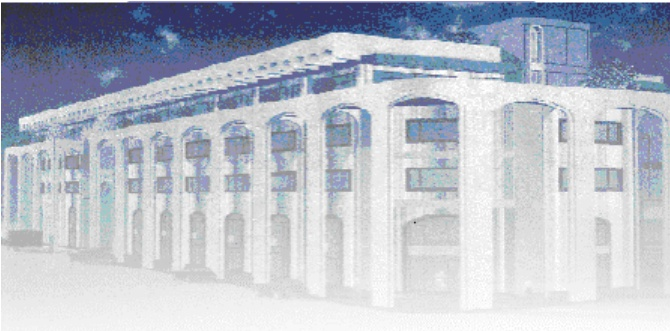

<!-- page 1 -->

Banque de la République d'Haïti

Note mensuelle d'inflation

Juin 2017

<!-- page 2 -->

## Tables des matières

I.- Introduction.....2
II.- Évolution de l'inflation globale en juin 2017.....2
III.- Évolution des principales fonctions de consommation en juin 2017.....3
IV.- Évolution de l'inflation selon l'origine des produits et les régions géographiques du pays.....3
V.- Évolution de l'inflation sous-jacente.....4
VI.- Facteur explicatif de l'évolution de l'inflation mensuelle en juin 2017.....5
VII.- Prévisions d'inflation.....5

<!-- page 3 -->

### I. - Introduction

La note mensuelle d'inflation analyse l'évolution de l'Indice des Prix à la Consommation (IPC) en Haïti au cours du mois sous revue. Elle apporte des éléments explicatifs permettant de comprendre les facteurs qui influencent l'évolution de l'inflation. Elle présente également les prévisions d'inflation pour les trois prochains mois.

### II. - Évolution de l'inflation globale en juin 2017

En juin 2017, l'indice des prix à la consommation (base 100 en août 2004) s'est établi à 309,3 contre 306 en mai 2017, enregistrant ainsi une progression de 15,8 % en glissement annuel contre 15,5 % le mois antérieur. Sur base mensuelle, l'inflation a augmenté de 1,1 % en juin, soit un ralentissement de 40 points de base par rapport au mois précédent.

Le taux d'inflation mensuel cumulé au cours des neuf premiers mois de l'exercice fiscal 2016-2017 a atteint 11,3 % contre 8,4 % au cours de la même période de l'exercice 2015-2016. De même, le taux moyen mensuel s'est porté à 1,3 % d'octobre 2016 à juin 2017 alors qu'il était de 0,9 % sur la période correspondante de l'exercise fiscal antérieur.

Graphique No. 1 Évolution de l'inflation mensuelle et annuelle en juin 2017 (en %)

| Date | Inflation Annuelle | Inflation Mensuelle |
| --- | --- | --- |
| Jun-15 | 8.0 | 14.2 |
| Aug-15 | 10.0 | 12.8 |
| Oct-15 | 11.5 | 9.5 |
| Dec-15 | 12.5 | 7.5 |
| Feb-16 | 14.2 | 10.0 |
| Apr-16 | 15.0 | 7.5 |
| Jun-16 | 14.5 | 7.0 |
| Aug-16 | 12.5 | 9.0 |
| Oct-16 | 13.0 | 11.5 |
| Dec-16 | 14.2 | 10.0 |
| Feb-17 | 14.0 | 9.0 |
| Apr-17 | 14.5 | 10.0 |
| Jun-17 | 15.8 | 11.0 |

<!-- page 4 -->

### III. - Évolution des principales fonctions de consommation en juin 2017

Le ralentissement de l'inflation mensuelle au cours du mois de juin 2017 est attribuable à la décélération de l'indice des prix de la fonction « Transport » et de celui du poste « Loyer, Énergie, Eau ». Parrallèment, la variation de l'indice des prix des fonctions « Alimentation, Boisson, Tabac », « Santé » et « Autres Biens et Services », étant restée inchangée à 1,1 %, 0,9 % et 0,3 % respectivement, a également concouru à la baisse du rythme de croissance mensuel de l'IPC en juin 2017. S'agissant de l'apport des postes de consommation à l'évolution de l'inflation mensuelle, les fonctions « Alimentation, Boisson et Tabac », « Loyer, Énergie, Eau » et « Habillement, Tissus, Chaussures » ont contribué à hauteur de 58,79 %, 19,68 % et 12,68 % respectivement à la réduction du renchérissement des biens et services dans l'économie de mai à juin 2017.

Le taux d'inflation en glissement annuel a été influencée par les postes « Alimentation, Boisson et Tabac » et « Loyer, Énergie, Eau » à hauteur de 48,72 % et 17,09 % respectivement.

Tableau No. 1

Contributions à l'inflation mensuelle et annuelle (en %) en juin 2017

| Poste | Pondération | Contribution à l'inflation mensuelle | Contribution à l'inflation annuelle |
| --- | --- | --- | --- |
|   | en % | en % | en % |
| Indice Général | 100.00 | 100.00 | 100.00 |
| Alim, bois, tab | 50.35 | 58.79 | 48.72 |
| Habil, tis, chs. | 6.86 | 12.68 | 9.51 |
| Loyer, En, eau | 11.05 | 19.68 | 17.09 |
| Aménag, Ent. log. | 4.70 | 3.34 | 4.18 |
| Santé | 2.90 | 2.84 | 2.61 |
| Transport | 13.74 | 0.79 | 6.25 |
| Lois., sp. Ens., Clt. | 5.84 | 0.58 | 6.21 |
| Aut. biens & serv. | 4.56 | 1.30 | 5.44 |

Source: Calculs de la BRH

<!-- page 5 -->

### IV. - Évolution de l'inflation selon l'origine des produits et les régions géographiques du pays

En variation mensuelle, le rythme de progression de l'indice des prix des produits importés a ralenti à 0,9 % en juin 2017 contre 1,8 % le mois précédent. En glissement annuel, l'inflation importée est ressortie à 15,2 % en juin, soit une hausse de 30 points de base par rapport au niveau affiché en mai 2017. Quant à l'indice des prix des produits locaux, il a progressé de 10 points de base pour s'établir à 1,2 % en juin 2017. En rythme annuel, sa variation est passée de 15,5 % à 15,8 % de mai à juin 2017.

Par ailleurs, l'inflation a évolué de manière constratée dans les différentes régions géographiques du pays en affichant un repli en variation mensuelle et une hausse en rythme annuel. Ainsi, l'aire métropolitaine et la région du Nord ont connu une diminution de 50 points de base de leur inflation mensuelle (1 % et 0,9 %), tandis que les régions Ouest, Sud et Transversale ont vu leur taux d'inflation mensuel reculer respectivement de 70 ; 40 et 30 points de base pour s'établir respectivement à 0,9 %, 1,3 % et 0,9 %. À l'inverse, l'inflation annuelle continue sa progression dans toutes les régions du pays : la région Sud affiche un taux d'inflation annuel record de 18,5 % en juin.

### V. - Évolution de l'inflation sous-jacente

L'inflation sous-jacente a évolué de manière contrastée en juin 2017. En variation annuelle, elle a progressé à 15,43 % en juin contre 15,25 % le mois antérieur. En rythme mensuel, elle est tombée à 1,01 % en juin alors qu'elle s'établissait à 1,17 % en mai 2017. Cette évolution de l'inflation sous-jacente mensuelle en dessous de l'inflation courante laisse présumer que celle-ci serait alimentée par les composantes volatiles du panier.

<!-- page 6 -->

Inflation globale et inflation sous-jacente en variation mensuelle (en %)

| Date | Inflation globale | Inflation sous-jacente |
| --- | --- | --- |
| Jun-15 | 1.90 | 1.87 |
| Jul-15 | 2.00 | 1.92 |
| Aug-15 | 1.50 | 1.45 |
| Sep-15 | 1.20 | 1.10 |
| Oct-15 | 0.90 | 0.80 |
| Nov-15 | 0.75 | 0.68 |
| Dec-15 | 1.08 | 0.95 |
| Jan-16 | 1.08 | 0.92 |
| Feb-16 | 1.25 | 1.10 |
| Mar-16 | 0.85 | 0.85 |
| Apr-16 | 0.85 | 0.75 |
| May-16 | 0.68 | 0.52 |
| Jun-16 | 0.85 | 0.85 |
| Jul-16 | 1.12 | 1.10 |
| Aug-16 | 0.95 | 1.20 |
| Sep-16 | 1.30 | 1.40 |
| Oct-16 | 1.78 | 1.68 |
| Nov-16 | 1.40 | 1.35 |
| Dec-16 | 1.00 | 1.00 |
| Jan-17 | 0.92 | 0.90 |
| Feb-17 | 1.05 | 1.00 |
| Mar-17 | 1.25 | 1.28 |
| Apr-17 | 1.05 | 1.02 |
| May-17 | 1.50 | 1.15 |
| Jun-17 | 1.08 | 1.01 |

### VI. - Facteur explicatif de l'évolution de l'inflation en rythme mensuel

Le ralentissement de l'inflation en variation mensuelle s'explique par la décélération du rythme de croissance des prix des produits alimentaires et par la relative stabilité du taux de change en juin 2017.

### 1. Décélération du rythme de croissance des prix des produits alimentaires

Selon la Commission Nationale de la Sécurité Alimentaire, la récolte des denrées locales (maïs, haricot) s'est amplement améliorée durant la période estivale, favorisant ainsi une amélioration de l'offre de produits alimentaires dans le pays. Ce facteur a contribué au ralentissement du rythme de croissance des prix des produits alimentaires en juin en dépit de l'ajustement des prix des produits pétroliers à la pompe en mai 2017, dont les effets sur les prix à la consommation se sont atténués en juin 2017.

### 2. Baisse du du taux de change moyen mensuel

De 64,1380 gourdes pour un dollar ÉU en mai, le taux de change moyen mensuel est passé à 62,2021 gourdes, soit une appréciation de la gourde de 3 %. Cette évolution du taux de change moyen mensuel a permis, dans une certaine mesure, d'amortir les effets de l'évolution à la hausse des prix de certains produits de base sur le marché international, notamment le riz (444,68 dollars la tonne en juin contre

<!-- page 7 -->

402,91 dollars en mai 2017) et le blé (157,2 dollars le boisseau en juin contre 146,5 dollars en mai 2017). En conséquence, on a observé une réduction du taux de croissance mensuel de l'IPC des produits importés (1,8 % en mai contre 0,9 % en juin 2017).

## VII- Prévisions d'inflation

Pour les trois prochains mois, les prévisions d'inflation réalisées par la Direction de la Monnaie et de l'Analyse Economique (MAE) augurent une baisse du rythme de croissance de l'indice des prix à la consommation. En rythme mensuel, l'inflation devrait se chiffrer à 0,8 % en juillet 2017, à 0,7 % en août 2017 et à 0,8 % en septembre 2017. En glissement annuel, la variation de l'indice des prix à la consommation serait à 15 %, 15,4 % et 14,5 % consécutivement en juillet, août et septembre 2017. Il convient de souligner que ces prévisions sont basées essentiellement sur le passé récent de l'inflation.

Graphique No. 6

Prévisions de l'inflation en variation mensuelle et annuelle sur trois mois (en %, à partir de juin 2017)

| Date | inflation mensuelle | inflation annuelle |
| --- | --- | --- |
| Jun-14 | 0.72 | 0.20 |
| Jul-14 | 0.72 | 0.28 |
| Aug-14 | 0.50 | 0.35 |
| Sep-14 | 0.40 | 0.42 |
| Oct-14 | 0.60 | 0.50 |
| Nov-14 | 0.50 | 0.55 |
| Dec-14 | 0.60 | 0.52 |
| Jan-15 | 0.35 | 0.55 |
| Feb-15 | 0.35 | 0.53 |
| Mar-15 | 0.50 | 0.50 |
| Apr-15 | 0.50 | 0.50 |
| May-15 | 0.80 | 0.60 |
| Jun-15 | 1.90 | 0.85 |
| Jul-15 | 2.00 | 1.00 |
| Aug-15 | 1.50 | 1.15 |
| Sep-15 | 1.10 | 1.20 |
| Oct-15 | 0.85 | 1.25 |
| Nov-15 | 1.10 | 1.35 |
| Dec-15 | 1.10 | 1.40 |
| Jan-16 | 1.30 | 1.50 |
| Feb-16 | 1.00 | 1.60 |
| Mar-16 | 0.90 | 1.65 |
| Apr-16 | 0.80 | 1.70 |
| May-16 | 0.70 | 1.60 |
| Jun-16 | 0.90 | 1.40 |
| Jul-16 | 1.10 | 1.30 |
| Aug-16 | 1.00 | 1.25 |
| Sep-16 | 1.30 | 1.25 |
| Oct-16 | 1.80 | 1.40 |
| Nov-16 | 1.50 | 1.45 |
| Dec-16 | 1.20 | 1.45 |
| Jan-17 | 0.90 | 1.40 |
| Feb-17 | 1.10 | 1.40 |
| Mar-17 | 1.20 | 1.45 |
| Apr-17 | 1.10 | 1.50 |
| May-17 | 1.50 | 1.60 |
| Jun-17 | 1.20 | 1.65 |
| Jul-17 | 0.80 | 1.54 |
| Aug-17 | 0.70 | 1.50 |
| Sep-17 | 0.80 | 1.45 |

Sources : Prévisions du Service de Modélisation et des Prévisions Macroéconomiques de la MAE

<!-- page 8 -->

Tableau No. 2

Indice des prix à la consommation (IPC) par postes de dépenses Variation et Contribution à l'inflation mensuelle et annuelle en juin 2017

<table><tr><td>Poste</td><td>Indice des Prix à la Consommation</td><td>Variation IPC (%)</td><td>Contribution à l'inflation (%)</td></tr><tr><td>Pondération (%)</td><td>Juin-16</td><td>Mai-17</td><td>Juin-17</td><td>Mensuelle</td><td>Annuelle</td><td>Mensuelle</td><td>Annuelle</td></tr><tr><td>Indice général</td><td>267.2</td><td>306</td><td>309.3</td><td>1.1</td><td>15.8</td><td>100</td><td>100</td></tr><tr><td>Alimentation, Boisson, Tabac</td><td>50.35</td><td>281.6</td><td>319.3</td><td>322.9</td><td>1.1</td><td>14.7</td><td>58.79</td><td>48.72</td></tr><tr><td>Habillement, Tissus, Chaussures</td><td>6.86</td><td>292.2</td><td>347.4</td><td>353.6</td><td>1.8</td><td>21</td><td>12.68</td><td>9.51</td></tr><tr><td>Loyer, Energie, Eau</td><td>11.05</td><td>311.4</td><td>377.9</td><td>384.4</td><td>1.7</td><td>23.4</td><td>19.68</td><td>17.09</td></tr><tr><td>Amenagement, Entretien Logement</td><td>4.70</td><td>271.6</td><td>306.1</td><td>308.2</td><td>0.7</td><td>13.5</td><td>3.34</td><td>4.18</td></tr><tr><td>Santé</td><td>2.90</td><td>272.3</td><td>306.5</td><td>309.4</td><td>0.9</td><td>13.6</td><td>2.84</td><td>2.61</td></tr><tr><td>Transport</td><td>13.74</td><td>169.6</td><td>181.2</td><td>181.3</td><td>0.1</td><td>6.9</td><td>0.79</td><td>6.25</td></tr><tr><td>Loisirs, Enseignement, Culture</td><td>5.84</td><td>269.2</td><td>312.3</td><td>312.6</td><td>0.1</td><td>16.1</td><td>0.58</td><td>6.21</td></tr><tr><td>Autres Biens et Services</td><td>4.56</td><td>247.3</td><td>291.2</td><td>292</td><td>0.3</td><td>18.1</td><td>1.30</td><td>5.44</td></tr></table>

Sources : IHSI et calculs du Service de la Macrééconomie et Analyse de Conjoncture de la MAE

<!-- page 9 -->

## Glossaire

| Variation mensuelle | : Variation par rapport au mois précédent. |
| --- | --- |
| Glissement annuel | : Variation par rapport au même mois de l'année antérieure. |
| Inflation | : Mouvement persistant à la hausse du niveau général des prix. |
| Désinflation | : Ralentissement de la croissance des prix. |
| Déflation | : Baisse du niveau général des prix associée à une contraction de la masse monétaire et du crédit. |
| Inflation sous-jacente | : Tendance de long terme des prix, tout en excluant la volatilité, les mouvements saisonniers, conjoncturels, et les chocs qui affectent les composantes du panier considéré. |
| Région Nord | : Elle couvre les départementes du Nord, Nord-Est et Nord-Ouest. |
| Région Sud | : Elle comprend les départementes du Sud de la Grand-Anse et des Nippes. |
| Région Reste Ouest | : Y sont incluses les départementes du Sud-Est et de l'Ouest à l'exception de l'aire métropolitaine |
| Région Transversale | : Elle regroupe les départementes du Centre et de l'Artibonite. |
| Aire Métropolitaine | : Elle contient les villes de Port-au-Prince, de Delmas, de Pétion-Ville, de Carrefour et de Croix des Bouquets. |
