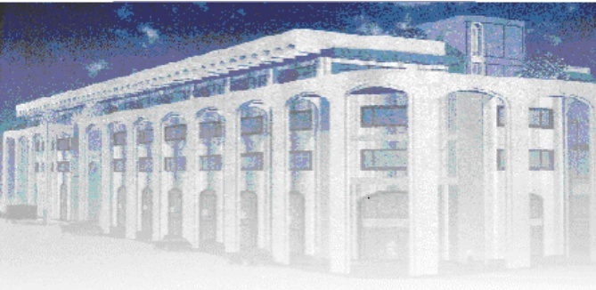

<!-- page 1 -->

Banque de la République d'Haïti

Note mensuelle d'inflation

Novembre 2013

<!-- page 2 -->

### I. Introduction

Cette note analyse l'évolution des prix à la consommation (IPC) en Haïti au cours du mois de novembre 2013. Elle apporte quelques éléments explicatifs permettant de comprendre les facteurs qui influencent l'évolution de l'inflation et présente les prévisions pour les trois prochains mois.

#### I. 1. Évolution de l'inflation globale

Au deuxième mois de l'exercice fiscal 2014, l'inflation en glissement annuel s'est établie à 3,4 %, enregistrant ainsi une baisse de 80 points de base par rapport à octobre 2013. C'est la sixième baisse consécutive de l'inflation en glissement annuel entamée depuis juin 2013. En variation mensuelle, l'inflation s'est portée à 0,1%, soit une baisse de 10 points de base par rapport au mois précédent.

Graphique No I Taux d'inflation (variation mensuelle en %)

| Date | Value |
| --- | --- |
| Sep-12 | 1.1% |
| Oct-12 | 0.6% |
| Nov-12 | 0.8% |
| Dec-12 | 0.4% |
| Jan-13 | 0.3% |
| Feb-13 | 0.4% |
| Mar-13 | 0.6% |
| Apr-13 | 0.3% |
| May-13 | 0.5% |
| Jun-13 | 0.0% |
| Jul-13 | 0.1% |
| Aug-13 | 0.3% |
| Sep-13 | 0.1% |
| Oct-13 | 0.2% |
| Nov-13 | 0.1% |

Ce reflux des prix, en rythme annuel, découle de la contraction de l'indice des prix des fonctions de consommation suivantes : « Alimentation, boissons et tabac », « Loyer du logement, Energie et eau » et « Loisirs, spectacles, enseignement et culture ». La fonction de consommation « Alimentation, boissons et tabac » a enregistré la plus importante baisse de son indice, soit de 130 points de base, avec une variation de 5,7%. Ensuite viennent les contractions de l'indice des autres fonctions de consommation respectivement de 30 et 10 points de base à 5% et 4,3%. En variation mensuelle, la croissance moindre de l'indice des prix est tributaire du repli de l'indice des prix de la quasi-totalité des fonctions de consommation à l'exception de celui des fonctions de consommation « Alimentation, boisson et tabac » et « Aménagement et entretien du logement ». La première a enregistré une hausse de 20 points de base pour se porter à 0.1% et la seconde de 10 points de base à 0.3%.

Il convient de noter qu'en glissement annuel, la contribution de la fonction « Alimentation, boisson et tabac » a diminué en se portant à 43,4 % en novembre 2013 contre 52,2 % en octobre 2013.

<!-- page 3 -->

Graphique No II Taux d'inflation (glissement annuel en %)

| Date | Value |
| --- | --- |
| Sep-12 | 6.5% |
| Oct-12 | 6.8% |
| Nov-12 | 7.5% |
| Dec-12 | 7.6% |
| Jan-13 | 7.2% |
| Feb-13 | 7.4% |
| Mar-13 | 7.7% |
| Apr-13 | 7.3% |
| May-13 | 7.3% |
| Jun-13 | 6.5% |
| Jul-13 | 6.2% |
| Aug-13 | 5.5% |
| Sep-13 | 4.5% |
| Oct-13 | 4.2% |
| Nov-13 | 3.4% |

#### I. 2. Évolution de l'inflation selon l'origine des produits

En novembre 2013, le comportement de l'indice globale des prix à la consommation s'est reflété dans l'évolution de celui des produits locaux et importés. En effet, après avoir enregistré une croissance de 0,2% en octobre 2013, le rythme de progression de l'indice des prix des produits locaux et importés a ralenti de 10 points de base pour se porter à 0,1 % et 0,2 % respectivement. En glissement annuel, la variation de l'indice des prix des produits locaux et importés s'est établie à 3,6% et 2,5 % contre 2,9 % et 4,4 %.

#### I. 3. Évolution de l'inflation sous-jacente

Sur base mensuelle, l'inflation sous-jacente s'est inscrite à 0,19 % contre 0,53 % un mois auparavant. Prise en glissement annuel, elle s'est chiffrée à 3,48% contre 4,20% en octobre 2013. Cette évolution de l'inflation sous jacente a permis de suivre l'évolution de l'inflation obtenue en dehors des phénomènes perturbateurs dès aux produits volatils. Ces derniers concernent essentiellement certains produits alimentaires et pétroliers dont les niveaux de prix sont fonctions des conditions du marché. Le fait que l'inflation sous-jacente soit inferieure à l'inflation globale implique que les éléments volatils ont peu impacté l'évolution de l'inflation fondamentale au cours de la période sous-étude.

<!-- page 4 -->

| Date | Inflation | Inflation sous-jacente |
| --- | --- | --- |
| Nov-11 | 9.80 | 8.80 |
| Dec-11 | 8.20 | 7.50 |
| Jan-12 | 7.50 | 6.80 |
| Feb-12 | 6.50 | 6.00 |
| Mar-12 | 5.50 | 5.40 |
| Apr-12 | 5.30 | 5.80 |
| May-12 | 5.10 | 5.20 |
| Jun-12 | 4.90 | 4.90 |
| Jul-12 | 5.50 | 5.30 |
| Aug-12 | 6.20 | 5.80 |
| Sep-12 | 6.60 | 6.10 |
| Oct-12 | 7.00 | 6.50 |
| Nov-12 | 7.50 | 7.20 |
| Dec-12 | 7.60 | 7.10 |
| Jan-13 | 7.20 | 7.00 |
| Feb-13 | 7.40 | 7.20 |
| Mar-13 | 7.80 | 7.30 |
| Apr-13 | 7.40 | 6.90 |
| May-13 | 7.20 | 7.10 |
| Jun-13 | 6.50 | 5.30 |
| Jul-13 | 6.00 | 5.80 |
| Aug-13 | 5.50 | 5.40 |
| Sep-13 | 4.80 | 4.70 |
| Oct-13 | 4.20 | 4.10 |
| Nov-13 | 3.44 | 3.48 |

### II. Facteurs explicatifs de la baisse de l'inflation mensuelle en novembre 2013

La décélération du taux de croissance de l'inflation en novembre 2013 peut être attribuer à plusieurs facteurs externes et internes. Parmi ces facteurs, nous pouvons citer la baisse des prix des produits pétroliers sur le marché international et la stabilité des prix des carburants à la pompe et la relative stabilité du taux de change.

#### II. 1. La stabilité des prix des produits pétroliers sur le marché local

En dépit de la baisse des prix du pétrole sur le marché international, les cours des produits pétroliers sur le marché local demeurent stables. En effet, le cours du Brent, brut de référence internationale, est passé de 106.69 dollars EU en octobre à 2013 à 104.97 dollars EU un mois après.

Parrallèlement, les prix des produits pétroliers à la pompe sont restés inchangés depuis la dernière modification réalisée en mars 2011. L'essence sans plomb 95 et 91 s'échangeait respectivement à 200 et 195 gourdes le gallon tandis le gallon du gasoil et du kérosène se vend à 162 et 161 gourdes depuis cette date.

<!-- page 5 -->

#### II. 2. La quasi-stabilité du taux de change

Dès le début de l'exercice fiscal, le taux de change a évolué à un niveau quasi-stable. En effet, après s'être porté à 43,81 gourdes pour un dollar américain en octobre 2013, le taux de change a enregistré une légère hausse pour se porter à 43,85 gourdes pour un dollar américain le mois suivant, enregistrant du même coup une légère apréciation de 0,1%¹.

Graphique No IV Taux de change nominal de fin de période (En gourdes/ 1$ E.U)

| Date | Value |
| --- | --- |
| Sep-12 | 42.32 |
| Oct-12 | 42.41 |
| Nov-12 | 42.58 |
| Dec-12 | 42.55 |
| Jan-13 | 42.75 |
| Feb-13 | 42.86 |
| Mar-13 | 43.02 |
| Apr-13 | 43.35 |
| May-13 | 43.68 |
| Jun-13 | 43.79 |
| Jul-13 | 43.73 |
| Aug-13 | 43.76 |
| Sep-13 | 43.74 |
| Oct-13 | 43.81 |
| Nov-13 | 43.85 |

<!-- page 6 -->

### III. Les prévisions d'inflation

Pour le dernier mois du premier trimestre 2013, les prévisions d'inflation, en variation mensuelle, élaborées à partir d'un modèle ARMA en fonction des valeurs passées de l'inflation corrigée des écarts de réalisation, font état d'un repli de 0,03% de l'indice général des prix à la consommation pour décembre 2013. Toutefois, elles indiquent une remontée des pressions inflationnistes à hauteur de 0,8% en janvier 2014, lesquelles devraient s'atténuer le mois suivant pour se porter à -0,04%. En glissement annuel, la Direction de la Monnaie et de l'Analyse Economique de la BRH prévoit une évolution en dents de scie de l'inflation au cours des trois prochains mois. Selon cette dernière, l'inflation devrait continuer à ralentir pour se porter à 3% en décembre 2013 pour ensuite remonter à 3,6 % en janvier 2014 et diminuer à 3,1 % en février 2014.

Graphique No V Prévision de l'inflation à partir du mois de novembre 2013

| Date | Inflation en glissement annual | Inflation en glissement annuel |
| --- | --- | --- |
| Dec-10 | 6.2 |   |
| Jan-11 | 3.7 |   |
| Feb-11 | 6.4 |   |
| Mar-11 | 7.5 |   |
| Apr-11 | 8.2 |   |
| May-11 | 8.6 |   |
| Jun-11 | 9.4 |   |
| Jul-11 | 9.5 |   |
| Aug-11 | 9.7 |   |
| Sep-11 | 10.4 |   |
| Oct-11 | 10.4 |   |
| Nov-11 | 9.8 |   |
| Dec-11 | 8.2 |   |
| Jan-12 | 7.6 |   |
| Feb-12 | 6.4 |   |
| Mar-12 | 5.7 |   |
| Apr-12 | 5.4 |   |
| May-12 | 5.1 |   |
| Jun-12 | 5.0 |   |
| Jul-12 | 5.4 |   |
| Aug-12 | 6.2 |   |
| Sep-12 | 6.6 |   |
| Oct-12 | 7.0 |   |
| Nov-12 | 7.6 |   |
| Dec-12 | 7.6 |   |
| Jan-13 | 7.3 |   |
| Feb-13 | 7.5 |   |
| Mar-13 | 7.7 |   |
| Apr-13 | 7.3 |   |
| May-13 | 7.3 |   |
| Jun-13 | 6.4 |   |
| Jul-13 | 5.8 |   |
| Aug-13 | 4.8 |   |
| Sep-13 | 4.3 |   |
| Oct-13 | 3.5 | 3.5 |
| Nov-13 | 3.4 | 2.5 |
| Dec-13 | 3.6 | 3.9 |
| Jan-14 | 4.1 | 3.1 |
| Feb-14 | 3.6 | 2.6 |

<!-- page 7 -->

# Tableau No.1 Indice des prix à la consommation par postes de dépenses Variation et contribution mensuelle et annuelle En Novembre 2013

<table><tr><td></td><td>Indice des Prix à la Consommation (IPC)</td><td>Variation mensuelle En (%)</td><td>Variation annuelle En (%)</td><td>Contribution mensuelle à l'inflation (en %)</td><td>Contribution annuelle à l'inflation (en %)</td></tr><tr><td>Poste</td><td>Pondération (en %)</td><td>Nov.12</td><td>Oct.13</td><td>Nov. 13</td><td>Nov. 13</td><td>Nov. 13</td><td>Nov. 13</td><td>Nov. 13</td></tr><tr><td>Indice Général</td><td>203.30</td><td>210.10</td><td>210.30</td><td>0.1%</td><td>3.4%</td><td>100</td><td>100</td></tr><tr><td>Alimentation, boisson et tabac</td><td>50.35</td><td>212.40</td><td>218.40</td><td>218.50</td><td>0.10%</td><td>2.9%</td><td>47</td><td>43.4</td></tr><tr><td>Habillement, tissus et chaus.</td><td>6.86</td><td>191.80</td><td>202.30</td><td>202.80</td><td>0.2%</td><td>5.7%</td><td>12.8</td><td>11.6</td></tr><tr><td>Loyer, énergie et eau</td><td>11.05</td><td>235.70</td><td>247.30</td><td>247.40</td><td>0.1%</td><td>5.0%</td><td>10.3</td><td>16.4</td></tr><tr><td>Aménag. et entret. du logem</td><td>4.7</td><td>207.40</td><td>214.40</td><td>215.00</td><td>0.3%</td><td>3.7%</td><td>13.2</td><td>5.2</td></tr><tr><td>Santé</td><td>2.9</td><td>207.50</td><td>215.10</td><td>215.20</td><td>0.1%</td><td>3.7%</td><td>2.7</td><td>3.2</td></tr><tr><td>Transport</td><td>13.74</td><td>154.80</td><td>157.50</td><td>157.50</td><td>-</td><td>1.7%</td><td>-</td><td>6.9</td></tr><tr><td>Lois., sp. Ens., Clt.</td><td>5.84</td><td>214.10</td><td>223.30</td><td>223.40</td><td>0.1%</td><td>4.3%</td><td>5.5</td><td>7.5</td></tr><tr><td>Aut. biens & serv.</td><td>4.56</td><td>168.00</td><td>174.80</td><td>175.20</td><td>0.2%</td><td>4.3%</td><td>8.5</td><td>5.8</td></tr></table>

Sources : IHSI et calculs du Service de la Macrééconomie et Analyse de Conjoncture de la MAE

<!-- page 8 -->

<table><tr><td>Glossaire</td></tr><tr><td>Variation mensuelle : Variation par rapport au mois précédent.</td></tr><tr><td>Glissement annuel</td><td>: Variation par rapport au même mois de l'année antérieure.</td></tr><tr><td>Inflation</td><td>: Mouvement persistant à la hausse du niveau général des prix.</td></tr><tr><td>Désinflation</td><td>: Ralentissement de la croissance des prix.</td></tr><tr><td>Déflation crédit.</td><td>: Baisse du niveau général des prix associée à une contraction de la masse monétaire et du</td></tr><tr><td>Inflation sous-jacente : Tendance de long terme des prix, tout en excluant la volatilité, les mouvements saisonniers, conjoncturels, et les chocs qui affectent les composantes du panier considéré.</td></tr><tr><td>Région Nord</td><td>: Elle couvre les départementes du Nord, Nord-Est et Nord-Ouest.</td></tr><tr><td>Région Sud</td><td>: Elle comprend les départementes du Sud de la Grand'Anse et des Nippes.</td></tr><tr><td>Région Reste Ouest : Y sont incluses les départementes du Sud'Est et de l'Ouest à l'exception de l'aire métropolitaine</td></tr><tr><td>Région Transversale : Elle regroupe les départementes du Centre et de l'Artibonite.</td></tr></table>

Aire Métropolitaine : Elle contient les villes de Port-au-Prince, de Delmas, de Pétion-Ville, de Carrefour et de Croix des Bouquets.
