<!-- page 1 -->

S N I F

# Stratégie Nationale d'Inclusion Financière

Dix (10) ans après

Août 2024

<!-- page 2 -->

<!-- page 3 -->

## Stratégie Nationale d'Inclusion Financière

—— Dix (10) ans après —

<!-- page 4 -->

## SOMMAIRE

I - VUE D'ENSEMBLE ..... PAGE 15
II - DES ÉLEMENTS CONTEXTUELS ..... PAGE 19
III - DANS LES MIRES DE LA SNIF ..... PAGE 22
IV - LES CONTOURS D'UN CADRE CONCEPTUEL ..... PAGE 26
V - UNE DÉCENNIE DÉTERMINANTE: LES INDICATEURS DE L'INCLUSION FINANCIERE ..... PAGE 35
VI - COUP DE PROJECTEUR SUR LES INDICATEURS D'ACCÈS ..... PAGE 39
VII - UN PAYSAGE FINANCIER REDÉFINI : DYNAMIQUE DE PAIEMENT ..... PAGE 43
VIII - DE L'UTILISATION DES COMPTES : L'INCLUSION FINANCIÈRE ACTIVE ..... PAGE 69
IX - ÉGALITE DES GENRES ET RENFORCEMENT DE LA RÉSILIENCE ÉCONOMIQUE ..... PAGE 73
X - AUX LEVIERS DE CHANGEMENT ..... PAGE 80
XI - ANALYSE ET DISCUSSIONS ..... PAGE 95
XII - UN RETOUR CONCLUSIF ..... PAGE 96
XIII - RECOMMANDATIONS POUR CONSTRUIRE L'AVENIR ..... PAGE 97

<!-- page 5 -->

## LISTE DES GRAPHIOUES

GRAPHIQUE 1 : Comptes dans des institutions formelles ..... PAGE 40
GRAPHIQUE 2 : Évolution des comptes électroniques ..... PAGE 41
GRAPHIQUE 3 : Évolution des fournisseurs de service ..... PAGE 45
GRAPHIQUE 4 : Répartition géographique des succursales bancaires en 2023 ..... PAGE 48
GRAPHIQUE 5 : Évolution du nombre de succursales bancaires ..... PAGE 49
GRAPHIQUE 6 : Évolution du portefeuille brut de prêts de 2012 à 2023 ..... PAGE 53
GRAPHIQUE 7 : Agents non bancaires en Haiti ..... PAGE 55
GRAPHIQUE 8 : Évolution du nombre de distributeurs automatiques de billets ..... PAGE 56
GRAPHIQUE 9 : Infrastructures de transfert en Haiti ..... PAGE 57
GRAPHIQUE 10 : Transferts effectués par les agents non bancaires ..... PAGE 58
GRAPHIQUE 11 : Prévision Valeur Fintech 2024 à 2029 (en milliards de USD) ..... PAGE 62

<!-- page 6 -->

## LISTE DES GRAPHIOUES

GRAPHIQUE 12 : Évolution du SPIH (s) ..... PAGE 63
GRAPHIQUE 13 : Nombre total de chèques compensés ..... PAGE 64
GRAPHIQUE 14 : Comparaison de l'évolution des SPIH et des chèques compensés ..... PAGE 65
GRAPHIQUE 15 : Comparaison de l'évolution des SPIH et des chèques compensés ..... PAGE 67
GRAPHIQUE 16 : Évolution des paiements par carte de crédit ..... PAGE 68
GRAPHIQUE 17 : Évolution des transferts ..... PAGE 69
GRAPHIQUE 18 : Prêts accordés par le secteur bancaire ..... PAGE 71
GRAPHIQUE 19 : Évolution du ratio prêts/dépôts ..... PAGE 72
GRAPHIQUE 20 : Comptes dans les institutions financières ..... PAGE 73
GRAPHIQUE 21 : Évolution de l'épargne par sexe en 2023 ..... PAGE 74
GRAPHIQUE 22 : Répartition des crédits par sexe en 2023 ..... PAGE 76

<!-- page 7 -->

## LISTE DES FIGURES

FIGURE 1 : Les Objectifs du Millénaire pour le Développement (OMD) PAGE 15
FIGURE 2 : Les faits de l'inclusivité PAGE 19
FIGURE 3 : Répartition de l'accès aux services financiers PAGE 21
FIGURE 4 : Les piliers de la vision de la SNIF PAGE 22
FIGURE 5 : La Responsabilité des acteurs PAGE 23
FIGURE 6 : Les axes stratégiques et domaines d'intervention PAGE 24
FIGURE 7 : La structure de gouvernance PAGE 24
FIGURE 8 : Définition de l'inclusion financière PAGE 26
FIGURE 9 : Principes de l'inclusion financière au niveau du G20 PAGE 28
FIGURE 10 : Accès universel et utilisation appropriée de produits et services financiers abordables PAGE 30
FIGURE 11 : Les indicateurs d'inclusion financière PAGE 35
FIGURE 12 : L'écosystème de l'inclusion financière en Haïti PAGE 36
FIGURE 13 : Chiffres clés de l'inclusion financière PAGE 37
FIGURE 14 : Points d'accès aux services (POS) PAGE 44
FIGURE 15 : Le paysage financier formel PAGE 46

<!-- page 8 -->

## LISTE DES FIGURES

FIGURE 16 : Carte d'accès aux succursales des banques commerciales en % PAGE 47
FIGURE 17 : Répartition géographique des utilisateurs des IMF PAGE 50
FIGURE 18 : Point de Service: Des CEC(s) aux IMF(s) PAGE 51
FIGURE 19 : Indicateurs microscopiques de secteur PAGE 52
FIGURE 20 : Paysage des Fintech(s) avant la SNIF PAGE 59
FIGURE 21 : Cadre du secteur numérique PAGE 60
FIGURE 22 : Innovations financières en Haiti en 2024 PAGE 61
FIGURE 23 : Leviers de changement pour l'inclusion financière PAGE 80
FIGURE 24 : De la responsabilité des acteurs PAGE 81
FIGURE 25 : Points d'accès aux services (POS) PAGE 83
FIGURE 26 : Évolution de l'infrastructure numérique en utilisation PAGE 85
FIGURE 27 : Initiatives prises par l'État pour promouvoir l'inclusion financière PAGE 87
FIGURE 28 : Engagement de BCA et de la BNDA PAGE 88
FIGURE 29 : Engagement et Rôle de la BNC, le FDI et la BRH PAGE 89
FIGURE 30 : Les interactions stratégiques PAGE 92

<!-- page 9 -->

## LISTE DES TABLEAUX

## 01

## 02

Tableau 1: Importance de l'inclusion financière
pour les ménages ..... PAGE 27

Tableau 2 : Les initiatives pour la modernisation du Secteur Financier ..... PAGE 102

Tableau 3 : L'Innovation des banques ..... PAGE 104

Tableau 4 : L'essor de la microfinance ..... PAGE 105

Tableau 5 : La promotion des Coopératives d'Épargne et de Crédit (CEC) ..... PAGE 106

Tableau 6 : L'Émergence des Fintech(s) ..... PAGE 107

Tableau 7 : La Répartition des POS par département ..... PAGE 108

## 03

## 04

## 05

## 06

## 07

<!-- page 10 -->

## SIGLES ET ABRÉVIATIONS

| AFI | Alliance pour l’Inclusion Financière |
| --- | --- |
| AHFI | Alliance Haitienne pour la Finance Inclusive |
| ANACAPH | Association Nationale des Caisses Populaires Haïtiennes |
| ANIHM | Association Nationale des Institutions de Microfinance d’Haïti |
| APB | Association Professionelle des Banques |
| BCA | Bureau de Crédit Agricole |
| BID | Banque Intéraméricaine de Développement |
| BM | Banque Mondiale |
| BNC | Banque Nationale de Crédit |
| BNDA | Banque Nationale de Développement Agricole |
| BPH | Banque Populaire Haïtienne |
| BRH | Banque de la République d’Haïti |
| CIRP | Cadre Intérimaire pour la Réduction de la Pauvreté |
| CIN | Carte d’Identification Nationale |
| CCSSNIF | Comité de Coordination et de Suivi de la Stratégie Nationale d’Inclusion Financière |
| CEC | Coopératives d’Épargne et de Crédit |
| CEIC | Compensation Électronique par Image des Chèques |
| CEPAL | Commission Économique pour l’Amérique Latine et les Caraïbes |
| DAI | Agence de Développement Internationale |
| DSBIF | Direction de la Supervision des Banques et autres Institutions Financières |
| DSN | Document de Stratégie Nationale |

<!-- page 11 -->

# SIGLES ET ABRÉVIATIONS

| DSNCRP | Document de Stratégie Nationale pour la Croissance et la Réduction de la Pauvreté |
| --- | --- |
| DSNIF | Document de la Stratégie Nationale d’Inclusion Financière |
| DIGCP | Direction Inspection Générale des Caisses Populaires |
| FDI | Fonds de Développement Industriel |
| FMI | Fonds Monétaire International |
| FINSCOPE | Enquête sur la Demande de Produits et Services Financiers |
| IFBC | Institut de Formation de la Banque Centrale |
| IMF | Institution de Microfinance |
| KNFP | Konsèy Nasyonal Finansman Popilè |
| MAE | Direction de la Monnaie et Analyse Économique |
| MPME | Micro, Petites et Moyennes Entreprises |
| MAST | Ministère des Affaires Sociales et du Travail |
| MCI | Ministère du Commerce et de l’Industrie |
| MEF | Ministère de l’Économie et des Finances |
| MENFP | Ministère de l’Éducation Nationale et de la Formation Professionnelle |
| MHAVE | Ministère des Haïtiens Vivant à l’Étranger |
| MPCE | Ministère de la Planification et de la Coopération Externe |
| OCDE | Organisation de Coopération et de Développement Économiques |
| ODD | Objectifs de Développement Durable |
| OMD | Objectifs du Millénaire pour le Développement |
| ONI | Office Nationale d’Identification |

<!-- page 12 -->

## SIGLES ET ABRÉVIATIONS

| PAM | Programme Alimentaire Mondial |
| --- | --- |
| PARDH | Plan d’Action pour le Relèvement et le Développement d’Haïti |
| PIB | Produit Intérieur Brut |
| PME | Petite et Moyenne Entreprise |
| PNEF | Plan National d’Éducation Financière |
| PRONAP | Processeur National de Paiements |
| PSDH | Plan Stratégique de Développement d’Haïti |
| RDCCF | Revue de Développement des Connaissances et des Compétences Financières |
| SNIF | Stratégie Nationale d’Inclusion Financière |
| UIF | Unité d’Inclusion Financière |
| USAID | Agence des États-Unis pour le Développement International |

<!-- page 13 -->

## PARTIE 1

## CADRE GÉNÉRAL DE L'ÉTUDE

<!-- page 14 -->

## CADRE GÉNÉRAL DE L'ÉTUDE

VUE D'ENSEMBLE ..... PAGE 15
1.1- Une évolution contextuelle transformative ..... PAGE 15
1.2- Les perspectives de l'étude ..... PAGE 16
1.3- Mieux comprendre la vision : La démarche méthodologique ..... PAGE 17

DES ÉLÉMENTS CONTEXTUELS ..... PAGE 19
2.1- Données factuelles: De la conception à la mise en œuvre de la SNIF ..... PAGE 19
2.1.1- Explorer le paysage international ..... PAGE 20
2.1.2- Dans l'écosystème financier régional ..... PAGE 20
2.1.3- À travers le prisme national ..... PAGE 20

DANS LES MIRES DE LA SNIF ..... PAGE 22
3.1- Les piliers de la vision de la SNIF ..... PAGE 22
3.2- Cibler l'inclusivité ..... PAGE 23
3.3- Les axes stratégiques et domaines d'intervention ..... PAGE 23
3.4- Un cadre de gouvernance inclusif ..... PAGE 24

LES CONTOURS D'UN CADRE CONCEPTUEL ..... PAGE 26
4.1- Explorer les horizons du concept : AFI; BM; OCDE; FMI ..... PAGE 26
4.2- Réaliser l'inclusion financière : Cap sur les ODD ..... PAGE 28
4.3- Une approche basée sur des principes ..... PAGE 28
4.4- Un cadre théorique éprouvé : Pour un avenir financier de plus en plus inclusif ..... PAGE 29
4.5- Banque mondiale : Le cadre UFA 2020 ..... PAGE 30

<!-- page 15 -->

## 1 - VUE D'ENSEMBLE

### 1.1 Une évolution contextuelle transformative

Cherchant à dynamiser la croissance économique et poursuivant l'objectif ultime de contribuer à la réalisation des Objectifs du Millénaire pour le Développement (OMD) $ ^{1} $, la lutte contre la pauvreté s'est imposée en Haïti, depuis le tournant du nouveau millénaire, comme une priorité dans les actions gouvernementales. Cette orientation stratégique reflète l'engagement continu du gouvernement haïtien à créer des conditions favorables à l'inclusion économique et à l'amélioration des conditions de vie des populations les plus vulnérables du pays.

C'est dans ce contexte qu'en 2000, après des consultations avec divers acteurs impliqués, le pays s'est engagé dans la réalisation des Objectifs du Millénaire pour le Développement (OMD). Dans cette même perspective, en 2004, le gouvernement a élaboré un Cadre Intérimaire pour la Réduction de la Pauvreté (CIRP) $ ^{2} $, qui s'est ensuite transformé en Document de Stratégie Nationale pour la Croissance et la Réduction de la Pauvreté (DSNCRP) $ ^{3} $ en 2007. Ci-dessous est présenté le schéma illustrant l'arbre des divers scénarios adoptés à l'échelle nationale en matière de politiques publiques pour la réduction de la pauvreté.

Figure 1. :::: Les Objectifs du Millénaire pour le Développement (OMD 2000)

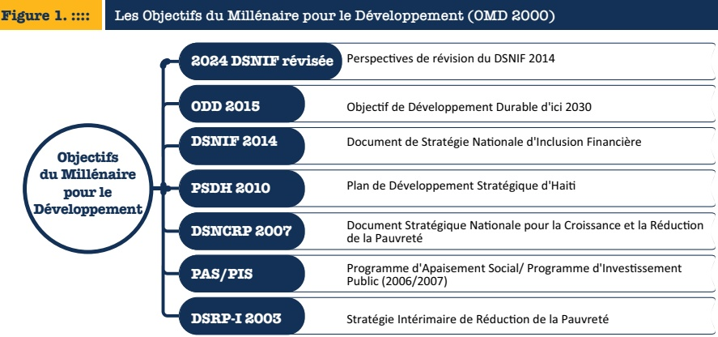

<!-- page 16 -->

Suite au séisme de 2010, ce document a évolué en Plan d'Action pour le Relèvement et le Développement d'Haïti (PARDH). Finalement, en 2012, un Plan Stratégique de Développement d'Haïti (PSDH) a été adopté par les acteurs concernés. En dépit des efforts substantiels consentis pour dynamiser et moderniser l'économie nationale, les vulnérabilités demeurent et constituent un défè majeur.

Selon la Banque mondiale, en 2012, Haïti affichait un taux de pauvreté de 58,5 % et un taux d'extrême pauvreté de 23,8 %. De plus, d'après l'enquête FinScope réalisée en 2018, environ 46 % de la population haïtienne restait exclue du système financier.

Tenant compte de ce constat global, les autorités haïtiennes ont décidé d’aborder la problématique de l’inclusion financière de manière holistique et cohérente, en élaborant une Stratégie Nationale d’Inclusion Financière (SNIF). La démarche a impliqué une diversité d’acteurs provenant des secteurs public, privé, et de la société civile. Après deux années de consultations consécutives avec diverses parties prenantes, le gouvernement haïtien a formellement adopté, en 2014, le Document de la Stratégie Nationale d’Inclusion Financière (DSNIF).

Cette démarche s'inscrit dans la continuité des efforts entrepris par les autorités locales en vue de rendre les services et produits financiers disponibles et accessibles à l'ensemble de la population. Les stratégies retenues visent à mettre en place des mécanismes susceptibles de faciliter la correspondance entre la demande et l'offre, dans le but d'éliminer les obstacles entravant l'accès et l'utilisation adéquate des services et produits financiers, notamment pour les populations des zones reculées.

La définition de ces stratégies, ancrée dans la perspective des progrès du développement humain, vise à projeter les résultats afin de guider le pays vers une société plus inclusive à l'horizon 2030. En 2024, la Banque de la République d'Haïti (BRH) invite ses partenaires à marquer les dix ans de la publication de la SNIF. Cette décennie représente une étape importante dans l'effort collectif des acteurs gouvernementaux, des autorités de régulation, des partenaires internationaux, du secteur privé, de la société civile, et de l'industrie des services financiers pour s'attaquer aux racines de l'exclusion financière.

### 1.2 Les perspectives de l'état des lieux

Sous l'égide d'une structure de gouvernance dédiée, la mise en œuvre des axes stratégiques de la SNIF s'aligne sur le Plan Stratégique Global (2022-2024) de la Banque de la République d'Haïti (BRH). Ces axes stratégiques ont pour objectif commun de stimuler les actions visant à éliminer les obstacles à l'inclusion financière.

Ce document se propose de réaliser un état des lieux non exhaustif d'une décennie de mise en œuvre du cadre de coordination des activités liées à l'inclusion financière dans le pays. L'état des lieux englobe les résultats d'une série de pratiques hybrides, issues d'efforts conjoints du secteur public et du secteur privé, visant toutes à améliorer l'accès et l'utilisation des services financiers, tout en portant une attention particulière aux populations financièrement exclues.

<!-- page 17 -->

### 1.3 Mieux comprendre la vision : La démarche méthodologique

Ce document d'état des lieux, marquant les dix (10) ans après la publication de la SNIF, est divisé en deux parties : la première partie retrace le cadre général de l'étude, et la deuxième partie présente le bilan avec des analyses, des conclusions et des recommandations, incluant de manière détaillée les réalisations.

Dans l'ensemble, le document offrira une analyse basée sur des données factuelles provenant de sources diverses et fiables, notamment des évaluations ex-ante, des études de mi-parcours, des rapports annuels de l'Unité d'Inclusion Financière (UIF), ainsi que des rapports publics publiés par les autres directions de la BRH telles que la Direction de la Monnaie et Analyse Économique (MAE), la Direction de l'Inspection Générale des Caisses Populaires (DIGCP), la Direction de la Supervision des Banques et autres Institutions Financières (SBIF), et la Direction de la Caisse et du Réseau (DCR). De plus, des informations publiques provenant de la base de données de la BRH $ ^{1} $ ont été exploitées pour comprendre le contexte de santé financière globale et la réglementation en vigueur, afin d'améliorer l'approche et de formuler des recommandations adaptées à l'environnement macroéconomique.

Afin d'obtenir des perspectives variées et d'enrichir le travail, diverses sources d'information ont été consultées, provenant d'agences gouvernementales telles que le Ministère de l'Économie et des Finances (MEF) $ ^{2} $, le Ministère de la Planification et de la Coopération Externe (MPCE) $ ^{3} $, le Ministère du Commerce et de l'Industrie (MCI) $ ^{4} $, et le Ministère des Affaires Sociales et du Travail (MAST). Leurs sites fournissent des statistiques sur l'environnement général et des informations officielles sur les initiatives en cours. Ces données officielles sont importantes pour la formulation de recommandations pertinentes capables d'orienter les politiques publiques en matière d'inclusion financière.

Des organisations internationales telles que l'Alliance pour l'Inclusion Financière (AFI)⁵, Aflatoun⁶, la Banque Interaméricaine de Développement (BID)⁷, la Banque mondiale (BM)⁸, l'Agence des États-Unis pour le développement international (USAID)⁹, et l'Organisation de Coopération et de Développement Économiques (OCDE)¹⁰ jouent un rôle crucial dans la promotion de l'inclusion financière en fournissant ou partageant des analyses approfondies sur les meilleures pratiques et des cadres stratégiques pour guider les actions en matière d'inclusion financière. L'ensemble

<!-- page 18 -->

des données collectées sur leurs sites est pertinent, car il guide le travail d'un point de vue global sur les questions importantes, les tendances émergentes, et les solutions efficaces qui peuvent favoriser l'inclusion financière dans notre contexte.

L'intégration des données des rapports annuels publiés par les institutions financières locales, ainsi que celles d'autres partenaires tels que l'Association Professionnelle des Banques (APB), l'Alliance Haïtienne pour la Finance Inclusive (AHFI), l'Association Nationale des Institutions de Microfinance d'Haïti (ANIMH), la Fédération Le Levier, et l'Association Nationale des Caisses Populaires Haïtiennes (ANACAPH), enrichit considérablement l'approche en permettant de mettre l'accent sur les défis sectoriels spécifiques pour la formulation des recommandations adaptées au contexte local.

Toutefois, il est essentiel de reconnaître les défis liés à la collecte de données récentes sur les groupes cibles de la SNIF, dans le contexte particulier du pays.

En raison de la nature dynamique de ce contexte, il s'avère difficile de rapporter fidèlement les observations et la voix du terrain, ainsi que d'évaluer minutieusement les impacts socio-économiques des interventions des parties prenantes. Les réalités sur le terrain peuvent être influencées par de nombreux facteurs, tels que les fluctuations économiques et financières ainsi que des événements imprévisibles, tant à l'interne qu'à l'extérieur, dont certains sont décrits dans le prochain chapitre.

Malgré les limitations mentionnées, les analyses s'appuieront sur une méthodologie rigoureuse, en tenant compte de la diversité des perspectives, des expériences réalisées, et des interactions régulièrees avec les partenaires impliqués dans la mise en œuvre de la Stratégie Nationale d'Inclusion Financière.

<!-- page 19 -->

### II. DES ÉLÉMENTS CONTEXTUELS

L'approche inclusive repose sur plusieurs paramètres à la fois : économiques, sociaux, financiers, et environnementaux. Les résultats des interventions peuvent être influencés par des tendances macro-économiques, qu'elles soient internationales, régionales ou nationales. Ainsi, il s'avère crucial d'intégrer des données contextuelles pour une analyse pertinente et approfondie des interventions liées à la mise en œuvre de la SNIF. Cette intégration permet non seulement de mieux comprendre l'impact des stratégies déployées, mais aussi d'ajuster les actions en fonction des évolutions du contexte global.

### 2.1 Données factuelles : De la conception à la mise en œuvre de la SNIF

Certaines dates importantes ont marqué le cheminement du lancement et de la mise en œuvre de la Stratégie Nationale d'Inclusion Financière, dont certaines sont résumées dans la figure ci-dessous:

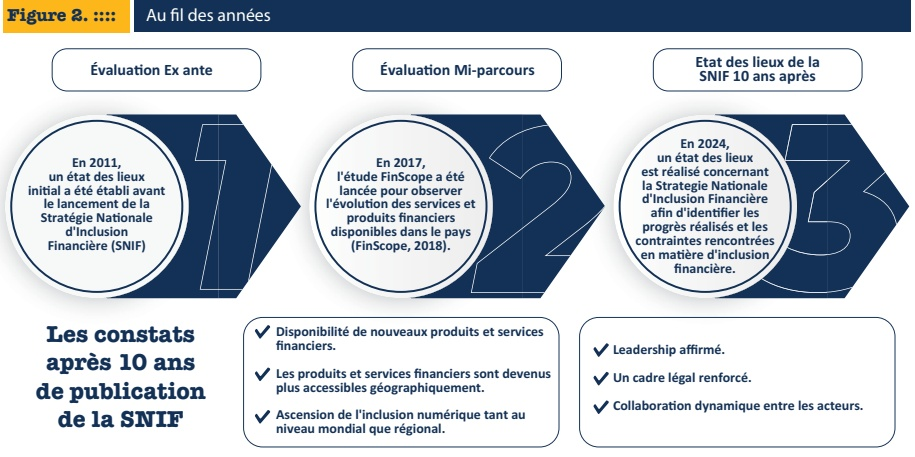

## Les constats après 10 ans de publication de la SNIF

Les produits et services financiers sont devenus plus accessibles géographiquement.

Ascension de l'inclusion numérique tant au niveau mondial que régional.

Vers une révision de la SNIF

<!-- page 20 -->

#### 2.1.1 Exploration du paysage international

De 2011 à nos jours, d'importantes avancées ont été réalisées dans l'accès aux services financiers. De 2011 à 2017, 1,2 milliard d'adultes à travers le monde ont eu la possibilité d'ouvrir un compte d'opérations courantes, ce qui a fait passer le taux mondial de détention de comptes à 69% (Banque mondiale, 2023). Cette tendance favorable s'est poursuivie, et en 2021, 76 % des adultes à l'échelle mondiale avaient accès à un compte bancaire, représentant une augmentation significative de 51 % par rapport à 2011, selon la Banque mondiale. Ces chiffres mettent en évidence les progrès majeurs réalisés en matière d'inclusion financière au cours de la dernière décennie. Le nombre d'adultes non bancarisés a également diminué de manière significative, passant de 2,5 milliards à 1,4 milliard (Banque mondiale, 2023). Pour cette même période, l'écart entre les sexes dans l'accès aux services financiers dans les économies en développement s'est réduit de 9 à 6 points de pourcentage. Cette évolution est due à la digitalisation des opérations. Selon KPMG¹, il existe un écosystème de 475 fintechs actives dans le monde, fournissant principalement des services de paiement et d'assurance. La taille du marché en 2024 serait évaluée à 228,24 milliards de dollars (GSMA, 2024)

La croissance économique mondiale devrait se stabiliser à 3,2 % pour les années 2024 et 2025, maintenant ainsi le même rythme observé en 2023 (Banque mondiale, 2024). Parallèlement, l'inflation globale devrait connaître une diminution significative, passant de 6,8 % en 2023 à 5,9 % en 2024, puis à 4,5 % en 2025.

#### 2.1.2 Dans l'écosystème financier régional

En 2021, le pourcentage d'adultes ayant accès à un compte bancaire en Amérique latine et dans les Caraïbes, à l'exclusion des économies à revenu élevé, s'élevait à 73 %. Cela représente une augmentation significative de 18,5 points par rapport à 2017 (Global Findex, 2021). Cependant, la pauvreté demeure un problème sérieux, particulièrement en dehors du Brésil, où le taux de pauvreté a augmenté de 24 % à 26,7 %, la plus forte hausse depuis des décennies (CEPAL, 2024). Pour 2024, l'inflation régionale, à l'exception de l'Argentine et du Venezuela, est prévue à 3,5 %, nettement inférieure aux 5,7 % enregistrés dans les pays de l'OCDE.

#### 2.1.3 À travers le prisme national

Selon les données du Findex 2017, 27 % des hommes âgés de 15 ans et plus et 29 % des femmes du même groupe d'âge possèdent un compte dans une institution financière. Toutefois, le taux de pénétration géographique des services bancaires a augmenté, passant de 2,72 % à 11,85 % au cours de la période 2014-2023.

<!-- page 21 -->

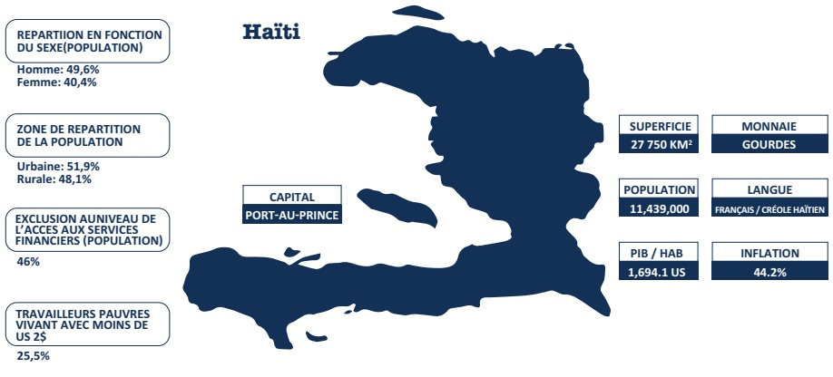

Source: IHSI/MEF

D'un point de vue socio-économique, Haïti est confrontée à une prévision de contraction économique continue en 2024, avec une baisse attendue du PIB de 1,8 %, selon les projections de la Banque mondiale. Cette récession s'inscrit dans le prolongement d'une tendance déjà observée en 2023, année durant laquelle l'économie haïtienne a régressé de 1,9 %. Cette détérioration économique est en grande partie imputable à l'instabilité sécuritéaire qui sévit dans le pays.

L'inflation, quant à elle, a atteint des niveaux préoccupants. En décembre 2023, le taux d'inflation était de 21,2 %. En février 2024, il a enregistré une hausse, en glissement annuel, à 23,0 % (IHSI, 2024). Ces chiffres illustrent la volatilité économique et la diminution du pouvoir d'achat des Haitians, exacerbant les défis socio-économiques existants.

En outre, la situation en matière de sécurité alimentaire demeure critique. Selon le Programme Alimentaire Mondial (PAM), environ 7,8 millions de personnes étaient en situation d'insécurité alimentaire en 2023. Ce chiffre alarmant reflète les multiples facettes de la crise humanitaire qui persiste en Haïti, mettant en lumière l'urgence de réponses coordonnées et efficaces pour améliorer la résilience et le bien-être de la population.

<!-- page 22 -->

## III- DANS LES MIRES DE LA SNIF

L'adoption d'un document de Stratégie Nationale d'Inclusion Financière est cruciale pour des pays comme Haïti, confrontés à des défis liés à la mobilisation de l'épargne, au financement, et à l'exclusion financière. Par conséquent, une meilleure intégration des ménages et des entreprises dans le secteur financier formel, ainsi que l'accès continu aux produits et services financiers, devraient améliorer leur niveau de vie et avoir un impact positif sur la croissance économique du pays.

### 3.1 Les piliers de la vision de la SNIF

La vision de l'inclusion financière se traduit par la création d'un système financier accessible à tous, où chaque individu a la possibilité d'accéder à une offre de produits et de services financiers adaptés à ses besoins. Cela inclut le développement de microcrédits pour les entrepreneurs, l'amélioration de l'accès aux comptes bancaires dans les zones rurales, et la promotion de l'éducation financière pour tous les âges.

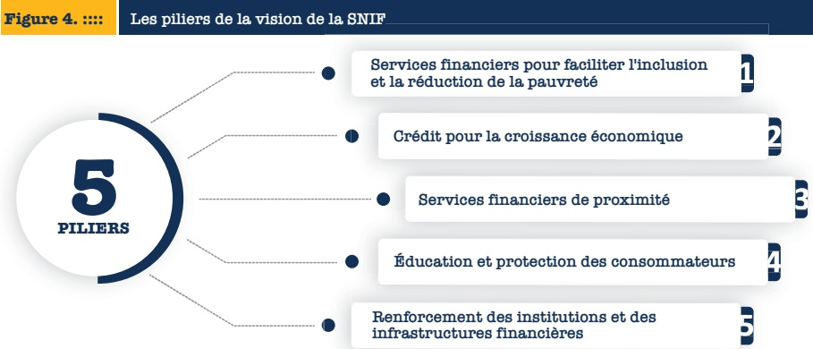

Source: Stratégie Nationale d'Inclusion Financière

Les piliers de la SNIF, illustrés dans la figure ci-dessus, englobent également des efforts visant à renforcer l'éducation financière, la protection des consommateurs, et la promotion de l'inclusion numérique pour garantir la pleine participation des citoyens à l'économie.

<!-- page 23 -->

### 3.2 Cibler l'inclusivité

Le document de la Stratégie Nationale d'Inclusion Financière (DSNIF) cible la population haïtienne en général, mais se concentre particulièrement sur les groupes vulnérables tels que les agriculteurs, les jeunes, les femmes, les populations vivant dans les zones reculées, les MPME (micro, petites et moyennes entreprises), et les travailleurs migrants. Actuellement en cours d'actualisation, cette stratégie propose une série de mesures qui nécessitent l'engagement des autorités du pays et la participation active des acteurs du marché, tant pour réguler la demande que pour fournir des services et produits financiers.

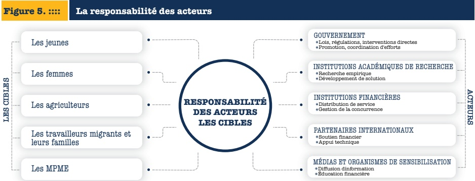

Source: Stratégie Nationale d'Inclusion Financière

Les révélations surprenantes sur l'efficacité de certaines initiatives d'inclusion financière en cours, issues des discussions tenues lors des forums organisés au cours des dernières décennies, devraient alerter nos décideurs sur les défis persistants liés à l'inclusion financière des groupes cibles de la SNIF, notamment les micros, petites et moyennes entreprises (MPME) ainsi que les femmes. Une Stratégie Nationale d'Inclusion Financière (SNIF) révisée doit donc proposer des mesures pour répondre à ces défis de manière plus efficace et durable.

### 3.3 Axes stratégiques et domaines d'intervention

Le principal engagement intégré au document de la Stratégie Nationale d'Inclusion Financière est de façonner un avenir financier inclusif pour l'ensemble des Haïtiens. Pour atteindre cet objectif, les axes stratégiques et les domaines d'intervention sont énumérés dans le tableau ci-dessous pour une meilleure compréhension.

<!-- page 24 -->

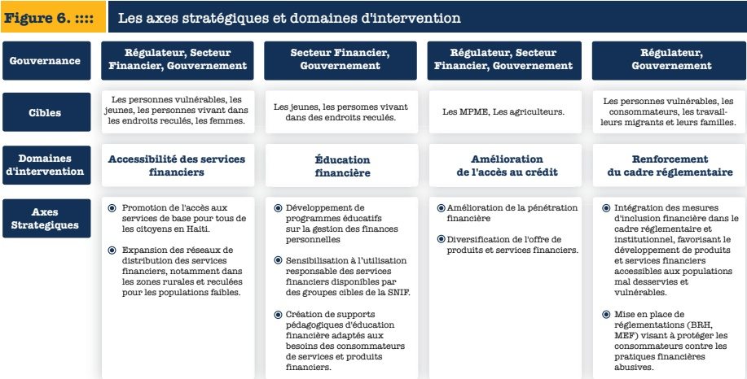

Source: Stratégie Nationale d'Inclusion Financière

## gouvernance inclusif

La mise en œuvre de la SNIF s'appuie sur un cadre institutionnel et politique intégré dans le document. On y retrouve des acteurs gouvernementaux, des organismes de régulation, des institutions financières, ainsi que des représentants des trois pouvoirs de la vie nationale. La représentation des acteurs impliqués est résumée dans le schéma ci-dessous.

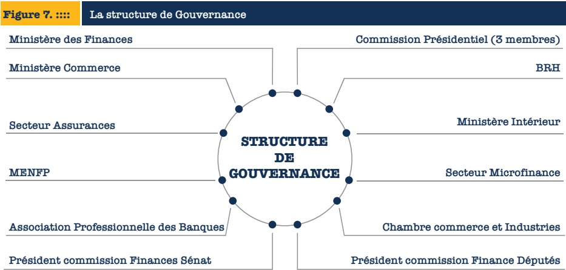

Source: Stratégie Nationale d'Inclusion Financière

<!-- page 25 -->

La collaboration et l'engagement des parties prenantes, comprenant les institutions financières, les régulateurs, et les autres structures autonomes, ont été essentiels pour surmonter les défis tels que l'accès limité aux services bancaires et la méfiance envers le système financier. Ensemble, ils ont travaillé pour promouvoir une inclusion financière plus équitable dans le pays, en développement des solutions adaptées aux besoins locaux.

<!-- page 26 -->

# IV- LES CONTOURS D'UN CADRE THÉORIQUE ET CONCEPTUEL

### 4.1 Explorer les horizons du concept : AFI; BM; OCDE; FMI

L'inclusion financière est un concept dynamique dont la définition évolue et s'adapte au contexte socio-économique et politique propre à chaque communauté. Cette flexibilité est cruciale, car elle permet une approche plus précise et adaptée aux besoins variés des ménages et des entreprises, tenant compte des spécificités régionales et locales. La figure ci-dessous présente à la fois la vision de l'Alliance Internationale pour l'Inclusion Financière (AFI) et celle promue par la Banque mondiale, deux organisations phares impliquées dans des actions en faveur du secteur, ainsi que la définition adoptée en Haïti.

### Figure 8. ::::

## Définition de l'inclusion financière

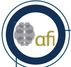

L'AFI a volontairement choisi de ne pas avoir de définition "unique" de l'inclusion financière afin d'encourager ses membres à développer leur propre définition en fonction de leur réalité à un moment donné.

Au lieu de cela, l'AFI se concentre sur les facteurs ou les dimensions à prendre en compte en termes d'inclusion financière. Sachant que celle-ci évolue dans le temps et peut ne pas être identique d'un pays à l'autre.

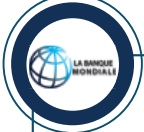

Selon la Banque Mondiale, l'inclusion financière est la capacité des individus et des entreprises à accéder à une gamme de produits et services financiers utiles et abordables (transaction, paiement, crédit, épargne et assurance), offerts par des fournisseurs fiables et responsables.

L'inclusion financière est un état de développement du système financier où, grâce des mécanismes efficaces et sécurisés, une large gamme de produits et services financiers est accessible à tous les individus et entreprises haitiens, de manière rapide, abordable et sécurisée.

<!-- page 27 -->

De son côté, le Fonds Monétaire International (FMI) $ ^{1} $ souligne l'importance cruciale de l'inclusion financière pour les ménages, car elle leur permet d'accéder à des financements essentiels. Cela facilite la régulation de leur consommation, la couverture de dépenses significatives, et l'épargne pour l'avenir. De plus, comme illustré dans le tableau ci-dessous, l'inclusion financière aide également les ménages à investir dans des projets commerciaux rentables et à bénéficier de services d'assurance.

<table><tr><td>Tableau 1</td><td>Importance de l'inclusion financière pour les ménages</td></tr><tr><td>Des besoins de constance</td><td>Des méthodes informelles qui répondent à ses besoins</td><td>Des services financiers formels favorisant l'inclusion financière</td></tr><tr><td>Un endroit sûr pour stocker de l'argent ou des aliments</td><td>Stocker l'argent à la maison</td><td>Compte d'épargne</td></tr><tr><td>Envoi de l'argent à sa mère</td><td>Prendre le bus pour remettre de l'argent à sa mère</td><td>Services de paiement sûrs, rapides et bon marché pour transférer de l'argent</td></tr><tr><td>Frais de scolarité et dépenses à venir pour le fils</td><td>Épargner à la maison, utiliser un groupe d'épargne et de crédit, emprunter à des amis et à la famille</td><td>Compte d'épargne ou prêt</td></tr><tr><td>Achat de biens durables (par exemple, appareil téléviseur) et d'une maison</td><td>Épargner à la maison, utiliser un groupe d'épargne et de crédit</td><td>Compte d'épargne ou prêt</td></tr><tr><td>Développement de son petit magasin</td><td>Epargner à la maison en utilisant le groupe d'épargne et de crédit</td><td>Besoin d'accéder à des services de paiement, un compte d'épargne et à un prêt commercial</td></tr><tr><td>Gestion de maladie</td><td>Utiliser l'épargne informelle, compter sur les amis et la famille</td><td>Assurance maladie</td></tr><tr><td>La mère a besoin d'un revenu pour ses vieux jours</td><td>Économiser</td><td>Pension</td></tr></table>

Source: Institut pour le développement des capacités du FMI

<!-- page 28 -->

### 4.2 Réaliser l'inclusion financière : Cap sur les ODD

Intégré au cadre mondial des Nations Unies pour un monde plus convivial, l'accès aux produits et services financiers est considéré comme essentiel pour atteindre sept des dix-sept Objectifs de Développement Durable (ODD) (Nations Unies, 2020). Cette constatation souligne l'importance de l'inclusion financière dans l'accomplissement d'objectifs plus larges de développement économique et social. Selon l'Organisation de Coopération et de Développement Économiques (OCDE), l'inclusion financière est définie comme « l'accès et l'utilisation des services financiers de qualité par l'ensemble de la population, notamment les groupes marginalisés » (OCDE, 2019). Ainsi, promouvoir l'accès aux services financiers devient un levier incontourable pour stimuler la création de richesse, favoriser l'égalité des sexes, soutenir l'éducation et la santé, propulser la croissance économique et l'emploi, renforcer les infrastructures, et promouvoir le développement durable (Banque mondiale, 2018).

### 4.3 Une approche basée sur des principes

Pour ce faire, dès 2009, les décideurs politiques de plusieurs pays ont initié des efforts pour promouvoir les Documents de Stratégies Nationales (DSN), contribuant ainsi à la formulation et à l'adoption de neuf principes de base. Ces principes établissent un cadre stratégique et réglementaire, favorisant une inclusion financière plus novatrice au sein du G20 (OCDE, 2015). Ils sont illustrés dans la figure 8 ci-dessous.

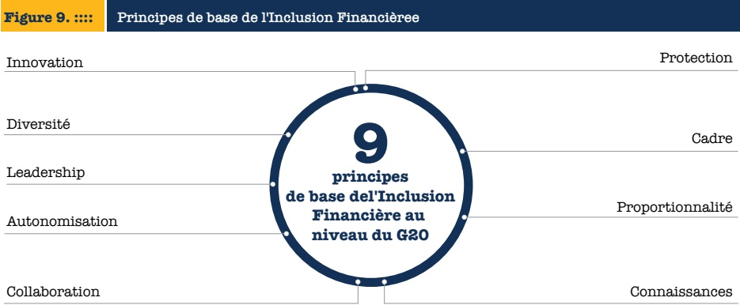

Ces principes offrent également un soutien pour assurer la cohérence, la faisabilité et la mise en œuvre rapide des stratégies nationales. En outre, leur application illustre les chaînes de causalité entre les différentes interventions liées aux stratégies déployées, les progrès intermédiaires réalisés, et les impacts finaux sur le terrain.

<!-- page 29 -->

### 4.4 Un cadre théorique éprouvé : Pour un avenir financier de plus en plus inclusif

Le DSNIF propose une série de stratégies financières spécifiques visant à atténuer la vulnérabilité financière des ménages. L'élaboration de ces stratégies s'inspire de la vision intégrée des experts d'organisations internationales reconnues pour leur recherche et leur intervention dans le domaine de l'inclusion financière, telles que l'OCDE, la Banque mondiale, l'AFI, et le FMI, ainsi que de l'approche économique de Franco Modigliani, développementée en 1960.

En effet, Modigliani, par ses recherches, a contribué à une meilleure compréhension de la consommation financière et de la pratique d'épargne des ménages et des particuliers. En s'inspirant des différentes étapes du cycle de vie des agents économiques telles que la jeunesse, la vie économique active, et la période de retraite, ce cadre théorique a ouvert la voie à une série d'initiatives visant à la conception de produits et services financiers plus contextualisés en fonction des besoins des individus et des ménages.

En ce sens, la théorie du cycle de vie financière de Modigliani a joué un rôle déterminant dans l'émergence du mouvement de la microfinance non mutualiste des années 1970, en mettant en évidence les potentiels des services financiers pour autonomiser les populations les plus marginalisées. Les résultats très positifs de ces interventions ont jeté les bases d'une réflexion plus large sur l'importance de l'accès aux services financiers pour le développement économique et social (Servet, 2008).

Par exemple, en Afrique de l'Ouest, la mise en œuvre d'institution de microcrédit a permis à de nombreuses femmes de lancer des entreprises artisanales, stimulant ainsi l'économie locale (Briggs, H, 2021). De même, en Asie du Sud, l'utilisation de services bancaires mobiles a considérablement augmenté, facilitant l'accès aux services financiers pour les populations rurales (GSMA, 2023).

À partir des années 2000, ce cadre théorique a inspiré la mise en place de politiques publiques favorables à l'inclusion financière. Dans cette mouvance, les gouvernements ont commencé à se pencher davantage sur l'adoption de mesures telles que l'élaboration de Stratégie Nationale d'Inclusion Financière, dans le but d'étendre l'accès aux services financiers de base, de promouvoir l'innovation financière, de faciliter l'éducation financière, et de renforcer la protection des consommateurs financiers.

On constate également que des organisations internationales, des banques commerciales, des entreprises sociales, des institutions de microfinance, des coopératives d'épargne et de crédit, ainsi que des firmes technologiques s'investissent davantage pour diversifier leur offre de produits et de services financiers. C'est dans ce cadre que le Partenariat Global pour l'Inclusion Financière (GPFI) a vu le jour au Sommet de Séoul, par les leaders des 20 pays les plus influents politiquement (G20), en novembre 2010.

Dans ce même élan, la Banque mondiale a établi un cadre de référence d'accès universel aux services financiers, nommé UFA-2020. L'approche apporte une perspective supplémentaire, en

<!-- page 30 -->

mettant l'accent sur une logique d'empilement de blocs financiers et non financiers pour renforcer la sécurité financière des 1,6 milliard d'adultes identifiés, à l'époque, comme étant en dehors du système financier formel dans le monde. Les indicateurs associés à l'approche UFA-2020 sont repris dans la figure 9 ci-après.

### 4.5 Banque Mondiale : Le cadre UFA2020

Pour mesurer l'inclusion financière, des indicateurs clés liés au concept d'accès et d'utilisation sont établis. Ils sont clairement définis en termes de nombre de comptes de transactions et d'instruments de paiement, de la disponibilité et de l'accessibilité aux points de service, de la réalisation d'activités liées à la sensibilisation et à l'éducation financière, ainsi que de la valorisation du flux monétaire. Il est également noté que la réalisation de cette vision englobe l'existence d'infrastructures financières adéquates, soutenues par des outils de technologie de l'information et de la communication (TIC), d'un cadre légal et réglementaire robuste, ainsi que l'engagement proactif des acteurs des secteurs public et privé. Comme le démontre le schéma ci-dessous, ces éléments interdépendants établissent ensemble un cadre solide pour l'inclusion financière, essentielle à la réduction de la pauvreté et à l'atteinte d'un développement économique durable.¹

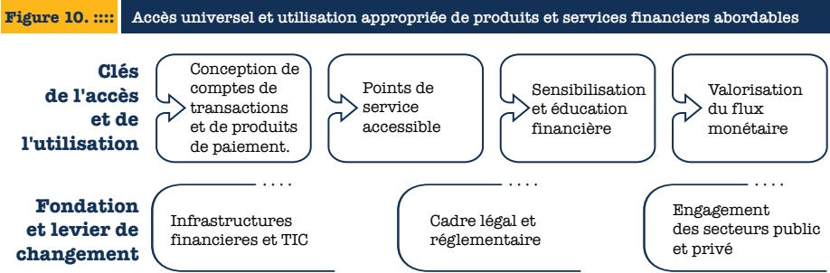

L'AFI² a été créée en septembre 2008 et apporte depuis un soutien essentiel aux travaux du GPFI (AFI, 2015). Elle regroupe actuellement 120 institutions et 60 pays, dont Haïti. Le pays a rejoint cette organisation en tant que membre principal en décembre 2010 et a signé les déclarations de Maya lors de l'Assemblée Générale de Caputo en Angola. Son engagement envers cette initiative s'est renforcé au fil des années avec des actions concrètes en faveur des jeunes, des femmes, des producteurs, et des entrepreneurs pour promouvoir l'inclusion financière. L'AFI offre un soutien pratique aux pays engagés dans le cadre de la Déclaration de Maya et des initiatives du G20 à

<!-- page 31 -->

travers son programme d'apprentissage par les pairs dédié à l'inclusion financière. La contribution de l'AFI a été exceptionnelle dans l'élaboration du Plan National d'Éducation Financière (PNEF).

Les principales réalisations accomplies dans le cadre de l'inclusion financière au cours de cette décennie seront analysées dans le prochain chapitre du document, à la lumière du cadre conceptuel et théorique évoqué ici.

<!-- page 32 -->

## PARTIE 2

## UN ÉTAT DES LIEUX

<!-- page 33 -->

## UN ÉTAT DES LIEUX

UNE DÉCENNIE DÉTERMINANTE: LES INDICATEURS
DE L'INCLUSION FINANCIÈRE ..... PAGE 35
5.1. À la Découverte des indicateurs d'inclusion financière clés ..... PAGE 35
5.2. L'écosystème de l'inclusion financière en Haïti ..... PAGE 35
5.3- Le Répertoire des indicateurs sur l'inclusion financière en Haïti ..... PAGE 37
COUP DE PROJECTEUR SUR LES INDICATEURS D'ACCÈS ..... PAGE 39
6.1- Possession d'un compte: L'identification digitale une porte d'entrée ..... PAGE 39
UN PAYSAGE FINANCIER REDÉFINI : DYNAMIQUE DE PAIEMENT ..... PAGE 43
7.1. Pour une offre plus diversifiée: L'ascension des POS ..... PAGE 43
7.2- Carte d'accès aux services bancaires ..... PAGE 46
7.3- Des CEC aux Institutions de Microfinance : Synergie dans les moyens de paiement ..... PAGE 50
7.4- Les Paiements : L'énergie des transactions financières modernes ..... PAGE 54
7.4.1 Évolution du réseau des agents non bancaires ..... PAGE 54
7.4.2 - Les Distributeurs Automatiques de Billets (ATM) ..... PAGE 56
7.4.3 Transferts d'argent et inclusion financière ..... PAGE 57
7.5 L'Inclusion numérique: Quel Rôle pour les nouveaux moyens de paiement? ..... PAGE 58
7.5.1 Le paysage des innovations: Cartographie et tendances ..... PAGE 59
7.5.2 Des moyens de paiement résilients: Le Cadre du numérique ..... PAGE 59
7.5.3 Les Fintech(s) en Haiti: Quelles sont les tendances? ..... PAGE 60
7.5.4 Des SPIH(s) à la carte: Des moyens de paiement innovants ..... PAGE 63
7.5.4.1 Évolution des transactions SPIH ..... PAGE 63
7.5.4.2 Analyse de l'évolution des chèques compensés en Haïti (2012-2023) ..... PAGE 64
7.5.4.3 : De l'encre au numérique: Une analyse comparative des transactions de 2012 à 2024 ..... PAGE 65
7.6- L'univers des cartes de paiement ..... PAGE 67

<!-- page 34 -->

## UN ÉTAT DES LIEUX

DE L'UTILISATION DES COMPTES: L'INCLUSION
FINANCIÈRE ACTIVE ..... PAGE 69
8.1- Principe de diversité ..... PAGE 69
8.2- L'offre de produits ..... PAGE 69
ÉGALITÉ DES GENRES ET RENFORCEMENT DE LA RÉSILIENCE ÉCONOMIQUE ..... PAGE 73
9.1- Les genres sous le feu des données ..... PAGE 73
9.2- Des piliers pour construire une résilience financière ..... PAGE 76
9.3- Dynamiser l'éducation financière en Haïti: Stratégie innovante pour un futur prospère ..... PAGE 77
9.4- Protection des consommateurs: Sécurité et confiance à l'ère du numérique ..... PAGE 78
AUX LEVIERS DE CHANGEMENT ..... PAGE 80
10.1- Le cadre règlementaire: Du principe de proportionnalité ..... PAGE 80
10.2- Des infrastructures financières solides et promotion de l'inclusion financière numérique ..... PAGE 83
10.3- Les infrastructures numériques : vers une réforme du système de paiement ..... PAGE 84
10.4- Coopération et engagement pour l'inclusion financière ..... PAGE 86
10.4.1- Responsabilité et engagements des acteurs ..... PAGE 86
10.4.1.1- La responsabilité gouvernementale et inclusion financière ..... PAGE 87
10.4.1.2- Engagement des institutions financières ..... PAGE 88
10.4.1.3- Engagement des consommateurs financières ..... PAGE 89
10.4.1.4- Engagement de la société civile ..... PAGE 90
10.4.2- Coopération pour l'inclusion financière ..... PAGE 90
10.4.3-Le pouvoir des interactions stratégiques ..... PAGE 92
ANALYSES ET DISCUSSIONS ..... PAGE 95
UN RETOUR CONCLUSIF ..... PAGE 96
RECOMMANDATIONS POUR CONSTRUIRE L'AVENIR ..... PAGE 97

<!-- page 35 -->

## V- UNE DÉCENNIE DÉTERMINANTE: DES INDICATEURS QUI COMPTENT POUR HAÏTI

Cette section vise à présenter l'évolution des trois principales dimensions de l'inclusion financière, selon la définition adoptée dans la SNIF, tout en l'élargissant à deux autres aspects importants pour l'inclusion financière : l'épargne et la résilience. L'aspect de la diversité, l'un des neuf principes fondamentaux encouragés par les spécialistes de la Banque Mondiale, sera intégré dans les analyses (Banque Mondiale, 2018).

### 5.1 À la Découverte des indicateurs d'inclusion financière clés

La méthodologie utilisée dans le Global Findex regroupe les indicateurs d'inclusion en quatre grandes catégories :

Figure 11. ::::

## Les indicateurs de l' inclusion financière

Possession

d'un compte

Services

de paiement

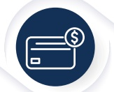

Utilisation du compte

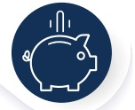

Épargne, crédit et résilience financière

La littérature sur l'inclusion financière reconnaît l'universalité des indicateurs mentionnés ci-dessus. Ceux-ci offrent une base de comparaison pour évaluer le niveau d'inclusion financière à l'échelle mondiale et régionale, permettant de retracer les tendances et les progrès de l'inclusion financière dans les pays, y compris Haïti, depuis 2011. En explorant les initiatives publiques, privées et gouvernementales en matière d'inclusion financière à travers les deux prochains chapitres, nous mettrons en évidence les tendances observées dans le contexte haïtien.

### 5.2 L'écosystème de l'inclusion financière en Haïti

La figure 12 ci-dessous offre une vue d'ensemble des principaux acteurs de l'écosystème en Haïti, illustrant comment ils collaborent pour créer un environnement financier plus équitable et accessible à tous.

<!-- page 36 -->

Figure 12. ::: L'écosystème de l'inclusion financière en Haïti

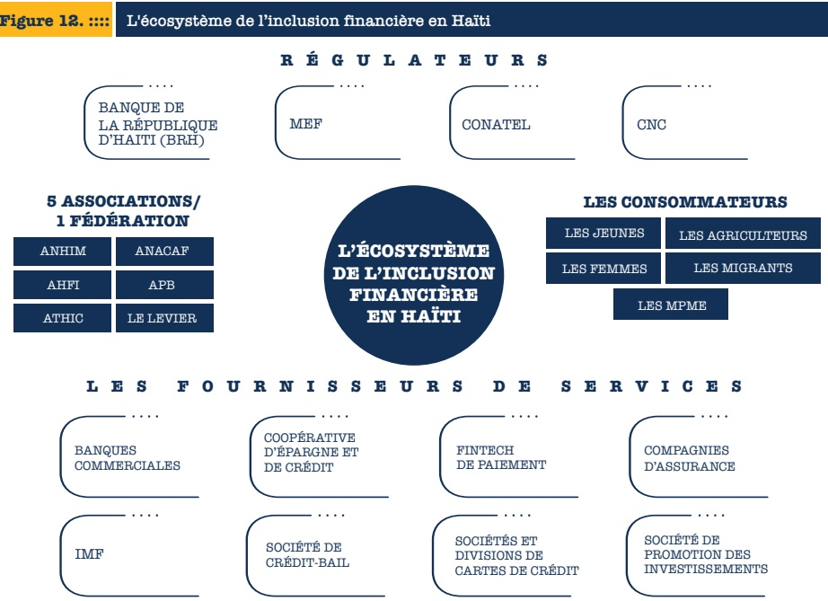

LES FOURNISSEURS DE SERVICES

L'inclusion financière est essentielle pour permettre aux membres d'une société, notamment ceux qui sont traditionnellement exclus ou marginalisés, d'accéder et d'utiliser adéquatement les services financiers de base et de participer pleinement à l'économie (Banque mondiale, 2018). Dans un écosystème aussi complexe que celui d'Haïti, pour atteindre cet objectif ambitieux, une variété d'acteurs doit œuvrer en synergie pour répondre aux différents problèmes liés à l'accès adéquat aux comptes, à l'étendue de l'offre du système de paiement, et à une utilisation optimale des produits et services financiers par les consommateurs.

Dans un écosystème aussi complexe que celui d’Haïti, pour atteindre cet objectif ambitieux, une variété d’acteurs, tels que les banques commerciales, les institutions de microfinance, les organisations non gouvernementales, et les régulateurs gouvernementaux, doit œuvrer en synergie. Ensemble, ils doivent répondre aux différents problèmes liés à l’accès adéquat aux comptes, à l’étendue de l’offre du système de paiement, et à une utilisation optimale des produits et services financiers par les consommateurs.

<!-- page 37 -->

### 5.3 Le Répertoire des indicateurs sur l'inclusion financière en Haïti

Le répertoire des chiffres clés ci-dessous fournit une vue d'ensemble des principaux indicateurs relatifs à l'inclusion financière en Haïti au 31 mars 2024. Il offre une perspective de la dynamique actuelle, tant en termes d'offre que d'utilisation des services financiers dans le pays, en couvrant cinq principaux domaines : les infrastructures financières, le nombre de comptes, le crédit, l'épargne, ainsi que les moyens de paiement, y compris les transactions liées au Système de Paiement Interbancaire Haïtien (SPIH), les chèques et les cartes de crédit.

### Figure 13. ☐ Chiffres clés de l'inclusion financière, Mars 2024

Nombres de prêt accordés

Banques:

72 619

Banques

Portefeuille:

123,7 MMG

IMF

Portefeuille:

4,677 MMG

CEC:

57 405 prêts

CEC

Portefeuille:

13,283 MMG

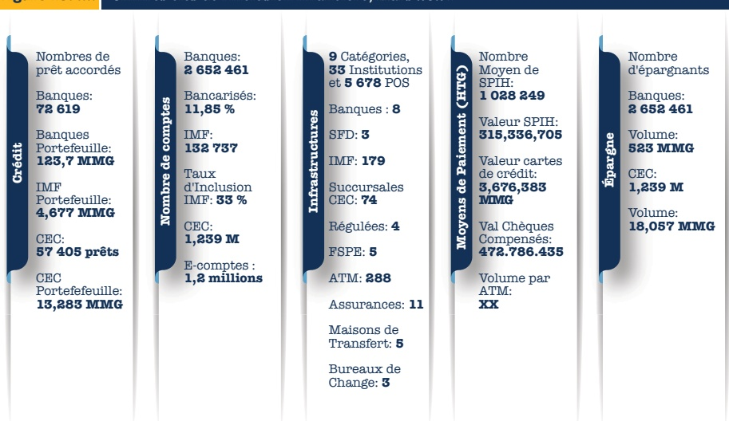

## Nombre de comptes

Banques:

2 652 461

Bancarisés:

11,85 %

IMF:

132 737

Taux

d'Inclusion

IMF: 33 %

CEC:

1,239 M

E-comptes :

1,2 millions

## Infrastructures

9 Catégories,

33 Institutions

et 5 678 POS

Banques : 8

SFD: 3

IMF: 179

Succursales

CEC: 74

Régulées: 4

FSPE: 5

ATM: 288

Assurances: 11

Maisons de Transfert: 5

Bureaux de Change: 3

## Moyens de Paiement (HTG)

Valeur cartes

de crédit:

3,676,383

MIMG

Val Chèques

Compensés:

472.786.435

Volume par

ATM:

XX

## Epargne

Source: Banque de la République d'Haïti

<!-- page 38 -->

Ces données indiquent une activité de prêt dynamique. Les transactions, avec un volume moyen de 1,028,249 transactions SPIH pour les quatre dernières années et une valeur de 3,676.383 milliards de gourdes effectuées à partir des cartes de crédit pour l'exercice 2022-2023, mettent en évidence une utilisation accrue des moyens de paiement numériques. Enfin, l'épargne, estimée à 523 milliards de gourdes pour les banques et à près de 180 milliards de gourdes pour les caisses d'épargne et de crédit (CEC), reste un domaine à fort potentiel de croissance, avec un nombre étonnamment bas d'épargnants enregistrés, ce qui souligne le besoin de stratégies ciblées pour encourager l'épargne parmi les Haïtiens.

Les prochains chapitres, en fournissant une vue plus détaillée et distincte de chacune des dimensions de l'inclusion financière, permettront de mieux évaluer les progrès réalisés au cours de la décennie et d'identifier les domaines nécessitant une attention particulière pour renforcer l'inclusion financière dans le pays.

<!-- page 39 -->

# VI- COUP DE PROJECTEUR SUR LES INDICATEURS D'ACCÈS

L'accès au compte bancaire est considéré comme l'un des premiers indicateurs pour évaluer le niveau d'accès aux services financiers.

### 6.1 Possession d'un compte: L'identification digitale, une porte d'entrée

L'accès au compte renvoie à la disponibilité et à la facilité pour les individus, les ménages, et les entreprises d'accéder au système financier formel, de bénéficier et d'utiliser une gamme de services financiers (Banque Mondiale, 2018). Ces services englobent une diversité de produits tels que les comptes bancaires, les prêts, les assurances, les services de paiement, et les investissements.

Dans des pays comme la France, les banques sont légalement tenues d'ouvrir un compte bancaire à toute personne qui en fait la demande, ce qui est communément désigné comme le droit au compte. Cependant, malgré l'existence de certaines dispositions favorables à la bancarisation des ménages, en Haïti, il n'y a pas d'obligation légale pour les institutions financières d'offrir un tel compte, et donc le droit au compte n'est ni obligatoire ni automatique. De plus, l'âge minimum pour l'ouverture d'un compte bancaire est fixé à 18 ans. Cependant, la Circulaire 99-4 autorise l'ouverture de comptes pour des mineurs. En outre, la loi 2002 sur les CEC permet aux mineurs d'être membres auxiliaires.

En 2011, environ 10 comptes bancaires étaient détenus pour 100 000 adultes en Haïti, tandis que dans les pays à faible revenu de la région, ce nombre était d'environ 13 comptes. Bien que le nombre de comptes bancaires ait légèrement diminué en Haïti entre 2011 et 2020, une tendance notable à la hausse a été observée dans les pays à faible revenu de la région LAC, avec 22,03 comptes bancaires pour 100 000 adultes en 2020.

Il reste entendu que, seulement 11,85% de la population possèdent des comptes bancaires, un faible taux qui souligne le besoin d'améliorer l'accès aux services financiers. Le nombre de comptes dans les CEC est estimé à 1 239 108 membres, dont 719 570 hommes, 482 375 femmes et 37 163 personnes morales.

L'analyse des données issues de la Stratégie Nationale d'Inclusion Financière (SNIF) publiée en 2014 a révélé que seulement 6 % des jeunes âgés de 15 à 24 ans étaient détenteurs d'un compte dans une institution financière formelle. Cependant, cette proportion a considérablement augmenté pour atteindre 29 % en 2017, marquant ainsi une augmentation notable de 23 points de pourcentage sur cette période. Parallèlement, pour les adultes âgés de 25 ans et plus, le taux d'inclusion financière est passé de 31 % en 2011 à 36 % en 2017 (FinScope des Méngages, 2018).

Une analyse plus approfondie des données révèle des tendances divergentes selon les strates

<!-- page 40 -->

socio-économiques. Pour les 40 % les plus pauvres, le taux d'inclusion financière est demeuré stable à 15 % entre 2011 et 2017, après avoir subi une baisse à 12 % en 2014. En revanche, pour les 60 % les plus riches, ce taux a légèrement diminué, passant de 38 % en 2011 à 37 % en 2017.

Ces données soulignent une disparité persistante dans l'accès aux services financiers entre les populations les plus riches et les plus pauvres, mettant en évidence la nécessité d'une action ciblée pour renforcer l'inclusion financière des groupes les plus défavorisés, notamment les femmes, afin de promouvoir une société plus équitable et inclusive.

Graphique 1

Compte dans des institutions formelles (âge, revenu et éducation)

| % Jeunes de 15-24 ans | % Adultes de 25 ans et plus | % 40 les plus pauvres (âgés de 15 ans et plus ) | % 60 les plus riches (âgés de 15 ans et plus ) | Éducation primaire au moins (âgés de 15 ans et plus ) | Éducation Secondaire et plus (âgés de 15 ans et plus ) |
| --- | --- | --- | --- | --- | --- |
| 21% | 36% | 12% | 38% | 11% | 29% |
| 31% | 27% | 15% | 21% | 8% | 23% |
| 15% | 21% | 12% | 37% | 17% | 42% |

Source: Document Stratégie Nationale d'Inclusion Financière

L'analyse des informations récentes collectées dans les rapports de la BRH en 2023 révèle une image contrastée de l'inclusion financière dans le pays. Bien que les Coopératives d'Épargne et de Crédit (CEC) et les institutions de microfinance non mutualistes aient enregistré une certaine augmentation du nombre de sociétaires et de clients respectivement, les chiffres demeurent relativement modestes. Par exemple, avec seulement 1 239 000 sociétaires pour les coopératives d'épargne et un peu plus de 133 000 clients pour les institutions de microfinance, selon les données collectées en 2023, il est clair que l'accès aux services financiers reste limité pour une grande partie de la population âgée de 18 ans et plus. De plus, bien que le nombre de comptes digitaux soit plus élevé que celui des clients des IMF, atteignant plus de 1,2 million, il est important de noter que ces comptes peuvent être détenus par un nombre limité de personnes, ce qui ne garantit pas nécessairement une inclusion financière étendue.

Par ailleurs, aux côtés des opérations traditionnelles, la monnaie électronique est appelée à contribuer à quinze des dix-sept objectifs de développement durable (ODD). La croissance des smartphones et l'accessibilité accrue aux infrastructures d'Internet dans certaines régions du monde ont contribué à l'adoption des systèmes électroniques, tels que les plateformes de paiement mobile et les portefeuilles électroniques, à partir des comptes électroniques. Réalisée

<!-- page 41 -->

dans de bonnes conditions, cette innovation offre l'avantage de faciliter la réduction des coûts des transactions financières ainsi que leur traçabilité.

Selon le rapport publié par la GSMA faisant le point sur les services financiers mobiles, en 2024, il existe 1,75 milliard de comptes électroniques enregistrés dans le monde, laissant transiter chaque année 1 400 milliards de dollars. En Haïti, en raison des problèmes persistants liés aux infrastructures de base, l'adoption des comptes électroniques progresse lentement.

L'expansion constatée plus bas révèle non seulement les dynamiques de croissance du secteur, mais aussi les opportunités d'affiner et d'étendre les services financiers numériques. Cette tendance soutient l'objectif d'une meilleure inclusion financière et numérique en Haïti, en ciblant particulièrement les populations jusqu'à présent exclues du système financier traditionnel.

Graphique 2

Évolution des comptes électroniques

Compte électronique actif en chiffre

| Year | Nombre de Compte electronique (En millions) | Year's CUMULATION |
| --- | --- | --- |
| 2014 | 101 | 0.9 |
| 2017 | 134 | 14 |
| 2014-2023 | 177 | 217 |

Source : Banque de la République d'Haïti, 2023

<!-- page 42 -->

Les travaux réalisés par la Banque Mondiale et le FMI reconnaissent que l'exclusion financière peut résulter aussi bien de choix délibérés que de circonstances involontaires. Ce phénomène peut être exacerbé par les réalités environnementales de l'individu, en particulier lorsque les services de base sont défaillants. Pour devenir client d'une banque, de tout autre établissement financier, ou sociéténaire d'une Coopérative d'Épargne et de Crédit dans le pays, un (1) document d'identification officiel ainsi que des preuves d'adresse sont requis. Ces exigences en matière de réglementation liée au KYC (Know Your Client / Connaître Ton Client), en conformité avec les circulaires et lignes directrices émises par la BRH, présentent des avantages en termes de protection contre les crimes financiers et de l'intégrité du système financier. Cependant, dans le cadre de l'inclusion financière, elles peuvent constituer un obstacle pour certains individus, en particulier pour ceux qui n'ont pas de preuves d'adresse formelles ou qui sont dans des situations précaires. Par conséquent, bien que des stratégies soient en place pour faciliter les transactions financières, l'accès effectif aux services financiers peut encore être limité pour certaines personnes en raison de ces exigences.

L'inclusion financière consiste à éliminer les obstacles qui empêchent ses cibles d'accéder aux services financiers de base. Ces obstacles peuvent être liés au manque d'infrastructures financières, à la discrimination basée sur le genre, mais aussi à des problèmes d'identification. D'après les données des enquêtes FinScope 2018, parmi les 87 % des personnes qui n'empruntent pas, environ 5 % sont confrontées à des problèmes d'identité. Selon cette même source, 94 % des personnes enquêtées ne possèdent pas un acte de naissance, et notamment 73 % d'entre elles n'ont pas accès à la pièce d'identification gouvernementale, qui est la Carte d'Identification Nationale (CIN).

La réingénierie du processus d'identification a commencé en 2005, par un décret présidentiel signé par feu Boniface, créant l'Office National d'Identification (ONI). La procédure administrative pour l'obtention d'une CIN est complexe, rendant l'accès difficile, particulièrement pour les personnes âgées, les femmes, et les résidents en milieu rural. Aujourd'hui, l'identité numérique (Digital ID) offre une solution efficace pour résoudre les problèmes liés à l'identification dans des pays comme Haïti, où l'acquisition de pièces d'identité traditionnelles reste souvent inaccessible pour de nombreux ménages. L'adoption de l'identité numérique pourrait non seulement simplifier le problème d'identification et faciliter les procédures de reconnaissance du client (e-KYC), mais aussi avoir des impacts considérables sur les coûts associés au processus d'ouverture de compte.

Ces constats mettent en lumière la nécessité d'adopter des mesures supplémentaires pour améliorer l'inclusion financière dans le pays. Cela pourrait englober des initiatives visant à renforcer le cadre juridique afin de favoriser l'adoption rapide de l'inclusion numérique, à intensifier les efforts d'éducation et de sensibilisation de la population aux avantages des services financiers, à renforcer les capacités et les compétences numériques des institutions financières, ainsi qu'à faciliter des partenariats stratégiques pour mieux répondre aux besoins de la population.

<!-- page 43 -->

## VII- UN PAYSAGE FINANCIER REDÉFINI : DYNAMIQUE DE PAIEMENT

Un système de paiement inclusif, en facilitant la fluidité des transactions financières, constitue un pilier fondamental pour promouvoir l'inclusion financière. Formé, entre autres, par les infrastructures financières, les établissements, les moyens de paiement, et la réglementation, il inclut une variété de méthodes telles que les paiements mobiles, les cartes prépayées, les moyens de paiement et de transfert d'argent traditionnels, ainsi que d'autres solutions de paiement innovantes. Selon la Banque Mondiale, un système de paiement simple, accessible, abordable, sécuritéaire, et très efficace facilite l'intégration des produits et services financiers et favorise l'inclusion financière (Banque mondiale, 2007).

La Banque de la République d'Haïti (BRH), en tant que régulateur du système financier, est guidée par la loi du 14 mai 2012 sur le fonctionnement des banques et autres institutions financières. Le décret de 2020 autorise la BRH à superviser les institutions de microfinance, en les divisant en deux catégories : les entreprises de microcrédit et les sociétés de microfinance. Quant aux coopératives d'épargne et de crédit, elles opèrent selon la loi du 26 juin 2002. Les lignes directrices 121 émises en 2021 établit les conditions d'agrément et d'opérations des fournisseurs de services de paiement électronique (FSPE). La liste des institutions qui ont reçu l'agrément de la Banque est publiée sur son site internet.

### 7.1 Pour une offre plus diversifiée: L'ascension des POS

Dans l'économie haïtienne, les transactions sont majoritairement effectuées en espèces, surtout dans le secteur informel. Toutefois, dans le secteur formel, les supermarkés et autres entreprises commerciales acceptent des paiements par chèques, par cartes de paiement, ou par virement. La disponibilité des services de paiement est assurée par la plupart des institutions financières, telles que les banques, les coopératives d'épargne et de crédit (CEC), les institutions de microfinance (IMF), les maisons de transfert, les bureaux de change, les sociétés de crédit-bail et les Institutions financières non bancaires.

<!-- page 44 -->

Figure 14. ☐ Points d'accès aux services (POS)

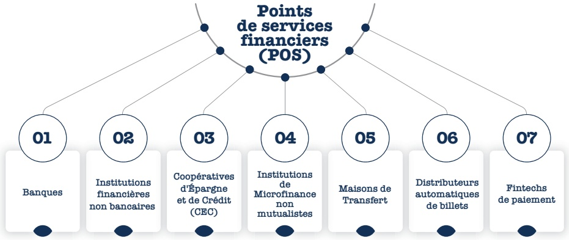

Comme le montre la figure n° 12, l'offre de paiement est soutenue par des infrastructures mobiles, comme les distributeurs automatiques de billets et les points de service (POS), ainsi que par des solutions numériques développées par les fintechs.

Le schéma ci-dessous présente l'évolution des infrastructures de paiement au cours de la dernière décennie. Une analyse des données montre que les points de services financiers (POS) ont connu une croissance considérable, passant de 2 220 à 5 250 de 2011 à 2023, soit une augmentation de 136 %. Cette expansion est principalement due à la prolifération des points de service de transfert, dont le nombre est passé de 695 à 1 904 pendant la même période, soit une hausse de 63,5 %.

<!-- page 45 -->

|   | Avant SNIF | Après SNIF |
| --- | --- | --- |
| Points de service | -175 | 326 |
| IMF | 270 | 312 |
| SFD | 0 | 1 |
| Société de Crédit Bail | 0 | 1 |
| Émise de Service de transfert | 695 | 1904 |
| Inisseurs de serve de paiement |   |   |
| Assurances | 15 | 13 |
| Agents non Bancaires | 1063 | 2068 |
| Total | 2220 | 5250 |

## Point de services

Le nombre de points de service bancaire augmenté passant de 228 (dont 175 succursales et 53 ATM à 372 (dont 192 points de services bancaires et 180 ATM, représentant une croissance de près de 63% des points de services bancaires.

## Fournisseurs de service de transfert

## Agents non Bancaires

Les fournisseurs de service de transfert ont vu leur nombre augmenter de 695 à 1904. ce qui représente une croissance explosive de 173.96%.

Le nombre d'agents non bancaires a augmenté de 1063 à 2688, soit une augmentation de 152.87%.

Le nombre total de fournisseurs de services financiers a augmenté de 136.49%, passant de 2220 à 5 250, ce qui témoigne de l'expansion significative du secteur financier.

Il faudra noter que, malgré cette offre diversifiée et la croissance observée, les services financiers demeurent concentrés dans le département de l'Ouest et dans les principales villes des zones urbaines. En effet, sur les dix départements, 2 520 points de service se trouvent dans le département de l'Ouest, ce qui représente 48 % du total des points de service.

D’après les données tirées de la cartographie de l’inclusion financière, en juin 2024, le pays dispose de huit (8) banques, une (1) banque de développement agricole, trois (3) sociétés financières de développement (SFD), deux (2) sociétés de carte de crédit, une (1) société de crédit-bail, une (1) société de promotion des investissements (SPI), cinq (5) maisons de transfert, trois (3) bureaux de change, soixante-quatorze (74) comptoirs de coopérative d’épargne et de crédit (CEC), cent soixante-dix-neuf (179) points de service (POS) de microfinance (IMF), dont quatre (4) IMF agréées,

<!-- page 46 -->

et deux cent quatre-vingt-huit (288) distributeurs automatiques de billets (ATM).

Il convient de noter que les deux dernières banques étrangères, la Scotiabank et la Citibank, qui ont pendant longtemps opéré en Haïti, ont respectivement cessé leurs activités dans le pays en 2017 et très récemment en 2024. L'ensemble de ces institutions est reportée sur la figure ci-dessous.

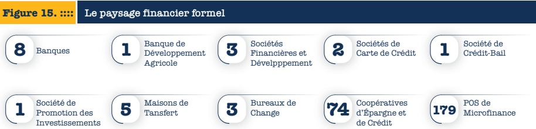

Selon les données fournies par la Banque Mondiale, à côté de cette offre plus formelle, près de 10 000 associations informelles telles que des mutuelles de solidarité (MUSO) et des associations villageoises d'épargne et de crédit (AVEC) sont répertoriées dans le paysage financier haïtien et fournissent des services de proximité à leurs membres (Banque, 2022).

De plus, dans un pays très exposé à divers risques, tant naturels que socio-économiques, onze (11) compagnies d'assurance se distinguent par leur présence et leur contribution. Elles jouent un rôle essentiel en renforçant la capacité des individus et des entreprises à faire face aux défis, à mieux s'adapter aux changements et à maintenir une certaine résilience financière.

Ces chiffres illustrent une infrastructure financière diversifiée, avec une gamme variée d'institutions impliquées. Cette pluralité d'institutions contribue à une plus grande accessibilité et de flexibilité dans les transactions de paiement, répondant ainsi aux besoins variés des utilisateurs financiers.

### 7.2 Carte d'accès aux services bancaires

La cartographie de l'accès aux banques en Haïti révèle la répartition des succursales à travers les différentes communes et départements du pays. Cette analyse, effectuée à partir des données du schéma ci-après, est essentielle pour comprendre l'accessibilité des services bancaires pour la population et pour identifier les régions où une expansion des services pourrait être nécessaire.

<!-- page 47 -->

Figure 16. …… Carte d'accès aux succursales des banques commerciales en %

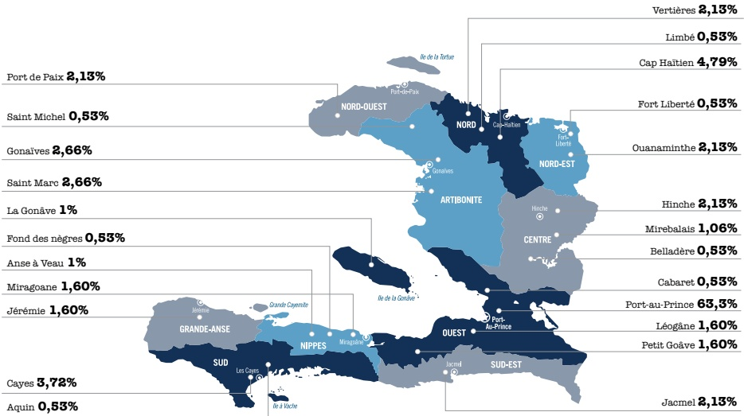

Source: Rapport statistique supervision bancaire - 1er Trimestre 2024 - BRH

D’après l’analyse des données, près de deux tiers (soit 63,3 %) des succursales de banque se situent à Port-au-Prince, indiquant une concentration très élevée des services bancaires dans la capitale. Le département de l’Ouest totalise 67,55 % des succursales, y compris les communes de Petit-Goâve et Léogâne. Cap-Haïtien, avec 4,79 % des succursales, est une autre zone importante pour les banques commerciales, contribuant à un total de 7,45 % pour le département du Nord. Toutefois, plusieurs communes, telles que Saint-Michel, Belladère, Fonds-des-Nègres, Anse-à-Veau, Limbé, Fort-Liberté, Cabaret, La Gonâve, et Aquin, ont chacune seulement 0,53 % des succursales, ce qui indique une couverture limitée. Une attention particulière pourrait être portée aux communes sous-desservies pour promouvoir une inclusion financière plus équitable à travers le pays.

En 2023, les données montrent une concentration significative des succursales bancaires dans les zones urbaines. Par exemple, UNIBANK, la plus grande banque en termes de présence géographique, compte 37 succursales dans les grandes villes contre 20 dans les communes les plus reculées. De même, SOGEBANK possède 27 succursales urbaines comparées à 17 rurales. Cette répartition montre que les banques privilégient les centres urbains, probablement en raison de la densité de population plus élevée, de meilleures infrastructures, et d'un potentiel de profit plus important.

<!-- page 48 -->

Répartition géographique des succursales bancaires en 2023

|   | Villes | Provinces |
| --- | --- | --- |
| BNC | 22 | 21 |
| BPH | 7 | 0 |
| BUH | 16 | 9 |
| SOGEBANK | 27 | 17 |
| UNIBANK | 37 | 20 |
| CAPITAL BANK | 13 | 0 |
| SOGEBEL | 6 | 0 |

Source: Cartographie, BRH

En 2023, les données montrent une concentration significative des succursales bancaires dans les zones urbaines. Par exemple, UNIBANK, la plus grande banque en termes de présence géographique, compte 37 succursales dans les grandes villes contre 20 dans les communes les plus reculées. De même, SOGEBANK possède 27 succursales dans les zones urbaines comparées à 17 dans les régions rurales. Cette répartition montre que les banques privilégient les centres urbains, probablement en raison de la densité de population plus élevée, de meilleures infrastructures, et d'un potentiel de profit plus élevé.

Quant à la BNC, dont les activités remontent à plus de 40 ans, elle montre une distribution plus équilibrée entre les grandes villes et les milieux ruraux. Cette absence pourrait être attribuée à divers facteurs, notamment les coûts élevés d'implantation et de maintenance dans les zones moins accessibles, ainsi que la perception d'un risque plus élevé et d'une rentabilité plus faible.

Pour la BNC, dont ses activités remontent à plus de 40 ans ancienneté, montre une distribution plus équilibrée entre les grandes villes et les milieux ruraux. Avec 22 succursales urbaines et 21 rurales, elle démontre un engagement à servir une clientèle plus variée. Cette banque joue un rôle crucial dans la promotion de l'inclusion financière, en apportant des services bancaires essentiels aux régions sous-desservies.

Le graphique ci-dessous montre que le nombre de succursales bancaires pour 100 000 adultes en Haïti a connu une modeste variation de 2011 à 2015, passant de 2,63 à 2,69 succursales. Cependant, après cette période, le nombre de succursales a fluctué pour finalement atteindre 2,62 succursales pour 100 000 adultes en 2020.

<!-- page 49 -->

| Year | Le nombre de succursales bancaires pour 100 000 adultes |
| --- | --- |
| 2011 | 4000000 |
| 2012 | 4500000 |
| 2013 | 4400000 |
| 2014 | 4300000 |
| 2015 | 4200000 |

Source: Cartographie d'Inclusion Financière

| Year | Infrastructure (d'inclusion financière) | Emission énergétique (par de 27 succuses d'eau croissante très modeste) | Water (par de 1000 adultes) |
| --- | --- | --- | --- |
| 2016 |   |   |   |
| 2017 |   |   |   |
| 2018 |   |   |   |
| 2019 |   |   |   |
| 2020 |   |   |   |

Au fil de la décennie, le taux de pénétration géographique des services bancaires en Haïti est passé de 2,72 à 11,85, ce qui signifie qu'en moyenne, il y a 11,85 points de services bancaires pour chaque tranche de 1 000 kilomètres carrés dans le pays. Malgré une augmentation du déploiement des points de service à travers tout le pays, le nombre de succursales pour 100 000 adultes a pratiquement stagné en raison d'une croissance démographique plus importante de la population adulte.

Les informations sur la répartition géographique des succursales bancaires dans le pays mettent en lumière une inégalité significative entre les zones urbaines et rurales en matière d'infrastructures financières. Ces indicateurs d'accès montrent que le taux de pénétration des services bancaires en Haïti est nettement inférieur à ceux observés en République dominicaine et dans d'autres pays à faible revenu de la région de l'Amérique latine et des Caraïbes (LAC).

Pour atteindre une inclusion financière plus équitable, il est crucial de mettre en œuvre des stratégies innovantes et durables visant à améliorer l'accès aux services financiers pour les populations des régions sous-desservies. Cela inclut le développement d'infrastructures adaptées, telles que l'installation de guichets automatiques et de points de service dans les zones rurales. La promotion de l'éducation financière pourrait se faire par le biais de programmes scolaires et communautaires, sensibilisant les populations aux avantages des services bancaires formels. L'utilisation de technologies financières avancées, comme les applications mobiles de paiement et les solutions de microcrédit en ligne, pourrait également faciliter l'accès aux services financiers pour ceux qui en ont le plus besoin. En outre, le renforcement de la collaboration entre les secteurs public et privé pourrait stimuler l'innovation et rendre ces services plus accessibles et abordables.

<!-- page 50 -->

### 7.3 Des CEC aux Institutions de Microfinance : Synergie des moyens de paiement

Le secteur de la microfinance en Haïti est divisé en deux sous-secteurs principaux, régulés par la BRH : les coopératives d'épargne et de crédit (CEC) et les institutions de microfinance non mutualistes (IMF). En combinant mission sociale et pérennisation financière, les institutions de microfinance jouent un rôle indispensable dans la promotion de l'inclusion financière en offrant des services financiers accessibles à des segments de la population souvent localisés dans des zones mal desservies par les banques. Actuellement, le secteur compte 74 comptoirs de CEC et quatre IMF(s) agréées : ACME, FONKOZE, GAFME et FINCA. Il est également important de noter que des banques commerciales, notamment Unibank, Sogebank, et Capital Bank, ont créé des filiales/divisions spécialisées dans la microfinance, à savoir SOGESOL, MCN et MCC, renforçant ainsi leur présence et leur impact dans ce secteur essentiel pour l'inclusion financière.

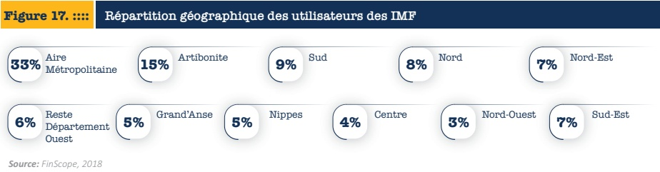

Avec la loi de 2002 sur le fonctionnement des caisses populaires, le champ d'action des CEC est limité à leur département d'implantation, interdisant l'ouverture de succursales en dehors de ce département. Cependant, leur nature endogène leur permet de maintenir une bonne couverture globale à travers tous les départementes du pays. Plus d'une dizaine de CEC parviennent à ouvrir une ou deux annexes dans les villes proches du chef-lieu du département, optimisant ainsi leur portée et leur service aux membres. Le nombre de CEC est passé de 54 en 2011 à plus de 70 en 2024.

Selon les données de la figure n° 16, l'aire métropolitaine de Port-au-Prince accapare à elle seule 33 % des utilisateurs, témoignant d'un accès plus développé aux services financiers dans cette zone. À l'inverse, d'autres départements, comme le Nord-Ouest (3 %), la Grand'Anse (5 %) et les Nippes (5 %), affichent des taux d'utilisation nettement plus faibles.

En effet, en 2012, une évaluation du secteur de la microfinance réalisée par l'USAID confirme que 41 % des prêts du secteur de la microfinance étaient concentrés à Port-au-Prince (USAID, 2012).

En 2019, il a été constaté que les IMF bénéficiaient d'une couverture géographique plus étendue que les CEC. En moyenne, ces dernières possédaient environ 1,8 succursale ou point de service,

<!-- page 51 -->

tandis que les IMF en comptaient 3,9 (The Economist, 2019). Les IMF avaient ainsi une capacité plus importante à atteindre une clientèle plus large, ce qui leur permettait de fournir des services financiers dans des zones géographiques plus diversifiées et souvent plus éloignées.

L'écart constaté suggère que certaines institutions de microfinance sont confrontées à des défis significatifs liés aux faiblesses des infrastructures de base et à un environnement général difficile.

Ce déséquilibre met en évidence l'opportunité de renforcer les politiques publiques liées à l'inclusion financière en Haïti. Bien que les institutions de microfinance (IMF) jouent un rôle crucial, leur concentration dans les centres urbains ouvre la voie à des initiatives visant à étendre leur présence dans les zones rurales, offrant ainsi à un plus grand nombre de personnes l'accès au système financier formel.

Figure 18. …… Point de Service: Des CEC(s) aux IMF(s)

| Category | Percentage (%) |
| --- | --- |
| IMF | 132.73 |
| Nombre de comptes | 1396 |
| IMP régulées | 19 |
| Taux d'inclusion financière des IMF | 30 |
| Distribution de crédit au 30 septembre 2025 | 39 |
| Prêts Hommes | 10 |
| Points de service de Microfinance | 179 |

Source: Cartographie de l'inclusion financière

| Membres | Anні职业发展情态 | Anніชترب (Centre for Biological Composition) |
| --- | --- | --- |
| Femmes |   | 482 375 |
| Hommes | 719 570 | 37 163 |
| Personnes Morales |   | 72 619 |
| Emprunteurs |   | 23 265 |
| Personnes Morales | 1 239 108 |   |

Pour remédier à cette situation, il est important de mettre en place des stratégies ciblées visant à étendre l'accès aux services financiers dans les régions défavorisées. Cela pourrait passer par le renforcement des infrastructures financières, la mise en place de partenariats avec les acteurs locaux ainsi que le développement de produits financiers plus adaptés au contexte.

<!-- page 52 -->

En outre, selon les indicateurs publiés dans le magazine The Economist, le score microscopique pour le secteur est évalué autour de 35, ce qui est relativement bas par rapport à la moyenne régionale estimée autour de 51 (The Economist Group, 2019). Ce score reporté sur la figure ci-dessous, indique des insuffisances dans le soutien réglementaire et les conditions opérationnelles pour ces institutions.

Figure 19. ::::

Indicateurs microscopiques de secteur

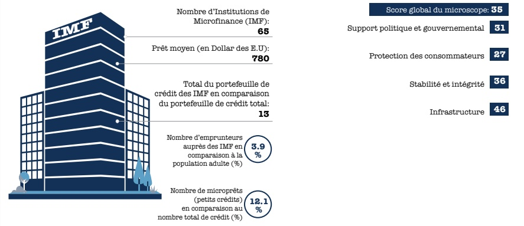

Source: The Economist Group, 2019

En termes de distribution de crédit, au 30 septembre 2023, les banques ont accordé 66 % des prêts aux hommes et 34 % aux femmes. Du côté des CEC, les statistiques montrent 57 405 emprunteurs, répartis entre 33 325 hommes, 23 265 femmes et 815 personnes morales (BRH, 2024). Les institutions de microfinance non mutualistes, avec une clientèle majoritairement féminine, ont desservi plus de 280 000 MPME (micro, petites et moyennes entreprises) (Grace and Associates, 2024). L'étude de Grace conclut que les institutions de microfinance ne desservent que 10 % du total des clients du secteur.

Avec seulement 1 433 000 emprunteurs (74 CEC et 4 IMF), comparé à la population de 18 ans et plus, il est clair que, malgré leurs efforts, ces institutions n'atteignent pas encore pleinement leur potentiel dans le contexte actuel.

Toutefois, le graphique ci-après montre que le portefeuille brut de prêts des CEC (s) a augmenté de manière constante d'année en année. De 2013 à 2023, le portefeuille est passé de 3 milliards de HTG à 15,8 milliards de HTG, ce qui représente une augmentation de plus de 426,67%, soit un taux de croissance annuel moyen du portefeuille brut de prêts des CEC(s) d'environ 19% pour la période.

<!-- page 53 -->

En ce qui concerne le portefeuille brut de prêts des Non mutualistes, il a également connu une hausse, mais de manière plus modérée par rapport aux CEC (s). En 2013, le portefeuille brut de prêts des Non mutualistes était de 1 milliard de HTG, atteignant 4,8 milliards de HTG en 2023, soit une augmentation de 380%, soit un taux de croissance annuel moyen du portefeuille brut de prêts des Non mutualistes d'environ 17% sur cette période.

## Graphique 6

## Evolution du portefeuille brut de prêts de 2012 à 2023

Portefeuille brut de prêts de 2013 à 2023 (en milliards de HTG)

| Year | CEC |
| --- | --- |
| 2013 | 2.5 |
| 2014 | 3.0 |
| 2015 | 3.5 |
| 2016 | 4.0 |
| 2017 | 5.8 |
| 2018 | 7.0 |
| 2019 | 9.5 |
| 2020 | 9.5 |
| 2021 | 11.5 |
| 2022 | 14.5 |
| 2023 | 15.8 |

Source: Cartographie d'Inclusion Financière / BRH

| Year | Non CEC (%) | Blue Line (%) |
| --- | --- | --- |
| 2014 | 61% | 7% |
| 2015 | 5% | 16% |
| 2016 | 12% | 14% |
| 2017 | 49% | 36% |
| 2018 | 25% | 13% |
| 2019 | 5% | 20% |
| 2020 | 12% | 12% |
| 2021 | 13% | 18% |
| 2022 | 4% | 28% |
| 2023 | 13% | 7% |

Les deux segments ont connu une croissance, suggérant une expansion globale du crédit. Toutefois, les CEC (s) ont connu une croissance plus rapide et plus importante que les Non CEC (s). Le portefeuille des CEC (s) a augmenté de 12,8 milliards de HTG sur la période analysée, tandis que celui des Non CEC(s) a augmenté de 3,8 milliards de HTG. L'écart entre les portefeuilles des CEC (s) et des Non CEC (s) s'est élargi au fil du temps. En 2013, l'écart était de 2 milliards de HTG, tandis qu'en 2023, il est passé à 11 milliards de HTG. Cette forte croissance du portefeuille brut de prêts des CEC (s) traduit une adoption accrue et une confiance plus grande dans les coopératives d'épargne et de crédit par rapport aux IMF non CEC.

Par ailleurs, l'éducation financière des nouveaux membres est intégrée dans la charte des CEC (s). Ces initiatives jouent un rôle crucial en facilitant l'intégration des nouveaux membres dans la vie de l'institution tout en renforçant leur capacité à établir des relations d'intermédiation financière plus durables. De plus, certaines IMF, notamment ACME et FONKOZE, sont très impliquées dans l'éducation financière de leurs clients en utilisant le programme d'éducation financière numérique, appelé Lista, testé sur environ 500 clients d'ACME suite au lancement du PNEF en 2020.

<!-- page 54 -->

Pour maximiser leur impact et améliorer leur efficacité, il est essentiel de renforcer le cadre règlementaire, améliorer la protection des consommateurs, adapter les politiques d'assurance et créer un environnement plus favorable pour les institutions de microfinance.

### 7.4 Les Paiements numériques: L'énergie des transactions financières modernes

L'introduction des agents non bancaires dans le paysage financier en Haïti, suite au séisme de 2010, marque une évolution significative dans la prestation des services financiers dans le pays. L'utilisation de ces agents facilite la diminution des coûts de service en offrant une solution adaptée aux exclus volontaires ou involontaires du système financier. L'inclusion financière, selon les perspectives de l'Alliance pour l'Inclusion Financière (AFI) et de la Banque mondiale, implique que les produits et services financiers soient abordables pour les clients.

Une composante axée sur la promotion de la réduction des coûts de transferts a été intégrée au projet Green Back, mis en œuvre en Haïti avec l'appui des spécialistes de la Banque mondiale en 2019. Des rencontres et des groupes de discussion ont été organisés pour recueillir des informations sur les impressions des bénéficiaires concernant les coûts de transferts, tout en les sensibilisant aux meilleures options pour réduire les coûts, tant pour eux-mêmes que pour les expéditeurs.

#### 7.4.1 Évolution du réseau des agents non bancaires

Les lignes directrices sur les banques à distance émises par la BRH fixent la responsabilité des institutions de dépôts et de leurs agents non bancaires. Les institutions financières partenaires (banques, CEC, IMF) s'assurent que les transactions sont conformes à la réglementation en ce qui a trait aux règles relatives à la connaissance du client en matière de lutte contre le blanchiment. Les agents sont autorisés à effectuer l'ouverture de comptes pour l'institution financière, des opérations de dépôt et de retrait en espèces, et des transferts de fonds, agissant à la fois comme agents payeurs et agents de transfert mobile.

Cette double fonction renforce leur utilité dans les communautés mal desservies financièrement, leur permettant de répondre à une gamme variée de besoins financiers. L'analyse des données pour l'évolution de l'un des réseaux pour la période 2014-2020 fournira des informations pertinentes sur l'évolution de cette innovation dans le pays.

<!-- page 55 -->

Portefeuille brut de prêts de 2013 à 2023 (en milliards de HTG)

| Year | Value |
| --- | --- |
| 2014 | 950 |
| 2015 | 1480 |
| 2016 | 2200 |
| 2017 | 2350 |
| 2018 | 3000 |
| 2019 | 3250 |
| 2020 | 3350 |

Source: BRH, 2018

| Year | Value |
| --- | --- |
| 2014 | 729 |
| 2017 | 2264 |
| 2020 | 3248 |

L'implémentation des agents non bancaires en Haïti entre 2014 et 2020 a considérablement augmenté l'accès aux services financiers dans des zones traditionnellement sous-desservies, en simplifiant des opérations telles que les dépôts, les retraits et les transferts d'argent. Cette initiative a enregistré une croissance remarquable de 210 % entre 2014 et 2015, suivie d'une augmentation de 345 % entre 2017 et 2020. Grâce à ces développement, l'offre de services financiers s'est largement étendue, la couverture géographique s'est améliorée et l'accès aux services financiers a été étendu aux populations jusqu'alors exclues du système bancaire traditionnel en Haïti.

Par ailleurs, le nombre d'agents non bancaires est passé de 2 264 en 2017 à plus de 3 248 en 2020. Cette augmentation suggère une plus grande disponibilité des services financiers, en particulier dans les zones financièrement mal desservies. Dans le département de l'Ouest, le nombre élevé de points financiers (2 520) témoigne d'une meilleure inclusion financière, grâce à la densité d'agents non bancaires et de sous- agents de maisons de transfert par habitant.

En outre, toutes les banques commerciales offrent actuellement des cartes de débit et de crédit. L'analyse des données de FinScope 2018 révèle un intérêt marqué pour les services de cartes de débit. Celles-ci facilitent un accès rapide aux services bancaires de base, offrent une flexibilité accrue et renforcent l'autonomie financière. Les distributeurs automatiques de billets (ATM) constituent une composante essentielle de l'infrastructure financière en Haïti. Dans le cadre du projet de modernisation des caisses, la BRH a facilité l'acquisition de trois (3) ATM pour trois (3) grandes caisses du Réseau de la Fédération des Caisses Populaires Le Levier, dans le but d'encourager l'expansion dynamique.

<!-- page 56 -->

#### 7.4.2 Les Distributeurs Automatiques de Billets (ATM)

Les données FinScope 2018 révèlent un grand intérêt pour les cartes de paiement utilisées pour les achats de biens et services ainsi que pour les retraits de fonds dans les ATM. Les données de la SNIF indiquent qu'en 2011, Haïti était faiblement desservi en ATM, avec seulement 53 machines dans tout le pays. Le schéma ci-dessous retrace l'évolution du développement des ATM dans le pays.

Évolution en % du nombre d'ATM

| Year | Value |
| --- | --- |
| 2014 | 80 |
| 2017 | 175 |
| 2019 | 295 |

| Year | Value |
| --- | --- |
| 2014 | 60 |
| 2017 | 155 |
| 2019 | 250 |

Source: Indicateurs du développement mondial et base de données sur le développement financier mondial

Une amélioration significative a été constatée dans le déploiement des ATM (s) au cours de cette dernière décennie. Avant 2011, le pays présentait une faible densité d'ATM, avec seulement 53 machines sur l'ensemble du territoire. Cependant, une dynamique positive s'est engagée à partir de 2014, avec une augmentation du nombre d'ATM à 74 unités. Cette tendance s'est accentuée jusqu'en 2019, où le nombre total d'ATM a atteint 285 unités, représentant une augmentation impressionnante de plus de 285 % sur une période de cinq ans. Après dix ans, le nombre de guichets automatiques (ATM) a plus que triplé, passant de 113 à 425 unités, soit une augmentation de 276 %.

Cette expansion remarquable des distributeurs automatiques de billets suggère un investissement sectoriel spécifiquement axé sur l'augmentation de l'inclusion financière. Elle témoigne également d'un engagement accru envers la modernisation du système financier, marquant une transition vers une économie moins dépendante de l'argent liquide et une adoption croissante de services bancaires numériques. De plus, cette évolution reflète une amélioration significative des infrastructures financières, laissant présager une plus grande inclusion financière.

<!-- page 57 -->

#### 7.4.3 Transferts d'argent et inclusion financière

Les transferts d'argent permettent aux bénéficiaires d'améliorer leurs conditions de vie. Ils augmentent leurs revenus familiaux, offrent une protection contre les risques financiers, facilitent l'accès à l'éducation et fournissent un capital pour créer de petites entreprises. C'est un moyen important d'inclusion financière. En Haïti, les activités de transfert de fonds sont régies, entre autres, par les lois du 14 mai 2012 sur les banques et autres institutions financières, les décrets du 6 juillet 1989 et du 5 juin 2020 sur les maisons de transfert et la Circulaire 114-3 sur les normes relatives au transfert de fonds internationaux sans contrepartie émises par la BRH en 2021.

| Category | Name |
| --- | --- |
| Graphique | Infras |
| CAM Transfert | Sogexpress |
| Unitransfert | Vigo Capital Transfert |
| CWT-Rapid Transfert | MONEY GRAM (Unibank) |
| MONEY GRAM (BUH) |   |

Source: DAT - BRH

| Category | Value (%) |
| --- | --- |
| 1 | 25 |
| 2 | 24 |
| 3 | 23, 11, 7 |
| 4 | 18 |
| 5 | 7, 2 |
| 6 | 5, 2 |
| 7 | 3, 3 |

Entre 2012 et 2022, huit principales institutions ont opéré sur ce marché en se partageant les parts de manière significative. Le marché des transferts en Haïti est fortement dominé par trois acteurs principaux : CAM Transfert, Sogebank/Sogexpress et Unitransfert, qui contrôlent respectivement 25,03 %, 23,98 % et 23,50 % du marché. Ensemble, ils détiennent plus de 72 % des parts de marché, ce qui indique une forte confiance et une large utilisation de leurs services par les consommateurs haïtiens. Vigo Capital Transfert se positionne en quatrième place avec 11,82 %, suivi de CWT-Rapid Transfert à 7,18 %. MoneyGram, via ses partenariats avec Unibank et BUH, possède des parts de marché plus modestes de 5,16 % et 3,32 % respectivement. Enfin, Prism Haïti représente une part négligeable du marché avec seulement 0,01 %.

En 2023, les envois de fonds vers les pays à faible revenu et à revenu intermédiaire ont représenté, 669 milliards de dollars (Banque Mondiale, 2023). En Haïti, les envois de fonds constituent une part essentielle de l'économie, soutenant financièrement les familles et favorisant le développement communautaire.

<!-- page 58 -->

| Category | Value |
| --- | --- |
| CAM Transfert | 6050 |
| Sogexpress | 5800 |
| Unitransfert | 5.68 |
| Vigo Capital Transfert | 2.86 |
| CWT-Rapid Transfert | 1.73 |
| Money Gram (Unibank) | 1.25 |
| Money Gram (BUH) | 0.8 |
| Prism Haiti | 0.8 |
| Prism Haiti | 0.8 |

Source: DAT - BRH

Entre 2012 et 2022, plusieurs entreprises ont facilité ces transferts, avec des volumes de transactions variés. Au cours de cette période, Haïti a reçu un total de 24,1 milliards de dollars du reste du monde. Les banques et les maisons de transfert permettent non seulement aux Haïtiens de recevoir des fonds de l'étranger, mais elles contribuent également à stabiliser l'économie locale et à réduire l'exclusion financière.

Cet état de fait montre la nécessité d'investir dans des infrastructures financières solides, telles que des plateformes de paiement efficaces, et d'encourager un cadre juridique adéquat favorisant la création de réseaux d'agents non bancaires étendus et d'autres solutions de paiement numérique fiables et accessibles localement. En garantissant la stabilité et la résilience du système de paiement dans son ensemble, ces mesures pourraient renforcer la capacité du système à faire face aux différents défis, tels que ceux posés par les multiples crises auxquelles Haïti est confrontée. Cela pourrait également contribuer à la valorisation des ressources internes, garantir une croissance économique durable fondée sur des flux endogènes, et favoriser une prospérité partagée pour l'ensemble de la population.

### 7.5 - L'Inclusion numérique: Quel Rôle pour les Nouveaux moyens de paiement?

C'est dans un contexte post-séisme, le 17 septembre 2010, que la BRH a émis des directives aux institutions financières de dépôt (banques, CEC) pour promouvoir les activités de banque à distance et renforcer le système de paiements en général. Cette réglementation a coïncidé avec le lancement du projet Haitian Mobile Money (HMMI) par l'USAID et la Fondation Bill & Melinda Gates (USAID, 2014). Cette initiative, visant à encourager la créativité numérique, a ouvert la voie au développement de nombreux partenariats stratégiques, à la création de nombreuses innovations, et à l'émergence de nouveaux acteurs dans le paysage financier, dont les technologies financières (fintechs). Depuis, la tendance n'a cessé d'évoluer, et aujourd'hui les fintechs peuvent accéder

<!-- page 59 -->

seules au marché financier et se constituer un portefeuille de clients.

#### 7.5.1 Le Paysage des Innovations: Cartographie et tendances

Les fintechs, en éliminant les obstacles traditionnels à l'accès aux services financiers, jouent un rôle important dans la promotion de la résilience financière et de l'inclusion financière. Le schéma ci-dessous reflète la situation du paysage des innovations lors du lancement de la Stratégie Nationale d'Inclusion Financière (SNIF) en 2014.

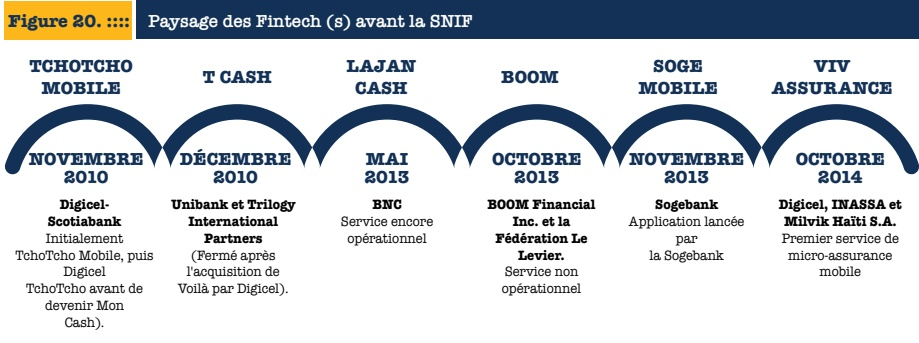

Cette diversité de services illustre l'évolution et l'expansion des solutions financières mobiles en Haïti, facilitant l'accès aux services pour une plus large partie de la population, dont l'inclusion financière des exclus.

#### 7.5.2 Des Moyens de Paiement Résilients: Le Cadre du numérique

Une analyse du secteur de la digitalisation des paiements, réalisée par l'AFI et la BRH en 2018, a été mise à jour en 2020. Cette analyse fournit des informations pertinentes sur les différents types de portefeuilles d'argent mobile disponibles, leurs capacités, et les types de produits proposés, tels que le cash-out et le cash-in, qui concernent à la fois les particuliers et les entreprises, désignés par les termes B2B, P2P, ou C2B (AFI, 2020). En outre, elle montre comment le secteur a évolué de 2011 à 2020. Aujourd'hui, le taux de pénétration des téléphones mobiles, évalué à 35 %, a plus que doublé, ce qui représente une opportunité énorme pour le développement de produits similaires.

<!-- page 60 -->

En effet, en raison de leurs caractéristiques, les fintechs se révèlent être un moyen efficace de paiement durant les périodes de turbulence en Haïti, en améliorant l'accès et l'utilisation des services financiers, surtout face aux défis posés par des infrastructures endommagées. Les innovations continues dans ce secteur promettent de renforcer encore davantage l'inclusion financière du pays. Le schéma ci-dessous reflète l'environnement dans lequel elles évoluent.

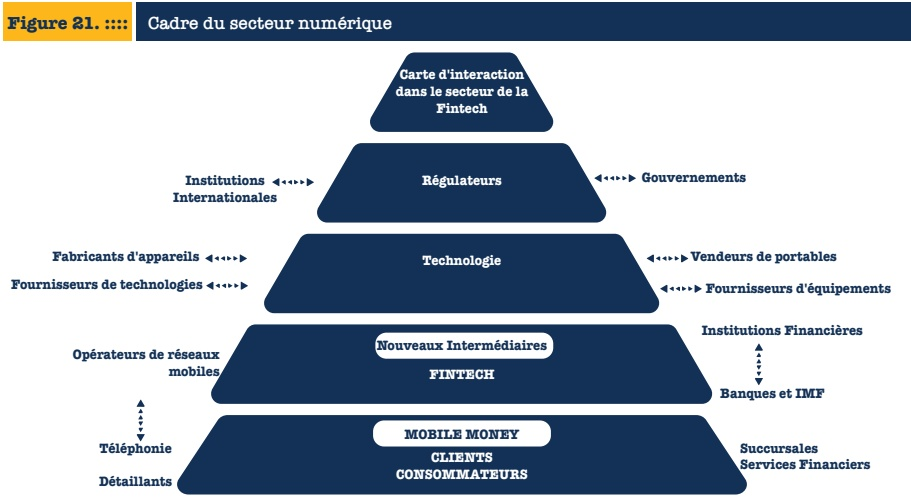

Source: GSMA, 2020

Le schéma ci-dessus présente les interactions entre les différents acteurs impliqués dans le développement du marché des Fintechs. En effet, ces innovations financières nécessitent un cadre réglementaire et législatif approprié pour soutenir leur développement. Un environnement institutionnel stable et transparent est également essentiel pour stimuler la confiance des investisseurs, encourager l'innovation et réduire les risques. Des politiques publiques, pouvant inclure des incitations fiscales pour les investissements dans les entreprises émergentes, peuvent favoriser l'expérimentation de nouveaux modèles commerciaux.

#### 7.5.3 Les Fintech(s) en Haiti: Quelles sont les tendances?

Malgré ces changements, le marché de la Fintech continue de prospérer, grâce aux alliances stratégiques entre les acteurs du secteur financier, les entreprises technologiques et les autres parties prenantes, en accord avec les directives du banked model. Ces alliances ont permis aux banques partenaires d'accéder à de nouveaux segments de clientèle et de s'étendre davantage

<!-- page 61 -->

dans des zones auparavant inexplorées. Cependant, avec la nouvelle régulation en place depuis décembre 2021, les Fintechs peuvent désormais exploiter directement le marché. La figure ci-après présente l'ensemble des Fintechs qui interagissent sur le marché. Cependant, il convient de noter que seulement 5 Fintechs de paiement électronique (FSP) ont reçu l'agrément de la BRH en 2024. Il s'agit de Mon Cash, Mago, Lajan Cash et Natcash. Sogeizi et Unibank tout Kote sont intégrées aux systèmes centraux de leurs banques promotrices.

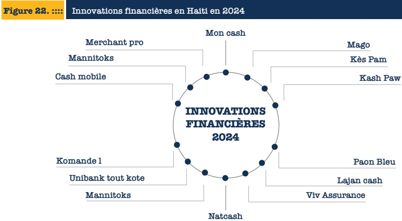

Source: Banque de la République d'Haïti

Antonio Pascual, du FMI, dans son rapport sur la stabilité financière dans le monde en 2022, alerte sur les risques que l'introduction rapide des fintechs pourrait créer pour la stabilité du système financier en l'absence de contrôles adéquats (FMI, 2022). La Circulaire 121, émise par la BRH en décembre 2021, impose des normes de conformité strictes aux acteurs et vise à encadrer l'intervention des fintechs de paiement afin de limiter les risques associés à leur émergence dans le paysage financier haïtien. Elle ouvre la voie à une plus grande concurrence et à davantage de créativité dans le domaine, toutes susceptibles de conduire l'inclusion financière vers de nouvelles avenues.

Malgré les avancées, en raison de certaines contraintes liées à d'autres politiques publiques sectorielles touchant l'économie réelle, l'offre de produits et services financiers numériques reste très limitée. Dans certaines zones du pays, les infrastructures technologiques et énergétiques sont encore inadéquates pour soutenir certaines pratiques innovantes déjà en application dans d'autres pays ayant pourtant des profils similaires à celui d'Haïti. En outre, le marketing de données fait partie des approches utilisées par de nombreuses fintechs pour offrir des produits et services de plus en plus personnalisés. Cependant, les limitations du cadre légal concernant la sécurisation

<!-- page 62 -->

et la confidentialité des données personnelles dans le pays peuvent limiter l'accès aux ressources informationnelles.

Les catastrophes naturelles et les crises qu'a connues le pays au cours de ces dernières années ont mis en évidence la nécessité d'un accès rapide et fiable aux services financiers, surtout dans les régions touchées par ces événements. Les fintechs, avec leur capacité à innover rapidement et à fournir des solutions financières décentralisées, offrent des opportunités considérables qui pourraient être utilisées pour stimuler la demande et une croissance inclusive, avec des effets d'entraînement sur le développement économique du pays. Comme pour les autres institutions du système financier, la liste des FSPE(s) agréées est mise à jour régulièrement sur le site de la Banque centrale.

Selon la firme GSMA, l'environnement mondial des fintechs est estimé aujourd'hui à 228,24 milliards de dollars américains (GSMA, 2024). Une croissance de 11,72 % est prévue pour les cinq prochaines années, ce qui devrait porter le marché à 397,24 milliards de dollars américains.

Graphique 11 Prévision Valeur Fintech 2024 à 2029 (en milliards de USD)

| Year | Value |
| --- | --- |
| 2024(P) | 250.0 |
| 2025(P) | 275.0 |
| 2026(P) | 290.0 |
| 2027(P) | 320.0 |
| 2028(P) | 365.0 |
| 2029(P) | 390.0 |

Source: GSMA. 2024

| Year | Value |
| --- | --- |
| 2025(P) | 01200 |
| 2026(P) | 01200 |
| 2027(P) | 01200 |
| 2028(P) | 01200 |
| 2029(P) | 01200 |

Une prévision de croissance aussi significative pourrait créer des effets induits qui se répercuteraient également sur les marchés régionaux et locaux. De plus, cette situation pourrait inciter nos fintechs locales à innover davantage, non seulement pour tirer parti de cette croissance et rester compétitives, mais aussi pour favoriser une plus grande inclusion financière.

<!-- page 63 -->

#### 7.5.4 Des SPIH(s) à la Carte: Des moyens de paiement innovants

Le RGTS, ou familièrement le SPIH (Système de Paiement Interbancaire Haïtien), a été établi en 2007 pour faciliter le virement des fonds entre les agents économiques. Depuis, un certain nombre d'innovations ont été introduites dans le système. Ces innovations présentent plusieurs avantages : l'utilisateur n'est pas obligé de se déplacer pour effectuer des opérations, et les coûts de transaction sont abordables. Cela se traduit par des impacts positifs sur la qualité de vie des citoyens.

##### 7.5.4.1 Évolution des transactions SPIH

D’après le graphique no. 12 ci-dessous, le nombre de transactions SPIH a connu une évolution en dents de scie sur la période 2011-2023. Après une hausse initiale de 23 % entre 2011 et 2012, on observe une croissance de 23,38 % entre 2012 et 2013. Les années suivantes connaissent une augmentation plus modérée, avec des pics à 36 % en 2013-2014 et 54 % en 2014-2015.

À partir de 2015-2016, on constate une stagnation puis une légère baisse du nombre de transactions SPIH. Cette baisse se poursuit jusqu'en 2017-2018 avec un recul de 27 %. Heureusement, la tendance s'inverse brutalement en 2018-2019 avec une envolée de 259 %. Les deux années suivantes voient une augmentation plus modérée mais constante, respectivement de 36 % et 18 %. En revanche, la période 2021-2022 est marquée par une nouvelle baisse de 21 %, suivie d'une légère reprise de 4 % en 2022-2023. Les périodes de diminution observées pourraient être dues aux perturbations économiques que connaît le pays.

Évolution du SPIH (s)

Nombre de SPIH effectués (En milliers)

| Period | Value |
| --- | --- |
| 2011-2012 | 154 |
| 2012-2013 | 191 |
| 2013-2014 | 258 |
| 2014-2015 | 278 |
| 2015-2016 | 280 |
| 2016-2017 | 264 |
| 2017-2018 | 192 |
| 2018-2019 | 691 |
| 2019-2020 | 937 |
| 2020-2021 | 1011 |
| 2021-2022 | 868 |
| 2022-2023 | 900 |

Source: Banque de la République d'Haiti

| Year | % du nombre de SPIH |
| --- | --- |
| 2012-2013 | 20% |
| 2014-2015 | 35% |
| 2016-2017 | 5% |
| 2018-2019 | 265% |
| 2019-2020 | 35% |
| 2020-2021 | 15% |
| 2021-2022 | -25% |
| 2022-2023 | 5% |

<!-- page 64 -->

Dans l'ensemble, ces données montrent une confiance continue dans le système, avec une adoption régulière des services SPIH. En offrant une plateforme accessible électroniquement pour les virements de fonds entre les banques commerciales haïtiennes, le SPIH permet à une plus grande partie de la population, y compris les personnes vivant dans des zones reculées, d'accéder à des services financiers formels et abordables.

##### 7.5.4.2 Analyse de l'évolution des chèques compensés en Haïti (2012-2023)

L'année 2013 a marqué l'émergence de la compensation électronique par image des chèques (CEIC), une innovation technologique qui devrait également avoir des impacts significatifs sur l'inclusion financière. C'est aussi à cette période que les Coopératives d'Épargne et de Crédit, à travers la fédération Le Levier, ont été admises à la Chambre de Compensation. Le CEIC favorise une transmission rapide de l'image des chèques à partir d'un support électronique et des données associées entre les institutions financières. Ce qui facilite l'accélération du processus en réduisant le délai de traitement des chèques de deux (2) à trois (3) jours ouvrables au lieu de huit (8) précédemment.

Graphique 13

Nombre total de chèques compensés

Nombre de chèques compensés (En millions)

| Year | Value |
| --- | --- |
| 2011-2012 | 2.2 |
| 2012-2013 | 2.37 |
| 2013-2014 | 2.47 |
| 2014-2015 | 2.41 |
| 2015-2016 | 2.11 |
| 2016-2017 | 2.02 |
| 2017-2018 | 1.79 |
| 2018-2019 | 2.11 |
| 2019-2020 | 1.8 |
| 2020-2021 | 2.01 |
| 2021-2022 | 2.02 |
| 2022-2023 | 1.71 |

Source: Banque de la République d'Haiti

Évolution en % du nombre de chèques compensés

| Year | Value (%) |
| --- | --- |
| 2012-2013 | 8.5% |
| 2014-2015 | -1.5% |
| 2015-2016 | -13.0% |
| 2016-2017 | -4.5% |
| 2017-2018 | -11.0% |
| 2018-2019 | 18.0% |
| 2019-2020 | -12.5% |
| 2020-2021 | 9.0% |
| 2021-2022 | 0.0% |
| 2022-2023 | -15.0% |

L'analyse des données sur le nombre de chèques compensés en Haïti entre 2011 et 2023 est marquée par des périodes de croissance et de déclin. La période de 2012 à 2014 est caractérisée par une augmentation du nombre de chèques compensés. Cette croissance s'explique par une amélioration du système de compensation bancaire, confirmant la mise en place de la compensation électronique par image des chèques. La stabilité du système bancaire et la confiance des agents économiques dans les institutions financières sont des déterminants importants du recours aux chèques.

<!-- page 65 -->

Toutefois, entre 2015 et 2018, on observe une tendance à la baisse du nombre de chèques compensés. La disponibilité des guichets automatiques, des moyens de paiement électroniques, l'accès à Internet et les services financiers mobiles favorisent le développement de modes de paiement alternatifs, réduisant ainsi le recours aux chèques.

Malgré une légère reprise en 2019, l'utilisation des chèques compensés continue de diminuer. Cela reflète une évolution plus globale vers la dématérialisation des paiements. Globalement, on observe une tendance à la baisse sur la période considérée, entrecoupée de quelques pics de hausse. Cependant, il est important de noter que le chèque reste encore un moyen de paiement utilisé par une partie de la population, notamment chez les personnes les plus éduquées et financièrement incluses.

##### 7.5.4.3 De l'encre au Numérique: Une Analyse comparative des transactions de 2012 à 2023

Entre 2011-2014, les transactions SPIH ont augmenté de manière significative, enregistrant des croissances de 24 % et 36 %, respectivement, tandis que les chèques compensés ont également connu une légère augmentation de 8 % et 4 % sur la même période. De 2014 à 2018, les transactions SPIH montrent des signes de stagnation et de déclin, avec des baisses de 6 % et 27 %, tandis que les chèques compensés subissent une baisse progressive mais constante de 2 %, 13 %, 4 %, et 11 %. En 2018-2019, les transactions SPIH connaissent une augmentation spectaculaire de 259 %, tandis que les chèques compensés augmentent également de 18 %. Entre 2021 et 2023, les SPIH subissent une baisse significative de 21 %, suivie d'une légère reprise de 4 %, tandis que les chèques compensés stagnent à 0 % avant de chuter de 15 %.

Comparaison de l'évolution des SPIH et des chèques compensés

| Period | Évolution chèques compensés (%) | Evolution SPIH (%) |
| --- | --- | --- |
| 2012-2013 | 0 | 20 |
| 2013-2014 | -2 | 35 |
| 2014-2015 | -5 | 5 |
| 2015-2016 | -20 | -5 |
| 2016-2017 | -10 | -10 |
| 2017-2018 | -15 | -30 |
| 2018-2019 | 12 | 260 |
| 2019-2020 | -20 | 30 |
| 2020-2021 | 5 | 15 |
| 2021-2022 | -5 | -25 |
| 2022-2023 | -25 | -45 |

Source: Banque de la République d'Haiti

<!-- page 66 -->

La tendance générale montre que lorsque les transactions SPIH augmentent de manière significative, les chèques compensés ont tendance à diminuer. Cela suggère une substitution partielle, où les utilisateurs abandonnent les chèques au profit de solutions de paiement plus pratiques, rapides et sécurisées. Les périodes de croissance des transactions SPIH, particulièrement en 2018-2019, indiquent une adoption technologique accrue, avec les utilisateurs préférant des méthodes de paiement plus modernes. Cependant, des diminutions importantes sont observées tant pour les SPIH que pour les chèques compensés à certains moments, reflétant les chocs économiques et technologiques que l'activité économique a subis ces cinq dernières années. Ces chocs influencent fortement les deux types de transactions, provoquant des fluctuations et des variations périodiques.

L'analyse montre une corrélation inverse partielle entre les transactions SPIH et les chèques compensés, où une augmentation significative des SPIH coïncide souvent avec une diminution des chèques compensés. La transition vers les SPIH est un processus graduel qui peut prendre plusieurs années. Des résistances peuvent persister, notamment chez les populations plus âgées ou moins familiarisées avec les technologies numériques. Pour une transition plus stable et une adoption accrue des SPIH, il est important de continuer à innover et à promouvoir les avantages des transactions électroniques. L'éducation financière des utilisateurs doit également être renforcée pour leur faire comprendre les bénéfices des transactions électroniques.

La hausse continue des transactions SPIH observée de 2019 à 2023, passant de 192 milliers en 2019 à 900 milliers en 2023. Le graphique no 14 montre une adoption croissante du système SPIH par les agents économiques, malgré une baisse en 2022.

L'analyse des données montre une corrélation faible mais négative entre l'utilisation des chèques compensés et les transactions SPIH sur certaines périodes.

En 2018-2019 et 2019-2020, on observe des années où l'augmentation de l'utilisation des chèques coïncide avec une stagnation ou une baisse des SPIH. L'année 2020-2021 est une année de croissance pour les deux méthodes, suggérant une augmentation globale des transactions financières. Toutefois, en 2021-2022, on assiste à une forte diminution des chèques alors que les SPIH restent stables, ce qui pourrait indiquer une transition des utilisateurs vers les SPIH. L'année 2022-2023 présente une baisse des SPIH et une légère augmentation des chèques, indiquant peut-être un retour aux chèques.

<!-- page 67 -->

|   | Nombre de SPIH (variation) | Nombre de chèques compensés HTG et USD (%) |
| --- | --- | --- |
| 2018-2019 | 72 | 0% |
| 2019-2020 | 26% | -16% |
| 2020-2021 | 15% | 9% |
| 2021-2022 | -27% | -10% |
| 2022-2023 | 4% | -15% |

Source: Banque de la République d'Haiti

L'analyse des variations annuelles montre une corrélation complexe entre l'évolution des transactions SPIH et celle des chèques compensés. Bien qu'il n'y ait pas de tendance inverse claire et constante entre les deux, certaines périodes montrent des indices de substitution entre les SPIH et les chèques.

Le SPIH a un impact évident sur la réduction de l'utilisation des chèques, contribuant à un environnement bancaire plus efficace et moins encombré. L'adoption des transactions électroniques via le SPIH aide à réduire la nécessité pour les bénéficiaires de se rendre physiquement dans les succursales bancaires, diminuant ainsi la charge sur les infrastructures bancaires et améliorant l'efficacité du système de paiement global.

### 7.6 L'Univers des cartes de paiement

En raison du pouvoir d'achat limité de la majorité des citoyens, le nombre de cartes de crédit en circulation reste restreint. La population reconnaît qu'il s'agit d'un moyen de paiement pratique et sécurisé. Avec la montée de l'e-commerce exacerbée par la réalité post-Covid, la carte de crédit est de plus en plus utilisée par les ménages. Facilitant les paiements en ligne et à l'étranger, elle est particulièrement appréciée par les usagers qui préfèrent ne pas transporter d'espèces. Dans l'ensemble, une utilisation adéquate permet de bâtir un historique de crédit. En effet, un bon historique de crédit est essentiel pour obtenir d'autres formes de crédit, notamment des prêts commerciaux, des prêts à la consommation et, en fonction des revenus, des prêts au logement.

L’utilisation des cartes de crédit dans le paysage financier haïtien remonte à 1996. Depuis lors, elle s’est démocratisée. En 2018, le volume des paiements par carte de crédit s’élevait à 2,323 milliards de gourdes, enregistrant une hausse significative en 2019 pour atteindre 3,131 milliards de gourdes. Cette augmentation est perçue comme un signe de renforcement de la confiance dans

<!-- page 68 -->

l'utilisation des cartes de crédit et d'élargissement de l'accès à ces services financiers. Le volume a continué d'augmenter en 2020, atteignant environ 3,886 milliards de gourdes. Ainsi, entre 2018 et 2021, une augmentation de 55 % du volume des transactions par carte de crédit a été observée, reflétant une expansion notable dans le paysage financier haïtien.

Évolution en milliards de gourdes (2018-2021)

| Year | Value |
| --- | --- |
| 2018 | 23000000000 |
| 2019 | 31000000000 |
| 2020 | 39000000000 |

Source: Banque de la République d'Haiti

| Year | Value | Percentage |
| --- | --- | --- |
| 2018 | 2.3 |   |
| 2019 | 3.1 |   |
| 2020 | 3.8 | 55% |
| 2021 | 3.6 | 50% |

Avant l'introduction des cartes de banques locales, les banques haïtiennes agissaient comme intermédiaires pour MasterCard et Visa. Toutes les dépenses effectuées sur les cartes de crédit étaient libellées en dollars, obligeant ainsi les utilisateurs à se procurer des dollars pour effectuer leurs paiements, ce qui mettait une pression sur les réserves de dollars en circulation.

À partir de 2016, dans le cadre de sa politique monétaire, la Banque de la République d'Haïti (BRH) a adopté une nouvelle réglementation stipulant que toutes les transactions devaient être effectuées en monnaie locale. Cette mesure visait à réduire la dépendance excessive au dollar américain dans les transactions économiques. Malgré ces avancées, le paysage financier haïtien, encore fortement basé sur le cash, continue de poser des défis importants pour la promotion des cartes de débit et de crédit ainsi que pour d'autres formes de paiement électronique (BRH, 2016).

<!-- page 69 -->

### VIII. DE L'UTILISATION DES COMPTES: L'INCLUSION FINANCIÈRE ACTIVE

### 8.1 Principe de diversité

L'inclusion financière ne se limite pas seulement à l'accès aux services financiers, mais également à leur utilisation efficace. Cette utilisation adéquate des produits est essentielle pour favoriser le développement économique et social, et elle doit être abordée en tenant compte de la diversité des besoins et des contextes des individus, des entreprises et des communautés. L'approche du cycle de vie financier reconnaît l'impératif d'adapter les services financiers aux besoins changeants des individus à différentes étapes de leur parcours financier. Dans ce contexte, l'approche prend en compte la diversité des besoins financiers et des pratiques de consommation, considérant les aspects personnels, institutionnels et communautaires. Cette diversification s'exprime au niveau des institutions elles-mêmes, tant, dans leur offre de produits financiers incluant des prêts, des produits d'épargne, des assurances et des services de transfert, que dans les produits non financiers, notamment l'éducation financière. Par ailleurs, cette diversité se manifeste également dans un paysage financier caractérisé par la présence de banques commerciales, d'établissements de crédit, de sociétés financières de développement, de sociétés de crédit-bail, de sociétés de cartes de crédit, d'institutions de microcrédit, de caisses populaires, de maisons de transfert, d'institutions de microfinance, et enfin, de fournisseurs de paiement électronique (FSPE).

### 8.2 L'offre de produits

Les transferts représentent un produit de paiement de base, sur lequel plusieurs autres produits et services financiers peuvent être greffés. De 2011 à 2023, les transferts reçus par Haïti ont connu une augmentation constante, passant de 1,55 milliard de dollars en 2011 à 3,41 milliards de dollars en 2023.

Transferts reçus (Millions de dollars EU)

| Year | Transerts reçus (Millions de dollars EU) |
| --- | --- |
| 1994 | 50.00 |
| 1995 | 70.00 |
| 1996 | 120.00 |
| 1997 | 200.00 |
| 1998 | 300.00 |
| 1999 | 450.00 |
| 2000 | 600.00 |
| 2001 | 700.00 |
| 2002 | 800.00 |
| 2003 | 900.00 |
| 2004 | 1000.00 |
| 2005 | 1100.00 |
| 2006 | 1200.00 |
| 2007 | 1300.00 |
| 2008 | 1350.00 |
| 2009 | 1400.00 |
| 2010 | 1500.00 |
| 2011 | 1600.00 |
| 2012 | 1700.00 |
| 2013 | 1800.00 |
| 2014 | 2000.00 |
| 2015 | 2200.00 |
| 2016 | 2250.00 |
| 2017 | 2400.00 |
| 2018 | 2700.00 |
| 2019 | 2750.00 |
| 2020 | 3200.00 |
| 2021 | 4000.00 |
| 2022 | 3800.00 |
| 2023 | 3750.00 |

Source: DSBIF/SEI-DAI/BRH

| 年 | (%) |
| --- | --- |
| 1995 | 110% |
| 1996 | 40% |
| 1997 | 70% |
| 1998 | 30% |
| 1999 | 32% |
| 2000 | 39% |
| 2001 | 9% |
| 2002 | 9% |
| 2003 | 27% |
| 2004 | 12% |
| 2005 | 8% |
| 2006 | 9% |
| 2007 | 17% |
| 2008 | 14% |
| 2009 | 2% |
| 2010 | 8% |
| 2011 | 7% |
| 2012 | 6% |
| 2013 | 11% |
| 2014 | 12% |
| 2015 | 12% |
| 2016 | 3% |
| 2017 | 10% |
| 2018 | 14% |
| 2019 | 0% |
| 2020 | 23% |
| 2021 | 25% |
| 2022 | -4% |
| 2023 | 0% |

<!-- page 70 -->

Comme le montre le schéma ci-dessus, cette tendance à la hausse souligne l'importance croissante des transferts internationaux pour l'économie haïtienne. Ces transferts jouent un rôle essentiel dans le flux financier de l'économie locale et représentent un vecteur d'accès aux services financiers pour une population souvent exclue du système bancaire traditionnel. Ils constituent une source significative de revenus pour de nombreux ménages en Haïti et sont cruciaux pour la stabilisation économique et sociale du pays, fournissant un soutien financier vital à de nombreuses familles. De plus, ils contribuent à atténuer les pressions économiques et à renforcer la résilience des communautés face aux chocs économiques et aux crises.

Avec l'introduction, en 2020, des normes concernant les paiements de transferts internationaux sans contrepartie en gourdes, imposées par la BRH aux banques et aux maisons de transfert, de nombreux usagers préfèrent désormais recevoir leurs transferts sur leur compte d'épargne. Cette mesure a sans aucun doute eu un impact sur le nombre de comptes dans le système.

La détention d'un compte d'épargne est un indicateur clé d'inclusion financière et un des piliers fondamentaux de la stabilité financière des ménages. La constitution d'une épargne régulière suggère une plus forte capacité de résilience pendant les périodes de crise. Selon le décret de 2020 sur les institutions de microfinance, seules les sociétés de microfinance agréées par la BRH sont autorisées à mobiliser l'épargne publique. Elles sont deux (2) à pouvoir le faire pour le moment.

Seules trois (3) catégories d'institutions financières peuvent capter des dépôts : les banques, les CEC et les sociétés de microfinance. Les institutions de microfinance (IMF) collectent seulement 3% de l'épargne, tandis que les banques en collectent 97%. À l'inverse, les IMF distribuent 12% du crédit accordé par le système financier, contre 88% pour les banques. Malgré un plus faible taux de collecte d'épargne, les IMF jouent un rôle significatif dans l'octroi de prêts et la collecte d'épargne, tandis que le secteur bancaire gère des volumes plus importants dans les deux domaines.

En 2017, le système financier d'Haïti a octroyé un total de 867 287 prêts. Parmi ceux-ci, 321 307 (environ 37%) ont été accordés par les institutions de microfinance (IMF), tandis que 545 980 (environ 63%) provenaient du secteur bancaire. Cette répartition met en évidence que, bien que le secteur bancaire domine largement en termes de volume de prêts, représentant 88% du total des prêts accordés, les IMF jouent un rôle important en fournissant des services financiers adaptés aux petites entreprises avec des montants de prêts plus modestes, représentant 12% du volume total de prêts accordés. Les banques, quant à elles, se concentrent davantage sur les grandes entreprises en accordant des prêts de montants plus importants.

<!-- page 71 -->

## Prêts - Secteur Bancaire (en milliards de gourdes)

En 2014, le secteur bancaire a accordé des prêts du montant total de 68 milliards de gourdes.

## I

En 2017, les prêts accordés par le secteur bancaire ont augmenté de 50%, attaignant ainsi un total de 102 milliards de gourdes.

2014-2018

En 2023, les prêts accordés par le secteur bancaire ont augmenté de 98,5% par rapport à 2014, atteignant ainsi un total de 135 milliards de gourdes.

| Year | Value |
| --- | --- |
| 2014 | 100 |
| 2015 | 125 |
| 2016 | 150 |
| 2017 | 175 |
| 2018 | 200 |

| Year | Value |
| --- | --- |
| 2019 |   |
| 2020 |   |
| 2021 |   |
| 2022 |   |
| 2023 |   |

Source: Combinaison "Indicateurs du développement mondial"-Banque Mondiale-DAI-BRH

Selon les données récentes fournies par la BRH, le nombre de comptes de prêts en Haïti a enregistré une baisse significative de 2021 à 2023. Le nombre de comptes est passé de 91,733 à 79,508 en 2022, puis à 69,098 en 2023. Cette tendance à la baisse suggère une détérioration de l'utilisation des services financiers dans le pays. Selon cette même étude, la contraction serait plus marquée chez les entrepreneurs du secteur de l'agro-industrie et des services touristiques. De plus, le rapport met en lumière une disparité significative, en 2023, concernant l'octroi de prêts en fonction du genre. En effet, les hommes ont bénéficié de 66% à 79,30% des prêts en devises locales et en dollars, tandis que les chiffres pour les femmes variant entre 34% et 20,70%.

En ce qui concerne les secteurs d'activité mentionnés plus haut, la situation morose peut être attribuée à l'instabilité économique passagère, poussant les individus à adopter une attitude de prudence ou à répondre à des besoins financiers pressants. De plus, la réduction des activités dans certaines zones considérées comme dangereuses peut également limiter l'accès à certains services financiers. Cette conjoncture risque d'entraîner une diminution de la diversification de l'offre de produits financiers et un ralentissement des investissements dans l'économie, réduisant ainsi les opportunités pour ceux qui sont déjà financièrement exclus.

<!-- page 72 -->

## Graphique 19

## 2014

## 2017

En 2014, les dépôts dans le secteur bancaire s'élevaient à 157,55 milliards de gourdes.

Entre 2014 et 2017, les dépôts bancaires ont progressé régulièrement, passant de 157,55 milliards à 243,56 milliards de gourdes, soit une augmentation de 54,60 %.

## 2023

En 2023, les dépôts ont significativement augmenté, atteignant 518,51 milliards de gourdes, ce qui représente une impressionnante croissance de 229,11 % depuis 2014.

| Year | Value |
| --- | --- |
| 2011 | 28.55% |
| 2014 | 43.27% |
| 2017 | 35.79% |
| 2023 | 26.07% |

| Year | Value |
| --- | --- |
| 2014 | 100 |
| 2015 | 110 |
| 2016 | 125 |
| 2017 | 140 |
| 2018 | 150 |
| 2019 | 130 |
| 2020 | 160 |
| 2021 | 190 |
| 2022 | 210 |
| 2023 | 220 |

Source: BRH

Dans les situations de crise, il est impératif que les autorités et les institutions financières soient à l'écoute des besoins de la population et agissent en conséquence. En facilitant un retour à la vie normale dans le pays, elles doivent surveiller de près les tendances et prendre des mesures pour promouvoir des produits et services financiers adaptés à la nouvelle réalité. Cela implique de tenir compte des différentes phases du cycle de vie financier des ménages et des entreprises, afin d'offrir des solutions véritablement pertinentes et utiles.

La résilience dans un contexte aussi fragile est un élément crucial pour assurer la stabilité économique et sociale dans le pays, face aux défis variés et aux chocs imprévus. Des actions concrètes d'appui sont encouragées en faveur des entreprises et les entrepreneurs, ce qui peut contribuer à stimuler l'activité économique et à renforcer une plus grande résilience économique chez les exclus. Ces mesures pourraient inclure des initiatives visant à renforcer la confiance dans le système financier, à accroître l'accès au crédit pour divers segments de la population, et à créer un environnement favorable à l'investissement et à la croissance économique.

<!-- page 73 -->

## IX- ÉGALITE DES GENRES ET RENFORCEMENT DE LA RÉSILIENCE ÉCONOMIQUES

Évaluant l'environnement pour l'inclusion financière, le Global Microscope sur l'inclusion financière de 2019, réalisé par The Economist, classe Haïti en trente-quatrième (34°) position sur 55 pays. L'évaluation était basée sur onze (11) critères, notamment le genre, la protection des consommateurs, les services financiers digitaux, la stabilité et l'intégrité financière. Cette étude met en évidence la nécessité de prendre des mesures spécifiques pour garantir un accès équitable aux services financiers pour les femmes dans le pays. Les données qui suivent permettront de voir comment cet aspect a été pris en compte.

### 9.1 Le Genre sous le feu des données

Les éléments saillants sur ce graphique indiquent qu'en 2011, une prévalence supérieure d'hommes par rapport aux femmes était observée dans l'utilisation des services financiers formels. C'est ce constat d'écart qui, à d'ailleurs, poussé les décideurs à intégrer les femmes parmi les groupes cibles de la SNIF et du Plan National d'Éducation Financière (PNEF). En 2014, l'écart entre les sexes s'est significativement creusé, indiquant que les femmes étaient beaucoup moins présentes que les hommes dans l'utilisation des services financiers.

Graphique 20 Comptes dans les institutions financières

Compte dans les institutions financières (par sexe)

| Year | Female (% age 15+) | Homme (% age 15+) |
| --- | --- | --- |
| 2011 | 21% | 23% |
| 2014 | 14% | 21% |
| 2017 | 27% | 29% |

Source: Stratégie National d'Inclusion Financière

<!-- page 74 -->

La baisse du pourcentage de femmes possédant un compte par rapport à 2011 (passant de 21 % à 14 %) observée contraste fortement avec la diminution plus légère chez les hommes (de 23 % à 21 %) dans le pays. En 2017, bien que l'écart entre les sexes se soit réduit à 2 points de pourcentage, les hommes restaient plus présents que les femmes dans l'utilisation des services financiers. La forte augmentation chez les femmes (de 14 % en 2014 à 27 % en 2017) a contribué à réduire l'écart, mais les hommes continuent d'avoir un léger avantage. Malgré des améliorations récentes, les femmes restent moins présentes que les hommes dans l'utilisation des services financiers formels.

Considérant le niveau d'épargne, il est constaté qu'en 2011, les hommes avaient, dans les institutions financières, un taux d'épargne plus élevé que les femmes, avec un écart de 4 points de pourcentage. Cela montre une disparité de genre où les hommes étaient plus enclins ou capables d'épargner que les femmes. En 2014, l'écart entre les sexes s'est réduit à 1 point de pourcentage. Les taux d'épargne ont diminué pour les deux sexes par rapport à 2011, mais cette baisse a été plus prononcée chez les femmes. Néanmoins, la différence entre les sexes en matière d'épargne s'est amoindrie. En 2017, les femmes ont surpassé les hommes en termes d'épargne dans les institutions financières, avec un écart de 2 points de pourcentage en leur faveur. C'est un renversement significatif par rapport aux années précédentes et indique une amélioration notable de l'inclusion financière des femmes haitiennes.

Graphique 21

Évolution de l'épargne par sexe en 2023

Épargne dans une institution financière

| Year | Female (% age 15+) | Homme (% age 15+) |
| --- | --- | --- |
| 2011 | 16% | 20% |
| 2014 | 9% | 10% |
| 2017 | 13% | 11% |

Source: Banque de la République d'Haïti

L'analyse des données du schéma relatives à l'épargne révèle plusieurs tendances importantes concernant les niveaux d'épargne des deux groupes cibles. Les informations montrent un écart dans le niveau d'épargne des femmes par rapport aux hommes en 2011. L'écart persiste, en 2014, passant de quatre (4 %) à un (1 %), bien qu'une diminution soit observée dans le niveau d'épargne chez les hommes pour les périodes en discussion. Cette tendance peut être associée à des difficultés d'accès aux services financiers ou des pressions économiques accrues.

Selon une étude de l'Organisation de Coopération et de Développement Économiques (OCDE, 2008),

<!-- page 75 -->

« les femmes réinvestissent jusqu’à 90 % de leurs revenus dans leur famille et leur communauté, contre seulement 30 à 40 % pour les hommes ». Cette étude suggère que la tendance observée pour les femmes peut être associée à des pressions économiques, investissant souvent dans des soins de santé et les frais de nourriture pour maintenir leur famille. La remontée constatée, en 2017, à la fois, pour les femmes (13 %) et pour les hommes (16 %), peut indiquer une amélioration des conditions économiques générales ou des changements dans les comportements d'épargne en réponse à des événements économiques.

En Haïti, les femmes jouent un rôle crucial et inspirant dans le domaine de l'entrepreneuriat, apportant une contribution inestimable à l'économie formelle et informelle du pays. Malgré cette contribution, les femmes en Haïti font face à des défis significatifs pour accéder au crédit.

L'analyse des données FinScope met en lumière les comportements de crédit par genre, démontrant des tendances similaires entre les femmes et les hommes. Seulement 1 % des hommes et des femmes utilisent des crédits bancaires, révélant une intégration très limitée des services de crédit formels. Les crédits non bancaires formels présentent une légère disparité, avec une utilisation de 3 % chez les hommes contre 2 % chez les femmes, soulignant une inégalité modeste mais notable dans l'accès aux services financiers alternatifs. Les prêts informels et les emprunts familiaux sont utilisés de manière équitable par les deux sexes, chacun représentant 5 %, ce qui indique une préférence partagée pour des méthodes de financement moins formelles. Ces options, bien qu'accessibles, sont souvent associées à des risques plus importants et à une moindre protection légale. De plus, une large majorité, soit 87 % des femmes et 86 % des hommes, ne recourt pas au crédit.

D’après la note sur le crédit bancaire de la BRH, qui analyse les tendances pour l’année fiscale 2022-2023, les données sur la distribution du crédit en gourdes en Haïti montrent que les femmes bénéficient de seulement 36 % du crédit accordé par les banques, tandis que 64 % est accordé aux hommes. Cette disparité renforce les données présentées plus haut et justifie davantage la nécessité d’interventions ciblées pour améliorer l’accès des femmes au crédit, ce qui est crucial pour leur autonomisation économique et le développement global du pays.

<!-- page 76 -->

Distribution du crédit par genre en 2023 Gourde

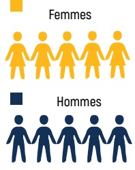

Source: Banque de la République d'Haiti

| Category | Value |
| --- | --- |
| Red | 36% |
| Grey | 64% |

Cette analyse met en lumière la dynamique changeante de l'epargne et du credit entre les sexes, soulignant l'importance d'adopter une approche holistique et proactive pour promouvoir l'inclusion financière et réduire les disparités de genre dans l'accès aux services financiers.

### 9.2 Des piliers pour construire une résilience financière

Selon l'USAID, la protection des consommateurs de services financiers englobe les dispositions et réglementations visant à protéger les clients lors de leurs interactions avec les prestataires de services financiers, tout en favorisant la confiance envers ces institutions (USAID-DAI, 2016). La protection des consommateurs est également intégrée en tant que composante essentielle du pilier quatre de la Stratégie Nationale d'Inclusion Financière (SNIF). Elle vise à l'élaboration et à la mise en œuvre d'un cadre réglementaire robuste capable de protéger les utilisateurs de produits et services financiers en Haïti. Actuellement, la protection des consommateurs, et particulièrement celle des consommateurs financiers, n'est pas réglementée par un cadre législatif.

Des avancées significatives ont toutefois été signalées dans le cadre du projet First de la Banque Mondiale, où une évaluation approfondie du contexte a été réalisée. Un document sur l'existant est maintenant disponible, et une version préliminaire d'un projet de loi est en cours de révision au niveau de la BRH. Des présentations sur la thématique ont également été effectuées. Dans la région de la Caraïbe, des discussions sont en cours concernant le développement d'un cadre régional de protection des consommateurs.

Par ailleurs, un projet sur la protection des consommateurs en général, introduit au Sénat lors de la 50e législature, est resté sans effet. En revanche, un projet de loi sur la signature électronique a été rendu public par le décret du 29 janvier 2016. La loi du 17 mars 2017 offre un cadre légal aux citoyens haïtiens pour s’adresser à l’administration publique par voie électronique. Tout en fixant les responsabilités, elle constitue une révolution dans le monde des affaires.

<!-- page 77 -->

À ce jour, la Circulaire 126 fixe les règles relatives à la protection des données à caractère personnel. Elle représente un jalon essentiel dans l'effort de sécurisation de la vie privée des clients des institutions financières. Elle établit des directives précises pour la collecte, le traitement et la conservation des données personnelles, renforçant ainsi la confidentialité, la concurrence, et la confiance des consommateurs dans le système bancaire haïtien.

Dans ce contexte, l'objectif d'un projet de loi sur la protection des consommateurs de produits et services financiers viendrait non seulement consolider les acquis des précédentes lois, mais aussi pousser plus loin l'engagement envers la transparence et l'équité.

À cet effet, le Centre de Contact de la Banque de la République d'Haïti (BRH) joue un rôle pivot. Cette structure centralisée, moderne et globale est dédiée à la gestion à distance des relations avec les consommateurs de services financiers. Elle vise à fournir un accompagnement et une assistance efficaces, renforçant ainsi les interactions entre les consommateurs et les institutions financières.

En consolidant les droits des consommateurs et en assurant une gestion transparente et sécurité des données personnelles, Haïti avancerait significativement vers la modernisation de son secteur financier. Ces initiatives doivent toutes contribuer à établir un environnement financier plus robuste et sécurisé, propice à la protection efficace des citoyens dans une économie numérique mondialisée.

### 9.3 Dynamiser l'éducation financière en Haïti : Stratégies innovantes pour un futur prospère

Le Plan National d'Éducation Financière (PNEF) en Haïti est un élément central de la Stratégie Nationale d'Inclusion Financière (SNIF), correspondant à son quatrième pilier. Le PNEF est une initiative de l'État haïtien, menée par la BRH, en partenariat avec le Ministère de l'Économie et des Finances (MEF) et le Ministère de l'Éducation Nationale et de la Formation Professionnelle (MENFP). Ce plan vise à améliorer l'éducation financière des Haïtiens, en promouvant une gestion saine des finances personnelles et en facilitant l'accès aux services financiers, en particulier pour les populations marginalisées.

Dans le cadre de la mise en œuvre du PNEF pour la période 2020-2025, des modules d'éducation financière ont été spécialement conçus pour être intégrés au curriculum scolaire géré par le MENFP. Ces modules sont développés en collaboration avec les représentants des organisations de la société civile impliquées dans l'éducation formelle, des représentants du secteur financier, des partenaires internationaux travaillant dans le domaine, des représentants de l'université, de la BRH, ainsi que d'Aflatoun International. Cette démarche vise à renforcer les capacités de gestion financière des élèves et étudiants haïtiens, les préparant ainsi à mieux gérer leurs finances personnelles et familiales.

<!-- page 78 -->

L'évaluation à mi-parcours réalisée en 2018 reconnaît que le niveau d'éducation financière de la population âgée de 15 ans et plus est très bas. Depuis 2021 et jusqu'en 2024, le PNEF a établi de nouvelles collaborations avec divers acteurs de l'écosystème financier pour étendre son impact. Reconnaissant l'importance de la connectivité et de l'engagement des jeunes sur les réseaux sociaux, des campagnes d'éducation financière ciblées sont régulièrement organisées. Ces campagnes, particulièrement actives lors d'événements comme la Global Money Week, utilisent des spots publicitaires et des activités de sensibilisation pour toucher efficacement cette audience clé.

Plusieurs programmes d'éducation financière sont animés à travers les médias et les réseaux sociaux par des animateurs chevronnés. De plus, un éventail d'acteurs, aux statuts variés, est impliqué dans l'éducation financière sur le terrain. La Direction de Communication de la BRH pilote plusieurs projets d'éducation financière.

Parallèlement, aux côtés d'autres programmes d'éducation financière, la Banque de la République d'Haïti (BRH) propose, à travers son Institut de Formation de la Banque Centrale (IFBC), des cours d'économie et de finance destinés aux journalistes. Ces formations visent à renforcer leur compréhension des enjeux économiques et financiers d'une part, et à les aider à mieux diffuser les informations relatives aux politiques monétaires de la banque, d'autre part. De plus, elle est impliquée dans la formation des cadres de la banque et d'autres partenaires.

Par ailleurs, la BRH a lancé sa première revue trimestrielle, Le Développement des Compétences et des Connaissances Financières (RDCCF), pour ajuster et améliorer les stratégies d'éducation financière en fonction des besoins changeants de la population haïtienne.

### 9.4 Protection des Consommateurs : Sécurité et confiance à l'ère du numérique

Selon l'USAID, la protection des consommateurs de services financiers englobe les dispositions et réglementations visant à protéger les clients lors de leurs interactions avec les prestataires de services financiers, tout en favorisant la confiance envers ces institutions. (USAID-DAI, 2016). La protection des consommateurs est aussi intégrée en tant que composante essentielle du plier quatre (4) de la Stratégie Nationale d'Inclusion Financière (SNIF). Elle vise à l'élaboration et à la mise en œuvre d'un cadre réglementaire robuste capable de protéger les utilisateurs de produits et services financiers en Haïti. Pour l'instant, la protection des consommateurs, et particulièrement celle des consommateurs financiers, n'est réglementée par aucun cadre législatif.

Des avancées significatives ont toutefois été signalées dans le cadre du projet First de la Banque Mondiale, où une évaluation approfondie du contexte a été réalisée. Un document sur l'existant est maintenant disponible, et une version préliminaire d'un projet-loi en cours de révision au niveau de la BRH. Des présentations sur la thématique ont également été effectuées. Au niveau de la région de la Caraïbe, des discussions sont en cours concernant le développement d'un cadre régional de protection des consommateurs.

<!-- page 79 -->

Par ailleurs, un projet sur la protection des consommateurs en général introduit au Sénat, lors de la 50e législature, est resté sans effet. En revanche un décret relatif à la signature électronique datant du 29 janvier 2016 a été promulgué. La loi du 17 mars 2017 vient offrir un cadre légal aux citoyens haïtiens pour s’adresser à l’administration publique par voie électronique. Tout en fixant les responsabilités, elle constitue une révolution dans le monde des affaires.

Aujourd'hui, avec l'intégration des supports électroniques dans l'expansion des services financiers en Haiti, une réglementation relative à la protection des données à caractère personnel pourrait représenter un jalon essentiel dans l'effort de sécurisation de la vie privée des clients des institutions financières. Elle devrait établir des directives précises pour la collecte, le traitement et la conservation des données personnelles, renforçant ainsi la confidentialité, la concurrence et augmentant la confiance des consommateurs dans le système bancaire haïtien.

En consolidant les droits des consommateurs et en assurant une gestion transparente et sécurité des données personnelles, Haïti avancerait significativement vers la modernisation de son secteur financier. Ces initiatives doivent toutes contribuer à établir un environnement financier plus robuste et sécurisé, propice à la protection efficace des citoyens dans une économie numérique mondialisée.

<!-- page 80 -->

## X- AUX LEVIERS DE CHANGEMENT

La perspective de la Banque mondiale reconnaît que la dynamique de l'inclusion financière peut reposer sur divers leviers de changement, principalement un cadre légal et réglementaire solide, des infrastructures financières innovantes, notamment technologiques, et une bonne coopération entre les acteurs. Cette vision est illustrée à travers le schéma ci-dessous.

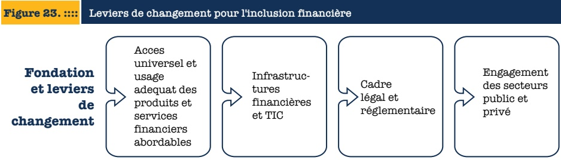

Source: Banque Mondiale 2018

### 10.1 Le cadre réglementaire : Du principe de proportionnalité

Selon l'Alliance pour l'Inclusion Financière (AFI), le principe de proportionnalité suggère que les règles et réglementations soient adaptées aux caractéristiques et à la taille des institutions financières, tout en tenant compte de leur impact sur la concurrence, les risques encourus, l'innovation, et l'accès aux services financiers. Appliqué au contexte haïtien, ce principe implique l'instauration d'un cadre réglementaire minimal mais inclusif, visant toutes les catégories d'institutions financières. Le cadre légal et réglementaire doit être suffisamment flexible pour réduire les barrières à l'entrée pour les entreprises débutantes et innovantes, leur permettant ainsi de proposer des solutions financières adaptées aux besoins spécifiques des populations mal desservies.

Toutefois, Antonio Pascual du FMI, dans son rapport sur la stabilité financière dans le monde d'avril 2022, reconnaît qu'il est nécessaire de prendre des mesures réglementaires visant proportionnellement à la fois les fintechs et les banques traditionnelles. Il souligne également qu'il faut imposer des règles plus strictes en matière de fonds propres, de liquidité, et de gestion des risques, proportionnellement aux risques encourus (FMI, 2022).

L'intégration du principe de proportionnalité dans le cadre de la réglementation financière est essentielle pour promouvoir l'inclusion financière de manière équitable et efficace. C'est dans cette perspective que, tout au long de cette dernière décennie, la BRH s'est attelée à prendre des mesures pour moderniser le cadre réglementaire financier, tout en tenant compte des risques financiers, technologiques et environnementaux.

<!-- page 81 -->

Cette période est caractérisée par la mise en place d'une série de réformes significatives touchant divers segments du secteur financier, allant des banques commerciales aux innovations technologiques des Fintechs de paiements. Cette évolution résulte de décisions concertées entre les autorités monétaires, les institutions financières, et divers partenaires, visant à créer un environnement propice à la croissance économique et à la réduction de la pauvreté.

L'une des initiatives majeures prises par les autorités, conformément à l'esprit de la loi du 14 mai 2012, a été l'engagement à assurer le leadership dans la mise en place et la mise en œuvre de la Stratégie Nationale d'Inclusion Financière, lancée en 2014. Cette stratégie offre un cadre d'action visant à renforcer la transparence et la protection des consommateurs. Plus d'une quarantaine de circulaires ont été publiées pour assurer l'efficience du système de paiements, réglementer la divulgation des taux d'intérêt, des frais et des commissions, et protéger les dépôts ainsi que les données personnelles des clients. Des mesures réglementaires ont été prises en vue d'instaurer un climat de confiance dans le secteur financier et à promouvoir des pratiques équitablement, essentielles pour encourager une intégration accrue de tous les agents économiques formels au système financier.

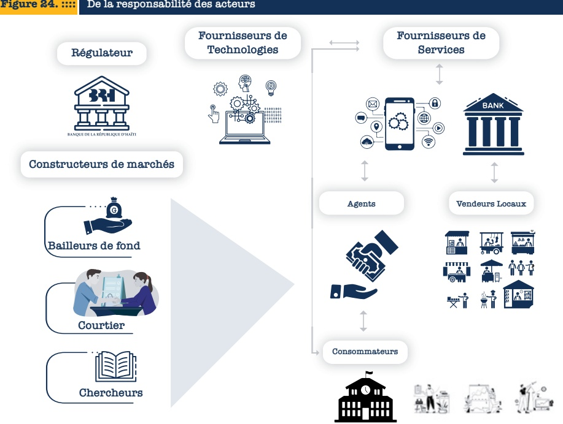

<!-- page 82 -->

Au niveau du secteur bancaire, les réformes ont particulièrement été axées sur de nouveaux outils pour mettre en œuvre la supervision basée sur les risques et la réglementation, visant ainsi à renforcer la stabilité et la transparence du système financier. En plus du renforcement des normes prudentielles, la BRH s'est efforcée d'harmoniser la réglementation anti-blanchiment avec les normes internationales. Des circulaires ont été émises pour encadrer des aspects spécifiques tels que l'ouverture de comptes pour les mineurs, les modalités de facturation des opérations par carte de paiement, et les règles régissant la gestion des chèques émis en Haïti. Ces mesures ont pour objectif de clarifier et de standardiser les pratiques bancaires, garantissant ainsi une meilleure protection des consommateurs et une gestion plus efficace des transactions financières.

En outre, des efforts ont été déployés pour renforcer la supervision des coopératives d'épargne et de crédit et réguler les institutions de microfinance non coopératives. Des incitations ont également été mises en place pour encourager le financement du secteur agricole, contribuant ainsi au développement économique local (Circulaire 103). Les coopératives d'épargne et de crédit ont été soumises à des réformes visant à renforcer leur gouvernance, leur gestion des risques, et leur supervision. Des projets de modernisation ont été lancés pour informatiser certaines caisses populaires et améliorer leur efficacité opérationnelle. Certaines études ont été menées pour mieux comprendre les défis auxquels ces institutions sont confrontées et orienter les politiques de développement du secteur.

Depuis juin 2020, un décret confère à la BRH la responsabilité de superviser le secteur de la microfinance non coopératif. Après analyse des dossiers, en plus des filiales de microfinance intégrées aux banques commerciales opérant selon les procédures de la banque mère, quatre autres institutions de microfinance ont déjà reçu leur agrément de fonctionnement de la BRH.

Au regard des impacts des lignes directrices sur la banque à distance de 2010, la Circulaire 121 instaure de nouvelles règles pour encadrer les activités des Fintechs de paiement électronique (FSPE) en Haïti. Ces mesures réglementaires visent à garantir une concurrence accrue dans le secteur du numérique. Elles ont également pour objectif de renforcer la profondeur du système financier et d'élargir l'accès aux services financiers à un plus grand nombre d'individus exclus du système financier.

Cette combinaison d'initiatives stratégiques et de mesures réglementaires témoigne de l'engagement ferme des autorités de politique monétaire envers l'inclusion financière et la protection des consommateurs. Une liste de circulaires est dressée dans la troisième partie du document.

<!-- page 83 -->

### 10.2 Des infrastructures financières solides et promotion de l'inclusion numérique

En Haïti, l'édification d'une infrastructure financière solide est plus qu'un impératif économique. C'est une nécessité urgente pour stimuler la croissance, catalyser le développement inclusif et renforcer la résilience financière. Avec les défis considérables exacerbés par les catastrophes naturelles et les instabilités politiques, le pays se trouve à un tournant crucial où l'amélioration et la consolidation de ses infrastructures financières peuvent significativement améliorer la qualité d'accès aux services financiers pour les citoyens.

Le concept d'infrastructure renvoie, à la fois, aux commodités physiques telles que les succursales bancaires et les distributeurs automatiques de billets (ATM), ainsi qu'à l'infrastructure numérique telle que les supports de télécommunications, les technologies de l'information et toute autre plateforme capable de promouvoir l'inclusion numérique. (Banque Mondiale, 2018). Dans le contexte de l'inclusion financière, l'infrastructure, qu'elle soit physique ou numérique, est un élément essentiel de tout système financier qui joue un rôle crucial dans la promotion de l'inclusion financière. Dans le cadre de référence du programme d'accès universel aux services financiers, UFA-2020 de la Banque mondiale, les infrastructures représentent la fondation charpentant l'accès au compte et l'utilisation du système de paiement en général.

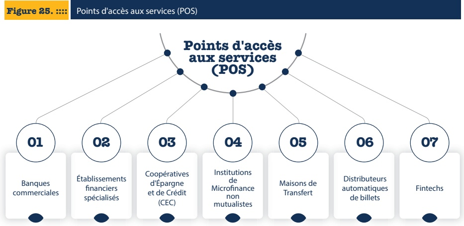

Dans le contexte actuel du pays, les succursales bancaires ou des institutions de microfinance demeurent les infrastructures les plus utilisées pour la distribution des services financiers. La population a à sa disposition environ 5250 points de service physiques. Souvent, dans les zones les plus reculées, la distance entre un point de service physique et le lieu de domicile d'un utilisateur de services financiers peut être évaluée entre une (1) à deux (2) heures de marche. Au regard

<!-- page 84 -->

de la loi de mai 2012 et de la Circulaire 125, des exigences strictes sont imposées aux acteurs du système financier afin de garantir le respect des normes de présentation et de sécurité au niveau des bâtiments.

Pour favoriser la transparence dans la gestion des informations sur l'historique des relations d'affaires entre les clients et les institutions financières, un Bureau d'Information sur le Crédit (BIC) est créé le 31 janvier 2005 par la Banque centrale. Son objectif est de réduire le niveau d'asymétrie d'information dans le secteur financier. Elle favorise ainsi une gestion optimale des problèmes de surendettemement des clients, facilite un accès plus transparent aux informations financières et permet de bâtir des historiques financiers dans le système. Le BIC est opérationnel depuis bientôt neuf (9) ans.

Avec l'émergence de la monnaie mobile, certains commerces ou entreprises (des stations d'essence, des points de vente modernes d'eau potable, des boutiques, des studios de beauté, des restaurants ou des Fintechs) servent d'agents non bancaires dans le cadre des partenariats développés avec les fournisseurs de paiement électronique ou à titre de sous-agent de transfert avec les banques et les maisons de transfert pour le paiement de transferts, suivant les directives sur les services de paiement électronique (Circulaire 121) et celle sur les transferts de fonds sans contrepartie (Circulaire 114-3). En raison de leur situation évolutive, il est difficile d'avancer un chiffre exact pour ces agents économiques. Pour les transferts internationaux, environ huit (8) opérateurs sont établis sur le marché.

### 10.3 - Les infrastructures numériques : vers une réforme du système de paiement

En Haïti, certains rapports publiés par l'Agence des États-Unis pour le Développement International (USAID, 2017), suite à ses interventions et aux recherches réalisées sur la digitalisation, démontrent que les services financiers mobiles jouent un rôle crucial dans la promotion de l'inclusion financière. Ils offrent des solutions flexibles, abordables et accessibles à un large éventail de personnes et de communautés. En facilitant les transactions financières, ces services favorisent la création d'emplois et l'innovation dans l'écosystème entrepreneurial et financier, contribuant ainsi à promouvoir un développement économique inclusif.

Le projet de la Gourde Digitale, dite BitKòb, porté par la BRH, offrira de nouvelles opportunités tant aux exclus financiers qu'aux institutions financières. En promettant d'être accessible sur un nombre de supports électroniques, la Gourde Digitale pourrait réduire de nombreuses barrières à l'entrée pour les personnes vivant dans les zones où les infrastructures de base sont déficientes. Cet engagement et les travaux en cours traduisent la vision de la Banque de moderniser les infrastructures financières, afin de contribuer à créer un système financier plus inclusif et résilient.

L'infrastructure numérique sous-tendant les activités du secteur financier peut varier d'un établissement financier à un autre. Les banques commerciales, par exemple, s'alignent sur les normes internationales et les exigences de la BRH afin d'être compatibles avec les réseaux

<!-- page 85 -->

mondiaux. En ce qui concerne les Caisses d'Épargne et de Crédit (CEC) affiliées, elles dépendent des structures faîtières et utilisent généralement le logiciel SAF 2000. Quant aux Institutions de Microfinance (IMF) non mutualistes, elles se basent souvent sur des logiciels tels que MicroBank, Loan Performer, SIEM, SMFS, Tableau, et les outils Microsoft.

Pour renforcer davantage l'intégrité du système de paiement et assurer son interopérabilité, la BRH a doté le système d'un Processeur National de Paiements (PRONAP) depuis 2016. Ce processeur vise à faciliter la traçabilité de toutes les opérations au sein des institutions financières. Cette initiative favorise la fluidité des transactions financières et permet la réalisation de transactions en temps réel entre les différents établissements financiers, améliorant ainsi l'efficacité et la transparence du système financier. Des normes ISO internationales de cryptage, spécifiquement conçues pour la sécurité des données, sont appliquées afin de faciliter la compensation électronique des chèques et des virements automatisés (SPIH) entre les clients des différentes banques.

Figure 26. Évolution de l'infrastructure numérique en utilisation

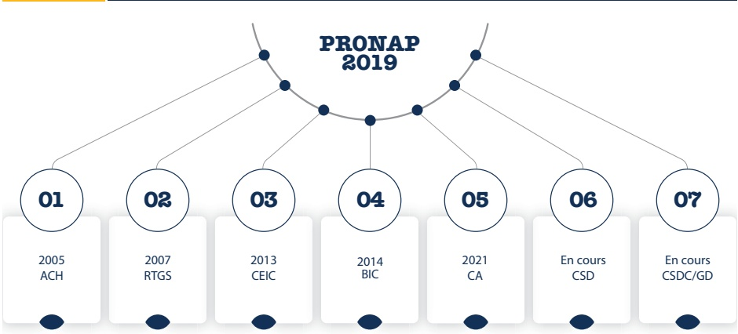

Les usagers reconnaissent également l'importance des distributeurs automatiques de billets (ATM) dans la facilitation des transactions financières. Ceux-ci sont soumis à des normes rigoureuses pour garantir leur compatibilité avec PRONAP. Environ 285 ATM sont actuellement disponibles sur le marché, offrant aux clients une plus grande flexibilité dans l'accès à leur épargne. Cependant, l'interopérabilité, selon la Banque mondiale, peut poser certains défis, notamment en ce qui concerne la sécurité des données, la confidentialité et la conformité réglementaire (Banque mondiale, 2016). La BRH, à partir de la Circulaire 126, contraint les acteurs du système financier à respecter les normes de sécurité et les protocoles de communication efficaces capables de protéger les clients contre les fraudes et les abus.

<!-- page 86 -->

De plus, les institutions sont soumises à des audits réguliers de leur système pour s'assurer de l'intégrité numérique du système. Elles ont aussi l'obligation de se doter d'un plan de contingence leur permettant de gérer certains risques climatiques, environnementaux, financiers et technologiques. Toutefois, face à la récurrence des actions de cybercriminalité dans le monde, des investissements conséquents dans des infrastructures robustes sont nécessaires pour sécuriser davantage les transactions en ligne et mobiles ainsi que pour protéger la vie privée et les données des clients dans le contexte fragile du pays.

En effet, la résilience aux attaques cybernétiques nécessite une approche holistique qui intègre des mesures de sécurité solides à tous les niveaux, depuis la conception, la mise en œuvre jusqu'à la maintenance. Une surveillance continue, la mise à jour des logiciels utilisés et la sensibilisation à la sécurité sont essentielles pour protéger le système contre les menaces. En garantissant la sécurité et la résilience des infrastructures, les acteurs peuvent non seulement protéger les données et les systèmes, mais aussi favoriser la stabilité et maintenir la confiance dans le système.

L'action des autorités régulatrices au cours de ces dix dernières années, visant à garantir la conformité des banques, des autres institutions financières régulées, et des distributeurs automatiques de billets (DAB) aux normes internationales établies, ainsi que la promotion de l'interopérabilité grâce à l'intégration avec le processeur national, ont été des leviers majeurs pour renforcer la transparence et la confiance dans le système financier, favorisant ainsi une plus grande inclusion financière. Cependant, la suppression de certains obstacles identifiés, tels qu'un cadre légal renforcé sur la protection des données, l'assurance, et l'interopérabilité pour les transactions mobiles en général, ainsi que l'accès aux infrastructures de base liées à la télécommunication et à la technologie, nécessite des efforts concertés soutenus par une collaboration plus efficace entre les parties prenantes de l'écosystème. Cet aspect de collaboration et de coopération fera l'objet de notre prochain sous-chapitre.

### 10.4 - Coopération et engagement pour l'inclusion financière

L'inclusion financière est un processus évolutif. Elle repose sur un engagement profond, une coopération étroite et une collaboration soutenue entre les différents acteurs impliqués. Une approche collaborative est importante pour naviguer dans les complexités qu'elle impose et créer un écosystème inclusif.

#### 10.4.1 - Responsabilité et engagement des acteurs

La responsabilité des acteurs impliqués dans la promotion de l'inclusion financière est cruciale pour la réduction des disparités économiques dans le pays. Cette responsabilité englobe quatre (4) dimensions :

1- Le gouvernement doit faciliter la création d'un environnement propice à l'inclusion financière

<!-- page 87 -->

2- Les Institutions financières doivent concevoir des produits et services financiers adaptés

3- Les organisations de la société civile doivent être sensibilisés

4- Les consommateurs doivent être des clients avisés et proactifs

C'est dans un tel contexte que le Document de la Stratégie Nationale d'Inclusion Financière est mis en œuvre.

##### 10.4.1.1 La responsabilité gouvernementale et l'inclusion financière

La BRH agit en tant que Secrétariat Technique pour la Stratégie Nationale d'Inclusion Financière, opérant à travers son Unité d'Inclusion Financière (UIF), établie en 2017. Avec un personnel dédié, elle aide la banque à assurer la coordination des activités liées à l'inclusion financière. Dans le cadre de la mise en œuvre du DSNIF, en 2020, par décret présidentiel, un Comité de Coordination et de Suivi de la Stratégie Nationale d'Inclusion Financière (CCSSNIF) est créé. Il est présidé par le Ministère de l'Économie et des Finances (MEF) et regroupe plusieurs parties prenantes. L'Unité d'Inclusion Financière offre un support technique pour le suivi des décisions prises par le Comité, tel que rapporté dans le Plan Stratégique Global de la BRH.

Un cadre institutionnel de gouvernance est crucial pour promouvoir l'inclusion financière en Haïti, car il favorise une collaboration efficace entre différents secteurs nationaux. Ce cadre aide à développer et mettre en œuvre des politiques qui élargissent l'accès aux services financiers pour tous les segments de la population, en établissant des politiques publiques appropriées ainsi que des règles, procédures et mécanismes de supervision et de réglementation.

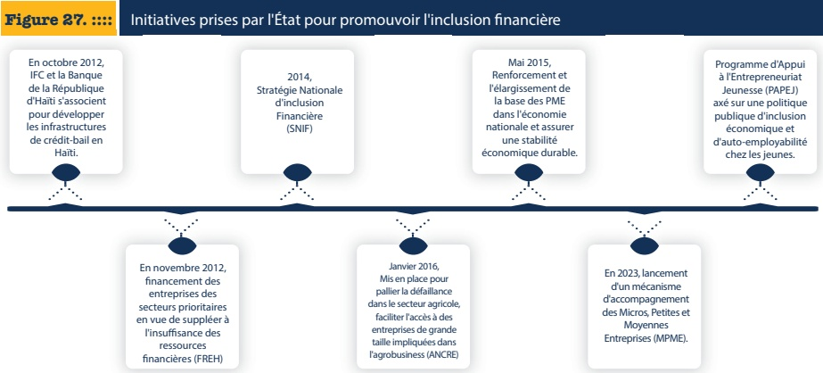

<!-- page 88 -->

La figure précédente résume certains engagements pris au cours de cette dernière décennie en faveur du secteur agricole. En Haïti, le secteur agricole emploie près de 50 % de la population et représente un quart du PIB national. Il est essentiellement basé sur la pluviométrie et a enregistré un taux de croissance d'environ 2 % au cours des dix dernières années, selon des données de la Banque Mondiale (2017). L'engagement du gouvernement haïtien est essentiel pour garantir l'accès universel aux services financiers.

##### 10.4.1.2 Engagement des institutions financières

La volatilité et les risques élevés associés au secteur agricole ont rendu l'offre de prêts et de services financiers formels aux agriculteurs largement insuffisante pour répondre aux besoins des communautés rurales. Face à ce constat d'une inclusion financière incomplète, tant sur le plan régional que démographique, le gouvernement haïtien a fait de l'amélioration de l'accès aux produits et services financiers une priorité. Depuis qu'Haïti est devenu membre principal de l'Alliance pour l'Inclusion Financière (AFI) en 2011, en adhérant aux déclarations de Maya lors de l'Assemblée Générale de Cape Town, divers gouvernements ont pris de nombreuses initiatives pour promouvoir une inclusion financière accrue. Le schéma ci-dessous illustre l'engagement de deux institutions majeures en Haïti.

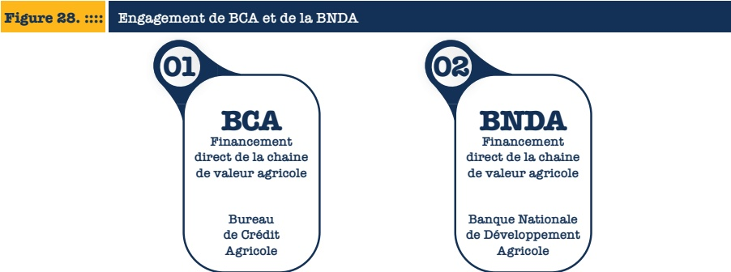

Le Bureau Communal Agricole et la Banque Nationale de Développement Agricole sont deux institutions clés dédiées à la promotion de la finance inclusive. Elles facilitent l'accès aux services financiers pour un large public, principalement dans les zones semi-urbaines et rurales, en offrant des taux d'intérêt annuels adaptés aux cycles agricoles, variant de 12% à 15% l'an. Ces institutions jouent un rôle essentiel dans l'élargissement de l'accès au financement, soutenant ainsi le développement économique des communautés agricoles.

<!-- page 89 -->

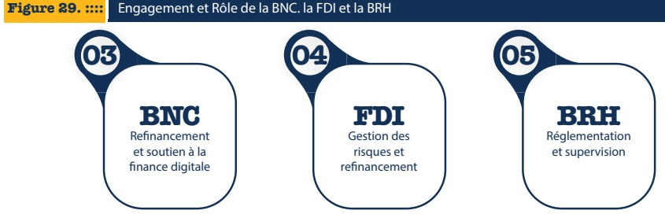

FDI

Gestion des risques et refinancement

BRH

Réglementation

et supervision

La Banque Nationale de Crédit (BNC) joue un rôle primordial dans la mobilisation des financements privés et offre également du refinancement ainsi qu’un soutien à la finance digitale. Parallèlement, le Fonds de Développement Industriel (FDI) contribue à cette dynamique en mobilisant les financements privés tout en se focalisant sur la gestion des risques et le refinancement. La Banque de la République d'Haïti (BRH), l'autorité de réglementation et de supervision du pays, veille à ce que les normes et les contrôles soient rigoureusement adaptés pour répondre aux exigences spécifiques du secteur financier haïtien. Ensemble, ces institutions forment un cadre systématique et coordonné visant à renforcer l'infrastructure financière nationale, en appui aux initiatives de développement agricole énoncées dans la circulaire 113, qui cible particulièrement le secteur agricole dans ses efforts de modernisation et d'inclusion financière.

##### 10.4.1.3 Engagement des consommateurs financiers

L'engagement des utilisateurs de services financiers est également important pour promouvoir la résilience financière et réduire les inégalités financières. En participant aux programmes d'éducation financière et de sensibilisation, ils s'engagent à améliorer leur compréhension des concepts financiers de base et à éviter les pièges en prenant des décisions éclairées.

Dans un monde financier complexe intégrant continuellement de nouveaux acteurs et promouvant de plus en plus de produits, financiers et non financiers, les utilisateurs de ces produits doivent pouvoir choisir ceux qui répondent le mieux à leurs besoins. Aussi, il est de leur responsabilité de réduire leur dépendance financière, de se créer des coussins financiers évolutifs et de se départir du surendetement.

L'évolution du marché leur suggère des choix. Ils doivent être en mesure d'explorer les gammes de produits qui présentent moins de risques et offrent l'avantage d'être les moins coûteux. L'inclusion numérique facilitée par les fintechs présente de nombreux avantages en ce sens.

D'après les réflexions produites par les spécialistes du Groupe Consultatif d'Assistance aux plus Pauvres (CGAP), l'engagement et la participation des consommateurs de produits et services

<!-- page 90 -->

financiers, notamment les femmes, sont essentiels pour améliorer l'analyse de l'impact des stratégies d'inclusion financière. Ils permettent aux décideurs politiques d'ajuster leurs approches en fonction des indicateurs (WEE) liés à la théorie du changement (CGAP, 2023). Cela peut favoriser une inclusion financière plus efficace, équitable et durable pour les groupes cibles et particulièrement pour les femmes.

##### 10.4.1.4 Engagement de la société civile

La société civile, de son côté, peut s'engager dans des campagnes de plaidoyer. L'exemple concret de l'Alliance pour la Finance Inclusive (AFHI), créée depuis déjà cinq ans, est bien illustratif. En outre, la société civile peut s'engager dans des dialogues avec les parties prenantes de l'écosystème afin de promouvoir des politiques publiques et des lois plus inclusives. De plus, elle peut proposer des solutions susceptibles d'améliorer les conditions d'accès aux services financiers pour les groupes les plus marginalisés.

Pour les personnes à mobilité réduite, les solutions financières proposées sur le marché ne doivent pas être discriminatoires. Des distributeurs automatiques de billets (DAB) avec des claviers en braille et des indications sonores doivent aider ceux qui éprouvent des difficultés à accéder aux services financiers en raison de problèmes liés à la vue, au langage ou à l'ouie. De même, certains DAB doivent aussi tenir compte de la taille de certaines catégories de personnes.

En s'engageant dans des partenariats stratégiques avec le gouvernement, les régulateurs et d'autres partenaires de l'écosystème, la société civile peut aider à faire avancer l'inclusion financière pour les groupes les moins nantis physiquement et financièrement.

#### 10.4.2 Coopération pour l'inclusion financière

L'inclusion financière, un impératif mondial, repose sur un ensemble de principes parmi lesquels la coopération et la collaboration occupent une place importante. Cette coopération peut revêtir diverses formes et permet, entre autres, de combiner les ressources et l'expertise des partenaires impliqués pour créer des synergies dans leurs interventions.

L'élaboration de la Stratégie Nationale d'Inclusion Financière (SNIF), fruit d'une enrichissante collaboration entre le gouvernement haïtien et la Banque Mondiale, a été intégrée au projet d'appui au secteur financier, FIRST. Cette coopération a également stimulé un ensemble de réflexions sur la protection des consommateurs financiers ainsi que sur les coûts des transferts pour les migrants et leurs familles, impliquant divers acteurs de l'écosystème, y compris le gouvernement à travers le Ministère des Haïtiens Vivant à l'Étranger (MHAVE). De plus, grâce à ce partenariat, le pays a bénéficié d'une dizaine d'études sur le système financier en général et le financement agricole.

Des partenariats additionnels ont été développés dans le cadre du renforcement des capacités de jeunes entrepreneurs, impliquant notamment l'Agence Universitaire pour la Francophonie (AUF), ainsi que la Sogebank et FOKAL, dans le cadre du projet RESACE, en 2022. Une cinquantaine de jeunes universitaires ont pu se lancer dans des projets innovants touchant plusieurs domaines,

<!-- page 91 -->

dont la technologie et l'agriculture.

Dans le cadre du renforcement de l'écosystème entrepreneurial, d'autres partenariats ont été conclus, notamment avec la Coopération Suisse en 2021, dans le cadre du programme d'inclusion financière des entreprises dirigées par des jeunes et des femmes, dit Booster PM. Cette collaboration a facilité l'intermédiation financière pour plus de 190 entreprises. Dans cette même veine, un accord de coopération a été signé avec USAID-MEDA en 2020 dans le cadre de son projet entrepreneurial Atteindre. La collaboration a abouti à la rédaction d'une étude sur le secteur des MPME. Cette coopération fait suite au partenariat éveloppé avec DAI-USAID en 2018, facilitant la mise en place de la Cartographie d'inclusion financière, ainsi que la réalisation des enquêtes nationales sur les tendances de l'inclusion financière en Haïti : FinScope, Consommateurs, Haïti 2018.

La rédaction du Plan National d'Éducation Financière a été rendue possible grâce à l'assistance technique de la Fondation Capital, de l'AFI, et des Affaires mondiales Canada. Le pays continue à bénéficier de l'expérience des autres pays membres de l'AFI ainsi que de celle de ses experts pour la mise en œuvre des stratégies du SNIF et du PNEF. La collaboration avec ONU-Femmes est également à signaler durant ces quatre dernières années. ONU-Femmes fait partie de plusieurs comités de pilotage liés aux initiatives visant à faciliter la coordination des efforts et la mise en œuvre des stratégies intégrées au SNIF et au PNEF pour promouvoir l'autonomisation économique des femmes. Elle facilite également les réflexions basées sur le genre dans les forums visant à promouvoir l'inclusion financière des femmes, organisés sous le leadership du CCSNIF.

En effet, le CNSCNIF incarne le principe de collaboration fondamentale pour la mise en œuvre de la Stratégie Nationale d'Inclusion Financière. Il devra mettre en place un cadre structuré pour les groupes de travail, leur permettant ainsi de se concentrer sur des thématiques spécifiques qui entravent l'inclusion financière. En favorisant une collaboration étroite et efficace, les communautés mal desservies financièrement pourront tirer parti des forces et des ressources de chaque acteur économique, tout en réduisant au minimum les obstacles potentiels susceptibles de freiner le processus d'inclusion financière.

L'expérience de collaboration effective et efficace est illustrée à travers l'exemple suivant. Pour contribuer à l'atténuation des problèmes de genre traités dans le chapitre lié à l'aspect genre du document, la BRH a établi des partenariats visant à réaliser diverses initiatives pour promouvoir l'inclusion financière des femmes. Au cours de cette décennie, plus de cinq séminaires et conférences ont été organisés en partenariat avec d'autres acteurs impliqués dans l'autonomisation financière des femmes, notamment le Ministère à la Condition Féminine et aux Droits de la Femme (MCDF) et l'ONU-Femmes. Un fonds de garantie ciblant les femmes entrepreneurs doit bientôt être opérationnel suite aux réflexions produites lors de ces ateliers.

Au niveau international, grâce au partenariat développé, la BRH représente le pays dans les travaux de la « Commission de la Condition de la Femme » (CSW) des Nations Unies. De plus, au sein de l'AFI, des cadres de la BRH participent à des forums sur la problématique du genre. La BRH est également membre de sept groupes de travail, dont un dédié au genre, au sein de l'AFI. En 2019,

<!-- page 92 -->

dans le cadre des Déclarations de Maya, une reconnaissance internationale a été décernée à la BRH pour son engagement envers l'inclusion financière des femmes.

À travers la BRH, le pays a assumé la présidence de la structure de l'Amérique latine et des Caraïbes de l'AFI (FILAC) pour la période de 2021-2023. Cette position a permis à la BRH de jouer un rôle de leadership dans la promotion de l'inclusion numérique dans la région, tout en soutenant des actions concertées régionales. Récemment, lors de l'Assemblée Générale de l'AFI aux Philippines en septembre 2023, la Banque a été élue membre du Conseil d'Administration de l'AFI pour les deux prochaines années. Cette nomination témoigne de l'engagement continu de la Banque envers l'inclusion financière et de son travail pour un monde plus juste et convivial.

#### 10.4.3 Le pouvoir des interactions stratégiques

La collaboration fait partie des neuf principes sur lesquels reposent les interventions en matière d'inclusion financière. Elle vise à encourager le développement de partenariats et des consultations permanentes entre les différents acteurs de la vie économique et les intervenants externes. Des interactions stratégiques entre les différents acteurs de l'inclusion financière, tels que décrits dans le schéma ci-dessous, jouent un rôle essentiel dans la création d'un écosystème financier plus accessible et équitable au cours de cette dernière décennie. Ces partenariats et collaborations, qui s'étendent souvent au-delà des frontières classiques entre les secteurs publics et privés, sont essentiels pour surmonter certains obstacles et étendre l'accès aux services financiers à ceux qui en sont exclus.

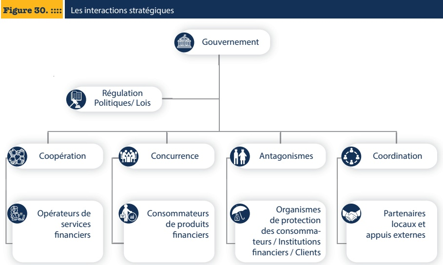

<!-- page 93 -->

Au cœur de ces interactions se sont développés des partenariats publics-privés et privés-privés qui ont réuni des ressources et de l'expertise pour développer des solutions innovantes, notamment le développement de produits et de services financiers adaptés, susceptibles de stimuler la croissance économique et de favoriser le développement local au cours de cette dernière décennie.

La collaboration initiée en 2011 entre les banques et les établissements de téléphonie a débouché sur l'extension de la portée des services financiers en Haïti, une innovation qui a eu des impacts considérables sur l'augmentation du taux d'inclusion financière dans le pays. Durant la pandémie de la COVID-19, elle s'est révélée être un moyen efficace pour transférer les subventions publiques aux bénéficiaires.

De plus, le développement de l'alliance entre certaines coopératives, les acteurs supportant les Mutuelles de Solidarité (MUSO), et l'Agence de Développement Internationale (DAI) a été un exemple concret des résultats du développement de partenariats efficaces pour la réduction des coûts grâce à l'utilisation de la technologie, afin de mieux servir les membres des mutuelles, qui ne cessent d'augmenter.

Aussi, la collaboration entre le gouvernement, les institutions autonomes et les partenaires techniques est essentielle pour faire avancer l'agenda de l'inclusion financière, renforcer l'éducation financière, et promouvoir la protection des consommateurs. Au fil des interactions, en 2020, un partenariat a été signé entre le Ministère de l'Éducation Nationale et de la Formation Professionnelle (MENFP), la Banque Centrale, et Aflatoun International pour l'intégration de l'éducation financière dans les écoles. Le processus est en cours et son aboutissement pourrait avoir des impacts positifs sur la résilience financière des jeunes et le développement de l'écosystème entrepreneurial.

Par ailleurs, l'inventaire des activités d'éducation financière réalisé par la BRH en 2019 révèle que les interactions entre des organisations de la société civile et le gouvernement ont servi à mettre en place des programmes pour sensibiliser les populations aux principes de base de la gestion financière et aux avantages des services financiers formels. Ces partenariats ont contribué à autonomiser les groupes ciblés et à renforcer leur résilience financière.

C'est au cœur de ces interactions stratégiques entre des acteurs de différents secteurs que l'Alliance Haïtienne pour la Finance Inclusive (AHFI) a été créée en 2020. Cette alliance inclut des banques et des établissements de téléphonie, deux organisations du secteur des caisses populaires, dont la Fédération des Caisses Populaires (Le Levier) et l'Association Nationale des Caisses Populaires (ANACAPH), l'Association Nationale des Institutions de Microfinance (ANIMH), le KNFP pour les Mutuelles de Solidarité, l'Association Professionnelle des Banques (APB) pour le secteur des banques, Digicel pour le secteur de la téléphonie, Haiti Pay pour les fintechs, ainsi que l'Alternative Insurance Company (AIC) pour le secteur des assurances.

Suite à ces interactions, les membres de ces institutions ont décidé de conjuguer leurs efforts au sein d'une même plateforme, formant ainsi une taskforce dédiée à l'inclusion financière. Ensemble, ils s'engagent à réfléchir aux obstacles à surmonter pour étendre les services financiers et promouvoir l'inclusion financière.

<!-- page 94 -->

Les discussions entre les différents acteurs de la Stratégie Nationale d'Inclusion Financière (SNIF), du CCSSNIF et de la BRH seront lancées afin de procéder à la révision de la SNIF. Cette révision vise à intégrer les réalisations accomplies au cours des dix dernières années et à établir de nouveaux objectifs en fonction des réalités actuelles sur le terrain, en tenant compte de l'évolution des outils technologiques et de l'inclusion numérique. Dans cette optique, un engagement et une collaboration étroite entre les différentes parties sont essentiels pour élaborer des stratégies efficaces et atteindre ces objectifs.

<!-- page 95 -->

# XI- ANALYSES ET DISCUSSIONS

Le diagnostic de la demande globale des services financiers a été réalisé par le biais de l'enquête FinScope Consommateur 2018, une grande première pour Haiti. Depuis lors, un certain nombre d'initiatives ont été menées jusqu'à aujourd'hui pour mieux structurer la demande de produits et services financiers, notamment à travers la promotion des groupes d'épargne, de crédit et la réalisation de séances d'éducation financière.

Au niveau national, des améliorations en termes d'accès et d'utilisation des services financiers ont été observées durant les dix dernières années (2014-2024). Parmi celles-ci, on note l'augmentation du nombre de points de service des institutions financières, une hausse considérable du nombre d'agents non bancaires, l'interopérabilité des services de porte-monnaie électronique, et une augmentation de son taux d'utilisation. En outre, durant cette période de mise en œuvre de la SNIF, on a assisté à l'émergence du modèle d'agent banking développé par les banques menant des activités de microfinance, offrant de réelles opportunités pour une meilleure inclusion financière de la population haïtienne et des MPME.

L'essor significatif des banques, caractérisé par un quadruplement de leur nombre, a entraîné une augmentation de l'accès aux services bancaires classiques et au crédit pour une plus large portion de la population. Parallèlement, la croissance des institutions de microfinance (IMF) laisse présager une amélioration de l'accès au financement pour les PME et les particuliers, surtout dans les zones où les services financiers étaient auparavant limités.

L'accès aux services financiers fait référence à la disponibilité et à la facilité pour les individus et les entreprises d'entrer dans le système financier formel afin d'utiliser et de bénéficier d'une gamme de services financiers. Cela englobe divers produits et services tels que les comptes bancaires, les prêts, les assurances, les services de paiement, et les investissements. L'inclusion financière vise à garantir que tous les membres d'une société, en particulier ceux qui sont traditionnellement exclus ou marginalisés (pauvres, résidents en milieu rural, femmes, analphabètes, etc.), aient la possibilité d'accéder aux services financiers de base, ce qui peut contribuer à réduire la pauvreté, favoriser le développement économique et renforcer la stabilité financière. Toutefois, les services restent concentrés dans le département de l'Ouest et dans les grandes villes des milieux urbains, où le département de l'Ouest possède 2520 points, représentant 48% du total des points de service sur les 10 départements.

Cette concentration suggère une limitation dans l'accessibilité physique aux services financiers pour la population adulte haïtienne hors de ces zones. Étant donné que les succursales bancaires jouent un rôle crucial dans la prestation de services financiers tels que l'ouverture de comptes, le crédit et la gestion d'épargne, cette répartition inégale pourrait représenter un obstacle à l'inclusion financière pour de nombreux Haïtiens, en particulier pour ceux qui n'ont pas accès aux technologies de la banque en ligne ou qui ont besoin de services en personne. Cela pourrait également refléter des défis économiques ou de politique publique influençant la stabilité et la croissance du secteur bancaire dans le pays

<!-- page 96 -->

# XII- UN RETOUR CONCLUSIF

Les constatations révélatrices issues de l'état des lieux permettent de conclure que l'inclusion financière est un processus complexe, collaboratif et évolutif. Elle implique des interactions avec de multiples parties prenantes. Cet aspect a été mis en évidence dans le chapitre concernant les leviers du changement. Il est reconnu que les fluctuations sur la scène internationale, les perturbations régionales, et les instabilités locales exercent toutes une influence significative sur les progrès de l'inclusion financière. Ces réalités soulignent l'importance d'une approche holistique et concertée pour promouvoir efficacement l'accès aux services financiers.

Ainsi, il apparaît que l'inclusion financière est souvent tributaire de divers facteurs, qu'ils soient économiques, sociaux, politiques ou technologiques. Un leadership éclairé et efficace, ainsi qu'une bonne gestion des données, sont essentiels pour une mise en œuvre réussie des stratégies intégrées dans les documents de référence de politiques publiques, tels que le DSNIF. "La SNIF dix ans après" a été élaborée afin de pouvoir effectuer un bilan non exhaustif des principales réalisations dix ans après la publication de la Stratégie Nationale d'Inclusion Financière (SNIF). Selon les principaux constats, cette stratégie a permis d'ouvrir la voie à une évolution significative des services financiers en Haïti et à une meilleure intégration des citoyens dans le système financier. Grâce aux efforts collectifs de l'État haïtien, du secteur financier, des organisations de la société civile, des partenaires techniques et financiers, et de tous les acteurs non identifiés, les services financiers se sont diversifiés et étendus à des segments de la population auparavant exclus, renforçant ainsi l'inclusion financière.

En ce sens, la BRH a compris la nécessité d'inciter les acteurs clés de la vie nationale à prendre part à cette initiative favorisant l'accès aux services financiers au bénéfice de l'ensemble de la population. Cette participation est essentielle pour conduire le pays vers la croissance économique. En soutenant des initiatives majeures et en privilégiant des partenariats stratégiques, la BRH travaille à promouvoir une plus grande accessibilité et utilisation des services financiers, contribuant ainsi à un développement économique inclusif et durable. Elle encourage les ménages à faire preuve d'une grande résilience en diversifiant davantage leurs sources de revenus et en se dotant d'une bonne capacité d'épargne. La réalisation d'une épargne plus consistante permettrait de se constituer des réserves financières plus solides, leur permettant de faire face aux dépenses imprévues et de mieux gérer les risques.

La BRH compte sur la réalisation de la prochaine enquête FinScope II, qui fournira un diagnostic détaillé des problématiques d'accès aux services financiers rencontrées par la population. Les résultats de cette enquête contribueront à l'amélioration de l'inclusion financière en Haïti et permettront de relever les défis existants sur le terrain. Ils orienteront également les actions futures afin de garantir une utilisation optimale des services financiers par tous les citoyens haïtiens.

<!-- page 97 -->

# XIII- RECOMMANDATION POUR CONSTRUIRE L'AVENIR

De ce travail, il ressort que pour renforcer l'inclusion financière en Haïti, il est primordial d'adresser en amont les défis inhérents à l'offre et à la demande dans le secteur financier. La mise en œuvre de stratégies ciblées pour surmonter les barrières qui restreignent l'accès aux services financiers est cruciale pour promouvoir une inclusion financière générale.

## Ces principales recommandations sont issues de cette étude :

## A- Développement de partenariats pour un registre de données plus pertinentes sur l'IF

1. Réaliser la phase FinScope des Ménages II

2- Réviser la Stratégie Nationale d'Inclusion Financière

3- Mettre à jour le diagnostic sur le Numérique.

4- Élaborer la Stratégie Digitale et de l'Inclusion Numérique. 5- Finaliser le Rapport de FinScope PME(s).

## B- Amélioration du cadre pour la protection des consommateurs financiers

1- Mettre en place l'Observatoire de qualité de produits et services financiers.

2- Mettre en place des systèmes efficaces et accessibles pour la soumission des plaintes et obtenir un recours en cas de mauvaises pratiques ou de litiges financiers.

3- Sensibiliser davantage la population sur l'importance et l'utilisation des produits d'assurance et d'épargne.

## C- Diversification davantage des produits et services financiers

1. Développer des produits axés sur le genre ainsi que des produits verts.

2- Offrir davantage de produits digitaux.

<!-- page 98 -->

## D- Amélioration du Cadre pour l'éducation financière

1- Développer et intégrer des modules d'éducation financière dès le plus jeune âge dans le système éducatif pour sensibiliser les élèves aux concepts financiers de base.

2- Utiliser davantage les médias, les réseaux sociaux et les campagnes publicitaires pour éduquer le public sur les risques financiers et les arnaques potentielles.

3- Développer des partenariats pour la mise en place d'un fonds conjoint (matching funds) pour la mise en place de programmes d'éducation financière.

## E- Simplification des exigences réglementaires

1. Travailler sur un cadre légal minimal pour la protection des consommateurs financiers.

2- Proposer un cadre légal minimal pour l'intégration des MPME(S) informelles dans le système financier.

3- Améliorer le cadre pour une saisie systématique de données désagrégées.

## F- Amélioration des infrastructures numériques

1- Développer des partenariats pour l'adoption de l'identité numérique.

2- Développer une plateforme centrale qui utilise des technologies de pointe pour assurer la sécurité et l'intégrité des données d'identification numérique.

3- Adopter des infrastructures qui facilitent la détection de risques financiers et technologiques, influencent l'accès à des services financiers sécurisés et personnalisés, et favorisent ainsi une plus grande inclusion financière.

4- Développer des partenariats pour l'amélioration de l'interopérabilité pour intégrer davantage d'interfaces et réduire la distance physique entre les clients et les infrastructures financières dans les zones reculées et faiblement desservies.

<!-- page 99 -->

<!-- page 100 -->

## Des réalisations

<!-- page 101 -->

## Des Réalisations

01 Tableau sur les initiatives pour la modernisation du Secteur Financier..... PAGE 102
02 Tableau sur l'Innovation des banques..... PAGE 104
03 Tableau sur l'Essor de la microfinance..... PAGE 105
04 Tableau sur la promotion des Coopératives d'Épargne et de Crédit (CEC)..... PAGE 106
05 Tableau sur l'Émergence des Fintechs..... PAGE 107
06 Tableau sur la Répartition des POS par département..... PAGE 108

<!-- page 102 -->

## Les initiatives pour la modernisation du secteur financier

Tableau 2 Les initiatives pour la modernisation du secteur financier

| Initiatives | Objectifs | Effets attendus |
| --- | --- | --- |
| 2014 :\nLancement de la Stratégie\nNationale d'Inclusion Financière | La stratégie nationale d'inclusion financière, lancée en 2014, vise à étendre l'accès aux services financiers à un plus grand nombre de personnes à travers le pays. Elle comprend des initiatives telles que l'expansion des services bancaires dans les zones rurales et l'amélioration de l'accessi- bilité aux services financiers pour les populations vulnérables. | • Augmentation de l'accessibilité aux services financiers\n• Impact sur la réduction de la pauvreté et l'amélioration économique\n• Renforcement de la stabilité financière et de la confiance |
| 2015 :\nDépôt du projet de loi relatif au crédit-bail et du projet de loi sur le gage sans dépossession | Ces projets de loi visent à faciliter l'accès au financement pour les entrepreneurs en introduisant de nouveaux instruments financiers tels que le crédit-bail et le gage sans dépossession. | • Augmentation de l'accès au financement\n• Stimulation de l'activité économique\n• Renforcement de la sécurité juridique\n• Diversification des outils de financement |
| 2016 :\nDéveloppement du Processeur National de Paiement (PRNAP) | Le PRONAP vise à faciliter les paiements électroniques en Haïti en permettant l'interopérabilité entre les différents systèmes de paiement et les différents acteurs financiers. | • Interopérabilité accrue\n• Accessibilité améliorée\n• Promotion de l'inclusion financière |
| Avril 2017 :\nPublication de la circulaire relative à la divulgation et à l'affichage des taux d'intérêt | Cette circulaire vise à promouvoir la transparence dans le secteur financier en exigeant que les institutions financières divulguent clairement les taux d'intérêt et les frais associés à leurs produits et services. | • Transparence accrue\n• Amélioration de la prise de décision des consommateurs\n• Concurrence accrue entre les institutions financières |
| Mai 2018 :\nMise en place de la cartographie d'inclusion financière | La cartographie d'inclusion financière, lancée en mai 2018, vise à identifier les zones où l'accès aux services financiers est limité et à élaborer des stratégies pour étendre la couverture financière dans ces régions. | • Les zones sous-desservies sont identifiées.\n• Facilitation du suivi des progrès\n• Stimulation de l'innovation |

<!-- page 103 -->

## Les initiatives pour la modernisation du secteur financier

Tableau 2 (suite) Les initiatives pour la modernisation du secteur financier

| Initiatives | Objectifs | Effets attendus |
| --- | --- | --- |
| Décembre 2018 : Enquête FINSCOPE des ménages | L'enquête FINSCOPE des ménages, menée en décembre 2018, a permis de mieux comprendre les besoins financiers des ménages haitiens et d'identifier les obstacles à l'accès aux services financiers. | • Meilleure compréhension des comportements financiers\n• Identification des besoins en inclusion financière\n• Base pour la formulation de politiques publiques |
| Avril 2019 : Introduction du comparateur de prix des produits et services financiers | Ce comparateur permet aux clients de comparer les tarifs et les caractéristiques des produits financiers proposés par différentes institutions, ce qui favorise la concurrence et la transparence dans le secteur financier. | • Amélioration de la transparence du marché\n• Empowerment des consommateurs |
| Juin 2020 : Mise en place de la cartographie d'inclusion financière | Le PNEF établi un plan visant à renforcer l'éducation financière des Haitiens et à promouvoir une gestion saine de leurs finances. | • Amélioration de la littérité financière\n• Stimulation de l'inclusion financière\n• Support au développement économique |
| Fevrier 2022 : Lancement du Fonds de Garantie partielle dédié aux femmes entrepreneurs | Ce fonds vise à soutenir les femmes entrepreneurs en leur fournissant des garanties partielles pour les prêts bancaires, ce qui facilite leur accès au financement. | • Accès amélioré au financement\n• Stimulation de l'entrepreneuriat féminin |
| En cours : Projet de loi sur la protection des consommateurs | Ce projet de loi vise à renforcer la protection des consommateurs dans le secteur financier en Haiti en établis-sant des normes claires et des mécanismes de recours pour les consommateurs en cas de pratiques abusives ou frauduleuses de la part des institutions financières. | • Renforcement des droits des consommateurs\n• Prévention des pratiques commerciales déloyales |

<!-- page 104 -->

L'innovation des banques

<table><tr><td>Tableau 3</td><td>L'innovation des banques</td></tr><tr><td>Initiatives</td><td>Objectifs</td><td>Effets attendus</td><td></td></tr><tr><td>2007 :\nMise en place du RTGS\n(SPIH)</td><td>Ce projet vise à faciliter les transactions financières entre les institutions tout en renforçant la supervision de la Banque Centrale.</td><td>• Amélioration de l'efficacité des transactions\n• Renforcement de la confiance dans le système financier</td><td></td></tr><tr><td>2013 :\nAmélioration du système de compensation à partir de l'image des chèques</td><td>Cette circulaire établit des règles pour la transmission des informations sur les crédits octroyés par les institutions financières au Bureau d'Information sur le crédit, ce qui permet de renforcer la transparence et la fiabilité du système financier.</td><td>• Amélioration de la communication client\n• Collecte de données sur les clients</td><td></td></tr><tr><td>12 septembre 2013 :\nCirculaire No. 103-1 sur les règles auxquelles sont assujettis les chèques émis en Haïti</td><td>Cette circulaire établit des règles claires pour l'émission et le traitement des chèques en Haïti, ce qui renforce la sécurité et la fiabilité du système de paiement par chèque.</td><td>• Renforcement de la sécurité destransactions par chèque\n• Standardisation des pratiques-bancaires</td><td></td></tr><tr><td>2017 :\nPublication de la circulaire 99 sur l'ouverture des comptes pour mineurs</td><td>Cette circulaire vise à faciliter l'accès des mineurs aux services bancaires en établissant des procédures claires pour l'ouverture de comptes bancaires à leur nom.</td><td>• Facilitation de l'accès bancaire pour les mineurs\n• Éducation financière précoce\n• Renforcement de l'inclusion financière</td><td></td></tr><tr><td>11 août 2017 :\nCirculaire No. 101-3 sur les modalités de facturation des opérations effectuées à partir des cartes de paiement</td><td>Cette circulaire établit des règles claires pour la facturation des opérations effectuées à partir des cartes de paiement, ce qui favorise la transparence et la protection des consommateurs.</td><td>• Amélioration de la transparence\n• Protection accrue des consommateurs\n• Renforcement de la confiance dans les systèmes de paiement\n• Normalisation des pratiques de facturation</td><td></td></tr><tr><td>Circulaire 114-3 :\nRelative aux transferts de fonds internationaux sans contrepartie</td><td>Cette circulaire vise à réglementer les transferts de fonds international aux effectués sans contrepartie, ce qui contribue à lutter contre le blanchiment d'argent et le financement du terrorisme.</td><td>• Renforcement de la lutte contre le blanchiment d'argent et le financement du terrorisme\n• Amélioration de la surveillance et du contrôle réglementaire\n• Renforcement de la conformité internationale</td><td></td></tr></table>

<!-- page 105 -->

Essor de la microfinance

<table><tr><td>Tableau 4</td><td>Essor de la microfinance</td></tr><tr><td>Initiatives</td><td>Objectifs</td><td>Effets attendus</td><td></td></tr><tr><td>2015 :\nProjet de loi relative à la microfinance\n2015 :\nExtension de la Direction de l’Inspection Générale des Caisses Populaires (DIGCP)</td><td>Ce projet de loi vise à réglementer le secteur de la microfinance en établis-sant des normes claires pour les institutions de microfinance et en renforçant la supervision de la Banque centrale.</td><td>• Régulation accrue du secteur de la microfinance\n• Renforcement de la supervision de la Banque centrale\n• Amélioration de la confiance dans le secteur</td><td></td></tr><tr><td>2015 :\nExtension de la Direction de l’Inspection Générale des Caisses Populaires (DIGCP)</td><td>L’extension de la DIGCP dans les départementes du Sud et du Nord permet de renforcer la supervision des caisses populaires et de promou-voir la stabilité du secteur de la micro-finance.</td><td>• Amélioration de la transparence financière\n• Renforcement de la fiabilité des données</td><td></td></tr><tr><td>Avril 2017 :\nCirculaire 105-1 sur les conditions de transmission des informations sur les crédits</td><td>Cette circulaire établit des règles pour la transmission des informations sur les crédits octroyés par les institutions financières au Bureau d’Information sur le crédit, ce qui permet de renforcer la transparence et la fiabilité du système financier.</td><td>• Renforcement de la transparence\n• Amélioration de la fiabilité du système financier</td><td></td></tr><tr><td>Octobre 2018 :\nCirculaire 103 sur les incitations au financement du secteur agricole</td><td>Cette circulaire vise à encourager le financement du secteur agricole en offrant des incitations aux institutions financières pour accorder des prêts aux agriculteurs et aux entreprises agricoles.</td><td>• Augmentation du financement agricole\n• Soutien à la modernisation de l’agriculture</td><td></td></tr></table>

<!-- page 106 -->

## La Promotion des Coopératives d'Épargne et de Crédit (CEC)

| Initiatives | Objectifs | Effets attendus |
| --- | --- | --- |
| 2016 :\nAdmission de la Fédération des CEC à la chambre de compensation | L'enquête FINSCOPE des ménages, menée en décembre 2018, a permis de mieux comprendre les besoins financiers des ménages haitiens et d'identifier les obstacles à l'accès aux services financiers. | • Amélioration de l'intégration des coopératives d'épargne et de crédit\n• Facilitation des transactions interbancaires\n• Accès élargi aux services financiers pour les membres des CEC |
| Projet de modernisation des caisses par la BRH | Le centre d'appel permet aux clients d'obtenir des informations sur les produits et services financiers | • Amélioration de l'efficacité opérationnelle\n• Amélioration de l'accès aux services financiers\n• Amélioration de l'inclusion financière |
| Décembre 2017 :\nÉtude sur les Coopératives d'Épargne et de Crédit en Haïti | Cette étude réalisée par la Banque Mondiale permet de mieux compren- dre l'onfonnement et les défis des coopératives d'épargne et de crédit en Haïti, ce qui aide à orienter les poli- tiques de développement du secteur. | • Amélioration de la compréhension du secteur\n• Orientation des politiques de développement\n• Stimulation de l'inclusion financière |

<!-- page 107 -->

## Émergence des Fintechs

<table><tr><td>Tableau 6</td><td>Emergence des Fintechs</td></tr><tr><td>Initiatives</td><td>Objectifs</td><td>Effets attendus</td></tr><tr><td>Décret sur la signature électronique</td><td>Ce décret vise à légaliser l’utilisation de la signature électronique pour les transactions financières, ce qui facilite les échanges électroniques et renforce la sécurité juridique des transactions.</td><td>• Facilitation des échanges électroniques\n• Amélioration de l’accès aux services\n• Boost à l’inclusion financière</td></tr><tr><td>Décembre 2021 : Décembre 2021 : Circulaire 121 sur les Fintechs</td><td>Cette circulaire établit des règles pour encadrer les activités des Fintechs en Haïti, ce qui contribue à assurer la stabilité et la sécurité du système financier.</td><td>• Renforcement de la stabilité financière\n• Promotion de l’innovation responsable\n• Alignment international</td></tr><tr><td>Études sur la surveillance des systèmes de paiement</td><td>Ces études réalisées par la Banque Mondiale permettent d’évaluer la robustesse et l’efficacité des systèmes de paiement en Haïti, ce qui aide à identifier les domaines nécessitant des améliorations.</td><td>• Évaluation de la robustesse des systèmes\n• Identification des améliorations nécessaires\n• Facilitation de l’inclusion financière</td></tr></table>

<!-- page 108 -->

## De la mise en place de la SNIF, le nombre de POS est passé de 193 à 312, soit une hausse de plus de 38%

<table><tr><td>Tableau 7</td><td>Répartition des POS par département</td></tr><tr><td>DÉPARTEMENT</td><td>CEC</td><td>Autres POS</td><td>TOTAL</td></tr><tr><td>OUEST</td><td>27</td><td>74</td><td>101</td></tr><tr><td>ARTIBONITE</td><td>21</td><td>24</td><td>45</td></tr><tr><td>NORD</td><td>9</td><td>16</td><td>25</td></tr><tr><td>SUD</td><td>20</td><td>11</td><td>31</td></tr><tr><td>SUD-EST</td><td>11</td><td>12</td><td>23</td></tr><tr><td>CENTRE</td><td>15</td><td>18</td><td>33</td></tr><tr><td>NORD-OUEST</td><td>12</td><td>5</td><td>17</td></tr><tr><td>GRAND’ANSE</td><td>7</td><td>5</td><td>12</td></tr><tr><td>NIPPES</td><td>5</td><td>7</td><td>12</td></tr><tr><td>NORD-EST</td><td>6</td><td>7</td><td>13</td></tr><tr><td>Total</td><td>133</td><td>179</td><td>312</td></tr></table>

Source: Une évolution du secteur de la microfinance haitien en 2014, Phare View 2015 et Cartographie des points financiers, BRH

<!-- page 109 -->

<!-- page 110 -->

# BIBLIOGRAPHIE

Alliance pour l'Inclusion Financière. (2015, août). Mission et leadership des politiques. Alliance pour l'Inclusion Financière (2017). Financial Inclusion for persons with disabilities.

Alliance pour l'Inclusion Financière (2018). Fintech for Financial Inclusion: A Framework for Digital Financial Transformation.

Alliance pour l'Inclusion Financière (2019). Digital Financial Service Indicators.

Alliance pour l'Inclusion financière (2023). Gender inclusive finance Roadmap for Latin America and the Caribbean Region.

Alliance pour l'Inclusion Financière (2023), Digital Payment's Roadmap for South Africa.

Aryeeety, E., & Simatele, M. (Éd.). (2019). Financial Inclusion in Africa. African Development Bank. Banque de l'Union Haïtienne. (2015-2016). Rapport annuel.

Banque de l'Union Haïtienne. (2020-2021). Rapport annuel.

Banque Européenne d'Investissement (BEI). (2020). Assessing the Development Impacts of Private Sector. Impact Investments. [Conférence en ligne].

Banque des Règlements Internationaux. (2016). Recommandations pour les acteurs de l'inclusion financière.

Banque Interaméricaine de Développement. (2022). RAPPORT ANNUEL, Bilan de l'année 2022. Banque Mondiale. (2014). Haïti, investir dans l'humain pour combattre la pauvreté.

Banque Mondiale. (2016). National Payment System High-Level Diagnostic. Décembre. Banque Mondiale. (2019). Capacité et inclusion financière en Haïti.

Banque Mondiale (2021). Creating Markets in Haiti: Leveraging Private investment for inclusive Growth. Banque Mondiale. Overview, Financial Inclusion.

Banque Nationale de Crédit. (2020-2021). Rapport annuel.

Bill and Melinda Gates Foundation, Dalberg. (2011). Haiti Mobile Money. BRH. (2013-2023). Rapport statistiques et indicateurs financiers.

BRH. (2018). FinScope des Ménages.

BRH. (2018). Le secteur de la microfinance en Haïti, Document d'information.

<!-- page 111 -->

BRH. (Mai 2024). Les transferts sans contrepartie : tendance, distribution et dynamique du marché. BRH. (2023-2024). Note sur le crédit Bancaire : Septembre 2023- Mai 2024.

Cadet, R. L., Providence, C., & Anténord, J.-B. La pénétration bancaire et le développement des villes d'Haïti.

Capital Bank. (2022-2023). Rapport annuel.

CGAP. (2017). Financial inclusion, Stability, integrity and protection.

CGAP (2023). Women's Economic Empowerment (WEE) Measurement in Financial Inclusion.

GAFI. (2018). Normes internationales sur le blanchiment de capitaux et financement du terrorisme.

Garcia Pascual, A., & Natalucci, F. (2022). L'évolution rapide des fintechs, un défii pour les régulateurs. G20/OECD INFE. (2018). Transformation numérique et culture financière.

GSMA (2012). State of Mobile Money in Haiti.

GSMA (2020). Le point sur le secteur. GSMA (2023). Point sur le secteur: Les services financiers de mobiles money dans le monde.

GSMA (2023), Point sur le secteur; Les services financiers de mobiles money dans le monde. IMF. (2004). Defining stability. Whashington DC.

IMF. (2020). Haïti: Selected Issues (IMF Country Report No. 20/123). International Monetary Fund. Kane, C. S., & Diandy, I. Y. Développement financier, institutions et croissance économique en Afrique Subsaharienne : Quelle causalité?.

Lahrour, K. Politiques publiques en matière d'inclusion financière en Amérique latine et en Asie :

quelles leçons pour les pays en développement?. Université Hassan II de Casablanca.

Loi juin 2002 sur les coopératives d'épargne et de crédit. Measuring financial literacy and financial inclusion. (2022).

National Strategy for Financial Inclusion 2019-2024 of India. (2019).

OCDE. (2011). Principe de haut niveau du G20 sur la protection financière des consommateurs. Phare View. (2015). An assessment of the Haitian microfinance sector in 2014.

PNUD. (2023). Égalité des sexes, autonomisation des femmes et leadership. Programme des Nations Unies pour le développement.

<!-- page 112 -->

Richardson, T. (2022). De l'importance des services financiers mobiles en milieu rural haïtien : cas de la section communale Désarmes (Mémoire de fin d'étude à la FDSE).

SOGEBANK. (2022-2023). Rapport annuel.

Souratié, W., Koinda, F., Decaluwé, B., & Samandoulougou, R. (2019). Politiques agricoles, emploie et revenu des femmes au Burkina Faso. Revue d'économie du développement, 27(3), 101-127. Éditions De Boeck Supérieur.

Stratégie Nationale d'Inclusion Financière d'Haïti. (2011).

Stratégie Nationale d'Inclusion Financière à Madagascar, 2018-2022. (2018). Stratégie Nationale d'Inclusion Financière du Maroc. (2021).

Stratégie Nationale d'Inclusion Financière du Bénin (SNIF 2023-2027). (Avril 2023).

Stratégie Nationale d'Inclusion Financière de la République du Congo, 2023-2028. (Juillet 2023). Taylor, M., Baptist, H., & Horst, K. (2011). Mobile Money in Haiti: Potential and challenges.

The Economist. (2019). Global Microscope: The enabling environment for financial inclusion and the expansion of digital financial and services.

UEMAO. (2018). Evolution des indicateurs de suivi de l'inclusion financière dans l'UEMAO au titre de l'année 2017. BCAO.

UNIBANK. (2020). Rapport annuel.

USAID, DAI. (2017). Recensement de l'industrie de la microfinance en Haïti. USAID, DAI (2012). Recensement de l'industrie de la microfinance en Haiti.

USAID. (2017). Rapport sur la protection des consommateurs de services et financiers et l'éducation en Haïti.

USAID. (2018). l'état de la situation des services financiers numériques en Haiti.

<!-- page 113 -->

# Listes des sites consultés

### 1. Aflatoun :

- Aflatoun. (n.d.). Visité en juin 2024, de https://aflatoun.org/

### 2. Alliance pour l'Inclusion Financière (AFI):

- Alliance pour l'Inclusion Financière. (n.d.). Visité en juin 2024, de https://www.afi-global.org/

### 3. Banque de la République d'Haïti (BRH):

- Banque de la République d'Haïti. (n.d.). Visité en juin 2024, de https://www.brh.ht/

### 4. Banque Mondiale :

- Banque Mondiale. (n.d.). Visité en juin 2024, de https://www.banquemondiale.org/fr/home

### 5. Banque Interaméricaine de Développement (BID):

- Banque Interaméricaine de Développement. (n.d.). Visité en juin 2024, de https://www.idb.org/

### 6. Ministère de l'Économie et des Finances (MEF) d'Haïti :

- Ministère de l'Économie et des Finances. (n.d.). Visité en juin 2024, de https://mef.gouv.ht/

### 7. Ministère de la Planification et de la Coopération Externe (MPCE) d'Haïti:

- Ministère de la Planification et de la Coopération Externe. (n.d.). Visité en juin 2024, de https://www.mpce.gouv.ht/

-Ministère de la Planification et de la Coopération Externe. (n.d.). Visité en juin 2024, de http://www.mpce.gouv.ht

### 8. Ministère du Commerce et de l'Industrie (MCI) d'Haïti :

- Ministère du Commerce et de l'Industrie. (n.d.). Visité en juin 2024, de https://mci.goutv.ht/

### 9. Organisation de Coopération et de Développement Économiques (OCDE):

- Organisation de Coopération et de Développement Économiques. (n.d.). Visité en juin 2024, de

<!-- page 114 -->

https://www.oecd.org/fr/

### 10. Organisation des Nations Unies (ONU):

- Organisation des Nations Unies. (n.d.). Visité en juin 2024, de https://www.un.org/

### 11. Agence des États-Unis pour le Développement International (USAID):

- Agence des États-Unis pour le Développement International. (n.d.). Visité en juin 2024, de https://www.usaid.gov/

<!-- page 115 -->

# Bases de données utilisées

## I-Banque de la République d'Haïti

• Rapports Statistiques trimestriels, Supervision bancaire, de 2018 à 2023 :

https://www.brh.ht/supervision-bancaire/rapports-statistiques-2/

• Cartographie des Points de Services Financiers

https://www.brh.ht/cartographie-des-points-financiers/

• Direction des Affaires Internationales

• Bureau d'Information sur le Crédit

## II- Banque Mondiale

• The Global Findex Database 2022: Financial Inclusion

https://www.worldbank.org/en/publication/globalfindex/Data

• Indicateurs du développement dans le monde

1-https://blogs.worldbank.org/fr/opendata/indicateurs-du-d-veloppement-dans-le-monde-d-couvrez-la-derni-re-mise-jour-trimestrielle

2- https://datacatalog.worldbank.org/search/dataset/0037712

• Global Financial Development Database GFDD Septembre 2022

https://www.worldbank.org/en/publication/gfdr/data/global-financial-development-database

• Remittance Prices Worldwide

https://remittanceprices.worldbank.org/

<!-- page 116 -->

## III- Fonds Monétaire International

• Financial Access Survey FAS Haiti Data 2023

https://www.google.com/search?q=Financial+Access+Survey+FAS+Haiti+Data+2023&oq=-Financial+Access+Survey+FAS+Haiti+Data+2023&gs_lcrp=EgZjaHJvbWUyBggAEEUYOTIHCAEQIRigAdIBBzc4OWowajeoAgCwAgA&sourceid=chrome&ie=UTF-8

## IV- Organisation de Coopération et de Développement Économiques (OECD)

• International Survey of Adult Financial Literacy (INFE 2023)

https://www.oecd.org/publications/oecd-infe-2023-international-survey-of-adult-financial-literacy-56003a32-en.htm

## V-Programme des Nations Unies pour le Développement (PNUD)

• Gender Development Index (GDI)

https://hdr.undp.org/gender-development-index#/indicies/GDI

• Global Multidimensional Poverty Index (MPI):

https://hdr.undp.org/content/2023-global-multidimensional-poverty-index-mpi#/indicies/MPI

<!-- page 117 -->

<!-- page 118 -->

| Month | Count of Donuts |
| --- | --- |
| Jul | 1 |
| Aug | 1 |
| Sep | 1 |
| Nov | 3 |

## Le BIC utilise les informations qu'il collecte pour aider les institutions financières à prendre des décisions de crédit

## FAITES CONFIANCE AU BIC!

12, Rue Butte, Bourdon

Tel: 28 17 00 00/28 17 00 01

<!-- page 119 -->

BANQUE DE LA RÉPUBLIQUE D'HAÎTI

INCITATIONS

AU FINANCEMENT

DU SECTEUR

AGRICOLE

CIRCULAIRE No 113

Aux Institutions Financières

<!-- page 120 -->

# raisons de souscrire aux OBLIGATIONS BRH

## 1

## TAUX D'INTÉRÊT ATTRACTIF

Les Obligations BRH vous offrent des taux d'intérêt de 7 %, 7,25 %, et 7,50 % par an respectivement pour des maturities de 3, 6, et 12 mois, avec une indexation à la hausse du taux de change.

## 2

ACCESSIBILITÉ

Le montant minimal de souscription est de 50,000.00 gourdes, rendant ce produit financier accessible à une large partie de la population.

## 3

REMOURSEMENT SIMPLE

ET EFFICACE

Deux jours ouvrables après la date d'échéance, les obligations BRH sont rémunérées directement sur votre compte via l'intermédiaire financier, simplifiant ainsi le processus de récupération de votre capital et des intérêts.

## 4

STABILISATION DE LA GOURDE

En investissant dans les Obligations BRH, vous contribuez à renforcer la valeur de la monnaie nationale et à protéger le pouvoir d'achat de votre argent.

<!-- page 121 -->

Banque de la République d'Haiti ⏰

@BRHHaiti

Banque Centrale d'Haiti qui assure la défense de la #Gourde, le développement du système de paiements, la stabilité financière, l'inclusion financière.

Haiti brh.ht Joined April 2024

6 Following 76 Followers

RESTEZ INFORMÉS DE TOUTES

LES DERNIÈRES MISES À JOUR DE LA BRH !

Scannez ce QR code pour nous suivre sur notre nouveau compte X: @BRHHaiti_

<!-- page 122 -->

<!-- page 123 -->

## Stratégie Nationale d'Inclusion Financière

—— Dix (10) ans après —

<!-- page 124 -->

Conception et Mise en page :

Direction de la Communication et des Affaires Publiques

Service Impression et Publication

Pour toutes informations, s'adresser à :

Banque de la République d'Haïti

Unité d'Inclusion Financière

Port-au-Prince, Haïti

Boîte postale : (BP) 1570

Téléphone : (509) 2299-1200 / (509) 2299-1251

Télécopieur : (Fax) (509) 2299-1149

Internet : http://www.brh.ht

<!-- page 125 -->

# S N I F

# Stratégie Nationale d'Inclusion Financière —— Dix (10) ans après ——
