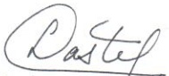

<!-- page 1 -->

# AUX BANQUES

Conformément à l'article 84 de la loi du 14 mai 2012 portant sur les banques et autres institutions financières et à l'article 16 de la loi du 11 novembre 2013 sanctionnant le blanchiment de capitaux et le financement du terrorisme, les banques sont tenues de respecter les dispositions suivantes relatives aux normes minimales de contrôle interne.

### 1. Définitions

Les définitions suivantes s'appliquent à la présente circulaire :

a) Cadre de contrôle interne : structure à l'intérieur de laquelle s'inscrivent l'élaboration, l'application et la surveillance des contrôles internes. Le cadre de contrôle interne se compose de mécanismes et de dispositions qui visent à déceler les risques internes et externes auxquels l'établissement bancaire et ses filiales consolidées s'exposent, à élaborer et à appliquer des contrôles internes adéquats et efficaces pour garantir une gestion saine et prudente de ces risques, et à mettre en place des systèmes fiables et exhaustifs pour surveiller convenablement l'efficacité de ces contrôles, et ainsi, permettre à l'établissement d'atteindre ses objectifs.

b) Contrôle corrélatif : procédure d'autocontrôle qui consiste à départager les responsabilités d'initiation des opérations de celles de leur enregistrement de sorte qu'un employé ou un groupe d'employés assure une vérification�ontinuelle et systématique des travaux effectués par d'autres employés. Une caractéristique essentielle de l'autocontrôle est qu'aucun employé n'a la responsabilité entière d'une opération ou d'une série d'opérations.

c) Contrôle interne : chacun des éléments constitutifs d'un système de contrôle interne. Mécanismes destinés à donner une assurance raisonnable que des erreurs ou des actes illégaux ne passent pas inaperçus ou ne se produisent pas.

d) Contrôle périodique : contrôle assumé par la fonction de vérification interne et qui consiste à examiner l'ensemble des activités, opérations, systèmes, fonctions et autres de l'établissement bancaire et de ses filiales, et ce, selon un cycle temporel devant s'étendre sur un nombre de mois aussi limité que possible.

e) Mandat de l'officier de conformité : document approuvé par le Conseil d'Administration de l'établissement bancaire qui précise les objectifs et les moyens destinés à assurer la fonction d'officier de conformité.

f) Mandat de vérification interne : document approuvé par le Conseil d'Administration de l'établissement bancaire qui précise les objectifs et les moyens destinés à assurer la fonction de vérification interne.

<!-- page 2 -->

g) Objectifs de l'établissement bancaire : résultats concrets qu'un établissement cherche à atteindre, dans son ensemble ou dans certaines de ses activités. Habituellement, les objectifs ont traité à une orientation stratégique de l'établissement (les marchés ou les activités qu'il vise), à son rendement financier (les indicateurs de rendement vers lesquels il tend) et à l'efficacité et à l'effécience opérationnelles de ses ressources.

h) Officier de conformité: cadre supérieur relevant directement du Conseil d'Administration de l'établissement bancaire pour ce qui a trait aux questions de blanchiment de capitaux et de financement du terrorisme. Il est chargé de veiller au respect des politiques, procédures, et méthodes en matière de blanchiment de capitaux et de financement du terrorisme, de la réglementation et de la législation en vigueur. Il assure la liaison entre l'établissement bancaire et l'unité d'intelligence financière, et communique à ladite unité les formulaires de déclaration de transactions ou de soupçon.

i) Politiques, procédures et méthodes relatives au blanchiment d'argent et au financement du terrorisme : ensemble de dispositions prises par l'établissement bancaire pour se protéger contre le risque de blanchiment de capitaux et de financement du terrorisme.

j) Programme annuel d'inspection : document préparé annuellement par le vérificateur interne et approuvé par le Conseil d'Administration de l'établissement bancaire qui inclut les objectifs d'inspection et d'audit interne pour la période à l'étude, les activités, opérations, systèmes, fonctions et autres qui seront examinés et un calendrier de travail.

k) Rapport d'exception : rapport signalant les situations dans lesquelles des contrôles ne sont pas respectés ou des pouvoirs sont outrepassés et permettant à l'établissement bancaire de prendre des dispositions pour les corriger.

l) Risque de blanchiment de capitaux : risque que l'établissement bancaire soit utilisé à des fins de blanchiment de capitaux, situation qui peut engendrer des risques opérationnels et de réputation pour l'établissement.

m) Risque de financement du terrorisme : risque que l'établissement bancaire soit utilisé à des fins de financement d'activités terroristes, situation qui peut engendrer des risques opérationnels et de réputation pour l'établissement.

n) Risque important : risque ayant une probabilité élevée de se concrétiser et dont la réalisation est susceptible de nuire de façon importante au bon fonctionnement de la banque.

o) Système de contrôle interne : ensemble des procédures et pratiques expressément instaurées et appliquées pour permettre à un établissement bancaire de gérer et de contrôler l'activité qu'il exerce ou un risque précis qu'il court, ou une combinaison de telles activités ou de tels risques. Autrement dit, le système de contrôle interne est constitué d'un ensemble de mesures de sécurité ayant pour objectif une gestion saine et prudente des risques auxquels s'expose un établissement bancaire.

<!-- page 3 -->

Se dit également de l'ensemble des procédures et pratiques établies en vue d'assurer, notamment et dans toute la mesure du possible, la préservation du patrimoine de l'établissement bancaire, la fiabilité de l'information comptable et financière, l'efficience ou l'utilisation optimale des ressources, la prévention et la détection des erreurs ou des fraudes ainsi que le respect des politiques établies et des lois et règlements.

p) Système d'information de gestion : système qui recueille et fournit des renseignements sur les activités d'un établissement bancaire, sur sa situation et sur les risques auxquels ils s'expose, à l'intention des administrateurs et des dirigeants, pour permettre à ces derniers d'analyser ces informations et de prendre les mesures adéquates. Ce système doit également servir d'outil de lutte contre le blanchiment de capitaux et le financement du terrorisme.

q) Vérificateur indépendant ou auditeur indépendant : professionnel de la vérification indépendante nommé par le Conseil d'Administration d'un établissement bancaire pour exprimer une opinion, qu'à tous égards importants, 1) les états financiers de l'établissement reflètent fidèlement sa situation financière, les résultats de son exploitation et l'évolution de sa situation financière, et 2) les contrôles internes relatifs aux opérations significatives sont adéquats et appliqués conformément aux politiques et procédures de contrôle interne de l'établissement, à la présente circulaire et aux lois en vigueur. Il devra également se prononcer sur le degré d'efficacité des mécanismes de lutte contre le blanchiment de capitaux et le financement du terrorisme en place au sein de l'établissement, s'assurer que les cadres connaissent les procédures en vigueur en la matière et que les formulaires de déclaration de transactions ou de soupçon sont remplis.

r) Vérificateur interne ou auditeur interne : personne employée par l'établissement bancaire qui est chargée de l'inspection et de l'audit interne dudit établissement.

s) Vérification annuelle de conformité : évaluation annuelle des mécanismes de lutte contre le blanchiment de capitaux et le financement du terrorisme effectuée par l'officer de conformité. L'établissement bancaire doit s'assurer que des tests indépendants soient effectués tous les douze (12) mois, en fonction du profil de risque de la banque.

t) Vérification interne ou audit interne : fonction d'inspection et de vérification interne (audit interne) établie au sein d'un établissement bancaire et dont l'objet est d'examiner, d'évaluer et de contrôler les activités de celui-ci pour le compte de son Conseil d'administration et de sa Direction générale. Elle vise à aider les administrateurs et les dirigeants à s'acquitter de leurs responsabilités, en leur fournissant des analyses, des évaluations, des recommandations, des conseils et des informations relativement aux activités examinées. Le vérificateur interne qui est un salarié de l'établissement bancaire, s'assure, pour le compte du Conseil d'Administration et de la direction, que les ressources humaines, financières et matérielles sont gérées avec l'économie, efficacité et efficiency, en conformité avec les lois, règlements et autres directives auxquels l'établissement est assujetti et que les procédures et pratiques de contrôle interne sont suffisantes, adéquates et appliquées efficacement en conformité avec le système de contrôle interne établi.

<!-- page 4 -->

### 2. Cadre de contrôle interne

Tout établissement bancaire ainsi que ses filiales consolidées doivent disposer d'un cadre de contrôle interne adéquat et efficace qui lui permette de s'assurer que ses activités sont gérées et contrôlées de manière saine et prudente.

Ce cadre de contrôle interne consiste en :

a) des administrateurs et des dirigeants qui comprennent bien leurs responsabilités et qui s'en acquittent avec loyauté et diligence en veillant à ce que les affaires de l'établissement soient efficacement gérées et contrôlées dans le but d'atteindre les objectifs fixés ;

b) des administrateurs et des dirigeants qui sont régulièrement informés de l'évolution des activités, des risques importants ainsi que des résultats au moyen d'un système d'information de gestion qui fournit une information financière de qualité ;

c) un système de contrôle interne bien défini et adapté aux risques importants et opérations significatives de l'établissement bancaire ;

d) une fonction de vérification interne qui permet de: i) surveiller l'efficacité et la cohérence du système de contrôle interne et la qualité de l'information financière à usage interne ou externe, ii) de redresser toute situation problématique causée par le non-respect, l'insuffisance ou le manque de contrôle ;

e) une fonction de vérification indépendante qui permet de surveiller l'efficacité du système de contrôle interne et la structure mise en place en matière de lutte anti-blanchiment.

### 3. Responsabilités des administrateurs et dirigeants

#### 3.1. En règle générale

Les administrateurs et les dirigeants d'un établissement bancaire jouent un rôle important dans l'administration de la société en guidant ses activités et en veillant à ce que celles-ci soient menées au mieux de ses intérêts. A cet égard, ils ont une triple obligation de loyauté, de diligence et de vigilance.

L’obligation de loyauté, fondée sur une relation de confiance, engage l’administrateur ou le dirigeant à protéger les intérêts de l’établissement bancaire en agissant de bonne foi envers l’établissement et ses clients, en faisant preuve de compétence et d’honnêteté dans l’exercice de ses fonctions, en évitant tout conflit d’intérêts et en préservant strictement le caractère confidentiel des questions qui touchent l’établissement.

L’obligation de diligence astreint l’administrateur ou le dirigeant à faire preuve de discernement et d’un grand sens des responsabilités dans l’orientation et la surveillance des activités de direction. Ce devoir l’oblige donc à respecter la règle de prudence raisonnable selon laquelle il doit agir avec la diligence, l’application, la compétence et la prudence dont une personne raisonnable ferait preuve dans les mêmes circonstances.

L'obligation de vigilance contraint les administrateurs et les dirigeants à prendre toutes les dispositions pour éviter que l'établissement bancaire soit utilisé à des fins de blanchiment de capitaux et de financement du terrorisme. Par conséquent, les administrateurs et les dirigeants doivent s'assurer de la mise en place de politiques, procédures et méthodes effectives en matière

<!-- page 5 -->

de lutte contre le blanchiment de capitaux et le financement du terrorisme. Les administrateurs sont tenus de procéder à la nomination de l'officier de conformité et de s'assurer que les recommandations de celui-ci sont suivies.

#### 3.2. A l'égard du système de contrôle interne

Les administrateurs et dirigeants ont le devoir de veiller à la mise en place d'une culture de contrôle et au respect du système de contrôle interne de l'établissement bancaire en dictant le caractère prioritaire et impératif des contrôles internes dans le fonctionnement opérationnel de l'établissement, et en sensibilisant le personnel chargé de les élaborer, de les appliquer et de les surveiller.

Les administrateurs et les dirigeants ont la responsabilité de s'assurer que le contrôle interne de l'établissement bancaire dispose des ressources, de l'indépendance et de l'autorité nécessaires pour éviter tout acte pouvant compromettre la continuité de l'exploitation surtout en ce qui à trait au blanchiment de capitaux et au financement du terrorisme.

### 4. Système de contrôle interne

La portée et les caractéristiques d'un système de contrôle interne assurant une gestion saine et prudente peuvent différer d'un établissement bancaire à l'autre pour plusieurs raisons, notamment : la nature et la diversité des activités, le volume, la taille et la complexité des opérations, le niveau de risque lié aux activités et opérations, le degré de centralisation ou de délégation des pouvoirs ainsi que l'envergure et l'efficacité de la technologie d'information utilisée.

Toutefois, peu importe l'établissement bancaire, les principes de base énoncés à l'annexe I de la présente circulaire doivent être respectés lors de la mise en place d'un système de contrôle interne.

### 5. Surveillance du système de contrôle interne

La surveillance de la politique de contrôle interne d'un établissement bancaire s'exerce à deux niveaux :

1) un contrôle corrélatif dont la responsabilité incombe aux cadres responsables, qui s'effectue dans le cadre même des activités et des opérations de manière à assurer leur bon déroulement, leur exactitude et leur conformité aux procédures mises en place et en fonction de la nature, de l'importance et des risques associés à chacune des activités et des opérations.

2) un contrôle périodique qui s'effectue par une fonction spécifique directement rattachée au Président du Conseil d'Administration ou au Président du Comité de vérification, le cas échéant. Cette fonction est généralement appelée vérification interne ou audit interne.

Tout établissement bancaire, eu égard à sa taille, doit préparer et tenir à jour un document, généralement qualifié de “mandat de vérification interne”, qui précise les objectifs et les moyens destinés à assurer la fonction de vérification interne. Ce mandat présente de manière claire les éléments suivants :

<!-- page 6 -->

a) la description du rôle, des responsabilités et de l'organisation de la fonction de vérification interne ainsi que les dispositions qui permettent d'en assurer l'indépendance ;

b) les moyens mis à sa disposition afin de lui permettre de remplir efficacement son rôle ;

c) une liste de ses attributions correspondant aux types de mission dont elle a la charge ;

d) la procédure de communication des résultats des missions effectuées et de l'analyse critique de la rentabilité des opérations et des services ;

e) une description du cycle complet d'inspection qui doit s'étendre à toutes les activités, opérations, systèmes, fonctions et autres de l'établissement bancaire et à toutes ses filiales, et ce, sans exception (à noter que le cycle doit s'étendre sur un nombre de mois aussi limité que possible).

La fonction de vérification interne doit disposer des moyens nécessaires pour mener à bien son programme d'inspection.

Au plus tard trente (30) jours avant le début du nouvel exercice financier de l'établissement bancaire, le vérificateur interne doit établir et faire approuver par le Conseil d'Administration un programme d'inspection. Ce programme annuel d'inspection doit inclure les objectifs d'inspection pour la période à l'étude, les opérations, activités, systèmes, fonctions ou autres qui feront l'objet d'une inspection ainsi qu'un calendrier de travail définissant l'échéancier des travaux de planification, d'exécution et de communication des résultats. Tout manquement observé ou toute insuffisance constatée par la fonction de vérification interne lors d'une inspection doit faire l'objet d'un rapport écrit et d'un plan de redressement assorti d'un calendrier de mise en place des mesures de redressement. Le Conseil d'Administration ou le Comité de vérification doit recevoir une copie de tous les rapports d'inspection. Tout établissement bancaire doit faire parvenir à la BRH, quinze (15) jours au plus tard après l'approbation du Conseil d'Administration, le programme d'inspection de l'exercice.

Au plus tard trente (30) jours après la fin de chaque trimestre de l'exercice financier de l'établissement bancaire, le vérificateur interne doit préparer un rapport trimestriel d'activité à l'intention du Conseil d'Administration. Ce rapport doit être officiellement discuté à une réunion du Conseil d'Administration ou du Comité de vérification.

Le rapport trimestriel d'activité inclut les informations suivantes :

a) une description des activités menées durant le trimestre ;

b) les principales conclusions liées à chacune des inspections et une description de l'impact des manquements ou des insuffisances, les redressements requis et le calendrier de mise en place des redressements ;

c) un suivi du programme annuel d'inspection qui fait le point sur son degré d'avancement et les activités planifiées pour le prochain trimestre ;

d) un suivi des mécanismes mis en place dans le cadre de la lutte contre le blanchiment de capitaux et le financement du terrorisme en fonction du profil de risque de la banque.

## Comité de vérification

Tout établissement bancaire doit constituer un Comité de vérification au sein du Conseil d'administration qui soit composé d'au moins trois (3) administrateurs. La majorité de ces administrateurs ne doivent pas être des dirigeants de l'établissement bancaire. Le Comité doit se réunir au moins quatre fois l'an et a notamment pour tâches de :

<!-- page 7 -->

a) passer en revue le rapport annuel de l'établissement bancaire avant son approbation par le Conseil d'administration ;

b) passer en revue les états financiers mensuels de l'établissement bancaire et les comparer au budget ;

c) passer en revue l'information statistique trimestrielle publiée par la BRH ;

d) veiller à ce qu'un système approprié de contrôle interne soit mis en place, appliqué et surveillé ;

e) vérifier tout prêt, placement ou autre actif ou opération susceptible de nuire à la bonne situation financière de l'établissement bancaire et porté à son attention par un dirigeant, le contrôleur interne, le vérificateur indépendant ou la BRH ;

f) rencontrer le vérificateur interne périodiquement et réviser ses rapports d'activité ;

g) rencontrer le vérificateur indépendant pour discuter des états financiers vérifiés et des recommandations à l'égard du renforcement du système de contrôle interne ;

h) réviser toute communication échangée entre l'établissement bancaire et la BRH ;

i) réviser toute communication échangée entre l'établissement bancaire et le vérificateur indépendant ;

j) rencontrer l'officier de conformité pour discuter des recommandations produites dans sa vérification annuelle de conformité.

### 6. Examen des contrôles par le vérificateur indépendant

Le vérificateur indépendant de l'établissement bancaire doit procéder à un examen des contrôles liés aux activités de crédit, de placements, de change et de dépôts ainsi qu'aux opérations de revenus, de dépenses, d'encaissements et de déboursés. La portée et les objectifs de l'examen sont décrits à l'annexe II de la présente circulaire.

Le rapport d'examen du vérificateur indépendant doit être adressé au Conseil d'Administration de l'établissement bancaire selon le format prescrit à l'annexe III de la présente circulaire au plus tard cent vingt (120) jours après la fin de l'exercice financier de l'établissement.

Dès sa réception, l'établissement bancaire fera parvenir à la BRH le rapport d'examen du vérificateur indépendant accompagné d'une description des travaux effectués et des résultats obtenus.

### 7. Disponibilité de renseignements pour inspection

Lors des inspections périodiques menées par la BRH, l'établissement bancaire doit mettre à la disposition des inspecteurs de la BRH les documents suivants :

a) le mandat de vérification interne de la fonction de vérification interne conformément à la section 5 de la présente circulaire ;

b) le programme annuel d'inspection dûment approuvé par le Conseil d'Administration conformément à la section 5 de la présente circulaire ;

c) les rapports trimestriels d'activité de la fonction de vérification interne conformément à la section 5 de la présente circulaire ;

d) les rapports d'inspection ainsi que toutes les pièces et feuilles de travail y relatives et le rapport de vérification annuelle de conformité.

<!-- page 8 -->

### 8. Sanctions

En cas de non respect des obligations définies dans la présente circulaire, la BRH se réserve le droit de prendre les sanctions administratives suivantes :

a) Disponibilité de renseignements pour inspection : à défaut de fournir les renseignements énoncés aux sections 6 et 7 de la présente circulaire, un établissement bancaire est assujetti à une pénalité de cinq mille gourdes (HTG 5,000.00) par jour d'infraction. La période de pénalité s'étend du jour de l'infraction (demande de renseignements par la BRH) jusqu'à celui où les renseignements sont mis à la disposition des agents de la BRH.

b) Retard de production des rapports de conformité : pénalités conformément à la circulaire en vigueur sur le sujet.

c) Retard de transmission des rapports de conformité: pénalités conformément à la circulaire en vigueur sur le sujet.

d) Non soumission des rapports de conformité : pénalités conformément à la circulaire en vigueur sur le sujet.

La BRH peut exiger d'un établissement bancaire qu'il redresse toute situation relative à :

a) des infractions relatives aux dispositions de la présente circulaire ;

b) des insuffisances de contrôles internes soulevées par le vérificateur interne, le vérificateur indépendant ou la BRH elle-même ;

c) des manquements aux principes de base d'un bon système de contrôle interne présentés à l'annexe 1 de la présente circulaire.

### 9. Cas des succursales de banques étrangères

En plus des dispositions prévues aux sections 2 à 8, les succursales de banques étrangères doivent soumettre à la BRH, au plus tard trente (30) jours avant le début du nouvel exercice financier :

a) une description détaillée de leur système de contrôle interne (éléments principaux, organisation de la surveillance, mécanismes de redressement, communication avec la banque mère);

b) une description du type de surveillance exercée par la banque mère (type d'intervention, fréquence, type de communication) ;

c) le rapport de la dernière inspection effectuée par la banque mère.

De plus, à chaque visite des inspecteurs de la banque mère, ces succursales doivent planifier et organiser une rencontre entre les inspecteurs de la banque mère et ceux de la BRH.

<!-- page 9 -->

### 10. Entrée en vigueur

Les dispositions de la présente circulaire remplacent celles de la Circulaire No. 89 et entrent en vigueur le 12 octobre 2015.

Port-au-Prince, le 29 septembre 2015

Charles Castel

Gouverneur

## Annexes

I Principes de base d'un système de contrôle interne

Ⅱ Examen du vérificateur indépendant - Portée et objectifs de l'examen

III Examen du vérificateur indépendant - Renseignements à fournir et libellé du rapport

<!-- page 10 -->

# PRINCIPES DE BASE D'UN SYSTEME DE CONTROLE INTERNE

Le système de contrôle interne en place doit être cohérent et s'étendre à toutes les entités faisant partie de l'établissement bancaire. Tout établissement bancaire est donc tenu de prendre les mesures nécessaires pour garantir la stricte application des politiques, procédures et méthodes en vigueur spécialement celles relatives au blanchiment de capitaux et au financement du terrorisme.

Un établissement bancaire doit concevoir son système de contrôle interne selon les principes de base suivants, indépendamment des modalités d'application :

## 1 - Une structure administrative adéquate

Recenser et suivre l'évolution des fonctions et des risques.

Elaborer un organigramme détaillé selon les fonctions commerciales, administratives et financières.

■ Inventorier l'ensemble des risques et leur interdépendance.

■ Etablir un mécanisme permettant de déceler et d'évaluer en permanence les risques importants auxquels l'établissement s'expose ainsi que leurs répercussions possibles sur sa situation.

■ Etablir un mécanisme permettant de déceler et de prévenir le blanchiment de capitaux et le financement du terrorisme.

Définir explicitement jusqu'à quels niveaux il convient de déléguer les pouvoirs d'approbation en toute prudence.

Etablir une délimitation claire des responsabilités et des niveaux d'exercice des pouvoirs afin que les décisions soient prises par des personnes habilitées à le faire et capables d'en évaluer les répercussions.

Adapter la délégation des pouvoirs en fonction de la taille de l'établissement bancaire, le type de risque évalué, l'expérience des administrateurs et dirigeants et leur niveau d'implication dans les opérations quotidiennes et le contrôle exercé sur celles-ci.

Communiquer la délégation de pouvoirs en précisant quel pouvoir est délégué, à quels directions, services, postes, personnes ou comités; le pouvoir est délégué, si les délégataires sont eux-mêmes habilités à déléguer à nouveau le pouvoir et quelles restrictions sont imposées à l'exercice du pouvoir délégué, le cas échéant.

Etablir un cloisonnement prudent des responsabilités fonctionnelles afin de réduire le risque de manipulation ou d'erreur voulue ou accidentelle.

Séparer les fonctions opérationnelles (personnes qui enregistrent, exécutent ces opérations, en rendent compte et conservent les pièces justificatives) des fonctions administratives (personnes qui autorisent, supervisent ou ordonnent des opérations).

S'assurer qu'une personne ne peut contrôler suffisamment d'étapes du traitement d'une opération pour que des erreurs ou des malversations puissent se produire sans qu'il ne soit raisonnablement possible de les déceler.

Concevoir l'ordre des tâches des employés de manière à ce que le travail d'un employé soit indépendant de celui des autres, et serve même à le contrôler.

<!-- page 11 -->

Prévoir des contrôles fréquents et systématiques par les dirigeants lorsque la taille réduite de la banque ou le volume restreint des opérations ne justifie pas de séparer les fonctions opérationnelles des fonctions administratives.

Etablir un plan d'entreprise formel une fois par an.

Cerner les nouveaux débouchés du marché, antiaper et effectuer les changements d'orientation, prévoir ses résultats, déterminer les ressources financières et humaines nécessaires pour assurer la réalisation du plan et fixer des objectifs commerciaux et de rendement.

Veiller à faire approuver le plan d'entreprise par le Conseil d'Administration.

Communiquer, selon la participation de chacun à la réalisation du plan d'entreprise, les objectifs commerciaux et de rendement aux actionnaires, administrateurs, dirigeants et employés. Les employés sont seulement mis au courant des renseignements qui les touchent directement.

Etablir un mécanisme de suivi et de mesure de la mise en place du plan d'entreprise.

## 2 - Un personnel qualifié

Adopter des politiques écrites en matière de ressources humaines.

Adopter une stratégie permettant à l'établissement d'avoir un personnel suffisamment nombreux, compétent, motivé et expérimenté pour pouvoir exercer ses activités en toute prudence (stratégie de recrutement, programme de formation et de perfectionnement, plan de relève).

Elaborer et réviser périodiquement les programmes de rémunération pour veiller à ce que les politiques de l'établissement n'aient pas pour effet d'accroître ses risques.

Examiner et évaluer périodiquement le rendement du personnel.

Adopter un code de déontologie formel.

Instituer des règles satisfaisantes et prudentes à l'égard de la conduite à tenir en affaires et de l'éthique professionnelle.

Veiller à faire sanctionner le code de déontologie par le Conseil d'Administration.

Veiller à faire réviser annuellement le code de déontologie par le Conseil d'Administration.

Veiller à faire signer une déclaration par les administrateurs, dirigeants et employés attestant qu'ils ont pris connaissance du code, qu'ils le comprennent et qu'ils s'engagent à le respecter.

## 3 - Des systèmes comptables et de gestion appropriés

Etablir et maintenir des contrôles comptables efficaces.

Créer, maintenir et utiliser un système comptable permettant d'enregistrer les opérations en temps opportun et de produire une information comptable intégrale et exacte.

Concevoir le système comptable et tenir les dossiers comptables de manière à assurer la présence d'une piste d'audit permettant de faciliter le contrôle des informations comptables et prudentielles. La piste d'audit doit permettre de reconstituer dans un ordre chronologique les opérations, de justifier toute information par une pièce justificative à partir de laquelle il doit être possible de remonter par un cheminement ininterrompu aux rapports ou états et réciproquement et finalement, d'expliquer l'évolution des soldes d'une date d'arrêté des comptes à l'autre par la conservation des mouvements ayant affecté les postes comptables.

<!-- page 12 -->

Etablir et maintenir un système d'information de gestion efficace.

Créer, maintenir et utiliser un système d'information de gestion complet, grâce auquel l'établissement bancaire dispose en temps opportun des renseignements pertinents à sa gestion et à son contrôle.

Concevoir des rapports permettant de connaître, de quantifier, d'évaluer et de surveiller les activités commerciales d'un établissement bancaire, sa position de risque, sa situation financière et son rendement, et de prendre à cet égard les décisions qui s'imposent.

Mettre en place un système permettant d'apprécier les opérations effectuées par un client quelque soit le nombre de comptes qu'il détient à l'établissement bancaire.

■ Concevoir des rapports d'exception permettant de relever toutes les dérogations aux contrôles internes et d'identifier rapidement toute situation problématique à l'égard des risques, de la solvabilité et du rendement d'un établissement bancaire.

Concevoir des rapports permettant de relever toutes les dérogations aux contrôles internes.

Produire les rapports aussi souvent qu'il le faut pour que les données sur les activités, les risques, la solvabilité et le rendement soient aussi récentes et pertinentes que possible.

Réexaminer régulièrement les rapports de gestion pour vérifier si l'information présentée ou la fréquence de production demeure valable.

Mettre en place un système de surveillance pouvant garantir la maîtrise des risques relatifs au blanchiment de capitaux et au financement du terrorisme.

• Etablir des systèmes de mesure des risques et une évaluation régulière desdits systèmes.

## 4 - Une protection adéquate des biens et un plan de relève efficace des systèmes et activités

Concevoir et appliquer des mesures efficaces de protection, d'évaluation et de contrôle des postes du bilan.

▪ Mettre en place toutes les mesures nécessaires à la protection physique des actifs liquides, ainsi que des biens mobiliers et immobiliers de l'établissement bancaire (restriction à l'accès physique, prise d'inventaire périodique, procédures d'entretien et couverture d'assurances adéquate).

Adapter ces mesures à la valeur des éléments d'actif en question, au degré de leur transférabilité et négociabilité, à la facilité avec laquelle une perte ou un détournement pourrait être dissimulé et les répercussions d'une perte sur la situation financière, l'exploitation et la réputation de l'établissement bancaire.

Elaborer des politiques et des pratiques d'évaluation pour tenir compte de la dépréciation monétaire ou de la baisse de valeur des éléments d'actif ou de la hausse de valeur des engagements de l'établissement bancaire.

Surveiller, examiner et quantifier régulièrement la quantité et la valeur des éléments d'actif et de passif, inscrits au bilan et hors-bilan, en fonction des pertes qu'un établissement bancaire a subies ou est susceptible de subir dans le cadre de ses activités.

■ Evaluer les éléments d'actif et de passif et comptabiliser, le cas échéant, des provisions prudentes ou d'autres redressements appropriés à l'égard de ceux-ci, conformément aux politiques comptables et aux exigences réglementaires auxquels l'établissement bancaire est assujetti.

<!-- page 13 -->

Adopter des contrôles satisfaisants de sécurité et de relève à l'égard des systèmes informatiques et de télécommunications.

Mettre en place des contrôles qui soient en adéquation avec les risques liés à une panne irrémédiable ou prolongée de ces systèmes pour l'établissement bancaire.

■ Tester convenablement les systèmes avant leur mise en service.

Documenter convenablement les systèmes ainsi que tout changement pouvant y être apporté.

Mettre en place des mesures qui visent à préserver l'intégrité du matériel, des logiciels et des données ainsi qu'à limiter l'accès physique ou électronique à ces derniers aux seules personnes autorisées.

Adopter des pratiques de sauvegarde et de récupération de données et des dispositions de relève et de secours permettant de faire adéquatement face à la défaillance ou à la perte, par destruction ou autrement, des systèmes de l'établissement bancaire, de ses fichiers de données, de son matériel, de ses logiciels et de sa documentation.

Réviser et mettre à l'essai périodiquement ces mesures de secours.

Adopter des mesures de relève des affaires de l'établissement bancaire en cas de destruction partielle ou totale de ses locaux ou la restriction temporaire ou permanente de l'accès à ceux-ci.

## 5 - Une documentation appropriée

Etablir un système de documentation et d'information efficient.

Description des activités, opérations, systèmes ou fonctions

■ Consigner par écrit tous les renseignements nécessaires aux activités, opérations, systèmes ou fonctions afin de faciliter leur compréhension par le personnel ainsi que leur évaluation et leur modification dans le cas de recherche de solutions à certains problèmes de fonctionnement.

## Description des tâches

Consigner par écrit tous les renseignements nécessaires aux tâches afin de faciliter le processus de recrutement du personnel, l'évaluation du personnel et la répartition appropriée des tâches.

## Manuels de procédures

Etablir des manuels de procédures sur la base de l'analyse des activités, opérations, systèmes, fonctions et risques de l'établissement bancaire dans lesquels doivent être décrits de façon détaillée les contrôles internes.

Documenter le système de contrôle interne conformément à la section 4 de la présente circulaire.

Consigner par écrit tous les renseignements nécessaires aux contrôles internes afin de guider le personnel chargé de les élaborer, de les appliquer et de les surveiller.

## 6 - Une surveillance appropriée

Établir un système de surveillance basée sur des contrôles corrélatifs et des contrôles périodiques conformément à la section 5 de la présente circulaire.

<!-- page 14 -->

# EXAMEN DU VERIFICATEUR INDEPENDANT

# PORTEE ET OBJECTIFS DE L'EXAMEN

La portée et les objectifs de l'examen prévu à la section 6 de la Circulaire 89-1 de la BRH sont les suivants :

## Activité de crédit $ ^{1} $

présence d'une politique et de procédures écrites en matière de crédit ;

description des contrôles liés à l'activité de crédit (octroi, révision périodique classification, provisionnement, restructuration et recouvrement des prêts);

fonctionnement adéquats des contrôles en place :

caractère suffisant des contrôles pour assurer une gestion saine et prudente.

## Activité de placements

présence d'une politique et de procédures écrites en matière de placements ;

description des contrôles liés à l'activité de placements (décisions d'investissement et de disposition, et suivi de la qualité et de la valeur des placements) ;

fonctionnement adéquats des contrôles en place :

caractère suffisant des contrôles pour assurer une gestion saine et prudente.

## Activité de change

présence d'une politique et de procédures écrites en matière de gestion du risque de change ;

description des contrôles liés à l'activité de change (décisions relatives aux taux de conversion et application de ceux-ci, décisions relatives au maintien d'une position courte ou longue, analyse du risque et suivi de la position adoptée);

fonctionnement adéquats des contrôles en place :

caractère suffisant des contrôles pour assurer une gestion saine et prudente ;

conformité avec la Circulaire de la BRH relative à la gestion du risque de change.

## Activité de dépôts

présence d'une politique et de procédures écrites en matière de dépôt ;

description des contrôles liés à l'existence des dépôts, à l'ouverture des comptes, à la fermeture des comptes, aux retraits en espèces et à la rémunération des dépôts ;

fonctionnement adéquats des contrôles en place :

caractère suffisant des contrôles pour assurer une gestion saine et prudente.

présence de procédures écrites ;

Opérations de revenus, de dépenses, d'encaissements et de déboursés

description des contrôles en place :

<!-- page 15 -->

fonctionnement adéquats des contrôles en place.

caractère suffisant des contrôles pour assurer l'intégralité, l'existence et l'exactitude des opérations.

## Lutte contre le blanchiment de capitaux et le financement du terrorisme

existence d'une politique, de procédures et de méthodes écrites en matière de lutte contre le blanchiment d'argent et le financement du terrorisme ;

description des contrôles en place ;

fonctionnement adéquat des contrôles en place ;

efficacité des mécanismes en place pour prévenir le blanchiment de capitaux et le financement du terrorisme ;

conformité avec les lois et règlements en vigueur.

<!-- page 16 -->

# EXAMEN DU VERIFICATEUR INDEPENDANT RENSEIGNEMENTS A FOURNIR ET LIBELLE DU RAPPORT

Le vérificateur indépendant doit fournir, dans une lettre qui accompagne son rapport d'examen, les renseignements suivants dans le cadre de la section 6 de la Circulaire 89-1 sur le contrôle interne:

## Description des travaux effectués

Il doit décrire :

☐ la portée et les objectifs de l'examen ;

la stratégie d'examen poursuivie pour chaque activité et opération ;

les procédés d'examen utilisés et l'étendue des sondages effectués.

## Résultats des travaux effectués

Il doit décrire :

les résultats de l'examen de chaque activité et opérations ;

les faiblesses observées et l'impact du fonctionnement inefficace ou de l'absence de contrôles ;

les recommandations proposées par le vérificateur indépendant ;

les commentaires de la direction de l'établissement bancaire à l'égard des faiblesses et des recommandations formulées par le vérificateur indépendant ainsi qu'un échéancier des mesures de redressement envisagées.

## Libellé du rapport d'examen du vérificateur externe

## Aux membres du Conseil d'Administration de la Banque ABC

Nous avons procédé à un examen des contrôles liés aux activités de crédit, de placements, de change et de dépôts ainsi qu'aux opérations de revenus, de dépenses, d'encaissements et de déboursés, de lutte contre le blanchiment de capitaux et le financement du terrorisme selon la portée et les objectifs d'examen énoncés à l'annexe II de la Circulaire 89-1 de la BRH sur le contrôle interne. Notre examen ne visait pas l'expression d'une opinion sur les contrôles internes et n'a pas nécessairement permis de déceler toutes les faiblesses relatives au contrôle des activités et opérations revues. Notre examen a consisté essentiellement en prises de renseignements, discussions portant sur les renseignements et a comporté par conséquent les sondages et autres procédés que nous avons jugés nécessaires dans les circonstances.

Notre examen ne nous a pas permis de déceler de faiblesses (ou nous a permis de déceler les faiblesses suivantes - liste des faiblesses ou renvoi à une lettre qui accompagne l'examen).

Lieu et date Signature
