<!-- page 1 -->

Document d'Information - Taux de change et le marché des changes 02.qxt Layout 1 8/13/24 8:40 PM Page 1

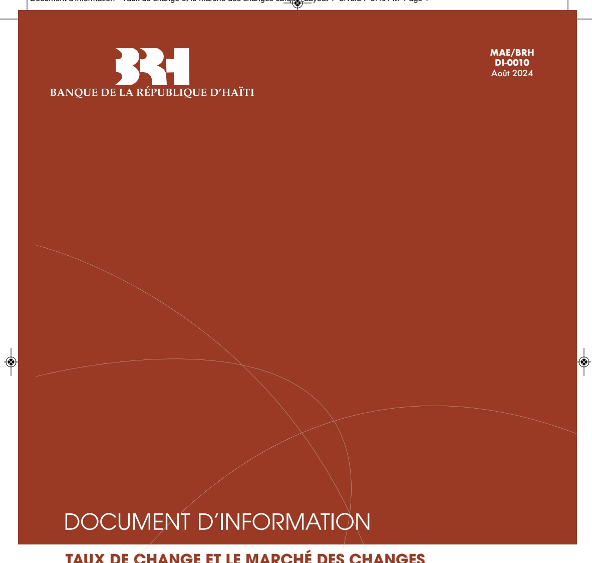

MAE/BRH DI-0010 Août 2024

## DOCUMENT D'INFORMATION

TAUX DE CHANGE ET LE MARCHÉ DES CHANGES

<!-- page 2 -->

<!-- page 3 -->

Document d'Information - Taux de change et le marché des changes 02.qxt Layout 1 8/13/24 8:40 PM Page 3

## INTRODUCTION

L'intégration et l'interdépendance croissante des économies nationales dans le contexte de la mondialisation ont favorisé l'augmentation du commerce international, un plus grand accès aux marchés financiers mondiaux et par ricochet une progression accrue des opérations de change. Ces dernières supposent donc la conversion des monnaies, d'où l'importance du taux de change. Ainsi, le taux de change devient un indicateur important à suivre pour toute banque centrale dont l'un des rôles fondamentaux est de défendre, entre autres, la valeur externe de la monnaie nationale. Il représente ainsi une variable incontournable pour toute économie, en particulier pour celles dépendantes de l'extérieur comme Haïti, c'est-à-dire, une petite économie ouverte. De ce fait, les autorités monétaires et le public en général suivent de près, dont l'influence sur le comportement des prix à la consommation affecte la stabilité macroéconomique du pays.

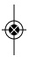

## DÉFINITION DU TAUX DE CHANGE

Toute transaction entre deux agents évoluant dans des espaces monétaires différents nécessite une opération de change. Conséquemment, pour satisfaire les besoins des transactions internationales, la conversion des monnaies est nécessaire ; les opérations de change permettent donc d'assurer cette convertibilité entre les monnaies. Ainsi, le taux de change représente le prix d'une monnaie nationale par rapport à une monnaie étrangère¹. Le taux de change est, en d'autres termes, la quantité de monnaie nationale nécessaire à l'achat d'une unité de monnaie étrangère ou inversement.

## EXPRESSION DU TAUX DE CHANGE D'UNE MONNAIE PAR RAPPORT À UNE AUTRE

Définie suivant la norme internationale des codes isométriques monétaires, une monnaie est représentée par un code international de devises formé par trois (3) caractères alphabétiques. Les deux premiers caractères représentent le nom du pays émetteur de la monnaie, tandis que le troisième est l'initiale du nom de la monnaie. Ainsi, la gourde est symbolisée par le code HTG où HT représente « Haiti » et G pour « gourde » ; le dollar américain par le code USD avec US pour « United States » et D pour « dollar » ; le peso dominicain par DOP, avec DO pour « Dominican » et P pour « Peso ». Aussi, la

Le taux de change ainsi défini est le taux de change nominal. Il existe par ailleurs le taux de change réel qui lui exprime le prix relatif des produits étrangers par rapport aux produits nationaux exprimé en monnaie nationale. Ce taux prend en compte non seulement le taux de change nominal mais aussi le niveau des prix dans les deux pays considérés.

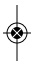

<!-- page 4 -->

cotation d'une monnaie par rapport à une autre, se dénote à partir de leurs acronymes respectifs.

| EXPRESSION DU DOLLAR PAR RAPPORT À LA GOURDE | EXPRESSION DU PESO PAR RAPPORT AU DOLLAR |
| --- | --- |
| Un dollar vaut 93 gourdes :\nHTG / USD = 93\nOU HTGUSD = 93 | Un collar vaut 52,94 pesos:\nDOP / USD = 53\nOU DOPUSD = 53 |

## COURS CROISÉS

Certaines devises ne sont pas directement cotées sur le marché des devises, c'est-à-dire qu'elle ne peut être exprimée en fonction d'une autre. Ainsi, afin de déterminer la contrepartie équivalente en unités de devise, il convient de considérer sa cotation par rapport à une devise commune ou universelle. Les plus populaires ou celles généralement utilisées sont le dollar américain ou l'euro, d'où l'importance du cours croisé. Le cours croisé est donc un cours de change d'une devise par rapport à une autre monnaie déterminée à partir d'une devise « pivot ».

Prenons par exemple la paire de devises DOP et HTG². Ces deux monnaies n'ont pas de cotation directe sur le marché international de devises. Ainsi, pour déterminer le nombre de gourdes nécessaires pour avoir un peso, on considère la cotation DOP/ USD et HTG/USD.

Ainsi, si un dollar américain vaut 93 gourdes et s'il faut 53 pesos pour un dollar américain, alors on peut déterminer la valeur de la gourde par rapport au peso étant donné qu'elles sont exprimées à partir d'une même devise : le dollar américain.

D'où l'expression du :

1) Taux de change de la gourde par rapport au peso dominicain HTG/DOP = (HTG/USD)/(DOP/USD) ou HTG/DOP = 93/53 = 1,75

2) Taux de change du peso dominicain par rapport à la gourde DOP/HTG = (DOP/USD) / (HTG/USD) ou DOP/HTG = 53/93 = 0,57

<!-- page 5 -->

## MODES DE COTATION DU TAUX DE CHANGE

Il existe deux modes de cotation du taux de change : la cotation au certain (ou directe) et la cotation à l'incertain (ou indirecte). On parle de cotation au certain lorsqu'une unité de la monnaie nationale est exprimée en une quantité variable de la devise étrangère. De ce fait, le taux de change coté au certain indique le nombre d'unités de monnaie étrangère que l'on peut se procurer avec une unité de monnaie nationale. La cotation à l'incertain se réfère à l'expression d'une quantité variable de monnaie nationale pour une unité de devise étrangère. Ainsi, le taux de change coté à l'incertain représente le nombre d'unités de monnaie nationale que l'on doit débourser pour avoir une unité de monnaie étrangère $ ^{3} $.

| COTATION À L'INCERTAIN | COTATION AU CERTAIN |
| --- | --- |
| 1 USD = 93 HTG\nUn agent économique en Haïti doit avoir 93 gourdes pour acheter un dollar. | 1 HTG= 0,011 USD\nUn agent économique aux États-Unis doit donner 0,011 USD pour avoir une gourde. |

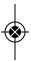

## MARCHÉ DES CHANGES

Le marché des changes, appelé encore Forex, est celui où se réalisent les opérations d'achat et de vente des devises. La confrontation de l'offre et de la demande d'une monnaie étrangère détermine son prix par rapport à la monnaie nationale. Toutefois, d'autres facteurs non liés à cette confrontation peuvent aussi influencer le prix d'une monnaie par rapport à une autre.

- Sur le marché au comptant ou spot, le taux de change considéré dit « Taux de change au comptant » est le prix d'une monnaie pour une transaction immédiate ne dépassant pas plus de deux jours.

On distingue deux types de marché : le marché au comptant et le marché à terme.

Le faux de change à terme, utilisé sur le marché à terme (Forward market), désigne le prix d'une monnaie pour une transaction future (soit dans 30 à 60 jours). Il existe alors un délai entre la date à laquelle le contrat a été signé et celle du paiement de la transaction. Ce type de contrat permet de fixer à l'avance le cours entre deux devises. Le marché des changes à terme trouve son importance dans la couverture contre le risque de change. Sur

 $ ^{3} $Il est à noter que le taux de change utilisé en Haïti est coté à l'incertain.

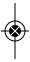

<!-- page 6 -->

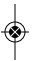

ce marché, le prix est fixé entre les deux « parties » (acheteur et vendeur) et reste invariable entre le jour de la signature du contrat et le jour du règlement de la transaction.

Deux principaux produits sont utilisés dans le cadre du change à terme :

Le terme Sec et les Swaps de change.

Le swap de change est une transaction financière dans laquelle deux entités établissent un contrat suivant lequel ils décident d'échanger des devises au cours de change au comptant dès la mise en place du contrat, et à échéance au cours de change à terme ou à un cours convenu à l'avance. En d'autres termes, le swap consiste en une double opération relative à la vente au comptant d'une monnaie et de son rachat à terme. La différence entre le cours comptant et le cours à terme est désignée par l'expression « points de swap ».

Le Terme Sec ou encore « Outright » renvoie à une transaction à terme au sens strict, qui consiste en l'achat ou la vente d'une devise contre une autre pour une livraison d'une durée supérieure à deux jours ouvrés.

LE SWAP DE CHANGE

## SEC

Quel que soit le type de taux de change considéré, son niveau dépend du régime de change adopté par les autorités du pays.

## RÉGIME DE CHANGE

Suivant les objectifs économiques d'un pays et en raison de l'environnement macroéconomique international et surtout des contraintes auxquelles il fait face dans les rapports avec ses partenaires commerciaux, le gouvernement et les autorités monétaires d'un pays établissent un régime de change à adopter. Un régime de change définit les règles institutionnelles qui précisent comment se déterminent les cours de change d'une monnaie par rapport aux autres devises. Le choix d'un régime de change approprié est un élément important dans la politique économique d'un pays. Les principaux facteurs qui peuvent intervenir dans la détermination d'un régime de change sont : le degré d'ouverture, la taille de l'économie, la concentration géographique, la diversification du commerce extérieur, l'intégration financière, l'inflation, le niveau de développement économique et le niveau des réserves de change.

Ainsi, le régime de change optimal est celui qui minimise les fluctuations des variables macroéconomiques telles que le PIB, la consommation, le niveau général des prix. Conséquemment, le choix d'un régime de change dépend de la nature et de la source des chocs, de l'orientation de la politique économique établie par les autorités et des caractéristiques structurelles de l'économie considérée.

<!-- page 7 -->

Il existe plusieurs types de régimes de change dont les deux principaux sont : Le régime de change fixe et le régime de change flexible.

## • Régime de Taux de change fixe

Dans un régime de taux de change fixe, le taux de change est fixé par les autorités monétaires et la banque centrale s'engage à échanger la monnaie nationale à ce taux. Dans un tel système, les autorités des pays, qui ont passé l'accord consistant à maintenir des parités stables entre leurs monnaies, ont l'obligation de garder cette parité en intervenant sur le marché des changes pour défendre le cours fixé en cas de chocs externes⁴. Dans une telle situation, la banque centrale doit disposer de réserves suffisantes pour pouvoir défendre la monnaie contre les attaques spécultives. Outre la quantité suffisante de réserves, la crédibilité d'un tel régime est fondée sur l'engagement des autorités à poursuivre des politiques monétaires et budgétaires saines.

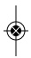

Une demande grandissante pour une devise fait augmenter son prix en fonction de la monnaie locale. Aussi, afin de maintenir la parité fixe, les autorités monétaires doivent réaliser des interventions sur le marché des changes en vendant des devises contre l'excédent de liquidité en monnaie nationale. Ce faisant, elles diminuent les réserves de change détenues à la banque centrale. Cette situation s'observe surtout quand le pays émetteur de la monnaie nationale fait face à un déficit commercial. Il s'ensuit alors une pression sur le marché des changes via la demande des importateurs. Par contre, si ce pays enregistre un excédent commercial, l'État doit éponger la quantité supplémentaire de devises dans l'économie afin de garantir le taux de change fixe. Cette opération fait augmenter le niveau des réserves de change du pays $ ^{5} $.

## • Régime de Taux de change flexible

Dans un régime de taux de change flexible ou flottant, le taux de change varie librement en fonction de l'offre et de la demande de devises étrangères sur le marché des changes. On parle alors de flottement pur. Dans le cas où les autorités monétaires interviennent sur le marché des changes, soit pour soutenir la valeur de la monnaie nationale ou pour lisser les fortes fluctuations du taux de change, on parle de flottement administré ou de flottement impur. Dans un régime de taux de change flottant, une augmentation du taux de change défini à l'incertain renvoie à une dépréciation de la monnaie nationale, ceci sous-tend qu'il faudra plus de monnaie locale pour avoir une unité de devise étrangère, tandis qu'une baisse

<!-- page 8 -->

du taux de change constitue une appréciation de la monnaie locale, moins de monnaies nationales pour acquérir une unité de devises étrangère.

Parité glissante (Crawling Peg) : Le régime de change avec une parité glissante est celui dans lequel le taux de change est en principe fixe. Toutefois, cette parité de référence est périodiquement ajusté suite à l'évolution de certaines variables prédéterminées telles que le différentiel d'inflation passée avec certains partenaires commerciaux.

Entre ces deux régimes de change extrêmes, on retrouve des régimes de change intermédiaires

Le régime de change avec un glissement actif permet de faire un ancrage sur les anticipations de prix et d'annoncer à l'avance le taux de dévaluation pour plusieurs mois. Ce régime de change a été adopté dans les pays d'Amérique latine dans les années 1980 afin d'enrayer leur inflation galopante.

## DANS UN MARCHÉ DE CHANGE FLOTTANT, LE TAUX DE CHANGE EST DÉTERMINÉ PAR LA LOI DE L’OFFRE ET DE LA DEMANDE

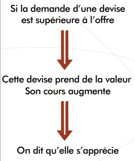

Si 1 USD = 91 HTG en t,

Et

1 USD = 92 HTG, en t+1

La gourde se déprécie parceau’il faut plus de gourdes en t+1 qu’en t pour acheter un dollar américain

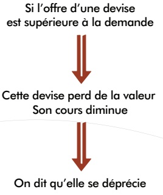

Par ailleurs, dans un système de parité fixe, l'État peut décider de baisser la valeur de la monnaie nationale, on parle alors de « dévaluation ». Contrairement à la dépréciation qui est la perte de valeur de la monnaie nationale, l'État a été dévalué par la parole, la dévaluation est la baisse des cours de la monnaie nationale par rapport à une monnaie de référence découlant de la volonté des autorités monétaires d'un pays. La dévaluation est envisagée dans l'objectif de relancer la compétitivité économique en particulier la compétitivité-prix. En effet, elle a un double impact sur la balance commerciale, elle diminue le coût des produits exportés et renchérit la valeur des importations. A contrario, lorsque les autorités monétaires décident d'augmenter la valeur de la monnaie nationale par rapport à l'étalon de référence, on parle alors de « réévaluation ».

<!-- page 9 -->

## DIFFÉRENCE ENTRE TAUX DE CHANGE À L'ACHAT ET TAUX DE CHANGE À LA VENTE

Le taux de change à l'achat ou cours acheteur (bid price) est le prix auquel la banque ou le cambiste décide d'acheter une devise sur le marché des changes. Le taux de change à la vente ou encore cours vendeur (ask price) est le prix auquel la banque ou le cambiste veut vendre une monnaie. Le taux de change à l'achat étant toujours inférieur au taux à la vente, la différence qui en résulte constitue le gain de change ou « Spread ». Le spread représente donc la marge ou le gain d'un opérateur sur le marché des changes.

## Les déterminants du taux de change ou les mécanismes de formation des prix en Haïti

À travers ce volet, nous présentons le rôle de la BRH dans le mécanisme de formation des prix et les contraintes limitant la marge de spéculation des intermédiaires financiers sur le taux de change, pour une meilleure compréhension du fonctionnement du marché des changes en Haïti.

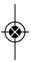

## 1 ) LE MARCHÉ DES CHANGES ET LA FORMATION DES PRIX

Le marché des changes haïtien est composé d'opérateurs formels (banques, agents de change) et informels (cambistes de rues, et des agents qui effectuent des opérations cambiaires sans accord de la Banque centrale et sans autorisation légale).

Depuis l'adoption par Haiti d'un régime de change flottant en 1991, la formation des prix sur le marché des changes résulte de l'interaction entre l'offre et de la demande de dollars américains. Ainsi, l'évolution du taux de change s'explique notamment par le développement des fondamentaux, les imperfections du marché et les anticipations des agents économiques.

La Banque de la République d'Haïti (BRH) ne fixe pas le taux de change sur le marché. Cependant, elle peut être amenée à intervenir pour limiter les fluctuations indésirables du taux de change, c'est-à-dire, atténuer une appréciation conjonctuelle ou contenir une dépréciation de la gourde sans lien direct avec les fondamentaux de l'économie.

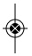

<!-- page 10 -->

## Au niveau du marché des changes, les banques utilisent deux (2) taux

Un taux pratiqué est le taux effectivement négocié en fonction de facteurs tels que le volume des transactions, le client et la nature de la transaction (cash, virement, chèque, transaction en ligne etc.).

Un taux affiché, basé sur l'évolution du marché du jour précédent, en termes d'offre et de demande, et auquel se transigent les montants les plus faibles. Ce taux donne également une idée approximative de la réalité du marché tout en indiquant dans quel sens et comment les transactions vont être négociées.

## 2 ) RÔLE DE LA BRH

La BRH fait obligation aux banques de lui soumettre un rapport relatant l'ensemble des transactions réalisées pour la journée de la veille. Ces transactions concernent tous les achats et ventes de dollars (par transaction et par taux). En communiquant leur taux, la BRH procède au calcul du taux de référence (taux moyen d'achat) ainsi que du TMA ou Taux moyen d'acquisition par les banques (taux de vente). Les taux, une fois calculés, sont transmis aux banques, aux entités publiques et publiés sur le site et les différents réseaux en ligne de la BRH.

Le taux de référence est le résultat de la somme de la moyenne des taux d'achat pondérée par les volumes du système bancaire et du taux moyen d'achat de l'informel, en tenant compte du poids de chaque segment du marché. Ce taux sert de référence aux participants du marché. On l'utilise dans la comptabilité, pour les évaluations en douane, dans les transactions avec le Gouvernement, pour le paiement des transferts sans contrepartie et toutes autres transactions de change selon la perspective de l'agent économique.

Le TMA ou Taux Moyen d'Acquisition par les banques est le taux moyen auquel les clients acquièrent le dollar auprès du système bancaire, autrement dit, c'est le taux de vente moyen du système bancaire.

## DISPOSITIONS RÈGLEMENTAIRES ET CONTRAINTES POUR LES BANQUES

La BRH, conformément à sa mission institutionnelle, veille constamment à la stabilité des prix incluant le taux de change. Ainsi, dans la mise en œuvre de sa politique monétaire, la BRH agit de manière à réduire la volatilité sur le marché local des

<!-- page 11 -->

changes. Afin de limiter les mouvements spéculatifs sur le marché des changes, la BRH a pris des mesures administratives à travers deux (2) circulaires :

## Circulaire 81-5

Les banques doivent maintenir une position cambiste nulle en fin de journée, c'est-à-dire, elles peuvent acheter autant de devises qu'elles veulent pourvu qu'elles vendent le même jour la totalité de leurs acquisitions, ramenant ainsi leur position de change à 0 unité monétaire. Si au cours d'une journée, une banque a acheté plus de devises qu'elle n'en a vendues, la BRH acquiert automatiquement le surplus au Taux moyen d'achat bancaire (TMA).

Les banques doivent également garder en tout temps une position structurelle cumulée longue inférieure ou égale à 0,5 % de leurs fonds propres comptables. La position structurelle de change sur une devise est la différence entre les avoirs que la banque détient dans cette devise et les engagements libellés dans la même devise qu'elle a envers la clientèle.

## Circulaire 97

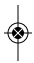

En vertu de cette circulaire, les banques doivent respecter en tout temps un ratio maximum de 50 % entre le montant des prêts en devises (prêts bruts nets des déductions autorisées) et celui des passifs en devises. Cette norme limite le niveau des prêts en devises qu'une institution bancaire peut accorder compte tenu du niveau de ses passifs libellés dans la même devise.

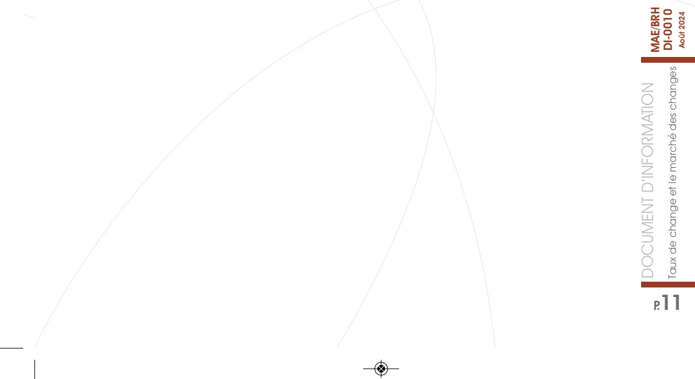

<!-- page 12 -->

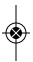

## CONCLUSION

La globalisation a favorisé l'expansion des échanges internationaux et par ricochet des paiements en devises étrangères entraînant la prolifération des activités de change, d'où l'importance du taux de change qui permet de réaliser ces conversions. Le taux de change est donc une variable incontournable pour un pays par rapport à ses relations commerciales avec l'extérieur. Cet indicateur, qui détermine la contre-valeur de la monnaie locale, revêt une importance non négligeable en raison de son incidence sur l'environnement macroéconomique notamment sur la stabilité des prix et la croissance économique. Aussi, afin de contourner les différents déséquilibres économiques résultant d'une grande volatilité du taux de change, les principales banques centrales se donnent comme objectif d'intervenir sur le marché des changes afin de lisser les grandes fluctuations⁶. Son évolution dépend aussi d'autres facteurs inhérents aux caractéristiques propres de l'économie considérée.

## GLOSSAIRE

ANTICIPATION : Une anticipation est une hypothèse faite par un agent économique sur l'évolution future de certaines variables (inflation, taux de change, taux d'intérêt, salaire...). L'agent économique peut fonder ses décisions en conséquence.

APPRÉCIATION MONÉTAIRE : L'appréciation monétaire est l'augmentation de la valeur d'une monnaie par rapport à une autre. Dans le contexte haïtien, cette appréciation peut résulter d'une entrée importante de devises des transferts courants (provenant de la diaspora ou de l'aide internationale à Haïti), et de la bonne tenue des fondamentaux de l'économie.

DÉPRÉCIATION MONÉTAIRE : La dépréciation monétaire désigne la baisse de valeur d'une monnaie par rapport à une autre. En Haiti, la dépréciation de la gourde est généralement observée par rapport au dollar E.U qui est la monnaie de référence. Cette dépréciation peut résulter de l'accumulation de déficits budgétaires et commerciaux élevés, des anticipations pessimistes des agents économiques ou encore d'un excédent de monnaie en circulation par rapport à la capacité productive d'une économie.

FONDAMENTAUX DE L'ÉCONOMIE : Les fondamentaux sont des variables ou indicateurs qui permettent d'analyser et de déterminer le potentiel d'une économie (PIB, taux inflation, balance des paiements, budget etc.).

<!-- page 13 -->

IMPERFECTIONS DU MARCHÉ : Quand les conditions permettant le bon fonctionnement du marché ne sont pas réunies. Il s'agit de la formation des prix dans un environnement non-concurrentiel.

INTERACTION DE L'OFFRE ET DE LA DEMANDE : Dans un marché concurrentiel, la rencontre de l'offre et de la demande détermine le prix. Le prix est aussi déterminé par les facteurs qui influencent l'offre ou la demande. Si la demande dépasse l'offre, le cours augmente et vice versa.

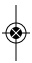

MARCHÉ CONCURRENTIEL : Un marché concurrentiel ou un marché en concurrence pure et parfaite est un lieu de rencontre d'une multitude d'offreurs et de demandeurs sur lequel s'établit un prix et une quantité d'équilibre (quantité offerte = quantité demandée). Certaines conditions doivent être vérifiées afin d'affirmer rigoureusement qu'un marché est concurrentiel. Elles incluent la qualité homogène du bien, l'accès égal à l'information et l'absence de collusion.

MESURES RÉSTRICTIVES : Ensemble de mesures prises par une banque centrale pour réduire l'offre de monnaie en vue de lutter contre l'inflation et de garantir la stabilité des prix.

MOYENNE PONDÉRÉE : La moyenne pondérée s'obtient en multipliant les taux de change moyens de chaque banque par les volumes correspondants (achats ou ventes). Les produits ainsi obtenus sont additionnés et divisés par l'effectif total (volume total en devises).

POLITIQUE MONÉTAIRE : La politique monétaire est l'ensemble des moyens et instruments dont disposent les Autorités Monétaires (Banques centrales) pour agir sur l'activité économique par l'intermédiaire de l'offre de monnaie.

POSITION CAMBISTE : Elle se réfère à la différence entre les achats et les ventes de change au cours d'une journée ouvrée. Cette position est déficitaire quand les achats sont inférieurs aux ventes. Elle est excédentaire quand les achats dépassent les ventes.

POSITION STRUCTURELLE DE CHANGE : La position structurelle de change sur une devise est la différence entre les avoirs que la banque détient dans cette devise et les engagements libellés dans la même devise qu'elle a envers la clientèle. Cette position est courte quand les engagements sont inférieurs aux avoirs. Elle est longue quand les avoirs excèdent les engagements.

SPÉCULATION : La spéculation est une opération financière qui consiste à anticiper les mouvements des marchés afin d'effectuer des transactions plus fructueuses en termes de plus-values plutôt que satisfaire aux besoins d'une activité réelle.

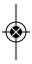

<!-- page 14 -->

TAUX DE CHANGE : C'est le prix d'une monnaie par rapport à une autre. Par exemple, la quantité de gourdes offertes pour obtenir un dollar américain ou toute autre devise disponible sur le marché.

TRANSACTION DE GRÉ À GRÉ : Une transaction de gré à gré est une transaction conclue directement entre un vendeur et un acheteur, c'est-à-dire sans intermédiaire.

VOLATILITÉ : C'est l'ampleur des variations d'un cours financier ou de change. Elle sert de paramètre de quantification du risque de rendement et de prix d'un actif financier.

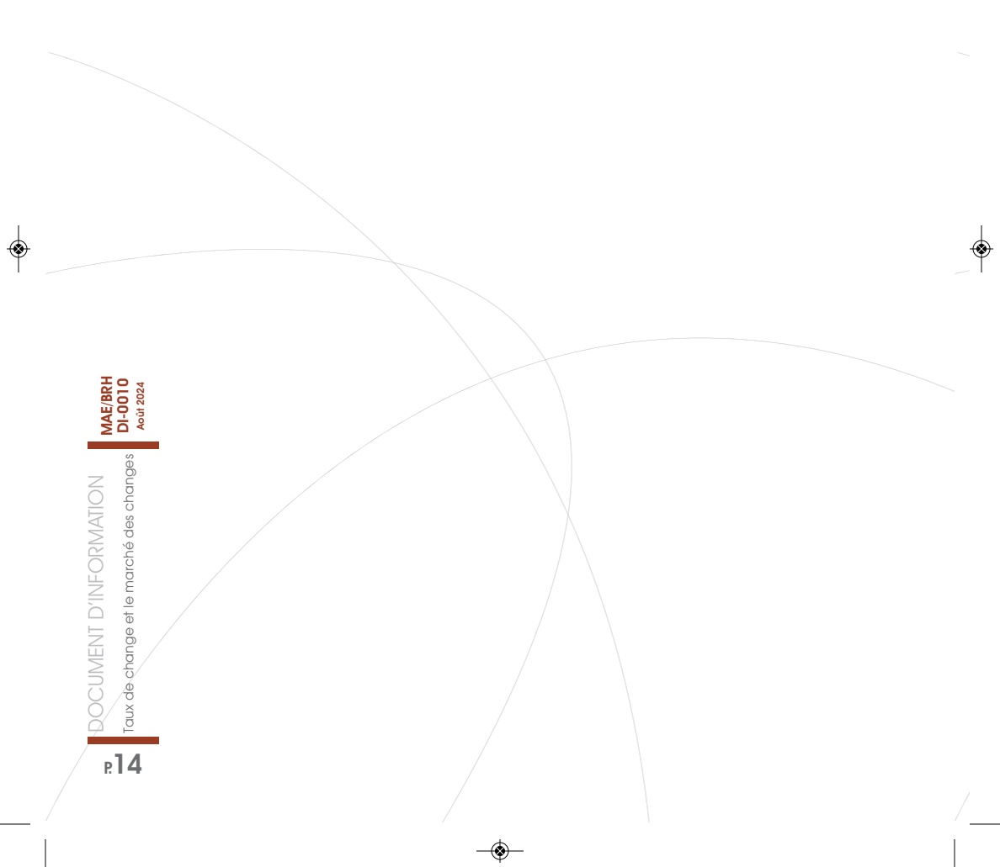

<!-- page 15 -->

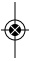

| Document | Year |
| --- | --- |
| DOCUMENT D'INFORMATION | 2024 |
| TAUX de change et le marché des changes | 2024 |
| MAE/BRH DI-0010 | 2024 |
| Acuit | 2024 |

<!-- page 16 -->

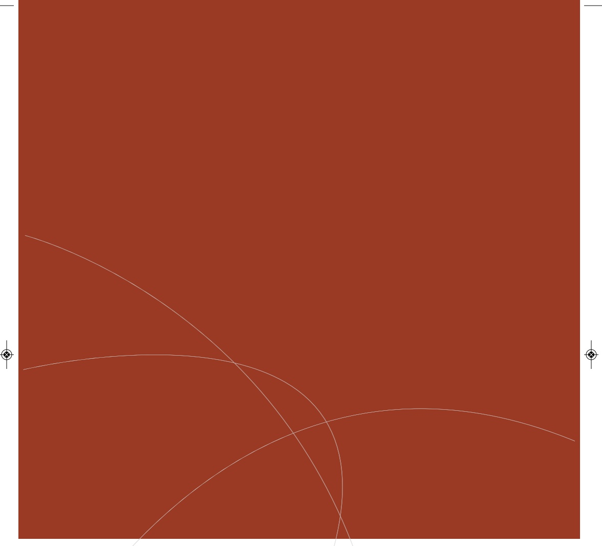

Banque de la République D'Haiti

www.brh.ht

www.brh.fr

Direction Monnaie et Analyse Economique

Angle rues Pavée et du Quai / Port-au-Prince, Haiti W.I.

Boite Postale 1570

Téléphone: (509) 22.99.11.64

Fax: (509)22.99.11.92
