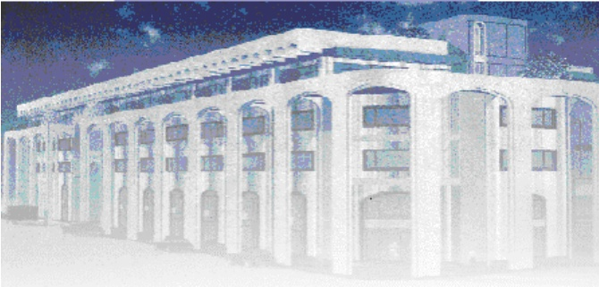

<!-- page 1 -->

Banque de la République d'Haïti

Note mensuelle d'inflation

Mai 2015

<!-- page 2 -->

## Introduction

Cette note examine l'évolution de l'Indice des Prix à la Consommation (IPC) en Haïti durant le mois de mai 2015. Elle apporte quelques éléments explicatifs permettant de comprendre les principaux facteurs qui influencent le comportement de l'inflation mensuelle et présente également les prévisions pour les trois prochains mois.

### I. - Évolution de l'inflation globale

Au mois de mai 2015, un retournement de tendance a été observé au niveau de la variation de l'Indice des prix à la consommation, en glissement annuel. Après des ralentissements à 6,4 % et 6,3 % au cours des mois de mars et d'avril, le taux s'est accru de 20 points de base pour retourner à son niveau de janvier et février, en se portant à 6,6 %.

Graphique 1 : Évolution de l'inflation annuelle (en %)

| Date | Value |
| --- | --- |
| Jan-14 | 3.4 |
| Feb-14 | 3.2 |
| Mar-14 | 3.2 |
| Apr-14 | 3.5 |
| May-14 | 3.5 |
| Jun-14 | 4.2 |
| Jul-14 | 4.8 |
| Aug-14 | 5.1 |
| Sep-14 | 5.3 |
| Oct-14 | 5.8 |
| Nov-14 | 6.2 |
| Dec-14 | 6.4 |
| Jan-15 | 6.6 |
| Feb-15 | 6.6 |
| Mar-15 | 6.4 |
| Apr-15 | 6.3 |
| May-15 | 6.6 |

Prise en variation mensuelle, l'inflation a fait état d'une tendance similaire à celle du mois dernier, en progressant de 0,4 % en mars à 0,5 % en avril et à 0,8 % en mai 2015. Par conséquent, l'inflation cumulée pour les huit (8) premiers mois de l'exercice en cours est de 4,2 %, contre 3 % au cours de la même période un an plus tôt.

<!-- page 3 -->

Graphique 2 : Évolution de l'inflation mensuelle (en %)

| Date | Value |
| --- | --- |
| Jan-14 | 0.2 |
| Feb-14 | 0.3 |
| Mar-14 | 0.6 |
| Apr-14 | 0.6 |
| May-14 | 0.6 |
| Jun-14 | 0.6 |
| Jul-14 | 0.7 |
| Aug-14 | 0.5 |
| Sep-14 | 0.4 |
| Oct-14 | 0.6 |
| Nov-14 | 0.5 |
| Dec-14 | 0.6 |
| Jan-15 | 0.4 |
| Feb-15 | 0.3 |
| Mar-15 | 0.4 |
| Apr-15 | 0.5 |
| May-15 | 0.8 |

Hormis les fonctions « Transport » et « Loyers du Logement, Énergie et eau » pour lesquels l'indice des prix a stagné, la progression mensuelle de l'Indice des prix à la consommation résulte principalement de la variation à la hausse de l'IPC de toutes les fonctions de consommation, particulièrement de l'IPC des groupes « Alimentation, boissons et tabac », « Habillement, tissus et chaussures » et « Autres biens et services » dont la contribution totale à l'inflation a été de 80 %. La fonction « Alimentation, boissons et tabac » a le plus contribué à l'inflation mensuelle (55,4 %). L'augmentation des prix des produits tels que l'igname (3,3 %), le pois sec (2,8 %) et le poulet (2,4 %) ont influencé à la hausse cet indice. L'indice des prix du groupe « Habillement, tissus et chaussures » a crû de 100 points de base à 1,7 %, en raison de la hausse des prix de la « robe » (3,1 %) et des « souliers et tennis » (2,5 %). En ce qui a trait à l'IPC de la fonction « Autres biens et services », il s'est porté à 2 %, en hausse de 90 points de base, sous l'effet de l'augmentation des prix du shampoing (6,9 %) ainsi que du parfum et de l'eau de toilette (5,1 %).

<!-- page 4 -->

Tableau no 1 : Contribution (en %) des différents postes de dépenses à l'inflation en mai 2015

Sources : IHSI et calculs BRH/MAE

### II. - Évolution de l'inflation selon l'origine des produits

En mai 2015, l'IPC des produits importés et celui des produits locaux ont affiché des tendances divergentes en glissement annuel, mais similaires en variations mensuelles. En rythme annuel, la variation de l'IPC des produits importés est restée la même à 4,7 % tandis que celle de l'IPC des produits locaux s'est portée à 6,6 % contre 6,2 % en avril 2015. En variation mensuelle, l'IPC des produits importés a poursuivi sa tendance à la hausse se portant à 0,7 % contre 0,3 % en avril 2015. Celui des produits locaux a crû au même rythme que l'inflation globale, soit de 0,8 % contre des progressions de 0,5 % enregistrées en avril et mars 2015

### III. - Évolution de l'inflation sous-jacente

Pour le deuxième mois consécutif, l'inflation sous-jacente a évolué au-dessus de l'inflation globale. Elle a été plus prononcée que l'inflation globale pour le mois sous-étude, en se portant à 6,8 % contre 6,6 % pour l'indice global. En glissement annuel, le taux d'inflation sous-jacente a crû de 18 points de base, tandis qu'en variation mensuelle, l'IPC sous-jacent s'est établi à 0,76 % contre 0,68 % un mois auparavant, soit le plus haut niveau depuis juillet 2014 (0,93 %). L'évolution de l'inflation sous-jacente au-dessus de l'inflation globale sous-entend que les produits volatils du panier de la ménagère ne seraient pas les facteurs responsables des pressions inflationnistes en mai 2015.

<!-- page 5 -->

### IV. - Facteurs explicatifs de la hausse de la croissance mensuelle des prix en mai 2015

Parmi les facteurs susceptibles d'expliquer la hausse mensuelle de l'inflation au mois de mai 2015, il convient de souligner la faiblesse de la production agricole et la dépréciation continue de la gourde.

### 1. - Faiblesse de la production agricole

Selon le dernier rapport de la CNSA, en plus d'une pluviométrie tardive, la production agricole serait menacée par le phénomène El niño, enregistré souvent au cours des mois d'avril, de mai et de juin et qui pourrait se répartir dans la plupart des régions du pays. Cette faiblesse de la production agricole, accompagnée de l'épuisement des stocks et des grains devenus peu disponibles, a eu pour effet de rendre la plupart des produits agricoles plus chers sur le marché local.

### 2. - Dépréciation continue de la gourde

En dépit des mesures de resserrement et des interventions sur le marché des changes, on a assisté à une dépréciation continue de la monnaie locale au cours du mois de mai 2015. En effet, le taux de change est passé de 47,38 gourdes en avril à 48,11 gourdes pour un dollar au cours du mois sous revue. Pris par rapport au mois de mai de 2014 où le taux s'était établi à 45,36 gourdes, la variation annuelle du taux de change a atteint 6,01 % contre un taux de 4,48 % et 4,06 % enregistré respectivement en avril et en mars 2015.

Graphique 3 : Dépréciation de la gourde

| Date | Value |
| --- | --- |
| Oct-14 | 4.45% |
| Dec-14 | 6.27% |
| Jan-15 | 5.41% |
| Feb-15 | 4.97% |
| Mar-15 | 4.78% |
| Apr-15 | 4.06% |
| May-15 | 4.46% |
| Jun-15 | 7.78% |

<!-- page 6 -->

### V. - Prévisions

Les prévisions réalisées par la BRH tablent sur une poursuite de cette tendance à la hausse de l'inflation annuelle sur les trois prochains mois de l'exercice. En effet, l'inflation annuelle devrait se chiffrer à 6,7 %; 6,8 % et 6,9 % en juin, juillet et août 2015 respectivement. En variation mensuelle, le taux d'inflation devrait se chiffrer à 0,8 % en juin et juillet 2015 pour ralentir à 0,6 % en août.

Graphique 4 : Prévision de l'inflation à partir du mois de juin 2015

| Date | inflation estimée (inf) | inflation en glissement annuel (sup) |
| --- | --- | --- |
| Jan-12 |   | 7.8 |
| Feb-12 |   | 6.2 |
| Mar-12 |   | 5.7 |
| Apr-12 |   | 5.3 |
| May-12 |   | 4.9 |
| Jun-12 |   | 5.3 |
| Jul-12 |   | 6.0 |
| Aug-12 |   | 6.5 |
| Sep-12 |   | 6.8 |
| Oct-12 |   | 7.4 |
| Nov-12 |   | 7.6 |
| Dec-12 |   | 7.5 |
| Jan-13 |   | 7.2 |
| Feb-13 |   | 7.7 |
| Mar-13 |   | 7.5 |
| Apr-13 |   | 7.3 |
| May-13 |   | 6.8 |
| Jun-13 |   | 6.2 |
| Jul-13 |   | 5.5 |
| Aug-13 |   | 4.5 |
| Sep-13 |   | 4.0 |
| Oct-13 |   | 3.4 |
| Nov-13 |   | 3.4 |
| Dec-13 |   | 3.4 |
| Jan-14 |   | 3.3 |
| Feb-14 |   | 3.2 |
| Mar-14 |   | 3.2 |
| Apr-14 |   | 3.5 |
| May-14 |   | 3.5 |
| Jun-14 |   | 4.5 |
| Jul-14 |   | 5.0 |
| Aug-14 |   | 5.3 |
| Sep-14 |   | 5.8 |
| Oct-14 |   | 6.2 |
| Nov-14 |   | 6.5 |
| Dec-14 |   | 6.6 |
| Jan-15 |   | 6.6 |
| Feb-15 |   | 6.5 |
| Mar-15 |   | 6.3 |
| Apr-15 | 6.1 | 6.7 |
| May-15 | 6.3 | 7.2 |
| Jun-15 | 6.5 | 7.3 |
| Jul-15 | 6.8 | 7.3 |
| Aug-15 | 6.9 | 7.3 |

<!-- page 7 -->

Tableau 2

En mai 2015

<table><tr><td></td><td>Indice des Prix à la Consommation (IPC)</td><td>Variation IPC (en %)</td><td>Contribution à l'inflation (en %)</td></tr><tr><td>Mensuelle</td><td>Annuelle</td><td>Mensuelle</td><td>Annuelle</td></tr><tr><td>Poste</td><td>Pondération (en %)</td><td>Avr. 15</td><td>Mai 14</td><td>Mai 15</td><td>Mai 15</td><td>Mai 15</td><td>Mai 15</td><td>Mai 15</td></tr><tr><td>Indice Général</td><td>228.3</td><td>215.9</td><td>230.2</td><td>0.8</td><td>6.6</td><td>100.0</td><td>100.0</td></tr><tr><td>Alimentation, boisson et tabac</td><td>50.35</td><td>236.8</td><td>224.9</td><td>239.0</td><td>0.9</td><td>6.3</td><td>55.41</td><td>48.32</td></tr><tr><td>Habillement, tissus et chaus.</td><td>6.86</td><td>234.1</td><td>211.2</td><td>238.0</td><td>1.7</td><td>12.7</td><td>13.54</td><td>13.32</td></tr><tr><td>Loyer, énergie et eau</td><td>11.05</td><td>270.6</td><td>253.8</td><td>271.8</td><td>0.4</td><td>7.1</td><td>5.80</td><td>12.00</td></tr><tr><td>Aménag. et entret. du logem</td><td>4.7</td><td>230.7</td><td>218.9</td><td>232.8</td><td>0.9</td><td>6.3</td><td>5.07</td><td>4.57</td></tr><tr><td>Santé</td><td>2.9</td><td>242.1</td><td>225.2</td><td>245.0</td><td>1.2</td><td>8.8</td><td>4.11</td><td>3.90</td></tr><tr><td>Transport</td><td>13.74</td><td>161.4</td><td>158.8</td><td>161.7</td><td>0.2</td><td>1.8</td><td>3.02</td><td>3.84</td></tr><tr><td>Lois., sp. Ens., Clt.</td><td>5.84</td><td>237.8</td><td>225.2</td><td>238.5</td><td>0.3</td><td>5.9</td><td>2.04</td><td>5.28</td></tr><tr><td>Aut. biens & serv.</td><td>4.56</td><td>201.1</td><td>182.3</td><td>205.2</td><td>2.0</td><td>12.6</td><td>11.01</td><td>8.77</td></tr></table>

Sources : IHSI et calcul du Service de la Macrééconomie et de l'Analyse de Conjoncture de la MAE (SMAC)

<!-- page 8 -->

## Glossaire

| Variation mensuelle | : Variation par rapport au mois précédent. |
| --- | --- |
| Glissement annuel | : Variation par rapport au même mois de l’année antérieure. |
| Inflation | : Mouvement persistant à la hausse du niveau général des prix. |
| Désinflation | : Ralentissement de la croissance des prix. |
| Déflation | : Baisse du niveau général des prix associée à une contraction de la masse monétaire et du crédit. |
| Inflation sous-jacente | : Tendance de long terme des prix, tout en excluant la volatilité, les mouvements saisonniers, conjoncturels, et les chocs qui affectent les composantes du panier considéré. |
| Région Nord | : Elle couvre les départementes du Nord, Nord-Est et Nord-Ouest. |
| Région Sud | : Elle comprend les départementes du Sud de la Grand-Anse et des Nippes. |
| Région Reste Ouest | : Y sont incluses les départementes du Sud-Est et de l’Ouest à l’exception de l’aire métropolitaine |
| Région Transversale | : Elle regroupe les départementes du Centre et de l’Artibonite. |
| Aire Métropolitaine | : Elle contient les villes de Port-au-Prince, de Delmas, de Pétion-Ville, de Gare-sur-et-Châtes. |
