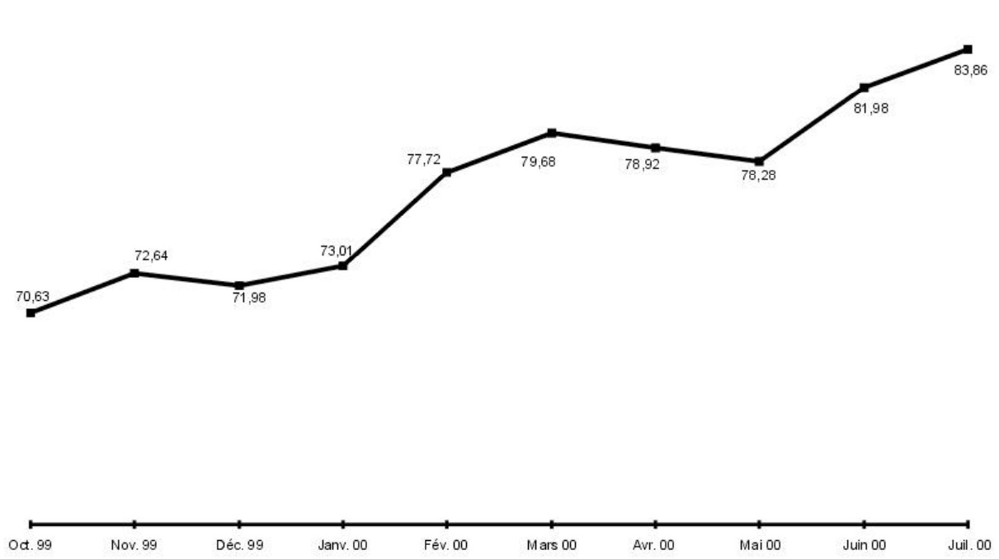
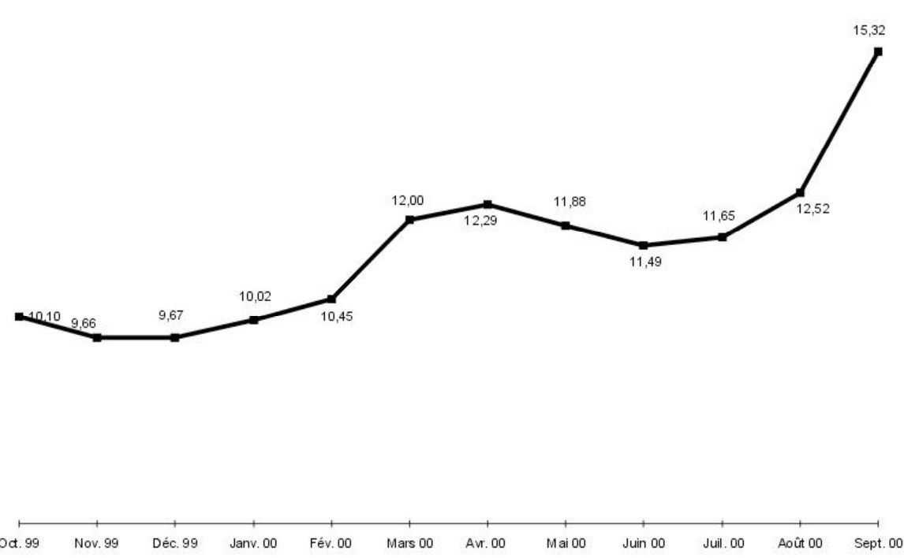

<!-- page 1 -->

## Bulletin Statistique 36

Juillet - Septembre 2000

<!-- page 2 -->

## Table des matières

Avertissement .....5
I- Statistiques monétaires et financières
Tableau 1.1 Principaux indicateurs monétaires .....10
Tableau 1.2 Situation monétaire .....11
Tableau 1.3 Liquidités du système bancaire .....13
Tableau 1.4 Taux de réserves obligatoires .....13
Tableau 1.5 Spread sur le marché formel des changes .....13
Tableau 1.6 Volume des transactions sur le marché formel des changes .....14
Tableau 1.7 Taux d'intérêt moyens mensuels du système bancaire .....16
Tableau 1.8 Taux d'intérêt moyens mensuels sur le marché monétaire .....16
Tableau 1.9 Dépôts du secteur privé .....17
Tableau 1.10 Dépôts : parts de marché .....19
Tableau 1.11 Crédit au secteur privé .....20
Tableau 1.12 Crédit : parts de marché .....22
Tableau 1.13 Bilan consolidé des banques commerciales .....23
Tableau 1.14 Bilan de la BRH .....25
Tableau 1.15 Encours des bons BRH .....27
Tableau 1.16 Avoirs extérieurs nets de la BRH .....28
Tableau 1.17 Résultats des activités de la chambre de compensation .....30

Il- Finances publiques
Tableau 2.1 Résumé des opérations financières des administrations publiques .....34
Tableau 2.2 Recettes des administrations publiques .....35
Tableau 2.3 Dépenses des administrations publiques .....36
Tableau 2.4 Endettement total du secteur public .....37
Tableau 2.5 Dette publique externe .....38

Ill- Balance des paiements
Tableau 3.1 Résumé de la balance des paiements .....40
Tableau 3.2 Principaux produits exportés .....41
Tableau 3.3 Exportations des industries d'assemblage vers les États-Unis d'Amérique à base de matières premières importées .....42
Tableau 3.4 Exportations vers les États-Unis d'Amérique à base de matières premières locales .....43
Tableau 3.5 Importations par grandes catégories de produits .....44
Tableau 3.5a Importations de produits pétroliers .....45
Tableau 3.6 Évolution de l'indice du taux de change réel bilatéral Haïti-États-Unis d'Amérique .....46

<!-- page 3 -->

## Table des matières (suite)

## IV- Prix et autres indicateurs économiques

Tableau 4.1 Indice des prix à la consommation (IPC) pour l'ensemble du pays .....48
Tableau 4.2 Taux d'inflation .....48
Tableau 4.3 Taux de change à Port-au-Prince .....49
Tableau 4.4 Prix moyen de détail de certains produits sur l'ensemble du pays .....50
Tableau 4.5 Prix moyen des matériaux de construction .....51
Tableau 4.6 Activités du secteur de la construction à Port-au-Prince .....51
Tableau 4.7 Nouvelles entreprises déclarées à Port-au-Prince et nombre correspondant d'employés .....52
Tableau 4.8 Nouvelles entreprises enregistrées à l'ONA et nombre correspondant d'assurés .....52
Tableau 4.9 Production industrielle de certains biens .....53
Tableau 4.10 Consommation d'électricité .....54
Tableau 4.11 Production brute d'électricité .....54
Tableau 4.12 Prix moyen des principaux produits pétroliers et dérivés sur le marché local .....55
Tableau 4.13 Véhicules importés enregistrés au port de Port-au-Prince .....56
Tableau 4.14 Nombre de touristes arrivés au pays .....58
Tableau 4.15 Mouvements migratoires aériens internationaux .....59
Tableau 4.16 Pouvoir d'achat de la gourde .....60
Tableau 4.17 Cours des devises étrangères à Port-au-Prince .....61

## Annexe graphique

Graphique 1 Agrégats M1, M2, M3.....64
Graphique 2 Contreparties de M3.....65
Graphique 3 Encours des bons BRH.....66
Graphique 4 Dépôts du secteur privé.....67
Graphique 5 Crédit au secteur privé.....68
Graphique 6 Recettes et dépenses des administrations publiques.....69
Graphique 7 Endettement total du secteur public.....70
Graphique 8 Balances commerciale et globale.....71
Graphique 9 Indice du taux de change réel bilatéral Haïti-États Unis d'Amérique.....72
Graphique10 Taux d'inflation (variation mensuelle de l'IPC; novembre 1996=100).....73
Graphique11 Taux d'inflation (variation de l'IPC en glissement annuel).....74
Graphique12 Taux de change (marché informel; moyenne de période).....75

<!-- page 4 -->

# Avertissement

## Statistiques monétaires et financières

Les statistiques monétaires sont présentées selon les critères de classification établis dans le manuel Guide des Statistiques Monétaires et Bancaires publiées dans Statistiques Financières Internationales du Fonds Monétaire International (1987). Elles représentent des données de stock (fin de période) qui sont collectées mensuellement.

## Finances publiques

Les statistiques des finances publiques sont présentées selon les critères de classification établis dans le Manuel de Référence des Finances Publiques (1986) du FMI. Elles représentent des données de flux qui sont collectées mensuellement et sont enregistrées sur la base des encaissements-décaissements. Ces données subissent un traitement qui tient compte de la spécificité du contexte haïtien. Étant donné qu'Haïti ne dispose pas d'un budget général consolidé, les recettes enregistrées sont celles du Trésor excluant celles des unités de production marchande du secteur public. Les dépenses enregistrées sont celles effectuées par le Trésor pour le compte de l'Administration Centrale, et comprennent également les dépenses réalisées sur financement externe pour l'ensemble des administrations publiques.

## Balance des paiements

Les statistiques de la balance des paiements sont des données de flux. Elles sont présentées selon les critères établis dans la 5ème Édition du Manuel de la Balance des Paiements du FMI. Les transactions sur les biens sont enregistrées sur une base brute. Les transferts de capital réfèrent surtout à des annulations d'engagements par un ou plusieurs créanciers qui ne reçoivent rien en échange (remise de dette).

Les transferts courants sont ceux qui ne peuvent être dits transferts de capital. Ils comprennent les transferts en espèces entre administrations publiques destinés à financer leurs dépenses courantes, les transferts en nature (tels que dons d'aliments, de médicaments et d'autres biens de consommation), les envois de fonds de travailleurs émigrés, etc.

La variation des avoirs de réserves est présentée sous forme d'avoirs bruts à l'exclusion des engagements envers le FMI et des engagements envers le Fonds d'investissement vénézuélien (FIV) (enregistrés dans les engagements constituant des réserves pour les autorités étrangères). Ceux-ci sont présentés séparément.

L'indice du taux de change réel bilatéral (1991=100) est calculé à partir de l'indice des prix à la consommation (IPC) des États-Unis produit par le US Department of Labor (1982-84=100). Le changement de base est effectué à partir de la moyenne annuelle de la série pour l'année 1991 (1982-84=100). L'indice du taux de change nominal (1991=100) est calculé de la manière suivante : Taux de référence de fin de période du mois X / Taux de référence moyen pour l'année 1991.

<!-- page 5 -->

## Avertissement (suite)

## Prix et autres indicateurs économiques

Les informations regroupées sous la dénomination Prix et autres indicateurs économiques réfèrent aux données de production, d'emploi, de prix et aussi d'activités de divers secteurs. Il s'agit dans la plupart des cas de données brutes agrégées et tabulées. Ces données correspondent pour la plupart à des informations statistiques disponibles au moment de la compilation; elles sont donc sujettes à modification éventuelle dans le futur. L'indice des prix à la consommation est un indice de Laspeyres (période de base novembre 1996 avec pondération de 1986-1987) qui couvre l'ensemble du territoire national.

Le taux de change de la monnaie nationale par rapport au dollar américain (Gde / $) est aussi présenté au niveau de cette section pour les marchés formel (banques et agents de change) et informel. Le taux de référence de la BRH représente une moyenne pondérée des taux de ces marchés.

## Liste des sigles utilisés dans le Bulletin Statistique

| AGD | Administration Générale des Douanes |
| --- | --- |
| AIB | Autres institutions bancaires |
| BEL | Banques d'épargne et de logement |
| BID | Banque Interaméricaine de Développement |
| BNC | Banque Nationale de Crédit |
| BRH | Banque de la République d'Haiti |
| BRI | Banque de Règlements Internationaux |
| CIF | Cost, Insurance and Freight |
| DTS | Droits de Tirage Spéciaux |
| EDH | Électricité d'Haiti |
| EU | États-Unis d'Amérique |
| FIV | Fonds d'Investissement Vénézuélien |
| FMI | Fonds Monétaire International |
| FOB | Free on Board |
| IFNB | Institutions financières non bancaires |
| IHSI | Institut Haitien de Statistique et d'Informatique |
| IPC | Indice des prix à la consommation |
| MEF | Ministère de l'Économie et des Finances |
| MG | Millions de gourdes |
| OEA | Organisation des États Américains |
| OFATMA | Office d'Assurance-Accidents du Travail, Maladie et Maternité |
| OFI | Organisations financières internationales |
| (-) | Indique une valeur nulle |
| (...) | Indique la non-disponibilité de données statistiques au moment de la mise sous presse |
| (0.00) | Indique une valeur presque nulle |

<!-- page 6 -->

# I- Statistiques monétaires et financières

<!-- page 7 -->

Tableau 1.1

<table><tr><td>(en millions de gourdes)</td></tr><tr><td></td><td>1er trimestre 2000</td><td>2e trimestre 2000</td><td>3e trimestre 2000</td><td>4e trimestre 2000</td><td></td></tr><tr><td></td><td>Oct. 99</td><td>Nov. 99</td><td>Déc. 99</td><td>Janv. 00</td><td>Fév. 00</td><td>Mars 00</td><td>Avr. 00</td><td>Mai 00</td><td>Juin 00</td><td>Jui. 00</td><td>Aout 00</td><td>Sept. 00</td><td></td></tr><tr><td>Monnaie en circulation</td><td>3 958,03</td><td>4 001,60</td><td>4 927,06</td><td>4 548,41</td><td>4 447,65</td><td>4 636,63</td><td>4 757,42</td><td>4 686,20</td><td>4 743,62</td><td>4 837,73</td><td>4 962,59</td><td>5 283,68</td><td></td></tr><tr><td>Base monétaire</td><td>11 592,05</td><td>11 836,17</td><td>12 285,21</td><td>12 324,59</td><td>12 189,82</td><td>12 644,06</td><td>12 614,41</td><td>12 309,74</td><td>12 495,05</td><td>12 694,87</td><td>12 889,42</td><td>14 118,17</td><td></td></tr><tr><td>M1</td><td>7 398,98</td><td>7 446,39</td><td>8 153,31</td><td>7 986,69</td><td>7 776,71</td><td>7 946,11</td><td>8 022,83</td><td>7 811,44</td><td>8 033,02</td><td>8 180,87</td><td>8 187,01</td><td>8 618,33</td><td></td></tr><tr><td>M2</td><td>16 751,42</td><td>16 873,87</td><td>17 720,27</td><td>17 745,13</td><td>17 715,32</td><td>18 116,44</td><td>18 250,49</td><td>18 241,75</td><td>18 652,47</td><td>18 774,42</td><td>18 793,36</td><td>19 357,69</td><td></td></tr><tr><td>M3</td><td>22 610,37</td><td>23 088,48</td><td>24 234,52</td><td>24 495,61</td><td>24 874,47</td><td>25 634,86</td><td>25 968,06</td><td>26 189,38</td><td>27 034,26</td><td>27 170,70</td><td>27 427,36</td><td>30 180,21</td><td></td></tr><tr><td>Crédit intérieur</td><td>17 750,64</td><td>18 497,90</td><td>18 458,30</td><td>18 988,46</td><td>19 200,49</td><td>19 605,19</td><td>19 953,01</td><td>20 022,11</td><td>20 315,53</td><td>20 566,83</td><td>21 225,02</td><td>22 885,57</td><td></td></tr><tr><td>Avoirs extérieurs nets</td><td>5 784,94</td><td>5 744,16</td><td>6 511,75</td><td>6 327,31</td><td>6 883,59</td><td>7 368,91</td><td>7 003,79</td><td>6 989,47</td><td>7 254,93</td><td>7 296,70</td><td>7 421,47</td><td>9 797,19</td><td></td></tr><tr><td>Total dépôts en gourdes</td><td>12 793,39</td><td>12 872,27</td><td>12 793,21</td><td>13 196,72</td><td>13 267,67</td><td>13 479,80</td><td>13 493,07</td><td>13 555,55</td><td>13 908,85</td><td>13 936,69</td><td>13 830,76</td><td>14 074,00</td><td></td></tr><tr><td>Total dépôts en dollars EU  $ ^{w} $</td><td>5 858,95</td><td>6 214,61</td><td>6 514,25</td><td>6 750,48</td><td>7 159,15</td><td>7 518,43</td><td>7 717,57</td><td>7 947,63</td><td>8 381,79</td><td>8 396,28</td><td>8 634,00</td><td>10 822,52</td><td></td></tr><tr><td>Indice de dollarisation :</td><td></td><td></td><td></td><td></td><td></td><td></td><td></td><td></td><td></td><td></td><td></td><td></td><td></td></tr><tr><td>Dépôts en dollars en % de M3</td><td>25,91</td><td>26,92</td><td>26,88</td><td>27,56</td><td>28,78</td><td>29,33</td><td>29,72</td><td>30,35</td><td>31,00</td><td>30,90</td><td>31,48</td><td>35,86</td><td></td></tr><tr><td>Pour mémoire:</td><td></td><td></td><td></td><td></td><td></td><td></td><td></td><td></td><td></td><td></td><td></td><td></td><td></td></tr><tr><td>Taux de change de référence (Fin de mois)</td><td>17,5482</td><td>17,9632</td><td>17,9654</td><td>18,2620</td><td>19,1848</td><td>19,7373</td><td>19,7265</td><td>19,6744</td><td>20,3781</td><td>20,3781</td><td>20,3781</td><td>20,3781</td><td></td></tr></table>

Source : Direction Monnaie et Analyse Économique, BRH.

1/ Convertis en gourdes autaux de référence de fin de mois de la BRH.

<!-- page 8 -->

Tableau 1.2

Situation monétaire

(en millions de gourdes)

<table><tr><td></td><td>1er trimestre 2000</td><td>2e trimestre 2000</td></tr><tr><td></td><td>Oct. 99</td><td>Nov. 99</td><td>Déc. 99</td><td>Janw. 00</td><td>Fév. 00</td><td>Mars 00</td></tr><tr><td>Avoirs extérieurs nets</td><td>5 784,94</td><td>5 744,16</td><td>6 511,75</td><td>6 327,31</td><td>6 883,59</td><td>7 368,91</td></tr><tr><td>Avoirs extérieurs  $ ^{{u}} $</td><td>7 916,21</td><td>7 919,12</td><td>8 622,73</td><td>8 614,91</td><td>9 264,39</td><td>9 784,52</td></tr><tr><td>Engagements extérieurs  $ ^{{u}} $</td><td>-2 131,27</td><td>-2 174,96</td><td>-2 110,99</td><td>-2 287,61</td><td>-2 380,80</td><td>-2 415,61</td></tr><tr><td>Crédit intérieur</td><td>17 750,64</td><td>18 497,90</td><td>18 458,30</td><td>18 988,46</td><td>19 200,49</td><td>19 605,19</td></tr><tr><td>Créances nettes sur secteur public</td><td>7 646,22</td><td>8 027,37</td><td>8 056,54</td><td>8 215,52</td><td>8 187,20</td><td>8 291,12</td></tr><tr><td>Créances nettes sur gouvernement central</td><td>7 745,30</td><td>8 166,32</td><td>8 173,44</td><td>8 342,28</td><td>8 363,50</td><td>8 590,35</td></tr><tr><td>Créances nettes sur collectivités locales</td><td>-45,87</td><td>-53,49</td><td>-61,17</td><td>-58,67</td><td>-58,45</td><td>-67,08</td></tr><tr><td>Créances nettes sur entreprises publiques</td><td>-53,21</td><td>-85,46</td><td>-55,74</td><td>-68,09</td><td>-117,85</td><td>-232,14</td></tr><tr><td>Créances sur secteur privé</td><td>10 104,42</td><td>10 470,53</td><td>10 401,77</td><td>10 772,94</td><td>11 013,30</td><td>11 314,07</td></tr><tr><td>ACTIF = PASSIF</td><td>23 535,57</td><td>24 242,06</td><td>24 970,05</td><td>25 315,77</td><td>26 084,08</td><td>26 974,10</td></tr><tr><td>M3</td><td>22 610,37</td><td>23 088,48</td><td>24 234,52</td><td>24 495,61</td><td>24 874,47</td><td>25 634,86</td></tr><tr><td>M2</td><td>16 751,42</td><td>16 873,87</td><td>17 720,27</td><td>17 745,13</td><td>17 715,32</td><td>18 116,44</td></tr><tr><td>M1</td><td>7 398,98</td><td>7 446,39</td><td>8 153,31</td><td>7 986,69</td><td>7 776,71</td><td>7 946,11</td></tr><tr><td>Monnaie en circulation</td><td>3 958,03</td><td>4 001,60</td><td>4 927,06</td><td>4 548,41</td><td>4 447,65</td><td>4 636,63</td></tr><tr><td>Dépôts à vue</td><td>3 440,95</td><td>3 444,79</td><td>3 226,26</td><td>3 438,28</td><td>3 329,06</td><td>3 309,47</td></tr><tr><td>Quasi-monnaie</td><td>9 352,45</td><td>9 427,48</td><td>9 566,95</td><td>9 758,44</td><td>9 938,61</td><td>10 170,33</td></tr><tr><td>Dépôts d'épargne</td><td>5 669,85</td><td>5 678,76</td><td>5 703,35</td><td>5 832,56</td><td>5 914,19</td><td>6 089,06</td></tr><tr><td>Dépôts à terme et autres</td><td>3 682,59</td><td>3 748,72</td><td>3 863,60</td><td>3 925,88</td><td>4 024,42</td><td>4 081,27</td></tr><tr><td>Dépôts en dollars EU  $ ^{{u}} $</td><td>5 858,95</td><td>6 214,61</td><td>6 514,25</td><td>6 750,48</td><td>7 159,15</td><td>7 518,43</td></tr><tr><td>Dépôts à vue</td><td>1 298,86</td><td>1 332,60</td><td>1 530,62</td><td>1 484,73</td><td>1 574,35</td><td>1 689,37</td></tr><tr><td>Dépôts d'épargne</td><td>2 207,61</td><td>2 233,01</td><td>2 319,43</td><td>2 351,70</td><td>2 498,26</td><td>2 603,00</td></tr><tr><td>Dépôts à teme et autres</td><td>2 352,48</td><td>2 649,01</td><td>2 664,20</td><td>2 914,05</td><td>3 086,53</td><td>3 226,06</td></tr><tr><td>Autres postes nets</td><td>925,20</td><td>1 153,58</td><td>735,53</td><td>820,16</td><td>1 209,61</td><td>1 339,24</td></tr><tr><td>Comptes de capital</td><td>3 262,05</td><td>3 419,43</td><td>3 293,10</td><td>3 373,78</td><td>3 572,93</td><td>3 713,00</td></tr><tr><td>Créances nettes interbancaires</td><td>-352,53</td><td>-230,01</td><td>-251,34</td><td>-300,04</td><td>-383,36</td><td>-337,30</td></tr><tr><td>Autres postes non classés</td><td>-1 984,33</td><td>-2 035,84</td><td>-2 306,23</td><td>-2 253,57</td><td>-1 979,96</td><td>-2 036,46</td></tr></table>

Source : Direction Monnaie et Analyse Économique, B RH.

1/ Convertis autaux de référence de fin de mois de la BRH.

<!-- page 9 -->

Tableau 1.2 (suite) Situation monétaire (en millions de gourdes)

<table><tr><td></td><td>3e trimestre 2000</td><td>4e trimestre 2000</td></tr><tr><td></td><td>Avr. 00</td><td>Mai 00</td><td>Juni 00</td><td>Juli. 00</td><td>Aоit 00</td><td>Sept. 00</td></tr><tr><td>Avoirs extérieurs nets</td><td>7 003,79</td><td>6 989,47</td><td>7 254,93</td><td>7 296,70</td><td>7 421,47</td><td>9 797,19</td></tr><tr><td>Avoirs extérieurs  $ ^{1)} $</td><td>9 370,39</td><td>9 353,23</td><td>9 738,11</td><td>9 835,71</td><td>10 105,95</td><td>13 058,40</td></tr><tr><td>Engagements extérieurs  $ ^{1)} $</td><td>-2 366,60</td><td>-2 363,76</td><td>-2 483,18</td><td>-2 539,01</td><td>-2 684,48</td><td>-3 261,21</td></tr><tr><td>Crédit intérieur</td><td>19 953,01</td><td>20 022,11</td><td>20 315,53</td><td>20 566,83</td><td>21 225,02</td><td>22 885,57</td></tr><tr><td>Créances nettes sur secteur public</td><td>8 473,49</td><td>8 603,71</td><td>8 803,11</td><td>8 928,98</td><td>9 125,66</td><td>9 276,00</td></tr><tr><td>Créances nettes sur gouvernement central</td><td>8 604,61</td><td>8 743,93</td><td>8 913,16</td><td>9 084,54</td><td>9 241,76</td><td>9 480,88</td></tr><tr><td>Créances nettes sur collectivités locales</td><td>-33,72</td><td>-26,06</td><td>-28,83</td><td>-30,83</td><td>-22,77</td><td>-22,82</td></tr><tr><td>Créances nettes sur entreprises publiques</td><td>-187,40</td><td>-114,16</td><td>-81,23</td><td>-124,73</td><td>-93,33</td><td>-191,06</td></tr><tr><td>Créances sur secteur privé</td><td>11 479,52</td><td>11 418,40</td><td>11 512,42</td><td>11 637,85</td><td>12 099,36</td><td>13 609,57</td></tr><tr><td>ACTIF = PASSIF</td><td>26 956,80</td><td>27 011,58</td><td>27 570,46</td><td>34 754,28</td><td>37 779,50</td><td>41 598,79</td></tr><tr><td>M3</td><td>25 968,06</td><td>26 189,38</td><td>27 034,26</td><td>27 170,70</td><td>27 427,36</td><td>30 180,21</td></tr><tr><td>M2</td><td>18 250,49</td><td>18 241,75</td><td>18 652,47</td><td>18 774,42</td><td>18 793,36</td><td>19 357,69</td></tr><tr><td>M1</td><td>8 022,83</td><td>7 811,44</td><td>8 033,02</td><td>8 180,87</td><td>8 187,01</td><td>8 618,33</td></tr><tr><td>Monnaie en circulation</td><td>4 757,42</td><td>4 686,20</td><td>4 743,62</td><td>4 837,73</td><td>4 962,59</td><td>5 283,68</td></tr><tr><td>Dépôts à vue</td><td>3 265,41</td><td>3 125,24</td><td>3 289,40</td><td>3 343,14</td><td>3 224,41</td><td>3 334,64</td></tr><tr><td>Quasi-monnaie</td><td>10 227,67</td><td>10 430,31</td><td>10 619,45</td><td>10 593,55</td><td>10 606,35</td><td>10 739,36</td></tr><tr><td>Dépôts d'épargne</td><td>6 143,42</td><td>6 231,90</td><td>6 292,31</td><td>6 244,69</td><td>6 191,47</td><td>6 295,19</td></tr><tr><td>Dépôts à terme et autres</td><td>4 084,24</td><td>4 198,41</td><td>4 327,14</td><td>4 348,86</td><td>4 414,88</td><td>4 444,17</td></tr><tr><td>Dépôts en dollars EU  $ ^{1)} $</td><td>7 717,57</td><td>7 947,63</td><td>8 381,79</td><td>8 396,28</td><td>8 634,00</td><td>10 822,52</td></tr><tr><td>Dépôts à vue</td><td>1 839,10</td><td>1 885,19</td><td>1 984,00</td><td>1 920,39</td><td>2 068,50</td><td>2 525,57</td></tr><tr><td>Dépôts d'épargne</td><td>2 663,61</td><td>2 647,63</td><td>2 738,74</td><td>2 737,03</td><td>2 819,98</td><td>3 600,19</td></tr><tr><td>Dépôts à terme et autres</td><td>3 214,86</td><td>3 414,81</td><td>3 659,06</td><td>3 738,86</td><td>3 745,52</td><td>4 696,76</td></tr><tr><td>Autres postes nets</td><td>988,74</td><td>822,20</td><td>536,20</td><td>7 583,58</td><td>10 352,14</td><td>11 418,58</td></tr><tr><td>Comptes de capital</td><td>3 755,37</td><td>3 740,13</td><td>3 888,18</td><td>4 138,19</td><td>5 785,62</td><td>6 960,55</td></tr><tr><td>Créances nettes interbancaires</td><td>-349,33</td><td>-276,19</td><td>-481,44</td><td>344,80</td><td>172,93</td><td>683,84</td></tr><tr><td>Autres postes non classés</td><td>-2 417,30</td><td>-2 641,74</td><td>-2 870,54</td><td>3 100,59</td><td>4 393,59</td><td>3 774,19</td></tr></table>

Source : Direction Monnaie et Analyse Économique, B RH.

1/ Convertis autaux de référence de fin de mois de la BRH.

<!-- page 10 -->

Tableau 1.3

<table><tr><td>(en millions de gourdes)</td><td>1er trimestre 2000</td><td>2e trimestre 2000</td><td>3e trimestre 2000</td><td>4e trimestre 2000</td></tr><tr><td></td><td>Oct. 99</td><td>Nov. 99</td><td>Déc. 99</td><td>Janw. 00</td><td>Fév. 00</td><td>Mars 00</td><td>Avr. 00</td><td>Mai 00</td><td>Jun 00</td><td>Jul. 00</td><td>Aocit 00</td><td>Sept. 00</td><td></td><td></td><td></td><td></td></tr><tr><td>Solde des encaisses et dépôts de réserves</td><td>4 323,24</td><td>4 486,73</td><td>4 660,88</td><td>4 854,17</td><td>4 922,89</td><td>4 901,26</td><td>5 274,96</td><td>5 433,15</td><td>5 566,28</td><td>5 585,79</td><td>5 651,89</td><td>6 398,39</td><td></td><td></td><td></td><td></td></tr><tr><td>Réserves obligatoires</td><td>4 189,01</td><td>4 343,20</td><td>4 590,62</td><td>4 667,18</td><td>4 731,92</td><td>4 806,13</td><td>5 265,96</td><td>5 348,92</td><td>5 427,60</td><td>5 497,19</td><td>5 573,28</td><td>6 492,69</td><td></td><td></td><td></td><td></td></tr><tr><td>Position de réserves</td><td>134,23</td><td>143,53</td><td>70,26</td><td>186,98</td><td>190,96</td><td>95,13</td><td>8,99</td><td>84,23</td><td>138,68</td><td>88,61</td><td>78,61</td><td>94,30</td><td></td><td></td><td></td><td></td></tr></table>

Source : Direction du Controle du Crédit, BRH.

Tableau 1.4

<table><tr><td>Taux de réserves obligatoires (en pourcentage)</td></tr><tr><td></td><td>1er trimestre 2000</td><td>2er trimestre 2000</td><td>3er trimestre 2000</td><td>4er trimestre 2000</td></tr><tr><td></td><td>Oct. 99</td><td>Nov. 99</td><td>Déc. 99</td><td>Jan. 00</td><td>Fév. 00</td><td>Mars 00</td><td>Avr. 00</td><td>Mai 00</td><td>Juin 00</td><td>Jul. 00</td><td>Aout 00</td><td>Sept. 00</td><td></td></tr><tr><td>Passifs des banques commerciales</td><td></td><td></td><td></td><td></td><td></td><td></td><td></td><td></td><td></td><td></td><td></td><td></td><td></td></tr><tr><td>Gourdes</td><td>26,50</td><td>26,50</td><td>26,50</td><td>26,50</td><td>26,50</td><td>26,50</td><td>28,00</td><td>28,00</td><td>28,00</td><td>28,00</td><td>28,00</td><td>30,00</td><td></td></tr><tr><td>Devises</td><td>15,00</td><td>15,00</td><td>15,00</td><td>15,00</td><td>15,00</td><td>15,00</td><td>17,00</td><td>17,00</td><td>17,00</td><td>17,00</td><td>17,00</td><td>20,00</td><td></td></tr><tr><td>Passifs des banques d'épargne et de logement</td><td></td><td></td><td></td><td></td><td></td><td></td><td></td><td></td><td></td><td></td><td></td><td></td><td></td></tr><tr><td>Gourdes</td><td>15,00</td><td>15,00</td><td>15,00</td><td>15,00</td><td>15,00</td><td>15,00</td><td>16,50</td><td>16,50</td><td>16,50</td><td>16,50</td><td>16,50</td><td>18,50</td><td></td></tr><tr><td>Devises</td><td>14,50</td><td>14,50</td><td>14,50</td><td>14,50</td><td>14,50</td><td>14,50</td><td>16,00</td><td>16,00</td><td>16,00</td><td>16,00</td><td>16,00</td><td>18,00</td><td></td></tr><tr><td>Source : Direction du Contrôle du Crédit, B.RH.</td></tr><tr><td>Tableau 1.5</td></tr><tr><td>Spread sur le marché formel des changes (en pourcentage du prix d'achat)</td></tr><tr><td></td><td>4e trimestre 1999</td><td>1er trimestre 2000</td><td>2e trimestre 2000</td><td>3e trimestre 2000</td></tr><tr><td></td><td>Juil. 99</td><td>Aout 99</td><td>Sept. 99</td><td>Oct. 99</td><td>Nov. 99</td><td>Déc. 99</td><td>Jan. 00</td><td>Fév. 00</td><td>Mars 00</td><td>Avr. 00</td><td>Mai 00</td><td>Juin 00</td></tr><tr><td>Agents de change</td><td>0,87</td><td>0,81</td><td>0,64</td><td>0,16</td><td>0,20</td><td>0,16</td><td>0,16</td><td>0,15</td><td>0,32</td><td>0,23</td><td>...</td><td>0,29</td></tr><tr><td>Banques</td><td>1,15</td><td>1,00</td><td>1,08</td><td>0,23</td><td>0,25</td><td>0,25</td><td>0,29</td><td>0,29</td><td>0,59</td><td>0,46</td><td>...</td><td>0,40</td></tr></table>

Source : Direction des Affaires Internationales, BRH.

<!-- page 11 -->

Tableau 1.6

<table><tr><td>Volume des transactions sur le marché formel des changes (en millions de dollars EU)</td></tr><tr><td></td><td>1er trimestre 2000</td><td>2e trimestre 2000</td></tr><tr><td></td><td>Oct. 99</td><td>Nov. 99</td><td>Déc. 99</td><td>Janv. 00</td><td>Fév. 00</td><td>Mars 00</td></tr><tr><td></td><td>Achat</td><td>Vente</td><td>Achat</td><td>Vente</td><td>Achat</td><td>Vente</td><td>Achat</td><td>Vente</td><td>Achat</td><td>Vente</td><td>Achat</td><td>Vente</td></tr><tr><td>Agents de change</td><td>4,79</td><td>4,26</td><td>4,68</td><td>4,51</td><td>10,09</td><td>10,32</td><td>6,99</td><td>8,09</td><td>7,55</td><td>7,58</td><td>4,12</td><td>3,86</td></tr><tr><td>Turnier</td><td>-</td><td>-</td><td>-</td><td>-</td><td>2,90</td><td>2,92</td><td>2,16</td><td>1,93</td><td>1,60</td><td>1,63</td><td>-</td><td>-</td></tr><tr><td>Fouchard</td><td>-</td><td>-</td><td>-</td><td>-</td><td>-</td><td>-</td><td>-</td><td>-</td><td>-</td><td>-</td><td>-</td><td>-</td></tr><tr><td>Bayard</td><td>3,18</td><td>2,74</td><td>2,97</td><td>2,86</td><td>4,23</td><td>4,34</td><td>3,64</td><td>3,92</td><td>3,16</td><td>3,08</td><td>2,45</td><td>2,23</td></tr><tr><td>Cobty</td><td>1,60</td><td>1,52</td><td>1,71</td><td>1,65</td><td>2,96</td><td>3,06</td><td>1,19</td><td>2,24</td><td>2,79</td><td>2,87</td><td>1,67</td><td>1,63</td></tr><tr><td>Banques</td><td>93,27</td><td>88,84</td><td>78,03</td><td>78,28</td><td>103,42</td><td>95,03</td><td>82,03</td><td>84,74</td><td>76,99</td><td>77,76</td><td>86,30</td><td>84,17</td></tr><tr><td>Promobank</td><td>9,17</td><td>8,16</td><td>6,59</td><td>7,89</td><td>9,75</td><td>9,29</td><td>7,98</td><td>8,55</td><td>7,47</td><td>8,03</td><td>6,98</td><td>6,96</td></tr><tr><td>Sogebank</td><td>15,01</td><td>13,67</td><td>14,05</td><td>15,04</td><td>22,85</td><td>18,75</td><td>16,31</td><td>18,31</td><td>14,53</td><td>15,17</td><td>19,62</td><td>19,22</td></tr><tr><td>Banque Intercontinental de Commerce</td><td>-</td><td>-</td><td>-</td><td>-</td><td>-</td><td>-</td><td>-</td><td>-</td><td>-</td><td>-</td><td>-</td><td>-</td></tr><tr><td>Scotiabank</td><td>1,57</td><td>1,56</td><td>1,39</td><td>1,51</td><td>1,66</td><td>1,72</td><td>1,84</td><td>1,77</td><td>1,88</td><td>2,01</td><td>1,79</td><td>1,83</td></tr><tr><td>Citibank NA</td><td>9,60</td><td>10,29</td><td>6,76</td><td>5,95</td><td>11,26</td><td>11,09</td><td>8,08</td><td>8,67</td><td>6,48</td><td>6,56</td><td>8,91</td><td>8,34</td></tr><tr><td>Banque de l'Union Haitienne</td><td>5,27</td><td>5,37</td><td>5,99</td><td>5,32</td><td>7,47</td><td>6,22</td><td>5,05</td><td>6,84</td><td>4,21</td><td>3,75</td><td>6,13</td><td>5,51</td></tr><tr><td>Banque Populaire Haitienne</td><td>0,92</td><td>1,05</td><td>0,94</td><td>1,05</td><td>0,95</td><td>0,95</td><td>1,31</td><td>0,94</td><td>0,86</td><td>1,24</td><td>1,07</td><td>1,04</td></tr><tr><td>Banque Nationale de Crédit</td><td>2,81</td><td>1,25</td><td>2,64</td><td>1,57</td><td>3,53</td><td>1,10</td><td>3,04</td><td>1,01</td><td>1,95</td><td>3,39</td><td>2,21</td><td>1,45</td></tr><tr><td>Unibank</td><td>17,43</td><td>17,68</td><td>16,93</td><td>17,17</td><td>23,81</td><td>22,63</td><td>19,2</td><td>19,22</td><td>18,52</td><td>18,30</td><td>22,34</td><td>22,33</td></tr><tr><td>Socabank</td><td>17,37</td><td>15,68</td><td>10,18</td><td>9,93</td><td>10,95</td><td>12,03</td><td>9,90</td><td>10,60</td><td>10,73</td><td>10,08</td><td>8,86</td><td>9,07</td></tr><tr><td>Capital Bank</td><td>13,37</td><td>13,43</td><td>11,81</td><td>12,04</td><td>10,09</td><td>10,12</td><td>8,26</td><td>7,73</td><td>9,44</td><td>8,32</td><td>7,28</td><td>7,31</td></tr><tr><td>Sogebel</td><td>0,76</td><td>0,71</td><td>0,75</td><td>0,82</td><td>1,11</td><td>1,14</td><td>1,06</td><td>1,10</td><td>0,92</td><td>0,91</td><td>1,11</td><td>1,11</td></tr><tr><td>Banque Métropolitaine d'Haiti</td><td>-</td><td>-</td><td>-</td><td>-</td><td>-</td><td>-</td><td>-</td><td>-</td><td>-</td><td>-</td><td>-</td><td>-</td></tr><tr><td>Banque Haitienne de Développement</td><td>-</td><td>-</td><td>-</td><td>-</td><td>-</td><td>-</td><td>-</td><td>-</td><td>-</td><td>-</td><td>-</td><td>-</td></tr><tr><td>Total</td><td>98,05</td><td>93,10</td><td>82,71</td><td>82,79</td><td>113,51</td><td>105,35</td><td>89,02</td><td>92,83</td><td>84,54</td><td>85,34</td><td>90,42</td><td>88,03</td></tr></table>

Source : Direction des Affaires Internationales, BRH.

... : données non disponibles

<!-- page 12 -->

Tableau 1.6 (suite)

<table><tr><td>Volume des transactions sur le marché formel des changes (en millions de dollars EU)</td></tr><tr><td></td><td>3e trimestre 2000</td><td>4e trimestre 2000</td></tr><tr><td></td><td>Avril 00</td><td>Mai 00</td><td>Juin 00</td><td>Juil. 00</td><td>Aout 00</td><td>Sept. 00</td></tr><tr><td></td><td>Achat</td><td>Vente</td><td>Achat</td><td>Vente</td><td>Achat</td><td>Vente</td><td>Achat</td><td>Vente</td><td>Achat</td><td>Vente</td><td>Achat</td><td>Vente</td></tr><tr><td>Agents de change</td><td>3,44</td><td>3,32</td><td>...</td><td>...</td><td>4,44</td><td>4,21</td><td>5,22</td><td>4,88</td><td>4,80</td><td>4,99</td><td>4,67</td><td>4,48</td></tr><tr><td>Turnier</td><td>-</td><td>-</td><td>-</td><td>-</td><td>-</td><td>-</td><td>2,06</td><td>2,01</td><td>1,53</td><td>1,71</td><td>1,53</td><td>1,41</td></tr><tr><td>Fouchard</td><td>-</td><td>-</td><td>-</td><td>-</td><td>-</td><td>-</td><td></td><td></td><td></td><td></td><td></td><td></td></tr><tr><td>Bayard</td><td>2,28</td><td>2,19</td><td>...</td><td>...</td><td>4,44</td><td>4,21</td><td>3,16</td><td>2,87</td><td>3,27</td><td>3,28</td><td>3,14</td><td>3,07</td></tr><tr><td>Cobty</td><td>1,16</td><td>1,13</td><td></td><td></td><td></td><td></td><td></td><td></td><td></td><td></td><td></td><td></td></tr><tr><td>Banques</td><td>61,98</td><td>61,97</td><td>...</td><td>...</td><td>73,09</td><td>73,36</td><td>68,53</td><td>69,79</td><td>75,37</td><td>80,80</td><td>80,45</td><td>74,54</td></tr><tr><td>Promobank</td><td>5,8</td><td>5,83</td><td>...</td><td>...</td><td>5,89</td><td>5,37</td><td>7,32</td><td>7,25</td><td>7,4</td><td>7,31</td><td>6,82</td><td>5,07</td></tr><tr><td>Sogebank</td><td>12,29</td><td>12,75</td><td>...</td><td>...</td><td>13,69</td><td>12,55</td><td>13,05</td><td>14,59</td><td>13,8</td><td>14,57</td><td>15,24</td><td>14,61</td></tr><tr><td>Banque Intercontinental de Commerce</td><td>-</td><td>-</td><td>-</td><td>-</td><td>-</td><td>-</td><td></td><td></td><td></td><td></td><td></td><td></td></tr><tr><td>Scotiabank</td><td>2,01</td><td>1,96</td><td>...</td><td>...</td><td>2,99</td><td>3,11</td><td>1,54</td><td>1,58</td><td>2,24</td><td>2,21</td><td>2,38</td><td>2,39</td></tr><tr><td>Citibank NA</td><td>4,02</td><td>4,79</td><td>...</td><td>...</td><td>5,87</td><td>5,85</td><td>6,54</td><td>6,79</td><td>6,51</td><td>7,52</td><td>6,72</td><td>6,38</td></tr><tr><td>Banque de l'Union Haitienne</td><td>4,09</td><td>3,98</td><td>...</td><td>...</td><td>4,78</td><td>4,06</td><td>3,59</td><td>2,91</td><td>3,32</td><td>5,41</td><td>5,86</td><td>4,06</td></tr><tr><td>Banque Populaire Haitienne</td><td>1,18</td><td>1,17</td><td>...</td><td>...</td><td>0,74</td><td>0,79</td><td>1,3</td><td>1,34</td><td>2,22</td><td>2,25</td><td>2,26</td><td>2,2</td></tr><tr><td>Banque Nationale de Crédit</td><td>1,37</td><td>1</td><td>...</td><td>...</td><td>0,57</td><td>1,91</td><td>0,87</td><td>1,52</td><td>0,22</td><td>0,27</td><td>1,23</td><td>1</td></tr><tr><td>Unibank</td><td>17,25</td><td>16,92</td><td>...</td><td>...</td><td>18,41</td><td>18,94</td><td>17,75</td><td>17,89</td><td>19,22</td><td>19,59</td><td>17</td><td>16,01</td></tr><tr><td>Socabank</td><td>6,68</td><td>7,28</td><td>...</td><td>...</td><td>12,3</td><td>13,78</td><td>9,28</td><td>8,8</td><td>11,66</td><td>11,73</td><td>13,13</td><td>13,33</td></tr><tr><td>Capital Bank</td><td>6,31</td><td>5,3</td><td>...</td><td>...</td><td>6,38</td><td>5,67</td><td>6,57</td><td>6,38</td><td>8,19</td><td>9,31</td><td>9,04</td><td>8,74</td></tr><tr><td>Sogebel</td><td>0,98</td><td>0,99</td><td>...</td><td>...</td><td>1,47</td><td>1,33</td><td>0,72</td><td>0,74</td><td>0,59</td><td>0,63</td><td>0,77</td><td>0,75</td></tr><tr><td>Banque Métropolitaine d'Haiti</td><td>-</td><td>-</td><td>-</td><td>-</td><td>-</td><td>-</td><td></td><td></td><td></td><td></td><td></td><td></td></tr><tr><td>Banque Haitienne de Développement</td><td>-</td><td>-</td><td>-</td><td>-</td><td>-</td><td>-</td><td>0,092</td><td>0,092</td><td>0,1</td><td>0,07</td><td>0,1</td><td>0,23</td></tr><tr><td>Total</td><td>65,42</td><td>65,29</td><td>...</td><td>...</td><td>77,53</td><td>77,57</td><td>73,75</td><td>74,67</td><td>80,17</td><td>85,79</td><td>85,12</td><td>79,02</td></tr></table>

Source : Direction des Affaires Internationales, BRH.

... : données non disponibles

<!-- page 13 -->

Tableau 1.7

<table><tr><td></td><td>1er trimestre 2000</td><td>2e trimestre 2000</td><td>3e trimestre 2000</td><td>4e trimestre 2000</td></tr><tr><td></td><td>Oct. 99</td><td>Nov. 99</td><td>Déc. 99</td><td>Jarw. 00</td><td>Fév. 00</td><td>Mars 00</td><td>Avr. 00</td><td>Mai 00</td><td>Juin 00</td><td>Juli. 00</td><td>Aout 00</td><td>Sept. 00</td></tr><tr><td>Prêts</td><td></td><td></td><td></td><td></td><td></td><td></td><td></td><td></td><td></td><td></td><td></td><td></td></tr><tr><td>Gourdes</td><td>22,50</td><td>23,00</td><td>22,00</td><td>23,30</td><td>23,50</td><td>24,25</td><td>24,50</td><td>25,00</td><td>24,50</td><td>24,50</td><td>25,50</td><td>25,00</td></tr><tr><td>Devises</td><td>12,50</td><td>13,00</td><td>13,50</td><td>13,00</td><td>13,00</td><td>13,50</td><td>14,50</td><td>13,75</td><td>14,25</td><td>13,50</td><td>13,50</td><td>15,50</td></tr><tr><td>Dépôts à terme</td><td></td><td></td><td></td><td></td><td></td><td></td><td></td><td></td><td></td><td></td><td></td><td></td></tr><tr><td>Gourdes</td><td>7,30</td><td>8,50</td><td>9,60</td><td>10,00</td><td>9,75</td><td>9,75</td><td>10,75</td><td>10,00</td><td>10,50</td><td>10,75</td><td>12,25</td><td>15,00</td></tr><tr><td>Devises</td><td>4,30</td><td>5,30</td><td>6,30</td><td>4,87</td><td>5,00</td><td>4,50</td><td>4,13</td><td>5,00</td><td>4,75</td><td>4,50</td><td>4,00</td><td>4,88</td></tr><tr><td>Dépôts d'épargne</td><td></td><td></td><td></td><td></td><td></td><td></td><td></td><td></td><td></td><td></td><td></td><td></td></tr><tr><td>Gourdes</td><td>3,30</td><td>2,80</td><td>3,50</td><td>3,25</td><td>3,25</td><td>3,25</td><td>3,25</td><td>3,25</td><td>3,25</td><td>3,75</td><td>3,75</td><td>3,75</td></tr><tr><td>Devises</td><td>1,80</td><td>2,00</td><td>2,00</td><td>1,25</td><td>2,00</td><td>1,50</td><td>2,00</td><td>2,00</td><td>1,50</td><td>1,50</td><td>1,75</td><td>1,75</td></tr></table>

Source : Direction du Contrôle du Crédit, BRH.

1/Moyenne de fin de période.

Tableau 1.8

<table><tr><td></td><td>1er trimestre 2000</td><td>2e trimestre 2000</td><td>3e trimestre 2000</td><td>4e trimestre 2000</td></tr><tr><td></td><td>Oct. 99</td><td>Nov. 99</td><td>Déc. 99</td><td>Janw. 00</td><td>Fév. 00</td><td>Mars 00</td><td>Avr. 00</td><td>Mai 00</td><td>Juin 00</td><td>Juil. 00</td><td>Aout 00</td><td>Sept. 00</td></tr><tr><td>Bons BRH $ ^{1} $</td><td></td><td></td><td></td><td></td><td></td><td></td><td></td><td></td><td></td><td></td><td></td><td></td></tr><tr><td>7 jours</td><td>10,50</td><td>10,00</td><td>10,00</td><td>10,00</td><td>10,00</td><td>12,00</td><td>12,00</td><td>12,00</td><td>12,00</td><td>12,00</td><td>14,00</td><td>14,00</td></tr><tr><td>28 jours</td><td>13,10</td><td>12,10</td><td>12,10</td><td>12,10</td><td>12,10</td><td>14,20</td><td>14,20</td><td>14,20</td><td>14,20</td><td>14,20</td><td>16,00</td><td>16,00</td></tr><tr><td>91 jours</td><td>15,30</td><td>17,80</td><td>21,10</td><td>21,10</td><td>21,10</td><td>23,30</td><td>23,30</td><td>23,30</td><td>23,30</td><td>23,30</td><td>26,70</td><td>26,70</td></tr><tr><td>Refinancement BRH</td><td></td><td></td><td></td><td></td><td></td><td></td><td></td><td></td><td></td><td></td><td></td><td></td></tr><tr><td>Mise en pension de bons BRH</td><td>20,00</td><td>20,00</td><td>25,00</td><td>25,00</td><td>25,00</td><td>27,00</td><td>27,00</td><td>27,00</td><td>27,00</td><td>27,00</td><td>30,00</td><td>30,00</td></tr></table>

Source : Direction du Contrôle du Crédit, BRH.

1/Taux moyens précomptés de fin de période.

<!-- page 14 -->

Tableau 1.9

<table><tr><td></td><td>1er trimestre 2000</td><td>2e trimestre 2000</td></tr><tr><td></td><td>Oct. 99</td><td>Nov. 99</td><td>Déc. 99</td><td>Janw. 00</td><td>Fév. 00</td><td>Mars 00</td></tr><tr><td>Total des dépôts</td><td>18 541,20</td><td>18 974,15</td><td>19 225,89</td><td>19 947,20</td><td>20 426,81</td><td>20 998,23</td></tr><tr><td>Dépôts des banques commerciales</td><td>17 203,71</td><td>17 596,46</td><td>17 849,45</td><td>18 459,94</td><td>18 913,12</td><td>19 473,40</td></tr><tr><td>Banque Industrielle et Commerciale d'Haïti</td><td>3,62</td><td>3,53</td><td>5,37</td><td>5,01</td><td>4,63</td><td>4,43</td></tr><tr><td>Banque Intercontinental de Commerce</td><td>-</td><td>-</td><td>-</td><td>-</td><td>-</td><td>-</td></tr><tr><td>Banque Nationale de Crédit</td><td>1 386,82</td><td>1 404,85</td><td>1 421,07</td><td>1 466,99</td><td>1 476,35</td><td>1 478,36</td></tr><tr><td>Scotiabank</td><td>917,63</td><td>876,85</td><td>872,25</td><td>902,35</td><td>889,07</td><td>897,12</td></tr><tr><td>Banque Populaire Haïtienne</td><td>372,97</td><td>384,72</td><td>367,87</td><td>384,52</td><td>386,47</td><td>397,14</td></tr><tr><td>Banque de l'Union Haïtienne</td><td>1 969,47</td><td>2 008,72</td><td>2 013,49</td><td>1 952,47</td><td>2 007,84</td><td>2 017,62</td></tr><tr><td>Citibank NA</td><td>1 199,08</td><td>1 267,62</td><td>1 330,49</td><td>1 333,86</td><td>1 268,40</td><td>1 377,17</td></tr><tr><td>Métrobanque</td><td>-</td><td>-</td><td>-</td><td>-</td><td>-</td><td>-</td></tr><tr><td>Promobank</td><td>1 406,61</td><td>1 428,15</td><td>1 389,94</td><td>1 461,59</td><td>1 489,94</td><td>1 467,86</td></tr><tr><td>Socabank</td><td>2 170,88</td><td>2 206,85</td><td>2 308,68</td><td>2 351,62</td><td>2 481,58</td><td>2 579,99</td></tr><tr><td>Sogebank</td><td>4 620,17</td><td>4 699,50</td><td>4 694,27</td><td>4 862,34</td><td>5 006,64</td><td>5 130,12</td></tr><tr><td>Unibank</td><td>3 156,45</td><td>3 315,68</td><td>3 437,43</td><td>3 723,00</td><td>3 886,02</td><td>4 107,84</td></tr><tr><td>Banque Haitienne de Développement  $ ^{1} $</td><td>-</td><td>-</td><td>8,59</td><td>16,18</td><td>16,18</td><td>15,76</td></tr><tr><td>Dépôts des BEL</td><td>1 337,49</td><td>1 377,69</td><td>1 376,44</td><td>1 487,25</td><td>1 513,70</td><td>1 524,83</td></tr><tr><td>Capital Bank</td><td>879,60</td><td>912,59</td><td>897,91</td><td>989,03</td><td>1 000,02</td><td>995,41</td></tr><tr><td>Sogebel</td><td>457,89</td><td>465,10</td><td>478,53</td><td>498,23</td><td>513,68</td><td>529,43</td></tr></table>

Source : Direction Monnaie et Analyse Économique, BRH.

1/ Cette nouvelle banque a soumis son bilan à la BRH à partir de décembre 1999.

<!-- page 15 -->

Tableau 1.9 (suite)

Dépôts du secteur privé

(en millions de gourdes)

<table><tr><td></td><td>3e trimestre 2000</td><td>4e trimestre 2000</td></tr><tr><td></td><td>Avr. 00</td><td>Mai 00</td><td>Juni 00</td><td>Juli. 00</td><td>Aout 00</td><td>Sept. 00</td></tr><tr><td>Total des dépôts</td><td>21 210,64</td><td>21 503,18</td><td>22 290,64</td><td>22 332,93</td><td>22 464,74</td><td>24 905,18</td></tr><tr><td>Dépôts des banques commerciales</td><td>19 683,42</td><td>19 945,61</td><td>20 715,05</td><td>20 735,60</td><td>20 833,20</td><td>23 104,54</td></tr><tr><td>Banque Industrielle et Commerciale d'Haiti</td><td>4,52</td><td>4,59</td><td>4,29</td><td>4,45</td><td>3,65</td><td>4,38</td></tr><tr><td>Banque Intercontinental de Commerce</td><td>-</td><td>-</td><td>-</td><td>-</td><td>-</td><td>-</td></tr><tr><td>Banque Nationale de Crédit</td><td>1 541,47</td><td>1 547,20</td><td>1 552,83</td><td>1 577,22</td><td>1 557,05</td><td>1 575,95</td></tr><tr><td>Scotiabank</td><td>912,97</td><td>960,26</td><td>947,96</td><td>946,23</td><td>955,38</td><td>1 060,79</td></tr><tr><td>Banque Populaire Haïtienne</td><td>371,18</td><td>386,06</td><td>379,82</td><td>400,72</td><td>392,01</td><td>421,03</td></tr><tr><td>Banque de l'Union Haïtienne</td><td>2 026,95</td><td>2 066,67</td><td>2 151,80</td><td>2 134,63</td><td>2 112,59</td><td>2 336,56</td></tr><tr><td>Citibank NA</td><td>1 380,67</td><td>1 489,03</td><td>1 580,78</td><td>1 649,03</td><td>1 580,32</td><td>1 716,57</td></tr><tr><td>Métrobanque</td><td>-</td><td>-</td><td>-</td><td>-</td><td>-</td><td>-</td></tr><tr><td>Promobank</td><td>1 486,06</td><td>1 483,23</td><td>1 496,53</td><td>1 482,32</td><td>1 474,05</td><td>1 635,82</td></tr><tr><td>Socabank</td><td>2 570,73</td><td>2 554,31</td><td>2 775,50</td><td>2 767,37</td><td>2 822,28</td><td>3 187,43</td></tr><tr><td>Sogebank</td><td>5 205,69</td><td>5 251,70</td><td>5 335,09</td><td>5 355,54</td><td>5 381,50</td><td>5 987,46</td></tr><tr><td>Unibank</td><td>4 167,42</td><td>4 181,94</td><td>4 469,84</td><td>4 386,08</td><td>4 519,65</td><td>5 135,14</td></tr><tr><td>Banque Haïtienne de Développement  $ ^{1} $</td><td>15,76</td><td>20,62</td><td>20,62</td><td>32,01</td><td>34,72</td><td>43,41</td></tr><tr><td>Dépôts des BEL</td><td>1 527,22</td><td>1 557,58</td><td>1 575,59</td><td>1 597,33</td><td>1 631,54</td><td>1 800,64</td></tr><tr><td>Capital Bank</td><td>983,61</td><td>1 010,16</td><td>1 032,97</td><td>1 050,60</td><td>1 083,50</td><td>1 210,32</td></tr><tr><td>Sogebel</td><td>543,61</td><td>547,42</td><td>542,62</td><td>546,73</td><td>547,95</td><td>590,32</td></tr></table>

Source : Direction Monnaie et Analyse Économique, BRH.

1/ Cette nouvelle banque a soumis son bilan à la BRH à partir de décembre 1999.

<!-- page 16 -->

Tableau 1.10

<table><tr><td></td><td>1er trimestre 2000</td><td>2e trimestre 2000</td><td>3e trimestre 2000</td><td>4e trimestre 2000</td></tr><tr><td></td><td>Oct. 99</td><td>Nov. 99</td><td>Déc. 99</td><td>Janv. 00</td><td>Fév. 00</td><td>Mars 00</td><td>Avr. 00</td><td>Mai 00</td><td>Juin 00</td><td>Jui. 00</td><td>Aout 00</td><td>Sept. 00</td></tr><tr><td>Total</td><td>100,00</td><td>100,00</td><td>100,00</td><td>100,00</td><td>100,00</td><td>100,00</td><td>100,00</td><td>100,00</td><td>100,00</td><td>100,00</td><td>100,00</td><td>100,00</td></tr><tr><td>Part de marché des banques commerciales</td><td>92,79</td><td>92,74</td><td>92,84</td><td>92,54</td><td>92,59</td><td>92,74</td><td>92,80</td><td>92,76</td><td>92,93</td><td>92,85</td><td>92,74</td><td>92,77</td></tr><tr><td>Banque Industrielle et Commerciale d'Haiti</td><td>0,02</td><td>0,02</td><td>0,03</td><td>0,03</td><td>0,02</td><td>0,02</td><td>0,02</td><td>0,02</td><td>0,02</td><td>0,02</td><td>0,02</td><td>0,02</td></tr><tr><td>Banque Intercontinental de Commerce</td><td>-</td><td>-</td><td>-</td><td>-</td><td>-</td><td>-</td><td>-</td><td>-</td><td>-</td><td>-</td><td>-</td><td>-</td></tr><tr><td>Banque Nationale de Crédit</td><td>7,48</td><td>7,40</td><td>7,39</td><td>7,35</td><td>7,23</td><td>7,04</td><td>7,27</td><td>7,20</td><td>6,97</td><td>7,06</td><td>6,93</td><td>6,33</td></tr><tr><td>Scotiabank</td><td>4,95</td><td>4,62</td><td>4,54</td><td>4,52</td><td>4,35</td><td>4,27</td><td>4,30</td><td>4,47</td><td>4,25</td><td>4,24</td><td>4,25</td><td>4,26</td></tr><tr><td>Banque Populaire Haitienne</td><td>2,01</td><td>2,03</td><td>1,91</td><td>1,93</td><td>1,89</td><td>1,89</td><td>1,75</td><td>1,80</td><td>1,70</td><td>1,79</td><td>1,75</td><td>1,69</td></tr><tr><td>Banque de l'Union Haitienne</td><td>10,62</td><td>10,59</td><td>10,47</td><td>9,79</td><td>9,83</td><td>9,61</td><td>9,56</td><td>9,61</td><td>9,65</td><td>9,56</td><td>9,40</td><td>9,38</td></tr><tr><td>Citébank NA</td><td>6,47</td><td>6,68</td><td>6,92</td><td>6,69</td><td>6,21</td><td>6,56</td><td>6,51</td><td>6,92</td><td>7,09</td><td>7,38</td><td>7,03</td><td>6,89</td></tr><tr><td>Métrobanque</td><td>-</td><td>-</td><td>-</td><td>-</td><td>-</td><td>-</td><td>-</td><td>-</td><td>-</td><td>-</td><td>-</td><td>-</td></tr><tr><td>Promobank</td><td>7,59</td><td>7,53</td><td>7,23</td><td>7,33</td><td>7,29</td><td>6,99</td><td>7,01</td><td>6,90</td><td>6,71</td><td>6,64</td><td>6,56</td><td>6,57</td></tr><tr><td>Socabank</td><td>11,71</td><td>11,63</td><td>12,01</td><td>11,79</td><td>12,15</td><td>12,29</td><td>12,12</td><td>11,88</td><td>12,45</td><td>12,39</td><td>12,56</td><td>12,80</td></tr><tr><td>Sogebank</td><td>24,92</td><td>24,77</td><td>24,42</td><td>24,38</td><td>24,51</td><td>24,43</td><td>24,54</td><td>24,42</td><td>23,93</td><td>23,98</td><td>23,96</td><td>24,04</td></tr><tr><td>Unibank</td><td>17,02</td><td>17,47</td><td>17,88</td><td>18,66</td><td>19,02</td><td>19,56</td><td>19,65</td><td>19,45</td><td>20,05</td><td>19,64</td><td>20,12</td><td>20,62</td></tr><tr><td>Banque Haitienne de Développement  $ ^{1} $</td><td>-</td><td>-</td><td>0,04</td><td>0,08</td><td>0,08</td><td>0,08</td><td>0,07</td><td>0,10</td><td>0,09</td><td>0,14</td><td>0,15</td><td>0,17</td></tr><tr><td>Part de marché des BEL</td><td>7,21</td><td>7,26</td><td>7,16</td><td>7,46</td><td>7,41</td><td>7,26</td><td>7,20</td><td>7,24</td><td>7,07</td><td>7,15</td><td>7,26</td><td>7,23</td></tr><tr><td>Capital Bank</td><td>4,74</td><td>4,81</td><td>4,67</td><td>4,96</td><td>4,90</td><td>4,74</td><td>4,64</td><td>4,70</td><td>4,63</td><td>4,70</td><td>4,82</td><td>4,86</td></tr><tr><td>Sogebel</td><td>2,47</td><td>2,45</td><td>2,49</td><td>2,50</td><td>2,51</td><td>2,52</td><td>2,56</td><td>2,55</td><td>2,43</td><td>2,45</td><td>2,44</td><td>2,37</td></tr></table>

Source : Direction Monnaie et Analyse Économique, B RH.

1/ Cette nouvelle banque a soumis son bilan à la BRH à partir de décembre 1999.

<!-- page 17 -->

Tableau 1.11

Crédit au secteur privé

(en millions de gourdes)

<table><tr><td></td><td>1er trimestre 2000</td><td>2e trimestre 2000</td></tr><tr><td></td><td>Oct. 99</td><td>Nov. 99</td><td>Déc. 99</td><td>Janv. 00</td><td>Fév. 00</td><td>Mars 00</td></tr><tr><td>Total</td><td>9 843,23</td><td>10 203,46</td><td>10 128,88</td><td>10 492,24</td><td>10 715,32</td><td>11 049,39</td></tr><tr><td>Crédit en gourdes</td><td>5 953,04</td><td>6 143,84</td><td>6 239,73</td><td>6 449,99</td><td>6 413,86</td><td>6 625,02</td></tr><tr><td>Crédit en dollars $ ^{1} $</td><td>3 890,19</td><td>4 059,61</td><td>3 889,16</td><td>4 042,25</td><td>4 301,46</td><td>4 424,37</td></tr><tr><td>Crédit des banques commerciales</td><td>8 907,01</td><td>9 260,49</td><td>9 173,07</td><td>9 492,99</td><td>9 714,49</td><td>10 047,39</td></tr><tr><td>Banque Industrielle et Commerciale d'Haiti</td><td>3,76</td><td>3,73</td><td>3,90</td><td>4,06</td><td>4,19</td><td>4,08</td></tr><tr><td>Banque Intercontinental de Commerce</td><td>-</td><td>-</td><td>-</td><td>-</td><td>-</td><td>-</td></tr><tr><td>Banque Nationale de Crédit</td><td>498,07</td><td>501,07</td><td>491,46</td><td>474,09</td><td>474,58</td><td>468,11</td></tr><tr><td>Scotiabank</td><td>517,07</td><td>519,57</td><td>522,33</td><td>525,94</td><td>524,96</td><td>550,16</td></tr><tr><td>Banque Populaire Haitienne</td><td>361,99</td><td>374,85</td><td>374,21</td><td>379,55</td><td>381,60</td><td>372,88</td></tr><tr><td>Banque de l'Union Haitienne</td><td>763,34</td><td>794,35</td><td>808,18</td><td>816,00</td><td>819,29</td><td>814,27</td></tr><tr><td>Citibank N.A.</td><td>820,60</td><td>802,00</td><td>772,35</td><td>780,77</td><td>838,76</td><td>854,84</td></tr><tr><td>Métrobanque</td><td>-</td><td>-</td><td>-</td><td>-</td><td>-</td><td>-</td></tr><tr><td>Promobank</td><td>816,03</td><td>885,01</td><td>884,23</td><td>913,51</td><td>967,15</td><td>988,98</td></tr><tr><td>Socabank</td><td>1 404,76</td><td>1 496,58</td><td>1 520,82</td><td>1 600,27</td><td>1 691,75</td><td>1 746,15</td></tr><tr><td>Sogebank</td><td>2 065,80</td><td>2 192,44</td><td>2 111,87</td><td>2 207,21</td><td>2 200,68</td><td>2 287,54</td></tr><tr><td>Unibank</td><td>1 655,59</td><td>1 690,89</td><td>1 676,28</td><td>1 783,14</td><td>1 803,07</td><td>1 956,67</td></tr><tr><td>Banque Haitienne de Développement $ ^{2} $</td><td>-</td><td>-</td><td>7,42</td><td>8,46</td><td>8,46</td><td>3,68</td></tr><tr><td>Crédit des BEL</td><td>936,22</td><td>942,97</td><td>955,81</td><td>999,25</td><td>1 000,83</td><td>1 002,00</td></tr><tr><td>Capital Bank</td><td>574,10</td><td>575,00</td><td>587,40</td><td>622,30</td><td>609,57</td><td>594,27</td></tr><tr><td>Sogebel</td><td>362,12</td><td>367,98</td><td>368,41</td><td>376,95</td><td>391,26</td><td>407,73</td></tr></table>

Source : Direction Monnaie et Analyse Économique, BRH.

1/ Convertis autaux de référence de fin de mois de la BRH.

2/ Cette nouvelle banque a soumis son bilan à la BRH à partir de décembre 1999.

<!-- page 18 -->

Tableau 1.11 (suite)

<table><tr><td>Crédit au secteur privé (en millions de gourdes)</td></tr><tr><td></td><td>3e trimestre 2000</td><td>4e trimestre 2000</td></tr><tr><td></td><td>Avr. 00</td><td>Mai 00</td><td>Juin 00</td><td>Jui. 00</td><td>Aout 00</td><td>Sept. 00</td></tr><tr><td>Total</td><td>11 176,02</td><td>11 115,94</td><td>11 206,69</td><td>11 332,14</td><td>11 778,50</td><td>13 341,71</td></tr><tr><td>Crédit en gourdes</td><td>6 711,6</td><td>6 656,3</td><td>6 499,9</td><td>6 558,1</td><td>6 703,2</td><td>7 062,5</td></tr><tr><td>Crédit en dollars $ ^{w} $</td><td>4 464,4</td><td>4 459,6</td><td>4 706,7</td><td>4 774,1</td><td>5 075,3</td><td>6 279,2</td></tr><tr><td>Crédit des banques commerciales</td><td>10 173,14</td><td>10 086,06</td><td>10 158,50</td><td>10 296,54</td><td>10 688,28</td><td>12 103,63</td></tr><tr><td>Banque Industrielle et Commerciale d'Haiti</td><td>3,91</td><td>4,48</td><td>4,12</td><td>3,71</td><td>4,04</td><td>3,81</td></tr><tr><td>Banque Intercontinental de Commerce</td><td>-</td><td>-</td><td>-</td><td>-</td><td>-</td><td>-</td></tr><tr><td>Banque Nationale de Crédit</td><td>460,53</td><td>463,24</td><td>443,86</td><td>436,80</td><td>423,85</td><td>421,87</td></tr><tr><td>Scotiabank</td><td>558,02</td><td>565,07</td><td>562,12</td><td>554,91</td><td>571,65</td><td>569,03</td></tr><tr><td>Banque Populaire Haitienne</td><td>361,14</td><td>334,02</td><td>325,37</td><td>327,88</td><td>329,08</td><td>342,98</td></tr><tr><td>Banque de l'Union Haitienne</td><td>785,63</td><td>793,74</td><td>780,46</td><td>793,10</td><td>815,02</td><td>863,82</td></tr><tr><td>Citibank N.A.</td><td>888,09</td><td>901,84</td><td>903,02</td><td>939,88</td><td>1 056,99</td><td>1 301,83</td></tr><tr><td>Métrobanque</td><td>-</td><td>-</td><td>-</td><td>-</td><td>-</td><td>-</td></tr><tr><td>Promobank</td><td>1 018,62</td><td>987,80</td><td>978,74</td><td>1 007,39</td><td>997,47</td><td>1 053,61</td></tr><tr><td>Socabank</td><td>1 801,97</td><td>1 809,96</td><td>1 927,41</td><td>1 947,12</td><td>2 075,33</td><td>2 363,41</td></tr><tr><td>Sogebank</td><td>2 311,16</td><td>2 243,62</td><td>2 169,74</td><td>2 165,33</td><td>2 221,80</td><td>2 581,87</td></tr><tr><td>Unibank</td><td>1 980,39</td><td>1 975,79</td><td>2 057,16</td><td>2 112,15</td><td>2 184,52</td><td>2 590,95</td></tr><tr><td>Banque Haitienne de Développement $ ^{2} $</td><td>3,68</td><td>6,51</td><td>6,51</td><td>8,27</td><td>8,53</td><td>10,45</td></tr><tr><td>Crédit des BEL</td><td>1 002,87</td><td>1 029,88</td><td>1 048,19</td><td>1 035,54</td><td>1 090,17</td><td>1 238,04</td></tr><tr><td>Capital Bank</td><td>591,07</td><td>620,46</td><td>638,20</td><td>622,59</td><td>673,44</td><td>768,92</td></tr><tr><td>Sogebel</td><td>411,81</td><td>409,42</td><td>409,99</td><td>412,95</td><td>416,73</td><td>469,12</td></tr></table>

Source : Direction Monnaie et Analyse Économique, B RH.

1/ Convertis au taux de référence de fin de mois de la BRH.

2/ Cette nouvelle banque a soumis son bilan à la BRH à partir de décembre 1999.

<!-- page 19 -->

Tableau 1.12

<table><tr><td></td><td>1er trimestre 2000</td><td>2e trimestre 2000</td><td>3e trimestre 2000</td><td>4e trimestre 2000</td></tr><tr><td></td><td>Oct. 99</td><td>Nov. 99</td><td>Déc. 99</td><td>Janv. 00</td><td>Fév. 00</td><td>Mars 00</td><td>Avr. 00</td><td>Mai 00</td><td>Juin 00</td><td>Jui. 00</td><td>Aout 00</td><td>Sept. 00</td></tr><tr><td>Total</td><td>100,00</td><td>100,00</td><td>100,00</td><td>100,00</td><td>100,00</td><td>100,00</td><td>100,00</td><td>100,00</td><td>100,00</td><td>100,00</td><td>100,00</td><td>100,00</td></tr><tr><td>Part de marché des banques commerciales</td><td>90,49</td><td>90,76</td><td>90,56</td><td>90,48</td><td>90,66</td><td>90,93</td><td>91,03</td><td>90,74</td><td>90,65</td><td>90,86</td><td>90,74</td><td>90,72</td></tr><tr><td>Banque Industrielle et Commerciale d'Haiti</td><td>0,04</td><td>0,04</td><td>0,04</td><td>0,04</td><td>0,04</td><td>0,04</td><td>0,03</td><td>0,04</td><td>0,04</td><td>0,03</td><td>0,03</td><td>0,03</td></tr><tr><td>Banque Intercontinental de Commerce</td><td>-</td><td>-</td><td>-</td><td>-</td><td>-</td><td>-</td><td>-</td><td>-</td><td>-</td><td>-</td><td>-</td><td>-</td></tr><tr><td>Banque Nationale de Crédit</td><td>5,06</td><td>4,91</td><td>4,85</td><td>4,52</td><td>4,43</td><td>4,24</td><td>4,12</td><td>4,17</td><td>3,96</td><td>3,85</td><td>3,60</td><td>3,16</td></tr><tr><td>Scotiabank</td><td>5,25</td><td>5,09</td><td>5,16</td><td>5,01</td><td>4,90</td><td>4,98</td><td>4,99</td><td>5,08</td><td>5,02</td><td>4,90</td><td>4,85</td><td>4,27</td></tr><tr><td>Banque Populaire Haitienne</td><td>3,68</td><td>3,67</td><td>3,69</td><td>3,62</td><td>3,56</td><td>3,37</td><td>3,23</td><td>3,00</td><td>2,90</td><td>2,89</td><td>2,79</td><td>2,57</td></tr><tr><td>Banque de l'Union Haitienne</td><td>7,76</td><td>7,79</td><td>7,98</td><td>7,78</td><td>7,65</td><td>7,37</td><td>7,03</td><td>7,14</td><td>6,96</td><td>7,00</td><td>6,92</td><td>6,47</td></tr><tr><td>Citibank N.A.</td><td>8,34</td><td>7,86</td><td>7,63</td><td>7,44</td><td>7,83</td><td>7,74</td><td>7,95</td><td>8,11</td><td>8,06</td><td>8,29</td><td>8,97</td><td>9,76</td></tr><tr><td>Métrobanque</td><td>-</td><td>-</td><td>-</td><td>-</td><td>-</td><td>-</td><td>-</td><td>-</td><td>-</td><td>-</td><td>-</td><td>-</td></tr><tr><td>Promobank</td><td>8,29</td><td>8,67</td><td>8,73</td><td>8,71</td><td>9,03</td><td>8,95</td><td>9,11</td><td>8,89</td><td>8,73</td><td>8,89</td><td>8,47</td><td>7,90</td></tr><tr><td>Socabank</td><td>14,27</td><td>14,67</td><td>15,01</td><td>15,25</td><td>15,79</td><td>15,80</td><td>16,12</td><td>16,28</td><td>17,20</td><td>17,18</td><td>17,62</td><td>17,71</td></tr><tr><td>Sogebank</td><td>20,99</td><td>21,49</td><td>20,85</td><td>21,04</td><td>20,54</td><td>20,70</td><td>20,68</td><td>20,18</td><td>19,36</td><td>19,11</td><td>18,86</td><td>19,35</td></tr><tr><td>Unibank</td><td>16,82</td><td>16,57</td><td>16,55</td><td>16,99</td><td>16,83</td><td>17,71</td><td>17,72</td><td>17,77</td><td>18,36</td><td>18,64</td><td>18,55</td><td>19,42</td></tr><tr><td>Banque Haitienne de Développement  $ ^{1} $</td><td>-</td><td>-</td><td>0,07</td><td>0,08</td><td>0,08</td><td>0,03</td><td>0,03</td><td>0,06</td><td>0,06</td><td>0,07</td><td>0,07</td><td>0,08</td></tr><tr><td>Part de marché des BEL</td><td>9,51</td><td>9,24</td><td>9,44</td><td>9,52</td><td>9,34</td><td>9,07</td><td>8,97</td><td>9,26</td><td>9,35</td><td>9,14</td><td>9,26</td><td>9,28</td></tr><tr><td>Capital Bank</td><td>5,83</td><td>5,64</td><td>5,80</td><td>5,93</td><td>5,69</td><td>5,38</td><td>5,29</td><td>5,58</td><td>5,69</td><td>5,49</td><td>5,72</td><td>5,76</td></tr><tr><td>Sogebel</td><td>3,68</td><td>3,61</td><td>3,64</td><td>3,59</td><td>3,65</td><td>3,69</td><td>3,68</td><td>3,68</td><td>3,66</td><td>3,64</td><td>3,54</td><td>3,52</td></tr></table>

Source : Direction Monnaie et Analyse Économique, BRH.

1/ Cette nouvelle banque a soumis son bilan à la BRH à partir de décembre 1999.

<!-- page 20 -->

Tableau 1.13

Bilan consolidé des banques commerciales (en millions de gourdes)

<table><tr><td></td><td>1er trimestre 2000</td><td>2e trimestre 2000</td></tr><tr><td></td><td>Oct. 99</td><td>Nov. 99</td><td>Déc. 99</td><td>Janw. 00</td><td>Fév. 00</td><td>Mars 00</td></tr><tr><td>Avoirs extérieurs nets</td><td>1 808,43</td><td>1 840,89</td><td>2 407,02</td><td>2 307,75</td><td>2 679,72</td><td>3 069,84</td></tr><tr><td>Avoirs extérieurs  $ ^{1} $</td><td>2 151,55</td><td>2 190,81</td><td>2 706,81</td><td>2 683,27</td><td>3 081,99</td><td>3 481,77</td></tr><tr><td>Engagements extérieurs  $ ^{1} $</td><td>-343,12</td><td>-349,93</td><td>-299,79</td><td>-375,52</td><td>-402,27</td><td>-411,92</td></tr><tr><td>Réserves/dépôts & bons BRH</td><td>7 122,63</td><td>7 247,83</td><td>6 729,09</td><td>7 346,38</td><td>7 353,36</td><td>7 314,82</td></tr><tr><td>Réserves/dépôts</td><td>4 155,63</td><td>4 731,83</td><td>4 394,09</td><td>5 062,38</td><td>5 205,36</td><td>5 105,82</td></tr><tr><td>Réserves/dépôts à la BRH</td><td>3 336,59</td><td>3 838,62</td><td>3 621,82</td><td>4 121,55</td><td>4 243,71</td><td>4 250,13</td></tr><tr><td>Encaisses en monnaie nationale</td><td>819,05</td><td>893,22</td><td>772,27</td><td>940,83</td><td>961,65</td><td>855,69</td></tr><tr><td>Bons BRH</td><td>2 967,00</td><td>2 516,00</td><td>2 335,00</td><td>2 284,00</td><td>2 148,00</td><td>2 209,00</td></tr><tr><td>Crédit intérieur</td><td>9 607,90</td><td>9 958,00</td><td>9 891,00</td><td>10 258,90</td><td>10 474,42</td><td>10 793,99</td></tr><tr><td>Créances nettes sur le secteur public  $ ^{2} $</td><td>-235,33</td><td>-245,45</td><td>-237,88</td><td>-233,34</td><td>-240,90</td><td>-255,40</td></tr><tr><td>Créances nettes sur le gouvernement central</td><td>-231,05</td><td>-241,17</td><td>-233,60</td><td>-229,06</td><td>-236,51</td><td>-251,11</td></tr><tr><td>Créances nettes sur les collectivités locales</td><td>-0,61</td><td>-0,61</td><td>-0,61</td><td>-0,61</td><td>-0,72</td><td>-0,61</td></tr><tr><td>Créances nettes sur les entreprises publiques</td><td>-3,68</td><td>-3,68</td><td>-3,68</td><td>-3,68</td><td>-3,68</td><td>-3,68</td></tr><tr><td>Créances sur le secteur privé</td><td>9 843,23</td><td>10 203,46</td><td>10 128,88</td><td>10 492,24</td><td>10 715,32</td><td>11 049,39</td></tr><tr><td>Créances sur les AIB</td><td>-</td><td>-</td><td>-</td><td>-</td><td>-</td><td>-</td></tr><tr><td>Créances sur les IFHB</td><td>-</td><td>-</td><td>-</td><td>-</td><td>-</td><td>-</td></tr><tr><td>ACTIF = PASSIF</td><td>18 538,96</td><td>19 046,73</td><td>19 027,11</td><td>19 913,02</td><td>20 507,50</td><td>21 178,66</td></tr><tr><td>Engagements envers le secteur privé</td><td>18 541,20</td><td>18 974,15</td><td>19 225,89</td><td>19 947,20</td><td>20 426,81</td><td>20 998,23</td></tr><tr><td>Dépôts en gourdes</td><td>12 690,40</td><td>12 789,11</td><td>12 717,36</td><td>13 144,06</td><td>13 201,81</td><td>13 414,00</td></tr><tr><td>Dépôts à vue</td><td>3 431,12</td><td>3 435,40</td><td>3 226,04</td><td>3 438,28</td><td>3 329,06</td><td>3 309,47</td></tr><tr><td>Dépôts d'épargne</td><td>5 617,61</td><td>5 626,05</td><td>5 668,75</td><td>5 832,56</td><td>5 914,19</td><td>6 089,06</td></tr><tr><td>Dépôts à terme</td><td>3 641,67</td><td>3 727,67</td><td>3 822,57</td><td>3 873,23</td><td>3 958,57</td><td>4 015,47</td></tr><tr><td>Autres engagements envers les particuliers</td><td>19,96</td><td>70,14</td><td>21,91</td><td>52,65</td><td>65,86</td><td>65,80</td></tr><tr><td>Dépôts en dollars EU  $ ^{1} $</td><td>5 830,83</td><td>6 114,90</td><td>6 486,62</td><td>6 750,48</td><td>7 159,15</td><td>7 518,43</td></tr><tr><td>Dépôts à vue</td><td>1 298,05</td><td>1 331,74</td><td>1 530,47</td><td>1 484,73</td><td>1 574,35</td><td>1 689,37</td></tr><tr><td>Dépôts d'épargne</td><td>2 188,99</td><td>2 213,57</td><td>2 300,79</td><td>2 351,70</td><td>2 498,26</td><td>2 603,00</td></tr><tr><td>Dépôts à terme et autres</td><td>2 343,79</td><td>2 569,59</td><td>2 655,35</td><td>2 914,05</td><td>3 086,53</td><td>3 226,06</td></tr><tr><td>Engagements envers la BRH</td><td>35,11</td><td>34,92</td><td>134,67</td><td>84,48</td><td>34,34</td><td>34,15</td></tr><tr><td>Autres postes nets</td><td>-37,34</td><td>37,65</td><td>-333,45</td><td>-118,65</td><td>46,35</td><td>146,27</td></tr><tr><td>Comptes de capital</td><td>1 831,81</td><td>1 894,85</td><td>1 811,19</td><td>1 827,79</td><td>1 848,48</td><td>1 920,70</td></tr><tr><td>Créances nettes interbancaires</td><td>-499,50</td><td>-431,94</td><td>-506,46</td><td>-349,23</td><td>-386,96</td><td>-385,68</td></tr><tr><td>Autres postes non classés</td><td>-1 369,65</td><td>-1 425,26</td><td>-1 638,18</td><td>-1 597,21</td><td>-1 415,18</td><td>-1 388,75</td></tr></table>

Source : Direction Monnaie et Analyse Économique, BRH.

1/ Convertis en gourdes au taux de référence de fin de mois de la BRH.

2/ Ce poste reflète le crédit net de la BNC au secteur public.

<!-- page 21 -->

Tableau 1.13 (suite)

Bilan consolidé des banques commerciales

(en millions de gourdes)

<table><tr><td></td><td>3e trimestre 2000</td><td>4e trimestre 2000</td></tr><tr><td></td><td>Avr. 00</td><td>Mai 00</td><td>Juin 00</td><td>Juil. 00</td><td>Aout 00</td><td>Sept. 00</td></tr><tr><td>Avoirs extérieurs nets</td><td>3 205,94</td><td>3 397,83</td><td>3 373,18</td><td>3 361,94</td><td>3 428,77</td><td>4 754,01</td></tr><tr><td>Avoirs extérieurs  $ ^{{u}} $</td><td>3 590,77</td><td>3 779,20</td><td>3 817,70</td><td>3 877,62</td><td>3 972,59</td><td>5 348,65</td></tr><tr><td>Engagements extérieurs  $ ^{{u}} $</td><td>-384,83</td><td>-381,37</td><td>-444,52</td><td>-515,68</td><td>-543,82</td><td>-594,64</td></tr><tr><td>Réserves/dépôts & bons BRH</td><td>7 213,29</td><td>7 327,31</td><td>7 471,20</td><td>7 482,35</td><td>7 549,92</td><td>8 497,40</td></tr><tr><td>Réserves/dépôts</td><td>5 365,29</td><td>5 541,31</td><td>5 886,20</td><td>5 839,35</td><td>6 212,92</td><td>7 196,40</td></tr><tr><td>Réserves/dépôts à la BRH</td><td>4 430,28</td><td>4 565,10</td><td>4 929,65</td><td>4 964,79</td><td>5 304,55</td><td>6 360,26</td></tr><tr><td>Encaisses en monnaie nationale</td><td>935,01</td><td>976,21</td><td>956,54</td><td>874,56</td><td>908,37</td><td>836,14</td></tr><tr><td>Bons BRH</td><td>1 848,00</td><td>1 786,00</td><td>1 585,00</td><td>1 643,00</td><td>1 337,00</td><td>1 301,00</td></tr><tr><td>Crédit intérieur</td><td>10 935,33</td><td>10 891,86</td><td>11 045,98</td><td>11 167,48</td><td>11 631,47</td><td>13 128,62</td></tr><tr><td>Créances nettes sur le sedeur public  $ ^{{2}} $</td><td>-240,69</td><td>-240,39</td><td>-196,30</td><td>-180,22</td><td>-163,25</td><td>-215,95</td></tr><tr><td>Créances nettes sur le gouvernement central</td><td>-236,40</td><td>-236,60</td><td>-192,51</td><td>-176,44</td><td>-159,47</td><td>-210,9</td></tr><tr><td>Créances nettes sur les collectivités locales</td><td>-0,61</td><td>-0,61</td><td>-0,61</td><td>-0,61</td><td>-0,61</td><td>-0,61</td></tr><tr><td>Créances nettes sur les entreprises publiques</td><td>-3,68</td><td>-3,18</td><td>-3,18</td><td>-3,18</td><td>-3,18</td><td>-4,45</td></tr><tr><td>Créances sur le secteur privé</td><td>11 176,02</td><td>11 115,94</td><td>11 206,69</td><td>11 332,14</td><td>11 778,50</td><td>13 341,72</td></tr><tr><td>Créances sur les AIB</td><td>-</td><td>16,31</td><td>35,59</td><td>15,56</td><td>16,22</td><td>2,85</td></tr><tr><td>Créances sur les IFHB</td><td>-</td><td>-</td><td>-</td><td>-</td><td>-</td><td>-</td></tr><tr><td>ACTIF = PASSIF</td><td>21 354,55</td><td>21 617,00</td><td>21 890,36</td><td>22 011,77</td><td>22 610,16</td><td>26 380,03</td></tr><tr><td>Engagements envers le secteur privé</td><td>21 210,64</td><td>21 503,18</td><td>22 290,64</td><td>22 337,97</td><td>22 464,75</td><td>24 905,22</td></tr><tr><td>Dépôts en gourdes</td><td>13 414,94</td><td>13 465,26</td><td>13 799,99</td><td>13 825,66</td><td>13 716,06</td><td>13 936,50</td></tr><tr><td>Dépôts à vue</td><td>3 265,41</td><td>3 125,24</td><td>3 289,40</td><td>3 343,14</td><td>3 224,41</td><td>3 338,15</td></tr><tr><td>Dépôts d'épargne</td><td>6 143,42</td><td>6 231,90</td><td>6 292,31</td><td>6 244,69</td><td>6 191,47</td><td>6 295,47</td></tr><tr><td>Dépôts à terme</td><td>4 006,11</td><td>4 108,12</td><td>4 218,28</td><td>4 237,83</td><td>4 300,18</td><td>4 302,88</td></tr><tr><td>Autres engagements envers les particuliers</td><td>78,13</td><td>90,30</td><td>108,86</td><td>111,03</td><td>114,69</td><td>141,58</td></tr><tr><td>Dépôts en dollars EU  $ ^{{u}} $</td><td>7 717,57</td><td>7 947,63</td><td>8 381,79</td><td>8 396,28</td><td>8 634,00</td><td>10 827,14</td></tr><tr><td>Dépôts à vue</td><td>1 839,10</td><td>1 885,19</td><td>1 984,00</td><td>1 920,39</td><td>2 068,50</td><td>2 526,56</td></tr><tr><td>Dépôts d'épargne</td><td>2 663,61</td><td>2 647,63</td><td>2 738,74</td><td>2 737,03</td><td>2 819,98</td><td>3 601,14</td></tr><tr><td>Dépôts à terme et autres</td><td>3 214,86</td><td>3 414,81</td><td>3 659,05</td><td>3 738,86</td><td>3 745,52</td><td>4 699,44</td></tr><tr><td>Engagements envers la BRH</td><td>93,89</td><td>73,90</td><td>33,31</td><td>33,09</td><td>32,73</td><td>498,39</td></tr><tr><td>Autres postes nets</td><td>50,02</td><td>39,91</td><td>-433,60</td><td>-487,23</td><td>-20,13</td><td>835,88</td></tr><tr><td>Comptes de capital</td><td>1 954,03</td><td>1 975,87</td><td>2 031,93</td><td>2 091,00</td><td>2 175,87</td><td>2 356,53</td></tr><tr><td>Créances nettes interbancaires</td><td>-375,47</td><td>-280,33</td><td>-477,15</td><td>-551,27</td><td>-416,98</td><td>84,54</td></tr><tr><td>Autres postes non classés</td><td>-1 528,55</td><td>-1 655,63</td><td>-1 988,38</td><td>-2 026,96</td><td>-1 779,02</td><td>-1 605,19</td></tr></table>

Source : Direction Monnaie et Analyse Économique, BRH.

1/ Convertis en gourdes au taux de référence de fin de mois de la BRH.

2/ Ce poste reflète le crédit net de la BNC au secteur public.

<!-- page 22 -->

Tableau 1.14

Bilan de la BRH

(en millions de gourdes.)

<table><tr><td></td><td>1er trimestre 2000</td><td>2e trimestre 2000</td></tr><tr><td></td><td>Oct. 99</td><td>Nov. 99</td><td>Déc. 99</td><td>Jarw. 00</td><td>Fév. 00</td><td>Mars 00</td></tr><tr><td>Avoirs extérieurs nets</td><td>3 865,36</td><td>3 790,54</td><td>4 023,15</td><td>4 019,56</td><td>4 203,86</td><td>4 299,07</td></tr><tr><td>Avoirs extérieurs</td><td>5 764,66</td><td>5 728,31</td><td>5 915,92</td><td>5 931,64</td><td>6 182,40</td><td>6 302,75</td></tr><tr><td>Engagements extérieurs</td><td>-1 899,30</td><td>-1 937,77</td><td>-1 892,77</td><td>-1 912,08</td><td>-1 978,54</td><td>-2 003,68</td></tr><tr><td>Crédit intérieur</td><td>10 323,39</td><td>10 741,78</td><td>10 971,17</td><td>11 089,98</td><td>11 039,02</td><td>11 116,10</td></tr><tr><td>Créances sur le gouvernement central</td><td>9 757,48</td><td>10 189,64</td><td>10 302,31</td><td>10 466,66</td><td>10 493,41</td><td>10 467,98</td></tr><tr><td>Créances sur les collectivités locales</td><td>1,97</td><td>1,69</td><td>1,69</td><td>1,69</td><td>1,11</td><td>1,11</td></tr><tr><td>Créances sur les entreprises publiques</td><td>88,96</td><td>96,91</td><td>84,48</td><td>118,40</td><td>75,37</td><td>15,49</td></tr><tr><td>Créances sur les banques</td><td>170,07</td><td>142,73</td><td>264,58</td><td>178,82</td><td>121,66</td><td>284,36</td></tr><tr><td>Créances sur les IFNB</td><td>14,22</td><td>14,07</td><td>13,95</td><td>13,79</td><td>13,60</td><td>13,47</td></tr><tr><td>Créances sur les particuliers</td><td>290,69</td><td>296,74</td><td>304,17</td><td>310,62</td><td>333,86</td><td>333,67</td></tr><tr><td>ACTIF = PASSIF</td><td>14 188,75</td><td>14 532,32</td><td>14 994,32</td><td>15 109,54</td><td>15 242,88</td><td>15 415,17</td></tr><tr><td>Base monétaire</td><td>11 592,05</td><td>11 836,17</td><td>12 285,21</td><td>12 324,59</td><td>12 189,82</td><td>12 644,06</td></tr><tr><td>Monnaie en circulation</td><td>3 958,03</td><td>4 001,60</td><td>4 927,06</td><td>4 548,41</td><td>4 447,65</td><td>4 636,63</td></tr><tr><td>Réserves/dépôts & bons BRH</td><td>7 299,98</td><td>7 444,33</td><td>7 047,78</td><td>7 405,96</td><td>7 357,31</td><td>7 527,52</td></tr><tr><td>Réserves/dépôts des banques</td><td>4 332,98</td><td>4 869,66</td><td>4 655,05</td><td>4 181,13</td><td>4 327,66</td><td>4 462,82</td></tr><tr><td>dont : dépôts en dollars EU $ ^{1} $</td><td>819,05</td><td>893,22</td><td>772,27</td><td>3 834,76</td><td>4 067,38</td><td>4 203,39</td></tr><tr><td>Bons BRH</td><td>2 967,00</td><td>2 516,00</td><td>2 335,00</td><td>2 284,00</td><td>2 068,00</td><td>2 209,00</td></tr><tr><td>Autres engagements envers les banques</td><td>-</td><td>58,67</td><td>57,73</td><td>940,83</td><td>961,65</td><td>855,69</td></tr><tr><td>Dépôts des AIB</td><td>3,07</td><td>3,07</td><td>3,07</td><td>3,07</td><td>3,07</td><td>3,07</td></tr><tr><td>Dépôts des IFNB</td><td>115,74</td><td>124,24</td><td>77,22</td><td>94,67</td><td>97,51</td><td>96,30</td></tr><tr><td>Dépôts des collectivités locales</td><td>47,23</td><td>54,57</td><td>62,25</td><td>59,75</td><td>58,85</td><td>67,59</td></tr><tr><td>Dépôts des entreprises publiques</td><td>138,49</td><td>178,69</td><td>136,55</td><td>182,82</td><td>189,54</td><td>243,96</td></tr><tr><td>Dépôts des particuliers</td><td>29,51</td><td>29,67</td><td>31,29</td><td>29,92</td><td>35,89</td><td>68,99</td></tr><tr><td>Dépôts du gouvernement central</td><td>1 781,13</td><td>1 782,15</td><td>1 895,27</td><td>1 895,32</td><td>1 893,40</td><td>1 626,53</td></tr><tr><td>Autres postes nets</td><td>815,57</td><td>914,00</td><td>813,85</td><td>889,63</td><td>1 159,66</td><td>1 144,58</td></tr><tr><td>Comptes de capital</td><td>1 430,25</td><td>1 524,58</td><td>1 481,91</td><td>1 545,99</td><td>1 724,45</td><td>1 792,29</td></tr><tr><td>dont : allocations de DTS</td><td>331,87</td><td>336,99</td><td>337,42</td><td>338,40</td><td>351,93</td><td>364,12</td></tr><tr><td>Autres postes non classés</td><td>-614,68</td><td>-610,59</td><td>-668,06</td><td>-656,36</td><td>-564,79</td><td>-647,71</td></tr></table>

Source : Direction Monnaie et Analyse Économique, B RH.

1/ Les dépôts en dollars EU des banques doivent être déduits des avoirs extérieurs de la BRH. Ils sont convertis en gourdes au taux de référence de fin de mois de la BRH.

<!-- page 23 -->

Tableau 1.14 (suite)

<table><tr><td></td><td>3e trimestre 2000</td><td>4e trimestre 2000</td></tr><tr><td></td><td>Avr. 00</td><td>Mai 00</td><td>Juni 00</td><td>Juli. 00</td><td>Aout 00</td><td>Sept. 00</td></tr><tr><td>Avoirs extérieurs nets</td><td>3 797,85</td><td>3 591,64</td><td>3 881,75</td><td>3 931,76</td><td>3 992,71</td><td>5 043,81</td></tr><tr><td>Avoirs extérieurs</td><td>5 779,62</td><td>5 574,03</td><td>5 920,41</td><td>5 958,09</td><td>6 133,36</td><td>7 710,38</td></tr><tr><td>Engagements extérieurs</td><td>-1 981,77</td><td>-1 982,39</td><td>-2 038,66</td><td>-2 026,33</td><td>-2 140,65</td><td>-2 666,57</td></tr><tr><td>Crédit intérieur</td><td>11 291,57</td><td>11 088,52</td><td>11 184,87</td><td>11 292,12</td><td>11 374,40</td><td>12 632,41</td></tr><tr><td>Créances sur le gouvernement central</td><td>10 493,44</td><td>10 572,81</td><td>10 703,16</td><td>10 816,41</td><td>10 885,73</td><td>11 139,03</td></tr><tr><td>Créances sur les collectivités locales</td><td>1,11</td><td>1,11</td><td>1,11</td><td>1,11</td><td>1,11</td><td>1,11</td></tr><tr><td>Créances sur les entreprises publiques</td><td>15,49</td><td>15,49</td><td>48,37</td><td>15,56</td><td>37,40</td><td>15,49</td></tr><tr><td>Créances sur les banques</td><td>436,90</td><td>155,50</td><td>87,92</td><td>106,44</td><td>96,98</td><td>1122,38</td></tr><tr><td>Créances sur les IFNB</td><td>13,31</td><td>13,15</td><td>12,99</td><td>12,79</td><td>12,63</td><td>12,46</td></tr><tr><td>Créances sur les particuliers</td><td>331,30</td><td>330,45</td><td>331,31</td><td>339,81</td><td>340,55</td><td>341,94</td></tr><tr><td>ACTIF = PASSIF</td><td>15 089,42</td><td>14 680,16</td><td>15 066,62</td><td>15 223,88</td><td>15 367,11</td><td>17 676,22</td></tr><tr><td>Base monétaire</td><td>12 614,41</td><td>12 309,74</td><td>12 495,05</td><td>12 694,87</td><td>12 889,42</td><td>14 118,17</td></tr><tr><td>Monnaie en circulation</td><td>4 757,42</td><td>4 686,20</td><td>4 743,62</td><td>4 838,00</td><td>4 953,54</td><td>5 275,43</td></tr><tr><td>Réserves/dépôts & bons BRH</td><td>7 489,62</td><td>7 350,57</td><td>7 514,46</td><td>7 568,33</td><td>7 704,18</td><td>8 473,47</td></tr><tr><td>Réserves/dépôts des banques</td><td>4 706,61</td><td>4 588,35</td><td>4 972,91</td><td>5 050,75</td><td>5 449,75</td><td>6 328,08</td></tr><tr><td>dont : dépôts en dollars EU $ ^{1} $</td><td>225,85</td><td>204,76</td><td>268,47</td><td>234,73</td><td>323,63</td><td>265,02</td></tr><tr><td>Bons BRH</td><td>1 848,00</td><td>1 786,00</td><td>1 585,00</td><td>1 643,00</td><td>1 337,00</td><td>1 301,00</td></tr><tr><td>Autres engagements envers les banques</td><td>935,01</td><td>976,21</td><td>956,55</td><td>874,29</td><td>917,43</td><td>844,38</td></tr><tr><td>Dépôts des AIB</td><td>3,07</td><td>3,07</td><td>3,07</td><td>3,07</td><td>3,07</td><td>3,07</td></tr><tr><td>Dépôts des IFNB</td><td>103,06</td><td>88,87</td><td>52,57</td><td>82,92</td><td>56,10</td><td>68,60</td></tr><tr><td>Dépôts des collectivités locales</td><td>34,23</td><td>26,57</td><td>29,34</td><td>31,33</td><td>23,28</td><td>23,32</td></tr><tr><td>Dépôts des entreprises publiques</td><td>199,22</td><td>126,48</td><td>126,42</td><td>137,12</td><td>129,56</td><td>202,11</td></tr><tr><td>Dépôts des particuliers</td><td>27,80</td><td>27,99</td><td>25,58</td><td>34,10</td><td>19,69</td><td>72,17</td></tr><tr><td>Dépôts du gouvernement central</td><td>1 562,43</td><td>1 592,27</td><td>1 597,48</td><td>1 555,44</td><td>1 484,50</td><td>1 438,26</td></tr><tr><td>Autres postes nets</td><td>912,58</td><td>778,15</td><td>974,09</td><td>973,56</td><td>6 226,31</td><td>7 090,05</td></tr><tr><td>Comptes de capital</td><td>1 801,33</td><td>1 764,26</td><td>1 856,25</td><td>2 047,19</td><td>3 609,74</td><td>4 604,93</td></tr><tr><td>dont : allocations de DTS</td><td>356,44</td><td>355,71</td><td>370,95</td><td>326,05</td><td>386,64</td><td>503,69</td></tr><tr><td>Autres postes non classés</td><td>-888,75</td><td>-986,11</td><td>-882,16</td><td>-1 073,63</td><td>2 616,57</td><td>2 485,12</td></tr></table>

Source : Direction Monnaie et Analyse Économique, B RH.

1/ Les dépôts en dollars EU des banques doivent être déduits des avoirs extérieurs de la BRH. Ils sont convertis en gourdes au taux de référence de fin de mois de la BRH.

<!-- page 24 -->

Tableau 1.15

<table><tr><td></td><td>1er trimestre 2000</td><td>2e trimestre 2000</td><td>3e trimestre 2000</td><td>4e trimestre 2000</td></tr><tr><td></td><td>Oct. 99</td><td>Nov. 99</td><td>Dec. 99</td><td>Janw. 00</td><td>Fév. 00</td><td>Mars 00</td><td>Avr. 00</td><td>Mai 00</td><td>Juin 00</td><td>Juil. 00</td><td>Aout 00</td><td>Sept. 00</td></tr><tr><td>Encours total</td><td>2 967</td><td>2 516</td><td>2 335</td><td>2 284</td><td>2 068</td><td>2 209</td><td>1 848</td><td>1 786</td><td>1 585</td><td>1 643</td><td>1 337</td><td>1 301</td></tr><tr><td>7 jours</td><td>580</td><td>185</td><td>-</td><td>305</td><td>145</td><td>65</td><td>-</td><td>370</td><td>124</td><td>65</td><td>-</td><td>87</td></tr><tr><td>28 jours</td><td>430</td><td>75</td><td>30</td><td>10</td><td>60</td><td>120</td><td>-</td><td>40</td><td>40</td><td>25</td><td>-</td><td>-</td></tr><tr><td>91 jours</td><td>1 957</td><td>2 256</td><td>2 305</td><td>1 969</td><td>1 863</td><td>2 024</td><td>1 848</td><td>1 376</td><td>1 421</td><td>1 553</td><td>1 337</td><td>1 214</td></tr></table>

Source : Direction du Contrôle du Crédit, BRH.

<!-- page 25 -->

Tableau 1.16

<table><tr><td></td><td>1er trimestre 2000</td><td>2e trimestre 2000</td></tr><tr><td></td><td>Oct. 99</td><td>Nov. 99</td><td>Déc. 99</td><td>Janw. 00</td><td>Fév. 00</td><td>Mars 00</td></tr><tr><td>Avoirs extérieurs nets de la BRH</td><td>3 865,36</td><td>3 790,54</td><td>4 023,15</td><td>4 019,56</td><td>4 203,86</td><td>4 299,07</td></tr><tr><td>Avoirs extérieurs  $ ^{1} $</td><td>5 764,65</td><td>5 728,31</td><td>5 915,92</td><td>5 931,64</td><td>6 182,40</td><td>6 302,75</td></tr><tr><td>Encaisse or</td><td>6,86</td><td>6,84</td><td>6,82</td><td>6,93</td><td>7,37</td><td>7,14</td></tr><tr><td>Avoirs liquides</td><td>4 891,64</td><td>4 835,67</td><td>5 023,13</td><td>5 020,64</td><td>5 228,08</td><td>5 319,71</td></tr><tr><td>Devises étrangères</td><td>130,02</td><td>30,26</td><td>207,10</td><td>251,49</td><td>104,57</td><td>219,62</td></tr><tr><td>Citi Institutional Liquid Reserves</td><td></td><td></td><td></td><td>32,61</td><td>34,26</td><td>-0,28</td></tr><tr><td>Dépots à vue à l'étranger</td><td>2 182,23</td><td>2 161,92</td><td>2 148,47</td><td>2 015,77</td><td>2 224,41</td><td>2 143,74</td></tr><tr><td>(dont dépôts en dollars EU des banques à la BRH)  $ ^{2} $</td><td>285,51</td><td>252,87</td><td>279,54</td><td>346,37</td><td>260,28</td><td>259,43</td></tr><tr><td>Disponibilités de DTS</td><td>10,66</td><td>2,84</td><td>15,39</td><td>15,43</td><td>16,05</td><td>11,69</td></tr><tr><td>Position de réserve au FMI</td><td>1,19</td><td>1,19</td><td>1,19</td><td>1,21</td><td>1,21</td><td>1,30</td></tr><tr><td>Placements à l'étranger</td><td>2 567,54</td><td>2 639,46</td><td>2 650,99</td><td>2 704,13</td><td>2 847,59</td><td>2 943,65</td></tr><tr><td>Autres avoirs extérieurs</td><td>866,15</td><td>885,80</td><td>885,97</td><td>904,07</td><td>946,95</td><td>975,89</td></tr><tr><td>Dépôts à terme à l'étranger</td><td>-</td><td>-</td><td>-</td><td>-</td><td>-</td><td>-</td></tr><tr><td>Valeurs en transit à l'étranger</td><td>0,85</td><td>0,03</td><td>0,10</td><td>3,56</td><td>0,95</td><td>2,64</td></tr><tr><td>Autres valeurs en transit à l'étranger</td><td>-</td><td>-</td><td>-</td><td>-</td><td>-</td><td>-</td></tr><tr><td>Intérêts à recevoir sur placements à l'étranger</td><td>-</td><td>-</td><td>-</td><td>-</td><td>-</td><td>-</td></tr><tr><td>Participations au capital des OFI</td><td>865,31</td><td>885,77</td><td>885,88</td><td>900,50</td><td>946,01</td><td>973,25</td></tr><tr><td>Engagements extérieurs (-)  $ ^{1} $</td><td>-1 899,30</td><td>-1 937,77</td><td>-1 892,77</td><td>-1 912,08</td><td>-1 978,54</td><td>-2 003,68</td></tr><tr><td>ESAF</td><td>-367,68</td><td>-373,35</td><td>-373,83</td><td>-374,92</td><td>-389,90</td><td>-403,41</td></tr><tr><td>Encours du crédit FMI</td><td>-470,65</td><td>-477,91</td><td>-427,94</td><td>-429,27</td><td>-429,27</td><td>-407,39</td></tr><tr><td>Engagements envers OFI</td><td>-1 054,67</td><td>-1 080,06</td><td>-1 084,56</td><td>-1 101,10</td><td>-1 152,29</td><td>-1 185,64</td></tr><tr><td>Comptes spéciaux bureaux BID, OEA en Haiti.</td><td>-</td><td>-</td><td>-</td><td>-</td><td>-</td><td>-</td></tr><tr><td>Remise à Citécorp</td><td>-</td><td>-</td><td>-</td><td>-0,23</td><td>-0,03</td><td>-</td></tr><tr><td>Prêt 990 SF HA renforcement institutionnel BRH</td><td>-6,30</td><td>-6,45</td><td>-6,45</td><td>-6,56</td><td>-7,04</td><td>-7,24</td></tr><tr><td>Dû aux firmes d'impression</td><td>-</td><td>-</td><td>-</td><td>-</td><td>-</td><td>-</td></tr></table>

Source : Direction Monnaie et Analyse Économique, B RH.

1/ Convertis en gourdes autaux de référence de fin de mois de la BRH.

2/ Les dépôts en dollars EU des banques doivent être déduits des avoirs extérieurs de la BRH.

Données préparées à partir de la Table 10R BRH selon les dernières recommandations du FMI.

<!-- page 26 -->

Tableau 1.16 (suite)

<table><tr><td></td><td>3e trimestre 2000</td><td>4e trimestre 2000</td></tr><tr><td></td><td>Avr. 00</td><td>Mai 00</td><td>Juin 00</td><td>Juil. 00</td><td>Aout 00</td><td>Sept. 00</td></tr><tr><td>Avoirs extérieurs nets de la BRH</td><td>3 797,85</td><td>3 591,64</td><td>3 881,75</td><td>3 931,81</td><td>3 992,71</td><td>5 044,66</td></tr><tr><td>Avoirs extérieurs  $ ^{1} $</td><td>5 779,62</td><td>5 574,03</td><td>5 920,41</td><td>5 958,09</td><td>6 133,35</td><td>7 710,37</td></tr><tr><td>Encaisse or</td><td>7,09</td><td>7,00</td><td>7,68</td><td>7,55</td><td>7,83</td><td>10,13</td></tr><tr><td>Avoirs liquides</td><td>4 799,75</td><td>4 596,75</td><td>4 905,58</td><td>4 921,31</td><td>5 057,59</td><td>6 299,15</td></tr><tr><td>Devises étrangères</td><td>87,68</td><td>60,80</td><td>125,55</td><td>182,06</td><td>207,58</td><td>304,00</td></tr><tr><td>Citi Institutional Liquid Reserves</td><td>-0,28</td><td>-0,28</td><td>-0,29</td><td>-0,29</td><td>-3,08</td><td>1,05</td></tr><tr><td>Dépots à vue à l'étranger</td><td>1 746,77</td><td>1 575,41</td><td>1 645,12</td><td>1 513,40</td><td>1 487,31</td><td>1 561,81</td></tr><tr><td>(dont dépôts en dollars EU des banques à la BRH)  $ ^{2} $</td><td>225,85</td><td>204,76</td><td>268,47</td><td>234,73</td><td>323,63</td><td>265,05</td></tr><tr><td>Disponibilités de DTS</td><td>11,53</td><td>2,78</td><td>11,28</td><td>9,91</td><td>7,55</td><td>9,84</td></tr><tr><td>Position de réserve au FMI</td><td>1,27</td><td>1,27</td><td>1,27</td><td>1,27</td><td>1,27</td><td>1,27</td></tr><tr><td>Placements à l'étranger</td><td>2 952,79</td><td>2 956,77</td><td>3 122,64</td><td>3 214,94</td><td>3 354,17</td><td>4 421,16</td></tr><tr><td>Autres avoirs extérieurs</td><td>972,77</td><td>970,27</td><td>1 007,15</td><td>1 029,23</td><td>1 067,93</td><td>1 401,09</td></tr><tr><td>Dépôts à terme à l'étranger</td><td>-</td><td>-</td><td>-</td><td>-</td><td>-</td><td>-</td></tr><tr><td>Valeurs en transit à l'étranger</td><td>0,06</td><td>0,12</td><td>2,30</td><td>0,23</td><td>0,29</td><td>0,95</td></tr><tr><td>Autres valeurs en transit à l'étranger</td><td>-</td><td>-</td><td>-</td><td>-</td><td>-</td><td>-</td></tr><tr><td>Intérêts à recevoir sur placements à l'étranger</td><td>-</td><td>-</td><td>-</td><td>-</td><td>-</td><td>-</td></tr><tr><td>Participations au capital des OFI</td><td>972,72</td><td>970,15</td><td>1 004,85</td><td>1 029,00</td><td>1 066,80</td><td>1 397,14</td></tr><tr><td>Engagements extérieurs (-)  $ ^{1} $</td><td>-1 981,77</td><td>-1 982,39</td><td>-2 038,66</td><td>-2 026,28</td><td>-2 140,64</td><td>-2 665,71</td></tr><tr><td>ESAF</td><td>-394,90</td><td>-394,10</td><td>-410,98</td><td>-361,24</td><td>-428,36</td><td>-558,04</td></tr><tr><td>Encours du crédit FMI</td><td>-398,81</td><td>-398,81</td><td>-394,90</td><td>-394,90</td><td>-394,90</td><td>-394,90</td></tr><tr><td>Engagements envers OFI</td><td>-1 180,73</td><td>-1 182,04</td><td>-1 225,14</td><td>-1 262,32</td><td>-1 309,27</td><td>-1 701,02</td></tr><tr><td>Comptes spéciaux bureaux BID, OEA en Haïti.</td><td>-</td><td>-</td><td>-</td><td>-</td><td>-</td><td>-</td></tr><tr><td>Remise à Citécorp</td><td>-0,08</td><td>-0,07</td><td>-</td><td>-</td><td>-</td><td>-</td></tr><tr><td>Prêt 990 SF HA renforcement institutionnel BRH</td><td>-7,24</td><td>-7,38</td><td>-7,64</td><td>-7,82</td><td>-8,11</td><td>-11,75</td></tr><tr><td>DU aux firmes d'impression</td><td>-</td><td>-</td><td>-</td><td>-</td><td>-</td><td>-</td></tr></table>

Source : Direction Monnaie et Analyse Économique, B RH.

1/ Convertis en gourdes autaux de référence de fin de mois de la BRH.

2/ Les dépôts en dollars EU des banques doivent être déduits des avoirs extérieurs de la BRH.

Données préparées à partir de la Table 10R BRH selon les dernières recommandations du FMI.

<!-- page 27 -->

Tableau 1.17

<table><tr><td></td><td>1er trimestre 2000</td><td>2e trimestre 2000</td><td>3e trimestre 2000</td><td>4e trimestre 2000</td></tr><tr><td></td><td>Oct. 99</td><td>Nov. 99</td><td>Déc. 99</td><td>Janw. 00</td><td>Fév. 00</td><td>Mars 00</td><td>Avr. 00</td><td>Mai 00</td><td>Juin 00</td><td>Juli. 00</td><td>Aout 00</td><td>Sept. 00</td></tr><tr><td>Compensation de chèques en dollars EU</td><td></td><td></td><td></td><td></td><td></td><td></td><td></td><td></td><td></td><td></td><td></td><td></td></tr><tr><td>Banque centrale</td><td></td><td></td><td></td><td></td><td></td><td></td><td></td><td></td><td></td><td></td><td></td><td></td></tr><tr><td>Nombre</td><td>258</td><td>186</td><td>218</td><td>180</td><td>233</td><td>247</td><td>237</td><td>228</td><td>228</td><td>214</td><td>208</td><td>210</td></tr><tr><td>Montant</td><td>2 437,50</td><td>1 832,40</td><td>2 374,90</td><td>1 317,40</td><td>1 832,00</td><td>2 325,60</td><td>1 592,10</td><td>1 682,00</td><td>1 613,10</td><td>1 079,10</td><td>1 111,80</td><td>1 432,80</td></tr><tr><td>Banques commerciales</td><td></td><td></td><td></td><td></td><td></td><td></td><td></td><td></td><td></td><td></td><td></td><td></td></tr><tr><td>Nombre</td><td>8 781</td><td>9 059</td><td>9 633</td><td>8 492</td><td>8 767</td><td>8 963</td><td>8 828</td><td>10 441</td><td>9 988</td><td>10 470</td><td>10 023</td><td>10 054</td></tr><tr><td>Montant</td><td>95 729,50</td><td>94 631,70</td><td>63 966,10</td><td>51 091,40</td><td>58 005,00</td><td>58 620,20</td><td>55 925,90</td><td>65 493,60</td><td>59 104,20</td><td>65 665,50</td><td>65 347,20</td><td>61 819,90</td></tr><tr><td>Système bancaire</td><td></td><td></td><td></td><td></td><td></td><td></td><td></td><td></td><td></td><td></td><td></td><td></td></tr><tr><td>Nombre</td><td>9 039</td><td>9 245</td><td>9 851</td><td>8 672</td><td>9 000</td><td>9 210</td><td>9 065</td><td>10 669</td><td>10 216</td><td>10 684</td><td>10 231</td><td>10 264</td></tr><tr><td>Montant</td><td>98 167,00</td><td>96 464,10</td><td>66 341,00</td><td>52 408,80</td><td>59 837,00</td><td>60 945,80</td><td>57 518,00</td><td>67 175,60</td><td>60 717,30</td><td>66 744,60</td><td>66 459,00</td><td>63 252,70</td></tr></table>

Source : Direction de la Caisse, BRH.

N.B Le nombre de chèques compensés correspond au nombre de chèques reçus par les banques

Les montants en milliers de dollars de s chèques compensés correspondent au débit du résultat de la compensation.

<!-- page 28 -->

Tableau 1.17 (suite)

<table><tr><td></td><td>1er trimestre 2000</td><td>2e trimestre 2000</td><td>3e trimestre 2000</td><td>4e trimestre 2000</td></tr><tr><td>Oct. 99</td><td>Nov. 99</td><td>Déc. 99</td><td>Jan. 00</td><td>Fév. 00</td><td>Mars 00</td><td>Avr. 00</td><td>Mai 00</td><td>Juin 00</td><td>Juli. 00</td><td>Aout 00</td><td>Sept. 00</td></tr><tr><td>Compensation de chèques en gourdes Banque centrale</td></tr><tr><td>Nombre</td><td>72 259</td><td>66 432</td><td>74 954</td><td>77 785</td><td>57 496</td><td>55 152</td><td>50 559</td><td>57 075</td><td>59 844</td><td>62 222</td><td>53 085</td><td>62 516</td></tr><tr><td>Montant</td><td>621,90</td><td>569,25</td><td>666,74</td><td>585,13</td><td>487,62</td><td>524,64</td><td>466,43</td><td>518,95</td><td>520,22</td><td>461,80</td><td>535,04</td><td>483,07</td></tr><tr><td>Banques commerciales</td></tr><tr><td>Nombre</td><td>166 358</td><td>170 344</td><td>194 920</td><td>174 460</td><td>180 984</td><td>177 346</td><td>158 321</td><td>187 692</td><td>169 399</td><td>173 640</td><td>161 686</td><td>163 416</td></tr><tr><td>Montant</td><td>4 300,61</td><td>4 099,55</td><td>4 332,42</td><td>4 017,35</td><td>3 889,05</td><td>4 160,64</td><td>3 653,59</td><td>4 454,73</td><td>3 845,14</td><td>4 249,58</td><td>4 510,74</td><td>4 210,77</td></tr><tr><td>Système bancaire</td></tr><tr><td>Nombre</td><td>238 617</td><td>236 776</td><td>269 874</td><td>252 245</td><td>238 480</td><td>232 498</td><td>208 880</td><td>244 767</td><td>229 243</td><td>235 862</td><td>214 771</td><td>225 932</td></tr><tr><td>Montant</td><td>4 922,51</td><td>4 668,79</td><td>4 999,16</td><td>4 602,48</td><td>4 376,67</td><td>4 685,28</td><td>4 120,02</td><td>4 973,68</td><td>4 365,36</td><td>4 711,37</td><td>5 045,78</td><td>4 693,85</td></tr></table>

Source : Direction de la Caisse, BRH.

N.B Le nombre de chèques compensés correspond au nombre de chèques reçus par les banques

Les montants en millions de gourdes des chèques compensés à partir d'octobre 1999 correspondent au débit du résoitat de la compensation.

<!-- page 29 -->

## II- Finances publiques

<!-- page 30 -->

Tableau 2.1

Résumé des opérations financières des administrations publiques $ ^{1} $ (en millions de gourdes)

<table><tr><td></td><td>1er trimestre 2000</td><td>2e trimestre 2000</td><td>3e trimestre 2000</td><td>4e trimestre 2000</td></tr><tr><td></td><td>Oct. 99</td><td>Nov. 99</td><td>Déc. 99</td><td>Janv. 00</td><td>Fév. 00</td><td>Mars 00</td><td>Avr. 00</td><td>Mai 00</td><td>Juin 00</td><td>Jui. 00</td><td>Aout 00</td><td>Sept. 00</td></tr><tr><td>Recettes totales + Dons</td><td>606,90</td><td>530,20</td><td>631,20</td><td>527,80</td><td>533,70</td><td>617,60</td><td>518,60</td><td>561,90</td><td>407,60</td><td>465,30</td><td>562,60</td><td>403,60</td></tr><tr><td>Recettes totales</td><td>606,90</td><td>530,20</td><td>541,10</td><td>527,80</td><td>533,70</td><td>510,50</td><td>518,60</td><td>561,90</td><td>407,60</td><td>465,30</td><td>562,60</td><td>403,60</td></tr><tr><td>Recettes courantes</td><td>606,90</td><td>530,20</td><td>541,10</td><td>527,20</td><td>533,40</td><td>508,50</td><td>518,00</td><td>552,90</td><td>403,60</td><td>465,30</td><td>562,60</td><td>403,60</td></tr><tr><td>Recettes intemes</td><td>485,70</td><td>402,90</td><td>408,70</td><td>398,30</td><td>396,60</td><td>352,60</td><td>316,00</td><td>356,80</td><td>276,70</td><td>299,20</td><td>330,90</td><td>298,30</td></tr><tr><td>Recettes douanières</td><td>120,50</td><td>119,90</td><td>125,20</td><td>116,60</td><td>124,40</td><td>155,30</td><td>140,40</td><td>183,20</td><td>117,90</td><td>122,50</td><td>109,40</td><td>90,90</td></tr><tr><td>Recettes non classées $ ^{1)} $</td><td>0,70</td><td>7,40</td><td>7,20</td><td>12,30</td><td>12,40</td><td>0,60</td><td>61,60</td><td>12,90</td><td>9,00</td><td>43,60</td><td>122,30</td><td>14,40</td></tr><tr><td>Transferts des entreprises publiques</td><td>-</td><td>-</td><td>-</td><td>0,60</td><td>0,30</td><td>2,00</td><td>0,60</td><td>9,00</td><td>4,00</td><td>-</td><td>-</td><td>4,00</td></tr><tr><td>Dons externes au comptant</td><td>-</td><td>-</td><td>90,10</td><td>-</td><td>-</td><td>107,10</td><td>-</td><td>-</td><td>-</td><td>-</td><td>-</td><td>-</td></tr><tr><td>Dépenses totales</td><td>787,40</td><td>913,50</td><td>820,80</td><td>762,70</td><td>577,40</td><td>612,10</td><td>542,40</td><td>639,10</td><td>536,00</td><td>635,00</td><td>670,70</td><td>644,40</td></tr><tr><td>Dépenses courantes</td><td>538,40</td><td>611,50</td><td>719,80</td><td>582,70</td><td>455,40</td><td>491,10</td><td>439,40</td><td>485,10</td><td>484,00</td><td>517,00</td><td>476,70</td><td>514,40</td></tr><tr><td>Dépenses sur biens et services</td><td>466,00</td><td>515,90</td><td>636,00</td><td>473,60</td><td>385,20</td><td>393,40</td><td>379,00</td><td>405,40</td><td>415,40</td><td>398,40</td><td>380,80</td><td>455,60</td></tr><tr><td>Traitements et salaires</td><td>228,80</td><td>303,80</td><td>401,70</td><td>388,00</td><td>308,80</td><td>256,10</td><td>237,20</td><td>259,10</td><td>230,50</td><td>277,60</td><td>247,30</td><td>276,50</td></tr><tr><td>Dépenses de fonctionnement</td><td>237,40</td><td>212,10</td><td>234,30</td><td>85,60</td><td>76,40</td><td>137,30</td><td>141,80</td><td>146,30</td><td>184,90</td><td>120,80</td><td>133,50</td><td>179,10</td></tr><tr><td>Paiements d'intérêts</td><td>38,90</td><td>44,40</td><td>12,60</td><td>44,40</td><td>-</td><td>50,30</td><td>4,10</td><td>21,60</td><td>32,20</td><td>16,30</td><td>60,30</td><td>8,30</td></tr><tr><td>Subventions</td><td>16,60</td><td>32,70</td><td>44,80</td><td>43,30</td><td>53,00</td><td>27,80</td><td>37,30</td><td>40,90</td><td>16,60</td><td>40,50</td><td>17,80</td><td>30,80</td></tr><tr><td>Autres dépenses</td><td>16,70</td><td>18,50</td><td>26,40</td><td>21,40</td><td>17,20</td><td>19,60</td><td>19,00</td><td>17,20</td><td>19,80</td><td>61,80</td><td>17,80</td><td>19,70</td></tr><tr><td>Dépenses d'investissement</td><td>249,00</td><td>302,00</td><td>101,00</td><td>180,00</td><td>122,00</td><td>121,00</td><td>103,00</td><td>154,00</td><td>52,00</td><td>118,00</td><td>194,00</td><td>130,00</td></tr><tr><td>Solde courant</td><td>68,50</td><td>-81,30</td><td>-178,70</td><td>-55,50</td><td>78,00</td><td>17,40</td><td>78,60</td><td>67,80</td><td>-80,40</td><td>-51,70</td><td>85,90</td><td>-110,80</td></tr><tr><td>Ajustement $ ^{2)} $</td><td>36,40</td><td>-248,10</td><td>-44,50</td><td>-47,20</td><td>-30,20</td><td>35,30</td><td>70,90</td><td>-86,77</td><td>-44,80</td><td>-1,10</td><td>-76,40</td><td>-77,60</td></tr><tr><td>Solde global $ ^{3)} $</td><td>-216,90</td><td>-135,20</td><td>-145,10</td><td>-187,70</td><td>-13,50</td><td>-29,80</td><td>-94,70</td><td>9,50</td><td>-83,60</td><td>-168,60</td><td>-31,70</td><td>-163,20</td></tr><tr><td>Financement total</td><td>216,90</td><td>135,20</td><td>145,10</td><td>187,70</td><td>13,50</td><td>29,80</td><td>94,70</td><td>-9,57</td><td>83,60</td><td>168,60</td><td>31,70</td><td>163,20</td></tr><tr><td>Financement extreme</td><td>-28,30</td><td>-34,20</td><td>-45,80</td><td>-27,40</td><td>-</td><td>-75,90</td><td>-</td><td>-21,87</td><td>-59,50</td><td>-</td><td>-93,40</td><td>-3,30</td></tr><tr><td>Prêts concessionnels</td><td>-</td><td>-</td><td>-</td><td>-</td><td>-</td><td>-</td><td>-</td><td>-</td><td>-</td><td>-</td><td>-</td><td>-</td></tr><tr><td>Autres Prets</td><td>-</td><td>-</td><td>41,80</td><td>-</td><td>-</td><td>-</td><td>-</td><td>-</td><td>-</td><td>-</td><td>-</td><td>-</td></tr><tr><td>Amortissements</td><td>-28,30</td><td>-34,20</td><td>-87,60</td><td>-27,40</td><td>-</td><td>-75,90</td><td>-</td><td>-21,87</td><td>-59,50</td><td>-</td><td>-93,40</td><td>-3,30</td></tr><tr><td>Financement interne</td><td>245,20</td><td>169,40</td><td>190,90</td><td>215,10</td><td>13,50</td><td>105,70</td><td>94,70</td><td>12,30</td><td>143,10</td><td>168,60</td><td>125,10</td><td>166,50</td></tr><tr><td>Financement BRH $ ^{4)} $</td><td>231,40</td><td>424,20</td><td>164,00</td><td>208,40</td><td>23,30</td><td>123,50</td><td>79,10</td><td>35,40</td><td>120,90</td><td>132,10</td><td>126,60</td><td>281,40</td></tr><tr><td>Financement BNC</td><td>3,20</td><td>-8,30</td><td>0,80</td><td>6,60</td><td>-9,60</td><td>-17,90</td><td>15,40</td><td>-23,30</td><td>22,20</td><td>18,20</td><td>-0,80</td><td>-57,40</td></tr><tr><td>Autres sources $ ^{5)} $</td><td>10,60</td><td>-246,50</td><td>26,10</td><td>0,10</td><td>-0,20</td><td>0,10</td><td>0,20</td><td>0,20</td><td>-</td><td>18,30</td><td>-0,70</td><td>-57,50</td></tr></table>

Sources : Direction du Contrôle du Crédit, BRH; Ministère de l'Économie et des Finances.

1/ Base : encaisse nts-décaissements.

2/ Le poste « ajustement » permet de rétablir l'équilibre comptable entre la balance globale et le financement.

3/ Le solde global est déterminé à partir des opérations considérées comme les moyens de son financement.

4/ Exclut les comptes STAB EX, PL-480, Farine Canada et Don Japonais.

5/ Incluant les dépôts du gouvernement dans les banques commerciales publiques et privées.

<!-- page 31 -->

Tableau 2.2

Recettes des administrations publiques (en millions de gourdes et en variation mensuelle en pourcentage)

<table><tr><td></td><td>1er trimestre 2000</td><td>2e trimestre 2000</td><td>3e trimestre 2000</td><td>4e trimestre 2000</td></tr><tr><td></td><td>Oct. 99</td><td>Nov. 99</td><td>Déc. 99</td><td>Jan. 00</td><td>Fév. 00</td><td>Mars 00</td><td>Avr. 00</td><td>Mai 00</td><td>Juin 00</td><td>Juil. 00</td><td>Aout 00</td><td>Sept. 00</td></tr><tr><td></td><td>En millions de gourdes</td></tr><tr><td>Recettes totales (incluant les dons) $ ^{1)} $</td><td>606,90</td><td>530,20</td><td>631,20</td><td>527,80</td><td>533,70</td><td>617,60</td><td>518,60</td><td>561,90</td><td>407,60</td><td>465,30</td><td>562,60</td><td>403,60</td></tr><tr><td>Dons externes au comptant</td><td>-</td><td>-</td><td>90,10</td><td>-</td><td>-</td><td>107,10</td><td>-</td><td>-</td><td>-</td><td>-</td><td>-</td><td>-</td></tr><tr><td>Recettes totales (hors dons)</td><td>606,90</td><td>530,20</td><td>541,10</td><td>527,80</td><td>533,70</td><td>510,50</td><td>518,60</td><td>561,90</td><td>407,60</td><td>465,30</td><td>562,60</td><td>403,60</td></tr><tr><td>Recettes courantes</td><td>606,90</td><td>530,20</td><td>541,10</td><td>527,20</td><td>533,40</td><td>508,50</td><td>518,00</td><td>552,90</td><td>403,60</td><td>465,30</td><td>562,60</td><td>403,60</td></tr><tr><td>Recettes douanières</td><td>120,50</td><td>119,90</td><td>125,20</td><td>116,60</td><td>124,40</td><td>155,30</td><td>140,40</td><td>183,20</td><td>117,90</td><td>122,50</td><td>109,40</td><td>90,90</td></tr><tr><td>Taxes sur les échanges extérieurs</td><td>279,70</td><td>260,40</td><td>289,70</td><td>259,10</td><td>276,20</td><td>293,40</td><td>277,00</td><td>345,40</td><td>241,40</td><td>252,50</td><td>262,10</td><td>235,00</td></tr><tr><td>dont : taxes perçues pour la DGI</td><td>159,20</td><td>140,50</td><td>164,50</td><td>142,50</td><td>151,80</td><td>138,10</td><td>136,60</td><td>162,20</td><td>123,50</td><td>130,00</td><td>152,60</td><td>144,10</td></tr><tr><td>Taxes à l'importation</td><td>275,70</td><td>257,50</td><td>286,90</td><td>257,20</td><td>272,20</td><td>255,00</td><td>266,50</td><td>315,80</td><td>215,00</td><td>221,90</td><td>257,10</td><td>234,40</td></tr><tr><td>Taxes à l'exportation</td><td>-</td><td>-</td><td>-</td><td>-</td><td>-</td><td>-</td><td>-</td><td>-</td><td>-</td><td>-</td><td>-</td><td>-</td></tr><tr><td>Autres droits</td><td>-</td><td>2,90</td><td>2,80</td><td>1,90</td><td>4,00</td><td>38,40</td><td>10,40</td><td>29,50</td><td>26,40</td><td>30,60</td><td>4,90</td><td>2,50</td></tr><tr><td>Recettes internes</td><td>485,70</td><td>402,90</td><td>408,70</td><td>398,30</td><td>396,60</td><td>352,60</td><td>316,00</td><td>356,80</td><td>276,70</td><td>299,20</td><td>330,90</td><td>298,30</td></tr><tr><td>Droits d'accise</td><td>56,50</td><td>24,60</td><td>24,50</td><td>21,80</td><td>24,50</td><td>15,80</td><td>21,30</td><td>15,10</td><td>11,20</td><td>11,60</td><td>15,70</td><td>12,60</td></tr><tr><td>Impôts sur le revenu</td><td>183,90</td><td>143,60</td><td>144,10</td><td>118,60</td><td>130,30</td><td>97,50</td><td>75,70</td><td>96,80</td><td>64,60</td><td>68,20</td><td>72,00</td><td>67,90</td></tr><tr><td>Taxes sur le chiffre d'affaires</td><td>134,50</td><td>136,00</td><td>149,80</td><td>150,70</td><td>143,10</td><td>147,30</td><td>135,60</td><td>166,50</td><td>135,00</td><td>137,60</td><td>159,00</td><td>141,70</td></tr><tr><td>Autres recettes internes</td><td>110,80</td><td>98,70</td><td>90,30</td><td>107,20</td><td>98,70</td><td>92,00</td><td>83,40</td><td>78,40</td><td>65,90</td><td>81,80</td><td>84,20</td><td>76,10</td></tr><tr><td>Recettes non classées $ ^{2)} $</td><td>0,70</td><td>7,40</td><td>7,20</td><td>2,30</td><td>12,40</td><td>0,60</td><td>61,60</td><td>12,90</td><td>9,00</td><td>43,60</td><td>122,30</td><td>14,40</td></tr><tr><td>Transferts des entreprises publiques</td><td>-</td><td>-</td><td>-</td><td>0,60</td><td>0,30</td><td>2,00</td><td>0,60</td><td>9,00</td><td>4,00</td><td>-</td><td>-</td><td>4,00</td></tr><tr><td>Variation mensuelle en pourcentage</td></tr><tr><td>Recettes totales (incluant les dons)</td><td>-1,30</td><td>-12,64</td><td>19,05</td><td>-16,38</td><td>1,12</td><td>15,72</td><td>-16,03</td><td>8,35</td><td>-27,46</td><td>14,16</td><td>20,91</td><td>-28,26</td></tr><tr><td>Dons externes au comptant</td><td>-</td><td>-</td><td>-</td><td>-</td><td>-</td><td>-</td><td>-</td><td>-</td><td>-</td><td>-</td><td>-</td><td>-</td></tr><tr><td>Recettes totales (hors dons)</td><td>-1,30</td><td>-12,64</td><td>2,06</td><td>-2,46</td><td>1,12</td><td>-4,35</td><td>1,59</td><td>8,35</td><td>-27,46</td><td>14,16</td><td>20,91</td><td>-28,26</td></tr><tr><td>Recettes courantes</td><td>-1,30</td><td>-12,64</td><td>2,06</td><td>-2,57</td><td>1,18</td><td>-4,67</td><td>1,87</td><td>6,74</td><td>-27,00</td><td>15,29</td><td>20,91</td><td>-28,26</td></tr><tr><td>Recettes douanières</td><td>9,30</td><td>-0,50</td><td>4,42</td><td>-6,87</td><td>6,69</td><td>24,84</td><td>-9,59</td><td>30,48</td><td>-35,64</td><td>3,90</td><td>-10,69</td><td>-16,91</td></tr><tr><td>Taxes sur les échanges extérieurs</td><td>0,40</td><td>-6,90</td><td>11,25</td><td>-0,56</td><td>6,60</td><td>6,23</td><td>-5,59</td><td>24,69</td><td>-30,11</td><td>4,60</td><td>3,80</td><td>-10,34</td></tr><tr><td>dont taxes perçues pour la DGI</td><td>-5,40</td><td>-11,75</td><td>17,08</td><td>-3,37</td><td>6,53</td><td>-9,03</td><td>-1,09</td><td>18,74</td><td>-23,86</td><td>5,26</td><td>17,38</td><td>-5,57</td></tr><tr><td>Taxes à l'importation</td><td>0,20</td><td>-6,60</td><td>11,42</td><td>-0,35</td><td>5,83</td><td>-6,32</td><td>4,51</td><td>18,50</td><td>-31,92</td><td>3,21</td><td>15,86</td><td>-8,83</td></tr><tr><td>Taxes à l'exportation</td><td>-</td><td>-</td><td>-</td><td>-</td><td>-</td><td>-</td><td>-</td><td>-</td><td>-</td><td>-</td><td>-</td><td>-</td></tr><tr><td>Autres droits</td><td>23,10</td><td>-</td><td>-3,45</td><td>-32,14</td><td>110,53</td><td>860,00</td><td>-72,92</td><td>183,65</td><td>-10,51</td><td>15,91</td><td>-83,99</td><td>-48,98</td></tr><tr><td>Recettes internes</td><td>-0,80</td><td>-17,05</td><td>1,44</td><td>-2,54</td><td>-0,43</td><td>-11,09</td><td>-10,38</td><td>12,91</td><td>-22,45</td><td>8,13</td><td>10,59</td><td>-9,85</td></tr><tr><td>Droits d'accise</td><td>-24,70</td><td>-56,46</td><td>-0,41</td><td>-1,02</td><td>12,39</td><td>-35,51</td><td>34,81</td><td>-29,11</td><td>-25,83</td><td>3,57</td><td>35,34</td><td>-19,75</td></tr><tr><td>Impôts sur le revenu</td><td>-20,20</td><td>-21,91</td><td>0,35</td><td>-7,70</td><td>9,87</td><td>-25,17</td><td>-22,36</td><td>27,87</td><td>-33,26</td><td>5,57</td><td>5,57</td><td>-5,69</td></tr><tr><td>Taxes sur le chiffre d'affaires</td><td>6,90</td><td>1,12</td><td>10,15</td><td>0,60</td><td>-5,04</td><td>2,94</td><td>-7,94</td><td>22,79</td><td>-18,92</td><td>1,93</td><td>15,55</td><td>-10,88</td></tr><tr><td>Autres recettes internes</td><td>32,00</td><td>-10,92</td><td>-8,51</td><td>8,72</td><td>-7,93</td><td>-6,79</td><td>-9,35</td><td>-6,00</td><td>-15,94</td><td>24,13</td><td>2,93</td><td>-9,62</td></tr><tr><td>Recettes non classées</td><td>-85,10</td><td>957,14</td><td>-2,70</td><td>70,83</td><td>0,81</td><td>-95,16</td><td>10166,67</td><td>-79,06</td><td>-30,23</td><td>384,44</td><td>180,50</td><td>-88,23</td></tr><tr><td>Transferts des entreprises publiques</td><td>-50,00</td><td>-</td><td>-</td><td>-</td><td>-50,00</td><td>566,67</td><td>-70,00</td><td>1400,00</td><td>-55,56</td><td>-100,00</td><td>-</td><td>-</td></tr></table>

Sources : Direction du Controle du Crédit, BRH; MEF.

1/ Les encaissements au titre des recettes totales incluent les recettes fiscales et non fiscales et les dons, mais excluent les emprunts.

2/ Cette rubrique regroupe les recettes non identifiées au niveau des recettes internes et douanières.

<!-- page 32 -->

Tableau 2.3

<table><tr><td></td><td>1er trimestre 2000</td><td>2e trimestre 2000</td><td>3e trimestre 2000</td><td>4e trimestre 2000</td></tr><tr><td></td><td>Oct. 99</td><td>Nov. 99</td><td>Déc. 99</td><td>Jan. 00</td><td>Fév. 00</td><td>Mars 00</td><td>Avr. 00</td><td>Mai 00</td><td>Juin 00</td><td>Jui. 00</td><td>Aout 00</td><td>Sept. 00</td></tr><tr><td>En millions de gourdes</td></tr><tr><td>Dépenses totales $ ^{1)} $</td><td>787,40</td><td>913,50</td><td>820,80</td><td>762,70</td><td>577,40</td><td>612,10</td><td>542,40</td><td>639,10</td><td>536,00</td><td>912,60</td><td>917,40</td><td>920,90</td></tr><tr><td>Dépenses courantes</td><td>538,40</td><td>611,50</td><td>719,80</td><td>582,70</td><td>455,40</td><td>491,10</td><td>439,40</td><td>485,10</td><td>484,00</td><td>794,60</td><td>723,40</td><td>790,90</td></tr><tr><td>Traitements et salaires</td><td>228,80</td><td>303,80</td><td>401,70</td><td>388,00</td><td>308,80</td><td>256,10</td><td>237,20</td><td>259,10</td><td>230,50</td><td>277,60</td><td>247,30</td><td>276,50</td></tr><tr><td>Dépenses de fonctionnement</td><td>237,40</td><td>212,10</td><td>234,30</td><td>85,60</td><td>76,40</td><td>137,30</td><td>141,80</td><td>146,30</td><td>184,90</td><td>398,40</td><td>380,80</td><td>455,60</td></tr><tr><td>Opérations/comptes courants</td><td>124,40</td><td>25,40</td><td>191,90</td><td>48,50</td><td>60,80</td><td>63,70</td><td>134,90</td><td>116,90</td><td>67,70</td><td>78,30</td><td>13,20</td><td>126,50</td></tr><tr><td>Achats de biens et services</td><td>113,00</td><td>186,70</td><td>42,40</td><td>37,00</td><td>15,60</td><td>73,60</td><td>6,90</td><td>29,40</td><td>117,20</td><td>320,10</td><td>367,60</td><td>329,10</td></tr><tr><td>Paiements d'intérêts</td><td>38,90</td><td>44,40</td><td>12,60</td><td>44,40</td><td>-</td><td>50,30</td><td>4,10</td><td>21,60</td><td>32,20</td><td>16,30</td><td>60,30</td><td>8,30</td></tr><tr><td>Dette interne</td><td>20,50</td><td>20,50</td><td>-</td><td>20,50</td><td>-</td><td>-</td><td>3,00</td><td>6,00</td><td>6,00</td><td>8,00</td><td>6,00</td><td>6,00</td></tr><tr><td>Dette extreme</td><td>18,40</td><td>23,90</td><td>12,60</td><td>23,90</td><td>-</td><td>50,30</td><td>1,10</td><td>15,60</td><td>26,20</td><td>8,30</td><td>54,30</td><td>2,30</td></tr><tr><td>Subventions</td><td>16,60</td><td>32,70</td><td>44,80</td><td>43,30</td><td>53,00</td><td>27,80</td><td>37,30</td><td>40,90</td><td>16,60</td><td>40,50</td><td>17,20</td><td>30,80</td></tr><tr><td>Anierés de paiements</td><td>-</td><td>-</td><td>-</td><td>-</td><td>-</td><td>-</td><td>-</td><td>-</td><td>-</td><td>-</td><td>-</td><td>-</td></tr><tr><td>Autres dépenses</td><td>16,70</td><td>18,50</td><td>26,40</td><td>21,40</td><td>17,20</td><td>19,60</td><td>19,00</td><td>17,20</td><td>19,80</td><td>61,80</td><td>17,80</td><td>19,70</td></tr><tr><td>Dépenses d'investissement</td><td>249,00</td><td>302,00</td><td>101,00</td><td>180,00</td><td>122,00</td><td>121,00</td><td>103,00</td><td>154,00</td><td>52,00</td><td>118,00</td><td>194,00</td><td>130,00</td></tr><tr><td>Variation mensuelle en pourcentage</td></tr><tr><td>Dépenses totales</td><td>2,58</td><td>16,01</td><td>-10,15</td><td>-7,08</td><td>-24,30</td><td>6,01</td><td>-11,39</td><td>17,83</td><td>-16,13</td><td>70,26</td><td>0,53</td><td>0,38</td></tr><tr><td>Dépenses courantes</td><td>-10,06</td><td>13,58</td><td>17,71</td><td>-19,05</td><td>-21,85</td><td>7,84</td><td>-10,53</td><td>10,40</td><td>-0,23</td><td>64,17</td><td>-8,96</td><td>9,33</td></tr><tr><td>Traitements et salaires</td><td>-1,29</td><td>32,78</td><td>32,23</td><td>-3,41</td><td>-20,41</td><td>-17,07</td><td>-7,38</td><td>9,23</td><td>-11,04</td><td>20,43</td><td>-10,91</td><td>11,81</td></tr><tr><td>Dépenses de fonctionnement</td><td>-8,06</td><td>-10,66</td><td>10,47</td><td>-63,47</td><td>-10,75</td><td>79,71</td><td>3,28</td><td>3,17</td><td>26,38</td><td>115,47</td><td>-4,42</td><td>19,64</td></tr><tr><td>Opérations/comptes courants</td><td>-42,54</td><td>-79,58</td><td>655,51</td><td>-74,73</td><td>25,36</td><td>4,77</td><td>111,77</td><td>-13,34</td><td>-42,09</td><td>15,66</td><td>-83,14</td><td>858,33</td></tr><tr><td>Achats de biens et services</td><td>170,98</td><td>65,22</td><td>-77,29</td><td>-12,74</td><td>-57,84</td><td>371,79</td><td>-90,63</td><td>326,09</td><td>298,64</td><td>173,12</td><td>14,84</td><td>-10,47</td></tr><tr><td>Paiements d'intérêts</td><td>-11,99</td><td>14,14</td><td>-71,62</td><td>252,38</td><td>-100,00</td><td>-</td><td>-91,85</td><td>426,83</td><td>49,07</td><td>-49,38</td><td>269,94</td><td>-86,24</td></tr><tr><td>Dette interne</td><td>-8,89</td><td>-</td><td>-100,00</td><td>-</td><td>-100,00</td><td>-</td><td></td><td>100,00</td><td>-</td><td>33,33</td><td>-25,00</td><td>-</td></tr><tr><td>Dette extreme</td><td>-15,21</td><td>29,89</td><td>-47,28</td><td>89,68</td><td>-100,00</td><td>-</td><td>-97,81</td><td>1318,18</td><td>67,95</td><td>-68,32</td><td>554,22</td><td>-95,76</td></tr><tr><td>Subventions</td><td>-65,34</td><td>96,99</td><td>37,00</td><td>-3,35</td><td>22,40</td><td>-47,55</td><td>34,17</td><td>9,65</td><td>-59,41</td><td>143,98</td><td>-57,53</td><td>79,07</td></tr><tr><td>Anierés de paiements</td><td>-</td><td>-</td><td>-</td><td>-</td><td>-</td><td>-</td><td>-</td><td>-</td><td>-</td><td>-</td><td>-</td><td>-</td></tr><tr><td>Autres dépenses</td><td>1,21</td><td>10,78</td><td>42,70</td><td>-18,94</td><td>-19,63</td><td>13,95</td><td>-3,06</td><td>-9,47</td><td>15,12</td><td>212,12</td><td>-71,20</td><td>10,67</td></tr><tr><td>Dépenses d'investissement</td><td>47,34</td><td>21,29</td><td>-66,56</td><td>78,22</td><td>-32,22</td><td>-0,82</td><td>-14,88</td><td>49,51</td><td>-66,23</td><td>126,92</td><td>64,41</td><td>-32,99</td></tr></table>

Sources : Direction du Controle du Crédit, BRH; MEF.

1/ Les décaissements au titre des dépenses totales incluent les paiements d'intérêts et excluent les amortissements de la dette publique.

<!-- page 33 -->

Tableau 2.4

<table><tr><td></td><td>1er trimestre 2000</td><td>2e trimestre 2000</td><td>3e trimestre 2000</td><td>4e trimestre 2000</td></tr><tr><td></td><td>Oct. 99</td><td>Nov.99</td><td>Déc. 99</td><td>Janv. 00</td><td>Fév. 00</td><td>Mars 00</td><td>Avr. 00</td><td>Mai 00</td><td>Juin 00</td><td>Jui. 00</td><td>Aout 00</td><td>Sept. 00</td></tr><tr><td>Endetirement total $ ^{1)} $</td><td>28 346,96</td><td>29 519,70</td><td>29 566,52</td><td>29 974,47</td><td>31 147,32</td><td>31 932,13</td><td>32 259,67</td><td>32 636,51</td><td>32 954,22</td><td>33 677,62</td><td>34 977,31</td><td>42 650,05</td></tr><tr><td>Dette interne $ ^{2)} $</td><td>7 881,55</td><td>8 272,83</td><td>8 294,41</td><td>8 448,86</td><td>8 428,09</td><td>8 552,51</td><td>8 714,19</td><td>8 844,05</td><td>8 999,35</td><td>9 109,22</td><td>9 286,87</td><td>9 491,97</td></tr><tr><td>Gouvemement central</td><td>7 976,35</td><td>8 407,49</td><td>8 407,03</td><td>8 571,33</td><td>8 600,00</td><td>8 841,45</td><td>8 931,00</td><td>8 980,50</td><td>9 105,67</td><td>9 261,00</td><td>9 401,20</td><td>9 700,80</td></tr><tr><td>Collectivités locales</td><td>-45,26</td><td>-52,88</td><td>-60,56</td><td>-58,06</td><td>-57,73</td><td>-66,47</td><td>-33,11</td><td>-25,45</td><td>-28,27</td><td>-30,22</td><td>-22,17</td><td>-22,21</td></tr><tr><td>Entreprises publiques</td><td>-49,54</td><td>-81,78</td><td>-52,06</td><td>-64,41</td><td>-114,18</td><td>-222,47</td><td>-183,70</td><td>-111,00</td><td>-78,05</td><td>-121,56</td><td>-92,16</td><td>-186,62</td></tr><tr><td>Dette externe $ ^{3)} $</td><td>20 465,41</td><td>21 246,87</td><td>21 272,11</td><td>21 525,61</td><td>22 719,23</td><td>23 379,62</td><td>23 545,48</td><td>23 792,46</td><td>23 954,87</td><td>24 568,40</td><td>25 690,44</td><td>33 158,08</td></tr><tr><td>Gouvemement central</td><td>17 538,90</td><td>18 329,83</td><td>18 360,82</td><td>18 603,13</td><td>19 667,50</td><td>20 209,02</td><td>20 383,49</td><td>20 590,03</td><td>20 728,14</td><td>21 279,41</td><td>22 296,56</td><td>28 780,24</td></tr><tr><td>Collectivités locales</td><td>-</td><td>-</td><td>-</td><td>-</td><td>-</td><td>-</td><td>-</td><td>-</td><td>-</td><td>-</td><td>-</td><td>-</td></tr><tr><td>Entreprises publiques</td><td>2 926,51</td><td>2 917,04</td><td>2 911,29</td><td>2 922,48</td><td>3 051,73</td><td>3 170,60</td><td>3 162,00</td><td>3 202,43</td><td>3 226,73</td><td>3 288,99</td><td>3 393,88</td><td>4 377,84</td></tr><tr><td>Pour mémoire:</td><td></td><td></td><td></td><td></td><td></td><td></td><td></td><td></td><td></td><td></td><td></td><td></td></tr><tr><td>Taux de change de référence (Fin de mois)</td><td>17,5482</td><td>17,9632</td><td>17,9654</td><td>18,2620</td><td>19,1848</td><td>19,7373</td><td>20,0469</td><td>20,2365</td><td>20,2633</td><td>20,8679</td><td>21,8523</td><td>28,3337</td></tr></table>

Sources : Direction des Affaires Internationales, Direction du Controle du Crédit, BRH.

1/ L'endettement total n'inclut pas les engagements du sedeur public envers les banques commerciales.

2/ La dette interne du secteur public indique la position nette du secteur public vis-à-vis de la BRH.

3/ L'encours de la dette extreme a été converti en gourdes autaux de référence de fin de mois de la BRH.

<!-- page 34 -->

Tableau 2.5

<table><tr><td>Déte publique externe (en millions de dollars EU)</td></tr><tr><td></td><td>1er trimestre 2000</td><td>2e trimestre 2000</td><td>3e trimestre 2000</td><td>4e trimestre 2000</td><td>Sept. 00</td></tr><tr><td></td><td>Oct. 99</td><td>Nov. 99</td><td>Déc. 99</td><td>Jan. 00</td><td>Fév. 00</td><td>Mar. 00</td><td>Avr. 00</td><td>Mai 00</td><td>Juin 00</td><td>Juil. 00</td><td>Aout 00</td><td></td></tr><tr><td>Décaissements nets  $ ^{1)} $</td><td>0,80</td><td>6,60</td><td>-2,20</td><td>2,05</td><td>7,37</td><td>-3,63</td><td>3,21</td><td>1,55</td><td>2,11</td><td>1,86</td><td>2,92</td><td></td><td>2,07</td></tr><tr><td>Décaissements nets de l'État</td><td>1,80</td><td>7,00</td><td>-1,80</td><td>2,21</td><td>7,37</td><td>-2,89</td><td>3,21</td><td>1,75</td><td>2,56</td><td>1,86</td><td>2,81</td><td></td><td>2,07</td></tr><tr><td>Tirages</td><td>2,90</td><td>8,50</td><td>2,70</td><td>3,53</td><td>7,37</td><td>2,91</td><td>3,21</td><td>2,26</td><td>4,88</td><td>1,86</td><td>7,05</td><td></td><td>2,20</td></tr><tr><td>Amortissements</td><td>1,10</td><td>1,50</td><td>4,50</td><td>1,32</td><td>-</td><td>5,80</td><td>-</td><td>0,51</td><td>2,32</td><td>-</td><td>4,24</td><td></td><td>0,13</td></tr><tr><td>Décaissements nets</td><td>-1,00</td><td>-0,40</td><td>-0,40</td><td>-0,16</td><td>-</td><td>-0,74</td><td>-</td><td>-0,20</td><td>-0,45</td><td>-</td><td>0,11</td><td></td><td>-</td></tr><tr><td>des entreprises publiques</td><td></td><td></td><td></td><td></td><td></td><td></td><td></td><td></td><td></td><td></td><td></td><td></td><td></td></tr><tr><td>Tirages</td><td>-</td><td>-</td><td>-</td><td>-</td><td>-</td><td>-</td><td>-</td><td>-</td><td>-</td><td>-</td><td>0,11</td><td></td><td>-</td></tr><tr><td>Amortissements</td><td>1,00</td><td>0,40</td><td>0,40</td><td>0,16</td><td>-</td><td>0,74</td><td>-</td><td>0,20</td><td>0,45</td><td>-</td><td>-</td><td></td><td>-</td></tr><tr><td>Ajustements  $ ^{2)} $</td><td>-2,30</td><td>10,00</td><td>3,40</td><td>-7,64</td><td>-1,86</td><td>3,95</td><td>13,32</td><td>-0,03</td><td>4,33</td><td>-</td><td>-</td><td></td><td>-</td></tr><tr><td>État</td><td>-2,30</td><td>13,90</td><td>3,40</td><td>-5,54</td><td>-0,91</td><td>1,64</td><td>10,41</td><td>-0,75</td><td>3,30</td><td>-</td><td>-</td><td></td><td>-</td></tr><tr><td>Entreprises publiques</td><td>-</td><td>-3,90</td><td>-</td><td>-2,10</td><td>-0,95</td><td>2,31</td><td>2,91</td><td>0,72</td><td>1,03</td><td>-</td><td>-</td><td></td><td>-</td></tr><tr><td>Intérêts</td><td>0,80</td><td>1,20</td><td>0,60</td><td>1,30</td><td>-</td><td>2,80</td><td>-</td><td>1,04</td><td>1,18</td><td>0,40</td><td>2,46</td><td></td><td>0,10</td></tr><tr><td>État</td><td>0,80</td><td>1,10</td><td>0,50</td><td>1,19</td><td>-</td><td>2,50</td><td>-</td><td>1,00</td><td>1,01</td><td>-</td><td>2,46</td><td></td><td>0,10</td></tr><tr><td>Entreprises publiques</td><td>-</td><td>0,10</td><td>0,10</td><td>0,11</td><td>-</td><td>0,30</td><td>-</td><td>0,04</td><td>0,17</td><td>0,40</td><td>-</td><td></td><td>-</td></tr></table>

Source : Direction des Affaires Internationales, BRH.

1/ Décaissements au titre des prêts.

2/ Cette rubrique refête les variations du taux de change des devises dans lesquelles sont libellés les engagements extérieurs du secteur public.

<!-- page 35 -->

## Ill- Balance des paiements

<!-- page 36 -->

Tableau 3.1

<table><tr><td>Résumé de la balance des paiements (en millions de dollars EU)</td></tr><tr><td></td><td>Oct. - Dec. 99</td><td>Janw. - Mars 00</td><td>Avril - Juin 00</td><td>Juil. - Sept. 00</td><td></td></tr><tr><td>A. Compte des transactions courantes</td><td>-35,32</td><td>-36,18</td><td>-2,01</td><td>16,25</td><td></td></tr><tr><td>Biens et services</td><td>-188,90</td><td>-194,21</td><td>-193,22</td><td>-193,83</td><td></td></tr><tr><td></td><td>Crédit</td><td>124,16</td><td>116,87</td><td>123,67</td><td>123,71</td></tr><tr><td></td><td>Débit</td><td>-313,06</td><td>-311,08</td><td>-316,89</td><td>-317,54</td></tr><tr><td>Biens</td><td>Balance commerciale</td><td>-174,24</td><td>-175,65</td><td>-170,60</td><td>-154,90</td></tr><tr><td></td><td>Crédit</td><td>82,79</td><td>74,29</td><td>86,56</td><td>84,12</td></tr><tr><td></td><td>Débit</td><td>-257,03</td><td>-249,94</td><td>-257,20</td><td>-239,04</td></tr><tr><td>Services</td><td>Crédit</td><td>-14,66</td><td>-18,56</td><td>-22,60</td><td>-38,90</td></tr><tr><td></td><td>Débit</td><td>41,37</td><td>42,58</td><td>37,10</td><td>39,59</td></tr><tr><td></td><td>Crédit</td><td>-56,03</td><td>-61,14</td><td>-59,69</td><td>-78,50</td></tr><tr><td>Revenus nets</td><td>Crédit</td><td>-1,88</td><td>-3,20</td><td>-1,60</td><td>-2,50</td></tr><tr><td>Transferts courants nets</td><td>Crédit</td><td>-156,95</td><td>169,73</td><td>201,30</td><td>212,50</td></tr><tr><td>B. Compte de capital</td><td>Crédit</td><td>-</td><td>-</td><td>-</td><td>-</td></tr><tr><td></td><td>Crédit</td><td>-</td><td>-</td><td>-</td><td>-</td></tr><tr><td></td><td>Débit</td><td>-</td><td>-</td><td>-</td><td>-</td></tr><tr><td>C. Comptes d'opérations financières</td><td>-14,51</td><td>-23,70</td><td>-5,03</td><td>13,68</td><td></td></tr><tr><td>Investissements directs</td><td>4,50</td><td>1,50</td><td>2,50</td><td>2,30</td><td></td></tr><tr><td>Autres investissements</td><td>-19,01</td><td>-25,20</td><td>-26,44</td><td>11,43</td><td></td></tr><tr><td></td><td>Secteur des administrations publiques (net)</td><td>6,75</td><td>5,80</td><td>6,66</td><td>7,13</td></tr><tr><td></td><td>Secteur bancaire (net)</td><td>-26,25</td><td>-23,70</td><td>-16,60</td><td>4,30</td></tr><tr><td></td><td>Secteur non bancaire (net)</td><td>-3,00</td><td>2,00</td><td>8,00</td><td>5,00</td></tr><tr><td></td><td>Autres avoirs et engagements (nets)</td><td>0,94</td><td>-9,30</td><td>-5,50</td><td>-</td></tr><tr><td>D. Enreurs et omissions nettes</td><td>47,45</td><td>40,28</td><td>-31,17</td><td>-44,75</td><td></td></tr><tr><td>Balance globale</td><td>-0,89</td><td>-4,25</td><td>-29,71</td><td>-10,82</td><td></td></tr><tr><td>E. Financement</td><td>0,89</td><td>4,25</td><td>29,71</td><td>10,82</td><td></td></tr><tr><td>Avoirs de réserves $ ^{1} $</td><td>5,82</td><td>7,72</td><td>28,72</td><td>14,80</td><td></td></tr><tr><td>Utilisation des crédits et prêts du FMI</td><td>-5,58</td><td>-3,21</td><td>-1,26</td><td>-5,50</td><td></td></tr><tr><td>Autres engagements $ ^{2} $</td><td>0,42</td><td>-0,32</td><td>0,05</td><td></td><td></td></tr><tr><td>Variations des arriérés de paiement</td><td>0,23</td><td>0,06</td><td>2,20</td><td>1,46</td><td></td></tr></table>

Source : Direction des Affaires Internationales, BRH.

1/Variation des avoirs de réserves bruts. Le signe (-) signifie une variation positive.

2/ Engagements à courterme envers les OFI.

<!-- page 37 -->

Tableau 3.2

<table><tr><td>Principaux produits exportés (en millions de dollars EU)</td></tr><tr><td></td><td>1er trimestre 2000</td><td>2e trimestre 2000</td><td>3e trimestre 2000</td><td>4e trimestre 2000</td></tr><tr><td></td><td>Oct. 99</td><td>Nov. 99</td><td>Déc. 99</td><td>Jan. 00</td><td>Fév. 00</td><td>Mars 00</td><td>Avr. 00</td><td>Mai 00</td><td>Juin 00</td><td>Juli. 00</td><td>Aout 00</td><td>Sept. 00</td></tr><tr><td>Principaux Produits Primaires</td><td>4,46</td><td>4,36</td><td>4,79</td><td>2,93</td><td>2,50</td><td>2,65</td><td>3,24</td><td>4,83</td><td>4,07</td><td>2,27</td><td>2,56</td><td>2,16</td></tr><tr><td>Café</td><td>1,98</td><td>2,00</td><td>1,97</td><td>1,30</td><td>1,50</td><td>1,80</td><td>0,50</td><td>0,40</td><td>0,35</td><td>1,00</td><td>0,60</td><td>0,80</td></tr><tr><td>Cacao</td><td>0,85</td><td>1,05</td><td>0,68</td><td>0,87</td><td>0,09</td><td>0,04</td><td>0,72</td><td>1,60</td><td>0,47</td><td>0,05</td><td>0,04</td><td>0,04</td></tr><tr><td>Mangues</td><td>0,13</td><td>0,01</td><td>0,20</td><td>0,01</td><td>0,01</td><td>0,11</td><td>1,30</td><td>2,30</td><td>1,90</td><td>0,74</td><td>1,30</td><td>0,70</td></tr><tr><td>Pite et ficelles</td><td>0,20</td><td>0,10</td><td>0,14</td><td>0,15</td><td>0,20</td><td>0,10</td><td>0,30</td><td>0,15</td><td>0,37</td><td>0,08</td><td>0,12</td><td>0,12</td></tr><tr><td>Autres produits primaires</td><td>1,30</td><td>1,20</td><td>1,80</td><td>0,60</td><td>0,70</td><td>0,60</td><td>0,42</td><td>0,38</td><td>0,98</td><td>0,40</td><td>0,50</td><td>0,50</td></tr><tr><td>Produits industriels</td><td>10,14</td><td>10,02</td><td>11,60</td><td>7,47</td><td>9,83</td><td>10,75</td><td>8,98</td><td>10,79</td><td>10,68</td><td>10,19</td><td>10,72</td><td>10,20</td></tr><tr><td>Petite industrie $ ^{1} $</td><td>1,20</td><td>0,89</td><td>1,30</td><td>0,67</td><td>0,70</td><td>0,75</td><td>0,66</td><td>0,72</td><td>0,87</td><td>0,59</td><td>0,59</td><td>0,59</td></tr><tr><td>Articles manufacturés $ ^{2} $</td><td>8,03</td><td>7,80</td><td>8,42</td><td>5,65</td><td>8,16</td><td>8,58</td><td>7,71</td><td>9,49</td><td>9,25</td><td>9,10</td><td>9,35</td><td>8,93</td></tr><tr><td>Huiles essentielles</td><td>0,16</td><td>0,13</td><td>0,18</td><td>0,25</td><td>0,27</td><td>0,62</td><td>0,27</td><td>0,17</td><td>0,15</td><td>0,11</td><td>0,28</td><td>0,18</td></tr><tr><td>Autres produits industriels</td><td>0,75</td><td>1,20</td><td>1,70</td><td>0,90</td><td>0,70</td><td>0,80</td><td>0,34</td><td>0,41</td><td>0,41</td><td>0,39</td><td>0,50</td><td>0,50</td></tr><tr><td>Ajustements pour évaluation</td><td>1,23</td><td>1,20</td><td>1,40</td><td>0,89</td><td>1,06</td><td>1,15</td><td>1,05</td><td>1,34</td><td>1,26</td><td>1,07</td><td>1,14</td><td>1,06</td></tr><tr><td>Exportations nettes (F.O.B.)</td><td>15,58</td><td>15,17</td><td>17,80</td><td>11,29</td><td>13,38</td><td>14,55</td><td>13,27</td><td>16,96</td><td>16,01</td><td>13,53</td><td>14,42</td><td>13,42</td></tr><tr><td>Ajustements pour classification</td><td>12,57</td><td>12,21</td><td>13,18</td><td>8,84</td><td>12,76</td><td>13,42</td><td>12,06</td><td>14,85</td><td>14,47</td><td>14,30</td><td>14,60</td><td>13,97</td></tr><tr><td>Exportations brutes (F.O.B.)</td><td>28,15</td><td>27,37</td><td>30,97</td><td>20,13</td><td>26,14</td><td>27,97</td><td>25,33</td><td>31,81</td><td>30,48</td><td>27,83</td><td>29,02</td><td>27,39</td></tr></table>

Source : Administration Générale des Douanes.

1/ Chiffres obtenus à partir du tableau 3.4.

2/Valeur ajoutée des industries d'assemblage.

<!-- page 38 -->

Tableau 3.3

<table><tr><td>Exportations des industries d'assemblage vers les Etats-Unis d'Amérique à base de matières premières importées (en milliers de dollars EU)</td></tr><tr><td></td><td>1er trimestre 2000</td><td>2er trimestre 2000</td><td>3er trimestre 2000</td><td>4er trimestre 2000</td><td></td></tr><tr><td></td><td>Oct. 99</td><td>Nov. 99</td><td>Déc. 99</td><td>Janv. 00</td><td>Fév. 00</td><td>Mars 00</td><td>Avr. 00</td><td>Mai 00</td><td>Juin 00</td><td>Jui. 00</td><td>Aout 00</td><td>Sept. 00</td><td></td></tr><tr><td>Tulles, dentelles et rubans, ouvrages brodés</td><td>51,60</td><td>44,70</td><td>106,20</td><td>299,70</td><td>135,50</td><td>178,20</td><td>131,80</td><td>183,70</td><td>65,80</td><td>6,30</td><td>11,80</td><td>27,97</td><td></td></tr><tr><td>Appareils et matériels électriques et électroniques</td><td>110,40</td><td>9,50</td><td>207,40</td><td>31,00</td><td>238,30</td><td>126,20</td><td>129,70</td><td>196,10</td><td>70,40</td><td>89,30</td><td>92,30</td><td>84,00</td><td></td></tr><tr><td>Machinerie et Accesoires</td><td>-</td><td>-</td><td>-</td><td>-</td><td>-</td><td>-</td><td>-</td><td>-</td><td>-</td><td>-</td><td>-</td><td>-</td><td></td></tr><tr><td>Articles de voyage et sacs à main, art. en cuir, bijouterie</td><td>71,30</td><td>85,60</td><td>78,60</td><td>49,00</td><td>128,20</td><td>72,40</td><td>63,49</td><td>80,20</td><td>47,40</td><td>21,80</td><td>51,20</td><td>40,13</td><td></td></tr><tr><td>Vêtements et articles pour vêtements</td><td>20 081,80</td><td>19 665,00</td><td>22 744,40</td><td>13 811,00</td><td>20 181,71</td><td>22 099,60</td><td>19 097,43</td><td>23 665,15</td><td>23 338,30</td><td>23 423,70</td><td>23 597,56</td><td>23 453,19</td><td></td></tr><tr><td>Chaussures</td><td>-</td><td>-</td><td>-</td><td>-</td><td>-</td><td>-</td><td>-</td><td>-</td><td>0,60</td><td>-</td><td>-</td><td>0,20</td><td></td></tr><tr><td>Jouets, omements et articles de sport</td><td>255,20</td><td>172,22</td><td>359,11</td><td>273,60</td><td>190,00</td><td>283,01</td><td>291,56</td><td>173,20</td><td>147,10</td><td>216,50</td><td>172,20</td><td>178,60</td><td></td></tr><tr><td>Articles manufacturés en caoutchouc et en plastique</td><td>29,10</td><td>40,80</td><td>29,19</td><td>27,01</td><td>40,00</td><td>40,50</td><td>58,40</td><td>38,50</td><td>50,40</td><td>33,30</td><td>48,35</td><td>44,02</td><td></td></tr><tr><td>Autres: Appareils optiques et d'enregistrement de sons</td><td>-</td><td>-</td><td>5,40</td><td>2,70</td><td>7,08</td><td>7,30</td><td>2,70</td><td>10,60</td><td>17,60</td><td>10,28</td><td>9,70</td><td>12,53</td><td></td></tr><tr><td>Total  $ ^{{w}} $</td><td>20 599,40</td><td>20 017,82</td><td>23 530,30</td><td>14 494,01</td><td>20 920,79</td><td>22 807,21</td><td>19 775,08</td><td>24 347,45</td><td>23 737,60</td><td>23 801,18</td><td>23 983,11</td><td>23 840,64</td><td></td></tr></table>

Sources : Département du Commerce des États-Unis d'Amérique; BRH.

1/ Valeur brute permettant de déterminer les exportations nettes des industries d'assemblage figurant au tableau 3.2 sous la rubrique « Articles manufacturés ».

<!-- page 39 -->

Tableau 3.4

<table><tr><td></td><td>1er trimestre 2000</td><td>2e trimestre 2000</td><td>3e trimestre 2000</td><td>4e trimestre 2000</td></tr><tr><td></td><td>Oct. 99</td><td>Nov. 99</td><td>Déc. 99</td><td>Janv. 00</td><td>Fév. 00</td><td>Mars 00</td><td>Avr. 00</td><td>Mai 00</td><td>Juin 00</td><td>Jul. 00</td><td>Aout 00</td><td>Sept. 00</td></tr><tr><td>Articles manufacturés en cuir</td><td>193,09</td><td>239,50</td><td>395,23</td><td>279,00</td><td>257,00</td><td>260,00</td><td>294,40</td><td>355,31</td><td>340,40</td><td>293,70</td><td>269,87</td><td>301,32</td></tr><tr><td>Articles manufacturés en bois, bois pour meubles</td><td>17,30</td><td>17,70</td><td>9,50</td><td>14,60</td><td>14,60</td><td>22,60</td><td>8,44</td><td>34,80</td><td>8,20</td><td>45,50</td><td>-</td><td>17,90</td></tr><tr><td>Articles pour vêtements et autres ouvrages, produits textiles</td><td>121,21</td><td>132,50</td><td>160,33</td><td>83,30</td><td>121,80</td><td>133,40</td><td>114,60</td><td>142,84</td><td>140,80</td><td>141,40</td><td>142,44</td><td>141,55</td></tr><tr><td>Tapis, articles pour tapis, Couvertures</td><td>8,10</td><td>2,20</td><td>14,90</td><td>0,64</td><td>2,50</td><td>1,30</td><td>0,56</td><td>1,70</td><td>2,03</td><td>3,20</td><td>-</td><td>1,74</td></tr><tr><td>Travaux d'art, objets de collection, antiquités</td><td>772,36</td><td>358,10</td><td>322,50</td><td>238,60</td><td>196,60</td><td>259,06</td><td>24,05</td><td>10,80</td><td>2,80</td><td>20,10</td><td>20,60</td><td>14,50</td></tr><tr><td>Balais, brosses, ficelles</td><td>15,04</td><td>29,40</td><td>60,71</td><td>44,20</td><td>34,30</td><td>68,13</td><td>35,11</td><td>139,70</td><td>169,09</td><td>47,50</td><td>151,41</td><td>122,67</td></tr><tr><td>Autres (Articles en verre et en céramique)</td><td>113,24</td><td>144,80</td><td>166,40</td><td>31,50</td><td>98,04</td><td>87,30</td><td>61,04</td><td>57,20</td><td>230,40</td><td>59,70</td><td>29,60</td><td>106,57</td></tr><tr><td>Sous-total</td><td>1240,34</td><td>924,20</td><td>1129,57</td><td>691,84</td><td>724,84</td><td>831,79</td><td>538,20</td><td>742,35</td><td>893,72</td><td>611,10</td><td>613,92</td><td>706,25</td></tr><tr><td>Marchandises retournées</td><td>37,21</td><td>27,27</td><td>41,48</td><td>18,25</td><td>25,75</td><td>24,96</td><td>16,15</td><td>22,27</td><td>26,81</td><td>18,33</td><td>18,42</td><td>21,19</td></tr><tr><td>Total net $ ^{1} $</td><td>1203,13</td><td>896,93</td><td>1088,09</td><td>673,59</td><td>699,09</td><td>806,83</td><td>522,05</td><td>720,08</td><td>866,91</td><td>592,77</td><td>595,50</td><td>685,06</td></tr></table>

Sources : Département du Commerce des États-Unis d'Amérique ; BRH.

1/ Ce total sert de base pour le calcul de la rubrique "Petite l'industrie" du tableau 3.2.

<!-- page 40 -->

Tableau 3.5

Importations par grandes catégories de produits (en millions de dollars EU)

<table><tr><td></td><td>1er trimestre 2000</td><td>2e trimestre 2000</td><td>3e trimestre 2000</td><td>4e trimestre 2000</td></tr><tr><td></td><td>Oct. 99</td><td>Nov. 99</td><td>Déc. 99</td><td>Janv. 00</td><td>Fév. 00</td><td>Mars 00</td><td>Avr. 00</td><td>Mai 00</td><td>Juin 00</td><td>Juli. 00</td><td>Aout 00</td><td>Sept. 00</td></tr><tr><td>Produits alimentaires</td><td>17,57</td><td>28,25</td><td>27,76</td><td>17,79</td><td>19,76</td><td>23,60</td><td>18,13</td><td>20,87</td><td>25,56</td><td>13,43</td><td>17,02</td><td>18,03</td></tr><tr><td>Boissons et tabac</td><td>0,76</td><td>0,35</td><td>0,73</td><td>2,40</td><td>1,48</td><td>4,20</td><td>1,40</td><td>0,80</td><td>1,44</td><td>1,68</td><td>1,64</td><td>1,08</td></tr><tr><td>Matières brutes non comestibles</td><td>1,43</td><td>3,14</td><td>1,76</td><td>1,07</td><td>1,50</td><td>1,22</td><td>0,81</td><td>1,51</td><td>1,28</td><td>1,63</td><td>1,73</td><td>2,69</td></tr><tr><td>Combustibles minéraux</td><td>11,80</td><td>12,96</td><td>17,89</td><td>16,11</td><td>14,13</td><td>12,58</td><td>10,18</td><td>17,39</td><td>18,65</td><td>19,87</td><td>13,24</td><td>13,11</td></tr><tr><td>dont produits pétroliers  $ ^{1)} $</td><td>10,04</td><td>11,20</td><td>15,22</td><td>13,69</td><td>12,01</td><td>10,69</td><td>8,65</td><td>14,78</td><td>15,85</td><td>16,89</td><td>11,25</td><td>11,14</td></tr><tr><td>Huiles et graisses animales et végétales</td><td>1,52</td><td>0,70</td><td>5,63</td><td>6,56</td><td>5,49</td><td>5,02</td><td>1,75</td><td>4,28</td><td>3,16</td><td>5,57</td><td>1,23</td><td>2,23</td></tr><tr><td>Produits chimiques</td><td>4,65</td><td>6,88</td><td>5,78</td><td>3,05</td><td>3,08</td><td>3,25</td><td>3,35</td><td>3,80</td><td>3,53</td><td>4,33</td><td>4,53</td><td>4,45</td></tr><tr><td>Articles manufacturés</td><td>13,29</td><td>15,20</td><td>13,40</td><td>16,17</td><td>21,59</td><td>23,36</td><td>21,83</td><td>17,31</td><td>33,24</td><td>17,99</td><td>21,44</td><td>22,59</td></tr><tr><td>Machine et matériel de transport</td><td>17,54</td><td>16,30</td><td>20,50</td><td>11,88</td><td>15,10</td><td>14,36</td><td>17,68</td><td>13,58</td><td>10,28</td><td>10,10</td><td>12,12</td><td>12,10</td></tr><tr><td>Articles manufacturés divers</td><td>4,54</td><td>4,61</td><td>4,35</td><td>4,08</td><td>3,25</td><td>4,05</td><td>3,77</td><td>2,92</td><td>3,73</td><td>4,28</td><td>5,88</td><td>5,92</td></tr><tr><td>Articles divers non définis ailleurs</td><td>6,32</td><td>4,67</td><td>5,80</td><td>5,72</td><td>4,19</td><td>6,19</td><td>6,00</td><td>4,26</td><td>4,03</td><td>4,98</td><td>6,53</td><td>5,63</td></tr><tr><td>Total importations (C.I.F)</td><td>79,42</td><td>93,06</td><td>103,60</td><td>84,83</td><td>89,57</td><td>97,83</td><td>84,90</td><td>86,72</td><td>104,90</td><td>83,86</td><td>85,36</td><td>87,83</td></tr><tr><td>Ajustement</td><td>-5,56</td><td>-6,51</td><td>-7,25</td><td>-5,94</td><td>-6,27</td><td>-6,85</td><td>-5,94</td><td>-6,07</td><td>-7,34</td><td>-5,87</td><td>-5,98</td><td>-6,15</td></tr><tr><td>Importations nettes (F.O.B)</td><td>73,86</td><td>86,55</td><td>96,35</td><td>78,89</td><td>83,30</td><td>90,98</td><td>78,96</td><td>80,65</td><td>97,56</td><td>77,99</td><td>79,38</td><td>81,68</td></tr></table>

Source : Administration Générale des Douanes.

Voir Tableau 3.5a.

<!-- page 41 -->

Tableau 3.5a

<table><tr><td></td><td>1er trimestre 2000</td><td>2e trimestre 2000</td></tr><tr><td>Oct. 99</td><td>Nov. 99</td><td>Déc. 99</td><td>Janv. 00</td><td>Fév. 00</td><td>Mars 00</td></tr><tr><td>Volume</td><td>Valeur</td><td>Volume</td><td>Valeur</td><td>Volume</td><td>Valeur</td><td>Volume</td><td>Valeur</td><td>Volume</td><td>Valeur</td><td>Volume</td><td>Valeur</td></tr><tr><td>Gazoline</td><td>70,80</td><td>2 083,60</td><td>68,40</td><td>2 101,40</td><td>81,70</td><td>2 934,70</td><td>87,20</td><td>2 901,00</td><td>71,00</td><td>2 508,90</td><td>63,10</td><td>2 902,60</td></tr><tr><td>Kérosène</td><td>38,90</td><td>1 069,90</td><td>57,80</td><td>1 786,90</td><td>49,90</td><td>1 581,20</td><td>47,90</td><td>1 619,80</td><td>43,70</td><td>1 606,30</td><td>42,90</td><td>1 684,40</td></tr><tr><td>Gasoil</td><td>174,00</td><td>4 715,40</td><td>147,50</td><td>4 360,00</td><td>205,80</td><td>6 045,80</td><td>208,10</td><td>6 500,00</td><td>144,70</td><td>5 225,60</td><td>99,50</td><td>3 436,50</td></tr><tr><td>Fuel-oil (Mazout)</td><td>14,60</td><td>358,70</td><td>4,00</td><td>99,40</td><td>49,70</td><td>1 305,80</td><td>26,40</td><td>667,30</td><td>12,60</td><td>326,50</td><td>14,80</td><td>387,60</td></tr><tr><td>Lubrifiants et autres</td><td>2,50</td><td>367,70</td><td>1,50</td><td>217,80</td><td>6,10</td><td>944,50</td><td>3,20</td><td>547,80</td><td>2,40</td><td>345,70</td><td>4,90</td><td>738,10</td></tr><tr><td>Bitume</td><td>4,10</td><td>121,20</td><td>25,70</td><td>851,60</td><td>1,30</td><td>38,70</td><td>17,50</td><td>609,20</td><td>4,70</td><td>140,20</td><td>2,50</td><td>71,40</td></tr><tr><td>Gaz de pétrole liquéfié</td><td>44,80</td><td>1 321,10</td><td>64,20</td><td>1 780,90</td><td>113,30</td><td>2 365,80</td><td>7,30</td><td>200,40</td><td>23,90</td><td>819,80</td><td>3,90</td><td>211,20</td></tr><tr><td>Total</td><td>349,70</td><td>10 037,60</td><td>369,10</td><td>11 198,00</td><td>507,80</td><td>15 216,50</td><td>397,60</td><td>13 045,50</td><td>303,00</td><td>10 973,00</td><td>231,60</td><td>9 431,80</td></tr></table>

Tableau 3.5a (suite)

<table><tr><td></td><td>3e trimestre 2000</td><td>4e trimestre 2000</td></tr><tr><td>Avr. 00</td><td>Mai 00</td><td>Juin 00</td><td>Juil. 00</td><td>Aokit 00</td><td>Sept. 00</td></tr><tr><td>Volume</td><td>Valeur</td><td>Volume</td><td>Valeur</td><td>Volume</td><td>Valeur</td><td>Volume</td><td>Valeur</td><td>Volume</td><td>Valeur</td><td>Volume</td><td>Valeur</td></tr><tr><td>Gazoline</td><td>62,40</td><td>2 069,20</td><td>79,30</td><td>3 245,50</td><td>94,40</td><td>4 223,30</td><td>72,30</td><td>2 868,30</td><td>35,20</td><td>1 411,80</td><td>60,10</td><td>2 537,10</td></tr><tr><td>Kérosène</td><td>63,30</td><td>1 992,50</td><td>67,30</td><td>2 422,40</td><td>64,60</td><td>2 309,20</td><td>67,30</td><td>2 571,70</td><td>32,90</td><td>1 328,50</td><td>42,90</td><td>1 955,10</td></tr><tr><td>Gasoil</td><td>110,50</td><td>3 387,50</td><td>183,10</td><td>6 324,90</td><td>232,70</td><td>8 074,00</td><td>214,60</td><td>7 690,40</td><td>171,20</td><td>6 282,30</td><td>101,90</td><td>4 534,40</td></tr><tr><td>Fuel-oil (Mazout)</td><td>21,70</td><td>607,20</td><td>79,70</td><td>2 267,30</td><td>14,70</td><td>402,30</td><td>12,90</td><td>356,20</td><td>1,10</td><td>30,60</td><td>2,10</td><td>59,60</td></tr><tr><td>Lubrifiants et autres</td><td>1,20</td><td>134,60</td><td>0,50</td><td>86,00</td><td>0,30</td><td>141,60</td><td>3,10</td><td>531,70</td><td>5,70</td><td>475,10</td><td>-</td><td>-</td></tr><tr><td>Bitume</td><td>1,50</td><td>43,80</td><td>3,60</td><td>106,00</td><td>9,83</td><td>285,50</td><td>3,70</td><td>110,60</td><td>4,10</td><td>124,20</td><td>2,10</td><td>83,70</td></tr><tr><td>Gaz de pétrole liquéifié</td><td>35,30</td><td>419,80</td><td>10,10</td><td>326,30</td><td>12,60</td><td>420,30</td><td>77,70</td><td>2 763,60</td><td>42,30</td><td>1 599,70</td><td>47,20</td><td>1 972,90</td></tr><tr><td>Total</td><td>295,90</td><td>8 654,60</td><td>423,60</td><td>14 778,40</td><td>429,13</td><td>15 856,20</td><td>451,60</td><td>16 892,50</td><td>292,50</td><td>11 252,20</td><td>256,30</td><td>11 142,80</td></tr></table>

Sources: MEF, SHELL, ESSO & TEX ACO.

1/1 baril = 42 Gallons

<!-- page 42 -->

Tableau 3.6

Évolution de l'indice du taux de change réel bilatéral Haïti-É tats-Unis d'Amérique (1991=100) $ ^{1} $

<table><tr><td></td><td>1er trimestre 2000</td><td>2e trimestre 2000</td><td>3e trimestre 2000</td><td>4e trimestre 2000</td></tr><tr><td></td><td>Oct. 99</td><td>Nov. 99</td><td>Dec. 99</td><td>Janv. 00</td><td>Fév. 00</td><td>Mars 00</td><td>Avr. 00</td><td>Mai 00</td><td>Juin 00</td><td>Juli. 00</td><td>Aout 00</td><td>Sept. 00</td></tr><tr><td>Indice des prix à la consommation d'Haiti</td><td>438,94</td><td>440,94</td><td>445,05</td><td>449,99</td><td>455,06</td><td>464,38</td><td>468,99</td><td>471,57</td><td>474,75</td><td>479,79</td><td>...</td><td>...</td></tr><tr><td>Indice des prix à la consommation des États-Unis</td><td>123,54</td><td>123,54</td><td>123,54</td><td>123,87</td><td>124,66</td><td>125,66</td><td>125,66</td><td>125,78</td><td>126,56</td><td>126,78</td><td>...</td><td>...</td></tr><tr><td>Indice de taux de change nominal</td><td>250,96</td><td>259,26</td><td>259,31</td><td>265,24</td><td>283,70</td><td>294,46</td><td>294,53</td><td>293,49</td><td>307,52</td><td>317,36</td><td>...</td><td>...</td></tr><tr><td>Indice de taux de change réel bilatéral $ ^{2} $</td><td>70,63</td><td>72,64</td><td>71,98</td><td>73,01</td><td>77,72</td><td>79,68</td><td>78,92</td><td>78,28</td><td>81,98</td><td>83,86</td><td>...</td><td>...</td></tr><tr><td>Rapport des prix relatifs (EU/Haiti)</td><td>0,28</td><td>0,28</td><td>0,28</td><td>0,28</td><td>0,27</td><td>0,27</td><td>0,27</td><td>0,27</td><td>0,27</td><td>0,26</td><td>...</td><td>...</td></tr></table>

Sources : US Department of Labor ; BRH.

1/ Changement de base (1991 = 100) effectué à partir de l'IP C mensuel (1982-84=100) du US Dept. of Labor.

2/ Indice de taux de change nominal * (rapport des prix relatifs EU/Haiti).

(…): données non disponibles

<!-- page 43 -->

# IV- Prix et autres indicateurs économiques

<!-- page 44 -->

Tableau 4.1

Indice des prix à la consommation (IPC) - ensemble du pays Novembre 1996=100

<table><tr><td></td><td>1er trimestre 2000</td><td>2e trimestre 2000</td><td>3e trimestre 2000</td><td>4e trimestre 2000</td></tr><tr><td>Oct. 99</td><td>Nov. 99</td><td>Déc. 99</td><td>Jarw. 00</td><td>Fév. 00</td><td>Mars 00</td><td>Avr. 00</td><td>Mai 00</td><td>Juin 00</td><td>Jul. 00</td><td>Aout 00</td><td>Sept. 00</td></tr><tr><td>Indice général (ponderation: 100%)</td><td>136,70</td><td>137,32</td><td>138,60</td><td>140,14</td><td>141,72</td><td>144,62</td><td>146,07</td><td>146,86</td><td>147,85</td><td>149,42</td><td>151,57</td><td>156,52</td></tr><tr><td>Alimentation, boissons et tabacs (49,42%)</td><td>127,63</td><td>128,20</td><td>127,51</td><td>128,78</td><td>130,55</td><td>132,82</td><td>134,28</td><td>134,77</td><td>136,53</td><td>138,23</td><td>139,28</td><td>142,40</td></tr><tr><td>Habillement et tissus, chaussures (8,48%)</td><td>149,18</td><td>151,47</td><td>154,71</td><td>159,55</td><td>162,58</td><td>168,15</td><td>169,11</td><td>172,64</td><td>172,98</td><td>176,57</td><td>178,52</td><td>181,05</td></tr><tr><td>Loyer du logement, énergie et eau (9,08%)</td><td>163,82</td><td>163,82</td><td>171,12</td><td>172,66</td><td>172,66</td><td>177,54</td><td>181,42</td><td>181,42</td><td>181,42</td><td>181,81</td><td>189,90</td><td>194,62</td></tr><tr><td>Aménagement et entretien du logement (4,96%)</td><td>137,34</td><td>137,51</td><td>139,36</td><td>142,44</td><td>144,49</td><td>150,81</td><td>152,71</td><td>152,90</td><td>153,24</td><td>154,85</td><td>155,53</td><td>161,86</td></tr><tr><td>Santé (3,21%)</td><td>144,34</td><td>144,64</td><td>145,38</td><td>147,30</td><td>149,92</td><td>155,76</td><td>157,16</td><td>158,45</td><td>158,47</td><td>159,73</td><td>162,31</td><td>164,46</td></tr><tr><td>Transport (8,72%)</td><td>118,55</td><td>119,30</td><td>119,88</td><td>120,01</td><td>120,69</td><td>120,70</td><td>121,01</td><td>121,15</td><td>121,18</td><td>121,87</td><td>122,19</td><td>142,81</td></tr><tr><td>Loisirs, spectacles, enseignement et culture (7,19%)</td><td>156,73</td><td>158,47</td><td>160,33</td><td>160,35</td><td>160,98</td><td>162,84</td><td>162,83</td><td>162,87</td><td>162,87</td><td>164,04</td><td>165,51</td><td>168,47</td></tr><tr><td>Autres biens et services (8,94%)</td><td>135,99</td><td>136,16</td><td>138,12</td><td>140,10</td><td>142,25</td><td>143,51</td><td>144,86</td><td>147,83</td><td>149,23</td><td>151,72</td><td>154,78</td><td>158,25</td></tr></table>

Source : Institut Haïtien de Statistique et d'Informatique (IHS I).

Tableau 4.2

<table><tr><td></td><td>1er trimestre 2000</td><td>2e trimestre 2000</td><td>3e trimestre 2000</td><td>4e trimestre 2000</td></tr><tr><td></td><td>Oct. 99</td><td>Nov. 99</td><td>Déc. 99</td><td>Jan. 00</td><td>Fév. 00</td><td>Mars 00</td><td>Avr. 00</td><td>Mai 00</td><td>Juin 00</td><td>Juli. 00</td><td>Aout 00</td><td>Sept. 00</td></tr><tr><td>Indice général (variation mensuelle de l'IPC en pourcentage)</td><td>0,71</td><td>0,45</td><td>0,93</td><td>1,11</td><td>1,13</td><td>2,05</td><td>1,01</td><td>0,54</td><td>0,68</td><td>1,06</td><td>1,44</td><td>3,26</td></tr><tr><td>Alimentation, boissons et tabacs</td><td>-1,08</td><td>0,45</td><td>-0,54</td><td>1,00</td><td>1,37</td><td>1,74</td><td>1,09</td><td>0,36</td><td>1,31</td><td>1,24</td><td>0,76</td><td>2,24</td></tr><tr><td>Habillement, tissus et chaussures</td><td>3,13</td><td>1,54</td><td>2,14</td><td>3,13</td><td>1,90</td><td>3,43</td><td>0,57</td><td>2,08</td><td>0,20</td><td>2,08</td><td>1,10</td><td>1,42</td></tr><tr><td>Loyer du logement, énergie et eau</td><td>0,01</td><td>-</td><td>4,46</td><td>0,90</td><td>-</td><td>2,83</td><td>2,19</td><td>-</td><td>-</td><td>0,21</td><td>4,45</td><td>2,49</td></tr><tr><td>Aménagement et entretien du logement</td><td>5,06</td><td>0,12</td><td>1,35</td><td>2,21</td><td>1,44</td><td>4,37</td><td>1,26</td><td>0,13</td><td>0,22</td><td>1,05</td><td>0,44</td><td>4,07</td></tr><tr><td>Santé</td><td>0,45</td><td>0,21</td><td>0,51</td><td>1,32</td><td>1,70</td><td>3,90</td><td>0,90</td><td>0,02</td><td>0,01</td><td>0,79</td><td>1,01</td><td>1,32</td></tr><tr><td>Transport</td><td>1,23</td><td>0,63</td><td>0,49</td><td>0,11</td><td>0,57</td><td>0,01</td><td>0,25</td><td>0,12</td><td>0,03</td><td>0,57</td><td>0,26</td><td>16,88</td></tr><tr><td>Loisirs, spectacles, enseignement et culture</td><td>6,01</td><td>1,11</td><td>1,17</td><td>0,01</td><td>0,39</td><td>1,16</td><td>-0,01</td><td>0,03</td><td>-</td><td>0,72</td><td>0,90</td><td>1,79</td></tr><tr><td>Autres biens et services</td><td>0,10</td><td>0,13</td><td>1,44</td><td>1,43</td><td>1,53</td><td>0,89</td><td>0,95</td><td>2,05</td><td>0,95</td><td>1,67</td><td>2,02</td><td>2,24</td></tr><tr><td>Indice général (variation de l'IPC en glissement annuel)</td><td>10,10</td><td>9,66</td><td>9,67</td><td>10,02</td><td>10,45</td><td>12,00</td><td>12,29</td><td>11,88</td><td>11,49</td><td>11,65</td><td>12,52</td><td>15,32</td></tr></table>

Source : Direction de la Monnaie et de l'Analyse Économique, BRH.

<!-- page 45 -->

Tableau 4.3

<table><tr><td>Taux de change à Port-au-Prince (gourdes/dollar EU)</td><td>1er trimestre 2000</td><td>2e trimestre 2000</td><td>3e trimestre 2000</td><td>4e trimestre 2000</td></tr><tr><td></td><td>Oct. 99</td><td>Nov. 99</td><td>Déc. 99</td><td>Janv. 00</td><td>Fév. 00</td><td>Mars 00</td><td>Avr. 00</td><td>Mai 00</td><td>Juin 00</td><td>Juil. 00</td><td>Aout 00</td><td>Sept. 00</td></tr><tr><td>Marché informel $ ^{1} $</td><td></td><td></td><td></td><td></td><td></td><td></td><td></td><td></td><td></td><td></td><td></td><td></td></tr><tr><td>À l'achat</td><td>17,0418</td><td>17,4776</td><td>17,9607</td><td>18,5499</td><td>18,9954</td><td>19,8876</td><td>19,4385</td><td>19,7577</td><td>19,7469</td><td>20,1912</td><td>21,5139</td><td>24,3249</td></tr><tr><td>À la vente</td><td>17,2914</td><td>17,7235</td><td>18,1798</td><td>18,7826</td><td>19,2913</td><td>20,3340</td><td>20,0578</td><td>20,4740</td><td>20,1439</td><td>20,5129</td><td>21,8082</td><td>24,1485</td></tr><tr><td>Marché bancaire $ ^{1} $</td><td></td><td></td><td></td><td></td><td></td><td></td><td></td><td></td><td></td><td></td><td></td><td></td></tr><tr><td>À l'achat</td><td>17,1647</td><td>17,5220</td><td>17,9221</td><td>18,5294</td><td>18,9937</td><td>19,5458</td><td>19,5768</td><td>19,8115</td><td>19,8754</td><td>20,3148</td><td>21,6531</td><td>24,2077</td></tr><tr><td>À la vente</td><td>17,4014</td><td>17,7672</td><td>18,1779</td><td>18,8289</td><td>19,2877</td><td>20,5382</td><td>20,0396</td><td>20,2411</td><td>20,2791</td><td>20,6997</td><td>22,2363</td><td>24,9846</td></tr><tr><td>Taux de référence</td><td></td><td></td><td></td><td></td><td></td><td></td><td></td><td></td><td></td><td></td><td></td><td></td></tr><tr><td>Moyen</td><td>17,1156</td><td>17,5042</td><td>17,9375</td><td>18,5376</td><td>18,9944</td><td>19,9225</td><td>19,5215</td><td>19,7899</td><td>19,8240</td><td>20,2653</td><td>21,5975</td><td>24,2546</td></tr><tr><td>Fin de période</td><td>17,5482</td><td>17,9632</td><td>17,9654</td><td>18,2620</td><td>19,1948</td><td>19,7373</td><td>20,0469</td><td>20,2365</td><td>20,2633</td><td>20,8679</td><td>21,6345</td><td>28,3337</td></tr></table>

Source : Direction des Affaires Internationales, BRH.

1/moyenne arithmétique de la période.

<!-- page 46 -->

Tableau 4.4

<table><tr><td>Prix moyen de détail de certains produits sur l'ensemble du pays (en gourdes)</td></tr><tr><td></td><td></td><td>1er trimestre 2000</td><td>2e trimestre 2000</td><td>3e trimestre 2000</td><td>4e trimestre 2000</td></tr><tr><td></td><td></td><td>Oct. 99</td><td>Nov. 99</td><td>Déc. 99</td><td>Jan. 00</td><td>Fév. 00</td><td>Mars 00</td><td>Avr. 00</td><td>Mai 00</td><td>Juin 00</td><td>Juli. 00</td><td>Aout 00</td><td>Sept. 00</td></tr><tr><td>Produits</td><td>Unité de mesure</td><td></td><td></td><td></td><td></td><td></td><td></td><td></td><td></td><td></td><td></td><td></td><td></td></tr><tr><td>Riz</td><td>livre</td><td>6,46</td><td>6,47</td><td>6,50</td><td>6,56</td><td>6,65</td><td>6,76</td><td>6,83</td><td>8,30</td><td>6,83</td><td>6,85</td><td>7,03</td><td>7,25</td></tr><tr><td>Mais moulu</td><td>livre</td><td>4,02</td><td>4,01</td><td>4,02</td><td>4,07</td><td>4,16</td><td>4,37</td><td>4,41</td><td>5,28</td><td>4,59</td><td>4,61</td><td>4,75</td><td>4,77</td></tr><tr><td>Farine de blé</td><td>livre</td><td>4,49</td><td>4,50</td><td>4,52</td><td>4,53</td><td>4,71</td><td>4,86</td><td>4,86</td><td>5,49</td><td>4,91</td><td>4,91</td><td>4,96</td><td>5,30</td></tr><tr><td>Pain</td><td>livre</td><td>6,12</td><td>6,08</td><td>6,12</td><td>6,13</td><td>6,19</td><td>5,97</td><td>6,00</td><td>4,88</td><td>6,03</td><td>6,07</td><td>6,03</td><td>6,18</td></tr><tr><td>Viande de boeuf</td><td>livre</td><td>20,27</td><td>20,44</td><td>21,02</td><td>21,00</td><td>21,22</td><td>21,26</td><td>21,48</td><td>24,10</td><td>22,24</td><td>22,21</td><td>22,29</td><td>21,35</td></tr><tr><td>Viande de cabri</td><td>livre</td><td>22,18</td><td>22,62</td><td>22,99</td><td>23,58</td><td>23,87</td><td>24,69</td><td>24,87</td><td>29,53</td><td>25,32</td><td>25,38</td><td>25,48</td><td>25,36</td></tr><tr><td>Poulets</td><td>livre</td><td>22,76</td><td>22,83</td><td>23,16</td><td>23,70</td><td>23,62</td><td>23,41</td><td>23,43</td><td>24,00</td><td>23,52</td><td>23,83</td><td>24,41</td><td>25,2</td></tr><tr><td>Poissons frais</td><td>livre</td><td>25,57</td><td>25,68</td><td>25,76</td><td>26,40</td><td>26,59</td><td>27,07</td><td>27,73</td><td>37,03</td><td>27,29</td><td>27,44</td><td>27,96</td><td>28,17</td></tr><tr><td>Lait évaporé non sucré</td><td>boite de 6 oz</td><td>6,48</td><td>6,48</td><td>6,49</td><td>6,49</td><td>7,00</td><td>7,25</td><td>7,32</td><td>7,50</td><td>7,34</td><td>7,34</td><td>7,68</td><td>7,84</td></tr><tr><td>Huile</td><td>gallon</td><td>77,87</td><td>77,16</td><td>76,13</td><td>75,97</td><td>76,26</td><td>77,44</td><td>77,46</td><td>79,10</td><td>77,09</td><td>77,09</td><td>77,29</td><td>78,57</td></tr><tr><td>Banane</td><td>livre</td><td>2,73</td><td>2,74</td><td>2,66</td><td>2,80</td><td>2,82</td><td>2,79</td><td>2,82</td><td>3,32</td><td>2,77</td><td>2,81</td><td>2,83</td><td>2,82</td></tr><tr><td>Pois sec</td><td>livre</td><td>8,87</td><td>8,87</td><td>8,86</td><td>8,85</td><td>8,94</td><td>9,01</td><td>8,90</td><td>11,07</td><td>9,38</td><td>9,40</td><td>9,56</td><td>9,59</td></tr><tr><td>Sucre</td><td>livre</td><td>5,32</td><td>5,32</td><td>5,34</td><td>5,37</td><td>5,38</td><td>5,51</td><td>5,51</td><td>5,27</td><td>5,54</td><td>5,59</td><td>6,24</td><td>7,06</td></tr><tr><td>Cola</td><td>bouteille de 33 cl</td><td>3,62</td><td>3,63</td><td>3,63</td><td>3,63</td><td>3,63</td><td>4,58</td><td>5,17</td><td>6,00</td><td>5,28</td><td>5,28</td><td>5,38</td><td>6,20</td></tr><tr><td>Savon de toilette</td><td>140 gr</td><td>9,48</td><td>9,48</td><td>9,51</td><td>9,55</td><td>9,87</td><td>9,87</td><td>9,91</td><td>11,00</td><td>9,97</td><td>9,97</td><td>10,41</td><td>10,27</td></tr><tr><td>Savon de lessive</td><td>barre</td><td>4,36</td><td>4,35</td><td>4,35</td><td>4,40</td><td>4,47</td><td>4,47</td><td>4,65</td><td>4,55</td><td>4,64</td><td>4,65</td><td>4,65</td><td>5,12</td></tr><tr><td>Charbon de bois</td><td>"gros sac"</td><td>110,17</td><td>110,17</td><td>114,67</td><td>117,67</td><td>117,67</td><td>117,67</td><td>120,00</td><td>120,00</td><td>120,00</td><td>121,90</td><td>126,90</td><td>129,70</td></tr></table>

Source : Institut Haïtien de Statistique et d'Informatique (IHSI).

<!-- page 47 -->

Tableau 4.5

<table><tr><td>(en gourdes)</td><td>1er trimestre 2000</td><td>2e trimestre 2000</td><td>3e trimestre 2000</td><td>4e trimestre 2000</td></tr><tr><td>Oct. 99</td><td>Nov. 99</td><td>Déc. 99</td><td>Janv. 00</td><td>Fév. 00</td><td>Mars 00</td><td>Avril 00</td><td>Mai 00</td><td>Juin 00</td><td>Jul. 00</td><td>Aout 00</td><td>Sept. 00</td></tr><tr><td>Ciment (sac)</td><td>85,00</td><td>85,00</td><td>92,50</td><td>89,17</td><td>93,33</td><td>115,00</td><td>110,00</td><td>105,00</td><td>105,00</td><td>120,00</td><td>130,00</td><td>140,00</td></tr><tr><td>Eau (3 000 gallons)</td><td>513,89</td><td>515,00</td><td>515,00</td><td>547,22</td><td>530,56</td><td>541,67</td><td>600,00</td><td>600,00</td><td>616,67</td><td>616,67</td><td>633,33</td><td>666,67</td></tr><tr><td>Sable (camion  $ 5m^{3} $)</td><td>875,00</td><td>875,00</td><td>875,00</td><td>875,00</td><td>875,00</td><td>875,00</td><td>875,00</td><td>875,00</td><td>875,00</td><td>875,00</td><td>875,00</td><td>1125,00</td></tr><tr><td>Fer (½30) (barre)</td><td>85,17</td><td>85,17</td><td>85,17</td><td>91,05</td><td>92,39</td><td>98,47</td><td>97,70</td><td>97,70</td><td>96,13</td><td>96,13</td><td>116,75</td><td>146,77</td></tr><tr><td>Blocs 10</td><td>5,00</td><td>5,00</td><td>5,00</td><td>5,75</td><td>5,75</td><td>5,90</td><td>6,00</td><td>6,00</td><td>6,00</td><td>6,08</td><td>6,83</td><td>7,75</td></tr><tr><td>Blocs 15</td><td>5,50</td><td>5,50</td><td>5,50</td><td>6,50</td><td>6,67</td><td>6,90</td><td>7,03</td><td>7,03</td><td>7,03</td><td>7,12</td><td>7,83</td><td>8,95</td></tr></table>

Sources : Entreprises de Matériaux de Construction; Direction de la Monnaie et de l'Analyse Économique, BRH.

(…): données non disponibles

Tableau 4.6

<table><tr><td>Activités du secteur de la construction à Port-au-Prince</td></tr><tr><td></td><td>1er trimestre 2000</td><td>2e trimestre 2000</td><td>3e trimestre 2000</td><td>4e trimestre 2000</td></tr><tr><td></td><td>Oct. 99</td><td>Nov. 99</td><td>Déc. 99</td><td>Janv. 00</td><td>Fév. 00</td><td>Mars 00</td><td>Avr. 00</td><td>Mai 00</td><td>juin 00</td><td>juil. 00</td><td>Aout 00</td><td>Sept. 00</td></tr><tr><td>Constructions</td><td>49</td><td>15</td><td>20</td><td>15</td><td>27</td><td>28</td><td>18</td><td>30</td><td>20</td><td>49</td><td>40</td><td>29</td></tr><tr><td>Travailleurs</td><td>392</td><td>120</td><td>160</td><td>120</td><td>216</td><td>224</td><td>144</td><td>244</td><td>166</td><td>392</td><td>320</td><td>232</td></tr></table>

Source : Office Assurance Accidents du Travail et Maternité (OFATMA).

<!-- page 48 -->

Tableau 4.7

<table><tr><td>Nouvelles entreprises déclarées à Port-au-Prince et nombre correspondant d'emplois</td></tr><tr><td></td><td>1er trimestre 2000</td><td>2e trimestre 2000</td><td>3e trimestre 2000</td><td>4e trimestre 2000</td><td></td></tr><tr><td></td><td>Oct. 99</td><td>Nov. 99</td><td>Déc. 99</td><td>Janv. 00</td><td>Fév. 00</td><td>Mars 00</td><td>Avr. 00</td><td>Mai 00</td><td>Juin 00</td><td>Juil. 00</td><td>Aout 00</td><td>Sept. 00</td><td></td></tr><tr><td>Nouvelles entreprises</td><td>7</td><td>4</td><td>4</td><td>2</td><td>1</td><td>2</td><td>7</td><td>5</td><td>7</td><td>5</td><td>1</td><td>2</td><td></td></tr><tr><td>Produits alimentaires, boissons et tabac</td><td>...</td><td>...</td><td>...</td><td>-</td><td>-</td><td>-</td><td>-</td><td>-</td><td>-</td><td>-</td><td>-</td><td>-</td><td></td></tr><tr><td>Industries textiles et habillements</td><td>...</td><td>...</td><td>...</td><td>-</td><td>-</td><td>-</td><td>-</td><td>-</td><td>-</td><td>-</td><td>-</td><td>-</td><td></td></tr><tr><td>Fabrication de produits chimiques</td><td>...</td><td>...</td><td>...</td><td>-</td><td>-</td><td>-</td><td>-</td><td>-</td><td>-</td><td>-</td><td>-</td><td>-</td><td></td></tr><tr><td>Imprimeries, édition et industries annexes</td><td>...</td><td>...</td><td>...</td><td>-</td><td>-</td><td>-</td><td>-</td><td>-</td><td>-</td><td>-</td><td>-</td><td>-</td><td></td></tr><tr><td>Autres activités de fabrication</td><td>...</td><td>...</td><td>...</td><td>-</td><td>-</td><td>-</td><td>5</td><td>3</td><td>1</td><td>3</td><td>1</td><td>1</td><td></td></tr><tr><td>Gaz et eau</td><td>...</td><td>...</td><td>...</td><td>-</td><td>-</td><td>-</td><td>-</td><td>-</td><td>-</td><td>-</td><td>-</td><td>-</td><td></td></tr><tr><td>Commerce, restaurants et hôtels</td><td>...</td><td>...</td><td>...</td><td>-</td><td>-</td><td>-</td><td>2</td><td>2</td><td>6</td><td>2</td><td>-</td><td>1</td><td></td></tr><tr><td>Transports, postes et communications</td><td>...</td><td>...</td><td>...</td><td>1</td><td>-</td><td>-</td><td>-</td><td>-</td><td>-</td><td>-</td><td>-</td><td>-</td><td></td></tr><tr><td>Intermédiation financière</td><td>...</td><td>...</td><td>...</td><td>-</td><td>-</td><td>-</td><td>-</td><td>-</td><td>-</td><td>-</td><td>-</td><td>-</td><td></td></tr><tr><td>Immobilier, location et services aux entreprises</td><td>...</td><td>...</td><td>...</td><td>1</td><td>-</td><td>-</td><td>-</td><td>-</td><td>-</td><td>-</td><td>-</td><td>-</td><td></td></tr><tr><td>Autres services</td><td>...</td><td>...</td><td>...</td><td>-</td><td>1</td><td>2</td><td>-</td><td>-</td><td>-</td><td>-</td><td>-</td><td>-</td><td></td></tr><tr><td>Nombre de salariés</td><td>361</td><td>117</td><td>125</td><td>19</td><td>20</td><td>16</td><td>273</td><td>171</td><td>1272</td><td>42</td><td>6</td><td>12</td><td></td></tr></table>

Source : Office Assurance Accidents du Travail et Maternité (OFATMA).

(…): données non disponibles

### Tableau 4.8

<table><tr><td>Houvelles entreprises enregistrées à l'OHA et nombre correspondant d'assurés $ ^{1} $</td></tr><tr><td></td><td>1er trimestre 2000</td><td>2e trimestre 2000</td><td>3e trimestre 2000</td><td>4e trimestre 2000</td><td></td></tr><tr><td></td><td>Oct. 99</td><td>Nov. 99</td><td>Déc. 99</td><td>Janv. 00</td><td>Fév. 00</td><td>Mars 00</td><td>Avr. 00</td><td>Mai 00</td><td>Juin 00</td><td>Juil. 00</td><td>Aout 00</td><td>Sept. 00</td><td></td></tr><tr><td>Nouvelles entreprises</td><td>3</td><td>23</td><td>7</td><td>19</td><td>18</td><td>20</td><td>11</td><td>6</td><td>7</td><td>7</td><td>7</td><td>10</td><td></td></tr><tr><td>Produits alimentaires, boissons et tabac</td><td>...</td><td>...</td><td>...</td><td>-</td><td>-</td><td>-</td><td>-</td><td>-</td><td>-</td><td>-</td><td>-</td><td>1</td><td></td></tr><tr><td>Industries textiles et habillements</td><td>...</td><td>...</td><td>...</td><td>-</td><td>-</td><td>-</td><td>-</td><td>-</td><td>-</td><td>-</td><td>-</td><td>-</td><td></td></tr><tr><td>Fabrication de produits chimiques</td><td>...</td><td>...</td><td>...</td><td>1</td><td>-</td><td>-</td><td>-</td><td>-</td><td>-</td><td>-</td><td>-</td><td>-</td><td></td></tr><tr><td>Imprimeries, édition et industries annexes</td><td>...</td><td>...</td><td>...</td><td>-</td><td>-</td><td>-</td><td>-</td><td>-</td><td>-</td><td>-</td><td>-</td><td>-</td><td></td></tr><tr><td>Autres activités de fabrication</td><td>...</td><td>...</td><td>...</td><td>-</td><td>-</td><td>-</td><td>-</td><td>-</td><td>-</td><td>-</td><td>1</td><td>-</td><td></td></tr><tr><td>Gaz et eau</td><td>...</td><td>...</td><td>...</td><td>-</td><td>-</td><td>-</td><td>-</td><td>-</td><td>-</td><td>-</td><td>-</td><td>-</td><td></td></tr><tr><td>Commerce, restaurants et hôtels</td><td>...</td><td>...</td><td>...</td><td>7</td><td>8</td><td>4</td><td>2</td><td>2</td><td>1</td><td>2</td><td>3</td><td>3</td><td></td></tr><tr><td>Transports, postes et communications</td><td>...</td><td>...</td><td>...</td><td>-</td><td>2</td><td>-</td><td>-</td><td>-</td><td>-</td><td>-</td><td>-</td><td>-</td><td></td></tr><tr><td>Intermédiation financière</td><td>...</td><td>...</td><td>...</td><td>1</td><td>-</td><td>-</td><td>-</td><td>-</td><td>-</td><td>1</td><td>-</td><td>-</td><td></td></tr><tr><td>Immobilier, location et services aux entreprises</td><td>...</td><td>...</td><td>...</td><td>-</td><td>-</td><td>-</td><td>-</td><td>-</td><td>-</td><td>1</td><td>-</td><td>1</td><td></td></tr><tr><td>Autres services</td><td>...</td><td>...</td><td>...</td><td>10</td><td>8</td><td>16</td><td>9</td><td>4</td><td>6</td><td>3</td><td>3</td><td>5</td><td></td></tr><tr><td>Nombre d'assurés</td><td>40</td><td>246</td><td>194</td><td>99</td><td>174</td><td>691</td><td>190</td><td>65</td><td>414</td><td>51</td><td>29</td><td>119</td><td></td></tr></table>

Source : Office National d'Assurance Veillesse (O NA).

1/ Données enregistrées au bureau central de Port-au-Prince et aux annexes de l'institution.

(…): données non disponibles

<!-- page 49 -->

Tableau 4.9

<table><tr><td></td><td></td><td>1er trimestre 2000</td><td>2e trimestre 2000</td><td>3e trimestre 2000</td><td>4e trimestre 2000</td></tr><tr><td></td><td></td><td>Oct. 99</td><td>Nov. 99</td><td>Déc. 99</td><td>Janv. 00</td><td>Fév. 00</td><td>Mars 00</td><td>Avr. 00</td><td>Mai 00</td><td>Juin 00</td><td>Jui. 00</td><td>Aout 00</td><td>Sept. 00</td></tr><tr><td>Huiles comestibles</td><td>tonnes métiques</td><td>3 734,52</td><td>2 704,27</td><td>3 166,43</td><td>2 483,34</td><td>3 394,26</td><td>3 206,63</td><td>2 680,62</td><td>3 230,15</td><td>3 361,74</td><td>3 496,66</td><td>3 153,93</td><td>2 654,27</td></tr><tr><td>Saindoux (mantègue)</td><td>tonnes métiques</td><td>221,46</td><td>209,60</td><td>177,15</td><td>212,08</td><td>214,71</td><td>188,96</td><td>166,26</td><td>328,74</td><td>326,72</td><td>197,47</td><td>252,07</td><td>229,69</td></tr><tr><td>Beurre de cuisine</td><td>tonnes métiques</td><td>262,74</td><td>590,82</td><td>270,39</td><td>420,98</td><td>241,64</td><td>148,56</td><td>249,66</td><td>395,63</td><td>405,38</td><td>400,02</td><td>289,31</td><td>320,19</td></tr><tr><td>Margarine</td><td>tonnes métiques</td><td>309,31</td><td>210,76</td><td>267,41</td><td>296,05</td><td>301,29</td><td>297,62</td><td>65,75</td><td>210,55</td><td>132,56</td><td>137,51</td><td>154,75</td><td>38,08</td></tr><tr><td>Farine de blé</td><td>tonnes métiques  $ ^{1)} $</td><td>10 688,19</td><td>11 010,42</td><td>10 914,81</td><td>10 846,90</td><td>13 104,30</td><td>13 375,05</td><td>11 437,98</td><td>11 330,05</td><td>10 878,95</td><td>10 272,12</td><td>13 690,57</td><td>12 118,01</td></tr><tr><td>Son de blé</td><td>tonnes métiques  $ ^{1)} $</td><td>6 417,02</td><td>3 671,83</td><td>4 064,06</td><td>5 438,44</td><td>4 704,53</td><td>4 750,07</td><td>3 850,86</td><td>3 941,47</td><td>3 343,06</td><td>3 260,38</td><td>3 708,00</td><td>3 621,00</td></tr><tr><td>Savon</td><td>tonnes métiques</td><td>2 101,83</td><td>1 529,96</td><td>1 940,04</td><td>2 941,77</td><td>2 585,12</td><td>2 567,11</td><td>1 884,85</td><td>3 293,44</td><td>2 983,80</td><td>3 228,06</td><td>2 392,60</td><td>2 116,22</td></tr><tr><td>Détergent</td><td>tonnes métiques</td><td>396,23</td><td>491,73</td><td>446,66</td><td>439,92</td><td>621,07</td><td>545,66</td><td>498,99</td><td>628,06</td><td>536,51</td><td>406,74</td><td>403,75</td><td>291,21</td></tr><tr><td>Bière (Prestige)</td><td>milliers de caisses  $ ^{2)} $</td><td>18,13</td><td>21,11</td><td>46,81</td><td>15,21</td><td>15,65</td><td>18,20</td><td>15,57</td><td>21,71</td><td>17,98</td><td>26,98</td><td>21,81</td><td>15,95</td></tr><tr><td>Malta</td><td>milliers de caisses</td><td>19,95</td><td>28,30</td><td>39,41</td><td>53,00</td><td>33,88</td><td>35,86</td><td>34,18</td><td>41,56</td><td>37,91</td><td>47,89</td><td>37,16</td><td>27,72</td></tr><tr><td>Guiness</td><td>milliers de caisses</td><td>5,15</td><td>5,21</td><td>8,53</td><td>5,12</td><td>6,47</td><td>6,88</td><td>5,87</td><td>5,55</td><td>6,26</td><td>7,98</td><td>5,68</td><td>5,26</td></tr><tr><td>Boissons gazeuses</td><td>milliers de caisses</td><td>214,05</td><td>248,14</td><td>246,88</td><td>188,09</td><td>179,58</td><td>184,54</td><td>166,28</td><td>176,94</td><td>217,75</td><td>226,78</td><td>235,25</td><td>169,06</td></tr><tr><td>Jus de fruits</td><td>milliers de gallons</td><td>5,90</td><td>6,19</td><td>6,38</td><td>6,43</td><td>6,80</td><td>6,75</td><td>6,95</td><td>6,99</td><td>6,97</td><td>8,40</td><td>8,64</td><td>8,92</td></tr><tr><td>Eau traitée</td><td>milliers de sachets</td><td>7,70</td><td>7,78</td><td>8,21</td><td>8,03</td><td>8,50</td><td>8,45</td><td>8,60</td><td>8,75</td><td>8,82</td><td>7,80</td><td>8,26</td><td>8,43</td></tr><tr><td>Eau traitée</td><td>milliers de bouteilles  $ ^{3)} $</td><td>7,99</td><td>8,65</td><td>8,77</td><td>11,90</td><td>11,88</td><td>11,95</td><td>12,85</td><td>13,70</td><td>14,24</td><td>12,30</td><td>13,70</td><td>13,45</td></tr><tr><td>Rhum</td><td>milliers de bouteilles de 750 ml</td><td>182,40</td><td>167,50</td><td>314,50</td><td>129,85</td><td>130,50</td><td>192,75</td><td>89,00</td><td>139,00</td><td>113,25</td><td>138,00</td><td>...</td><td>...</td></tr><tr><td>Électricité</td><td>millions de kWh</td><td>63,08</td><td>61,52</td><td>62,40</td><td>66,88</td><td>53,68</td><td>53,19</td><td>43,81</td><td>53,97</td><td>56,57</td><td>45,74</td><td>36,10</td><td>38,18</td></tr></table>

Source : Entreprises industrielles haïtiennes.

1/ Données correspondant aux ventes en TVI de l'entreprise productrice de ces biens.

2/ Caisse de 24 bouteilles.

3/ Bouteilles de 5 gallons

(…): données non disponibles

<!-- page 50 -->

Tableau 4.10

<table><tr><td>(en millions de kwh)</td></tr><tr><td></td><td>1er trimestre 2000</td><td>2er trimestre 2000</td><td>3er trimestre 2000</td><td>4er trimestre 2000</td><td></td></tr><tr><td>Oct. 99</td><td>Nov. 99</td><td>Déc. 99</td><td>Jarw. 00</td><td>Fév. 00</td><td>Mars 00</td><td>Avr. 00</td><td>Mai 00</td><td>Juin 00</td><td>Juil. 00</td><td>Aout 00</td><td>Sept. 00</td><td></td></tr><tr><td>Résidences</td><td>12,40</td><td>11,98</td><td>9,79</td><td>11,70</td><td>10,43</td><td>11,34</td><td>9,89</td><td>9,46</td><td>10,03</td><td>10,88</td><td>8,09</td><td>7,24</td><td></td></tr><tr><td>Commercants et industriels</td><td>13,89</td><td>14,05</td><td>11,26</td><td>12,52</td><td>11,92</td><td>12,4</td><td>10,14</td><td>9,83</td><td>11,52</td><td>12,08</td><td>8,13</td><td>8,02</td><td></td></tr><tr><td>Éclairage de rue</td><td>0,92</td><td>0,97</td><td>0,93</td><td>1,01</td><td>1,11</td><td>1,07</td><td>1,08</td><td>1,16</td><td>1,16</td><td>1,15</td><td>1,12</td><td>1,11</td><td></td></tr><tr><td>Services publics et communaux</td><td>3,96</td><td>2,35</td><td>2,64</td><td>2,42</td><td>2,80</td><td>2,48</td><td>3,23</td><td>3,39</td><td>3,38</td><td>2,63</td><td>2,19</td><td>2,68</td><td></td></tr><tr><td>Total</td><td>31,17</td><td>29,35</td><td>24,62</td><td>27,65</td><td>26,26</td><td>27,29</td><td>24,34</td><td>23,84</td><td>26,09</td><td>26,74</td><td>19,54</td><td>19,04</td><td></td></tr></table>

Source : Electricité d'Haiti.

(…): données non disponibles

Tableau 4.11

<table><tr><td>(en millions de kwh)</td></tr><tr><td></td><td>1er trimestre 2000</td><td>2er trimestre 2000</td><td>3er trimestre 2000</td><td>4er trimestre 2000</td></tr><tr><td></td><td>Oct. 99</td><td>Nov. 99</td><td>Déc. 99</td><td>Janv. 00</td><td>Fév. 00</td><td>Mars 00</td><td>Avr. 00</td><td>Mai 00</td><td>Juin 00</td><td>Juil. 00</td><td>Aocit 00</td><td>Sept. 00</td></tr><tr><td>Hydraulique</td><td>24,49</td><td>30,73</td><td>27,78</td><td>28,87</td><td>12,37</td><td>9,91</td><td>5,86</td><td>15,75</td><td>26,01</td><td>13,46</td><td>15,93</td><td>30,85</td></tr><tr><td>Port-au-Prince et environs</td><td>22,73</td><td>28,92</td><td>25,72</td><td>27,20</td><td>11,15</td><td>8,55</td><td>4,74</td><td>14,32</td><td>24,06</td><td>11,66</td><td>14,12</td><td>28,82</td></tr><tr><td>Provinces</td><td>1,75</td><td>1,81</td><td>2,07</td><td>1,67</td><td>1,22</td><td>1,36</td><td>1,12</td><td>1,43</td><td>1,95</td><td>1,80</td><td>1,81</td><td>2,02</td></tr><tr><td>Themique</td><td>38,59</td><td>30,79</td><td>34,61</td><td>38,01</td><td>41,31</td><td>43,28</td><td>37,95</td><td>38,22</td><td>30,56</td><td>32,28</td><td>20,17</td><td>7,33</td></tr><tr><td>Port-au-Prince et environs</td><td>34,18</td><td>26,47</td><td>29,42</td><td>33,15</td><td>36,23</td><td>37,95</td><td>32,55</td><td>32,63</td><td>24,76</td><td>28,37</td><td>16,96</td><td>5,26</td></tr><tr><td>Provinces</td><td>4,40</td><td>4,32</td><td>5,19</td><td>4,86</td><td>5,08</td><td>5,33</td><td>5,40</td><td>5,59</td><td>5,80</td><td>3,91</td><td>3,21</td><td>2,06</td></tr><tr><td>Total</td><td>63,08</td><td>61,52</td><td>62,40</td><td>66,88</td><td>53,68</td><td>53,19</td><td>43,81</td><td>53,97</td><td>56,57</td><td>45,74</td><td>36,10</td><td>38,18</td></tr></table>

Source : Electricité d'Haïti.

<!-- page 51 -->

Tableau 4.12

<table><tr><td>Prix moyen des principaux produits pétroliers et dérivés sur le marché local (en gourdes)</td></tr><tr><td></td><td>1er trimestre 2000</td><td>2er trimestre 2000</td><td>3er trimestre 2000</td><td>4er trimestre 2000</td></tr><tr><td></td><td>Oct. 99</td><td>Nov. 99</td><td>Déc. 99</td><td>Jan. 00</td><td>Fév. 00</td><td>Mars 00</td><td>Avr. 00</td><td>Mai 00</td><td>juin 00</td><td>juil. 00</td><td>Aout. 00</td><td>sept. 00</td></tr><tr><td>Gasoline avec plomb (gallon)</td><td>33,50</td><td>33,50</td><td>33,50</td><td>33,50</td><td>33,50</td><td>33,50</td><td>33,50</td><td>33,50</td><td>33,50</td><td>33,50</td><td>33,50</td><td>46,00</td></tr><tr><td>Gasoline sans plomb (gallon)</td><td>37,00</td><td>37,00</td><td>37,00</td><td>37,00</td><td>37,00</td><td>37,00</td><td>37,00</td><td>37,00</td><td>37,00</td><td>37,00</td><td>37,00</td><td>56,00</td></tr><tr><td>Diesel (gallon)</td><td>22,50</td><td>22,50</td><td>22,50</td><td>22,50</td><td>22,50</td><td>22,50</td><td>22,50</td><td>22,50</td><td>22,50</td><td>22,50</td><td>22,50</td><td>30,50</td></tr><tr><td>Kérosène (litre)</td><td>7,79</td><td>7,79</td><td>7,79</td><td>7,79</td><td>7,79</td><td>7,79</td><td>7,79</td><td>7,79</td><td>7,79</td><td>7,79</td><td>7,79</td><td>8,95</td></tr><tr><td>Propane (25 livres)</td><td>158,44</td><td>158,44</td><td>165,61</td><td>169,78</td><td>169,78</td><td>169,78</td><td>208,60</td><td>208,60</td><td>208,60</td><td>208,60</td><td>213,60</td><td>240,93</td></tr></table>

Sources : Compagnies pétrolières; IHS1.

<!-- page 52 -->

Tableau 4.13

<table><tr><td>Nombre de véhicules importés enregistrés au port de Port-au-Prince (en unités)</td></tr><tr><td></td><td>1er trimestre 2000</td><td>2e trimestre 2000</td></tr><tr><td></td><td>Oct. 99</td><td>Nov. 99</td><td>Déc. 99</td><td>Janv. 00</td><td>Fév. 00</td><td>Mars 00</td></tr><tr><td></td><td>Neufs</td><td>Usagés</td><td>Neufs</td><td>Usagés</td><td>Neufs</td><td>Usagés</td><td>Neufs</td><td>Usagés</td><td>Neufs</td><td>Usagés</td><td>Neufs</td><td>Usagés</td></tr><tr><td>Tracteurs, engins agricoles et du BTP $ ^{1)} $</td><td>1</td><td>-</td><td>8</td><td>-</td><td>2</td><td>-</td><td>4</td><td>-</td><td>1</td><td>-</td><td>4</td><td>3</td></tr><tr><td>- à chenilles</td><td>-</td><td>-</td><td>8</td><td>-</td><td>1</td><td>-</td><td>4</td><td>-</td><td>-</td><td>-</td><td>1</td><td>-</td></tr><tr><td>- agricoles</td><td>1</td><td>-</td><td>-</td><td>-</td><td>1</td><td>-</td><td>-</td><td>-</td><td>1</td><td>-</td><td>3</td><td>-</td></tr><tr><td>- routiers</td><td>-</td><td>-</td><td>-</td><td>-</td><td>-</td><td>-</td><td>-</td><td>-</td><td>-</td><td>-</td><td>-</td><td>3</td></tr><tr><td>Camions</td><td>-</td><td>-</td><td>10</td><td>-</td><td>-</td><td>2</td><td>-</td><td>-</td><td>-</td><td>-</td><td>-</td><td>1</td></tr><tr><td>- Camions-grues</td><td>-</td><td>-</td><td>10</td><td>-</td><td>-</td><td>1</td><td>-</td><td>-</td><td>-</td><td>-</td><td>-</td><td>1</td></tr><tr><td>- Camions-bétonnières</td><td>-</td><td>-</td><td>-</td><td>-</td><td>-</td><td>1</td><td>-</td><td>-</td><td>-</td><td>-</td><td>-</td><td>-</td></tr><tr><td>Bus, autobus et mini-bus</td><td>6</td><td>4</td><td>1</td><td>3</td><td>31</td><td>2</td><td>1</td><td>8</td><td>9</td><td>33</td><td>22</td><td>7</td></tr><tr><td>- de 10 à 24 places</td><td>5</td><td>4</td><td>1</td><td>3</td><td>22</td><td>2</td><td>1</td><td>6</td><td>8</td><td>10</td><td>11</td><td>7</td></tr><tr><td>- de 25 places et plus</td><td>1</td><td>-</td><td>-</td><td>-</td><td>9</td><td>-</td><td>-</td><td>2</td><td>1</td><td>23</td><td>11</td><td>-</td></tr><tr><td>Véhicules</td><td>202</td><td>179</td><td>295</td><td>191</td><td>278</td><td>227</td><td>281</td><td>204</td><td>233</td><td>235</td><td>339</td><td>234</td></tr><tr><td>- utilitaires</td><td>60</td><td>69</td><td>65</td><td>80</td><td>67</td><td>79</td><td>33</td><td>53</td><td>80</td><td>63</td><td>69</td><td>98</td></tr><tr><td>- tourisme</td><td>39</td><td>68</td><td>102</td><td>57</td><td>51</td><td>76</td><td>84</td><td>83</td><td>55</td><td>98</td><td>38</td><td>75</td></tr><tr><td>- pick up</td><td>47</td><td>5</td><td>44</td><td>7</td><td>85</td><td>16</td><td>48</td><td>12</td><td>6</td><td>12</td><td>74</td><td>8</td></tr><tr><td>- toutterrain</td><td>56</td><td>37</td><td>84</td><td>47</td><td>75</td><td>56</td><td>116</td><td>56</td><td>92</td><td>62</td><td>158</td><td>53</td></tr><tr><td>Autres véhicules utilisaires</td><td>2</td><td>-</td><td>1</td><td>1</td><td>-</td><td>1</td><td>-</td><td>-</td><td>-</td><td>1</td><td>2</td><td>4</td></tr><tr><td>- ambulances</td><td>-</td><td>-</td><td>-</td><td>-</td><td>-</td><td>-</td><td>-</td><td>-</td><td>-</td><td>-</td><td>2</td><td>-</td></tr><tr><td>- corbillards</td><td>-</td><td>-</td><td>-</td><td>1</td><td>-</td><td>1</td><td>-</td><td>-</td><td>-</td><td>-</td><td>-</td><td>-</td></tr><tr><td>- autres</td><td>2</td><td>-</td><td>1</td><td>-</td><td>-</td><td>-</td><td>-</td><td>-</td><td>-</td><td>1</td><td>-</td><td>4</td></tr><tr><td>Motos et motoculteurs</td><td>1</td><td>-</td><td>-</td><td>-</td><td>-</td><td>-</td><td>-</td><td>-</td><td>7</td><td>-</td><td>1</td><td>-</td></tr><tr><td>Total</td><td>212</td><td>183</td><td>315</td><td>195</td><td>311</td><td>232</td><td>286</td><td>212</td><td>250</td><td>269</td><td>368</td><td>249</td></tr></table>

Source: Administration Général des Douanes; Direction Monnaie et Analyse Economique, BRH

1/BTP = bâtiments et travaux publics

<!-- page 53 -->

Tableau 4.13 (suite)

<table><tr><td>Nombre de véhicules importés enregistrés au port de Port-au-Prince (en unités)</td></tr><tr><td></td><td>3e trimestre 2000</td><td>4e trimestre 2000</td></tr><tr><td></td><td>Avr. 00</td><td>Mai 00</td><td>Jui. 00</td><td>Jui. 00</td><td>Aout 00</td><td>Sept. 00</td></tr><tr><td></td><td>Neufs</td><td>Usagés</td><td>Neufs</td><td>Usagés</td><td>Neufs</td><td>Usagés</td><td>Neufs</td><td>Usagés</td><td>Neufs</td><td>Usagés</td><td>Neufs</td><td>Usagés</td></tr><tr><td>Tracteurs, engins agricoles et du BTP $ ^{1)} $</td><td>4</td><td>1</td><td>3</td><td>-</td><td>2</td><td>-</td><td>2</td><td>-</td><td>5</td><td>3</td><td>-</td><td>-</td></tr><tr><td>- à chenilles</td><td>3</td><td>-</td><td>1</td><td>-</td><td>1</td><td>-</td><td>-</td><td>-</td><td>1</td><td>-</td><td>-</td><td>-</td></tr><tr><td>- agricoles</td><td>1</td><td>-</td><td>1</td><td>-</td><td>1</td><td>-</td><td>1</td><td>-</td><td>3</td><td>-</td><td>-</td><td>-</td></tr><tr><td>- routiers</td><td>-</td><td>1</td><td>1</td><td>-</td><td>-</td><td>-</td><td>1</td><td>-</td><td>1</td><td>3</td><td>-</td><td>-</td></tr><tr><td>Camions</td><td>-</td><td>-</td><td>-</td><td>-</td><td>-</td><td>-</td><td>-</td><td>-</td><td>-</td><td>-</td><td>-</td><td>-</td></tr><tr><td>- Camions-grues</td><td>-</td><td>-</td><td>-</td><td>-</td><td>-</td><td>-</td><td>-</td><td>-</td><td>-</td><td>-</td><td>-</td><td>-</td></tr><tr><td>- Camions-bétonnières</td><td>-</td><td>-</td><td>-</td><td>-</td><td>-</td><td>-</td><td>-</td><td>-</td><td>-</td><td>-</td><td>-</td><td>-</td></tr><tr><td>Bus, autobus et mini-bus</td><td>10</td><td>6</td><td>6</td><td>1</td><td>8</td><td>13</td><td>25</td><td>6</td><td>8</td><td>4</td><td>2</td><td>1</td></tr><tr><td>- de 10 à 24 places</td><td>10</td><td>5</td><td>4</td><td>1</td><td>7</td><td>13</td><td>7</td><td>5</td><td>8</td><td>4</td><td>2</td><td>1</td></tr><tr><td>- de 25 places et plus</td><td>-</td><td>1</td><td>2</td><td>-</td><td>1</td><td>-</td><td>18</td><td>1</td><td>-</td><td>-</td><td>-</td><td>-</td></tr><tr><td>Véhicules</td><td>131</td><td>180</td><td>106</td><td>217</td><td>88</td><td>178</td><td>137</td><td>188</td><td>130</td><td>243</td><td>92</td><td>133</td></tr><tr><td>- utilitaires</td><td>43</td><td>49</td><td>28</td><td>53</td><td>26</td><td>77</td><td>41</td><td>60</td><td>14</td><td>82</td><td>13</td><td>42</td></tr><tr><td>- tourisme</td><td>32</td><td>65</td><td>7</td><td>93</td><td>11</td><td>43</td><td>18</td><td>55</td><td>24</td><td>67</td><td>5</td><td>44</td></tr><tr><td>- pick up</td><td>19</td><td>17</td><td>19</td><td>1</td><td>12</td><td>9</td><td>31</td><td>20</td><td>56</td><td>14</td><td>28</td><td>7</td></tr><tr><td>- toutterrain</td><td>37</td><td>49</td><td>52</td><td>70</td><td>39</td><td>49</td><td>47</td><td>53</td><td>36</td><td>80</td><td>46</td><td>40</td></tr><tr><td>Autres véhicules utilisaires</td><td>2</td><td>1</td><td>-</td><td>1</td><td>-</td><td>-</td><td>-</td><td>1</td><td>-</td><td>3</td><td>-</td><td>-</td></tr><tr><td>- ambulances</td><td>-</td><td>-</td><td>-</td><td>1</td><td>-</td><td>-</td><td>-</td><td>-</td><td>-</td><td>-</td><td>-</td><td>-</td></tr><tr><td>- corbillards</td><td>-</td><td>1</td><td>-</td><td>-</td><td>-</td><td>-</td><td>-</td><td>1</td><td>-</td><td>3</td><td>-</td><td>-</td></tr><tr><td>- autres</td><td>2</td><td>-</td><td>-</td><td>-</td><td>-</td><td>-</td><td>-</td><td>-</td><td>-</td><td>-</td><td>-</td><td>-</td></tr><tr><td>Motos et motoculteurs</td><td>-</td><td>-</td><td>-</td><td>-</td><td>-</td><td>-</td><td>-</td><td>-</td><td>-</td><td>-</td><td>-</td><td>-</td></tr><tr><td>Total</td><td>147</td><td>188</td><td>115</td><td>219</td><td>98</td><td>191</td><td>164</td><td>195</td><td>143</td><td>253</td><td>94</td><td>134</td></tr></table>

Source: Administration Général des Douanes; Direction Monnaie et Analyse Economique, BRH

1/BTP = bâtiments et travaux publics

<!-- page 54 -->

Tableau 4.14

<table><tr><td>Hombre de touristes arrivés au pays</td></tr><tr><td></td><td>1er trimestre 2000</td><td>2er trimestre 2000</td><td>3er trimestre 2000</td><td>4er trimestre 2000</td></tr><tr><td></td><td>Oct. 99</td><td>Nov. 99</td><td>Dec. 99</td><td>Janv. 00</td><td>Fév. 00</td><td>Mars 00</td><td>Avr. 00</td><td>Mai 00</td><td>Juin 00</td><td>Juil. 00</td><td>Avr 00</td><td>Sept. 00</td><td></td></tr><tr><td>Clientele touristique</td><td></td><td></td><td></td><td></td><td></td><td></td><td></td><td></td><td></td><td></td><td></td><td></td><td></td></tr><tr><td>Croisières (site Labadie)</td><td>18 302</td><td>19 453</td><td>17 552</td><td>25 088</td><td>24 828</td><td>22 706</td><td>22 259</td><td>31 283</td><td>19 774</td><td>25 902</td><td>26 957</td><td>...</td><td></td></tr><tr><td>Touristes internationaux de séjour</td><td>9 968</td><td>10 436</td><td>16 123</td><td>13 676</td><td>13 360</td><td>14 129</td><td>13 396</td><td>11 700</td><td>14 207</td><td>21 707</td><td>16 711</td><td>...</td><td></td></tr><tr><td>Autres excursionnistes $ ^{1)} $</td><td>2 167</td><td>2 167</td><td>2 167</td><td>2 167</td><td>2 167</td><td>2 167</td><td>2 167</td><td>2 167</td><td>2 167</td><td>2 167</td><td>2 167</td><td>2 167</td><td></td></tr><tr><td>Total</td><td>30 437</td><td>32 056</td><td>35 842</td><td>40 931</td><td>40 355</td><td>39 002</td><td>37 822</td><td>45 150</td><td>36 148</td><td>49 776</td><td>45 835</td><td>2 167</td><td></td></tr></table>

Source : Office National du Tourisme / Secrétaire d'État du Tourisme

1/ Données estimées pour les excursionnistes venant de la République Dominicaine

(...) : Données non disponibles

<!-- page 55 -->

Tableau 4.15

<table><tr><td>Mouvements migratoires aériens internationaux</td></tr><tr><td></td><td>1er trimestre 2000</td><td>2e trimestre 2000</td><td>3e trimestre 2000</td><td>4e trimestre 2000</td></tr><tr><td></td><td>Oct. 99</td><td>Nov. 99</td><td>Déc. 99</td><td>Janv. 00</td><td>Fév. 00</td><td>Mars 00</td><td>Avr. 00</td><td>Mai 00</td><td>Juin 00</td><td>Juil. 00</td><td>Août 00</td><td>Sept. 00</td><td></td></tr><tr><td>Départ</td><td></td><td></td><td></td><td></td><td></td><td></td><td></td><td></td><td></td><td></td><td></td><td></td><td></td></tr><tr><td>Hombre de vols</td><td></td><td></td><td></td><td></td><td></td><td></td><td></td><td></td><td></td><td></td><td></td><td></td><td></td></tr><tr><td>Aéroport de Port-au-Prince (Mais Gâté)</td><td>1 018</td><td>1 024</td><td>1 140</td><td>1 030</td><td>936</td><td>974</td><td>974</td><td>852</td><td>774</td><td>960</td><td>912</td><td>762</td><td></td></tr><tr><td>Aéroport du Cap-Haitien</td><td>...</td><td>...</td><td>...</td><td>...</td><td>...</td><td>...</td><td>...</td><td>...</td><td>...</td><td>...</td><td>...</td><td>...</td><td></td></tr><tr><td>Passagers embarqués</td><td>29 161</td><td>27 416</td><td>32 231</td><td>31 092</td><td>27 715</td><td>34 770</td><td>32 316</td><td>27 898</td><td>31 737</td><td>48 326</td><td>47 441</td><td>35 549</td><td></td></tr><tr><td>Arrivée</td><td></td><td></td><td></td><td></td><td></td><td></td><td></td><td></td><td></td><td></td><td></td><td></td><td></td></tr><tr><td>Hombre de vols</td><td></td><td></td><td></td><td></td><td></td><td></td><td></td><td></td><td></td><td></td><td></td><td></td><td></td></tr><tr><td>Aéroport de Port-au-Prince (Mais Gâté)</td><td>1 018</td><td>1 024</td><td>1 140</td><td>1 030</td><td>936</td><td>974</td><td>974</td><td>852</td><td>774</td><td>960</td><td>912</td><td>762</td><td></td></tr><tr><td>Aéroport du Cap-Haitien</td><td>...</td><td>...</td><td>...</td><td>...</td><td>...</td><td>...</td><td>...</td><td>...</td><td>...</td><td>...</td><td>...</td><td>...</td><td></td></tr><tr><td>Passagers débarqués</td><td>25 931</td><td>27 824</td><td>37 461</td><td>27 785</td><td>26 833</td><td>29 855</td><td>31 573</td><td>33 203</td><td>30 465</td><td>47 713</td><td>41 505</td><td>30 965</td><td></td></tr><tr><td>Vacanciers (touristes)</td><td>9 968</td><td>10 436</td><td>16 123</td><td>13 676</td><td>13 360</td><td>14 129</td><td>13 396</td><td>11 700</td><td>14 207</td><td>21 707</td><td>16 711</td><td>...</td><td></td></tr><tr><td>Résidents locaux  $ ^{{1/2}} $</td><td>15 191</td><td>16 954</td><td>20 786</td><td>13 995</td><td>12 981</td><td>15 564</td><td>17 585</td><td>20 773</td><td>16 094</td><td>25 778</td><td>24 561</td><td>30 855</td><td></td></tr><tr><td>Autres  $ ^{{1/2}} $</td><td>772</td><td>434</td><td>552</td><td>114</td><td>492</td><td>162</td><td>592</td><td>730</td><td>164</td><td>228</td><td>233</td><td>110</td><td></td></tr><tr><td>Diplomates</td><td>558</td><td>149</td><td>211</td><td>...</td><td>...</td><td>...</td><td>...</td><td>...</td><td>...</td><td>...</td><td>...</td><td>...</td><td></td></tr><tr><td>Rapatriés</td><td>214</td><td>285</td><td>341</td><td>114</td><td>492</td><td>162</td><td>592</td><td>730</td><td>164</td><td>228</td><td>233</td><td>110</td><td></td></tr></table>

Source : Autorité Aéroportuaire Nationale, Office National du Tourisme / Secrétaire de l'État du Tourisme

1/ Données provisoires

(…): données non disponibles

<!-- page 56 -->

Tableau 4.16

<table><tr><td>Pouvoir d'achat de la gourde $ ^{1)} $ (en gourdes, en dollars EU et en pourcentage)</td></tr><tr><td></td><td>1er trimestre 2000</td><td>2e trimestre 2000</td><td>3e trimestre 2000</td><td>4e trimestre 2000</td></tr><tr><td></td><td>Oct. 99</td><td>Nov. 99</td><td>Déc. 99</td><td>Janv. 00</td><td>Fév. 00</td><td>Mars 00</td><td>Avr. 00</td><td>Mai 00</td><td>Juin 00</td><td>Juil. 00</td><td>Août 00</td><td>Sept. 00</td><td></td></tr><tr><td>A.- En référence au mois précédent</td><td></td><td></td><td></td><td></td><td></td><td></td><td></td><td></td><td></td><td></td><td></td><td></td><td></td></tr><tr><td>Valeur en gourdes actuelles</td><td>99,29</td><td>99,55</td><td>99,07</td><td>98,89</td><td>98,87</td><td>97,95</td><td>98,99</td><td>99,46</td><td>99,32</td><td>98,94</td><td>98,56</td><td>96,74</td><td></td></tr><tr><td>Valeur en dollars $ ^{2)} $</td><td>5,66</td><td>5,54</td><td>5,51</td><td>5,42</td><td>5,15</td><td>4,96</td><td>5,02</td><td>5,06</td><td>4,87</td><td>4,74</td><td>4,56</td><td>3,41</td><td></td></tr><tr><td>B.- En glissement annuel</td><td></td><td></td><td></td><td></td><td></td><td></td><td></td><td></td><td></td><td></td><td></td><td></td><td></td></tr><tr><td>Valeur en gourdes actuelles</td><td>89,90</td><td>90,34</td><td>90,33</td><td>89,98</td><td>89,55</td><td>88,00</td><td>87,71</td><td>88,12</td><td>88,51</td><td>88,35</td><td>87,48</td><td>84,68</td><td></td></tr><tr><td>Valeur en dollars $ ^{2)} $</td><td>5,12</td><td>5,03</td><td>5,03</td><td>4,93</td><td>4,67</td><td>4,46</td><td>4,45</td><td>4,48</td><td>4,34</td><td>4,23</td><td>4,04</td><td>2,99</td><td></td></tr><tr><td>C.- En référence à septembre dernier</td><td></td><td></td><td></td><td></td><td></td><td></td><td></td><td></td><td></td><td></td><td></td><td></td><td></td></tr><tr><td>Valeur en gourdes actuelles</td><td>99,29</td><td>98,83</td><td>97,89</td><td>96,75</td><td>95,59</td><td>93,45</td><td>92,38</td><td>91,80</td><td>91,07</td><td>89,91</td><td>88,33</td><td>84,68</td><td></td></tr><tr><td>Valeur en dollars $ ^{2)} $</td><td>5,66</td><td>5,50</td><td>5,45</td><td>5,30</td><td>4,98</td><td>4,73</td><td>4,68</td><td>4,67</td><td>4,47</td><td>4,31</td><td>4,08</td><td>2,99</td><td></td></tr><tr><td>Pour mémoire:</td><td></td><td></td><td></td><td></td><td></td><td></td><td></td><td></td><td></td><td></td><td></td><td></td><td></td></tr><tr><td>Variation mensuelle de FIPC en pourcentage</td><td>0,71</td><td>0,45</td><td>0,93</td><td>1,11</td><td>1,13</td><td>2,05</td><td>1,01</td><td>0,54</td><td>0,68</td><td>1,06</td><td>1,44</td><td>3,26</td><td></td></tr><tr><td>Variation de FIPC en glissement annuel</td><td>10,10</td><td>9,66</td><td>9,67</td><td>10,02</td><td>10,45</td><td>12,00</td><td>12,29</td><td>11,88</td><td>11,49</td><td>11,65</td><td>12,52</td><td>15,32</td><td></td></tr><tr><td>Variation de FIPC par rapport à septembre dernier</td><td>0,71</td><td>1,17</td><td>2,11</td><td>3,25</td><td>4,41</td><td>6,55</td><td>7,62</td><td>8,20</td><td>8,93</td><td>10,09</td><td>11,67</td><td>15,32</td><td></td></tr><tr><td>Taux de référence BRH (fin de période) $ ^{3)} $</td><td>17,5482</td><td>17,9632</td><td>17,9654</td><td>18,2620</td><td>19,1848</td><td>19,7373</td><td>19,7265</td><td>19,6744</td><td>20,3781</td><td>20,8679</td><td>21,6345</td><td>28,3337</td><td></td></tr></table>

Source : Direction de la Monnaie et de l'Analyse Économique, BRH.

1/ Coefficient de transformation de 100 gourdes d'une période antérieure en gourdes actuelles.

2/ Sur la base du taux de référence de la BRH (fin de période).

3/ Ce taux représente une moyenne pon dérée à l'achat du taux de change (du marché informel et du marché bancaire) de la monnaie nationale par rapport au dollar américain.

<!-- page 57 -->

Tableau 4.17

<table><tr><td></td><td>1er trimestre 2000</td><td>2er trimestre 2000</td><td>3er trimestre 2000</td><td>4er trimestre 2000</td></tr><tr><td></td><td>Oct. 99</td><td>Nov. 99</td><td>Déc. 99</td><td>Jan. 00</td><td>Fév. 00</td><td>Mars 00</td><td>Avr. 00</td><td>Mai 00</td><td>Jui n 00</td><td>Jui. 00</td><td>Aout. 00</td><td>Sept. 00</td></tr><tr><td>Peso argentin</td><td>17,5517</td><td>17,9632</td><td>17,9654</td><td>18,2638</td><td>19,1848</td><td>19,7412</td><td>19,7324</td><td>19,6764</td><td>20,3801</td><td>20,8721</td><td>21,6388</td><td>28,3507</td></tr><tr><td>Franc belge (BEF)</td><td>0,4580</td><td>0,4492</td><td>0,4481</td><td>0,4412</td><td>0,4585</td><td>0,4674</td><td>0,4459</td><td>0,4574</td><td>0,4812</td><td>0,4583</td><td>0,4762</td><td>0,6205</td></tr><tr><td>Real brésilien (BRL)</td><td>9,0037</td><td>9,3412</td><td>9,9863</td><td>10,2365</td><td>10,8603</td><td>11,3694</td><td>10,9167</td><td>10,7864</td><td>11,2836</td><td>11,7137</td><td>11,8643</td><td>15,3653</td></tr><tr><td>Livre sterling (GBP)</td><td>10,6689</td><td>11,2403</td><td>11,1021</td><td>11,2993</td><td>12,1492</td><td>12,4048</td><td>12,7161</td><td>13,1049</td><td>13,4589</td><td>13,9147</td><td>14,9482</td><td>19,2041</td></tr><tr><td>Dollar canadien (CAD)</td><td>11,6739</td><td>12,2033</td><td>12,0873</td><td>12,3317</td><td>12,8198</td><td>13,3378</td><td>13,6158</td><td>13,5714</td><td>14,0742</td><td>14,4305</td><td>14,6794</td><td>19,2668</td></tr><tr><td>Peso colombien (COB)</td><td>0,0089</td><td>0,0093</td><td>0,0096</td><td>0,0092</td><td>0,0098</td><td>0,0101</td><td>0,0098</td><td>0,0093</td><td>0,0095</td><td>0,0096</td><td>0,0098</td><td>0,0128</td></tr><tr><td>Couronne danoise (DKK)</td><td>2,4889</td><td>2,4345</td><td>2,4299</td><td>2,3904</td><td>2,4919</td><td>2,5341</td><td>2,4131</td><td>2,4725</td><td>2,6019</td><td>2,5923</td><td>2,5769</td><td>3,3562</td></tr><tr><td>Peso dominicain (DOP)</td><td>1,1128</td><td>1,1192</td><td>1,1110</td><td>1,1631</td><td>1,2027</td><td>1,2567</td><td>1,2084</td><td>1,2412</td><td>1,2697</td><td>1,3262</td><td>1,3252</td><td>1,7763</td></tr><tr><td>Peseta espagnole (ESP)</td><td>0,1113</td><td>0,1089</td><td>0,1086</td><td>0,1065</td><td>0,1112</td><td>0,1133</td><td>0,1081</td><td>0,1109</td><td>0,1167</td><td>0,1162</td><td>0,1155</td><td>0,1504</td></tr><tr><td>Euro (XEU)</td><td>16,6349</td><td>17,7977</td><td>17,8547</td><td>18,8132</td><td>19,8971</td><td>20,6608</td><td>21,6323</td><td>20,9748</td><td>21,3943</td><td>22,5209</td><td>24,3687</td><td>32,0989</td></tr><tr><td>Franc français (FRF)</td><td>2,8219</td><td>2,7624</td><td>2,7556</td><td>2,7023</td><td>2,8204</td><td>2,8741</td><td>2,7424</td><td>2,8128</td><td>2,9592</td><td>2,9481</td><td>2,9291</td><td>3,8155</td></tr><tr><td>Mark allemand (DEM)</td><td>9,4640</td><td>9,2646</td><td>9,2419</td><td>9,0630</td><td>9,4590</td><td>9,6392</td><td>9,1974</td><td>9,4339</td><td>9,9246</td><td>9,8877</td><td>9,8236</td><td>12,7969</td></tr><tr><td>Dollar Hong Kong (HKD)</td><td>2,2590</td><td>2,3127</td><td>2,3111</td><td>2,3472</td><td>2,4650</td><td>2,5348</td><td>2,5325</td><td>2,5249</td><td>2,6141</td><td>2,6759</td><td>2,7741</td><td>3,6342</td></tr><tr><td>Lire italienne (TL)</td><td>0,0096</td><td>0,0094</td><td>0,0093</td><td>0,0092</td><td>0,0096</td><td>0,0097</td><td>0,0093</td><td>0,0095</td><td>0,0100</td><td>0,0100</td><td>0,0099</td><td>0,0129</td></tr><tr><td>Yen japonais (JPY)</td><td>0,1686</td><td>0,1759</td><td>0,1753</td><td>0,1702</td><td>0,1739</td><td>0,1920</td><td>0,1823</td><td>0,1828</td><td>0,1920</td><td>0,1907</td><td>0,2028</td><td>0,2620</td></tr><tr><td>Peso mexicain (MXN)</td><td>1,8284</td><td>1,9034</td><td>1,8901</td><td>1,9038</td><td>2,0477</td><td>2,1331</td><td>2,1002</td><td>2,0695</td><td>2,0731</td><td>2,2314</td><td>2,3511</td><td>2,8513</td></tr><tr><td>Couronne norvégienne (NOK)</td><td>2,2433</td><td>2,2279</td><td>2,2410</td><td>2,1925</td><td>2,2871</td><td>2,3308</td><td>2,2053</td><td>2,2127</td><td>2,3707</td><td>2,3568</td><td>2,3808</td><td>3,1244</td></tr><tr><td>Won sud-coréen</td><td>0,0146</td><td>0,0155</td><td>0,0158</td><td>0,0162</td><td>0,0170</td><td>0,0177</td><td>0,0178</td><td>0,0174</td><td>0,0183</td><td>0,0187</td><td>0,0195</td><td>0,0254</td></tr><tr><td>Couronne danoise (DKK)</td><td>2,4889</td><td>2,4345</td><td>2,4299</td><td>2,3904</td><td>2,4919</td><td>2,5341</td><td>2,4131</td><td>2,4725</td><td>2,6019</td><td>2,5923</td><td>2,5769</td><td>3,3562</td></tr><tr><td>Franc suisse (CHF)</td><td>11,5380</td><td>11,3247</td><td>11,2940</td><td>11,0171</td><td>11,5203</td><td>11,8521</td><td>11,4976</td><td>11,7110</td><td>12,4690</td><td>12,4972</td><td>12,4172</td><td>16,4282</td></tr><tr><td>Nt $taiwanais (TWD)</td><td>0,5529</td><td>0,5673</td><td>0,5722</td><td>0,5949</td><td>0,6243</td><td>0,6486</td><td>0,6442</td><td>0,6386</td><td>0,6616</td><td>0,6717</td><td>0,6962</td><td>0,9044</td></tr><tr><td>Bolivar vénezuelien (VEB)</td><td>0,0278</td><td>0,0282</td><td>0,0277</td><td>0,0279</td><td>0,0290</td><td>0,0295</td><td>0,0292</td><td>0,0290</td><td>0,0299</td><td>0,0304</td><td>0,0314</td><td>0,0410</td></tr><tr><td>Pour mémoire:</td><td></td><td></td><td></td><td></td><td></td><td></td><td></td><td></td><td></td><td></td><td></td><td></td></tr><tr><td>Taux de référence (fin de période)</td><td>17,5482</td><td>17,9632</td><td>17,9654</td><td>18,2620</td><td>19,1848</td><td>19,7373</td><td>19,7265</td><td>19,6744</td><td>20,3781</td><td>20,8679</td><td>21,6345</td><td>28,3337</td></tr></table>

Source : Direction des Affaires Internationales, BRH.

<!-- page 58 -->

Annexe graphique

<!-- page 59 -->

|   | M1 | M2 | M3 |
| --- | --- | --- | --- |
| Oct. 99 | 7.30 | 16.90 | 22.30 |
| Nov. 99 | 7.30 | 16.90 | 22.50 |
| Dec. 99 | 7.80 | 18.00 | 24.00 |
| Janv. 00 | 7.70 | 18.00 | 24.20 |
| Fév. 00 | 7.60 | 18.00 | 24.50 |
| Mars 00 | 7.70 | 18.20 | 25.00 |
| Avr. 00 | 7.80 | 18.30 | 25.50 |
| Mai 00 | 7.70 | 18.30 | 25.70 |
| Juin 00 | 7.80 | 18.50 | 26.50 |
| Juli. 00 | 7.80 | 18.60 | 27.00 |
| Août 00 | 7.80 | 18.60 | 27.20 |
| Sept. 00 | 8.00 | 19.00 | 29.00 |

<!-- page 60 -->

Graphique 2 Contreparties de M3 (en milliards de gourdes)

| Periatur | Crédit intérieur | Avoirs extérieurs nets |
| --- | --- | --- |
| Oct. 99 | 1775 | 578 |
| Nov. 99 | 1850 | 574 |
| Déc. 99 | 1846 | 651 |
| Janv. 00 | 1899 | 633 |
| Fév. 00 | 1920 | 688 |
| Mars 00 | 1961 | 737 |
| Avr. 00 | 1995 | 700 |
| Mai 00 | 2002 | 699 |
| Juin 00 | 2032 | 725 |
| Juil. 00 | 2057 | 730 |
| Août 00 | 2123 | 742 |
| Sept. 00 | 2289 | 980 |

<!-- page 61 -->

Graphique 3 Encours des bons BRH $ ^{1} $ (en millions de gourdes)

| Month | Value |
| --- | --- |
| Oct. 99 | 2967 |
| Nov. 99 | 2516 |
| Dec. 99 | 2335 |
| Janv. 00 | 2284 |
| Fév. 00 | 2068 |
| Mars 00 | 2209 |
| Avr. 00 | 1848 |
| Mai 00 | 1786 |
| Juin 00 | 1585 |
| Juil. 00 | 1643 |
| Août 00 | 1337 |
| Sept. 00 | 1301 |

 $ ^{1} $ Première émission réalisée le 11 novembre 1996.

<!-- page 62 -->

Graphique 4 Dépôts du secteur privé (en milliards de gourdes)

| Month | Total dépôts en gourdes | Total dépôts en dollars EU |
| --- | --- | --- |
| Oct. 99 | 1279 | 586 |
| Nov. 99 | 1287 | 621 |
| Déc. 99 | 1279 | 651 |
| Janv. 00 | 1320 | 675 |
| Fév. 00 | 1327 | 716 |
| Mars 00 | 1348 | 752 |
| Avr. 00 | 1349 | 772 |
| Mai 00 | 1356 | 795 |
| Juin 00 | 1391 | 838 |
| Juli. 00 | 1394 | 840 |
| Aout 00 | 1383 | 863 |
| Sept. 00 | 1407 | 1082 |

<!-- page 63 -->

Graphique 5 Crédit au secteur privé (en milliards de gourdes)

|   | Crédit en gourdes | Crédit en dollars 1/ |
| --- | --- | --- |
| Oct. 99 | 595 | 389 |
| Nov. 99 | 614 | 406 |
| Déc. 99 | 624 | 389 |
| Janv. 00 | 645 | 404 |
| Fév. 00 | 641 | 430 |
| Mars 00 | 663 | 442 |
| Avr. 00 | 671 | 446 |
| Mai 00 | 666 | 446 |
| Juin 00 | 650 | 471 |
| Juil. 00 | 656 | 477 |
| Août 00 | 670 | 508 |
| Sept. 00 | 706 | 628 |

<!-- page 64 -->

## Graphique 6 Recettes et dépenses des administrations publiques (en millions de gourdes)

|   | Recettes totales | Dépenses totales |
| --- | --- | --- |
| Oct. 99 | 60690 | 78740 |
| Nov. 99 | 53020 | 91350 |
| Déc. 99 | 54110 | 82080 |
| Janv. 00 | 52780 | 76270 |
| Fév. 00 | 53370 | 57740 |
| Mars 00 | 51050 | 61210 |
| Avr. 00 | 51860 | 54240 |
| Mai 00 | 56190 | 63910 |
| Juin 00 | 40760 | 53600 |
| Juil. 00 | 46530 | 63500 |
| Août 00 | 56260 | 67070 |
| Sept. 00 | 40360 | 64440 |

<!-- page 65 -->

Graphique 7 Endettlement total du secteur public (en milliards de gourdes)

|   | Dette interne | Dette extreme |
| --- | --- | --- |
| Oct. 99 | 79 | 205 |
| Nov. 99 | 83 | 212 |
| Dec. 99 | 83 | 213 |
| Jan. 00 | 84 | 215 |
| Fév. 00 | 84 | 227 |
| Mars 00 | 86 | 234 |
| Avr. 00 | 87 | 235 |
| Mai 00 | 88 | 238 |
| Juin 00 | 90 | 240 |
| Juil. 00 | 91 | 246 |
| Août 00 | 93 | 257 |
| Sept. 00 | 95 | 332 |

<!-- page 66 -->

Graphique 8 Balances commerciale et globale (en millions de dollars EU)

|   | Balance commerciale | Balance globale |
| --- | --- | --- |
| Oct. - Dec. 99 | -17424 | -089 |
| Janv. - Mars 00 | -17565 | -425 |
| Avril - Juin 00 | -17060 | -2971 |
| Juil. - Sept. 00 | -15490 | -1082 |

<!-- page 67 -->

Graphique 9 Indice du taux de change réel bilatéral Haïti-États-Unis d'Amérique

<!-- page 68 -->

| Date | Value |
| --- | --- |
| Oct. 99 | 0.71 |
| Nov. 99 | 0.45 |
| Dec. 99 | 0.93 |
| Jan. 00 | 1.11 |
| Feb. 00 | 1.13 |
| Mar. 00 | 2.05 |
| Apr. 00 | 1.01 |
| May 00 | 0.54 |
| Jun. 00 | 0.68 |
| Jul. 00 | 1.06 |
| Aug. 00 | 1.44 |
| Sept. 00 | 3.26 |

<!-- page 69 -->

<!-- page 70 -->

Graphique 12

Taux de change

(marché informel; moyenne de période)

(gourdes/dollar EU)

| Médal | À l'achat | À la vente |
| --- | --- | --- |
| Oct. 99 | 17.00 | 17.30 |
| Nov. 99 | 17.50 | 17.80 |
| Déc. 99 | 18.20 | 18.30 |
| Janv. 00 | 18.80 | 18.90 |
| Fév. 00 | 19.20 | 19.30 |
| Mars 00 | 19.90 | 20.30 |
| Avr. 00 | 19.40 | 20.10 |
| Mai 00 | 19.80 | 20.50 |
| Juin 00 | 19.80 | 20.10 |
| Juil. 00 | 20.20 | 20.50 |
| Août 00 | 21.50 | 21.80 |
| Sept. 00 |   | 24.20 |

<!-- page 71 -->

Coordination et mise en page :

Direction Monnaie et Analyse Économique - BRH

Pour toutes informations, s'adresser à:

Banque de la République d'Haïti

Direction Monnaie et Analyse Économique

Port-au-Prince, Haiti

Boîte Postale: BP 1570

Téléphone: 299-1130

Télécopieur: (Fax) 299-1149

Internet: http://www.brh.net

E-mail: brh_mae@brh.net
