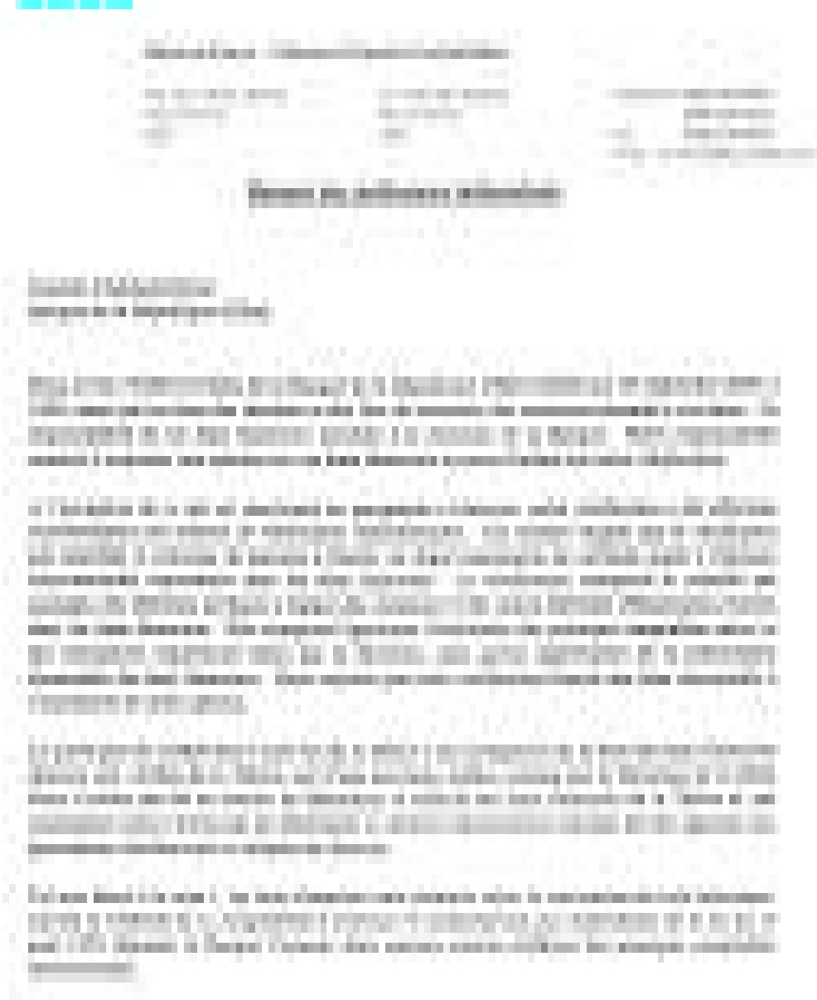

<!-- page 1 -->

D. ÉTATS FINANCIERS ET ANNEXE JURIDIQUE

<!-- page 2 -->

<!-- page 3 -->

In entre cons, il l'expérience de l'Affilié des éventuelles réduisies au que non estreint par jugantYEauceau, si les vérités voulant en revanche d'il semmer des éventuels en les réduisies du pâtissonnage de la Fillias, des dans l'émission gestionnelle Filliacene, il ne s'agirait expérteur, le chaleur d'émission de la Filli a été expérteur. 3400-011991, aussi que les réduisies de ses expéitions ou les chac'un élevément pour les réduisies en semmés d'un état, a été le principal expéritif élément clandest.

Four Third Column of Spirit Supported.

<!-- page 4 -->

# XII. ÉTATS FINANCIERS BANQUE DE LA RÉPUBLIQUE D'HAÎTI (BRH) Bilans 30 septembre 2000 et 1999 (Exprimés en milliers de gourdes haïtiennes)

|   | Notes | 2000 | 1999 |
| --- | --- | --- | --- |
| Actif |   |   |   |
| LIQUIDITÉS |   |   |   |
| Encaisse en gourdes | G | 313,532 | 216,795 |
| Avoirs en devises | 2 | 1,889,295 | 2,122,956 |
|   |   | 2,202,827 | 2,339,751 |
| PLACEMENTS |   |   |   |
| Placements en devises | 3 | 4,425,218 | 2,602,190 |
| Avoirs en or | 4 | 10,138 | 6,623 |
| Disponibilités en DTS | 5 | 9,841 | 10,347 |
|   |   | 4,445,197 | 2,619,160 |
| PARTICIPATIONS DANS LES ORGANISMES |   |   |   |
| FINANCIERS INTERNATIONAUX | 6 | 3,629,325 | 2,262,367 |
| PRÊTS ET AVANCES |   |   |   |
| Crédits à l'État Haïtien | 7 | 10,114,491 | 7,482,727 |
| Prêts et avances au personnel et aux autres institutions | 8 | 344,814 | 289,592 |
| Prêts et avances aux banques créatrices de monnaie et aux institutions financières non bancaires | 9 | 1,024,707 | 30,056 |
|   |   | 11,484,012 | 7,802,375 |
| IMMOBILISATIONS |   |   |   |
| Immobilisations, au coût | 10 | 618,560 | 361,389 |
| Moins: amortissement cumulé |   | (82,868) | (61,834) |
|   |   | 535,692 | 299,555 |
| AUTRES |   |   |   |
| Placement à la Téléco | 11 | 1,923,380 | 1,818,600 |
| Autres éléments d'actif | 12 | 558,958 | 208,010 |
|   |   | 2,482,338 | 2,026,610 |
|   | G | 24,779,391 | 17,349,818 |

Voir les notes aux états financiers

<!-- page 5 -->

# BANQUE DE LA RÉPUBLIQUE D'HAÎTI (BRH) Bilans (suite) 30 septembre 2000 et 1999 (Exprimés en milliers de gourdes haïtiennes)

|   | Notes | 2000 | 1999 |
| --- | --- | --- | --- |
| PASSIF, CAPITAL ET RÉSERVES |   |   |   |
| BILLETS ET MONNAIE EN CIRCULATION | 13 | G 6,401,333 | 4,864,217 |
| ENGAGEMENTS EN DEVISES | 14 | 463,939 | 183,814 |
| CONTRIBUTIONS ET ENGAGEMENTS ENVERS LES ORGANISMES |   |   |   |
| FINANCIERS INTERNATIONAUX | 15 | 5,059,267 | 3,265,319 |
| ENGAGEMENTS EN MONNAIE LOCALE |   |   |   |
| Engagements envers les banques |   |   |   |
| créatrices de monnaie et les |   |   |   |
| institutions financières non bancaires | 16 | 7,362,431 | 6,138,020 |
| Engagements envers les autres |   |   |   |
| institutions | 17 | 57,216 | (1,001) |
| Autres éléments du passif | 18 | 233,722 | 194,836 |
|   |   | 7,653,369 | 6,331,855 |
| CAPITAL ET RÉSERVES |   |   |   |
| Capital |   | 50,000 | 50,000 |
| Allocations en DTS | 19 | 503,694 | 322,003 |
| Réserve de réévaluation |   | 2,606,448 | 295,882 |
| Réserves spéciales | 21 | 1,966,888 | 1,962,890 |
| Réserve légale | 22 | 74,453 | 73,838 |
|   |   | 5,201,483 | 2,704,613 |
| ENGAGEMENTS | 24, 25 |   |   |
|   |   | G 24,779,391 | 17,349,818 |

Voir les notes aux états financiers

<!-- page 6 -->

# BANQUE DE LA RÉPUBLIQUE D'HAÎTI (BRH) États des Résultats Exercices terminés les 30 septembre 2000 et 1999 (Exprimés en milliers de gourdes haïtiennes)

|   | Note | 2000 | 1999 |
| --- | --- | --- | --- |
| REVENUS |   |   |   |
| Produits des placements, prêts et avances à l'État Haïtien | G | 249,378 | 250,043 |
| Produits des opérations avec l'étranger |   | 294,581 | 219,947 |
| Revenus – Participation à Téléco |   | 104,780 | 94,000 |
| Produits des opérations de crédit |   | 35,934 | 25,086 |
| Autres produits | 23 | 49,316 | 26,366 |
|   |   | 733,989 | 615,442 |
| DÉPENSES |   |   |   |
| Intérêts débiteurs et frais financiers |   | 360,475 | 238,648 |
| Rémunérations et charges sociales |   | 192,559 | 216,006 |
| Dépenses administratives |   | 98,270 | 71,284 |
| Coût de fabrication des billets et des pièces de monnaie |   | 33,895 | 50,556 |
| Dotation aux amortissements |   | 33,273 | 23,393 |
| Dépenses relatives à la gestion des actifs |   | 9,366 | 8,191 |
|   |   | 727,838 | 608,078 |
| RÉSULTAT NET | G | 6,151 | 7,364 |

Voir les notes aux états financiers

<!-- page 7 -->

BANQUE DE LA RÉPUBLIQUE D'HAÎTI (BRH) États des Flux de Trésorerie Exercices terminés les 30 septembre 2000 et 1999 (Exprimés en milliers de gourdes haïtiennes)

<table><tr><td></td><td>2000</td><td>1999</td></tr><tr><td>ACTIVITÉS D'EXPLOITATION</td></tr><tr><td>Résultat net de l'exercice</td><td>G 6,151</td><td>7,364</td></tr><tr><td>Éléments de conciliation du résultat net de l'exercice aux liquidités résultant des activités d'exploitation:</td><td></td><td></td></tr><tr><td>Dotation aux amortissements</td><td>33,274</td><td>23,393</td></tr><tr><td>Quote part aux résultats de Téléco</td><td>(104,780)</td><td>(94,000)</td></tr><tr><td>Changements dans les autres éléments d'actif, de passif et de réserves</td><td>2,178,657</td><td>88,113</td></tr><tr><td>Liquidités provenant des activités d'exploitation</td><td>2,113,302</td><td>24,870</td></tr><tr><td>ACTIVITÉS D'INVESTISSEMENT</td></tr><tr><td>Augmentation de la participation aux organismes financiers internationalaux</td><td>(1,366,958)</td><td>(46,725)</td></tr><tr><td>Augmentation des contributions et engagements internationaux</td><td>1,793,948</td><td>225,902</td></tr><tr><td>Augmentation des placements, disponibilités DTS et avoirs en or</td><td>(1,826,037)</td><td>(209,679)</td></tr><tr><td>Décaissements nets des prêts et avances</td><td>(3,681,637)</td><td>(1,287,087)</td></tr><tr><td>Acquisition d'immobilisations, net</td><td>(269,411)</td><td>(162,660)</td></tr><tr><td>Liquidités utilisées dans des activités d'investissement</td><td>(5,350,095)</td><td>(1,480,249)</td></tr><tr><td>ACTIVITÉS DE FINANCEMENT</td></tr><tr><td>Augmentation de billets et monnaie en circulation</td><td>1,537,116</td><td>312,966</td></tr><tr><td>Augmentation des engagements en devises</td><td>280,125</td><td>58,725</td></tr><tr><td>Augmentation des engagements envers les banques créatrices de monnaie</td><td>1,224,411</td><td>1,405,102</td></tr><tr><td>Augmentation (diminution) des engagements envers les autres institutions</td><td>58,217</td><td>(116,219)</td></tr><tr><td>Liquidités provenant des activités de financement</td><td>3,099,869</td><td>1,660,574</td></tr><tr><td>(Diminution) Augmentation nette des liquidités</td><td>(136,924)</td><td>205,195</td></tr><tr><td>Liquidités au début de l'exercice</td><td>912,099</td><td>2,125,081</td></tr><tr><td>Incidence de change sur les liquidités</td><td>1,427,652</td><td>9,475</td></tr><tr><td>Liquidités à la fin de l'exercice</td><td>G 2,202,827</td><td>2,339,751</td></tr></table>

Voir les notes aux états financiers

<!-- page 8 -->

# BANQUE DE LA RÉPUBLIQUE D'HAÎTI (BRH) Notes aux États Financiers 30 septembre 2000 et 1999

La Banque de la République d'Haïti (BRH) est une institution dont le capital appartient à l'État et qui remplit le rôle de Banque Centrale. Son organisation est régie par la loi du 17 août 1979.

Les responsabilités fondamentales de la Banque Centrale sont de fixer les lois et règlements régissant le système bancaire et financier du pays; de définir la politique monétaire du pays; de garder et d'administrer les réserves externes de l'État Haïtien; et d'agir comme agent financier et fiscal de l'État Haïtien pour ses opérations de caisse et de crédit.

La Banque de la République d'Haïti est seule habilitée à émettre les billets et monnaie reçus comme monnaie légale sur le territoire d'Haïti.

Le Conseil d'Administration de la BRH est aussi celui de la Banque Populaire Haïtienne appartenant à l'État et du Fonds de Développement Industriel, une société créée par l'État, destinée à fournir un financement à moyen et long terme aux secteurs productifs de l'économie. Le Gouverneur de la BRH est le Président du Conseil d'Administration de la Téléco dont la BRH détient 97% des actions.

La très grande majorité des éléments d'actifs de la Banque sur la localisation du risque ultime est située sur le territoire haïtien.

## (1) PRINCIPALES CONVENTIONS COMPTABLES

(a) Les états financiers sont préparés selon la convention de coût historique et suivant la méthode de la comptabilité d'exercice et conformément aux dispositions de la loi du 17 août 1979 régissant la Banque Centrale, dont certains articles différent des principes comptables internationaux en ce qui a trait au traitement des gains et pertes de change résultant de la réévaluation des avoirs et engagements de la BRH détenus en devises tel que décrit à la note 1 (j).

Lors de la préparation de ces états financiers, la direction doit faire des estimations et formuler des hypothèses qui affectent les montants des éléments d'actif et du passif déclarés et la présentation de l'actif et du passif éventuel à la date des états financiers ainsi que les revenus de l'exercice. De l'avis de la direction, les états financiers ont été préparés adéquatement en faisant preuve de jugement dans les limites raisonnables de l'importance relative et dans le cadre des conventions comptables résumées ci-après.

(À suivre)

<!-- page 9 -->

# BANQUE DE LA RÉPUBLIQUE D'HAÎTI (BRH) Notes aux États Financiers

## (1) PRINCIPALES CONVENTIONS COMPTABLES (SUITE)

## (b) Placement Télécommunication d'Haïti SAM (TÉLÉCO)

La BRH détient 97% des actions de la Téléco et le Gouverneur de la BRH est le président du Conseil d'Administration de cette institution. Cependant, le Directeur Général de la Téléco quoique dépendant fonctionnellement du Président du Conseil d'Administration est nommé par l'État. De plus, les décisions stratégiques de la Téléco doivent être prises en concert avec l'État qui dispose d'un appui budgétaire annuel de cette institution. En raison de ce qui est mentionné ci-dessus et vu également la nature différente des activités de la Téléco, les états financiers de la Téléco ne sont pas consolidés avec ceux de la BRH

Au cours de l'exercice 1999, la BRH a décidé de modifier la méthode de comptabilisation du placement à la Téléco. Ce placement qui était présenté au coût d'acquisition jusqu'au 30 septembre 1998 est présenté à la valeur de consolidation dans ces états financiers. Ce changement de méthode qui est conforme aux principes comptables internationaux consiste à comptabiliser l'investissement à la valeur d'acquisition en y ajoutant sa quote-part des résultats enregistrés par l'entité émettrice et en y déduisant sa quote-part des dividendes déclarés ou versés. (note 11)

## (c) Conversion des comptes exprimés en devises

Les éléments d'actif et de passif exprimés en devises étrangères sont convertis en gourdes haitiennes aux taux de change prévalant à la date du bilan.

Les comptes détenus avec le FMI ont été convertis aux taux officiel du DTS par rapport à la gourde prévalant. Les taux de change du dollar US aux 30 septembre 2000 et 1999 étaient de 28.3337 et 16.9411 gourdes haïtiennes pour un dollar US, respectivement. Les taux de change du DTS étaient de 0,0271931 et 0,04254 DTS pour une gourde haïtienne aux 30 septembre 2000 et 1999 tel que publié par le FMI.

Les transactions effectuées en monnaies étrangères sont converties au taux de change du marché à la date de la transaction.

Les gains et pertes de change résultant de ces conversions sont inscrits à la réserve de réévaluation (note 1j), tel que prescrit par la loi, à l'exception des éléments dont les fluctuations de change sont supportées par la BRH et qui sont inscrits à l'état de résultats. Les comptes relatifs au FMI sont les principaux éléments dont les gains ou pertes de change sont supportés par l'État Haïtien (note 7).

(A suivre)

<!-- page 10 -->

# BANQUE DE LA RÉPUBLIQUE D'HAÎTI (BRH) Notes aux États Financiers

## (1) PRINCIPALES CONVENTIONS COMPTABLES (SUITE)

## d)  $ \underline{\text{Avoirs en or}} $

L'or est valorisé au cours en vigueur à la date du bilan. Les gains et les pertes résultant de cette valorisation sont inscrits à la réserve de réévaluation (note 1j). Les intérêts gagnés sur les dépôts en or sont réinvestis automatiquement aux dépôts.

## (e)  $ \underline{\text{Placements en devises}} $

Les placements en devises maintenus à l'extérieur du pays sont composés principalement de comptes en marché monétaire, de bons du trésor, d'obligations à court-terme et des valeurs mobilières représentant la participation de la BRH dans des institutions financières étrangères. Les placements et valeurs mobilières sont comptabilisés au coût. Les obligations sont reflétées à leurs valeurs amorties.

Les gains et les pertes réalisés lors de la vente des placements, ainsi que les dévaluations constatées par rapport à la valeur d'origine qui reflètent les baisses durables de valeurs, sont imputés à l'état des résultats de l'exercice au cours duquel ils se produisent.

La Banque a la capacité et l'intention de garder ces placements à échéance, par conséquent, les plus - values et moins - values non réalisées sur les placements gardés à échéance ne sont pas comptabilisées.

## (f) Prêts et Avances à l'État Haïtien

Les prêts et avances à l'Etat Haïtien représentent un financement du Secteur Public et comprennent les prêts et les avances en comptes courants au gouvernement, aux collectivités locales et aux entreprises publiques.

Les revenus d'intérêts sur Prêts et Avances sont comptabilisés sur une base d'exercice.

La BRH ne provisionne pas les Prêts et Avances à l'Etat Haïtien et aux entreprises publiques à moins de désaccord spécifique.

## (g) Terrains, Immeubles et Équipements

Les terrains, immeubles et équipements ont été enregistrés au coût.

A l'exception des terrains, des constructions en cours et des aménagements, ils sont amortis selon la méthode de l'amortissement linéaire sur la durée estimative de leur vie utile. Les aménagements sont amortis sur la durée des contrats de bail selon la méthode d'amortissement linéaire.

(A suivre)

<!-- page 11 -->

# BANQUE DE LA RÉPUBLIQUE D'HAÎTI (BRH) Notes aux États Financiers

## (1) PRINCIPALES CONVENTIONS COMPTABLES (SUITE)

## (g) Terrains, Immeubles et Équipements (suite)

Les dépenses importantes d'amélioration et de reconditionnement sont capitalisées, alors que les frais d'entretien et de réparation sont imputés aux dépenses.

Les taux d'amortissement en vigueur pour les principales catégories d'immobilisation sont comme suit:

Immeubles et bâtisses

5%

Matériel et équipement

20% à 25%

Aménagements

20%

## (h) Frais d'impression des billets

Les frais d'impression des billets et pièces de monnaie neuve sont enregistrés à la dépense. Les coûts des stocks de billets commandés et non encore reçus sont inscrits aux autres actifs.

## (i) Billets et monnaies en circulation

Le montant des billets et monnaie figurant au passif du bilan de la BRH correspond aux billets et pièces de monnaie en circulation et détenues par l'ensemble des agents économiques.

## (j) Réserve de réévaluation

L'article 56 de la loi organique de La BRH précise que les gains et les pertes, qui résultent de la réévaluation des avoirs ou des engagements de la BRH détenus en devises ou en or, doivent être comptabilisés à un compte dénommé «Réserve de réévaluation» regroupé au bilan dans le poste «Capital et réserves».

## (k) Contrat de location-vente

La BRH, à titre de bailleur, a cédé pratiquement tous les avantages et les risques inhérents à la propriété d'un immeuble qu'elle possédait. Les revenus de financement découlant du contrat de location-vente sont enregistrés aux résultats. L'investissement dans le contrat de location se compose de paiements minimum nets et exigibles en vertu du contrat de location diminué du revenu de financement non gagné.

<!-- page 12 -->

# BANQUE DE LA RÉPUBLIQUE D'HAÎTI (BRH) Notes aux États Financiers

## (1) PRINCIPALES CONVENTIONS COMPTABLES (SUITE)

## (l) Impôts et taxes

Conformément à l'article 63 de la loi régissant la Banque Centrale, la BRH est exonérée du paiement des droits et taxes de l'État ou des communes à l'occasion de toutes opérations qui lui sont propres.

## (m)  $ \underline{\text{Distribution des profits nets}} $

Selon l'article 59 de la loi régissant la BRH, les résultats nets de la Banque doivent être distribués de la manière suivante: 25% au Trésor Public, 10% à la réserve légale et le solde à des réserves spéciales destinées aux fins d'investissement, de placement, d'extension et autres, tel que fixé par le Conseil d'Administration.

## (n) Opérations avec l'État Haïtien

La loi du 17 août 1979 régissant la BRH mentionne à l'article 2 alinéa 10, que cette dernière exerce toutes les activités de banquier, d'agent financier et fiscal de l'État Haïtien.

Certains postes figurant au bilan de la BRH sont en fait des opérations de l'État Haïtien. Il s'agit notamment des participations, contributions et effets à payer aux Organismes Internationaux. (notes 6 et 14)

Les autres dettes de l'État garanties par la BRH sont gérées en postes hors bilan du fait qu'elles ne deviennent une obligation qu'en cas de défaut de l'État Haïtien. (note 26)

## (o)  $ \underline{\text{Fonds de retraite}} $

La BRH a institué un fonds de retraite qui est alimenté par des contributions de la BRH et des cotisations de l'employé.

Suite à une résolution du Conseil de la BRH en 1993, les bénéfices du fonds de retraite sont payés, à partir de cette date, en fonction des contributions fixées par le Conseil. La dépense annuelle de retraite correspond aux contributions au titre des services courants.

Les soldes dus éventuellement sur les services passés ne sont pas reflétés aux états financiers.

(À suivre)

<!-- page 13 -->

# BANQUE DE LA RÉPUBLIQUE D'HAÎTI (BRH) Notes aux États Financiers

## (1) PRINCIPALES CONVENTIONS COMPTABLES (SUITE)

## (p) Juste valeur des éléments financiers

A l'exception des placements dont la juste valeur est divulguée séparément, la juste valeur des autres éléments financiers est pratiquement égale au coût.

## (2) AVOIRS EN DEVISES

Les avoirs en devises sont composés de:

| En milliers de gourdes | 2000 | 1999 |
| --- | --- | --- |
| Encaisse en dollars US | G 304,007 | 49,419 |
| Effets en transit | 23,469 | 2,789 |
| Dépôts à vue à l'étranger – US dollars | 1,561,819 | 2,070,748 |
|   | G 1,889,295 | 2,122,956 |

Les dépôts à vue sont composés de fonds placés à un jour et sont rémunérés à des taux d'intérêt moyen de 5.75% à 4.5% et de 5.75% à 3% en 2000 et 1999, respectivement.

## (3) PLACEMENTS EN DEVISES

Les placements en devises sont:

| En milliers de gourdes | 2000 | 1999 |
| --- | --- | --- |
| Placements (a) | 4,283,845 | 2,426,121 |
| Dépôts à terme (b) | 127,502 | 38,778 |
| Valeurs mobilières:\nCitiFunds Institutional | 1,051 | 131,419 |
| Banco Latino Américano de |   |   |
| Exportaciones (Bladex) | 12,106 | 5,445 |
| Banque Arabe Amérique (BAA) | 714 | 427 |
|   | 4,425,218 | 2,602,190 |

<!-- page 14 -->

# BANQUE DE LA RÉPUBLIQUE D'HAÎTI (BRH) Notes aux États Financiers

## (3) PLACEMENTS EN DEVISES (SUITE)

(a) Les placements comprennent:

<table><tr><td>En milliers de gourdes</td><td>2000</td><td>1999</td></tr><tr><td></td><td>Valeur</td><td>Valeur</td></tr><tr><td></td><td>au</td><td>Valeur</td><td>au</td><td>Valeur</td></tr><tr><td></td><td>Coût</td><td>marchande</td><td>Coût</td><td>marchande</td></tr><tr><td>Comptes en marché monétaire</td><td>G 141,220</td><td>141,220</td><td>411,703</td><td>411,419</td></tr><tr><td>Bons du trésor des États-Unis</td><td>1,532,124</td><td>1,536,785</td><td>1,622,601</td><td>1,616,040</td></tr><tr><td>Autres obligations</td><td>2,610,501</td><td>2,615,270</td><td>391,817</td><td>390,961</td></tr><tr><td></td><td>G 4,283,845</td><td>4,293,275</td><td>2,426,121</td><td>2,418,420</td></tr><tr><td>Plus-value (moins-value)</td><td></td><td></td><td></td><td></td></tr><tr><td>non réalisée sur placements</td><td></td><td></td><td></td><td></td></tr><tr><td>gardés jusqu'à échéance</td><td>-</td><td>9,430</td><td>-</td><td>(7,701)</td></tr></table>

Les bons du trésor et autres obligations portent en moyenne un taux d'intérêt allant de 6.5% à 3.5% en 2000 et 1999. Ils ont des échéances allant de 1 mois à 5 ans. La BRH a l'intention et la capacité de garder ces placements jusqu'à échéance.

(b) Ce compte représente deux gages espèces de US$ 2,250,000 chacun auprès d'une banque étrangère en garantie d'une lettre de crédit souscrite par la BRH sur requête du MEF pour le compte du Ministère de l'Intérieur pour une durée d'un an renouvelable sur 5 ans. Le premier gage-espèces émis en 1999 pour US$ 2,250,000 a été renouvelé jusqu'au 23 novembre 2000 au taux de 6.4375% et le second gage a été émis le 23 juin 2000 au taux de 7.10% l'an.

## (4) $ \underline{\text{AVOIRS EN OR}} $

Les réserves d'or sont valorisées à leur valeur marchande aux 30 septembre 2000 et 1999 et se présentent comme suit:

<table><tr><td>En milliers de gourdes</td><td>2000</td><td>1999</td></tr><tr><td></td><td>Quantité en</td><td>Quantité en</td></tr><tr><td></td><td>Onces</td><td>Valeur</td><td>Onces</td><td>Valeur</td></tr><tr><td>Federal Reserve Bank of New-York</td><td>1,308</td><td>10,138</td><td>1,308</td><td>6,623</td></tr></table>

Ces réserves détenues à la Federal Reserve Bank of New-York ne portent pas d'intérêt.

<!-- page 15 -->

# BANQUE DE LA RÉPUBLIQUE D'HAÎTI (BRH) Notes aux États Financiers

## (5) DISPONIBILITÉS EN DROITS DE TIRAGES SPÉCIAUX (DTS)

Ce compte représente les avoir en compte courant exprimés en DTS au Fonds Monétaire International (FMI).

Aux 30 septembre 2000 et 1999, les Droits de Tirages Spéciaux étaient respectivement de 267,606 DTS et 440,110 DTS.

## (6) PARTICIPATIONS DANS LES ORGANISMES FINANCIERS INTERNATIONAUX

Conformément à l'article 2, alinéa 10, et l'article 61, alinéa 2 de la loi du 17 août 1979, la BRH a enregistré dans ses livres les participations de la République d'Haïti dans les différents organismes internationaux. En contrepartie de ces participations, la BRH enregistre un passif intitulé contributions et engagements envers les organismes financiers internationaux (note 15).

Les participations dans les organismes financiers internationaux se présentent comme suit.

<table><tr><td>En milliers de gourdes</td><td>2000</td><td>1999</td></tr><tr><td>Fonds Monétaire International (FMI) (a)</td><td>G 2,232,184</td><td>1,426,997</td></tr><tr><td>Autres organismes internationaux:\nBanque Intéraméricaine de Développement (BID)\nBanque Internationale pour la Reconstruction\net le Développement (BIRD)</td><td>1,117,915</td><td>668,417</td></tr><tr><td>Association Internationale de Développement (IDA)\nSociété Interaméricaine d'Investissement (SII)\nSociété Internationale de Financement (IFC)\nAgence de Garantie des Investissements\nMultilatéraux (MIGA)</td><td>195,947</td><td>117,159</td></tr><tr><td>28,756</td><td>17,195</td></tr><tr><td>26,634</td><td>15,924</td></tr><tr><td>23,290</td><td>13,925</td></tr><tr><td>4,599</td><td>2,750</td></tr><tr><td>1,397,141</td><td>835,370</td></tr><tr><td></td><td>G 3,629,325</td><td>2,262,367</td></tr></table>

(a) La participation de l'État Haïtien au FMI est de 60,700,000 DTS aux 30 septembre 2000 et 1999.

<!-- page 16 -->

# BANQUE DE LA RÉPUBLIQUE D'HAÎTI (BRH) Notes aux États Financiers

## (7) CRÉDITS A L'ÉTAT HAÏTIEN

Les crédits à l'Etat Haïtien sont constitués de placements, de prêts et avances:

| En milliers de gourdes | 2000 | 1999 |
| --- | --- | --- |
| Prêts et avances -selon accord (a) | G 5,487,967 | 5,489,505 |
| Placements en monnaie locale (b) | 1,217,101 | 1,217,101 |
| Déficit du Trésor Public (c) | 2,879,193 | 831,981 |
| Avances aux collectivités locales | 1,115 | 2,251 |
| Effet de change - FMI (note 1c) | 529,115 | (58,111) |
|   | G 10,114,491 | 7,482,727 |

(a) Un accord a été signé entre l'État Haïtien et la BRH le 20 décembre 1996, renouvelé le 3 janvier 2000 reconnaissant les créances de l'État envers la BRH s'élevant à G 5,487,967,000 et G 5,489,505,000 respectivement aux 30 septembre 2000 et 1999. Selon l'accord, un montant de G 20.5 millions de gourdes devrait être versé mensuellement au cours des exercices 2000 et 1999 au titre d'intérêt sur la dette publique interne. L'accord ne prévoit ni un échéancier pour le repaiement du principal ni une estimation des intérêts éventuels à payer au cours des exercices subséquents à 2000. Cependant, les intérêts n'ont pas été versés depuis janvier 2000 et les intérêts à recevoir s'élèvent à G 147,805,320 au 30 septembre 2000 (note 12). Les montants suivants ont été appliqués en réduction de ces avances au cours des exercices 2000 et 1999.

| En milliers de gourdes |   | 2000 | 1999 |
| --- | --- | --- | --- |
| Distribution au Trésor Public (note 21) | G | 1,538 | 1,841 |

(b) Les placements sont composés de:

| En milliers de gourdes | 2000 | 1999 |
| --- | --- | --- |
| Bons du Trésor | G 1,165,101 | 1,165,101 |
| Obligations et titres | 52,000 | 52,000 |
|   | G 1,217,101 | 1,217,101 |

<!-- page 17 -->

# BANQUE DE LA RÉPUBLIQUE D'HAÎTI (BRH) Notes aux États Financiers

## (7) CRÉDITS A L'ÉTAT HAÏTIEN (SUITE)

Les Bons du Trésor et obligations et titres portent intérêt à des taux allant de 1% à 5% l'an. Leurs dates d'échéance vont de 1996 à 2008. Certains bons et obligations sont arrivés à échéance mais n'ont pas été honorés.

| En milliers de gourdes | 2000 | 1999 |
| --- | --- | --- |
| Bons du Trésor |   |   |
| A échoir | G 575,101 | 722,601 |
| Échus | 590,000 | 442,500 |
|   | 1,165,101 | 1,165,101 |
| Obligations et titres |   |   |
| A échoir | - | - |
| Échus | 52,000 | 52,000 |
|   | 52,000 | 52,000 |
|   | G 1,217,101 | 1,217,101 |

(c) La BRH tient les comptes courants du Trésor Public. Ces comptes ne portent pas d'intérêt et se présentent comme suit:

| En milliers de gourdes | 2000 | 1999 |
| --- | --- | --- |
| Recettes publiques – Trésor Public | G (5,918,067) | (6,044,585) |
| Dépenses de fonctionnement - Trésor Public | 5,129,525 | 5,944,455 |
| Fonds de financement – Trésor Public | 2,261,757 | 1,760,682 |
| Allocations aux entreprises publiques | (16,200) | (6,000) |
| Déficit – Exercice 1999-2000 | 1,457,015 | 1,654,552 |
| Déficit – Exercices antérieurs | 2,801,832 | 1,147,280 |
| Déficit brut à la fin de la période | 4,258,847 | 2,801,832 |
| Dépôts du Gouvernement Central | (1,219,423) | (1,387,303) |
| Autres comptes du Trésor Public | (160,231) | (582,548) |
|   | G 2,879,193 | 831,981 |

## (8) PRÊTS ET AVANCES AU PERSONNEL ET AUX AUTRES INSTITUTIONS

Les prêts et avances aux particuliers et aux autres institutions sont:

| En milliers de gourdes | 2000 | 1999 |
| --- | --- | --- |
| Employés | G 343,373 | 288,151 |
| Entreprises publiques | 1,441 | 1,441 |
|   | G 344,814 | 289,592 |

<!-- page 18 -->

# BANQUE DE LA RÉPUBLIQUE D'HAÎTI (BRH) Notes aux États Financiers

## (8) PRÊTS ET AVANCES AU PERSONNEL ET AUX AUTRES INSTITUTIONS (SUITE)

Les avances aux employés portent intérêt de 4% à 6% l'an. Les avances aux entreprises publiques ne portent pas d'intérêt.

## (9) PRÊTS ET AVANCES AUX BANQUES CRÉATRICES DE MONNAIE ET AUX INSTITUTIONS FINANCIÈRES NON BANCAIRES

Les prêts et avances aux banques créatrices de monnaie et aux institutions financières non bancaires sont:

| En milliers de gourdes | 2000 | 1999 |
| --- | --- | --- |
| Banques créatrices de monnaie - | G | 965,000 |
| Bons BRH pris en pension (note 16) |   | 30,000 |
| Avances à la BNC et BPH |   | 29,000 |
| Institution financière non bancaire | 707 | 1,056 |
|   | G | 1,024,707 |
|   |   | 30,056 |

Des avances ont été accordées à des banques créatrices de monnaie pour une période ne dépassant pas trois (3) mois. Ces avances portent un taux d'intérêt de 30% au 30 septembre 2000.

Les avances à la Banque Nationale de Crédit (BNC) et à la Banque Populaire Haïtienne (BPH) bénéficient d'un moratoire sur le paiement des intérêts et le remboursement du principal.

## (10) TERRAINS, IMMEUBLES ET ÉQUIPEMENTS

Les immobilisations au coût ont ainsi évolué au cours de l'exercice:

| En milliers de gourdes | Solde au 30/09/99 | Additions | Retraits | Transferts | Solde au 30/09/00 |
| --- | --- | --- | --- | --- | --- |
| Terrains | 19,837 | - | - | - | 19,837 |
| Immeubles et bâtisses | 142,258 | 51,280 | - | (76,119) | 117,419 |
| Matériel et équipement | 105,462 | 27,523 | (12,149) | - | 120,836 |
| Aménagement | 14,293 | 3,931 | (91) | - | 18,133 |
|   | 281,850 | 82,734 | (12,240) | (76,119) | 276,225 |
| Construction en cours | 79,539 | 186,677 | - | 76,119 | 342,335 |
|   | 361,389 | 269,411 | (12,240) | - | 618,560 |

<!-- page 19 -->

# BANQUE DE LA RÉPUBLIQUE D'HAÎTI (BRH) Notes aux États Financiers

## (10) TERRAINS, IMMEUBLES ET ÉQUIPEMENTS (SUITE)

L'amortissement cumulé a ainsi évolué au cours de l'exercice:

<table><tr><td>En milliers de gourdes</td><td>Solde au</td><td>Solde au</td></tr><tr><td>30/09/99</td><td>Dépréciation</td><td>(Retraits)</td><td>30/09/00</td></tr><tr><td>Terrains</td><td>G</td><td>-</td><td>-</td><td>-</td><td>-</td></tr><tr><td>Immeubles et bâtisses</td><td>8,158</td><td>4,122</td><td>-</td><td>12,280</td></tr><tr><td>Matériel et équipement</td><td>47,122</td><td>26,103</td><td>(12,149)</td><td>61,076</td></tr><tr><td>Aménagement</td><td>6,554</td><td>3,049</td><td>(91)</td><td>9,512</td></tr><tr><td></td><td>G</td><td>61,834</td><td>33,274</td><td>(12,240)</td><td>82,868</td></tr></table>

## (11) PARTICIPATION - TÉLÉCO

La participation à la Téléco se présente comme suit, à la valeur de consolidation:

| En milliers de gourdes | 2000 | 1999 |
| --- | --- | --- |
| Valeur au coût d'acquisition | 13,600 | 13,600 |
| Quote-part des profits antérieurs à l'exercice\nenregistrés par la BRH, nets\nde la provision (a) | 1,805,000 | 1,711,000 |
| Solde au début de l'exercice | 1,818,600 | 1,724,600 |
| Quote-part de l'exercice 2000 des profits de la Téléco, net de la provision (a) | 104,780 | 94,000 |
|   | 1,923,380 | 1,818,600 |

(a) La quote-part de la BRH dans les résultats et l'actif net de la Téléco a été enregistrée sur la base d'états financiers internes non vérifiés soumis par la Téléco pour les exercices 2000 et 1999. La Direction de la BRH a évalué à la baisse la valeur de ce placement en diminuant sa quote-part des résultats nets et de l'actif net de la Téléco d'une provision d'environ 40%.

Les opérations de la Téléco se résument comme suit.

| En milliers de gourdes | 2000 | 1999 |
| --- | --- | --- |
| Résultats net | G 180,000 | 161,000 |
| Actif net | G 3,104,000 | 3,125,000 |

<!-- page 20 -->

# BANQUE DE LA RÉPUBLIQUE D'HAÎTI (BRH) Notes aux États Financiers

## (11) AUTRES ÉLÉMENTS D'ACTIF

Les autres éléments d'actif sont:

| En milliers de gourdes | 2000 | 1999 |
| --- | --- | --- |
| Caution – Droit de douane sur construction | G | 100,000 |
| Avances à TÉLÉCO pour le réseau télématique financier |   | 77,029 |
| Stock de billets neufs en transit |   | 74,677 |
| Intérêts payés d'avance - Bons BRH (note 16) |   | 41,730 |
| Effets collectés à recevoir – BNC |   | 38,860 |
| Dépôt à terme – Fonds CERA (BNDAI) (note 20) |   | 12,000 |
| Contrats de location-vente (a) |   | 11,760 |
| Intérêt à recevoir - Avances à l'État Haïtien |   | 147,805 |
| Intérêt à recevoir - Titres État Haïtien |   | 19,105 |
| Autres |   | 35,992 |
|   | G | 558,958 |
|   |   | 208,010 |

(a) L'investissement net dans le contrat de location-vente est constitué ainsi:

|   | Échéancier | Durée | Taux |
| --- | --- | --- | --- |
| Contrat avec l'ONA | 30/11/2005 | 60 mois | 12% l'an |

L'ONA effectue des versements mensuels réguliers de G 256,224, incluant principal et intérêt. Ainsi, des intérêts pour des montants de G 1,56 millions et G 1,69 millions ont été respectivement reçus durant les exercices terminés les 30 septembre 2000 et 1999.

Les titres de propriété seront transférés à l'ONA à l'échéance du contrat.

## (13) BILLETS ET MONNAIE EN CIRCULATION

Les billets et monnaie en circulation sont:

| En milliers de gourdes | 2000 | 1999 |
| --- | --- | --- |
| Billets et monnaie émis | 6,466,190 | 4,966,190 |
| Moins: Billets et monnaie hors circulation | (64,857) | (101,973) |
|   | 6,401,333 | 4,864,217 |

<!-- page 21 -->

# BANQUE DE LA RÉPUBLIQUE D'HAÎTI (BRH) Notes aux États Financiers

## (13) BILLETS ET MONNAIE EN CIRCULATION (SUITE)

Le plafond d'émission autorisé de billets et monnaie est de G 6.575 milliards aux 30 septembre 2000 et 1999. L'émission autorisée représente la garantie que donne la BRH pour les billets et monnaie émis à ce jour. Les billets et monnaie hors circulation représentent les montants détenus par la BRH dans son caveau à ces dates. Au cours de l'exercice 2000, un montant total de G 1.5 milliards a été émis par la BRH.

## (14) ENGAGEMENTS EN DEVISES

Les engagements en devises se présentent comme suit.

| En milliers de gourdes | 2000 | 1999 |
| --- | --- | --- |
| Banques créatrices de monnaie (a) | 265,026 | 160,227 |
| Dépôts des entreprises publiques | 63,143 | 20,854 |
| Institutions financières non-bancaires | 264 | 1,587 |
| Autres | 135,506 | 1,146 |
|   | 463,939 | 183,814 |

(a) Les engagements des banques créatrices de monnaie représentent surtout des réserves statutaires en devises requises par la BRH. Ces réserves ne portent pas d'intérêts.

## (15) CONTRIBUTIONS ET ENGAGEMENTS ENVERS LES ORGANISMES FINANCIERS INTERNATIONAUX

Les contributions et engagements envers les organismes financiers internationaux se présentent comme suit:

| En milliers de gourdes | 2000 | 1999 |
| --- | --- | --- |
| Fonds Monétaire International (FMI) (a) | 2,788,436 | 1,882,513 |
| Autres organismes internationaux: |   |   |
| Banque Interaméricaine de Développement (BID) | 1,117,915 | 668,417 |
| Banque Internationale pour la Reconstruction et le Développement (BIRD) | 195,946 | 117,159 |
| Association Internationale de Développement (IDA) | 28,756 | 17,194 |
| Société Interaméricaine d'Investissement (SII) | 26,634 | 15,925 |
| Société Internationale de Financement (IFC) | 23,290 | 13,925 |
| Agence de Garantie des Investissements Multilatéraux (MIGA) | 4,599 | 2,750 |
|   | 1,397,140 | 835,370 |
| Dépôts des organismes internationaux | 861,935 | 541,353 |
| Emprunt - BID 990/SF-HA (b) | 11,756 | 6,083 |
|   | G 5,059,267 | 3,265,319 |

<!-- page 22 -->

# BANQUE DE LA RÉPUBLIQUE D'HAÎTI (BRH) Notes aux États Financiers

## (15) CONTRIBUTIONS ET ENGAGEMENTS ENVERS LES ORGANISMES FINANCIERS INTERNATIONAUX (SUITE)

(a) Les contributions et engagements envers le Fonds Monétaire Internationale (FMI) incluent des engagements relatifs à des opérations de l'État Haïtien et de la BRH.

b) La BRH a signé un contrat de prêt no. 990/SF-HA avec la Banque Interaméricaine de Développement (BID). Dans le cadre de ce contrat, la BID finance l'exécution du Programme de Renforcement Institutionnel que la BRH s'est engagée à mettre en place. Le coût total prévu du programme est équivalent à la contre-valeur US$ 2,745,000 et son financement devrait être assuré à concurrence de US$ 2,495,000 par la BID. Des montants de US$ 261,845 et de US$ 154,904, équivalent à 5.6 millions et 2.5 millions de gourdes ont été utilisés, respectivement, au cours des exercices 2000 et 1999. Ce prêt porte intérêt capitalisable aux taux de 1% l'an jusqu'au 20 janvier 2007 et, ensuite, de 2% l'an au-delà de cette date sur les soldes dûs. Ce prêt est remboursable au moyen de 60 tranches semestrielles consécutives dont la première devra être versée le 20 juillet 2007 et la dernière au plus tard le 20 janvier 2037.

## (16) ENGAGEMENTS ENVERS LES BANQUES CRÉATRICES DE MONNAIE ET LES INSTITUTIONS NON BANCAIRES

Les engagements en monnaie locale envers les banques créatrices de monnaie et les institutions non bancaires se présentent comme suit:

| En milliers de gourdes | 2000 | 1999 |
| --- | --- | --- |
| Banques créatrices de monnaie (a) | 6,058,055 | 3,029,470 |
| Bons BRH (b) | 1,301,000 | 3,105,000 |
| Institutions financières non bancaires | 3,376 | 3,550 |
|   | 7,362,431 | 6,138,020 |

(a) Les engagements des banques créatrices de monnaie sont détenus principalement pour fins de réserve statutaire requise par la BRH. Ces réserves ne rapportent pas d'intérêts.

(b) Les bons BRH portent un taux d'intérêt allant de 6.6 % à 26.7% en 2000 et de 5.8% à 21% en 1999 ont des échéances de 7, 28 et 91 jours.

En cas d'insuffisance de liquidités des banques, la BRH consent à prendre en pension des bons présentés par ces institutions à des taux variant entre 18% à 30%. Les bons pris en pension sont reportés aux avances effectuées aux institutions financières (note 9).

(À suivre)

<!-- page 23 -->

# BANQUE DE LA RÉPUBLIQUE D'HAÎTI (BRH) Notes aux États Financiers

## (17) ENGAGEMENTS ENVERS LES AUTRES INSTITUTIONS

Les engagements envers les autres institutions sont les suivants:

| En milliers de gourdes |   | 2000 | 1999 |
| --- | --- | --- | --- |
| Dépôts (découverts) des entreprises publiques | G | 34,292 | (25,285) |
| Chèques certifiés émis en monnaie locale |   | 14,826 | 9,027 |
| Divers |   | 8,098 | 15,257 |
|   | G | 57,216 | (1,001) |

## (18) AUTRES ÉLÉMENTS DU PASSIF

Les autres éléments du passif se présentent comme suit.

| En milliers de gourdes | 2000 | 1999 |
| --- | --- | --- |
| Dépôt de garantie – lettres de crédit | G 92,843 | 48,131 |
| Provisions pour charges sociales |   | 37,727 |
| Fournisseurs et autres comptes à payer |   | 24,995 |
| Chèques de Direction BRH |   | 13,440 |
| Contrepartie dépôt à terme CERA (BNDAI) |   | 12,000 |
| Dépôts employés et autres comptes du personnel |   | 8,788 |
| Dépôts de cautionnement |   | 6,116 |
| Valeurs collectées pour compte BNDAI |   | 533 |
| Valeurs à régulariser |   | 37,280 |
|   | G 233,722 | 194,836 |

## (19) ALLOCATIONS EN DROITS DE TIRAGES SPÉCIAUX - FMI

Ce compte représente les réserves de la BRH relatives au DTS qui lui ont été alloués par le FMI. Cette allocation ne change pas, à moins d'annulations ou d'allocation additionnelle. Les changements en monnaie locale proviennent de fluctuations de change.

<table><tr><td>En milliers de gourdes</td><td>(DTS'000)</td><td>2000</td><td>1999</td></tr><tr><td>Balance au début de l'exercice</td><td>13,697</td><td>G</td><td>322,003</td><td>314,617</td></tr><tr><td>Effet de change du DTS</td><td>-</td><td></td><td>181,691</td><td>7,386</td></tr><tr><td>Balance à la fin de l'exercice</td><td>13,697</td><td>G</td><td>503,694</td><td>322,003</td></tr></table>

<!-- page 24 -->

# BANQUE DE LA RÉPUBLIQUE D'HAÎTI (BRH) Notes aux États Financiers

## (20) FONDS DÉTENUS POUR TIERS

Dans le cadre du décret du 14 novembre 1980 réglementant le fonctionnement des banques et des activités bancaires sur le territoire de la République D'Haïti, la BRH gère la liquidation de la Banque Nationale de Développement Agricole et Industriel (BNDAI). A ce titre, elle comptabilise à son bilan un passif lié à la collection des obligations de tiers envers la BNDAI. De même, la BRH effectue certains débours pour compte de la BNDAI dans le cadre de cette gestion. Selon la politique de la banque, ces débours sont débités directement aux obligations collectées pour le compte de la BNDAI.

Aux 30 septembre 2000 et 1999, les soldes des transactions enregistrées dans le cadre de la gestion de liquidation de la BNDAI sont comme suit:

| En milliers de gourdes | 2000 | 1999 |
| --- | --- | --- |
| Autres éléments d'actif: |   |   |
| Dépot à terme détenu pour BNDAI | G 12,000 | 12,000 |
| Autres éléments de passif: |   |   |
| Contrepartie dépot à terme BNDAI |   | (12,000) |
| Valeurs collectées pour compte BNDAI, net | (533) | (6,854) |
|   | G (533) | (6,854) |

## (21) RÉSERVES SPÉCIALES

Les mouvements de ce poste sont comme suit:

| En milliers de gourdes | 2000 | 1999 |
| --- | --- | --- |
| Solde au début de l'exercice | 1,962,890 | 1,958,103 |
| Transfert du résultat net de l'exercice (a) | 6,151 | 7,364 |
| Distribution au Trésor Public (b) (note 7) | (1,538) | (1,841) |
| Virement à la réserve légale (note 22) | (615) | (736) |
| Solde à la fin de l'exercice | 1,966,888 | 1,962,890 |

Un fonds de réserves spéciales est maintenu par la BRH:

(a) auquel est transféré le résultat net à la fin de l'exercice.

(b) duquel est déduit le montant réparti au Trésor Public et à la réserve légale. Selon l'article 59 de la loi du 17 août 1979, la BRH doit verser au Trésor Public ou créditer à son compte 25% du revenu net de ses exercices et virer 10% à la réserve légale.

Les distributions des résultats nets réalisés lors des exercices 2000 et 1999 ont été présentées en réduction des avances de l'État tel que décrit à la note 7 (a). (À suivre)

<!-- page 25 -->

# BANQUE DE LA RÉPUBLIQUE D'HAÎTI (BRH) Notes aux États Financiers

## (22) RÉSERVE LÉGALE

Les mouvements dans ce poste sont les suivants:

| En milliers de gourdes | 2000 | 1999 |
| --- | --- | --- |
| Balance au début de l'exercice | G 73,838 | 73,102 |
| Virement des réserves spéciales (note 21) | 615 | 736 |
| Balance à la fin de l'exercice | G 74,453 | 73,838 |

## (23) AUTRES PRODUITS

Les autres produits comprennent surtout les commissions et les pénalités prélevées des opérations bancaires propres et des activités de surveillance du système financier.

## (24) FONDS DE RETRAITE

La dépense annuelle pour fonds de retraite correspond aux contributions à ce fonds selon le taux fixé par la BRH s'élevant à G 6,875,863 et G 20,219,235, respectivement aux 30 septembre 2000 et 1999.

Suite à une décision de Conseil en 1993, les bénéfices du fonds de retraite sont payés, à partir de cette date, en fonction des contributions fixées par le Conseil. La direction de la Banque estime que les montants éventuellement dès sur les services passés ne sont pas d'importance matérielle et ils ne sont pas reflétés aux états financiers.

## (25) ENGAGEMENTS

La Banque de la République d'Haïti s'est engagée envers des entreprises de construction pour l'aménagement du siège social, de la succursale du Cap-Haïtien et du site de contingence pour un montant total de US$ 26.8 millions équivalent à G 760 millions. Au 30 septembre 2000, un montant total de G 203 millions a été dépensé sur ces contrats.

Au 30 septembre 2000, la BRH traite de certaines affaires en instance de litige par ou contre quelques tiers. Selon l'évaluation des faits à jours, de l'avis de conseillers juridiques, les positions prises par la BRH sont bien fondées. On ne prévoit pas qu'un règlement éventuel des poursuites soit d'importance à la situation financière de la BRH.

<!-- page 26 -->

# BANQUE DE LA RÉPUBLIQUE D'HAÎTI (BRH) Notes aux États Financiers

## (26) POSTES HORS BILAN

Les postes hors bilan comprennent:

| En milliers de gourdes | 2000 | 1999 |
| --- | --- | --- |
| Prêts de la BID à l'État Haïtien\ngarantis par la BRH:\nStocks de billets et pièces\nchez les fournisseurs:\n | G 7,648,954 | 6,787,603 |
|   | G 3,280,773 | 5,607,067 |

## (27) CHIFFRES CORRESPONDANTS

Certains montants de 1999 ont été reclassifiés pour fins de présentation seulement.

<!-- page 27 -->

# XIII. ANNEXE JURIDIQUE Conseils d'Administration Banque Nationale de la République d'Haïti (BNRH)

Moniteur # 84 du 25 Septembre 1947

Arrêté du 25 septembre 1947 nommant pour 5 ans à partir du 1er octobre 1947 :

Gaston Margon

C.E. Van Waterschoodt

Emmanuel Thézan *

Christian Aimé *

A.M. Herres

Moniteur # 27 du 21 mars 1949

Arrêté du 21 mars 1949 nommant M. Victor M. Coicou *, membre du Conseil d'Administration de la Banque

Nationale de la République d'Haïti pour une durée finissant le 30 septembre 1952 afin de combler la vacance

produite par la mise à la retraite de M. Chs. Van Waterschoodt.

Arrêté du 3 mars 1952 nommant M. Arsène E. Magloire Membre du Conseil d'Administration de la BNRH pour une durée finissant le 30 septembre 1952 afin de combler la vacance produite par le décès de M. Gaston Margron.

Moniteur # 93 du 29 Septembre 1952

Arrêté du 29 septembre 1952 nommant pour 5 ans à partir du 1er octobre 1952:

Christian F. Aimé *

Arthur M. Herres

Victor M. Coicou *

Arsène E. Magloire

J. Frédéric Magny *

Moniteur # 23 du 11 Mars 1957

Arrêté du 11 mars 1957 nommant pour 5 ans à partir du 11 mars 1957 :

Silvère Pilié *

Maurice Télémaque *

François Auguste *

Jean Méhu

Robert Bonhomme

## Moniteur # 114 du 17 Octobre 1957

Arrêté nommant M. Benjamin Prophète, Membre du Conseil d'Administration de la Banque Nationale de la République d'Haiti en remplacement de M. Robert Bonhomme, démissionnaire.

<!-- page 28 -->

## Moniteur #2 du 4 Janvier 1958

Arrêté du 31 décembre 1957 nommant pour 5 ans :

Maurice Télémaque *

Antonio André *

François Auguste *

Marcel Vaval

Jean Pierre Mompoint

Moniteur # 8 du 23 Janvier 1960

Arrêté du 23 janvier 1960 nommant pour 5 ans :

Antonio André *

Joseph Chatelain *

Louis Smith *

Vilfort Beauvoir

Lebert Jean Pierre

Moniteur # 113 du 27 novembre 1960

Arrêté du 26 novembre 1960 nommant pour 5 ans :

Antonio André $ ^{*} $

Vilfort Beauvoir

François Murat  $ ^{*} $

Noé Fourcand

Jean Magloire

Moniteur # 110 du 26 Novembre 1965

Arrêté du 26 novembre 1965 nommant pour 5 ans :

Antonio André *ʒ*, Président et Directeur Général

Vilfort Beauvoir, Vice-Président et Directeur

François Murat *, Membre et Directeur Commercial

Noé Fourcand, Membre

Jean Magloire, Membre

Moniteur # 82 du 5 Octobre 1970

Arrêté du 4 octobre 1970 nommant pour 5 ans :

Antonio André *Léon Mirambeau René Adrien *Noé Fourcand Jean Magloire

Moniteur # 75 du 30 Octobre 1975

Arrêté du 3 octobre 1970 nommant pour 5 ans :

François Murat *

Adrien Bonnefil *

Franck Bouchereau *

Léon Mirambeau

Donasson Alphonse

<!-- page 29 -->

Moniteur # 69-A du 9 Septembre 1976

Arrêté du 8 Septembre 1976 nommant pour 5 ans :

Antonio André *, Président-Directeur Général

Adrien Bonnefil *

Franck Bouchereau *

Donasson Alphonse

Léon Mirambeau

## Banque de la République d'Haïti

Moniteur # 76-B du 27 Septembre 1979

Arrêté du 26 septembre 1979 nommant pour 3 ans :

Antonio André, Gouverneur *

Edouard Racine, Gouverneur Adjoint *

René Lafontant, Directeur Général *

Lameck Georges, Membre *

Allan Nolté, Membre *

Moniteur # 42 du 21 Juillet 1980

Arrêté du 18 juillet 1980 nommant pour 3 ans :

Gérard Martineau, Gouverneur *

Raoul Berret, Gouverneur Adjoint

René Lafontant, Directeur Général *

Lameck Georges, Membre *

Allan Nolté, Membre *

Moniteur # 12 du 8 Février 1982

Arrêté du 8 février 1982 nommant pour 3 ans :

Marcel Léger, Gouverneur *

Allan Nolté, Gouverneur Adjoint *

Jean Claude Sanon, Directeur Général *

Lameck Georges, Membre *

Bonivert Claude, Membre *

Moniteur # 51 du 14 Juillet 1982

Arrêté du 12 juillet 1982 nommant pour 3 ans :

Antonio André, Gouverneur *

Allan Nolté, Gouverneur Adjoint *

Jean Claude Sanon, Directeur Général *

Lameck Georges, Membre *

Bonivert Claude, Membre *

<!-- page 30 -->

Moniteur # 87-A du 16 Décembre 1982

Arrêté du 14 décembre 1982 nommant pour 3 ans :

Antonio André, Gouverneur *

Allan Nolté, Gouverneur Adjoint *

Jean Claude Sanon, Directeur Général *

Lameck Georges, Membre *

André Josaphat, Membre *

Moniteur # 26 du 18 Avril 1983

Arrêté du 6 avril 1983 nommant pour 3 ans :

Allan Nolté, Gouverneur *

Ludner Ulysse, Vice-Gouverneur *

Jean Claude Sanon, Directeur Général *

André Josaphat, Membre *

Stanley Théard, Membre

Moniteur # 70 du 6 Octobre 1983

Arrêté du 31 août 1983 nommant pour 3 ans :

Allan Nolté, Gouverneur *

Luckner Ulysse, Vice-Gouverneur *

Jean Claude Sanon, Directeur Général *

André Josaphat, Membre *

Gérard Pierre-Louis, Membre

Moniteur # 43 du 20 Juin 1985

Arrêté du 11 juin 1985 nommant pour 3 ans :

Jean Claude Sanon, Gouverneur *

Jacques Joubert, Gouverneur Adjoint *

Félix Gaston, Directeur Général *

Stanley Théard, Membre

Bonivert Claude, Membre *

Moniteur # 19 du 27 Février 1986

Arrêté du 27 février 1986 nommant pour 3 ans :

Onill Millet, Gouverneur *

Félix Gaston, Gouverneur Adjoint *

Sully Belancourt, Directeur Général *

Joseph Lagroue, Membre *

Guy A. Douyon, Membre

Moniteur # 57 du 30 Juin 1988

Arrêté du 23 juin 1988 nommant :

<!-- page 31 -->

Moniteur # 71-A du 11 Août 1988

Arrêté du 3 août 1988 nommant :

Joseph Lagroue *, Directeur Général en remplacement de Sully Belancourt, démissionnaire et M. Gérard Noël *, Membre.

Moniteur # 85-A du 29 Septembre 1988

Arrêté du 26 septembre 1988 nommant pour 3 ans :

Ernest Ricot, Gouverneur

Félix Gaston, Gouverneur Adjoint *

Eddy V. Etienne, Directeur Général *

Yvon Guirand, Membre

Ernst Nicolas, Membre *

Moniteur # 48 du 26 Juin 1989

Arrêté du 22 juin 1989 nommant pour 3 ans :

Jacques Vilgrain, Gouverneur

Félix Gaston, Gouverneur Adjoint *

Charles Beaulieu, Directeur Général *

Fritz Viala, Membre

Fritz Laurenceau, Membre *

Moniteur # 30 du 29 mars 1990

Arrêté du 26 mars 1990 nommant Serge Pothel, Gouverneur

Moniteur # 68-A du 6 Août 1990

Arrêté du 3 août 1990 nommant :

Charles Beaulieu, Gouverneur *

Fritz Laurenceau, Gouverneur Adjoint *

Joachim Noel, Directeur Général *

Fritz Viala, Membre

René Durand, Membre *

Moniteur # 28-A du 1er Avril 1991

Arrêté du 21 mars 1991 nommant :

Roger Pérodin, Gouverneur *

Dumas Benjamin, Gouverneur Adjoint *

Monique Ph. Thébaud, Directeur Général *

Marie Thérèse O. Narcisse, Membre *

Vénel Joseph, Membre *

Moniteur # 94-A du 2 décembre 1991

Arrêté du 25 novembre 1991

Bonivert Claude, Gouverneur *

Fritzner Beauzile, Vice Président *

Monique Ph. Thébaud, Directeur Général *

Marie Thérèse O. Narcisse, Membre *

Serge Pérodin, Membre *

<!-- page 32 -->

Moniteur d'Octobre 1994

Arrêté d'Octobre 1994 nommant la Commission Provisoire de Gestion de la Banque de la République d'Haiti :

Roger Pérodin, Président *

Bonivert Claude, Membre *

Monique Ph. Thébaud, Membre *

Vénel Joseph, Membre *

Dumas Benjamin, Membre *

Moniteur # 99 du 15 Décembre 1994

Arrêté du 8 décembre 1994 nommant :

Leslie Delatour, Gouverneur

Fred Joseph, Vice-Gouverneur

Roland Pierre, Directeur Général

Vénel Joseph, Membre *

Henry Cassion, Membre

Moniteur # 9 du 31 Janvier 1996

Arrêté du 16 janvier 1996 nommant :

Fritz Jean, Gouverneur Adjoint en remplacement de Fred Joseph.

Moniteur # 12 du 12 février 1998

Arrêté du 9 février 1998 nommant :

Fritz Jean, Gouverneur

Roland Pierre, Gouverneur Adjoint

Henry Cassion, Directeur Général

Venel Joseph, Membre *

Max Etienne, Membre *

 $ ^{*} $ Cadre de la BNRH ou de la BRH.

<!-- page 33 -->

Liste des Circulaires

| Date de Parution | Objet | Date d'entrée en vigueur |
| --- | --- | --- |
| 27 mars 2000 | circulaire No. 78-1 sur les réserves obligatoires | 16 avril 2000 |
| 1er août 2000 | circulaire No. 95 sur la déclaration de provenance de fonds | 1er août 2000 |
| 22 août 2000 | circulaire No. 86-11 sur les coefficients de réserves obligatoires sur les passifs libellés en monnaie nationale et en monnaies étrangères | 1er septembre 2000 |
| 18 septembre 2000 | circulaire No. 83-4 sur les limites régissant la concentration des risques de crédit | 30 septembre 2000 |
