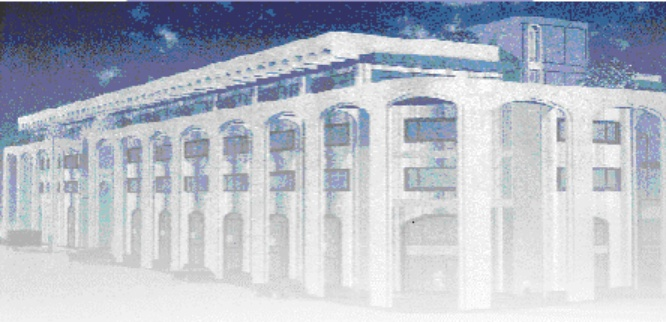

<!-- page 1 -->

Banque de la République d'Haïti

Note mensuelle d'inflation

Mars 2022

<!-- page 2 -->

## Table des matières

I.- Introduction.....2
II.- Évolution de l'inflation globale en mars 2022.....2
III.- Évolution des principales fonctions de consommation en mars 2022.....3
IV.- Évolution de l'inflation selon l'origine des produits et les régions géographiques du pays .....4
V.- Évolution de l'inflation sous-jacente.....5
VI.- Facteurs explicatifs du ralentissement de l'inflation mensuelle en mars 2022.....6
VII- Prévisions d'inflation.....6

<!-- page 3 -->

### I. - Introduction

Cette note analyse l'évolution de l'indice des prix à la consommation (IPC) en Haïti au cours du mois de mars 2022. Elle apporte quelques éléments explicatifs permettant de comprendre les facteurs qui influencent la variation mensuelle de l'IPC et inclut des prévisions pour les trois prochains mois.

### II. - Évolution de l'inflation globale en mars 2022

En mars 2022, l’indice des prix à la consommation (IPC) a été estimé à 208,3 contre 204,9 en février 2022. Ainsi, en glissement annuel, l’inflation a atteint 25,9 % contre 25,2 % le mois antérieur. Cependant, sur une base mensuelle, l’inflation a décéleré de 50 points de base en s’inscrivant à 1,6 %.

Par ailleurs, le taux d'inflation mensuel cumulé sur les six premiers mois de l'exercice 2021-2022 s'est porté à 14,6 % contre 3,7 % sur la même période un an plus tôt. En moyenne mensuelle, l'inflation s'est établie à 2,4 % sur la période allant d'octobre 2021 à mars 2022 contre 0,6 % au cours du premier semestre de l'exercice fiscal précédent. Aussi, ce taux d'inflation moyen mensuel demeure-t-il élevé comparativement à celui enregistré chez nos principaux partenaires commerciaux (États-Unis : 0,80 %, République dominicaine : 0,87 %).

Graphique 1. Évolution de l'inflation mensuelle et annuelle en mars 2022 (en %)

| Date | Inflation Annuelle | Inflation Mensuelle |
| --- | --- | --- |
| Mar-20 | 21.5 | 14.5 |
| May-20 | 23.0 | 17.0 |
| Jul-20 | 25.5 | 20.0 |
| Sep-20 | 26.5 | 21.5 |
| Nov-20 | 21.0 | 5.0 |
| Jan-21 | 20.0 | 11.0 |
| Mar-21 | 18.0 | 12.0 |
| May-21 | 15.5 | 11.5 |
| Jul-21 | 12.5 | 14.0 |
| Sep-21 | 11.0 | 14.0 |
| Nov-21 | 24.5 | 26.5 |
| Jan-22 | 24.0 | 6.5 |
| Mar-22 | 26.0 | 15.0 |

Source : IHSI

<!-- page 4 -->

### III. - Évolution des principales fonctions de consommation en mars 2022

La décélération de l'inflation mensuelle découle principalement du ralentissement du rythme de progression de l'indice de certaines fonctions de consommation. En effet, le taux de croissance de l'IPC du poste « Transports » a enregistré une baisse de 5,6 points de pourcentage (pp) au cours du mois sous revue pour s'établir à 0,6 %. Des ralentissements ont aussi été observés pour l'es postes « Logement, eau, gaz, électricité et autres combustibles » (-2,2 pp à 0,8 %) et « Articles d'habillement et chaussures » (-0,3 pp à 2,3 %). Toutefois, une accélération a été notée au niveau de la variation de l'IPC des postes de consommation suivants : « Produits alimentaires et boissons non alcoolisées » (1,9 % en mars 2022 contre 1,6 % en février 2022), « Boissons alcoolisées, tabac et stupéfiants » (1,2 % contre 0,1 %), « Meubles, articles de ménages et entretien courant du foyer » (2,1 % contre 1,4 %), « Loisirs » (1,2 % contre 0,8 %) et « Santé » (2,2 % contre 1,2 %). Par ailleurs, l'IPC du poste « Enseignement » est resté inchangé à 104,3.

S'agissant de l'inflation annuelle, son comportement reflète l'évolution à la hausse de l'IPC de toutes les fonctions de consommation. Les progressions les plus importantes ont été observées au niveau des fonctions de consommation suivantes : « Restaurants » (de 31,1 % en février 2022 à 32,7 % en mars 2022), « Articles d'habillement et chaussures » (de 26,6 % à 28,1 %), « Boissons alcoolisées, tabac et stupéfiants » (de 11,9 % à 13,2 %) et « Biens et services divers » (de 24,3 % à 25,7 %).

<!-- page 5 -->

Tableau 1. Contribution des divisions de consommation à l'inflation mensuelle et annuelle en mars 2022 (en %)

<table><tr><td>Poste</td><td>Pondération</td><td>Contribution à l'inflation mensuelle</td><td>Contribution à l'inflation annuelle</td></tr><tr><td></td><td>en %</td><td>en %</td></tr><tr><td>Indice Général</td><td>100,00</td><td>100,00</td><td>100,00</td></tr><tr><td>Produits alimentaires et boissons non alcoolisées</td><td>48,50</td><td>59,53</td><td>50,32</td></tr><tr><td>Boissons alcoolisés, tabac et stupéfiants</td><td>1,42</td><td>1,10</td><td>0,73</td></tr><tr><td>Articles d'habillement et chaussures</td><td>5,55</td><td>8,24</td><td>6,08</td></tr><tr><td>Logement, eau, gaz, électricité et autres combustibles</td><td>14,14</td><td>7,44</td><td>15,73</td></tr><tr><td>Meubles, articles de ménages et entretien courant du foyer</td><td>5,32</td><td>7,25</td><td>5,05</td></tr><tr><td>Santé</td><td>2,56</td><td>3,58</td><td>2,61</td></tr><tr><td>Transports</td><td>9,10</td><td>3,67</td><td>10,83</td></tr><tr><td>Communications</td><td>2,23</td><td>1,36</td><td>0,49</td></tr><tr><td>Loisirs</td><td>1,52</td><td>1,21</td><td>0,89</td></tr><tr><td>Enseignement</td><td>3,91</td><td>0,00</td><td>1,37</td></tr><tr><td>Restaurants</td><td>0,49</td><td>0,38</td><td>0,62</td></tr><tr><td>Biens et Services divers</td><td>5,26</td><td>6,26</td><td>5,28</td></tr></table>

Source : Calculs de la BRH/MAE

IV.- Évolution de l'inflation selon l'origine des produits et les régions géographiques du pays

Au cours du mois de mars 2022, la variation de l'IPC des produits importés a été en hausse de 20 points de base par rapport à celle du mois précédent, pour se porter à 36,2 % en glissement annuel.

En revanche, l'IPC des produits locaux a gardé le même rythme de progression que celui observé en février 2022, soit 20,2 %.

En ce qui a trait à l'évolution de l'inflation au niveau des différentes régions géographiques du pays, elle a été marquée par un ralentissement en rythme mensuel et une accélération en glissement annuel. En effet, sur base mensuelle, le taux de croissance de l'indice des prix de l'« Aire Métropolitaine » s'est décéleré de 60 points de base (pb) pour se chiffrer à 1,6 %. Il en est de même pour l'indice des prix du « Reste Ouest » (-30 pb à 1,7 %), du « Nord » (-40 pb à 1,6 %), du Sud (-30 pb à 1,7 %) et celui de la région « Transversale » (-30 pb à 1,6 %). En rythme annualisé, les

<!-- page 6 -->

pressions inflationnistes se sont accrues au niveau de toutes les zones géographiques : « Sud » (27,7 % ; +80 pb), « Reste Ouest » (27,4 % ; +70 pb), « Aire Métropolitaine » (25,4 % ; +80 pb), « Transversale » (25 % ; +70 pb) et « Nord » (24,6 % ; +70 pb).

### V. - Évolution de l'inflation sous-jacente

Au cours du mois de mars 2022, l'inflation sous-jacente a suivi la même tendance que l'inflation globale tant sur base mensuelle qu'annuelle. En effet, en glissement annuel, elle s'est établie à 24,18 %, soit une augmentation de 67 points de base par rapport au mois antérieur. Cependant, en rythme mensuel, l'inflation sous-jacente a ralenti de 65 points de base en s'inscrivant à 1,58 %. Cette variation de l'IPC sous-jacent demeure inférieure à celle de l'indice global, indiquant ainsi que l'évolution de l'inflation mensuelle a été alimentée par les composantes volatiles du panier de consommation.

Graphique 2. Inflation globale et inflation sous-jacente en glissement mensuel en mars 2022 (en %)

| Date | Inflation globale | Inflation sous-jacente |
| --- | --- | --- |
| Mar-20 | 1.75 | 1.75 |
| May-20 | 2.40 | 2.40 |
| Jul-20 | 2.40 | 2.40 |
| Sep-20 | -0.80 | -0.80 |
| Nov-20 | 0.60 | 0.60 |
| Jan-21 | 1.10 | 1.10 |
| Mar-21 | 1.00 | 1.00 |
| May-21 | 0.90 | 0.90 |
| Jul-21 | 2.00 | 1.90 |
| Sep-21 | 1.40 | 1.40 |
| Nov-21 | 4.60 | 4.60 |
| Jan-22 | 0.60 | 0.00 |
| Mar-22 | 1.60 | 1.60 |

Source : Calculs de la BRH/MAE

### VI. - Facteurs explicatifs du ralentissement de l'inflation mensuelle en mars 2022

Comme en témoigne la baisse de la croissance des indices des fonctions de consommation liés aux transports et à l'énergie, la décélération de l'inflation mensuelle en mars est surtout attribuable à

<!-- page 7 -->

l’affaiblissement des effets de la dernière hausse des prix du carburant. En effet, à la suite de la révision à la hausse des prix des produits pétroliers à la pompe en décembre 2021, les ajustements de prix au niveau des secteurs du transport et de l’énergie ont été parmi les principaux facteurs alimentant les pressions inflationnistes dans l’économie. Conséquement, leur contribution à l’inflation mensuelle a été de 87,81 % et 43,55 % respectivement. Cependant, au mois de mars 2022, les effets rémanents ont amplement diminué au de regard de l’évolution de l’IPC des postes : « Transports (-5,6 pp) et Énergie (-2,2 pp) ». Ces derniers ont contribué à hauteur de 11,11 % au ralentissement du rythme de croissance de l’inflation mensuelle pour le mois sous étude.

### VII. - Prévisions d'inflation

Pour le troisième trimestre de l'exercice 2021-2022, les prévisions d'inflation réalisées par la Direction Monnaie et Analyse Économique (MAE) tablent sur un accroissement de l'inflation en rythme annuel. En effet, le taux d'inflation devrait poursuivre son accélération en s'affichant à 28 %, 29,8 % et 31,1 % respectivement en avril, mai et juin 2022. Par ailleurs, l'inflation mensuelle devrait atteindre 2,6 % en avril avant de ralentir à 2,4 % et 2,3 % en mai et en juin 2022.

Graphique 3. Prévisions de l'inflation en variations mensuelle et annuelle pour avril, mai et juin 2022 (en %)

| Date | Infl_m | Infl_y |
| --- | --- | --- |
| Mar-19 | 0.7 | 19.5 |
| May-19 | 16.8 | 21.0 |
| Jul-19 | 14.0 | 22.5 |
| Sep-19 | 16.0 | 24.0 |
| Nov-19 | 17.0 | 25.5 |
| Jan-20 | 15.0 | 26.0 |
| Mar-20 | 17.5 | 27.0 |
| May-20 | 22.0 | 29.0 |
| Jul-20 | 29.0 | 33.0 |
| Sep-20 | 3.0 | 45.0 |
| Nov-20 | -1.5 | 30.0 |
| Jan-21 | 1.0 | 25.0 |
| Mar-21 | 1.0 | 22.0 |
| May-21 | 0.8 | 18.0 |
| Jul-21 | 1.5 | 14.0 |
| Sep-21 | 2.1 | 10.9 |
| Nov-21 | 4.6 | 24.0 |
| Jan-22 | 0.6 | 24.0 |
| Mar-22 | 2.1 | 25.2 |
| May-22 | 2.6 | 28.0 |

Source : Calculs de la BRH/MAE

<!-- page 8 -->

Tableau 2. Indice des prix à la consommation (IPC) par postes de dépenses, Variation mensuelle et annuelle en mars 2022

<table><tr><td>Poste</td><td>IPC</td><td>Variation IPC (%)</td></tr><tr><td>Mars 2021</td><td>Février 2022</td><td>Mars 2022</td><td>Mensuelle</td><td>Annuelle</td></tr><tr><td>Indice général</td><td>165,5</td><td>204,9</td><td>208,3</td><td>1,6</td><td>25,9</td></tr><tr><td>Produits alimentaires et boissons non alcoolisées</td><td>181,1</td><td>225,0</td><td>229,3</td><td>1,9</td><td>26,6</td></tr><tr><td>Boissons alcoolisés, tabac et stupéfiants</td><td>134,0</td><td>149,9</td><td>151,7</td><td>1,2</td><td>13,2</td></tr><tr><td>Articles d'habillement et chaussures</td><td>172,8</td><td>216,4</td><td>221,4</td><td>2,3</td><td>28,1</td></tr><tr><td>Logement,eau,gaz, électricité et autres combustibles</td><td>153,1</td><td>195,2</td><td>196,8</td><td>0,8</td><td>28,5</td></tr><tr><td>Meubles, articles de ménages et entretien courant du foyer</td><td>162,6</td><td>198,0</td><td>202,2</td><td>2,0</td><td>24,4</td></tr><tr><td>Santé</td><td>216</td><td>266,6</td><td>272,4</td><td>2,2</td><td>26,1</td></tr><tr><td>Transports</td><td>122,8</td><td>159,3</td><td>160,3</td><td>0,6</td><td>30,5</td></tr><tr><td>Communications</td><td>110,9</td><td>116,0</td><td>117,1</td><td>0,9</td><td>5,5</td></tr><tr><td>Loisirs</td><td>177,4</td><td>201,4</td><td>203,9</td><td>1,2</td><td>14,9</td></tr><tr><td>Enseignement</td><td>128,7</td><td>140,3</td><td>140,3</td><td>0,0</td><td>9,0</td></tr><tr><td>Restaurants</td><td>175,8</td><td>230,4</td><td>233,2</td><td>1,2</td><td>32,6</td></tr><tr><td>Biens et Services divers</td><td>153,1</td><td>189,0</td><td>192,5</td><td>1,8</td><td>25,7</td></tr></table>

Sources : IHSI et calculs du Service de la Macrééconomie et Analyse de Conjoncture de la MAE

<!-- page 9 -->

## Glossaire

| Variation mensuelle | : Variation par rapport au mois précédent. |
| --- | --- |
| Glissement annuel | : Variation par rapport au même mois de l'année antérieure. |
| Inflation | : Mouvement persistant à la hausse du niveau général des prix. |
| Désinflation | : Ralentissement de la croissance des prix. |
| Déflation | : Baisse du niveau général des prix associée à une contraction de la masse monétaire et du crédit. |
| Inflation sous-jacente | : Tendance de long terme des prix, tout en excluant la volatilité, les mouvements saisonniers, conjoncturels, et les chocs qui affectent les composantes du panier considéré. |
| Région Nord | : Elle couvre les départementes du Nord, Nord-Est et Nord-Ouest. |
| Région Sud | : Elle comprend les départementes du Sud de la Grand-Anse et des Nippes. |
| Région Reste Ouest | : Y sont incluses les départementes du Sud-Est et de l'Ouest à l'exception de l'aire métropolitaine |
| Région Transversale | : Elle regroupe les départementes du Centre et de l'Artibonite. |
| Aire Métropolitaine | : Elle contient les villes de Port-au-Prince, de Delmas, de Pétion-Ville, de Carrefour et de Croix des Bouquets. |
