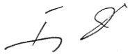
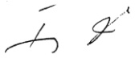

<!-- page 1 -->

# AUX BANQUES COMMERCIALES AUX BANQUES D'EPARGNE ET DE LOGEMENT

Conformément à l'article 43 alinéa a du Décret du 14 Novembre 1980 réglementant le fonctionnement des banques et les activités bancaires sur le territoire de la République d'Haïti les dispositions suivantes concernant le rapport entre les prêts en devises et les passifs en devises entrent en vigueur le 1er janvier 2001.

## 1 - Définitions

Les défitions suivantes s'appliquent à la présente circulaire :

## Prêts en devises

Désignent le solde des prêts bruts (prêts à la consommation, prêts au logement, prêts au commerce etc.), libellés en toutes monnaies autres que la gourde octroyés par un établissement bancaire, retranchés des déductions autorisées.

## Déductions autorisées

Peuvent être déduits des prêts en devises:

Les dépôts fongibles en devises (dépôts en espèces constitués auprès de l'établissement bancaire prêteur destinés à garantir le risque de crédit);

Admissibles lorsque les fonds sont détenus par l'établissement prêteur pour le compte du déposant/client aux conditions suivantes:

les fonds ne peuvent être retirés pendant la durée du risque;

l'établissement prêteur peut utiliser les fonds pour acquitter la dette dans la mesure où celle-ci n'est pas acquittée par le client conformément aux modalités de l'enterte de prêt et où au cune disposition juridique n'empêche l'utilisation de la garantie pour é.cquitter la dette;

Admissibles lorsque les fonds sont détenus par un autre établissement bancaire à condition que celui-ci soit situé en Haiti ou dans un pays de l'OCDE et que l'établissement prêteur obtienne une confirmation écrite du client et une autre de l'établissement bancaire à l'effet que le dépôt satisfait aux deux conditions énumérées précédemment;

- Les lettres de garantie en devises émises par les institutions internationales ayant leur siège social dans les pays de l'OCDE.

Les titres en devises émis par la BRH.

• Le$s$ lettres de garantie émises par les banques ayant leur siège social $tans$ les pays de l'OCDE.

Les titres émis par les gouvernements et les banques centrales des pays de l'OCDE dans leurs propres devises.

• Les lettres de garanties en devises émises par le Fonds de Développement Industriel (FDI).

<!-- page 2 -->

## Passifs en devises

Désignent l'ensemble des éléments du passif libellés en toutes monnaies autres que la gourde : dépôts (à vue, épargne, à terme), obligations (à vue et à terme), autres passifs et débentures subordonnées d'un établissement bancaire.

## 2 - Ratio maximum

Les établissements bancaires sont tenus de respecter en tout temps un ratio maximum de 50% entre le montant des prêts en devises et celui des passifs en devises. La différence devrait être maintenue dans des comptes immédiatement disponibles ou aisément mobilisables.

Pour l'application de la présente circulaire, les établissements bancaires sont tenus de ramener en dollars américains les montants des prêts et passifs libellés dans les “autres devises” avant de calculer ledit ratio.

## 3 - Opérations en devises avec des sociétés apparentées

## 4 - Disponibilité de renseignements pour inspection

Un établissement bancaire ne peut effectuer d'opérations en devises avec une ou plusieurs sociétés apparentées dans le but de ramener le ratio Prêts en devises sur Passifs en devises au dessous de la limite prévue dans la présente circulaire

Lors des inspections périodiques menées par la BRH, les établissements bancaires doivent mettre, à tout moment, à la disposition des inspecteurs de la BRH, selon le format qui leur convient le mieux, le dossier de travail relatif à la préparation des Rapports de conformité sur le ratio des prêts et passifs en devises.

## 5 - Rapports de conformité

Les établissements bancaires doivent faire parvenir à la BRH le rapport de conformité suivant :

Rapport mensuel de conformité des prêts et passifs en devises (Annexe 1)

Délai de soumission: 15 jours suivant la fin du mois.

## 6 - Pénalités

Toute infraction à la limite établie par la présente circulaire expose l'établissement bancaire à des pénalités qui seront déduites du solde de l'un de ses comptes à la BRH. Ces dernières sont calculées en fonction du dépassement établi soit:

## Dépassement de Limite

à la suite de l'analyse des rapports de conformité, lorsque la Banque ne respecte pas le ratio maximum de 50%. L'établissement bancaire s'expose à une pénalité de 1/10 de 1% du montant du dépassement par jour de dépassement.

à la suite d'une inspection effectuée par les représentants de la BRH, lorsque l'inspection fait ressortir que le ratio maximum de 50% n'est pas respecté entre les prêts en devises et les passifs en devises. L'établissement bancaire sera possible d'une pénalité de 1/10 de 1% du montant du dépassement par jour de dépassement.

<!-- page 3 -->

Disponibilité de renseignements pour inspection

A défaut de fournir les renseignements énoncés au point 4 de la présente circulaire, un établissement bancaire est assujetti à une pénalité de 5 000 gourdes par jour d'infraction. La période de pénalité s'étend du jour de l'infraction (demande de renseignements par les inspecteurs de la BRH) jusqu'à celui où les renseignements sont mis à la disposition des inspecteurs de la BRH.

 $ \underline{\text{Retard de production des rapports de conformité}} $

Conformément à la circulaire BRH CIR/95#70 en vigueur sur le sujet.

## 7 - Mise en vigueur

Les dispositions de la présente circulaire entrent en vigueur le 1er janvier 2001.

## Annexe

Rapport mensuel de conformité des prêts et passifs en devises.

Port-au-Prince, le 18 septembre 2000

T

Fritz Jean

Gouverneur

<!-- page 4 -->

# CIRCULAIRE 97 Annexe RATIO PRETS EN DEVISES / PASSIFS EN DEVISES RAPPORT MENSUEL DE CONFORMITE (1 de 2)

Etablissement bancaire : ___ Au : ___

Ce RAPPORT MENSUEL DE CONFORMITE fait foi du respect d'un établissement bancaire à l'égard de la limite réglementaire énoncée dans la circulaire #97

En dollars US

<table><tr><td>PRETS BRUTS NETS DES DEDUCTIONS AUTORISEES ( Voir annexe page 2/2 )</td><td></td><td>(1)</td></tr><tr><td>PASSIFS ( Voir annexe page 2/2 )</td><td></td><td>(2)</td></tr><tr><td></td></tr><tr><td>PRETS BRUTS / PASSIFS (1/2)</td><td></td><td></td></tr></table>

Signature de deux cadres autorisés : ___ ___

( Poste/Titre : _____ _____ )

<!-- page 5 -->

## CIRCULAIRE 97

## RATIO PRETS EN DEVISES / PASSIFS EN DEVISES

(2 de 2)

## RAPPORT MENSUEL DE CONFORMITE

Dollar US Dollar

Canadian

converti en

Dollar US

Francais

converti en

Dollar US

Autre

Devise

convertie

en Dollar

TOTAL en

Dollar US

<table><tr><td>PRETS BRUTS</td><td></td><td></td><td></td><td></td><td></td></tr><tr><td></td></tr><tr><td>DEDUCTIONS AUTORISEES</td><td></td><td></td><td></td><td></td><td></td></tr><tr><td></td></tr><tr><td>PRETS BRUTS NETS DES DEDUCTIONS AUTORISEES</td><td></td><td></td><td></td><td></td><td></td></tr><tr><td></td></tr><tr><td>PASSIFS</td><td></td><td></td><td></td><td></td><td></td></tr><tr><td></td></tr><tr><td>TAUX DE CONVERSION</td><td></td><td></td><td></td><td></td><td></td></tr></table>
