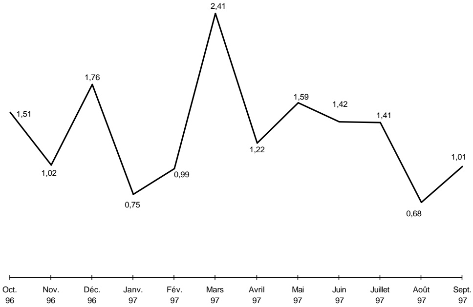
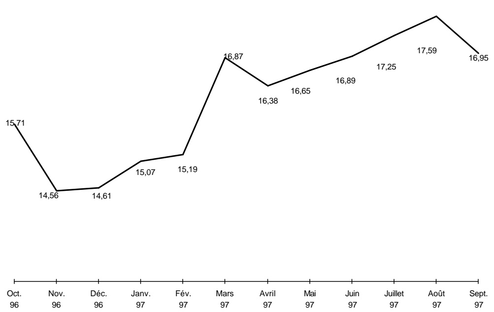

<!-- page 1 -->

## Bulletin Statistique 30

Octobre 1996 - Septembre 1997

<!-- page 2 -->

## Table des matières

Avertissement .....5
I- Statistiques monétaires et financières
Tableau 1.1 Principaux indicateurs monétaires .....10
Tableau 1.2 Situation monétaire .....11
Tableau 1.3 Liquidités du système bancaire .....13
Tableau 1.4 Taux de réserves obligatoires .....13
Tableau 1.5 Spread sur le marché formel des changes .....13
Tableau 1.6 Volume des transactions sur le marché formel des changes .....14
Tableau 1.7 Taux d'intérêt mensuels du système bancaire .....16
Tableau 1.8 Taux d'intérêt mensuels sur le marché monétaire .....16
Tableau 1.9 Dépôts du secteur privé .....17
Tableau 1.10 Dépôts : parts de marché .....18
Tableau 1.11 Crédit au secteur privé .....20
Tableau 1.12 Crédit : parts de marché .....22
Tableau 1.13 Bilan consolidé des banques commerciales .....24
Tableau 1.14 Bilan de la BRH .....26
Tableau 1.15 Encours des bons BRH .....28
Tableau 1.16 Avoirs extérieurs nets de la BRH .....29
II- Finances publiques
Tableau 2.1 Résumé des opérations financières des administrations publiques .....32
Tableau 2.2 Recettes des administrations publiques .....33
Tableau 2.3 Dépenses des administrations publiques .....35
Tableau 2.4 Endettemment total du secteur public .....36
Tableau 2.5 Dette publique externe .....37
III- Balance des paiements
Tableau 3.1 Résumé de la balance des paiements .....40
Tableau 3.2 Principaux produits exportés .....41
Tableau 3.3 Exportations des industries d'assemblage aux États-Unis d'Amérique à base de matières premières importées .....42
Tableau 3.4 Exportations vers les États-Unis d'Amérique à base de matières premières locales .....43
Tableau 3.5 Importations par grandes catégories de produits .....45
Tableau 3.5a Importations de produits pétroliers .....46
Tableau 3.6 Évolution de l'indice du taux de change réel bilatéral Haiti-États-Unis d'Amérique .....46

<!-- page 3 -->

## Table des matières (suite)

## IV- Prix et autres indicateurs économiques

Tableau 4.1 Indice des prix à la consommation (IPC) pour l'ensemble du pays .....48
Tableau 4.2 Taux d'inflation .....48
Tableau 4.3 Taux de change à Port-au-Prince .....49
Tableau 4.4 Prix moyen de détail de certains produits sur l'ensemble du pays .....49
Tableau 4.5 Prix moyen des matériaux de construction .....50
Tableau 4.6 Activités du secteur de la construction à Port-au-Prince .....50
Tableau 4.7 Nouvelles entreprises déclarées à Port-au-Prince et nombre correspondant d'employés .....51
Tableau 4.8 Nouvelles entreprises enregistrées à l'ONA et nombre correspondant d'assurés .....51
Tableau 4.9 Production de certaines industries .....51
Tableau 4.10 Évolution de la consommation d'électricité en Haiti .....52
Annexe graphique
Graphique1 Agrégats M1, M2, M3 .....54
Graphique2 Contreparties de M3 .....55
Graphique3 Encours des bons BRH .....56
Graphique4 Dépôts du secteur privé .....57
Graphique5 Crédit au secteur privé .....58
Graphique6 Recettes et dépenses des administrations publiques .....59
Graphique7 Endettlement total du secteur public .....60
Graphique8 Balances commerciale et globale .....61
Graphique9 Indice du taux de change réel bilatéral Haiti-États Unis d'Amérique .....62
Graphique10 Taux d'inflation (variation mensuelle; novembre 1996=100) .....63
Graphique11 Taux d'inflation (variation en glissement annuel) .....64
Graphique12 Taux de change .....65

<!-- page 4 -->

## Avertissement

## Statistiques monétaires et financières

Les statistiques monétaires sont présentées selon les critères de classification établis dans le manuel Guide des Statistiques Monétaires et Bancaires publiées dans Statistiques Financières Internationales du Fonds Monétaire International (1987). Elles représentent des données de stock (fin de période) qui sont collectées mensuellement.

Par rapport au Bulletin #29, les statistiques monétaires ont fait l'objet d'une révision méthodologique suite aux recommandations faites par le Fonds Monétaire International. Plusieurs modifications ont été introduites tant au niveau de la présentation des tableaux monétaires qu'au niveau de la terminologie y afférente.

Ont été éliminés les tableaux intitulés «La Base monétaire et ses sources», «Avoirs extérieurs nets des banques commerciales» et «Avoirs extérieurs nets du système bancaire consolidé». Les informations relatives à ces tableaux figurent respectivement dans les tableaux ayant pour titres «Bilan de la BRH» et «Bilan consolidé des banques». En outre, les titres de certains tableaux ont été modifiés comme suit :

## Bulletin #29

• Composantes et contreparties de M3

• Position de réserves des banques commerciales

• Évolution des dépôts des banques commerciales d'épargne et de logement (en MG)

• Évolution des dépôts des banques commerciales d'épargne et de logement (en %)

• Évolution du portefeuille de crédit des banques commerciales d'épargne et de logement (en MG)

## Bulletin #30

• Évolution du portefeuille de crédit des banques commerciales d'épargne et de logement (en %)

• Situation monétaire

• Évolution des taux d'intérêts

• Liquidités du système bancaire

• Dépôts du secteur privé

• Dépôts : Parts de marché

• Crédit au secteur privé

• Crédit : Parts de marché

• 1- Taux d'intérêt mensuels sur le marché monétaire

• 2- Taux d'intérêt mensuels du système bancaire

<!-- page 5 -->

# Avertissement (suite)

## Finances publiques

Les statistiques des finances publiques sont présentées selon les critères de classification établis dans le Manuel de Référence des Finances Publiques (1986) du FMI. Elles représentent des données de flux qui sont collectées mensuellement et sont enregistrées sur la base des encaissements-décaissements. Ces données subissent un traitement qui tient compte de la spécificité du contexte haïtien. Étant donné qu'Haïti ne dispose pas d'un budget général consolidé, les recettes enregistrées sont celles du Trésor excluant celles des unités de production marchande du secteur public. Les dépenses enregistrées sont celles effectuées par le Trésor pour le compte de l'Administration Centrale, et comprennent également les dépenses réalisées sur financement externe pour l'ensemble des administrations publiques.

## Balance des paiements

Les statistiques de la balance des paiements sont des données de flux. Elles sont présentées selon les critères établis dans la 5ème Édition du Manuel de la Balance des Paiements du FMI, contrairement aux statistiques du Bulletin Statistique # 29 qui avaient été compilées suivant les principes de la 4ème édition de ce manuel. Les transactions sur les biens sont enregistrées sur une base brute. Les transferts de capital se réfèrent surtout à des annulations d'engagements par un ou plusieurs créanciers qui ne reçoivent rien en échange (remise de dette).

Les transferts courants sont ceux qui ne peuvent être dits transferts de capital. Ils comprennent les transferts en espèces entre administrations publiques destinés à financer leurs dépenses courantes, les transferts en nature (dons d'aliments, de médicaments et d'autres biens de consommation, ...), les envois de fonds de travailleurs émigrés, etc. Dans les anciennes éditions du Manuel de la Balance des Paiements, ils sont regroupés au niveau des rubriques Transferts privés et Transferts publics.

La variation des avoirs de réserves est présentée sous forme d'avoirs bruts à l'exclusion des engagements envers le FMI et des engagements envers le FIV (enregistrés dans les engagements constituent des réserves pour les autorités étrangères). Ceux-ci sont présentés séparément.

Les données du secteur non bancaire pour la période Octobre 1996 - Septembre 1997 sont présentées de façon nette et correspondent aux dépôts et emprunts extraterritoriaux de ce secteur. Cependant, celles du secteur des exportations sont estimées.

L'indice de taux de change réel bilatéral (1991=100) est calculé à partir de l'indice des prix à la consommation (IPC) des États-Unis produit par le US Department of Labor (1982-84=100). Le changement de base est effectué à partir de la moyenne annuelle de la série pour l'année 1991 (1982-84=100). Dans le Bulletin Statistique #29 de la BRH, l'IPC des États Unis d'Amérique provenant des Statistiques Financières Internationales du FMI était utilisé. L'indice de taux de change nominal (1991=100) est calculé de la manière suivante : Taux de référence de fin de période du mois X / Taux de référence moyen pour l'année 1991.

Les statistiques de la balance des paiements pour les deux trimestres précédents ont été également présentées pour refléter les nouvelles informations obtenues du Département du Commerce américain et de l'Administration Générale des Douanes.

<!-- page 6 -->

## Avertissement (suite)

## Prix et autres indicateurs économiques

Les informations regroupées sous la dénomination Prix et autres indicateurs économiques réfèrent aux données de production, d'emplois, de prix et aussi d'activités du secteur de la construction. Il s'agit dans la plupart des cas de données brutes agrégées et tabulées. L'indice des prix à la consommation est un indice de Laspeyres (période de base novembre 1996 avec pondération de 1986-1987) qui couvre l'ensemble du territoire national.

Le taux de change de la monnaie nationale par rapport au dollar américain (Gde / $) est aussi présenté au niveau de cette section pour les marchés formel (banques et agents de change) et informel. Le taux de référence de la BRH représente une moyenne pondérée des taux de ces marchés.

## Liste des sigles utilisés dans le Bulletin Statistique

| AGD | Administration Générale des Douanes |
| --- | --- |
| AIB | Autres institutions bancaires |
| BEL | Banques d'épargne et de logement |
| BID | Banque Interaméricaine de Développement |
| BNC | Banque Nationale de Crédit |
| BRH | Banque de la République d'Haïti |
| BRI | Banque de Règlements Internationaux |
| CIF | Cost, Insurance and Freight |
| DTS | Droits de Tirage Spéciaux |
| EDH | Électricité d'Haïti |
| ERF | Établissements Raymond Flambert |
| EU | États-Unis d'Amérique |
| FIV | Fonds d'Investissement Vénézuélien |
| FMI | Fonds Monétaire International |
| FOB | Free on Board |
| IFNB | Institutions financières non bancaires |
| IHSI | Institut Haïtien de Statistique et d'Informatique |
| IPC | Indice des prix à la consommation |
| MEF | Ministère de l'Économie et des Finances |
| MG | Millions de gourdes |
| OEA | Organisation des États Américains |
| OFATMA | Office Assurance Accidents du Travail et Maternité |
| OFI | Organisations financières internationales |

<!-- page 7 -->

## I- Statistiques monétaires et financières

<!-- page 8 -->

Tableau 1.1

|   | Oct. 96 | Nov. 96 | Déc. 96 | Jan. 97 | Fév. 97 | Mars 97 | Avril 97 | Mai 97 | Juin 97 | Juil. 97 | Août 97 | Sept. 97 |
| --- | --- | --- | --- | --- | --- | --- | --- | --- | --- | --- | --- | --- |
| Monnaie en circulation | 3 014,55 | 2 975,85 | 3 435,72 | 3 261,16 | 3 256,84 | 3 378,47 | 3 332,71 | 3 336,38 | 3 288,12 | 3 278,56 | 3 265,52 | 3 354,72 |
| Base monétaire | 7 205,00 | 7 142,90 | 7 645,10 | 7 491,90 | 7 352,80 | 7 517,30 | 7 556,80 | 7 616,80 | 7 782,90 | 7 584,70 | 7 646,10 | 7 770,50 |
| M1 | 5 254,82 | 5 212,12 | 5 646,23 | 5 556,64 | 5 481,53 | 5 674,81 | 5 596,37 | 5 602,69 | 5 857,03 | 5 679,12 | 5 758,95 | 5 638,48 |
| M2 | 11 608,34 | 11 527,30 | 12 112,24 | 12 140,94 | 12 134,57 | 12 498,46 | 12 477,93 | 12 542,32 | 12 979,80 | 12 849,48 | 12 920,54 | 12 822,45 |
| M3 | 14 249,36 | 14 166,79 | 14 708,78 | 14 921,79 | 14 931,80 | 15 432,99 | 15 478,83 | 15 652,45 | 16 161,90 | 16 138,93 | 16 352,39 | 16 413,42 |
| Crédit intérieur | 11 564,68 | 11 372,71 | 11 512,46 | 11 837,99 | 12 004,35 | 12 338,45 | 12 526,54 | 12 633,37 | 12 725,07 | 13 113,28 | 13 452,57 | 13 099,86 |
| Avoirs extérieurs nets | 3 926,47 | 3 791,07 | 4 121,94 | 4 441,56 | 4 193,72 | 4 335,36 | 4 262,06 | 4 138,33 | 4 494,29 | 4 075,72 | 4 120,59 | 4 564,96 |
| Total dépôts en gourdes | 8 593,79 | 8 551,45 | 8 676,52 | 8 879,78 | 8 877,73 | 9 119,99 | 9 145,22 | 9 205,94 | 9 691,68 | 9 570,92 | 9 655,02 | 9 467,73 |
| Total dépôts en dollars EU $ ^{{1/}} $ | 2 641,02 | 2 639,49 | 2 596,54 | 2 780,85 | 2 797,23 | 2 934,53 | 3 000,90 | 3 110,13 | 3 182,10 | 3 289,45 | 3 431,85 | 3 590,97 |
| Indice de dollarisation : |   |   |   |   |   |   |   |   |   |   |   |   |
| Dépôts en dollars en % de M3 | 18,53 | 18,63 | 17,65 | 18,64 | 18,73 | 19,01 | 19,39 | 19,87 | 19,69 | 20,38 | 20,99 | 21,88 |

Source : Direction Monnaie et Analyse Économique, BRH.

1/ Convertis en gourdes au taux de référence de fin de mois de la BRH.

<!-- page 9 -->

Tableau 1.2

<table><tr><td>Situation monétaire\n(en millions de gourdes)</td></tr><tr><td></td><td>Oct. 96</td><td>Nov. 96</td><td>Déc. 96</td><td>Jan. 97</td><td>Fév. 97</td><td>Mars 97</td></tr><tr><td>Avoirs extérieurs nets</td><td>3 926,47</td><td>3 791,07</td><td>4 121,94</td><td>4 441,56</td><td>4 193,72</td><td>4 335,36</td></tr><tr><td>$ ^{{1/}} $ Avoirs extérieurs</td><td>5 320,81</td><td>5 461,41</td><td>5 830,31</td><td>6 333,84</td><td>6 066,90</td><td>6 252,00</td></tr><tr><td>$ ^{{1/}} $ Enaoements extérieurs</td><td>-1 394,34</td><td>-1 670,34</td><td>-1 708,37</td><td>-1 892,28</td><td>-1 873,18</td><td>-1 916,64</td></tr><tr><td>Crédit intérieur</td><td>11 564,68</td><td>11 372,71</td><td>11 512,46</td><td>11 837,99</td><td>12 004,35</td><td>12 338,45</td></tr><tr><td>Créances nettes sur secteur public</td><td>5 751,71</td><td>5 648,02</td><td>5 507,28</td><td>5 562,02</td><td>5 624,86</td><td>5 633,70</td></tr><tr><td>Créances nettes sur gouvernement central</td><td>5 802,79</td><td>5 683,20</td><td>5 573,65</td><td>5 616,05</td><td>5 652,32</td><td>5 679,10</td></tr><tr><td>Créances nettes sur collectivités locales</td><td>-4,03</td><td>-1,81</td><td>-7,38</td><td>-15,21</td><td>-11,79</td><td>-15,58</td></tr><tr><td>Créances nettes sur entreprises publiques</td><td>-47,05</td><td>-33,37</td><td>-58,99</td><td>-38,82</td><td>-15,67</td><td>-29,82</td></tr><tr><td>Créances sur secteur privé</td><td>5 813,00</td><td>5 724,69</td><td>6 005,18</td><td>6 276,00</td><td>6 379,48</td><td>6 704,74</td></tr><tr><td>ACTIF = PASSIF</td><td>15 491,15</td><td>15 163,78</td><td>15 634,40</td><td>16 279,55</td><td>16 198,07</td><td>16 673,81</td></tr><tr><td>M3</td><td>14 249,36</td><td>14 166,79</td><td>14 708,78</td><td>14 921,79</td><td>14 931,80</td><td>15 432,99</td></tr><tr><td>M2</td><td>11 608,34</td><td>11 527,30</td><td>12 112,24</td><td>12 140,94</td><td>12 134,57</td><td>12 498,46</td></tr><tr><td>M1</td><td>5 254,82</td><td>5 212,12</td><td>5 646,23</td><td>5 556,64</td><td>5 481,53</td><td>5 674,81</td></tr><tr><td>Monnaie en circulation</td><td>3 014,55</td><td>2 975,85</td><td>3 435,72</td><td>3 261,16</td><td>3 256,84</td><td>3 378,47</td></tr><tr><td>Dépôts à vue</td><td>2 240,27</td><td>2 236,27</td><td>2 210,51</td><td>2 295,48</td><td>2 224,69</td><td>2 296,34</td></tr><tr><td>Quasi-monnaie</td><td>6 353,52</td><td>6 315,18</td><td>6 466,01</td><td>6 584,30</td><td>6 653,04</td><td>6 823,65</td></tr><tr><td>Dépôts d'épargne</td><td>4 635,38</td><td>4 590,23</td><td>4 658,97</td><td>4 728,08</td><td>4 748,75</td><td>4 817,81</td></tr><tr><td>Dépôts à terme et autres</td><td>1 718,14</td><td>1 724,95</td><td>1 807,04</td><td>1 856,22</td><td>1 904,29</td><td>2 005,84</td></tr><tr><td>Dépôts en dollars EU  $ ^{{1/}} $</td><td>2 641,02</td><td>2 639,49</td><td>2 596,54</td><td>2 780,85</td><td>2 797,23</td><td>2 934,53</td></tr><tr><td>Dépôts à vue</td><td>1 054,96</td><td>1 043,78</td><td>999,41</td><td>1 024,75</td><td>963,64</td><td>1 049,22</td></tr><tr><td>Dépôts d'épargne</td><td>663,38</td><td>701,48</td><td>702,78</td><td>775,82</td><td>800,83</td><td>829,37</td></tr><tr><td>Dépôts à terme et autres</td><td>922,68</td><td>894,23</td><td>894,35</td><td>980,28</td><td>1 032,76</td><td>1 055,94</td></tr><tr><td>Autres postes nets</td><td>1 241,79</td><td>996,99</td><td>925,62</td><td>1 357,76</td><td>1 266,27</td><td>1 240,82</td></tr><tr><td>Comptes de capital</td><td>2 138,53</td><td>2 149,82</td><td>1 856,65</td><td>2 334,81</td><td>2 313,92</td><td>2 301,25</td></tr><tr><td>Créances nettes interbancaires</td><td>-142,28</td><td>-292,03</td><td>-79,05</td><td>-182,60</td><td>-229,19</td><td>-154,43</td></tr><tr><td>Autres postes non classés</td><td>-754,46</td><td>-860,80</td><td>-851,98</td><td>-794,45</td><td>-818,46</td><td>-906,00</td></tr></table>

Source : Direction Monnaie et Analyse Économique, BRH.

1/ Convertis au taux de référence de fin de mois de la BRH.

<!-- page 10 -->

Tableau 1.2 (suite)

<table><tr><td>Situation monétaire\n(en millions de gourdes)</td></tr><tr><td></td><td>Avril 97</td><td>Mai 97</td><td>Juin 97</td><td>Juil. 97</td><td>Août 97</td><td>Sept. 97</td></tr><tr><td>Avoirs extérieurs nets</td><td>4 262,06</td><td>4 138,33</td><td>4 494,29</td><td>4 075,72</td><td>4 120,59</td><td>4 564,96</td></tr><tr><td>$ ^{{1/}} $ Avoirs extérieurs</td><td>6 292,91</td><td>6 182,64</td><td>6 344,77</td><td>5 892,87</td><td>6 040,97</td><td>6 611,20</td></tr><tr><td>$ ^{{1/}} $ Enaaoements extérieurs</td><td>-2 030,85</td><td>-2 044,31</td><td>-1 850,48</td><td>-1 817,15</td><td>-1 920,38</td><td>-2 046,24</td></tr><tr><td>Crédit intérieur</td><td>12 526,54</td><td>12 633,37</td><td>12 725,07</td><td>13 113,28</td><td>13 452,57</td><td>13 099,86</td></tr><tr><td>Créances nettes sur secteur public</td><td>5 498,87</td><td>5 469,65</td><td>5 404,52</td><td>5 620,70</td><td>5 679,95</td><td>5 247,53</td></tr><tr><td>Créances nettes sur gouvernement central</td><td>5 625,02</td><td>5 564,42</td><td>5 550,06</td><td>5 767,00</td><td>5 826,30</td><td>5 391,02</td></tr><tr><td>Créances nettes sur collectivités locales</td><td>-27,27</td><td>-15,94</td><td>-1,97</td><td>-1,29</td><td>0,58</td><td>-11,09</td></tr><tr><td>Créances nettes sur entreprises publiques</td><td>-98,88</td><td>-78,83</td><td>-143,57</td><td>-145,01</td><td>-146,93</td><td>-132,40</td></tr><tr><td>Créances sur secteur privé</td><td>7 027,67</td><td>7 163,74</td><td>7 320,55</td><td>7 492,57</td><td>7 772,61</td><td>7 852,41</td></tr><tr><td>ACTIF = PASSIF</td><td>16 788,60</td><td>16 771,70</td><td>17 219,36</td><td>17 189,00</td><td>17 573,16</td><td>17 664,82</td></tr><tr><td>M3</td><td>15 478,83</td><td>15 652,45</td><td>16 161,90</td><td>16 138,93</td><td>16 352,39</td><td>16 413,42</td></tr><tr><td>M2</td><td>12 477,93</td><td>12 542,32</td><td>12 979,80</td><td>12 849,48</td><td>12 920,54</td><td>12 822,45</td></tr><tr><td>M1</td><td>5 596,37</td><td>5 602,69</td><td>5 857,03</td><td>5 679,12</td><td>5 758,95</td><td>5 638,48</td></tr><tr><td>Monnaie en circulation</td><td>3 332,71</td><td>3 336,38</td><td>3 288,12</td><td>3 278,56</td><td>3 265,52</td><td>3 354,72</td></tr><tr><td>Dépôts à vue</td><td>2 263,66</td><td>2 266,31</td><td>2 568,91</td><td>2 400,56</td><td>2 493,43</td><td>2 283,76</td></tr><tr><td>Quasi-monnaie</td><td>6 881,56</td><td>6 939,63</td><td>7 122,77</td><td>7 170,36</td><td>7 161,59</td><td>7 183,97</td></tr><tr><td>Dépôts d'épargne</td><td>4 895,71</td><td>4 927,92</td><td>4 986,35</td><td>4 916,92</td><td>4 846,93</td><td>4 830,95</td></tr><tr><td>Dépôts à terme et autres</td><td>1 985,85</td><td>2 011,71</td><td>2 136,42</td><td>2 253,44</td><td>2 314,66</td><td>2 353,02</td></tr><tr><td>Dépôts en dollars EU  $ ^{{1/}} $</td><td>3 000,90</td><td>3 110,13</td><td>3 182,10</td><td>3 289,45</td><td>3 431,85</td><td>3 590,97</td></tr><tr><td>Dépôts à vue</td><td>1 046,76</td><td>1 071,70</td><td>1 043,68</td><td>1 034,09</td><td>1 063,93</td><td>1 004,16</td></tr><tr><td>Dépôts d'épargne</td><td>901,09</td><td>906,04</td><td>969,36</td><td>1 068,50</td><td>1 095,79</td><td>1 177,11</td></tr><tr><td>Dépôts à terme et autres</td><td>1 053,05</td><td>1 132,39</td><td>1 169,06</td><td>1 186,86</td><td>1 272,13</td><td>1 409,70</td></tr><tr><td>Autres postes nets</td><td>1 309,77</td><td>1 119,25</td><td>1 057,46</td><td>1 050,07</td><td>1 220,77</td><td>1 251,40</td></tr><tr><td>Comptes de capital</td><td>2 530,58</td><td>2 322,11</td><td>2 303,41</td><td>2 351,18</td><td>2 529,43</td><td>2 501,07</td></tr><tr><td>Créances nettes interbancaires</td><td>-284,83</td><td>-243,24</td><td>-410,63</td><td>-378,02</td><td>-165,58</td><td>-206,41</td></tr><tr><td>Autres postes non classés</td><td>-935,98</td><td>-959,62</td><td>-835,32</td><td>-923,09</td><td>-1 143,08</td><td>-1 043,26</td></tr></table>

Source : Direction Monnaie et Analyse Économique, BRH.

1/ Convertis au taux de référence de fin de mois de la BRH.

<!-- page 11 -->

Tableau 1.3

<table><tr><td>Liquidités du système bancaire\n(en millions de gourdes)</td></tr><tr><td></td><td>Oct. 96</td><td>Nov. 96</td><td>Déc. 96</td><td>Jan. 97</td><td>Fév. 97</td><td>Mars 97</td><td>Avril 97</td><td>Mai 97</td><td>Juin 97</td><td>Juil. 97</td><td>Août 97</td><td>Sept. 97</td></tr><tr><td>Solde des encaisses et dépôts de réserves</td><td>4 026,19</td><td>3 509,38</td><td>n/d</td><td>2 936,21</td><td>2 784,53</td><td>2 493,92</td><td>2 462,16</td><td>2 544,78</td><td>2 638,09</td><td>2 798,19</td><td>3 019,70</td><td>3 188,86</td></tr><tr><td>Réserves obligatoires</td><td>3 686,90</td><td>3 549,30</td><td>n/d</td><td>2 469,98</td><td>2 577,42</td><td>2 346,61</td><td>2 332,04</td><td>2 361,38</td><td>2 500,69</td><td>2 688,26</td><td>2 888,46</td><td>2 974,90</td></tr><tr><td>Position de réserves</td><td>339,29</td><td>-39,92</td><td>n/d</td><td>466,23</td><td>207,11</td><td>147,31</td><td>130,12</td><td>183,40</td><td>137,40</td><td>109,93</td><td>131,24</td><td>213,96</td></tr></table>

Source : Direction du Contrôle du Crédit, BRH.

### Tableau 1.4

|   | Oct. 96 | Nov. 96 | Dec. 96 | Jan. 97 | Fév. 97 | Mars 97 | Avril 97 | Mai 97 | Juin 97 | Juil. 97 | Août 97 | Sept. 97 |
| --- | --- | --- | --- | --- | --- | --- | --- | --- | --- | --- | --- | --- |
| Passifs des banques commerciales |   |   |   |   |   |   |   |   |   |   |   |   |
| Gourdes | n/d | 42 | 30 | 30 | 27 | 26 | 26 | 25 | 25 | 26 | 26 | 26 |
| Devises $ ^{{1/}} $ | - | - | 0 | 0 | 0 | 12 | 12 | 12 | 12 | 12 | 12 | 12 |
| Passifs des banques d'épargne et de logement |   |   |   |   |   |   |   |   |   |   |   |   |
| Gourdes | n/d | 21 | 15 | 15 | 15 | 15 | 15 | 15 | 15 | 15 | 15 | 15 |
| Devises $ ^{{1/}} $ | - | - | 0 | 0 | 0 | 12 | 12 | 12 | 12 | 12 | 12 | 12 |

Source : Direction du Contrôle du Crédit, BRH.

1/ Le 17 mars 1997, le calcul des réserves obligatoires a été étendu aux passifs en devises des banques commerciales.

n/d : Donnée non disponible.

### Tableau 1.5

|   | Oct. 96 | Nov. 96 | Déc. 96 | Jan. 97 | Fév. 97 | Mars 97 | Avril 97 | Mai 97 | juin 97 | Juil. 97 | Août 97 | Sept. 97 |
| --- | --- | --- | --- | --- | --- | --- | --- | --- | --- | --- | --- | --- |
| Agents de change | 0,60 | 0,75 | 0,80 | 0,62 | 0,72 | 0,62 | 0,42 | 0,58 | 0,47 | 0,09 | 0,11 | 0,05 |
| Banques | 0,95 | 2,02 | 1,43 | 0,48 | 0,99 | 1,36 | 1,31 | 1,14 | 1,04 | 0,08 | 0,09 | 0,10 |

Source : Direction des Affaires Internationales, BRH.

<!-- page 12 -->

Tableau 1.6

<table><tr><td>Volume des transactions sur le marché formel des changes (en milliers de dollars EU)</td></tr><tr><td></td><td>Octobre 96</td><td>Novembre 96</td><td>Décembre 96</td><td>Janvier 97</td><td>Février 97</td><td>Mars 97</td><td></td></tr><tr><td></td><td>Achat</td><td>Vente</td><td>Achat</td><td>Vente</td><td>Achat</td><td>Vente</td><td>Achat</td><td>Vente</td><td>Achat</td><td>Vente</td><td>Achat</td><td>Vente</td><td></td></tr><tr><td>Agents de Change</td><td>11 460,53</td><td>10 600,77</td><td>6 639,52</td><td>7 667,36</td><td>5 134,72</td><td>5 384,48</td><td>9 390,18</td><td>9 377,64</td><td>6 990,21</td><td>6 862,87</td><td>11 817,27</td><td>10 810,59</td><td></td></tr><tr><td>Ackmed</td><td></td><td></td><td></td><td></td><td></td><td></td><td>-</td><td>-</td><td>1 148,26</td><td>1 245,00</td><td>2 377,06</td><td>2 646,69</td><td></td></tr><tr><td>Torchon</td><td>-</td><td>-</td><td>-</td><td>-</td><td>-</td><td>-</td><td>-</td><td>-</td><td>-</td><td>-</td><td>-</td><td>-</td><td></td></tr><tr><td>Turnier</td><td>2 903,33</td><td>2 599,58</td><td>1 017,53</td><td>1 386,16</td><td>-</td><td>-</td><td>2 245,66</td><td>2 231,04</td><td>1 844,51</td><td>1 880,19</td><td>2 227,68</td><td>2 095,92</td><td></td></tr><tr><td>Fouchard</td><td>-</td><td>-</td><td>-</td><td>-</td><td>-</td><td>-</td><td>-</td><td>-</td><td>338,90</td><td>340,46</td><td>337,09</td><td>346,66</td><td></td></tr><tr><td>Lemène</td><td>-</td><td>-</td><td>-</td><td>-</td><td>-</td><td>-</td><td>-</td><td>-</td><td>-</td><td>-</td><td>-</td><td>-</td><td></td></tr><tr><td>Bayard</td><td>5 577,74</td><td>5 177,92</td><td>3 432,45</td><td>3 744,49</td><td>3 155,46</td><td>3 684,35</td><td>4 533,48</td><td>4 522,01</td><td>3 658,54</td><td>3 397,22</td><td>5 228,95</td><td>4 321,32</td><td></td></tr><tr><td>Cobty</td><td>2 979,46</td><td>2 823,27</td><td>2 189,54</td><td>2 536,71</td><td>1 979,26</td><td>1 700,13</td><td>2 611,04</td><td>2 624,59</td><td>-</td><td>-</td><td>1 646,49</td><td>1 400,00</td><td></td></tr><tr><td>Banques</td><td>49 348,16</td><td>48 148,03</td><td>43 075,49</td><td>40 992,46</td><td>49 135,39</td><td>53 687,73</td><td>48 738,68</td><td>45 394,69</td><td>44 886,89</td><td>47 757,26</td><td>56 453,38</td><td>51 809,94</td><td></td></tr><tr><td>Promobank</td><td>5 140,86</td><td>4 860,21</td><td>3 755,02</td><td>3 658,85</td><td>4 472,24</td><td>5 110,20</td><td>5 110,33</td><td>4 774,81</td><td>4 764,90</td><td>5 141,63</td><td>4 320,45</td><td>3 693,35</td><td></td></tr><tr><td>Sogebank</td><td>8 065,46</td><td>7 582,90</td><td>7 014,61</td><td>7 160,65</td><td>8 069,02</td><td>8 197,96</td><td>9 671,42</td><td>8 982,64</td><td>7 531,91</td><td>7 938,87</td><td>10 590,81</td><td>10 166,95</td><td></td></tr><tr><td>Banque Intercontinental de Commerce</td><td>2 549,01</td><td>1 645,16</td><td>3 335,34</td><td>3 028,84</td><td>2 381,00</td><td>2 900,25</td><td>3 553,44</td><td>2 921,82</td><td>3 112,89</td><td>3 654,46</td><td>3 325,61</td><td>2 870,42</td><td></td></tr><tr><td>Scotiabank</td><td>1 137,99</td><td>1 300,86</td><td>1 165,93</td><td>817,08</td><td>1 346,76</td><td>1 606,18</td><td>1 404,63</td><td>1 139,25</td><td>822,54</td><td>909,15</td><td>901,12</td><td>368,38</td><td></td></tr><tr><td>Citibank NA</td><td>5 335,66</td><td>5 897,98</td><td>5 142,82</td><td>3 920,63</td><td>9 596,49</td><td>10 457,45</td><td>4 112,87</td><td>3 453,49</td><td>4 830,32</td><td>5 384,06</td><td>4 286,31</td><td>3 122,62</td><td></td></tr><tr><td>Banque de l'Union Haïtienne</td><td>6 403,14</td><td>6 071,76</td><td>4 177,71</td><td>4 301,75</td><td>3 621,93</td><td>4 795,23</td><td>3 726,99</td><td>3 613,06</td><td>5 347,70</td><td>5 343,52</td><td>5 274,10</td><td>4 912,89</td><td></td></tr><tr><td>Banque Populaire Haïtienne</td><td>1 948,13</td><td>2 306,87</td><td>1 951,14</td><td>1 894,76</td><td>2 252,56</td><td>2 359,88</td><td>2 825,05</td><td>2 820,95</td><td>1 815,13</td><td>1 777,63</td><td>2 820,26</td><td>3 117,25</td><td></td></tr><tr><td>Banque Nationale de Crédit</td><td>585,49</td><td>505,77</td><td>400,81</td><td>350,69</td><td>707,32</td><td>475,84</td><td>897,72</td><td>558,63</td><td>447,04</td><td>230,83</td><td>904,35</td><td>359,31</td><td></td></tr><tr><td>Unibank</td><td>7 363,33</td><td>7 108,41</td><td>7 042,49</td><td>7 117,00</td><td>7 752,32</td><td>8 545,75</td><td>8 712,43</td><td>8 537,19</td><td>8 480,56</td><td>8 637,22</td><td>13 204,05</td><td>13 215,28</td><td></td></tr><tr><td>Socabank</td><td>5 919,54</td><td>5 869,86</td><td>5 244,38</td><td>5 135,44</td><td>5 065,31</td><td>5 192,73</td><td>4 479,08</td><td>4 507,31</td><td>4 488,75</td><td>5 115,84</td><td>7 022,57</td><td>6 341,09</td><td></td></tr><tr><td>Capital Bank</td><td>4 374,07</td><td>4 413,61</td><td>3 154,86</td><td>3 010,48</td><td>3 308,34</td><td>3 422,66</td><td>3 588,34</td><td>3 610,16</td><td>2 923,51</td><td>2 943,42</td><td>3 376,82</td><td>3 223,03</td><td></td></tr><tr><td>Métrobanque</td><td>525,49</td><td>584,64</td><td>690,38</td><td>596,31</td><td>562,10</td><td>623,61</td><td>656,37</td><td>475,38</td><td>321,65</td><td>680,63</td><td>426,93</td><td>419,38</td><td></td></tr><tr><td>Total</td><td>60 808,69</td><td>58 748,79</td><td>49 715,01</td><td>48 659,81</td><td>54 270,12</td><td>59 072,21</td><td>58 128,85</td><td>54 772,33</td><td>51 877,10</td><td>54 620,13</td><td>68 270,65</td><td>62 620,53</td><td></td></tr></table>

<!-- page 13 -->

Tableau 1.6 (suite)

<table><tr><td>Volume des transactions sur le marché formel des changes (en milliers de dollars EU)</td></tr><tr><td></td><td>Avril 97</td><td>Mai 97</td><td>Juin 97</td><td>Juli. 97</td><td>Août 97</td><td>Sept. 97</td><td></td></tr><tr><td></td><td>Achat</td><td>Vente</td><td>Achat</td><td>Vente</td><td>Achat</td><td>Vente</td><td>Achat</td><td>Vente</td><td>Achat</td><td>Vente</td><td>Achat</td><td>Vente</td><td></td></tr><tr><td>Agents de Change</td><td>10 629,03</td><td>12 277,40</td><td>7 842,29</td><td>7 930,65</td><td>6 431,22</td><td>7 043,03</td><td>8 714,26</td><td>8 197,83</td><td>10 093,42</td><td>9 964,09</td><td>7 524,27</td><td>7 179,07</td><td></td></tr><tr><td>Ackmed</td><td>2 305,97</td><td>2 843,80</td><td>1 050,15</td><td>1 364,92</td><td>-</td><td>-</td><td>-</td><td>-</td><td>1 289,65</td><td>1 231,00</td><td>-</td><td>-</td><td></td></tr><tr><td>Torchon</td><td>-</td><td>-</td><td>-</td><td>-</td><td>-</td><td>-</td><td>-</td><td>-</td><td>-</td><td>-</td><td>-</td><td>-</td><td></td></tr><tr><td>Turnier</td><td>2 341,14</td><td>2 509,95</td><td>1 629,86</td><td>1 497,08</td><td>1 966,90</td><td>2 353,34</td><td>2 333,11</td><td>2 315,16</td><td>2 134,39</td><td>2 156,73</td><td>2 361,96</td><td>2 103,12</td><td></td></tr><tr><td>Fouchard</td><td>314,92</td><td>311,00</td><td>262,65</td><td>261,46</td><td>304,60</td><td>296,07</td><td>-</td><td>-</td><td>-</td><td>-</td><td>-</td><td>-</td><td></td></tr><tr><td>Lemène</td><td>-</td><td>-</td><td>-</td><td>-</td><td>-</td><td>-</td><td>-</td><td>-</td><td>-</td><td>-</td><td>-</td><td>-</td><td></td></tr><tr><td>Bayard</td><td>3 497,13</td><td>4 166,82</td><td>4 710,10</td><td>4 713,06</td><td>4 159,72</td><td>4 393,61</td><td>4 032,75</td><td>3 932,68</td><td>4 699,58</td><td>4 548,08</td><td>3 543,71</td><td>3 526,77</td><td></td></tr><tr><td>Cobty</td><td>2 169,87</td><td>2 445,83</td><td>189,53</td><td>94,13</td><td>-</td><td>-</td><td>2 348,40</td><td>1 949,98</td><td>1 969,80</td><td>2 028,28</td><td>1 618,60</td><td>1 549,19</td><td></td></tr><tr><td>Banques</td><td>54 473,33</td><td>56 738,60</td><td>47 680,27</td><td>46 503,81</td><td>50 272,44</td><td>51 325,13</td><td>59 739,15</td><td>59 514,17</td><td>54 943,32</td><td>56 162,85</td><td>65 847,86</td><td>64 955,15</td><td></td></tr><tr><td>Promobank</td><td>5 231,21</td><td>6 027,95</td><td>4 049,06</td><td>4 061,59</td><td>4 795,85</td><td>4 838,71</td><td>5 290,94</td><td>4 991,90</td><td>3 560,97</td><td>4 293,11</td><td>5 526,22</td><td>4 991,30</td><td></td></tr><tr><td>Sogebank</td><td>11 695,58</td><td>11 752,47</td><td>10 532,74</td><td>10 622,81</td><td>10 646,18</td><td>10 584,66</td><td>12 204,59</td><td>13 022,36</td><td>10 908,05</td><td>11 134,84</td><td>16 078,14</td><td>15 414,61</td><td></td></tr><tr><td>Banque Intercontinental de Commerce</td><td>2 326,22</td><td>2 537,12</td><td>2 333,61</td><td>1 964,24</td><td>4 100,22</td><td>3 702,15</td><td>3 149,48</td><td>3 117,22</td><td>2 774,14</td><td>2 450,88</td><td>3 866,26</td><td>3 675,50</td><td></td></tr><tr><td>Scotiabank</td><td>887,78</td><td>1 288,29</td><td>1 052,84</td><td>678,43</td><td>922,04</td><td>724,26</td><td>746,86</td><td>1 328,44</td><td>757,71</td><td>986,74</td><td>624,18</td><td>672,65</td><td></td></tr><tr><td>Citibank NA</td><td>7 151,84</td><td>7 803,14</td><td>5 110,31</td><td>4 860,76</td><td>5 183,50</td><td>6 640,50</td><td>6 727,77</td><td>5 977,82</td><td>4 790,18</td><td>4 850,77</td><td>6 633,73</td><td>7 941,57</td><td></td></tr><tr><td>Banque de l'Union Haïtienne</td><td>3 922,82</td><td>4 109,41</td><td>5 412,83</td><td>5 275,71</td><td>5 416,50</td><td>5 526,75</td><td>5 893,71</td><td>6 110,14</td><td>5 354,81</td><td>5 407,17</td><td>5 787,05</td><td>5 612,02</td><td></td></tr><tr><td>Banque Populaire Haïtienne</td><td>2 311,76</td><td>2 207,09</td><td>1 960,42</td><td>1 951,82</td><td>1 517,92</td><td>1 679,67</td><td>1 236,58</td><td>1 292,66</td><td>3 963,18</td><td>3 717,84</td><td>2 107,05</td><td>2 440,58</td><td></td></tr><tr><td>Banque Nationale de Crédit</td><td>673,59</td><td>398,91</td><td>323,53</td><td>493,42</td><td>233,22</td><td>260,62</td><td>546,41</td><td>424,77</td><td>668,66</td><td>827,17</td><td>350,31</td><td>1 178,07</td><td></td></tr><tr><td>Unibank</td><td>10 989,60</td><td>11 336,14</td><td>9 709,80</td><td>9 334,50</td><td>10 691,97</td><td>10 102,66</td><td>11 821,40</td><td>12 262,37</td><td>11 914,88</td><td>11 891,11</td><td>13 130,02</td><td>12 075,03</td><td></td></tr><tr><td>Socabank</td><td>5 337,85</td><td>5 631,17</td><td>4 293,26</td><td>4 394,48</td><td>3 925,59</td><td>4 386,20</td><td>7 297,56</td><td>6 279,47</td><td>6 103,85</td><td>6 504,43</td><td>6 623,84</td><td>5 766,15</td><td></td></tr><tr><td>Capital Bank</td><td>3 068,22</td><td>3 221,12</td><td>2 745,63</td><td>2 708,89</td><td>2 839,45</td><td>2 878,94</td><td>4 823,85</td><td>4 707,02</td><td>4 146,89</td><td>4 098,79</td><td>5 121,06</td><td>5 187,68</td><td></td></tr><tr><td>Métrobanque</td><td>876,87</td><td>425,77</td><td>156,23</td><td>157,15</td><td>-</td><td>-</td><td>-</td><td>-</td><td>-</td><td>-</td><td>-</td><td>-</td><td></td></tr><tr><td>Total</td><td>65 102,36</td><td>69 016,00</td><td>55 522,56</td><td>54 434,46</td><td>56 703,66</td><td>58 368,16</td><td>68 453,41</td><td>67 712,00</td><td>65 036,74</td><td>66 126,94</td><td>73 372,13</td><td>72 134,23</td><td></td></tr></table>

Source : Direction des Affaires Internationales, BRH.

<!-- page 14 -->

Tableau 1.7

<table><tr><td>Taux d'intérêt mensuels du svstème bancaire $ ^{{1}} $\n(en pourcentage)</td></tr><tr><td></td><td>Oct.96</td><td>Nov.96</td><td>Déc.96</td><td>Jan.97</td><td>Fév. 97</td><td>Mars 97</td><td>Avril 97</td><td>Mai 97</td><td>Juin 97</td><td>Juil. 97</td><td>Août 97</td><td>Sept. 97</td></tr><tr><td>Prêts</td><td></td><td></td><td></td><td></td><td></td><td></td><td></td><td></td><td></td><td></td><td></td><td></td></tr><tr><td>Gourdes</td><td>28,1</td><td>22,2</td><td>23,0</td><td>21,8</td><td>20,5</td><td>21,0</td><td>20,5</td><td>21,0</td><td>20,0</td><td>21,5</td><td>20,5</td><td>21,5</td></tr><tr><td>Devises</td><td>n/d</td><td>n/d</td><td>n/d</td><td>n/d</td><td>n/d</td><td>n/d</td><td>n/d</td><td>n/d</td><td>n/d</td><td>n/d</td><td>n/d</td><td>10,5</td></tr><tr><td>Dépôts à terme</td><td></td><td></td><td></td><td></td><td></td><td></td><td></td><td></td><td></td><td></td><td></td><td></td></tr><tr><td>Gourdes</td><td>11,0</td><td>11,0</td><td>10,5</td><td>10,0</td><td>11,5</td><td>10,0</td><td>9,5</td><td>9,5</td><td>10,0</td><td>11,5</td><td>11,8</td><td>11,3</td></tr><tr><td>Devises</td><td>n/d</td><td>n/d</td><td>n/d</td><td>n/d</td><td>n/d</td><td>n/d</td><td>n/d</td><td>n/d</td><td>n/d</td><td>n/d</td><td>3,8</td><td>4,3</td></tr><tr><td>Dépôts d'épargne</td><td></td><td></td><td></td><td></td><td></td><td></td><td></td><td></td><td></td><td></td><td></td><td></td></tr><tr><td>Gourdes</td><td>5,5</td><td>3,7</td><td>3,3</td><td>3,8</td><td>5,5</td><td>5,5</td><td>5,5</td><td>5,5</td><td>5,5</td><td>5,5</td><td>5,5</td><td>5,5</td></tr><tr><td>Devises</td><td>n/d</td><td>n/d</td><td>n/d</td><td>n/d</td><td>n/d</td><td>n/d</td><td>n/d</td><td>n/d</td><td>n/d</td><td>n/d</td><td>2,3</td><td>2,0</td></tr></table>

Source : Direction Contrôle du Crédit, BRH.

1/Moyenne de fin de période

n/d : Donnée non disponible

Tableau 1.8

<table><tr><td>(en pourcentage)</td></tr><tr><td></td><td>Nov. 96</td><td>Déc. 96</td><td>Jan. 97</td><td>Fév. 97</td><td>Mars 97</td><td>Avril 97</td><td>Mai 97</td><td>Juin 97</td><td>Juil. 97</td><td>Août 97</td><td>Sept. 97</td></tr><tr><td>Bons BRH $ ^{{1/2}} $</td><td></td><td></td><td></td><td></td><td></td><td></td><td></td><td></td><td></td><td></td><td></td></tr><tr><td>7 jours</td><td>15,8</td><td>16,8</td><td>14,9</td><td>13,9</td><td>13,0</td><td>14,3</td><td>14,8</td><td>14,6</td><td>14,9</td><td>14,4</td><td>14,1</td></tr><tr><td>28 jours</td><td>9,4</td><td>17,3</td><td>16,2</td><td>14,6</td><td>13,7</td><td>15,7</td><td>16,2</td><td>15,7</td><td>0,0</td><td>0,0</td><td>14,9</td></tr><tr><td>91 jours</td><td>0,0</td><td>19,4</td><td>17,2</td><td>15,7</td><td>15,3</td><td>18,1</td><td>18,6</td><td>18,0</td><td>18,0</td><td>17,9</td><td>17,7</td></tr><tr><td>Refinancement BRH</td><td></td><td></td><td></td><td></td><td></td><td></td><td></td><td></td><td></td><td></td><td></td></tr><tr><td>Mise en pension de bons BRH</td><td>21,0</td><td>21,0</td><td>21,0</td><td>21,0</td><td>21,0</td><td>21,0</td><td>21,0</td><td>22,0</td><td>22,0</td><td>22,0</td><td>22,0</td></tr><tr><td>Marché interbancaire</td><td>n/d</td><td>17,0</td><td>n/d</td><td>14,5</td><td>15,5</td><td>15,5</td><td>15,5</td><td>17,04</td><td>15,5</td><td>17,3</td><td>16,6</td></tr></table>

Source : Direction Contrôle du Crédit, BRH.

1/ Taux moyens précomptés de fin de période.

2/ Première émission réalisée le 11 novembre 1996.

n/d : Donnée non disponible.

<!-- page 15 -->

Tableau 1.9

|   | Oct. 96 | Nov. 96 | Déc. 96 | Jan. 97 | Fév. 97 | Mars 97 | Avril 97 | Mai 97 | Juin 97 | Juil. 97 | Août 97 | Sept. 97 |
| --- | --- | --- | --- | --- | --- | --- | --- | --- | --- | --- | --- | --- |
| Total des dépôts | 11 235,06 | 11 192,20 | 11 275,34 | 11 660,60 | 11 675,00 | 12 057,81 | 12 146,49 | 12 316,07 | 12 873,73 | 12 860,33 | 13 086,84 | 13 420,32 |
| Dépôts des banques commerciales | 10 686,91 | 10 609,21 | 10 668,15 | 11 053,03 | 11 057,57 | 11 403,78 | 11 460,06 | 11 605,90 | 12 164,98 | 12 165,57 | 12 377,46 | 12 669,67 |
| Banque Industrielle et Commerciale d'Haïti | 3,90 | 3,70 | 3,80 | 3,65 | 3,88 | 4,31 | 4,13 | 5,05 | 4,59 | 3,62 | 3,85 | 3,94 |
| Banque Intercontinentale de Commerce | 885,90 | 921,70 | 917,20 | 926,60 | 914,60 | 930,14 | 958,29 | 1 076,07 | 1 105,69 | 1 058,47 | 1 041,89 | 1 110,16 |
| Banque Nationale de Crédit | 1 412,32 | 1 376,80 | 1 397,62 | 1 415,97 | 1 454,43 | 1 482,93 | 1 516,41 | 1 483,11 | 1 513,86 | 1 486,19 | 1 462,07 | 1 440,07 |
| Scotiabank | 675,70 | 658,40 | 663,70 | 686,87 | 687,09 | 700,98 | 680,80 | 686,43 | 687,50 | 681,31 | 694,34 | 698,47 |
| Banque Populaire Haïtienne | 466,10 | 453,30 | 449,90 | 451,39 | 437,07 | 427,96 | 415,82 | 429,48 | 666,90 | 662,34 | 668,45 | 656,18 |
| Banque de l'Union Haïtienne | 1 208,10 | 1 246,00 | 1 270,90 | 1 248,53 | 1 240,87 | 1 252,67 | 1 245,54 | 1 289,99 | 1 303,08 | 1 321,94 | 1 316,94 | 1 339,81 |
| Citibank NA | 516,40 | 530,40 | 561,20 | 591,11 | 623,83 | 635,91 | 640,80 | 647,88 | 654,34 | 712,69 | 720,29 | 737,76 |
| Métrobanque | 64,10 | 73,60 | 92,06 | 86,45 | 64,10 | 83,78 | 82,09 | 1,74 | 2,22 | 3,86 | 3,05 | 2,89 |
| Promobank | 1 030,39 | 1 001,61 | 972,87 | 1 038,81 | 1 055,54 | 1 105,32 | 1 106,95 | 1 087,70 | 1 089,26 | 1 095,86 | 1 094,31 | 1 103,96 |
| Socabank | 547,90 | 505,90 | 527,00 | 562,35 | 597,49 | 711,92 | 727,26 | 723,48 | 772,83 | 752,55 | 819,97 | 908,26 |
| Sogebank | 2 294,60 | 2 261,70 | 2 236,70 | 2 345,17 | 2 306,98 | 2 340,20 | 2 319,30 | 2 343,97 | 2 384,80 | 2 430,94 | 2 538,00 | 2 635,32 |
| Unibank | 1 581,50 | 1 576,10 | 1 575,20 | 1 696,13 | 1 671,69 | 1 727,66 | 1 762,67 | 1 831,00 | 1 979,91 | 1 955,80 | 2 014,30 | 2 032,85 |
| Dépôts des BEL | 548,15 | 582,99 | 607,19 | 607,57 | 617,43 | 654,03 | 686,43 | 710,17 | 708,75 | 694,76 | 709,38 | 750,65 |
| Capital Bank | 254,62 | 285,20 | 303,96 | 299,90 | 308,36 | 334,48 | 353,44 | 370,46 | 365,98 | 353,74 | 368,46 | 404,40 |
| Sogebel | 293,53 | 297,79 | 303,23 | 307,67 | 309,07 | 319,55 | 332,99 | 339,71 | 342,77 | 341,02 | 340,92 | 346,25 |

Source : Direction Monnaie et Analyse Économique, BRH.

Données préparées à partir des tableaux révisés suivant les dernières recommandations du FMI.

<!-- page 16 -->

Tableau 1.10

<table><tr><td>Dépôts : parts de marché\n(en pourcentage)</td></tr><tr><td></td><td>Oct. 96</td><td>Nov. 96</td><td>Déc. 96</td><td>Jan. 97</td><td>Fév. 97</td><td>Mars 97</td></tr><tr><td>Total</td><td>100,00</td><td>100,00</td><td>100,00</td><td>100,00</td><td>100,00</td><td>100,00</td></tr><tr><td>Part de marché des banques commerciales</td><td>95,12</td><td>94,79</td><td>94,61</td><td>94,79</td><td>94,71</td><td>94,58</td></tr><tr><td>Banque Industrielle et Commerciale d'Haïti</td><td>0,03</td><td>0,03</td><td>0,03</td><td>0,03</td><td>0,03</td><td>0,04</td></tr><tr><td>Banque Intercontinental de Commerce</td><td>7,89</td><td>8,24</td><td>8,13</td><td>7,95</td><td>7,83</td><td>7,71</td></tr><tr><td>Banque Nationale de Crédit</td><td>12,57</td><td>12,30</td><td>12,40</td><td>12,14</td><td>12,46</td><td>12,30</td></tr><tr><td>Scotiabank</td><td>6,01</td><td>5,88</td><td>5,89</td><td>5,89</td><td>5,89</td><td>5,81</td></tr><tr><td>Banque Populaire Haïtienne</td><td>4,15</td><td>4,05</td><td>3,99</td><td>3,87</td><td>3,74</td><td>3,55</td></tr><tr><td>Banque de l'Union Haïtienne</td><td>10,75</td><td>11,13</td><td>11,27</td><td>10,71</td><td>10,63</td><td>10,39</td></tr><tr><td>Citibank NA</td><td>4,60</td><td>4,74</td><td>4,98</td><td>5,07</td><td>5,34</td><td>5,27</td></tr><tr><td>Métrobanque</td><td>0,57</td><td>0,66</td><td>0,82</td><td>0,74</td><td>0,55</td><td>0,69</td></tr><tr><td>Promobank</td><td>9,17</td><td>8,95</td><td>8,63</td><td>8,91</td><td>9,04</td><td>9,17</td></tr><tr><td>Socabank</td><td>4,88</td><td>4,52</td><td>4,67</td><td>4,82</td><td>5,12</td><td>5,90</td></tr><tr><td>Sogebank</td><td>20,42</td><td>20,21</td><td>19,84</td><td>20,11</td><td>19,76</td><td>19,41</td></tr><tr><td>Unibank</td><td>14,08</td><td>14,08</td><td>13,97</td><td>14,55</td><td>14,32</td><td>14,33</td></tr><tr><td>Part de marché des BEL</td><td>4,88</td><td>5,21</td><td>5,39</td><td>5,21</td><td>5,29</td><td>5,42</td></tr><tr><td>Capital Bank</td><td>2,27</td><td>2,55</td><td>2,70</td><td>2,57</td><td>2,64</td><td>2,77</td></tr><tr><td>Sogebel</td><td>2,61</td><td>2,66</td><td>2,69</td><td>2,64</td><td>2,65</td><td>2,65</td></tr></table>

Source : Direction Monnaie et Analyse Économique, BRH.

<!-- page 17 -->

Tableau 1.10 (suite)

<table><tr><td>Dépôts : parts de marché\n(en pourcentage)</td></tr><tr><td></td><td>Avril 97</td><td>Mai 97</td><td>Juin 97</td><td>Juil. 97</td><td>Août 97</td><td>Sept. 97</td></tr><tr><td>Total</td><td>100,0</td><td>100,0</td><td>100,0</td><td>100,0</td><td>100,0</td><td>100,0</td></tr><tr><td>Part de marché des banques commerciales</td><td>94,35</td><td>94,23</td><td>94,49</td><td>94,60</td><td>94,58</td><td>94,41</td></tr><tr><td>Banque Industrielle et Commerciale d'Haïti</td><td>0,03</td><td>0,04</td><td>0,04</td><td>0,03</td><td>0,03</td><td>0,03</td></tr><tr><td>Banque Intercontinental de Commerce</td><td>7,89</td><td>8,74</td><td>8,59</td><td>8,23</td><td>7,96</td><td>8,27</td></tr><tr><td>Banque Nationale de Crédit</td><td>12,48</td><td>12,04</td><td>11,76</td><td>11,56</td><td>11,17</td><td>10,73</td></tr><tr><td>Scotiabank</td><td>5,60</td><td>5,57</td><td>5,34</td><td>5,30</td><td>5,31</td><td>5,20</td></tr><tr><td>Banque Populaire Haïtienne</td><td>3,42</td><td>3,49</td><td>5,18</td><td>5,15</td><td>5,11</td><td>4,89</td></tr><tr><td>Banque de l'Union Haïitienne</td><td>10,25</td><td>10,47</td><td>10,12</td><td>10,28</td><td>10,06</td><td>9,98</td></tr><tr><td>Citibank NA</td><td>5,28</td><td>5,26</td><td>5,08</td><td>5,54</td><td>5,50</td><td>5,50</td></tr><tr><td>Métrobanque</td><td>0,68</td><td>0,01</td><td>0,02</td><td>0,03</td><td>0,02</td><td>0,02</td></tr><tr><td>Promobank</td><td>9,11</td><td>8,83</td><td>8,46</td><td>8,52</td><td>8,36</td><td>8,23</td></tr><tr><td>Socabank</td><td>5,99</td><td>5,87</td><td>6,00</td><td>5,85</td><td>6,27</td><td>6,77</td></tr><tr><td>Sogebank</td><td>19,09</td><td>19,03</td><td>18,52</td><td>18,90</td><td>19,39</td><td>19,64</td></tr><tr><td>Unibank</td><td>14,51</td><td>14,87</td><td>15,38</td><td>15,21</td><td>15,39</td><td>15,15</td></tr><tr><td>Part de marché des BEL</td><td>5,65</td><td>5,77</td><td>5,51</td><td>5,40</td><td>5,42</td><td>5,59</td></tr><tr><td>Capital Bank</td><td>2,91</td><td>3,01</td><td>2,84</td><td>2,75</td><td>2,82</td><td>3,01</td></tr><tr><td>Sogebel</td><td>2,74</td><td>2,76</td><td>2,66</td><td>2,65</td><td>2,61</td><td>2,58</td></tr></table>

Source : Direction Monnaie et Analyse Économique, BRH.

<!-- page 18 -->

Tableau 1.11

<table><tr><td>Crédit au secteur privé\n(en millions de gourdes)</td></tr><tr><td></td><td>Oct. 96</td><td>Nov. 96</td><td>Déc. 96</td><td>Jan. 97</td><td>Fév. 97</td><td>Mars 97</td></tr><tr><td>Total</td><td>5 689,89</td><td>5 599,85</td><td>5 881,62</td><td>6 153,40</td><td>6 257,20</td><td>6 582,80</td></tr><tr><td>Crédit en gourdes</td><td>4 876,19</td><td>4 532,65</td><td>4 840,32</td><td>4 890,50</td><td>5 033,10</td><td>5 343,80</td></tr><tr><td>Crédit en dollars</td><td>813,70</td><td>1 067,20</td><td>1 041,30</td><td>1 262,90</td><td>1 224,10</td><td>1 239,00</td></tr><tr><td>Crédit des banques commerciales</td><td>5 241,16</td><td>5 155,90</td><td>5 429,43</td><td>5 711,29</td><td>5 796,10</td><td>6 095,91</td></tr><tr><td>Banque Industrielle et Commerciale d'Haïti</td><td>2,66</td><td>2,70</td><td>2,73</td><td>2,71</td><td>2,52</td><td>2,47</td></tr><tr><td>Banque Intercontinental de Commerce</td><td>458,38</td><td>480,99</td><td>523,35</td><td>567,16</td><td>587,81</td><td>641,30</td></tr><tr><td>Banque Nationale de Crédit</td><td>833,09</td><td>844,25</td><td>850,92</td><td>869,90</td><td>890,70</td><td>917,70</td></tr><tr><td>Scotiabank</td><td>347,36</td><td>367,38</td><td>384,30</td><td>381,90</td><td>359,33</td><td>393,30</td></tr><tr><td>Banque Populaire Haïtienne</td><td>241,85</td><td>236,08</td><td>235,75</td><td>249,63</td><td>249,00</td><td>268,60</td></tr><tr><td>Banque de l'Union Haïtienne</td><td>377,55</td><td>387,95</td><td>378,62</td><td>381,90</td><td>381,58</td><td>460,08</td></tr><tr><td>Citibank N.A.</td><td>447,39</td><td>421,82</td><td>423,18</td><td>462,09</td><td>448,50</td><td>470,30</td></tr><tr><td>Métrobanque</td><td>16,16</td><td>18,01</td><td>20,25</td><td>22,96</td><td>22,90</td><td>22,80</td></tr><tr><td>Promobank</td><td>581,28</td><td>561,59</td><td>606,48</td><td>582,33</td><td>664,61</td><td>711,56</td></tr><tr><td>Socabank</td><td>284,47</td><td>305,76</td><td>324,97</td><td>383,03</td><td>386,79</td><td>422,66</td></tr><tr><td>Sogebank</td><td>1 014,15</td><td>876,91</td><td>1 042,00</td><td>1 044,16</td><td>1 041,55</td><td>1 058,25</td></tr><tr><td>Unibank</td><td>636,81</td><td>652,46</td><td>636,88</td><td>763,52</td><td>760,80</td><td>726,90</td></tr><tr><td>Crédit des BEL</td><td>448,73</td><td>443,95</td><td>452,19</td><td>442,11</td><td>461,11</td><td>486,89</td></tr><tr><td>Capital Bank</td><td>230,26</td><td>222,06</td><td>231,45</td><td>220,62</td><td>239,60</td><td>253,90</td></tr><tr><td>Sogebel</td><td>218,47</td><td>221,89</td><td>220,74</td><td>221,49</td><td>221,51</td><td>232,99</td></tr></table>

Source : Direction Monnaie et Analyse Économique, BRH.

<!-- page 19 -->

Tableau 1.11 (suite)

<table><tr><td>Crédit au secteur privé\n(en millions de gourdes)</td></tr><tr><td></td><td>Avril 97</td><td>Mai 97</td><td>Juin 97</td><td>Juil. 97</td><td>Août 97</td><td>Sept. 97</td></tr><tr><td>Total</td><td>6 896,10</td><td>7 029,82</td><td>7 186,41</td><td>7 354,40</td><td>7 640,91</td><td>7 671,28</td></tr><tr><td>Crédit en gourdes</td><td>5 473,50</td><td>5 608,32</td><td>5 832,51</td><td>5 734,40</td><td>5 869,01</td><td>5 971,68</td></tr><tr><td>Crédit en dollars</td><td>1 422,60</td><td>1 421,50</td><td>1 353,90</td><td>1 620,00</td><td>1 771,90</td><td>1 699,60</td></tr><tr><td>Crédit des banques commerciales</td><td>6 396,56</td><td>6 516,45</td><td>6 673,80</td><td>6 828,96</td><td>7 100,65</td><td>7 127,88</td></tr><tr><td>Banque Industrielle et Commerciale d'Haïti</td><td>2,50</td><td>2,57</td><td>2,51</td><td>2,47</td><td>2,52</td><td>2,59</td></tr><tr><td>Banque Intercontinental de Commerce</td><td>753,16</td><td>798,84</td><td>783,26</td><td>790,06</td><td>819,55</td><td>799,93</td></tr><tr><td>Banque Nationale de Crédit</td><td>939,30</td><td>939,32</td><td>941,01</td><td>939,30</td><td>936,61</td><td>918,58</td></tr><tr><td>Scotiabank</td><td>380,42</td><td>363,32</td><td>327,49</td><td>322,65</td><td>358,15</td><td>370,42</td></tr><tr><td>Banque Populaire Haïtienne</td><td>259,58</td><td>255,95</td><td>255,96</td><td>251,60</td><td>284,44</td><td>267,90</td></tr><tr><td>Banque de l'Union Haïtienne</td><td>498,61</td><td>549,45</td><td>607,14</td><td>608,45</td><td>616,09</td><td>607,60</td></tr><tr><td>Citibank N.A.</td><td>534,36</td><td>505,46</td><td>502,52</td><td>530,05</td><td>530,01</td><td>491,53</td></tr><tr><td>Métrobanque</td><td>4,07</td><td>0,27</td><td>0,00</td><td>0,00</td><td>0,00</td><td>0,00</td></tr><tr><td>Promobank</td><td>731,05</td><td>707,12</td><td>722,04</td><td>748,29</td><td>753,23</td><td>795,52</td></tr><tr><td>Socabank</td><td>428,60</td><td>446,99</td><td>461,07</td><td>491,90</td><td>512,94</td><td>604,31</td></tr><tr><td>Sogebank</td><td>1 078,91</td><td>1 131,99</td><td>1 074,48</td><td>1 127,43</td><td>1 192,09</td><td>1 214,12</td></tr><tr><td>Unibank</td><td>786,00</td><td>815,17</td><td>996,32</td><td>1 016,76</td><td>1 095,01</td><td>1 055,38</td></tr><tr><td>Crédit des BEL</td><td>499,54</td><td>513,36</td><td>512,61</td><td>525,44</td><td>540,26</td><td>543,40</td></tr><tr><td>Capital Bank</td><td>265,50</td><td>268,44</td><td>269,07</td><td>279,58</td><td>290,96</td><td>290,49</td></tr><tr><td>Sogebel</td><td>234,04</td><td>244,92</td><td>243,54</td><td>245,86</td><td>249,30</td><td>252,91</td></tr></table>

Source : Direction Monnaie et Analyse Économique, BRH.

<!-- page 20 -->

Tableau 1.12

<table><tr><td>Crédit : parts de marché (en pourcentage)</td></tr><tr><td></td><td>Oct. 96</td><td>Nov. 96</td><td>Déc. 96</td><td>Jan. 97</td><td>Fév. 97</td><td>Mars 97</td></tr><tr><td>Total</td><td>100,0</td><td>100,0</td><td>100,0</td><td>100,0</td><td>100,0</td><td>100,0</td></tr><tr><td>Part de marché des banques commerciales</td><td>92,1</td><td>92,1</td><td>92,3</td><td>92,8</td><td>92,6</td><td>92,6</td></tr><tr><td>Banque Industrielle et Commerciale d'Haïti</td><td>0,0</td><td>0,0</td><td>0,0</td><td>0,0</td><td>0,0</td><td>0,0</td></tr><tr><td>Banque Intercontinental de Commerce</td><td>8,1</td><td>8,6</td><td>8,9</td><td>9,2</td><td>9,4</td><td>9,7</td></tr><tr><td>Banque Nationale de Crédit</td><td>14,6</td><td>15,1</td><td>14,5</td><td>14,1</td><td>14,2</td><td>13,9</td></tr><tr><td>Scotiabank</td><td>6,1</td><td>6,6</td><td>6,5</td><td>6,2</td><td>5,7</td><td>6,0</td></tr><tr><td>Banque Populaire Haïtienne</td><td>4,3</td><td>4,2</td><td>4,0</td><td>4,1</td><td>4,0</td><td>4,1</td></tr><tr><td>Banque de l'Union Haïtienne</td><td>6,6</td><td>6,9</td><td>6,4</td><td>6,2</td><td>6,1</td><td>7,0</td></tr><tr><td>Citibank N.A.</td><td>7,9</td><td>7,5</td><td>7,2</td><td>7,5</td><td>7,2</td><td>7,1</td></tr><tr><td>Métrobanque</td><td>0,3</td><td>0,3</td><td>0,3</td><td>0,4</td><td>0,4</td><td>0,3</td></tr><tr><td>Promobank</td><td>10,2</td><td>10,0</td><td>10,3</td><td>9,5</td><td>10,6</td><td>10,8</td></tr><tr><td>Socabank</td><td>5,0</td><td>5,5</td><td>5,5</td><td>6,2</td><td>6,2</td><td>6,4</td></tr><tr><td>Sogebank</td><td>17,8</td><td>15,7</td><td>17,7</td><td>17,0</td><td>16,6</td><td>16,1</td></tr><tr><td>Unibank</td><td>11,2</td><td>11,7</td><td>10,8</td><td>12,4</td><td>12,2</td><td>11,0</td></tr><tr><td>Part de marché des BEL</td><td>7,9</td><td>7,9</td><td>7,7</td><td>7,2</td><td>7,4</td><td>7,4</td></tr><tr><td>Capital Bank</td><td>4,0</td><td>4,0</td><td>3,9</td><td>3,6</td><td>3,8</td><td>3,9</td></tr><tr><td>Sogebel</td><td>3,8</td><td>4,0</td><td>3,8</td><td>3,6</td><td>3,5</td><td>3,5</td></tr></table>

Source : Direction Monnaie et Analyse Économique, BRH.

<!-- page 21 -->

Tableau 1.12 (suite)

<table><tr><td>Crédit : parts de marché (en pourcentage)</td></tr><tr><td></td><td>Avril 97</td><td>Mai 97</td><td>Juin 97</td><td>Juil. 97</td><td>Août 97</td><td>Sept. 97</td></tr><tr><td>Total</td><td>100,0</td><td>100,0</td><td>100,0</td><td>100,0</td><td>100,0</td><td>100,0</td></tr><tr><td>Part de marché des banques commerciales</td><td>92,8</td><td>92,7</td><td>92,9</td><td>92,9</td><td>92,9</td><td>92,9</td></tr><tr><td>Banque Industrielle et Commerciale d'Haïti</td><td>0,0</td><td>0,0</td><td>0,0</td><td>0,0</td><td>0,0</td><td>0,0</td></tr><tr><td>Banque Intercontinentale de Commerce</td><td>10,9</td><td>11,4</td><td>10,9</td><td>10,7</td><td>10,7</td><td>10,4</td></tr><tr><td>Banque Nationale de Crédit</td><td>13,6</td><td>13,4</td><td>13,1</td><td>12,8</td><td>12,3</td><td>12,0</td></tr><tr><td>Scotiabank</td><td>5,5</td><td>5,2</td><td>4,6</td><td>4,4</td><td>4,7</td><td>4,8</td></tr><tr><td>Banque Populaire Haïtienne</td><td>3,8</td><td>3,6</td><td>3,6</td><td>3,4</td><td>3,7</td><td>3,5</td></tr><tr><td>Banque de l'Union Haïtienne</td><td>7,2</td><td>7,8</td><td>8,4</td><td>8,3</td><td>8,1</td><td>7,9</td></tr><tr><td>Citibank N.A.</td><td>7,7</td><td>7,2</td><td>7,0</td><td>7,2</td><td>6,9</td><td>6,4</td></tr><tr><td>Métrobanque</td><td>0,1</td><td>0,0</td><td>0,0</td><td>0,0</td><td>0,0</td><td>0,0</td></tr><tr><td>Promobank</td><td>10,6</td><td>10,1</td><td>10,0</td><td>10,2</td><td>9,9</td><td>10,4</td></tr><tr><td>Socabank</td><td>6,2</td><td>6,4</td><td>6,4</td><td>6,7</td><td>6,7</td><td>7,9</td></tr><tr><td>Sogebank</td><td>15,6</td><td>16,1</td><td>15,0</td><td>15,3</td><td>15,6</td><td>15,8</td></tr><tr><td>Unibank</td><td>11,4</td><td>11,6</td><td>13,9</td><td>13,8</td><td>14,3</td><td>13,8</td></tr><tr><td>Part de marché des BEL</td><td>7,2</td><td>7,3</td><td>7,1</td><td>7,1</td><td>7,1</td><td>7,1</td></tr><tr><td>Capital Bank</td><td>3,8</td><td>3,8</td><td>3,7</td><td>3,8</td><td>3,8</td><td>3,8</td></tr><tr><td>Sogebel</td><td>3,4</td><td>3,5</td><td>3,4</td><td>3,3</td><td>3,3</td><td>3,3</td></tr></table>

Source : Direction Monnaie et Analyse Économique, BRH.

<!-- page 22 -->

Tableau 1.13

<table><tr><td>Bilan consolidé des banques commerciales\n(en millions de gourdes)</td></tr><tr><td></td><td>Oct. 96</td><td>Nov. 96</td><td>Déc. 96</td><td>Jan. 97</td><td>Fév. 97</td><td>Mars 97</td></tr><tr><td>Avoirs extérieurs nets</td><td>1 805,11</td><td>1 638,99</td><td>1 620,93</td><td>1 657,09</td><td>1 612,21</td><td>1 700,46</td></tr><tr><td>Avoirs extérieurs  $ ^{{1/}} $</td><td>1 884,25</td><td>1 756,39</td><td>1 734,18</td><td>1 851,23</td><td>1 805,60</td><td>1 896,76</td></tr><tr><td>Engaaements extérieurs  $ ^{{1/}} $</td><td>-79,14</td><td>-117,39</td><td>-113,24</td><td>-194,13</td><td>-193,39</td><td>-196,30</td></tr><tr><td>Réserves/dépôts & bons BRH</td><td>4 026,18</td><td>4 174,44</td><td>3 979,80</td><td>4 124,56</td><td>3 956,68</td><td>3 930,84</td></tr><tr><td>Réserves/dépôts</td><td>4 026,18</td><td>3 659,44</td><td>3 013,80</td><td>2 804,56</td><td>2 619,68</td><td>2 792,84</td></tr><tr><td>Réserves/dépôts à la BRH</td><td>3 047,03</td><td>2 685,27</td><td>2 356,75</td><td>2 179,52</td><td>2 035,80</td><td>2 278,23</td></tr><tr><td>Encaisses en monnaie nationale</td><td>979,14</td><td>974,16</td><td>657,05</td><td>625,04</td><td>583,88</td><td>514,61</td></tr><tr><td>Bons BRH</td><td>0,00</td><td>515,00</td><td>966,00</td><td>1320,00</td><td>1337,00</td><td>1138,00</td></tr><tr><td>Crédit intérieur</td><td>5 647,76</td><td>5 547,85</td><td>5 833,13</td><td>6 102,21</td><td>6 209,40</td><td>6 534,88</td></tr><tr><td>Créances nettes sur le secteur public  $ ^{{2/}} $</td><td>-42,09</td><td>-52,04</td><td>-48,45</td><td>-51,12</td><td>-47,77</td><td>-51,94</td></tr><tr><td>Créances nettes sur le gouvernement central</td><td>-41,59</td><td>-51,53</td><td>-47,95</td><td>-50,56</td><td>-47,22</td><td>-51,43</td></tr><tr><td>Créances nettes sur les collectivités locales</td><td>0,00</td><td>0,00</td><td>0,00</td><td>-0,06</td><td>-0,05</td><td>-0,02</td></tr><tr><td>Créances nettes sur les entreprises publiques</td><td>-0,50</td><td>-0,50</td><td>-0,50</td><td>-0,50</td><td>-0,50</td><td>-0,50</td></tr><tr><td>Créances sur le secteur privé</td><td>5 689,85</td><td>5 599,89</td><td>5 881,59</td><td>6 153,32</td><td>6 257,17</td><td>6 582,83</td></tr><tr><td>Créances sur les AIB</td><td>0,00</td><td>0,00</td><td>0,00</td><td>0,00</td><td>0,00</td><td>0,00</td></tr><tr><td>Créances sur les IFNB</td><td>0,00</td><td>0,00</td><td>0,00</td><td>0,00</td><td>0,00</td><td>4,00</td></tr><tr><td>ACTIF = PASSIF</td><td>11 479,05</td><td>11 361,29</td><td>11 433,87</td><td>11 883,86</td><td>11 778,29</td><td>12 166,18</td></tr><tr><td>Engagements envers le secteur privé</td><td>11 234,82</td><td>11 190,95</td><td>11 272,66</td><td>11 660,64</td><td>11 674,96</td><td>12 054,53</td></tr><tr><td>Dépôts en gourdes</td><td>8 413,55</td><td>8 396,94</td><td>8 563,77</td><td>8 767,33</td><td>8 766,46</td><td>8 902,74</td></tr><tr><td>Dépôts à vue</td><td>2 240,27</td><td>2 236,28</td><td>2 210,51</td><td>2 295,48</td><td>2 224,69</td><td>2 296,34</td></tr><tr><td>Dépôts d'épargne</td><td>4 635,39</td><td>4 590,23</td><td>4 658,98</td><td>4 728,08</td><td>4 748,75</td><td>4 817,81</td></tr><tr><td>Dépôts à terme</td><td>1 537,89</td><td>1 570,43</td><td>1 694,28</td><td>1 743,77</td><td>1 793,02</td><td>1 788,58</td></tr><tr><td>Autres engagements envers les particuliers</td><td>180,25</td><td>154,52</td><td>112,76</td><td>112,45</td><td>111,27</td><td>217,26</td></tr><tr><td>Dépôts en dollars EU  $ ^{{1/}} $</td><td>2 641,02</td><td>2 639,50</td><td>2 596,14</td><td>2 780,86</td><td>2 797,23</td><td>2 934,53</td></tr><tr><td>Dépôts à vue</td><td>1 054,96</td><td>1 043,78</td><td>999,00</td><td>1 024,75</td><td>963,63</td><td>1 049,22</td></tr><tr><td>Dépôts d'épargne</td><td>663,37</td><td>701,49</td><td>702,79</td><td>775,82</td><td>800,83</td><td>829,37</td></tr><tr><td>Dépôts à terme et autres</td><td>922,68</td><td>894,23</td><td>894,35</td><td>980,28</td><td>1 032,76</td><td>1 055,94</td></tr><tr><td>Engagements envers la BRH</td><td>63,75</td><td>63,54</td><td>81,93</td><td>90,14</td><td>78,34</td><td>60,70</td></tr><tr><td>Autres postes nets</td><td>180,48</td><td>106,79</td><td>79,27</td><td>133,09</td><td>24,99</td><td>50,95</td></tr><tr><td>Comptes de capital</td><td>1 039,66</td><td>1 046,95</td><td>999,41</td><td>1 037,28</td><td>1 043,85</td><td>1 092,21</td></tr><tr><td>Créances nettes interbancaires</td><td>-157,27</td><td>-126,48</td><td>-138,48</td><td>-128,84</td><td>-199,30</td><td>-157,93</td></tr><tr><td>Autres postes non classés</td><td>-701,92</td><td>-813,68</td><td>-781,66</td><td>-775,35</td><td>-819,56</td><td>-883,32</td></tr></table>

Source : Direction Monnaie et Analyse Économique, BRH.

1/ Convertis en gourdes au taux de référence de fin de mois de la BRH.

2/ Ce poste reflète le crédit net de la BNC au secteur public.

<!-- page 23 -->

Tableau 1.13 (suite)

<table><tr><td>Bilan consolidé des banques commerciales\n(en millions de gourdes)</td></tr><tr><td></td><td>Avril 97</td><td>Mai 97</td><td>Juin 97</td><td>Juil. 97</td><td>Août 97</td><td>Sept. 97</td></tr><tr><td>Avoirs extérieurs nets</td><td>1 328,27</td><td>1 364,25</td><td>1 504,22</td><td>1 460,54</td><td>1 629,05</td><td>1 815,41</td></tr><tr><td>$ ^{{1/}} $Avoirs extérieurs</td><td>1 634,98</td><td>1 652,25</td><td>1 801,61</td><td>1 765,11</td><td>2 011,82</td><td>2 107,58</td></tr><tr><td>$ ^{{1/}} $Enaoàements extérieurs</td><td>-306,71</td><td>-288,00</td><td>-297,39</td><td>-304,58</td><td>-382,76</td><td>-292,17</td></tr><tr><td>Réserves/dépôts & bons BRH</td><td>4 089,59</td><td>4 158,93</td><td>4 377,25</td><td>4 267,50</td><td>4 105,37</td><td>4 188,33</td></tr><tr><td>Réserves/dépôts</td><td>2 838,59</td><td>2 823,93</td><td>2 776,25</td><td>3 139,50</td><td>3 073,37</td><td>3 234,33</td></tr><tr><td>Réserves/dépôts à la BRH</td><td>2 223,29</td><td>2 196,10</td><td>2 098,01</td><td>2 424,68</td><td>2 351,67</td><td>2 606,80</td></tr><tr><td>Encaisses en monnaie nationale</td><td>615,29</td><td>627,83</td><td>678,24</td><td>714,82</td><td>721,70</td><td>627,53</td></tr><tr><td>Bons BRH</td><td>1251,00</td><td>1335,00</td><td>1601,00</td><td>1128,00</td><td>1032,00</td><td>954,00</td></tr><tr><td>Crédit intérieur</td><td>6 842,89</td><td>6 981,38</td><td>7 127,61</td><td>7 298,62</td><td>7 580,28</td><td>7 609,57</td></tr><tr><td>$ ^{{2/}} $Créances nettes sur le secteur public</td><td>-57,21</td><td>-52,42</td><td>-62,76</td><td>-59,81</td><td>-60,53</td><td>-61,75</td></tr><tr><td>Créances nettes sur le gouvernement central</td><td>-56,66</td><td>-51,86</td><td>-62,20</td><td>-59,26</td><td>-59,98</td><td>-61,25</td></tr><tr><td>Créances nettes sur les collectivités locales</td><td>-0,05</td><td>-0,06</td><td>-0,06</td><td>-0,05</td><td>-0,05</td><td>0,00</td></tr><tr><td>Créances nettes sur les entreprises publiques</td><td>-0,50</td><td>-0,50</td><td>-0,50</td><td>-0,50</td><td>-0,50</td><td>-0,50</td></tr><tr><td>Créances sur le secteur privé</td><td>6 896,10</td><td>7 029,79</td><td>7 186,37</td><td>7 354,44</td><td>7 640,82</td><td>7 671,32</td></tr><tr><td>Créances sur les AIB</td><td>0,00</td><td>0,00</td><td>0,00</td><td>0,00</td><td>0,00</td><td>0,00</td></tr><tr><td>Créances sur les IFNB</td><td>4,00</td><td>4,00</td><td>4,00</td><td>4,00</td><td>0,00</td><td>0,00</td></tr><tr><td>ACTIF = PASSIF</td><td>12 260,74</td><td>12 504,56</td><td>13 009,09</td><td>13 026,66</td><td>13 314,71</td><td>13 613,31</td></tr><tr><td>Engagements envers le secteur privé</td><td>12 146,11</td><td>12 316,08</td><td>12 873,78</td><td>12 860,37</td><td>13 086,88</td><td>13 423,70</td></tr><tr><td>Dépôts en gourdes</td><td>8 989,82</td><td>9 136,28</td><td>9 599,37</td><td>9 485,92</td><td>9 611,56</td><td>9 811,32</td></tr><tr><td>Dépôts à vue</td><td>2 263,66</td><td>2 266,31</td><td>2 568,91</td><td>2 400,56</td><td>2 493,43</td><td>2 584,85</td></tr><tr><td>Dépôts d'épargne</td><td>4 895,71</td><td>4 927,92</td><td>4 986,35</td><td>4 916,92</td><td>4 846,93</td><td>4 830,95</td></tr><tr><td>Dépôts à terme</td><td>1 830,46</td><td>1 942,05</td><td>2 044,11</td><td>2 168,44</td><td>2 271,20</td><td>2 395,53</td></tr><tr><td>Autres engagements envers les particuliers</td><td>155,39</td><td>69,65</td><td>92,31</td><td>85,00</td><td>43,46</td><td>46,68</td></tr><tr><td>Dépôts en dollars  $ EU^{{1/}} $</td><td>3 000,90</td><td>3 110,14</td><td>3 182,09</td><td>3 289,45</td><td>3 431,85</td><td>3 565,71</td></tr><tr><td>Dépôts à vue</td><td>1 046,76</td><td>1 071,70</td><td>1 043,68</td><td>1 034,10</td><td>1 063,93</td><td>1 025,55</td></tr><tr><td>Dépôts d'épargne</td><td>901,09</td><td>906,04</td><td>969,36</td><td>1 068,50</td><td>1 095,79</td><td>1 177,11</td></tr><tr><td>Dépôts à terme et autres</td><td>1 053,05</td><td>1 132,39</td><td>1 169,06</td><td>1 186,86</td><td>1 272,13</td><td>1 363,05</td></tr><tr><td>Engagements envers la BRH</td><td>58,77</td><td>104,44</td><td>52,30</td><td>154,78</td><td>48,05</td><td>84,46</td></tr><tr><td>Autres postes nets</td><td>55,86</td><td>84,05</td><td>83,01</td><td>11,51</td><td>179,78</td><td>105,15</td></tr><tr><td>Comptes de capital</td><td>1 135,51</td><td>1 154,76</td><td>1 177,41</td><td>1 225,02</td><td>1 264,40</td><td>1 299,61</td></tr><tr><td>Créances nettes interbancaires</td><td>-174,20</td><td>-155,09</td><td>-216,02</td><td>-220,59</td><td>-132,37</td><td>-262,58</td></tr><tr><td>Autres postes non classés</td><td>-905,45</td><td>-915,63</td><td>-878,37</td><td>-992,92</td><td>-952,25</td><td>-931,88</td></tr></table>

Source : Direction Monnaie et Analyse Économique, BRH.

1/ Convertis en gourdes au taux de référence de fin de mois de la BRH.

2/ Ce poste reflète le crédit net de la BNC au secteur public.

<!-- page 24 -->

Tableau 1.14

|   | Oct. 96 | Nov. 96 | Déc. 96 | Jan. 97 | Fév. 97 | Mars 97 |
| --- | --- | --- | --- | --- | --- | --- |
| Avoirs extérieurs nets | 2 121 352,93 | 2 152 079,62 | 2 501 011,37 | 2 784 470,32 | 2 581 507,90 | 2 634 904,16 |
| Avoirs extérieurs | 3 436 555,77 | 3 705 026,07 | 4 096 136,63 | 4 482 618,38 | 4 261 297,70 | 4 355 243,75 |
| Engagements extérieurs | -1 315 202,84 | -1 552 946,45 | -1 595 125,26 | -1 698 148,06 | -1 679 789,79 | -1 720 339,59 |
| Crédit intérieur | 7 381 879,33 | 7 416 972,31 | 7 548 620,51 | 7 484 462,83 | 7 531 389,57 | 7 602 228,40 |
| Créances sur le gouvernement central | 7 096 281,26 | 7 105 132,92 | 7 238 812,69 | 7 165 241,45 | 7 188 481,18 | 7 263 974,36 |
| Créances sur les collectivités locales | 12 303,88 | 12 597,99 | 12 867,13 | 9 413,79 | 9 196,32 | 8 971,66 |
| Créances sur les entreprises publiques | 76 966,06 | 100 005,78 | 80 761,45 | 85 700,96 | 121 675,02 | 108 101,87 |
| Créances sur les banques | 51 940,15 | 51 940,15 | 70 207,94 | 78 430,09 | 66 652,31 | 74 952,04 |
| Créances sur les IFNB | 2 800,00 | 4 737,22 | 4 737,22 | 4 737,22 | 4 737,22 | 4 737,22 |
| Créances sur les particuliers | 141 587,98 | 142 558,23 | 141 234,08 | 140 939,33 | 140 647,51 | 141 491,24 |
| ACTIF = PASSIF | 9 503 232,25 | 9 569 051,92 | 10 049 631,88 | 10 268 933,15 | 10 112 897,47 | 10 237 132,56 |
| Base monétaire | 7 204 995,91 | 7 142 904,57 | 7 645 092,45 | 7 491 867,43 | 7 352 793,27 | 7 517 319,22 |
| Monnaie en circulation | 3 014 554,44 | 2 975 851,62 | 3 435 719,16 | 3 261 160,87 | 3 256 835,99 | 3 378 467,55 |
| Réserves/dépôts & bons BRH | 4 024 910,05 | 3 995 493,77 | 4 026 465,92 | 4 056 807,86 | 3 915 111,08 | 3 949 381,09 |
| Réserves/dépôts des banques | 4 004 616,41 | 3 474 854,11 | 2 996 738,88 | 2 735 907,86 | 2 578 111,08 | 2 811 381,09 |
| dont : dépôts en dollars EU $ ^{{1/}} $ | 55 430,67 | 95 913,27 | 108 129,35 | 134 170,19 | 88 172,89 | 436 104,36 |
| Bons BRH | 0,00 | 515 000,00 | 966 000,00 | 1 320 000,00 | 1 337 000,00 | 1 138 000,00 |
| Autres engagements envers les banques | 20 293,64 | 5 639,66 | 63 727,04 | 900,00 | 0,00 | 0,00 |
| Dépôts des IFNB | 7 241,99 | 6 527,31 | 5 772,83 | 7 035,05 | 4 729,39 | 7 942,17 |
| Dépôts des collectivités locales | 16 331,95 | 14 405,34 | 20 241,73 | 24 559,12 | 20 935,37 | 24 533,77 |
| Dépôts des entreprises publiques | 123 521,22 | 132 870,12 | 139 250,90 | 124 020,00 | 136 843,30 | 137 414,96 |
| Dépôts des particuliers | 18 436,24 | 17 756,41 | 17 641,90 | 18 284,53 | 18 338,14 | 19 579,66 |
| Dépôts du gouvernement central | 1 251 912,60 | 1 370 399,49 | 1 617 212,97 | 1 498 631,11 | 1 488 937,44 | 1 533 444,10 |
| Autres postes nets | 1 046 323,75 | 1 055 747,86 | 787 326,46 | 1 278 434,61 | 1 271 166,76 | 1 186 369,24 |
| Comptes de capital | 1 098 866,97 | 1 102 867,46 | 857 242,10 | 1 297 530,13 | 1 270 069,30 | 1 209 049,15 |
| dont : allocations de DTS | 308 079,66 | 302 262,39 | 297 263,84 | 310 607,31 | 305 631,27 | 313 544,21 |
| Autres postes non classés | -52 543,22 | -47 119,59 | -69 915,64 | -19 095,52 | 1 097,46 | -22 679,91 |

Source : Direction Monnaie et Analyse Économique, BRH.

1/ Les dépôts en dollars EU des banques doivent être déduits des avoirs extérieurs de la BRH. Ils sont convertis en gourdes au taux de référence de fin de mois de la BRH.

<!-- page 25 -->

Tableau 1.14 (suite)

|   | Avril 97 | Mai 97 | Juin 97 | Juil. 97 | Août 97 | Sept. 97 |
| --- | --- | --- | --- | --- | --- | --- |
| Avoirs extérieurs nets | 2 933 789,16 | 2 774 068,75 | 2 990 064,89 | 2 615 192,86 | 2 491 535,92 | 2 749 507,00 |
| Avoirs extérieurs | 4 657 933,22 | 4 530 385,11 | 4 543 154,86 | 4 127 762,20 | 4 029 151,24 | 4 503 620,74 |
| Engagements extérieurs | -1 724 144,06 | -1 756 316,36 | -1 553 089,97 | -1 512 569,34 | -1 537 615,32 | -1 754 113,74 |
| Crédit intérieur | 7 602 221,90 | 7 681 023,01 | 7 714 450,54 | 7 805 268,08 | 7 839 742,17 | 7 587 230,72 |
| Créances sur le gouvernement central | 7 296 395,38 | 7 331 246,70 | 7 364 781,68 | 7 465 996,59 | 7 497 257,35 | 7 333 103,92 |
| Créances sur les collectivités locales | 12 094,35 | 11 483,30 | 11 483,30 | 11 036,74 | 10 416,77 | 9 009,71 |
| Créances sur les entreprises publiques | 55 975,92 | 55 766,02 | 15 751,21 | 23 725,85 | 41 527,69 | 49 474,10 |
| Créances sur les banques | 87 234,72 | 131 226,99 | 166 683,90 | 143 562,49 | 130 401,81 | 32 784,37 |
| Créances sur les IFNB | 4 737,22 | 4 737,22 | 7 440,36 | 7 440,36 | 7 440,36 | 7 304,47 |
| Créances sur les particuliers | 145 784,30 | 146 562,78 | 148 310,08 | 153 506,05 | 152 698,18 | 155 554,16 |
| ACTIF = PASSIF | 10 536 011,06 | 10 455 091,76 | 10 704 515,43 | 10 420 460,94 | 10 331 278,09 | 10 336 737,72 |
| Base monétaire | 7 556 750,75 | 7 616 762,49 | 7 782 933,96 | 7 584 738,79 | 7 646 103,34 | 7 769 029,06 |
| Monnaie en circulation | 3 332 709,21 | 3 336 379,95 | 3 288 115,39 | 3 278 557,01 | 3 265 522,06 | 3 354 710,81 |
| Réserves/dépôts & bons BRH | 4 007 079,69 | 4 099 185,03 | 4 298 473,20 | 4 100 422,19 | 4 153 514,34 | 4 187 560,94 |
| Réserves/dépôts des banques | 2 756 079,69 | 2 764 185,03 | 2 697 473,20 | 2 972 422,19 | 3 121 376,11 | 3 233 254,04 |
| dont : dépôts en dollars EU $ ^{{1/}} $ | 467 908,88 | 469 253,89 | 313 049,23 | 150 574,88 | 153 193,57 | 128 194,78 |
| Bons BRH | 1 251 000,00 | 1 335 000,00 | 1 601 000,00 | 1 128 000,00 | 1 032 000,00 | 954 000,00 |
| Autres engagements envers les banques | 0,00 | 0,00 | 0,00 | 0,00 | 138,23 | 306,90 |
| Dépôts des IFNB | 9 074,87 | 7 114,60 | 9 990,59 | 9 876,87 | 8 429,54 | 9 992,90 |
| Dépôts des collectivités locales | 39 312,08 | 27 364,11 | 13 398,76 | 12 275,35 | 9 780,19 | 20 101,13 |
| Dépôts des entreprises publiques | 154 362,20 | 134 098,60 | 158 819,76 | 168 240,21 | 187 954,44 | 178 881,88 |
| Dépôts des particuliers | 14 212,70 | 12 620,21 | 14 136,27 | 15 367,16 | 20 902,78 | 17 781,40 |
| Dépôts du gouvernement central | 1 614 721,24 | 1 714 964,38 | 1 752 523,74 | 1 639 733,81 | 1 610 973,17 | 1 515 269,80 |
| Autres postes nets | 1 364 539,07 | 1 123 364,89 | 1 169 057,74 | 1 195 988,34 | 1 074 201,58 | 1 052 438,82 |
| Comptes de capital | 1 395 070,39 | 1 167 358,54 | 1 126 002,99 | 1 126 161,66 | 1 265 037,85 | 1 201 459,72 |
| dont : allocations de DTS | 311 802,10 | 320 588,32 | 318 595,36 | 306 769,66 | 311 980,06 | 316 945,34 |
| Autres postes non classés | -30 531,32 | -43 993,65 | 43 054,75 | 69 826,69 | -190 836,27 | -149 020,90 |

Source : Direction Monnaie et Analyse Économique, BRH.

1/ Les dépôts en dollars EU des banques doivent être déduits des avoirs extérieurs de la BRH. Ils sont convertis en gourdes au taux de référence de fin de mois de la BRH.

<!-- page 26 -->

Tableau 1.15

|   | Nov. 96 | Déc. 96 | Jan. 97 | Fév. 97 | Mars 97 | Avril 97 | Mai 97 | Juin 97 | Juil. 97 | Août 97 | Sept. 97 |
| --- | --- | --- | --- | --- | --- | --- | --- | --- | --- | --- | --- |
| Encours total | 515 | 966 | 1 320 | 1 337 | 1 138 | 1 251 | 1 335 | 1 601 | 1 128 | 1 032 | 954 |
| 7 jours | 226 | 265 | 352 | 232 | 290 | 251 | 263 | 398 | 77 | 227 | 270 |
| 28 jours | 289 | 415 | 384 | 311 | 185 | 305 | 195 | 90 | 51 | 5 | 90 |
| 91 jours | - | 286 | 584 | 794 | 663 | 695 | 877 | 1 113 | 1 000 | 800 | 594 |

Source : Direction du Contrôle du Crédit, BRH.

1/ Première émission réalisée le 11 novembre 1996.

<!-- page 27 -->

Tableau 1.16

|   | Oct. 96 | Nov. 96 | Déc. 96 | Janv. 97 | Fév. 97 | Mars 97 |
| --- | --- | --- | --- | --- | --- | --- |
| Avoirs extérieurs nets de la BRH $ ^{{1/}} $ | 2 121,35 | 2 152,08 | 2 501,01 | 2 784,47 | 2 581,51 | 2 634,90 |
| Avoirs extérieurs $ ^{{1/}} $ | 3 436,56 | 3 705,03 | 4 096,14 | 4 482,62 | 4 261,30 | 4 355,24 |
| Encaisse or | 111,54 | 107,66 | 105,36 | 110,30 | 109,95 | 111,50 |
| Avoirs liquides | 1 356,37 | 1 652,21 | 1 752,01 | 2 026,19 | 1 738,80 | 1 759,90 |
| Devises étrangères | 54,13 | 24,37 | 39,65 | 71,23 | 11,27 | 222,93 |
| Dépôts à vue à l'étranger | 1 292,55 | 1 625,28 | 1 691,85 | 1 945,35 | 1 725,28 | 1 534,65 |
| Disponibilités en DTS | 8,67 | 1,56 | 19,42 | 8,48 | 1,25 | 1,28 |
| Position de réserves au FMI | 1,02 | 1,00 | 1,09 | 1,13 | 1,01 | 1,03 |
| (dont dépôts des banques à la BRH) $ ^{{2/}} $ | 55,43 | 95,91 | 108,13 | 134,17 | 88,17 | 436,10 |
| Autres avoirs extérieurs | 1 968,65 | 1 945,16 | 2 238,77 | 2 346,12 | 2 412,54 | 2 483,85 |
| Dépôts à terme à l'étranger | 0,00 | 0,00 | 0,00 | 0,00 | 0,00 | 0,00 |
| Placements à l'étranger | 1 189,89 | 1 174,54 | 1 359,78 | 1 468,02 | 1 460,82 | 1 503,19 |
| Valeurs en transit à l'étranger | 30,04 | 29,45 | 146,57 | 75,50 | 156,44 | 165,93 |
| Autres valeurs en transit à l'étranger | 12,11 | 11,89 | 11,75 | 12,66 | 12,55 | 12,85 |
| Participations au capital des OFI | 736,61 | 729,28 | 720,66 | 789,94 | 782,74 | 801,87 |
|   |   | 0,00 | 0,00 | 0,00 | 0,00 | 0,00 |
| Engagements extérieurs(-) $ ^{{1/}} $ | -1 315,20 | -1 552,95 | -1 595,13 | -1 698,15 | -1 679,79 | -1 720,34 |
| Dû aux firmes d'impression | 0,00 | 0,00 | 0,00 | 0,00 | 0,00 | 0,00 |
| Recours au crédit du FMI | -388,72 | -696,79 | -693,45 | -716,03 | -704,56 | -722,80 |
| Engagements envers OFI | -926,49 | -856,15 | -901,68 | -982,12 | -975,23 | -997,54 |
| Comptes spéciaux bureaux BID et OEA en Haïti | 0,00 | 0,00 | 0,00 | 0,00 | 0,00 | 0,00 |
| Remise à Citicorp | 0,00 | 0,00 | 0,00 | 0,00 | 0,00 | 0,00 |

Source : Direction Monnaie et Analyse Économique, BRH.

1/ Convertis en gourdes au taux de référence de fin de mois de la BRH.

2/ Les dépôts en dollars EU des banques doivent être déduits des avoirs extérieurs de la BRH.

<!-- page 28 -->

Tableau 1.16 (suite)

|   | Avril 97 | Mai 97 | Juin 97 | Juil. 97 | Août 97 | Sept. 97 |
| --- | --- | --- | --- | --- | --- | --- |
| Avoirs extérieurs nets de la BRH $ ^{{1/}} $ | - |   |   |   |   |   |
|   | 2 933,79 | 2 774,07 | 2 990,06 | 2 615,19 | 2 491,54 | 2 749,51 |
| Avoirs extérieurs $ ^{{1/}} $ | 4 657,93 | 4 530,39 | 4 543,15 | 4 127,76 | 4 029,15 | 4 503,62 |
| Encaisse or | 109,95 | 112,55 | 109,21 | 102,81 | 105,96 | 109,26 |
| Avoirs liquides | 2 020,52 | 1 830,85 | 1 615,57 | 1 068,63 | 924,34 | 1 364,93 |
| Devises étrangères | 55,93 | 41,42 | 39,02 | 65,01 | 78,10 | 109,90 |
| Dépôts à vue à l'étranger | 1 954,32 | 1 786,31 | 1 572,48 | 989,73 | 843,00 | 1 251,74 |
| Disponibilités en DTS | 9,24 | 2,06 | 3,01 | 12,88 | 2,21 | 2,25 |
| Position de réserves au FMI | 1,03 | 1,06 | 1,05 | 1,01 | 1,03 | 1,05 |
| (dont dépôts des banques à la BRH) $ ^{{2/}} $ | 467,91 | 469,25 | 313,05 | 150,57 | 153,19 | 128,19 |
| Autres avoirs extérieurs | 2 527,46 | 2 586,98 | 2 818,38 | 2 956,32 | 2 998,86 | 3 029,43 |
| Dépôts à terme à l'étranger | 0,00 | 0,00 | 0,00 | 0,00 | 0,00 | 0,00 |
| Placements à l'étranger | 1 509,62 | 1 544,97 | 1 968,06 | 2 107,70 | 2 154,91 | 2 179,19 |
| Valeurs en transit à l'étranger | 193,95 | 211,91 | 23,22 | 34,91 | 17,07 | 13,59 |
| Autres valeurs en transit à l'étranger | 13,00 | 13,10 | 13,05 | 12,84 | 13,04 | 13,20 |
| Participations au capital des OFI | 810,90 | 817,00 | 814,06 | 800,87 | 813,83 | 823,44 |
| 0,00 | 0,00 | 0,00 | 0,00 | 0,00 | 0,00 | 0,00 |
| Enkaçements extérieurs(-) $ ^{{1/}} $ | -1 724,14 | -1 756,32 | -1 553,09 | -1 512,57 | -1 537,62 | -1 754,11 |
| Dû aux firmes d'impression | 0,00 | 0,00 | 0,00 | 0,00 | 0,00 | 0,00 |
| Recours au crédit du FMI | -718,78 | -739,04 | -734,44 | -707,18 | -719,19 | -730,64 |
| Engagements envers OFI | -1 005,36 | -1 017,28 | -818,65 | -805,39 | -818,42 | -1 023,47 |
| Comptes spéciaux bureaux BID et OEA en Haïti | 0,00 | 0,00 | 0,00 | 0,00 | 0,00 | 0,00 |
| Remise à Citicorp | 0,00 | 0,00 | 0,00 | 0,00 | 0,00 | 0,00 |

Source : Direction Monnaie et Analyse Économique, BRH.

1/ Convertis en gourdes au taux de référence de fin de mois de la BRH.

2/ Les dépôts en dollars EU des banques doivent être déduits des avoirs extérieurs de la BRH.

<!-- page 29 -->

## II- Finances publiques

<!-- page 30 -->

Tableau 2.1

<table><tr><td>Résumé des opérations financières des administrations publiques (en millions de gourdes)</td></tr><tr><td></td><td>Oct. 96</td><td>Nov. 96</td><td>Déc. 96</td><td>Jan. 97</td><td>Fév. 97</td><td>Mars 97</td><td>Avril 97</td><td>Mai 97</td><td>Juin 97</td><td>Juillet 97</td><td>Aout 97</td><td>Sept. 97</td></tr><tr><td>Recettes totales</td><td>424,3</td><td>430,3</td><td>395,8</td><td>401,3</td><td>385,3</td><td>395,8</td><td>429,9</td><td>345,3</td><td>407,4</td><td>449,4</td><td>344,6</td><td>372,8</td></tr><tr><td>Recettes courantes</td><td>422,8</td><td>415,0</td><td>370,0</td><td>401,3</td><td>385,3</td><td>392,5</td><td>429,6</td><td>343,8</td><td>403,7</td><td>447,3</td><td>344,7</td><td>369,2</td></tr><tr><td>Recettes internes</td><td>350,4</td><td>325,5</td><td>281,8</td><td>323,1</td><td>274,0</td><td>315,7</td><td>338,7</td><td>272,6</td><td>307,1</td><td>344,6</td><td>256,2</td><td>270,1</td></tr><tr><td>Recettes douanières</td><td>71,3</td><td>87,7</td><td>87,2</td><td>77,9</td><td>84,9</td><td>76,5</td><td>90,7</td><td>69,4</td><td>95,4</td><td>102,5</td><td>87,9</td><td>99,0</td></tr><tr><td>Recettes non classées  $ ^{{1/}} $</td><td>1,1</td><td>1,8</td><td>1,1</td><td>0,3</td><td>26,4</td><td>0,3</td><td>0,1</td><td>1,8</td><td>1,1</td><td>0,1</td><td>0,6</td><td>0,0</td></tr><tr><td>Transferts des entreprises publiques</td><td>1,5</td><td>15,3</td><td>25,8</td><td>0,0</td><td>0,0</td><td>3,3</td><td>0,3</td><td>1,5</td><td>3,8</td><td>2,1</td><td>0,0</td><td>3,6</td></tr><tr><td>Dépenses totales</td><td>379,2</td><td>420,5</td><td>654,9</td><td>376,4</td><td>441,9</td><td>527,3</td><td>484,7</td><td>441,3</td><td>457,2</td><td>572,4</td><td>458,9</td><td>582,9</td></tr><tr><td>Dépenses courantes</td><td>375,2</td><td>349,5</td><td>611,9</td><td>312,4</td><td>401,9</td><td>467,3</td><td>442,7</td><td>413,3</td><td>398,2</td><td>561,9</td><td>355,3</td><td>399,1</td></tr><tr><td>Traitements et salaires</td><td>117,6</td><td>131,4</td><td>341,7</td><td>94,4</td><td>140,7</td><td>242,8</td><td>175,6</td><td>164,5</td><td>185,8</td><td>191,7</td><td>161,0</td><td>279,0</td></tr><tr><td>Dépenses de fonctionnement</td><td>112,6</td><td>141,7</td><td>174,8</td><td>145,7</td><td>199,9</td><td>175,4</td><td>223,9</td><td>172,8</td><td>160,8</td><td>266,3</td><td>137,4</td><td>36,8</td></tr><tr><td>Paiements d'intérêts</td><td>22,2</td><td>32,7</td><td>31,4</td><td>27,4</td><td>37,5</td><td>20,5</td><td>21,8</td><td>54,9</td><td>27,9</td><td>32,3</td><td>34,1</td><td>51,9</td></tr><tr><td>Subventions</td><td>45,1</td><td>22,8</td><td>26,7</td><td>32,9</td><td>15,2</td><td>15,3</td><td>7,5</td><td>5,2</td><td>9,0</td><td>58,5</td><td>9,9</td><td>11,9</td></tr><tr><td>Arriérés de paiements</td><td>61,6</td><td>11,0</td><td>8,2</td><td>0,0</td><td>0,0</td><td>0,0</td><td>0,0</td><td>0,0</td><td>0,0</td><td>0,0</td><td>0,0</td><td>0,0</td></tr><tr><td>Autres dépenses</td><td>77,8</td><td>20,9</td><td>37,3</td><td>12,0</td><td>8,6</td><td>13,3</td><td>13,8</td><td>15,8</td><td>14,7</td><td>13,1</td><td>12,9</td><td>19,6</td></tr><tr><td>Solde courant</td><td>47,6</td><td>65,5</td><td>-241,9</td><td>88,9</td><td>-16,6</td><td>-74,8</td><td>-13,1</td><td>-69,5</td><td>5,5</td><td>-114,6</td><td>-10,6</td><td>-29,9</td></tr><tr><td>Dépenses d'investissement</td><td>4,0</td><td>71,0</td><td>43,0</td><td>64,0</td><td>40,0</td><td>60,0</td><td>42,0</td><td>28,0</td><td>59,0</td><td>10,5</td><td>103,6</td><td>183,8</td></tr><tr><td>Ajustement  $ ^{{2/}} $</td><td>-45,0</td><td>-98,0</td><td>-210,7</td><td>92,8</td><td>21,6</td><td>-103,6</td><td>-29,0</td><td>-153,1</td><td>-89,3</td><td>84,2</td><td>-56,1</td><td>-131,5</td></tr><tr><td>Solde global  $ ^{{3/}} $</td><td>90,1</td><td>107,8</td><td>-48,4</td><td>-67,9</td><td>-78,2</td><td>-27,9</td><td>-25,8</td><td>57,1</td><td>39,5</td><td>-207,2</td><td>-58,2</td><td>-78,6</td></tr><tr><td>Financement total</td><td>-90,1</td><td>-107,8</td><td>48,4</td><td>67,9</td><td>78,2</td><td>27,9</td><td>25,8</td><td>-57,1</td><td>-39,5</td><td>207,2</td><td>58,2</td><td>78,6</td></tr><tr><td>Financement externe</td><td>55,3</td><td>-5,3</td><td>163,4</td><td>-17,8</td><td>-10,2</td><td>-9,1</td><td>81,4</td><td>12,7</td><td>-16,7</td><td>-5,9</td><td>4,9</td><td>170,1</td></tr><tr><td>Prêts nets</td><td>-14,6</td><td>-26,0</td><td>-38,1</td><td>-17,8</td><td>-18,6</td><td>-9,1</td><td>-18,0</td><td>-26,4</td><td>-42,2</td><td>-15,50</td><td>-25,1</td><td>-20,5</td></tr><tr><td>Dons externes au comptant</td><td>69,9</td><td>20,7</td><td>201,5</td><td>0,0</td><td>8,4</td><td>0,0</td><td>99,4</td><td>39,2</td><td>25,5</td><td>9,7</td><td>30,0</td><td>190,5</td></tr><tr><td>Amortissements</td><td>-14,6</td><td>-26,0</td><td>-38,1</td><td>-17,8</td><td>-18,6</td><td>-9,1</td><td>-18,0</td><td>-26,4</td><td>-42,2</td><td>-15,50</td><td>-25,1</td><td>-20,5</td></tr><tr><td>Financement interne</td><td>-145,4</td><td>-102,5</td><td>-114,9</td><td>85,7</td><td>88,4</td><td>37,0</td><td>-55,6</td><td>-69,8</td><td>-22,9</td><td>213,10</td><td>53,3</td><td>-91,4</td></tr><tr><td>BRH</td><td>-143,9</td><td>-92,6</td><td>-118,5</td><td>88,4</td><td>85,1</td><td>41,2</td><td>-50,3</td><td>-74,6</td><td>-12,5</td><td>210,20</td><td>54,0</td><td>-90,2</td></tr><tr><td>Banques commerciales</td><td>-1,5</td><td>-9,9</td><td>3,6</td><td>-2,7</td><td>3,3</td><td>-4,2</td><td>-5,3</td><td>4,8</td><td>-10,4</td><td>2,9</td><td>-0,7</td><td>-1,2</td></tr><tr><td>Autres sources</td><td>0,0</td><td>0,0</td><td>0,0</td><td>0,0</td><td>0,0</td><td>0,0</td><td>0,0</td><td>0,0</td><td>0,0</td><td>0,0</td><td>0,0</td><td>0,0</td></tr></table>

Sources : Direction du Contrôle du Crédit, BRH; Ministère de l'Économie et des Finances.

1/ Cette rubrique regroupe les recettes non identifiées au niveau des recettes internes et douanières.

2/ Le poste « ajustement » permet de rétablir l'équilibre comptable entre le solde global et le financement.

3/ Le solde global est déterminé à partir des opérations considérées comme les moyens de son financement.

<!-- page 31 -->

Tableau 2.2

<table><tr><td></td><td>Oct. 96</td><td>Nov. 96</td><td>Déc. 96</td><td>Jan. 97</td><td>Fév. 97</td><td>Mars 97</td></tr><tr><td>Recettes totales (incluant les dons) $ ^{1/} $</td><td>494.2</td><td>451.0</td><td>597.3</td><td>401.3</td><td>393.6</td><td>395.8</td></tr><tr><td>Dons externes au comptant</td><td>69,9</td><td>20,7</td><td>201,5</td><td>0,0</td><td>8,4</td><td>0,0</td></tr><tr><td>Recettes totales (hors dons)</td><td>424,3</td><td>430,3</td><td>395,8</td><td>401,3</td><td>385,2</td><td>395,8</td></tr><tr><td>Recettes courantes</td><td>422,8</td><td>415,0</td><td>370,0</td><td>401,3</td><td>385,2</td><td>392,5</td></tr><tr><td>Recettes douanières</td><td>71,3</td><td>87,7</td><td>87,1</td><td>77,9</td><td>84,9</td><td>76,5</td></tr><tr><td>Taxes sur les échanges extérieurs</td><td>178,0</td><td>181,9</td><td>187,9</td><td>190,3</td><td>189,6</td><td>166,2</td></tr><tr><td>dont : taxes perçues pour la DGI</td><td>106,7</td><td>94,2</td><td>100,8</td><td>112,4</td><td>104,7</td><td>89,7</td></tr><tr><td>Taxes à l'importation</td><td>176,9</td><td>181,1</td><td>186,7</td><td>189,5</td><td>189,0</td><td>165,7</td></tr><tr><td>Taxes à l'exportation</td><td>0,3</td><td>0,2</td><td>0,2</td><td>0,2</td><td>0,1</td><td>0,0</td></tr><tr><td>Autres droits</td><td>0,8</td><td>0,6</td><td>1,0</td><td>0,6</td><td>0,5</td><td>0,5</td></tr><tr><td>Recettes internes</td><td>350,4</td><td>325,5</td><td>281,8</td><td>323,1</td><td>273,9</td><td>315,7</td></tr><tr><td>Droits d'accise</td><td>75,1</td><td>86,5</td><td>46,6</td><td>70,9</td><td>43,5</td><td>62,2</td></tr><tr><td>Impôts sur le revenu</td><td>89,8</td><td>61,5</td><td>61,4</td><td>78,3</td><td>59,6</td><td>48,2</td></tr><tr><td>Taxes sur le chiffre d'affaires</td><td>102,8</td><td>93,6</td><td>90,1</td><td>108,7</td><td>111,5</td><td>102,8</td></tr><tr><td>Autres recettes internes</td><td>82,7</td><td>83,9</td><td>83,7</td><td>65,2</td><td>59,3</td><td>102,5</td></tr><tr><td>Recettes non classées $ ^{2/} $</td><td>1,1</td><td>1,8</td><td>1,1</td><td>0,3</td><td>26,4</td><td>0,3</td></tr><tr><td>Transferts des entreprises publiques</td><td>1,5</td><td>15,3</td><td>25,8</td><td>0,0</td><td>0,0</td><td>3,3</td></tr><tr><td></td><td>Variation mensuelle en pourcentage</td></tr><tr><td>Recettes totales (incluant les dons) $ ^{1/} $</td><td></td><td>-8,74</td><td>32,44</td><td>-32,81</td><td>-1,92</td><td>0,56</td></tr><tr><td>Dons externes au comptant</td><td></td><td>-70,39</td><td>873,43</td><td>-100,00</td><td>-</td><td>-100,00</td></tr><tr><td>Recettes totales (hors dons)</td><td></td><td>1,41</td><td>-8,02</td><td>1,39</td><td>-4,01</td><td>2,75</td></tr><tr><td>Recettes courantes</td><td></td><td>-1,85</td><td>-10,84</td><td>8,46</td><td>-4,01</td><td>1,91</td></tr><tr><td>Recettes douanières</td><td></td><td>23,00</td><td>-0,68</td><td>-10,56</td><td>8,99</td><td>-9,84</td></tr><tr><td>Taxes sur les échanges extérieurs</td><td></td><td>2,19</td><td>3,30</td><td>1,28</td><td>-0,37</td><td>-12,32</td></tr><tr><td>dont taxes perçues pour la DGI</td><td></td><td>-11,72</td><td>7,01</td><td>11,51</td><td>-6,85</td><td>-14,33</td></tr><tr><td>Taxes à l'importation</td><td></td><td>2,37</td><td>3,09</td><td>1,50</td><td>-0,26</td><td>-12,33</td></tr><tr><td>Taxes à l'exportation</td><td></td><td>-33,33</td><td>0,00</td><td>0,00</td><td>-50,00</td><td>-100,00</td></tr><tr><td>Autres droits</td><td></td><td>-25,00</td><td>66,67</td><td>-40,00</td><td>-16,67</td><td>0,00</td></tr><tr><td>Recettes internes</td><td></td><td>-7,11</td><td>-13,43</td><td>14,66</td><td>-15,23</td><td>15,26</td></tr><tr><td>Droits d'accise</td><td></td><td>15,18</td><td>-46,13</td><td>52,15</td><td>-38,69</td><td>43,06</td></tr><tr><td>Impôts sur le revenu</td><td></td><td>-31,51</td><td>-0,16</td><td>27,49</td><td>-23,86</td><td>-19,11</td></tr><tr><td>Taxes sur le chiffre d'affaires</td><td></td><td>-8,95</td><td>-3,74</td><td>20,64</td><td>2,59</td><td>-7,82</td></tr><tr><td>Autres recettes internes</td><td></td><td>1,45</td><td>-0,24</td><td>-22,10</td><td>-9,05</td><td>72,77</td></tr><tr><td>Recettes non classées $ ^{2/} $</td><td></td><td>62,73</td><td>-38,55</td><td>-72,73</td><td>8700,00</td><td>-98,86</td></tr><tr><td>Transferts des entreprises publiques</td><td></td><td>920,00</td><td>68,63</td><td>-100,00</td><td>-</td><td>-</td></tr></table>

Sources : Direction du Contrôle du Crédit, BRH; Ministère de l'Économie et des Finances.

1/ Les encaissements au titre des recettes totales incluent les recettes fiscales et non fiscales et les dons, mais excluent les emprunts.

2/ Cette rubrique regroupe les recettes non identifiées au niveau des recettes internes et douanières.

<!-- page 32 -->

Tableau 2.2 (suite)

<table><tr><td>Recettes des administrations publiques\n(en millions de gourdes)</td></tr><tr><td></td><td>Avril 97</td><td>Mai 97</td><td>Juin 97</td><td>Juil. 97</td><td>Août 97</td><td>Sept. 97</td></tr><tr><td>Recettes totales (incluant les dons) $ ^{1/} $</td><td>529.2</td><td>384.4</td><td>432.9</td><td>458.9</td><td>374.6</td><td>563.2</td></tr><tr><td>Dons externes au comptant</td><td>99,4</td><td>39,1</td><td>25,5</td><td>9,6</td><td>30,0</td><td>190,5</td></tr><tr><td>Recettes totales (hors dons)</td><td>429,8</td><td>345,3</td><td>407,4</td><td>449,3</td><td>344,6</td><td>372,7</td></tr><tr><td>Recettes courantes</td><td>429,5</td><td>343,8</td><td>403,6</td><td>447,2</td><td>344,6</td><td>369,1</td></tr><tr><td>Recettes douanières</td><td>90,7</td><td>69,4</td><td>95,4</td><td>102,5</td><td>87,8</td><td>99,0</td></tr><tr><td>Taxes sur les échanges extérieurs</td><td>204,2</td><td>154,1</td><td>211,3</td><td>241,6</td><td>195,9</td><td>212,5</td></tr><tr><td>dont : taxes perçues pour la DGI</td><td>113,5</td><td>84,7</td><td>115,9</td><td>139,1</td><td>108,1</td><td>113,5</td></tr><tr><td>Taxes à l'importation</td><td>203,5</td><td>153,6</td><td>210,7</td><td>241,2</td><td>194,7</td><td>212,1</td></tr><tr><td>Taxes à l'exportation</td><td>0,0</td><td>0,0</td><td>0,0</td><td>0,0</td><td>0,0</td><td>0,0</td></tr><tr><td>Autres droits</td><td>0,7</td><td>0,5</td><td>0,6</td><td>0,4</td><td>1,2</td><td>0,4</td></tr><tr><td>Recettes internes</td><td>338,7</td><td>272,6</td><td>307,1</td><td>344,6</td><td>256,2</td><td>270,1</td></tr><tr><td>Droits d'accise</td><td>53,4</td><td>49,9</td><td>59,0</td><td>59,4</td><td>50,0</td><td>50,0</td></tr><tr><td>Impôts sur le revenu</td><td>75,9</td><td>52,3</td><td>47,4</td><td>51,0</td><td>52,5</td><td>52,5</td></tr><tr><td>Taxes sur le chiffre d'affaires</td><td>102,6</td><td>83,5</td><td>123,0</td><td>137,8</td><td>77,0</td><td>98,0</td></tr><tr><td>Autres recettes internes</td><td>106,8</td><td>86,9</td><td>77,7</td><td>96,4</td><td>76,7</td><td>69,6</td></tr><tr><td>Recettes non classées $ ^{2/} $</td><td>0,1</td><td>1,8</td><td>1,1</td><td>0,1</td><td>0,6</td><td>0,0</td></tr><tr><td>Transferts des entreprises publiques</td><td>0,3</td><td>1,5</td><td>3,8</td><td>2,1</td><td>0,0</td><td>3,6</td></tr><tr><td></td><td>Variation mensuelle en pourcentage</td></tr><tr><td>Recettes totales (incluant les dons) $ ^{1/} $</td><td>-54,57</td><td>-27,36</td><td>12,62</td><td>6,01</td><td>-18,37</td><td>50,35</td></tr><tr><td>Dons externes au comptant</td><td>0,00</td><td>-60,66</td><td>-34,78</td><td>-62,35</td><td>212,50</td><td>535,00</td></tr><tr><td>Recettes totales (hors dons)</td><td>-62,84</td><td>-19,66</td><td>17,98</td><td>10,28</td><td>-23,30</td><td>8,16</td></tr><tr><td>Recettes courantes</td><td>-62,76</td><td>-19,95</td><td>17,39</td><td>10,80</td><td>-22,94</td><td>7,11</td></tr><tr><td>Recettes douanières</td><td>-62,10</td><td>-23,45</td><td>37,42</td><td>7,44</td><td>-14,35</td><td>12,77</td></tr><tr><td>Taxes sur les échanges extérieurs</td><td>-62,61</td><td>-24,54</td><td>37,12</td><td>14,35</td><td>-18,92</td><td>8,48</td></tr><tr><td>dont taxes perçues pour la DGI</td><td>-63,00</td><td>-25,37</td><td>36,87</td><td>19,97</td><td>-22,28</td><td>4,99</td></tr><tr><td>Taxes à l'importation</td><td>-62,61</td><td>-24,51</td><td>37,17</td><td>14,46</td><td>-19,27</td><td>8,93</td></tr><tr><td>Taxes à l'exportation</td><td>0,00</td><td>0,00</td><td>0,00</td><td>0,00</td><td>0,00</td><td>0,00</td></tr><tr><td>Autres droits</td><td>-53,96</td><td>-33,46</td><td>17,05</td><td>-30,29</td><td>200,00</td><td>-64,40</td></tr><tr><td>Recettes internes</td><td>-62,89</td><td>-19,51</td><td>12,65</td><td>12,22</td><td>-25,66</td><td>5,44</td></tr><tr><td>Droits d'accise</td><td>-69,78</td><td>-6,47</td><td>18,25</td><td>0,64</td><td>-15,82</td><td>0,00</td></tr><tr><td>Impôts sur le revenu</td><td>-59,04</td><td>-31,04</td><td>-9,46</td><td>7,62</td><td>2,94</td><td>0,00</td></tr><tr><td>Taxes sur le chiffre d'affaires</td><td>-68,26</td><td>-18,59</td><td>47,29</td><td>11,98</td><td>-44,11</td><td>27,27</td></tr><tr><td>Autres recettes internes</td><td>-53,08</td><td>-18,63</td><td>-10,61</td><td>24,10</td><td>-20,44</td><td>-9,19</td></tr><tr><td>Recettes non classées $ ^{2/} $</td><td>-92,31</td><td>1660,00</td><td>-36,36</td><td>-89,90</td><td>424,07</td><td>-96,90</td></tr><tr><td>Transferts des entreprises publiques</td><td>-90,91</td><td>400,00</td><td>151,33</td><td>-44,30</td><td>-100,00</td><td>0,00</td></tr></table>

Sources : Direction du Contrôle du Crédit, BRH; Ministère de l'Économie et des Finances.

1/ Les encaissements au titre des recettes totales incluent les recettes fiscales et non fiscales et les dons, mais excluent les emprunts.

2/ Cette rubrique regroupe les recettes non identifiées au niveau des recettes internes et douanières.

<!-- page 33 -->

Tableau 2.3

<table><tr><td></td><td>Oct. 96</td><td>Nov. 96</td><td>Déc. 96</td><td>Jan. 97</td><td>Fév. 97</td><td>Mars 97</td><td>Avril 97</td><td>Mai 97</td><td>Juin 97</td><td>Juillet 97</td><td>Août 97</td><td>Sept. 97</td></tr><tr><td>Dépenses totales  $ ^{{1/}} $</td><td>379.30</td><td>420.50</td><td>654.90</td><td>376.40</td><td>441.90</td><td>527.30</td><td>484.67</td><td>441.28</td><td>457.20</td><td>572.40</td><td>458.90</td><td>582.90</td></tr><tr><td>Dépenses courantes</td><td>375,30</td><td>349,50</td><td>611,90</td><td>312,40</td><td>401,90</td><td>467,30</td><td>442,67</td><td>413,28</td><td>398,20</td><td>561,90</td><td>355,30</td><td>399,10</td></tr><tr><td>Traitements et salaires</td><td>117,60</td><td>131,40</td><td>341,70</td><td>94,40</td><td>140,70</td><td>242,80</td><td>175,62</td><td>164,52</td><td>185,80</td><td>191,71</td><td>161,00</td><td>279,00</td></tr><tr><td>Dépenses de fonctionnement</td><td>112,60</td><td>141,70</td><td>174,80</td><td>145,70</td><td>199,90</td><td>175,40</td><td>223,90</td><td>172,85</td><td>160,80</td><td>266,30</td><td>137,40</td><td>36,80</td></tr><tr><td>Opérations/cptes courants</td><td>58,90</td><td>88,20</td><td>140,20</td><td>177,40</td><td>120,50</td><td>118,30</td><td>174,90</td><td>166,90</td><td>151,30</td><td>171,30</td><td>103,30</td><td>120,70</td></tr><tr><td>Achats de biens et services</td><td>53,70</td><td>53,50</td><td>34,60</td><td>-31,70</td><td>53,70</td><td>57,10</td><td>53,70</td><td>53,70</td><td>9,50</td><td>95,00</td><td>34,10</td><td>-83,90</td></tr><tr><td>Paiements d'intérêts</td><td>22,20</td><td>32,70</td><td>31,40</td><td>27,40</td><td>37,50</td><td>20,50</td><td>21,80</td><td>54,90</td><td>27,90</td><td>32,30</td><td>34,10</td><td>51,90</td></tr><tr><td>Dette interne</td><td>14,00</td><td>14,00</td><td>14,00</td><td>14,00</td><td>14,00</td><td>14,00</td><td>14,00</td><td>14,00</td><td>14,00</td><td>14,00</td><td>14,00</td><td>14,00</td></tr><tr><td>Dette externe</td><td>8,20</td><td>18,70</td><td>17,40</td><td>13,40</td><td>23,50</td><td>6,50</td><td>7,80</td><td>40,90</td><td>13,90</td><td>18,30</td><td>20,10</td><td>37,90</td></tr><tr><td>Subventions</td><td>45,10</td><td>22,80</td><td>26,70</td><td>32,90</td><td>15,20</td><td>15,30</td><td>7,54</td><td>5,21</td><td>9,00</td><td>58,50</td><td>9,90</td><td>11,90</td></tr><tr><td>Arriérés de paiements</td><td>61,60</td><td>11,00</td><td>8,20</td><td>0,00</td><td>0,00</td><td>0,00</td><td>0,00</td><td>0,00</td><td>0,00</td><td>0,00</td><td>0,00</td><td>0,00</td></tr><tr><td>Autres dépenses</td><td>16,20</td><td>9,90</td><td>29,10</td><td>12,00</td><td>8,60</td><td>13,30</td><td>13,80</td><td>15,80</td><td>14,70</td><td>13,10</td><td>12,90</td><td>19,60</td></tr><tr><td>Dépenses d'investissement</td><td>4,00</td><td>71,00</td><td>43,00</td><td>64,00</td><td>40,00</td><td>60,00</td><td>42,00</td><td>28,00</td><td>59,00</td><td>10,50</td><td>103,60</td><td>183,80</td></tr><tr><td>Variation mensuelle en pourcentage</td></tr><tr><td>Dépenses totales  $ ^{{1/}} $</td><td></td><td>10,86</td><td>57,51</td><td>-43,05</td><td>17,40</td><td>19,33</td><td>-8,08</td><td>-8,95</td><td>3,61</td><td>25,20</td><td>-19,83</td><td>27,02</td></tr><tr><td>Dépenses courantes</td><td></td><td>-6,87</td><td>77,25</td><td>-49,44</td><td>28,65</td><td>16,27</td><td>-5,27</td><td>-6,64</td><td>-3,65</td><td>3,18</td><td>-36,77</td><td>12,33</td></tr><tr><td>Traitements et salaires</td><td></td><td>11,73</td><td>160,04</td><td>-72,37</td><td>49,05</td><td>72,56</td><td>-27,67</td><td>-6,32</td><td>12,93</td><td>3,18</td><td>-16,02</td><td>73,29</td></tr><tr><td>Dépenses de fonctionnement</td><td></td><td>25,84</td><td>27,59</td><td>-19,41</td><td>37,2</td><td>-12,25</td><td>27,65</td><td>-22,8</td><td>-6,97</td><td>65,61</td><td>-48,40</td><td>-73,22</td></tr><tr><td>Opérations/cptes courants</td><td></td><td>49,75</td><td>58,95</td><td>26,53</td><td>-32,07</td><td>-1,82</td><td>47,84</td><td>-4,57</td><td>-9,35</td><td>13,22</td><td>-39,70</td><td>16,84</td></tr><tr><td>Achats de biens et services</td><td></td><td>-0,37</td><td>0,37</td><td>-159,03</td><td>269,4</td><td>6,33</td><td>-5,95</td><td>0</td><td>-82,31</td><td>900</td><td>-64,11</td><td>-346,04</td></tr><tr><td>Paiements d'intérêts</td><td></td><td>47,30</td><td>-3,97</td><td>-12,74</td><td>36,86</td><td>-45,33</td><td>6,34</td><td>151,83</td><td>-49,18</td><td>15,77</td><td>5,57</td><td>52,20</td></tr><tr><td>Dette interne</td><td></td><td>0,00</td><td>0</td><td>0</td><td>0</td><td>0</td><td>0</td><td>0</td><td>0</td><td>0</td><td>0,00</td><td>0,00</td></tr><tr><td>Dette externe</td><td></td><td>128,05</td><td>-6,95</td><td>-22,98</td><td>75,37</td><td>-72,34</td><td>20</td><td>424,36</td><td>-66,01</td><td>31,65</td><td>9,84</td><td>88,56</td></tr><tr><td>Subventions</td><td></td><td>-49,45</td><td>17,1</td><td>23,22</td><td>-53,8</td><td>0,66</td><td>-50,72</td><td>-30,9</td><td>72,74</td><td>550</td><td>-83,08</td><td>20,20</td></tr><tr><td>Arriérés de paiements</td><td></td><td>-82,14</td><td>-25,45</td><td>-100</td><td>0</td><td>0</td><td>0</td><td>0</td><td>0</td><td>0</td><td>0,00</td><td>0,00</td></tr><tr><td>Autres dépenses</td><td></td><td>-38,89</td><td>223,3</td><td>-58,76</td><td>-28,33</td><td>54,65</td><td>3,76</td><td>14,49</td><td>-6,96</td><td>-10,88</td><td>-1,53</td><td>51,94</td></tr><tr><td>Dépenses d'investissement</td><td></td><td>1675,00</td><td>-39,44</td><td>48,84</td><td>-37,5</td><td>50</td><td>-30</td><td>-33,3</td><td>110,71</td><td>-82,2</td><td>886,67</td><td>77,41</td></tr></table>

Sources : Direction du Contrôle du Crédit, BRH; Ministère de l'Économie et des Finances.

1/ Les décaissements au titre des dépenses totales incluent les paiements d'intérêts et excluent les amortissements de la dette publique.

<!-- page 34 -->

Tableau 2.4

<table><tr><td>Endetlement total du secteur public (en millions de gourdes)</td></tr><tr><td></td><td>Oct. 96</td><td>Nov. 96</td><td>Déc. 96</td><td>Jan. 97</td><td>Fév. 97</td><td>Mars 97</td><td>Avril 97</td><td>Mai 97</td><td>Juin 97</td><td>Juillet 97</td><td>Aout 97</td><td>Sept. 97</td></tr><tr><td>Endetlement total  $ ^{{1/}} $</td><td>20 395,08</td><td>20 441,97</td><td>20 180,20</td><td>21 247,19</td><td>21 294,93</td><td>21 767,92</td><td>22 054,15</td><td>22 307,26</td><td>22 392,69</td><td>22 283,20</td><td>22 870,55</td><td>23 381,37</td></tr><tr><td>Dette interne  $ ^{{2/}} $</td><td>6 041,18</td><td>5 964,50</td><td>5 814,79</td><td>5 915,54</td><td>6 027,17</td><td>6 050,40</td><td>5 919,35</td><td>5 876,13</td><td>5 812,84</td><td>6 022,24</td><td>6 076,25</td><td>6 010,16</td></tr><tr><td>Gouvernement central</td><td>6 091,77</td><td>5 999,17</td><td>5 880,65</td><td>5 969,01</td><td>6 054,08</td><td>6 095,27</td><td>6 044,94</td><td>5 970,34</td><td>5 957,83</td><td>6 167,99</td><td>6 222,04</td><td>6149,90</td></tr><tr><td>Collectivités locales</td><td>-4,03</td><td>-1,81</td><td>-7,37</td><td>-15,15</td><td>-11,74</td><td>-15,56</td><td>-27,22</td><td>-15,88</td><td>-1,92</td><td>-1,24</td><td>0,64</td><td>-10,33</td></tr><tr><td>Entreprises publiques</td><td>-46,56</td><td>-32,86</td><td>-58,49</td><td>-38,32</td><td>-15,17</td><td>-29,31</td><td>-98,37</td><td>-78,33</td><td>-143,07</td><td>-144,51</td><td>-146,43</td><td>-129,41</td></tr><tr><td>Dette externe  $ ^{{3/}} $</td><td>14 353,90</td><td>14 477,47</td><td>14 365,41</td><td>15 331,65</td><td>15 267,76</td><td>15 717,52</td><td>16 134,80</td><td>16 431,13</td><td>16 579,85</td><td>16 260,96</td><td>16 794,30</td><td>17 371,21</td></tr><tr><td>Gouvernement central</td><td>11 679,30</td><td>11 851,62</td><td>11 795,16</td><td>12 604,56</td><td>12 543,40</td><td>12 934,27</td><td>13 318,92</td><td>13 642,21</td><td>13 799,80</td><td>13 561,28</td><td>13 891,24</td><td>14 437,83</td></tr><tr><td>Collectivités locales</td><td>0,00</td><td>0,00</td><td>0,00</td><td>0,00</td><td>0,00</td><td>0,00</td><td>0,00</td><td>0,00</td><td>0,00</td><td>0,00</td><td>0,00</td><td>0,00</td></tr><tr><td>Entreprises publiques</td><td>2 674,60</td><td>2 625,85</td><td>2 570,25</td><td>2 727,09</td><td>2 724,36</td><td>2 783,25</td><td>2 815,88</td><td>2 788,92</td><td>2 780,05</td><td>2 699,68</td><td>2 903,06</td><td>2 933,38</td></tr><tr><td>Pour mémoire :</td><td></td><td></td><td></td><td></td><td></td><td></td><td></td><td></td><td></td><td></td><td></td><td></td></tr><tr><td>Taux de change de référence (Fin de période)</td><td>15,55</td><td>15,27</td><td>15,09</td><td>16,25</td><td>16,11</td><td>16,51</td><td>16,69</td><td>16,82</td><td>16,76</td><td>16,49</td><td>16,75</td><td>16,95</td></tr></table>

Sources: Direction du Contrôle du Crédit et Direction des Affaires Internationales, BRH.

1/ L'endettement total n'inclut pas les engagements du secteur public envers les banques commerciales.

2/ La dette interne du secteur public indique la position nette du secteur public vis-à-vis de la BRH.

3/ L'encours de la dette externe a été convertì au taux de change de référence de fin de période déterminé par la BRH.

<!-- page 35 -->

Tableau 2.5

<table><tr><td>Dette publique externe\n(en millions de dollars EU)</td></tr><tr><td></td><td>Oct. 96</td><td>Nov. 96</td><td>Déc. 96</td><td>Jan. 97</td><td>Fév. 97</td><td>Mars 97</td><td>Avril 97</td><td>Mai 97</td><td>Juin 97</td><td>Juillet 97</td><td>Août 97</td><td>Sept. 97</td></tr><tr><td>Décaissements nets  $ ^{{1/}} $</td><td>7.44</td><td>23.49</td><td>3.78</td><td>3.07</td><td>5.06</td><td>5.61</td><td>4.82</td><td>1.54</td><td>7.53</td><td>1.65</td><td>4.76</td><td>3.90</td></tr><tr><td>Décaissements nets de l'État</td><td>7,48</td><td>23,77</td><td>4,29</td><td>3,28</td><td>5,43</td><td>5,90</td><td>4,86</td><td>2,42</td><td>7,60</td><td>1,81</td><td>5,12</td><td>4,19</td></tr><tr><td>Tirages</td><td>8,02</td><td>25,02</td><td>6,73</td><td>4,28</td><td>6,31</td><td>6,43</td><td>5,92</td><td>3,78</td><td>9,30</td><td>2,73</td><td>6,60</td><td>5,50</td></tr><tr><td>Amortissements</td><td>0,54</td><td>1,25</td><td>2,44</td><td>1,00</td><td>0,88</td><td>0,53</td><td>1,06</td><td>1,36</td><td>1,70</td><td>0,92</td><td>1,48</td><td>1,31</td></tr><tr><td>Décaissements nets entreprises publiques</td><td>-0,04</td><td>-0,28</td><td>-0,51</td><td>-0,21</td><td>-0,37</td><td>-0,29</td><td>-0,04</td><td>-0,88</td><td>-0,07</td><td>-0,16</td><td>-0,36</td><td>-0,29</td></tr><tr><td>Tirages</td><td>0,00</td><td>0,00</td><td>0,00</td><td>0,00</td><td>0,00</td><td>0,00</td><td>0,00</td><td>0,00</td><td>0,00</td><td>0,00</td><td>0,00</td><td>0,00</td></tr><tr><td>Amortissements</td><td>0,04</td><td>0,28</td><td>0,51</td><td>0,21</td><td>0,37</td><td>0,29</td><td>0,04</td><td>0,88</td><td>0,07</td><td>0,16</td><td>0,36</td><td>0,29</td></tr><tr><td>Ajustements  $ ^{{2/}} $</td><td>2,14</td><td>0,76</td><td>0,10</td><td>-11,56</td><td>-3,88</td><td>-1,33</td><td>-9,34</td><td>0,00</td><td>0,76</td><td>4,79</td><td>12,00</td><td>18,29</td></tr><tr><td>État</td><td>1,98</td><td>0,55</td><td>1,22</td><td>-9,27</td><td>-3,10</td><td>-1,09</td><td>-9,21</td><td>0,00</td><td>0,76</td><td>2,79</td><td>2,09</td><td>18,26</td></tr><tr><td>Entreprises publiques</td><td>0,16</td><td>0,21</td><td>-1,12</td><td>-2,29</td><td>-0,78</td><td>-0,24</td><td>-0,13</td><td>0,00</td><td>0,00</td><td>2,00</td><td>9,91</td><td>0,03</td></tr><tr><td>Intérêts</td><td>0,56</td><td>0,53</td><td>1,14</td><td>0,85</td><td>0,99</td><td>0,39</td><td>0,73</td><td>1,96</td><td>0,82</td><td>1,09</td><td>1,19</td><td>2,06</td></tr><tr><td>État</td><td>0,55</td><td>0,45</td><td>0,75</td><td>0,73</td><td>0,78</td><td>0,27</td><td>0,72</td><td>1,51</td><td>0,77</td><td>0,98</td><td>0,98</td><td>1,96</td></tr><tr><td>Entreprises publiques</td><td>0,01</td><td>0,08</td><td>0,39</td><td>0,12</td><td>0,21</td><td>0,12</td><td>0,01</td><td>0,45</td><td>0,05</td><td>0,11</td><td>0,21</td><td>0,10</td></tr></table>

Source : Direction du Contrôle du Crédit, BRH.

1/ Décaissements au titre des prêts.

public

<!-- page 36 -->

## Ill- Balance des paiements

<!-- page 37 -->

Tableau 3.1

<table><tr><td>Résumé de la balance des paiements\n(en millions de dollars EU)</td></tr><tr><td></td><td>Oct.-Déc. 96</td><td>Jan.-Mars 97</td><td>Avril-Juin 97</td><td>Juil.-Sept. 97</td><td></td></tr><tr><td>A. Compte des transactions courantes</td><td>-20,98</td><td>-39,25</td><td>-13,26</td><td>-21,96</td><td></td></tr><tr><td>Biens et services</td><td>-136,53</td><td>-127,84</td><td>-122,26</td><td>-128,06</td><td></td></tr><tr><td>Crédit</td><td>71,54</td><td>62,90</td><td>74,79</td><td>79,24</td><td></td></tr><tr><td>Débit</td><td>-208,07</td><td>-190,74</td><td>-197,05</td><td>-207,30</td><td></td></tr><tr><td>Biens</td><td>Balance commerciale</td><td>-90,48</td><td>-80,74</td><td>-80,30</td><td></td></tr><tr><td>Crédit</td><td>43,21</td><td>40,20</td><td>55,19</td><td>54,07</td><td></td></tr><tr><td>Débit</td><td>-133,69</td><td>-120,94</td><td>-125,15</td><td>-134,37</td><td></td></tr><tr><td>Services</td><td>-46,05</td><td>-47,10</td><td>-52,30</td><td>-47,76</td><td></td></tr><tr><td>Crédit</td><td>28,33</td><td>22,70</td><td>19,60</td><td>25,17</td><td></td></tr><tr><td>Débit</td><td>-74,38</td><td>-69,80</td><td>-71,90</td><td>-72,93</td><td></td></tr><tr><td>Revenus nets</td><td>-4,45</td><td>-9,93</td><td>-3,00</td><td>-3,90</td><td></td></tr><tr><td>Transferts courants nets</td><td>120,00</td><td>98,52</td><td>112,00</td><td>110,00</td><td></td></tr><tr><td>B. Compte de capital</td><td>0,00</td><td>0,00</td><td>0,00</td><td>0,00</td><td></td></tr><tr><td>Crédit</td><td>0,00</td><td>0,00</td><td>0,00</td><td>0,00</td><td></td></tr><tr><td>Débit</td><td>0,00</td><td>0,00</td><td>0,00</td><td>0,00</td><td></td></tr><tr><td>C. Comptes d'opérations financières</td><td>43,65</td><td>10,02</td><td>66,49</td><td>56,29</td><td></td></tr><tr><td>Investissements directs</td><td>1,00</td><td>0,90</td><td>1,20</td><td>1,90</td><td></td></tr><tr><td>Autres investissements</td><td>42,65</td><td>9,12</td><td>65,29</td><td>54,39</td><td></td></tr><tr><td>Secteur des administrations publiques (net)</td><td>13,60</td><td>4,42</td><td>18,78</td><td>8,06</td><td></td></tr><tr><td>Secteur bancaire (net)</td><td>15,05</td><td>4,70</td><td>13,51</td><td>17,33</td><td></td></tr><tr><td>Secteur non bancaire (net)</td><td>14,00</td><td>0,00</td><td>33,00</td><td>29,00</td><td></td></tr><tr><td>D. Erreurs et omissions nettes</td><td>0,27</td><td>23,16</td><td>-34,93</td><td>-47,31</td><td></td></tr><tr><td>Balance globale</td><td>21,94</td><td>-6,07</td><td>18,30</td><td>-12,98</td><td></td></tr><tr><td>E. Financement</td><td>-21,94</td><td>6,07</td><td>-18,30</td><td>12,98</td><td></td></tr><tr><td>Avoirs de réserves  $ ^{{1/}} $</td><td>-55,79</td><td>7,53</td><td>-7,26</td><td>5,37</td><td></td></tr><tr><td>Utilisation des crédits et prêts du FMI</td><td>21,07</td><td>-2,15</td><td>0,04</td><td>-0,72</td><td></td></tr><tr><td>Autres engagements  $ ^{{2/}} $</td><td>4,05</td><td>0,69</td><td>-11,58</td><td>8,33</td><td></td></tr><tr><td>Variation des arriérés de paiement  $ ^{{3/}} $</td><td>8,73</td><td>0,00</td><td>0,50</td><td>0,00</td><td></td></tr></table>

Source : Direction des Affaires Internationales, BRH.

1/ Variation des avoirs de réserves bruts. Le signe (-) signifie une variation positive.

2/ Engagements à court terme envers les OFI (FIV pour le trimestre avril-juin 1996).

3/ positif = accumulation ; négatif = remboursement.

<!-- page 38 -->

Tableau 3.2

<table><tr><td>Principaux produits exportés (en millions de dollars EU)</td></tr><tr><td></td><td>Oct. 96</td><td>Nov. 96</td><td>Déc. 96</td><td>Jan. 97</td><td>Fév. 97</td><td>Mars 97</td><td>Avril 97</td><td>Mai 97</td><td>Juin 97</td><td>Juil. 97</td><td>Août 97</td><td>Sept. 97</td></tr><tr><td>Produits primaires</td><td>0,88</td><td>1,37</td><td>1,38</td><td>1,00</td><td>1,07</td><td>1,10</td><td>3,12</td><td>4,35</td><td>3,46</td><td>3,80</td><td>2,67</td><td>2,51</td></tr><tr><td>Café</td><td>0,30</td><td>0,77</td><td>0,35</td><td>0,39</td><td>0,45</td><td>0,41</td><td>0,70</td><td>0,85</td><td>0,65</td><td>0,90</td><td>1,00</td><td>0,94</td></tr><tr><td>Cacao</td><td>0,03</td><td>0,08</td><td>0,05</td><td>0,06</td><td>0,03</td><td>0,05</td><td>0,07</td><td>0,08</td><td>0,04</td><td>0,05</td><td>0,07</td><td>0,07</td></tr><tr><td>Pite et ficelles</td><td>0,06</td><td>0,07</td><td>0,08</td><td>0,07</td><td>0,09</td><td>0,08</td><td>0,10</td><td>0,12</td><td>0,07</td><td>1,10</td><td>0,00</td><td>0,00</td></tr><tr><td>Autres produits primaires</td><td>0,49</td><td>0,45</td><td>0,90</td><td>0,48</td><td>0,50</td><td>0,56</td><td>2,25</td><td>3,30</td><td>2,70</td><td>1,75</td><td>1,60</td><td>1,50</td></tr><tr><td>Produits industriels</td><td>6,29</td><td>5,50</td><td>6,03</td><td>4,25</td><td>5,24</td><td>6,08</td><td>6,70</td><td>6,45</td><td>6,77</td><td>7,32</td><td>6,43</td><td>6,04</td></tr><tr><td>Petite industrie  $ ^{{1/}} $</td><td>1,30</td><td>1,28</td><td>1,52</td><td>1,12</td><td>1,10</td><td>1,18</td><td>1,35</td><td>1,30</td><td>1,12</td><td>1,32</td><td>1,15</td><td>1,08</td></tr><tr><td>Articles manufacturés  $ ^{{2/}} $</td><td>4,36</td><td>3,83</td><td>4,25</td><td>2,95</td><td>3,92</td><td>4,63</td><td>4,40</td><td>4,45</td><td>5,00</td><td>5,65</td><td>4,80</td><td>4,51</td></tr><tr><td>Huiles essentielles</td><td>0,60</td><td>0,37</td><td>0,23</td><td>0,15</td><td>0,20</td><td>0,25</td><td>0,25</td><td>0,20</td><td>0,20</td><td>0,10</td><td>0,20</td><td>0,19</td></tr><tr><td>Autres produits industriels</td><td>0,03</td><td>0,02</td><td>0,03</td><td>0,03</td><td>0,02</td><td>0,02</td><td>0,70</td><td>0,50</td><td>0,45</td><td>0,25</td><td>0,28</td><td>0,26</td></tr><tr><td>Ajustements pour évaluation</td><td>0,64</td><td>0,65</td><td>0,67</td><td>0,48</td><td>0,63</td><td>0,69</td><td>0,80</td><td>0,90</td><td>0,95</td><td>1,05</td><td>0,90</td><td>0,85</td></tr><tr><td>Exportations nettes (F.O.B.)</td><td>7,81</td><td>7,52</td><td>8,08</td><td>5,73</td><td>6,94</td><td>7,87</td><td>10,62</td><td>11,70</td><td>11,18</td><td>11,17</td><td>10,00</td><td>9,40</td></tr><tr><td>Ajustements pour classification</td><td>6,83</td><td>5,99</td><td>12,61</td><td>4,54</td><td>6,12</td><td>7,25</td><td>6,88</td><td>6,96</td><td>7,85</td><td>8,85</td><td>7,55</td><td>7,10</td></tr><tr><td>Exportations brutes (F.O.B.)</td><td>14,64</td><td>13,51</td><td>31,86</td><td>10,27</td><td>13,06</td><td>15,12</td><td>17,50</td><td>18,66</td><td>19,03</td><td>20,02</td><td>17,55</td><td>16,50</td></tr></table>

Sources : Administration Générale des Douanes; Département du Commerce des États-Unis d'Amérique.

1/ Chiffres obtenus à partir du Tableau 3.4.

2/ Valeur ajoutée des industries d'assemblage.

<!-- page 39 -->

Tableau 3.3

<table><tr><td>Exportations des industries d'assemblage aux États-Unis d'Amérique à base de matières premières importées (en milliers de dollars EU)</td></tr><tr><td></td><td>Oct. 96</td><td>Nov. 96</td><td>Déc. 96</td><td>Janv. 97</td><td>Fév. 97</td><td>Mars 97</td><td>Avril 97</td><td>Mai 97</td><td>Juin 97</td><td>Juil. 97</td><td>Août 97</td><td>Sept. 97 1/</td></tr><tr><td>Appareils et matériels électriques et électroniques</td><td>369,00</td><td>214,00</td><td>266,00</td><td>184,00</td><td>246,66</td><td>291,60</td><td>279,24</td><td>281,72</td><td>360,18</td><td>406,20</td><td>346,30</td><td>325,40</td></tr><tr><td>Articles de voyage et sacs à main, articles en cuir, biouterie</td><td>226,00</td><td>293,00</td><td>190,00</td><td>156,00</td><td>209,12</td><td>247,40</td><td>236,92</td><td>239,01</td><td>335,60</td><td>378,40</td><td>322,70</td><td>303,20</td></tr><tr><td>Vêtements et articles pour vêtements</td><td>10 501,00</td><td>9 100,00</td><td>10 171,00</td><td>6 974,00</td><td>9 348,92</td><td>11 060,00</td><td>10 490,30</td><td>10 613,00</td><td>11 803,00</td><td>13 309,50</td><td>11 348,30</td><td>10 664,00</td></tr><tr><td>Jouets, ornements et articles de sport</td><td>102,00</td><td>216,00</td><td>305,00</td><td>180,00</td><td>241,30</td><td>286,00</td><td>273,88</td><td>276,31</td><td>350,20</td><td>394,90</td><td>336,70</td><td>316,40</td></tr><tr><td>Total  $ ^{{1/}} $</td><td>11 198,00</td><td>9 823,00</td><td>10 932,00</td><td>7 494,00</td><td>10 046,00</td><td>11 885,00</td><td>11 280,00</td><td>11 410,04</td><td>12 848,98</td><td>14 489,00</td><td>12 354,00</td><td>11 609,00</td></tr></table>

Source : Département du Commerce des États-Unis d'Amérique.

1/ Valeur brute permettant de déterminer les exportations nettes des industries d'assemblage figurant au Tableau 3.2 sous la rubrique « Articles manufacturés ».

<!-- page 40 -->

Tableau 3.4

<table><tr><td>Exportations vers les États-Unis d'Amérique à base de matières premières locales (en milliers de dollars EU)</td></tr><tr><td></td><td>Oct. 96</td><td>Nov. 96</td><td>Déc.96</td><td>Jan. 97</td><td>Fév. 97</td><td>Mars 97</td></tr><tr><td>Articles manufacturés en cuir</td><td>372,00</td><td>374,00</td><td>369,00</td><td>263,00</td><td>231,00</td><td>222,00</td></tr><tr><td>Articles manufacturés en bois, bois pour meubles</td><td>57,00</td><td>76,00</td><td>55,00</td><td>48,00</td><td>42,00</td><td>41,00</td></tr><tr><td>Articles pour vêtements et autres ouvrages, produits textiles</td><td>486,00</td><td>456,00</td><td>294,00</td><td>385,00</td><td>368,00</td><td>415,00</td></tr><tr><td>Travaux d'art, objets de collection, antiquités</td><td>225,00</td><td>275,00</td><td>413,00</td><td>227,00</td><td>200,00</td><td>275,00</td></tr><tr><td>Balais, brosses, ficelles</td><td>42,00</td><td>85,00</td><td>205,00</td><td>166,00</td><td>146,00</td><td>140,00</td></tr><tr><td>Articles déclarés et non déclarés</td><td>50,00</td><td>48,00</td><td>46,00</td><td>51,00</td><td>45,00</td><td>43,00</td></tr><tr><td>Sous-total</td><td>1 232,00</td><td>1 314,00</td><td>1 382,00</td><td>1 140,00</td><td>1 032,00</td><td>1 136,00</td></tr><tr><td>Marchandises retournées</td><td>-99,00</td><td>-198,00</td><td>-62,00</td><td>-190,00</td><td>-110,00</td><td>-130,00</td></tr><tr><td>Total net</td><td>1 133,00</td><td>1 116,00</td><td>1 320,00</td><td>950,00</td><td>922,00</td><td>1 006,00</td></tr></table>

Source : Département du Commerce des États-Unis d'Amérique.

<!-- page 41 -->

Tableau 3.4 (suite)

<table><tr><td>Exportations vers les États-Unis d'Amérique à base de matières premières locales (en milliers de dollars EU)</td></tr><tr><td></td><td>Avril 97</td><td>Mai 97</td><td>Juin 97</td><td>Juil. 97</td><td>Août 97</td><td>Sept. 97</td></tr><tr><td>Articles manufacturés en cuir</td><td>302,59</td><td>249,78</td><td>268,60</td><td>284,00</td><td>243,90</td><td>226,80</td></tr><tr><td>Articles manufacturés en bois, bois pour meubles</td><td>55,36</td><td>45,70</td><td>49,14</td><td>52,00</td><td>44,60</td><td>41,50</td></tr><tr><td>Articles pour vêtements et autres ouvrages, produits textiles</td><td>493,61</td><td>407,46</td><td>438,18</td><td>463,20</td><td>397,90</td><td>370,00</td></tr><tr><td>Travaux d'art, objets de collection, antiquités</td><td>296,67</td><td>244,89</td><td>263,36</td><td>278,40</td><td>239,20</td><td>222,40</td></tr><tr><td>Balais, brosses, ficelles</td><td>191,02</td><td>157,68</td><td>169,57</td><td>179,30</td><td>154,00</td><td>143,20</td></tr><tr><td>Articles déclarés et non déclarés</td><td>58,75</td><td>48,49</td><td>52,15</td><td>55,10</td><td>47,40</td><td>44,10</td></tr><tr><td>Sous-total</td><td>1 398,00</td><td>1 154,00</td><td>1 241,00</td><td>1 312,00</td><td>1 127,00</td><td>1 048,00</td></tr><tr><td>Marchandises retournées</td><td>-250,50</td><td>-120,00</td><td>-285,00</td><td>-190,00</td><td>-150,00</td><td>-130,00</td></tr><tr><td>Total net</td><td>1 147,50</td><td>1 034,00</td><td>956,00</td><td>1 122,00</td><td>977,00</td><td>918,00</td></tr></table>

Source : Département du Commerce des États-Unis d'Amérique.

<!-- page 42 -->

Tableau 3.5

<table><tr><td>Importations par grandes catégories de produits (en millions de dollars EU)</td></tr><tr><td></td><td>Oct. 96</td><td>Nov. 96</td><td>Déc. 96</td><td>Jan. 97</td><td>Fév. 97</td><td>Mars 97</td><td>Avril 97</td><td>Mai 97</td><td>Juin 97</td><td>Juil. 97</td><td>Août 97</td><td>Sept. 97</td></tr><tr><td>Produits alimentaires</td><td>20,96</td><td>17,47</td><td>13,98</td><td>12,25</td><td>16,40</td><td>14,80</td><td>16,40</td><td>17,87</td><td>14,80</td><td>19,47</td><td>18,93</td><td>17,04</td></tr><tr><td>Boissons et tabac</td><td>0,71</td><td>0,65</td><td>0,57</td><td>0,56</td><td>0,31</td><td>0,40</td><td>0,27</td><td>0,53</td><td>0,51</td><td>0,40</td><td>0,53</td><td>0,48</td></tr><tr><td>Matières brutes non comestibles</td><td>0,64</td><td>1,12</td><td>0,98</td><td>0,96</td><td>2,00</td><td>0,59</td><td>1,60</td><td>1,87</td><td>2,90</td><td>1,20</td><td>1,73</td><td>1,56</td></tr><tr><td>Combustibles minéraux</td><td>7,02</td><td>0,26</td><td>9,30</td><td>9,03</td><td>0,50</td><td>16,77</td><td>6,00</td><td>0,63</td><td>7,45</td><td>7,00</td><td>5,92</td><td>6,99</td></tr><tr><td>dont produits pétroliers 1/</td><td>6,67</td><td>0,24</td><td>8,84</td><td>8,68</td><td>0,47</td><td>15,90</td><td>5,66</td><td>0,38</td><td>7,04</td><td>6,49</td><td>5,56</td><td>6,62</td></tr><tr><td>Huiles et graisses animales et végétales</td><td>8,35</td><td>8,27</td><td>7,24</td><td>4,67</td><td>4,82</td><td>4,80</td><td>4,60</td><td>4,15</td><td>4,50</td><td>7,60</td><td>0,67</td><td>0,60</td></tr><tr><td>Produits chimiques</td><td>4,20</td><td>9,79</td><td>8,58</td><td>5,15</td><td>4,02</td><td>2,13</td><td>3,10</td><td>3,75</td><td>3,60</td><td>2,40</td><td>2,67</td><td>2,40</td></tr><tr><td>Articles manufacturés</td><td>11,73</td><td>6,72</td><td>5,89</td><td>7,35</td><td>9,97</td><td>9,72</td><td>9,87</td><td>10,67</td><td>10,93</td><td>9,73</td><td>11,20</td><td>10,08</td></tr><tr><td>Machine et matériel de transport</td><td>11,85</td><td>9,87</td><td>8,65</td><td>6,70</td><td>9,06</td><td>9,60</td><td>7,87</td><td>6,67</td><td>8,67</td><td>10,53</td><td>11,60</td><td>10,44</td></tr><tr><td>Articles manufacturés divers</td><td>2,70</td><td>3,43</td><td>3,00</td><td>2,94</td><td>3,06</td><td>1,98</td><td>4,00</td><td>4,53</td><td>4,37</td><td>2,93</td><td>4,00</td><td>3,60</td></tr><tr><td>Articles divers non dénommés ailleurs</td><td>0,14</td><td>0,19</td><td>0,17</td><td>2,40</td><td>3,30</td><td>0,61</td><td>4,00</td><td>3,33</td><td>3,21</td><td>5,07</td><td>4,13</td><td>3,72</td></tr><tr><td>Total importations (C.I.F.)</td><td>68,30</td><td>57,77</td><td>58,36</td><td>52,01</td><td>53,44</td><td>61,40</td><td>57,71</td><td>54,00</td><td>60,94</td><td>66,33</td><td>61,38</td><td>56,91</td></tr><tr><td>Ajustement</td><td>-18,79</td><td>-15,89</td><td>-16,05</td><td>-14,31</td><td>-14,70</td><td>-16,89</td><td>-15,88</td><td>-14,86</td><td>-16,76</td><td>-18,25</td><td>-16,84</td><td>-15,16</td></tr><tr><td>Importations nettes (F.O.B.)</td><td>49,51</td><td>41,88</td><td>42,31</td><td>37,70</td><td>38,74</td><td>44,51</td><td>41,83</td><td>39,14</td><td>44,18</td><td>48,08</td><td>44,54</td><td>41,75</td></tr></table>

Source : Administration Générale des Douanes.

1/ Voir Tableau 3.5a pour ventilation.

<!-- page 43 -->

Tableau 3.5 a

<table><tr><td>Importations de produits pétroliers\n(volume en milliers de barils) 1/\n(valeur en milliers de dollars EU)</td></tr><tr><td></td><td>Oct.-Déc. 96</td><td>Jan.-Mars 97</td><td>Avril-Juin 97</td><td>Juil.-Sept. 97</td></tr><tr><td></td><td>Volume</td><td>Valeur</td><td>Volume</td><td>Valeur</td><td>Volume</td><td>Valeur</td><td>Volume</td><td>Valeur</td></tr><tr><td>Gazoline</td><td>160,95</td><td>4 910,93</td><td>210,47</td><td>6 328,64</td><td>113,55</td><td>3 322,59</td><td>202,50</td><td>5 961,00</td></tr><tr><td>Kérosène</td><td>77,03</td><td>2 644,68</td><td>116,30</td><td>3 362,65</td><td>55,20</td><td>1 420,19</td><td>123,20</td><td>3 203,60</td></tr><tr><td>Gasoil</td><td>220,73</td><td>7 106,68</td><td>489,23</td><td>13 355,11</td><td>257,37</td><td>6 438,98</td><td>327,36</td><td>8 155,40</td></tr><tr><td>Fuel-oil (Mazout)</td><td>-</td><td>-</td><td>36,00</td><td>816,23</td><td>17,47</td><td>404,30</td><td>0,00</td><td>0,00</td></tr><tr><td>Lubrifiants et autres</td><td>-</td><td>-</td><td>184,00</td><td>11,92</td><td>0,00</td><td>0,00</td><td>1,10</td><td>176,30</td></tr><tr><td>Bitume</td><td>7,99</td><td>235,59</td><td>9,46</td><td>274,10</td><td>12,00</td><td>384,12</td><td>19,80</td><td>546,20</td></tr><tr><td>Gaz de pétrole liquéfié</td><td>25,29</td><td>850,49</td><td>29,76</td><td>905,96</td><td>49,43</td><td>1 112,64</td><td>25,70</td><td>630,30</td></tr><tr><td>Total</td><td>491,99</td><td>15 748,37</td><td>1 075,22</td><td>25 054,61</td><td>505,02</td><td>13 082,82</td><td>699,66</td><td>18 672,80</td></tr></table>

Sources : Ministère de l'Économie et des Finances; SHELL, ESSO & TEXACO.

1/1 baril = 42 gallons

### Tableau 3.6

<table><tr><td>Évolution de l'indice du taux de change réel bilatéral Haïti-États-Unis 1/ (1991=100)</td></tr><tr><td></td><td>Oct. 96</td><td>Nov. 96</td><td>Déc. 96</td><td>Jan. 97</td><td>Fév. 97</td><td>Mars 97</td><td>Avril 97</td><td>Mai 97</td><td>juin 97</td><td>Juil. 97</td><td>Aout 97</td><td>Sept. 97</td></tr><tr><td>Indice des prix à la consommation d'Haïti</td><td>319,70</td><td>323,32</td><td>326,78</td><td>329,41</td><td>332,69</td><td>340,65</td><td>344,79</td><td>350,28</td><td>355,26</td><td>360,27</td><td>362,71</td><td>366,37</td></tr><tr><td>Indice des prix à la consommation des États-Unis</td><td>116,55</td><td>116,78</td><td>116,78</td><td>117,14</td><td>117,51</td><td>117,81</td><td>117,95</td><td>117,88</td><td>118,03</td><td>118,17</td><td>118,39</td><td>118,69</td></tr><tr><td>Indice de taux de change nominal</td><td>199,88</td><td>196,29</td><td>193,97</td><td>208,97</td><td>207,06</td><td>212,12</td><td>214,51</td><td>216,13</td><td>215,35</td><td>211,86</td><td>215,29</td><td>217,83</td></tr><tr><td>Indice de taux de change réel bilatéral</td><td>72,87</td><td>70,90</td><td>69,32</td><td>74,31</td><td>73,14</td><td>73,36</td><td>73,38</td><td>72,73</td><td>71,55</td><td>69,49</td><td>70,27</td><td>70,57</td></tr><tr><td>Rapport des prix relatifs (EU/Haïti)</td><td>0,36</td><td>0,36</td><td>0,36</td><td>0,36</td><td>0,35</td><td>0,35</td><td>0,34</td><td>0,34</td><td>0,33</td><td>0,33</td><td>0,33</td><td>0,32</td></tr></table>

Sources : BRH; US Department of Labor (US CPI 1982-84=100).

1/ Indice du taux de change nominal multiplié par le rapport des prix des États-Unis d'Amérique et d'Haïti. Une augmentation de l'indice de taux de change réel exprime une dépréciation réelle de la gourde. Une diminution de l'indice de taux de change réel exprime une appréciation réelle de la gourde.

<!-- page 44 -->

## IV- Prix et autres indicateurs économiques

<!-- page 45 -->

Tableau 4.1

<table><tr><td>Indice général (ponderation : 100%)</td><td>Oct. 96</td><td>Nov. 96</td><td>Déc. 96</td><td>Jan. 97</td><td>Fév.97</td><td>Mars 97</td><td>Avril 97</td><td>Mai 97</td><td>Juin 97</td><td>Juillet 97</td><td>Aout 97</td><td>Sept. 97</td></tr><tr><td>98,99</td><td>100,00</td><td>101,76</td><td>102,52</td><td>103,54</td><td>106,04</td><td>107,33</td><td>109,04</td><td>110,59</td><td>112,15</td><td>112,91</td><td>114,05</td></tr><tr><td>Alimentation, boissons et tabac (49,42%)</td><td>99,07</td><td>100,00</td><td>102,40</td><td>102,99</td><td>104,12</td><td>107,01</td><td>109,93</td><td>110,64</td><td>113,68</td><td>116,42</td><td>117,19</td><td>119,05</td></tr><tr><td>Habillement et tissus, chaussures (8,48%)</td><td>100,00</td><td>100,00</td><td>102,60</td><td>101,83</td><td>102,02</td><td>103,41</td><td>103,67</td><td>104,33</td><td>104,21</td><td>104,17</td><td>104,89</td><td>106,26</td></tr><tr><td>Loyer du logement, énergie et eau (9,08%)</td><td>97,83</td><td>100,00</td><td>102,80</td><td>105,25</td><td>108,54</td><td>114,07</td><td>115,51</td><td>122,47</td><td>121,71</td><td>121,24</td><td>122,11</td><td>122,21</td></tr><tr><td>Aménagement et entretien du logement (4,96%)</td><td>97,98</td><td>100,00</td><td>100,20</td><td>100,43</td><td>100,50</td><td>100,79</td><td>100,57</td><td>101,01</td><td>101,30</td><td>101,64</td><td>103,28</td><td>102,55</td></tr><tr><td>Santé (3,21%)</td><td>100,71</td><td>100,00</td><td>100,00</td><td>101,00</td><td>101,76</td><td>103,68</td><td>104,32</td><td>104,38</td><td>104,59</td><td>105,24</td><td>105,87</td><td>106,67</td></tr><tr><td>Transport (8,72%)</td><td>99,07</td><td>100,00</td><td>100,10</td><td>100,18</td><td>100,30</td><td>100,71</td><td>100,71</td><td>101,17</td><td>101,18</td><td>102,52</td><td>102,53</td><td>102,53</td></tr><tr><td>Loisirs, spectacles, enseignement et culture (7,19%)</td><td>100,00</td><td>100,00</td><td>100,10</td><td>100,89</td><td>101,03</td><td>102,21</td><td>103,09</td><td>103,85</td><td>104,38</td><td>106,21</td><td>107,13</td><td>108,47</td></tr><tr><td>Autres biens et services (8,94%)</td><td>97,83</td><td>100,00</td><td>100,80</td><td>101,61</td><td>103,46</td><td>105,34</td><td>105,69</td><td>105,83</td><td>106,28</td><td>106,94</td><td>107,56</td><td>108,31</td></tr></table>

Source : Institut Haïtien de Statistique et d'Informatique.

Tableau 4.2

<table><tr><td>Taux d'inflation\nNovembre 1996=100</td><td></td></tr><tr><td></td><td>Oct. 96</td><td>Nov. 96</td><td>Déc. 96</td><td>Janv. 97</td><td>Fév. 97</td><td>Mars 97</td><td>Avril 97</td><td>Mai 97</td><td>Juin 97</td><td>Juillet 97</td><td>Aout 97</td><td>Sept. 97</td></tr><tr><td>Indice général\n(variation mensuelle de l'IPC en pourcentage)</td><td>1,51</td><td>1,02</td><td>1,76</td><td>0,75</td><td>0,99</td><td>2,41</td><td>1,22</td><td>1,59</td><td>1,42</td><td>1,41</td><td>0,68</td><td>1,01</td></tr><tr><td>Alimentation, boissons et tabac</td><td>1,90</td><td>0,94</td><td>2,40</td><td>0,58</td><td>1,10</td><td>2,78</td><td>2,73</td><td>0,65</td><td>2,75</td><td>2,41</td><td>0,66</td><td>1,59</td></tr><tr><td>Habillement, tissus et chaussures</td><td>1,53</td><td>0,00</td><td>2,60</td><td>-0,75</td><td>0,19</td><td>1,36</td><td>0,25</td><td>0,64</td><td>-0,12</td><td>-0,04</td><td>0,69</td><td>1,31</td></tr><tr><td>Loyer du logement, énergie et eau</td><td>0,32</td><td>2,22</td><td>2,80</td><td>2,38</td><td>3,13</td><td>5,09</td><td>1,26</td><td>6,03</td><td>-0,62</td><td>-0,39</td><td>0,72</td><td>0,08</td></tr><tr><td>Aménagement et entretien du logement</td><td>0,69</td><td>2,06</td><td>0,20</td><td>0,23</td><td>0,07</td><td>0,29</td><td>-0,22</td><td>0,44</td><td>0,29</td><td>0,34</td><td>1,61</td><td>-0,71</td></tr><tr><td>Santé</td><td>2,17</td><td>-0,70</td><td>0,00</td><td>1,00</td><td>0,75</td><td>1,89</td><td>0,62</td><td>0,06</td><td>0,20</td><td>0,62</td><td>0,60</td><td>0,76</td></tr><tr><td>Transport</td><td>1,90</td><td>0,94</td><td>0,10</td><td>0,08</td><td>0,12</td><td>0,41</td><td>0,00</td><td>0,46</td><td>0,01</td><td>1,32</td><td>0,01</td><td>0,00</td></tr><tr><td>Loisirs, spectacles, enseignement et culture</td><td>1,53</td><td>0,00</td><td>0,10</td><td>0,79</td><td>0,14</td><td>1,17</td><td>0,86</td><td>0,74</td><td>0,51</td><td>1,75</td><td>0,87</td><td>1,25</td></tr><tr><td>Autres biens et services</td><td>0,32</td><td>2,22</td><td>0,80</td><td>0,80</td><td>1,82</td><td>1,82</td><td>0,33</td><td>0,13</td><td>0,43</td><td>0,62</td><td>0,58</td><td>0,70</td></tr><tr><td>Indice général\n(variation de l'IPC en glissement annuel)</td><td>15,71</td><td>14,56</td><td>14,61</td><td>15,07</td><td>15,19</td><td>16,87</td><td>16,38</td><td>16,65</td><td>16,89</td><td>17,25</td><td>17,59</td><td>16,95</td></tr></table>

Source : Direction Monnaie et Analyse Économique, BRH.

<!-- page 46 -->

Tableau 4.3

<table><tr><td>Taux de change à Port-au-Prince (gourdes/dollar FLI)</td></tr><tr><td></td><td>Oct. 96</td><td>Nov. 96</td><td>Déc. 96</td><td>Jan. 97</td><td>Fév. 97</td><td>Mars 97</td><td>Avril 97</td><td>Mai 97</td><td>Juin 97</td><td>Juil. 97</td><td>Août 97</td><td>Sept. 97</td></tr><tr><td>Marché informel  $ ^{{1/}} $</td><td></td><td></td><td></td><td></td><td></td><td></td><td></td><td></td><td></td><td></td><td></td><td></td></tr><tr><td>À l'achat</td><td>15,13</td><td>15,18</td><td>14,99</td><td>15,61</td><td>16,01</td><td>16,42</td><td>16,72</td><td>16,74</td><td>16,78</td><td>16,57</td><td>16,66</td><td>16,66</td></tr><tr><td>À la vente</td><td>15,35</td><td>15,43</td><td>15,24</td><td>15,86</td><td>16,25</td><td>16,67</td><td>16,96</td><td>16,97</td><td>17,01</td><td>16,80</td><td>16,91</td><td>16,87</td></tr><tr><td>Taux de référence</td><td></td><td></td><td></td><td></td><td></td><td></td><td></td><td></td><td></td><td></td><td></td><td></td></tr><tr><td>Moyen</td><td>15,16</td><td>15,27</td><td>15,04</td><td>15,64</td><td>16,09</td><td>16,52</td><td>16,75</td><td>16,78</td><td>16,83</td><td>16,61</td><td>16,71</td><td>16,70</td></tr><tr><td>Fin de période</td><td>15,55</td><td>15,27</td><td>15,09</td><td>16,26</td><td>16,11</td><td>16,51</td><td>16,69</td><td>16,82</td><td>16,76</td><td>16,49</td><td>16,75</td><td>16,95</td></tr></table>

Source : Direction des Affaires Internationales, BRH.

1/ Moyenne arithmétique de la période.

Tableau 4.4

Prix moyen de détail de certains produits sur l'ensemble du pays

| Produits | Unité de mesure | Nov. 96 | Déc. 96 | Jan. 97 | Fév. 97 | Mars 97 | Avril 97 | Mai 97 | Juin 97 | Juillet 97 | Aout 97 | Sept. 97 |
| --- | --- | --- | --- | --- | --- | --- | --- | --- | --- | --- | --- | --- |
| Riz | livre | 4,58 | 4,71 | 4,88 | 5,08 | 5,25 | 5,67 | 5,68 | 5,86 | 6,14 | 6,08 | 6,08 |
| Mais moulu | livre | 2,43 | 2,47 | 2,48 | 2,47 | 2,90 | 3,29 | 3,80 | 4,02 | 4,28 | 4,32 | 4,32 |
| Farine de blé | livre | 4,11 | 4,28 | 4,28 | 4,27 | 4,36 | 5,01 | 5,10 | 5,11 | 5,14 | 5,06 | 5,05 |
| Pain | livre | 7,35 | 7,29 | 7,30 | 7,39 | 7,57 | 7,64 | 6,61 | 6,43 | 6,42 | 6,28 | 6,41 |
| Viande de boeuf | livre | 17,61 | 17,82 | 17,96 | 17,92 | 17,79 | 17,67 | 17,39 | 17,55 | 17,78 | 16,87 | 17,06 |
| Viande de cabri | livre | 18,92 | 19,39 | 19,53 | 19,37 | 19,27 | 19,14 | 18,35 | 18,20 | 18,18 | 18,33 | 18,37 |
| Poulets | livre | 18,50 | 19,69 | 19,79 | 19,32 | 20,42 | 20,28 | 19,81 | 19,39 | 19,15 | 18,79 | 19,04 |
| Poissons frais | livre | 20,20 | 20,96 | 21,00 | 21,00 | 22,32 | 20,69 | 20,45 | 20,55 | 20,63 | 20,72 | 20,65 |
| Lait évaporé non sucré | boite de 6 oz | 6,53 | 6,58 | 6,59 | 6,61 | 6,63 | 6,66 | 6,65 | 6,65 | 6,67 | 6,63 | 6,60 |
| Huile | gallon | 61,81 | 64,25 | 64,57 | 64,70 | 65,80 | 67,12 | 67,12 | 66,12 | 66,27 | 66,50 | 66,46 |
| Banane | livre | 1,87 | 1,91 | 1,92 | 1,94 | 1,88 | 2,05 | 2,13 | 2,21 | 2,40 | 2,57 | 2,90 |
| Pois sec | livre | 5,88 | 6,07 | 6,15 | 6,35 | 6,50 | 7,25 | 8,37 | 10,04 | 9,53 | 8,88 | 8,72 |
| Sucre raffiné | livre | 5,84 | 5,87 | 5,88 | 5,95 | 5,98 | 6,03 | 6,01 | 6,02 | 5,98 | 5,98 | 6,02 |
| Cola | bouteille de 33 cl | 3,19 | 3,19 | 3,19 | 3,19 | 3,19 | 3,21 | 3,20 | 3,22 | 3,22 | 3,29 | 3,30 |
| Savon de toilette | 140 gr | 8,11 | 8,21 | 8,60 | 8,63 | 8,70 | 8,95 | 8,60 | 8,67 | 8,62 | 8,67 | 8,71 |
| Savon de lessive | barre | 4,02 | 4,00 | 4,04 | 4,04 | 4,06 | 4,06 | 4,06 | 4,07 | 4,03 | 4,03 | 4,01 |
| Charbon de bois | "gros sac" | 66,47 | 72,67 | 74,56 | 79,33 | 87,90 | 90,27 | 101,01 | 98,89 | 97,89 | 99,26 | 99,50 |

Source : Institut Haïtien de Statistique et d'Informatique.

<!-- page 47 -->

Tableau 4.5

| (en gourdes) | Oct. 96 | Nov. 96 | Déc. 96 | Jan. 97 | Fév. 97 | Mars 97 | Avril 97 | Mai 97 | Juin 97 | Juillet 97 | Aout 97 | Sept. 97 |
| --- | --- | --- | --- | --- | --- | --- | --- | --- | --- | --- | --- | --- |
| Ciment (sac) | 73,0 | 75,0 | 75,0 | 75,0 | 80,0 | 80,0 | 82,5 | 82,5 | 80,0 | 80,0 | 78,0 | 80,0 |
| Eau (3 000 gallons) | 400,0 | 400,0 | 400,0 | 400,0 | 550,0 | 500,0 | 400,0 | 400,0 | 400,0 | 400,0 | 500,0 | 500,0 |
| Sable (camion $ 5m^{{3}} $) | 1150.0 | 1150.0 | 1200.0 | 1250.0 | 1250.0 | 1250.0 | 1250.0 | 1200.0 | 1200.0 | 1150.0 | 1100.0 | 1100.0 |
| Fer ( $ \frac{1}{2}\times30 $) (barre) | 87,0 | 87,0 | 87,0 | 85,0 | 85,0 | 85,0 | 90,2 | 90,2 | 90,2 | 90,2 | 100,2 | 100,2 |

Sources : BRH; Établissements Raymond Flambert.

Tableau 4.6

<table><tr><td>Activités du secteur construction à Port-au-Prince</td></tr><tr><td></td><td>Oct. 96</td><td>Nov. 96</td><td>Déc. 96</td><td>Jan. 97</td><td>Fév. 97</td><td>Mars 97</td><td>Avril 97</td><td>Mai 97</td><td>Juin 97</td><td>Juillet 97</td><td>Août 97</td><td>Sept. 97</td></tr><tr><td>Constructions</td><td>n/d</td><td>n/d</td><td>n/d</td><td>42</td><td>17</td><td>34</td><td>26</td><td>21</td><td>10</td><td>16</td><td>33</td><td>20</td></tr><tr><td>Travailleurs</td><td>n/d</td><td>n/d</td><td>n/d</td><td>336</td><td>136</td><td>272</td><td>208</td><td>168</td><td>670</td><td>128</td><td>264</td><td>160</td></tr></table>

Source : OFATMA

n/d : Donnée non disponible.

<!-- page 48 -->

Tableau 4.7

<table><tr><td>Nouvelles entreprises déclarées à Port-au-Prince et nombre correspondant d'emplois</td></tr><tr><td></td><td>Oct. 96</td><td>Nov. 96</td><td>Déc. 96</td><td>Jan. 97</td><td>Fév. 97</td><td>Mars 97</td><td>Avril 97</td><td>Mai 97</td><td>Juin 97</td><td>Juillet 97</td><td>Aout 97</td><td>Sept. 97</td></tr><tr><td>Nouvelles entreprises</td><td>9</td><td>14</td><td>11</td><td>6</td><td>6</td><td>5</td><td>8</td><td>19</td><td>10</td><td>7</td><td>5</td><td>1</td></tr><tr><td>Nombre de salariés</td><td>314</td><td>123</td><td>416</td><td>118</td><td>286</td><td>62</td><td>81</td><td>123</td><td>670</td><td>74</td><td>35</td><td>39</td></tr></table>

Source : OFATMA.

Tableau 4.8

<table><tr><td>Nouvelles entreprises enregistrées à l'ONA et nombre correspondant d'assurés $ ^{{1}} $/</td></tr><tr><td></td><td>Oct. 96</td><td>Nov. 96</td><td>Déc. 96</td><td>Jan. 97</td><td>Fév. 97</td><td>Mars 97</td><td>Avril 97</td><td>Mai 97</td><td>Juin 97</td><td>Juillet 97</td><td>Aout 97</td><td>Sept. 97</td></tr><tr><td>Nouvelles entreprises</td><td>11</td><td>42</td><td>30</td><td>26</td><td>27</td><td>28</td><td>18</td><td>30</td><td>21</td><td>15</td><td>24</td><td>13</td></tr><tr><td>Nombre de salariés</td><td>336</td><td>538</td><td>541</td><td>285</td><td>269</td><td>227</td><td>84</td><td>193</td><td>323</td><td>361</td><td>160</td><td>76</td></tr></table>

Source : ONA.

1/ Données enregistrées au bureau central de Port-au-Prince et à l'annexe de Pétion-Ville.

Tableau 4.9

<table><tr><td>Production de certaines industries (en volume)</td></tr><tr><td></td><td></td><td>Oct. 96</td><td>Nov. 96</td><td>Dec. 96</td><td>Jan. 97</td><td>Fév. 97</td><td>Mars 97</td><td>Avril 97</td><td>Mai 97</td><td>Juin 97</td><td>Juillet 97</td><td>Aout 97</td><td>Sept. 97</td></tr><tr><td>Cigarettes</td><td>millions d'unités</td><td>n/d</td><td>n/d</td><td>n/d</td><td>99,26</td><td>63,27</td><td>84,20</td><td>80,04</td><td>77,23</td><td>69,28</td><td>82,64</td><td>94,79</td><td>65,25</td></tr><tr><td>Bière</td><td>millions de bouteilles</td><td>n/d</td><td>n/d</td><td>n/d</td><td>0,20</td><td>0,40</td><td>0,29</td><td>0,50</td><td>0,66</td><td>0,39</td><td>0,39</td><td>0,27</td><td>0,42</td></tr><tr><td>Malta</td><td>" "</td><td>60,08</td><td>62,63</td><td>49,44</td><td>0,69</td><td>0,92</td><td>1,02</td><td>1,46</td><td>1,35</td><td>1,38</td><td>1,38</td><td>0,91</td><td>1,19</td></tr><tr><td>Électricité</td><td>millions de kw/h</td><td>0,52</td><td>0,39</td><td>0,43</td><td>55,36</td><td>49,46</td><td>49,47</td><td>47,46</td><td>49,81</td><td>51,83</td><td>52,32</td><td>51,74</td><td>51,74</td></tr></table>

Source : Entreprises industrielles haïtiennes.

n/d : Donnée non disponible.

<!-- page 49 -->

Tableau 4.10

<table><tr><td>Evolution de la consommation d'électricité en Haiti\n(En millions de kw/h)</td></tr><tr><td></td><td>Oct. 96</td><td>Nov. 96</td><td>Déc. 96</td><td>Jan. 97</td><td>Fév. 97</td><td>Mars 97</td><td>Avril 97</td><td>Mai 97</td><td>Juin 97</td><td>Juillet 97</td><td>Aout 97</td><td>Sept. 97</td></tr><tr><td>Résidences</td><td>n/d</td><td>n/d</td><td>n/d</td><td>11,74</td><td>9,45</td><td>8,46</td><td>8,33</td><td>15,44</td><td>8,37</td><td>8,88</td><td>8,62</td><td>9,29</td></tr><tr><td>Commerçants et industriels</td><td>11,37</td><td>10,96</td><td>10,72</td><td>9,45</td><td>9,00</td><td>8,63</td><td>8,15</td><td>17,43</td><td>9,23</td><td>9,97</td><td>10,64</td><td>10,28</td></tr><tr><td>Éclairage de rue</td><td>11,11</td><td>10,51</td><td>10,20</td><td>1,06</td><td>1,06</td><td>0,94</td><td>1,04</td><td>1,89</td><td>1,03</td><td>0,99</td><td>0,99</td><td>0,98</td></tr><tr><td>Services publics et communaux</td><td>1,02</td><td>1,04</td><td>1,06</td><td>2,58</td><td>2,45</td><td>2,11</td><td>2,09</td><td>4,88</td><td>2,47</td><td>2,49</td><td>2,74</td><td>2,31</td></tr><tr><td>Total</td><td>n/d</td><td>n/d</td><td>n/d</td><td>24,83</td><td>21,97</td><td>20,14</td><td>19,61</td><td>39,64</td><td>21,09</td><td>22,33</td><td>22,99</td><td>22,86</td></tr></table>

Source : Électricité d'Haïti (EDH)

n/d : Donnée non disponible.

<!-- page 50 -->

## Annexe graphique

<!-- page 51 -->

|   | M1 | M2 | M3 |
| --- | --- | --- | --- |
| Oct. 96 | 528 | 1170 | 1430 |
| Nov. 96 | 520 | 1160 | 1420 |
| Dec. 96 | 568 | 1220 | 1480 |
| Jan. 97 | 558 | 1220 | 1500 |
| Feb. 97 | 550 | 1220 | 1500 |
| Mar. 97 | 570 | 1260 | 1550 |
| Apr. 97 | 560 | 1260 | 1550 |
| May 97 | 560 | 1260 | 1570 |
| Jun. 97 | 590 | 1300 | 1620 |
| Jul. 97 | 560 | 1290 | 1620 |
| Aug. 97 | 570 | 1300 | 1640 |
| Sep. 97 | 560 | 1290 | 1640 |

<!-- page 52 -->

Graphique 2 Contreparties de M3 (en milliards de gourdes)

|   | Crédit intérieur | Avoirs extérieurs nets |
| --- | --- | --- |
| Oct. 96 | 1156 | 393 |
| Nov. 96 | 1137 | 379 |
| Déc. 96 | 1151 | 412 |
| Jan. 97 | 1184 | 444 |
| Fév. 97 | 1200 | 419 |
| Mars 97 | 1234 | 434 |
| Avril 97 | 1253 | 426 |
| Mai 97 | 1263 | 414 |
| Juin 97 | 1273 | 449 |
| Juil. 97 | 1311 | 408 |
| Août 97 | 1345 | 412 |
| Sept. 97 | 1310 | 456 |

<!-- page 53 -->

Graphique 3 Encours des bons BRH $ ^{1} $ (en millions de gourdes)

| Period | Value |
| --- | --- |
| Nov. 96 | 515 |
| Dec. 96 | 966 |
| Jan. 97 | 1320 |
| Fév. 97 | 1337 |
| Mars 97 | 1138 |
| Avril 97 | 1251 |
| Mai 97 | 1335 |
| Juin 97 | 1601 |
| Juil. 97 | 1128 |
| Août 97 | 1032 |
| Sept. 97 | 954 |

 $ ^{1} $ Première émission réalisée le 11 novembre 1996.

<!-- page 54 -->

Graphique 4 Dépôts du secteur privé (en milliards de gourdes)

| Mét par de Dépôts | Dépôts à vue | Dépôts d'épargne | Dépôts à terme et autres |
| --- | --- | --- | --- |
| Oct. 96 | 224 | 464 | 172 |
| Nov. 96 | 224 | 459 | 172 |
| Déc. 96 | 221 | 466 | 181 |
| Jan. 97 | 230 | 473 | 186 |
| Fév. 97 | 222 | 475 | 190 |
| Mars 97 | 230 | 482 | 201 |
| Avril 97 | 226 | 490 | 199 |
| Mai 97 | 227 | 493 | 201 |
| Juin 97 | 257 | 499 | 214 |
| Juil. 97 | 240 | 492 | 225 |
| Août 97 | 249 | 485 | 231 |
| Sept. 97 | 228 | 483 | 235 |

<!-- page 55 -->

Graphique 5 Crédit au secteur privé (en millions de gourdes)

|   | Crédit en gourdes | Crédit en dollars |
| --- | --- | --- |
| Oct. 96 | 4876 | 814 |
| Nov. 96 | 4533 | 1067 |
| Déc. 96 | 4840 | 1041 |
| Jan. 97 | 4891 | 1263 |
| Fév. 97 | 5033 | 1224 |
| Mars 97 | 5344 | 1239 |
| Avril 97 | 5474 | 1423 |
| Mai 97 | 5608 | 1422 |
| Juin 97 | 5833 | 1354 |
| Juil. 97 | 5734 | 1620 |
| Août 97 | 5869 | 1772 |
| Sept. 97 | 5972 | 1700 |

<!-- page 56 -->

Graphique 6 Recettes et dépenses des administrations publiques (en millions de gourdes)

|   | Recettes courantes | Dépenses courantes |
| --- | --- | --- |
| Oct. 96 | 422,8 | 375,2 |
| Nov. 96 | 415,0 | 349,5 |
| Déc. 96 | 370,0 | 611,9 |
| Jan. 97 | 401,3 | 312,4 |
| Fév. 97 | 385,3 | 401,9 |
| Mars 97 | 392,5 | 467,3 |
| Avril 97 | 429,6 | 442,7 |
| Mai 97 | 343,8 | 413,3 |
| Juin 97 | 403,7 | 398,2 |
| Juillet 97 | 447,3 | 561,9 |
| Aout 97 | 344,7 | 355,3 |
| Sept. 97 | 369,2 | 399,1 |

<!-- page 57 -->

Graphique 7 Endettlement total du secteur public (en milliards de gourdes)

|   | Dette interne | Dette externe |
| --- | --- | --- |
| Oct. 96 | 58 | 201 |
| Nov. 96 | 57 | 202 |
| Déc. 96 | 56 | 199 |
| Jan. 97 | 56 | 200 |
| Fév. 97 | 57 | 201 |
| Mars 97 | 57 | 214 |
| Avril 97 | 56 | 217 |
| Mai 97 | 55 | 220 |
| Juin 97 | 55 | 222 |
| Juillet 97 | 57 | 219 |
| Août 97 | 57 | 225 |
| Sept. 97 | 57 | 230 |

<!-- page 58 -->

Graphique 8 Balances commerciale et globale (en millions de dollars EU)

|   | Oct.-Déc. 96 | Jan.-Mars 97 | Avril-Juin 97 | Juil.-Sept. 97 |
| --- | --- | --- | --- | --- |
| Balance commerciale | -9048 | -8074 | -6996 | -8030 |
| Balance globale | 2194 | -607 | 1830 | -1298 |

<!-- page 59 -->

| Date | Value |
| --- | --- |
| Oct. 96 | 72,87 |
| Nov. 96 | 70,90 |
| Dec. 96 | 69,32 |
| Jan. 97 | 74,31 |
| Feb. 97 | 73,14 |
| Mar. 97 | 73,36 |
| Apr. 97 | 73,38 |
| May. 97 | 72,73 |
| Jun. 97 | 71,55 |
| Jul. 97 | 69,49 |
| Aug. 97 | 70,27 |
| Sept. 97 | 70,57 |

<!-- page 60 -->

<!-- page 61 -->

<!-- page 62 -->

Graphique 12

Taux de change

(marché informel; moyenne de période)

(gourdes/dollar EU)

|   | À l'achat | À la vente |
| --- | --- | --- |
| Oct. 96 | 15150 | 15350 |
| Nov. 96 | 15200 | 15450 |
| Déc. 96 | 15000 | 15250 |
| Jan. 97 | 15600 | 15900 |
| Fév. 97 | 16100 | 16300 |
| Mars 97 | 16500 | 16700 |
| Avril 97 | 16750 | 17000 |
| Mai 97 | 16800 | 17000 |
| Juin 97 | 16800 | 17050 |
| Juil. 97 | 16600 | 16800 |
| Août 97 | 16650 | 16950 |
| Sept. 97 | 16650 | 16900 |

<!-- page 63 -->

Coordination et mise en page :

Direction Monnaie et Analyse Économique - BRH

Pour toutes informations, s'adresser à:

Banque de la République d'Haïti

Direction Monnaie et Analyse Économique

Port-au-Prince, Haiti

Boîte Postale: BP 1570

Téléphone: 299-1130

Télécopieur: (Fax) 299-1149

Internet: http://www.brh.net

E-mail: brh_mae@brh.net
