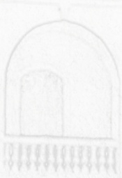

<!-- page 1 -->

# AVIS AU PUBLIC

——

Dans la poursuite des efforts pour discipliner le marché financier et inciter à des comportements plus responsables tant au plan du système de paiements qu'au niveau des remboursements de crédit, la Banque de la République d'Haïti (BRH) avise le public en général, les usagers et débiteurs du système financier en particulier que selon la réglementation en vigueur :

1) l'un de ses départements dénommé Bureau d'Information sur le Crédit (BIC), assure régulièrement au niveau de sa base de données, la collecte et le stockage d'informations sur les incidents de paiement par chèques et sur le crédit à la clientèle de toutes les institutions financières de crédit régulées et supervisées par la BRH;

2) toute personne qui, sur une période de douze (12) mois, émet cinq chèques impayés et retournés pour insuffisance de fonds est frappée d'interdiction de chéquier pour une période d'une année;

3) tout débiteur d'institutions financières de crédit susmentionnées qui a accusé des échéances arriérées de plus de 90 jours, tombe dans la catégorie des débiteurs non productifs ou en situation de retard de paiement prolongé assimilable à des incidents de paiement répétés ou à une accumulation d'échéances impayées.

Port-au-Prince, le 03 août 2026

Ronald Gabriel

Gouverneur
