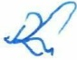

<!-- page 1 -->

# AUX INSTITUTIONS FINANCIÈRES

Conformément aux articles 87 et 179 de la loi du 14 mai 2012 portant sur les banques et autres institutions financières, à l'article 69 du décret du 5 juin 2020 portant sur l'organisation et le fonctionnement des Institutions de Microfinance (IMF), à l'article 12 de la loi du 26 juin 2002 portant sur la constitution, l'organisation, le contrôle et la surveillance des Coopératives d'Epargne et de Crédit (CEC) et des fédérations de coopératives d'épargne et de crédit, la présente circulaire détermine les conditions de transmission des informations sur les crédits octroyés aux clients des institutions financières au Bureau d'Information sur le Crédit (BIC) mis en place par la Banque de la République Haïti (BRH).

1.- Dans le cadre de la présente circulaire, on entend par :

Institution financière : toute institution agréée par la BRH et affiliée au BIC, notamment : les banques, les sociétés de carte de crédit, les sociétés financières de développement, les sociétés de crédit-bail, les coopératives d'épargne et de crédit, les institutions de microfinance, et toute autre institution désignée par la BRH.

Filiale de banque : toute entreprise contrôlée par une banque, soit par un apport en capital de plus de 50%, soit par la détention de droits de vote de plus de 50%, soit par un intérêt déterminant permettant à la banque d'exercer un contrôle effectif sur la gestion ou la politique de ladite filiale.

2.- Les institutions financières sont tenues de transmettre au BIC, au plus tard le dix (10) de chaque mois, les informations du mois précédent concernant tous les crédits accordés à leurs clients (personne physique ou morale). Sont inclus à ce titre : tous les prêts, avances de fonds, acceptations ou toute autre créance (bilan et hors-bilan) avec ou sans garantie qui constituent le portefeuille de crédit. Ces informations doivent être communiquées sous format électronique.

3.- Les institutions financières tirées sont tenues de notifier automatiquement le BIC de toutes informations sur les chèques retournés pour insuffisance de fonds émis par des personnes physiques ou morales, quel que soit leur statut.

De plus, elles doivent transmettre au BIC un rapport mensuel sur cesdits chèques, au plus tard, le dix (10) du mois suivant.

4.- Les informations requises dans le cadre de la présente circulaire doivent être transmises par toutes les institutions financières quelle que soit leur taille ou la nature de leurs activités, conformément aux spécifications et au format annexés à la présente. Les informations obligatoires figurant à l'annexe 2 doivent être collectées pour tout nouveau crédit et tout chèque retourné pour insuffisance de fonds.

<!-- page 2 -->

## Banque de la République d'Haïti

5.- Les institutions financières doivent en outre :

a) corriger tout renseignement qui se révélerait erroné concernant une personne physique ou morale dans un délai de cinq (5) jours ouvrables à compter de la date de réception de la requête relative à la correction :

b) utiliser les données et les systèmes d'informations du BIC en bon père de famille et conformément aux bonnes pratiques internationales ;

c) créer à leurs propres frais des conditions propices à la collecte, au traitement et à la soumission des informations ;

d) tenir à jour les informations sur les crédites concernant les personnes physiques ou morales détenues par elles ;

e) sécuriser les informations collectées et transmises au BIC.

6.-Toutes les institutions financières sont tenues de soumettre des informations réelles, exactes, à jour et complètes.

En cas de transmission d'informations se révélant fausses, inexactes, ou périmées, la BRH se réserve le droit d'appliquer des sanctions à leur encontre conformément aux lois et règlements en vigueur.

Toute transmission partielle d'informations par une institution financière sera considérée comme un défaut de transmission et pénalisée conformément aux dispositions de la présente circulaire.

7.- À compter du 15 octobre 2025, les institutions financières doivent obtenir, pour toute nouvelle demande de crédit, le consentement dûment signé du candidat à l'emprunt autorisant les échanges à tout moment, des informations de crédit personnelles et financières, avec le BIC ou tout autre bureau de crédit légalement habilité à exercer en Haïti ou à l'étranger.

De plus, les institutions financières sont tenues d'intégrer, dans tout nouveau contrat de crédit, une clause de consentement exprès de l'emprunteur autorisant la transmission de ses données au BIC ou tout autre bureau de crédit légalement habilité à exercer en Haïti ou à l'étranger. Ce consentement, recueilli au moment de la conclusion du contrat, fait partie intégrante de celui-ci et demeure valable jusqu'à l'extinction complète des obligations de l'emprunteur.

8.- Il est fait obligation à toutes les institutions financières de consulter et de garder une copie du rapport de crédit de tout client aux fins de l'évaluation des risques lors de :

a) l'octroi, le renouvellement, le suivi, et la prolongation de crédit ;

b) la modification des termes d'un contrat de crédit ;

c) l'attribution des moyens de paiement.

Les informations apparaissant dans les rapports de crédit ne peuvent être utilisées à des fins de prospection commerciale ou de marketing.

Le rapport de crédit a un délai de validité d'un (1) mois à compter de la date à laquelle il a été généré.

9.- En cas de non-respect des dispositions de la présente circulaire, les institutions financières visées s'exposent aux pénalités suivantes :

<!-- page 3 -->

#### 9.1. Retard de transmission

A défaut de transmettre toutes les informations exigées dans le délai établi à l'article 2 de la présente circulaire, l'institution financière est assujettie jusqu'au 15° jour du mois à une amende de cent mille gourdes (HTG 100,000.00) par jour de retard s'il s'agit d'une banque ou d'une filiale de banque. Le montant de l'amende est de cinquante mille gourdes (HTG 50,000.00) par jour de retard pour toute autre catégorie d'institution financière.

Au-delà du quinzième jour du mois, l'institution financière est assujettie à une amende de cent cinquante mille gourdes (HTG 150,000.00) par jour de retard s'il s'agit d'une banque ou d'une filiale de banque, et de soixante-quinze mille gourdes (HTG 75,000.00) par jour de retard pour toute autre catégorie d'institution financière, et ce jusqu'à la transmission complète des informations requises au BIC.

#### 9.2. Retard de correction

A défaut de ne pas corriger les informations sollicitées par le BIC dans les délais établis, l'institution financière est assujettie, s'il s'agit d'une banque ou d'une filiale de banque, à une amende de cinquante mille gourdes (HTG 50,000.00) par jour d'infraction à compter de la date à laquelle l'infraction a été notifiée. Cette amende est de vingt-cinq mille gourdes (HTG 25,000.00) par jour d'infraction pour toute autre catégorie d'institution financière.

#### 9.3. Absence de rapports de crédit

Au cas où la BRH constate, lors d'une inspection, l'absence de rapport de crédit dans le dossier d'un client, l'institution financière concernée sera sanctionnée d'une amende de deux cent mille gourdes (HTG 200,000.00) pour chaque cas constaté.

#### 9.4. Absence de consentement au partage d'information

Au cas où la BRH constate, lors d'une inspection, ou en d'autres circonstances, l'absence de consentement au partage d'informations de crédit dûment signé dans le dossier d'un client tel qu'exigé à la section 7 de la présente circulaire, l'institution financière concernée sera assujettie à une amende de deux cent mille gourdes (HTG 200,000.00) pour chaque absence relevée.

#### 9.5. Autres infractions

Pour toute autre infraction constatée, la BRH exigera la cessation immédiate de la pratique incriminée, prendra des sanctions administratives notamment par une lettre de blâme à l'encontre de l'institution fautive et pourra appliquer, pour chaque fait relevé, une amende de deux cent mille gourdes (HTG 200,000.00).

10.- Toute amende sera automatiquement prélevée sur l'un des comptes à la BRH de l'institution fautive. Le paiement de toute amende par une institution financière non-détentrice de compte à la BRH se fera par chèque de direction à l'ordre de la Banque de la République d'Haïti, au plus tard

<!-- page 4 -->

## Banque de la République d'Haïti

cinq (5) jours ouvrables, après réception de l'avis lui exigeant le paiement. En cas de non-paiement dans les délais requis, une pénalité de deux mille cinq cents gourdes (HTG 2,500.00) sera appliquée par jour de retard.

11.- Toute institution nouvellement affiliée au BIC bénéficie d'une période de grâce de quatre (4) mois à compter de la date de son affiliation. Durant cette période, elle n'est pas assujettie aux pénalités normalement applicables. Passé ce délai, l'application des sanctions suivra les dispositions en place.

12.- La présente circulaire abroge la circulaire 105-1 en date du 3 avril 2017 et entre en vigueur le 15 octobre 2025.

Port-au-Prince, le 15 septembre 2025.

Ronald Gabriel Gouverneur

Liste des annexes :

Annexe 1 - Spécifications pour le transfert des fichiers

Annexe 2 - Spécifications des fichiers de collecte des données

Annexe 3 - Données de référence

<!-- page 5 -->

# A) SPÉCIFICATIONS POUR LE TRANSFERT DES FICHIERS

### 1. INTRODUCTION

Pour le transfert des fichiers, les institutions financières doivent tenir compte des présentes spécifications qui constituent les principaux détails techniques nécessaires à l'établissement d'une connexion au serveur de fichiers en utilisant le protocole de transfert sécurisé pour la transmission des fichiers.

Le système d'exploitation installé sur le serveur offre un niveau de sécurité élevé.

### 2. CONNECTIVITÉ SFTP

L’adresse IP du serveur SFTP/SSH doit être configurée sur le poste client de l’institution comme adresse de destination pour pouvoir transférer les fichiers. Il est important de souligner que toute institution financière doit préalablement avoir une liaison  $ VPN^{1} $,  $ WIMAX^{2} $, Fibre optique,  $ VSAT^{3} $ avec la BRH et que le routage et les règles d’accès au serveur soient bien définis, configurés, testés et certifiés par la BRH.

Tous les fichiers déposés dans les répertoires doivent avoir des noms uniques qui suivent la nomenclature définie par la BRH (voir document de spécification des fichiers de collecte de données).

### 3. PROCESSUS DE TRANSMISSION

Toute institution financière doit s'assurer que la liaison est bien établie avant de démarrer toute transmission. Une fois la connexion établie, il faut lancer le logiciel de transfert de fichiers, partie client (SSH Secure File Transfer, WinSCP, Filezilla, etc.).

Pour se connecter au serveur de la BRH, l'institution financière doit remplir les champs nom d'utilisateur, mot de passe, adresse IP du serveur et numéro de port. Ces informations seront communiquées aux institutions par la BRH.

Une authentification réussie place l'institution financière dans le répertoire qui lui est destiné. Tout accès est enregistré dans le registre de log.

### 4. RÉPERTOIRES

Le BIC utilise une nomenclature pour nommer les répertoires de chaque institution financière affiliée.

Aucune institution financière n'est autorisée à consulter le contenu ou à accéder au répertoire d'une

autre institution.

<!-- page 6 -->

## B) SPÉCIFICATIONS DES FICHIERS DE COLLECTE DE DONNÉES

### 1. Entreprise/Responsable/Actionnaire/Crédit

Nom du fichier 1 : ent_resp_act_credit_ aaaammmjjtypedecredit.csv

Abréviation type de crédit :

| Prêt à Terme | PT |   | Carte de Crédit | CC |
| --- | --- | --- | --- | --- |
| Ligne de Crédit | LC |   | Micro Crédit Ligne | MCL |
| Micro Crédit | MC |   |   |   |

4 segments par enregistrement :

- Entreprise : segment obligatoire

- Responsable : segment obligatoire (à l'exception des cartes de crédit)

- Actionnaire : segment optionnel

- Crédit : segment obligatoire

<table><tr><td>Réf.</td><td>Champ</td><td>Type de données</td><td>Taille</td><td>Obligatoire</td><td>Description</td></tr><tr><td>Segment : ENTREPRISE</td></tr><tr><td>1.</td><td>Nom de l'entreprise</td><td>Char</td><td>2-75</td><td>✓</td><td>La dénomination de l'entreprise ou raison sociale de l'entreprise.</td></tr><tr><td>2.</td><td>Numéro de patente</td><td>Char</td><td>5-20</td><td></td><td>Le Numéro figurant sur le certificat de patente attribué par la Direction Générale des Impôts après paiement de l'impôt.</td></tr><tr><td>3.</td><td>Numéro d'identification fiscale de l'entreprise (NIF)</td><td>Char</td><td>10</td><td>✓\nSauf dans le cas où Forme Juridique [5] = 1000</td><td>Le numéro de la matricule fiscale délivrée par la Direction Générale des Impôts à une entreprise qui exerce une activité quelconque sur le territoire d'Haïti.</td></tr><tr><td>4.</td><td>Secteur d'activités</td><td>Code. Réf. Tableau 1</td><td></td><td>✓</td><td>Le code du secteur d'activités dans lequel une entreprise se trouve classifiée en fonction de ses activités.\nVoir tableau 1</td></tr></table>

<!-- page 7 -->

| 5. | Forme juridique | Code. Réf. Tableau 4 |   | ✓ | Le code permettant de catégoriser une entreprise.Voir tableau 4 |
| --- | --- | --- | --- | --- | --- |
| 6. | Téléphone 1 | Char | 8-11 |   | Le Numéro de téléphone affecté essentiellement aux activités de l'entreprise.Format : indicatif pays suivi du numéro de téléphone |
| 7. | Téléphone 2 | Char | 8-11 |   | Autre numéro de téléphone affecté aux activités de l'entreprise.Format : indicatif pays suivi du numéro de téléphone |
| 8. | Téléphone 3 | Char | 8-11 |   | Autre numéro de téléphone affecté aux activités de l'entreprise.Format : indicatif pays suivi du numéro de téléphone |
| 9. | Adresse | Char | 5-75 | ✓ | L'adresse du siège social de l'entrepriseNo, rue, quartier ou zone, code postal (Voir tableau 7) |
| 10. | Commune | Code. Réf. Tableau 2 |   | ✓ | Le code de la commune où se trouve l'entreprise suivant le code IHSI.Voir tableau 2 |
| 11. | Pays | Code. Réf. Tableau 3 |   | ✓ | Le code du pays où se trouve l'entreprise suivant le code international ISO.Voir tableau 3 |

<!-- page 8 -->

<table><tr><td>Segment : PERSONNE AUTORISEE A ENGAGER L'ENTREPRISE Ce segment n'est pas obligatoire pour les cartes de crédit. Mais si un des champs de ce segment est renseigné, les règles de validation relatives à ce segment doivent être respectées.</td></tr><tr><td>12.</td><td>Prénom</td><td>Char</td><td>2-45</td><td>✓</td><td>Le prénom de la personne autorisée à engager l'entreprise.</td></tr><tr><td>13.</td><td>Nom</td><td>Char</td><td>2-45</td><td>✓</td><td>Le nom de la personne autorisée à engager l'entreprise.</td></tr><tr><td>14.</td><td>Numéro d'identification fiscale (NIF)</td><td>Char</td><td>10</td><td></td><td>Le numéro de la matricule fiscale délivrée par la Direction Générale des Impôts à une personne physique qui exerce une activité quelconque sur le territoire d'Haïti. Format : xxxxxxxxxxx</td></tr><tr><td>15.</td><td>CIN</td><td>Char</td><td>14 ou 17</td><td></td><td>Le Numéro figurant sur la Carte d'Identification Nationale. Format : xxxxxxxxxxxxxxxxx</td></tr><tr><td>16.</td><td>Numéro de permis de conduire</td><td>Char</td><td>1-20</td><td></td><td>Le Numéro de dossier du permis de conduire Format : xxxxxxxx</td></tr><tr><td>17.</td><td>Numéro de passeport</td><td>Char</td><td>7-25</td><td></td><td>Le Numéro du passeport</td></tr><tr><td>18.</td><td>Adresse</td><td>Char</td><td>5-75</td><td>✓</td><td>L'adresse du domicile de la personne autorisée à engager l'entreprise : No, rue, quartier ou zone, code postal</td></tr><tr><td>19.</td><td>Commune</td><td>Code. Réf. Tableau 2</td><td></td><td>✓</td><td>Le code de la commune du domicile de la personne autorisée suivant le code IHSI Voir tableau 2</td></tr><tr><td>20.</td><td>Pays de la personne autorisée</td><td>Code. Réf. Tableau 3</td><td></td><td>✓</td><td>Le code du pays du domicile de la personne autorisée suivant le code international ISO Voir tableau 3</td></tr></table>

<!-- page 9 -->

<table><tr><td>Segment: ACTIONNAIRECe segment n'est pas obligatoire. Mais si un des champs de ce segment est renseigné, les règles de validation relatives à ce segment doivent être respectées.</td></tr><tr><td>21.</td><td>Prénom</td><td>Char</td><td>2-45</td><td></td><td>Le(s) prénom(s) d'un actionnaire de l'entreprise</td></tr><tr><td>22.</td><td>Nom</td><td>Char</td><td>2-45</td><td></td><td>Le nom d'un actionnaire de l'entreprise</td></tr><tr><td>23.</td><td>Numéro d'identification fiscale de l'actionnaire (NIF)</td><td>Char</td><td>10</td><td></td><td>Le numéro d'identification fiscale de l'actionnaire</td></tr><tr><td>24.</td><td>CIN</td><td>Char</td><td>10, 14 ou 17</td><td></td><td>Le numéro de la carte d'identification fiscale de l'actionnaire</td></tr><tr><td>25.</td><td>Numéro de permis de conduire</td><td>Char</td><td>1-20</td><td></td><td>Le numéro de dossier du permis de conduire de l'actionnaire</td></tr><tr><td>26.</td><td>Numéro de passeport</td><td>Char</td><td>7-25</td><td></td><td>Le numéro du passeport de l'actionnaire</td></tr><tr><td>27.</td><td>Adresse</td><td>Char</td><td>5-75</td><td></td><td>L'adresse où réside l'actionnaire : No, rue, quartier ou zone, code postal</td></tr><tr><td>28.</td><td>Commune</td><td>Code. Réf. Tableau 2</td><td></td><td></td><td>Le code de la commune où réside l'actionnaire suivant le code IHSI. Voir tableau 2</td></tr><tr><td>29.</td><td>Pays</td><td>Code. Réf. Tableau 3</td><td></td><td></td><td>Le code du pays où réside l'actionnaire suivant le code international ISO. Voir tableau 3</td></tr></table>

<!-- page 10 -->

<table><tr><td>Segment: CREDIT</td></tr><tr><td>30.</td><td>Numéro du prêt</td><td>Char</td><td>5-45</td><td>✓</td><td>Le numéro attribué au prêt</td></tr><tr><td>31.</td><td>Type de prêt</td><td>Code. Réf. Liste</td><td></td><td>✓</td><td>Le code du type de prêt.Liste des types de prêt:PCN: Prêt à la consommationPLT: Prêt au logementPCL: Prêt commercialLC: Ligne de créditPC-CC: Carte de créditPC-ED: Prêt à l'éducationPL-AG: Prêt agricolePL-CB: Crédit-bailPRI: Prêt industriel</td></tr><tr><td>32.</td><td>Classification/Statut du prêt</td><td>Code. Réf. Liste</td><td></td><td>✓Seule l'information sur la classification est obligatoire.</td><td>La classification et le statut du prêt:Liste des classifications:COURANT A SIGNALERFAIBLEDOUTEUXPERTEFERMEListe des statuts:Code.Réf. Tableau 9Format: Classification/Statut Ex: FERME/P-050</td></tr><tr><td>33.</td><td>Périodicité</td><td>Number</td><td>2-3</td><td>✓</td><td>La fréquence de paiement en nombre de jours calendaires.</td></tr><tr><td>34.</td><td>Date d'octroi</td><td>Date</td><td>8</td><td>✓</td><td>La date d'octroi du prêtFormat: aaaammmjj</td></tr><tr><td>35.</td><td>Date fermeture ou date de maturité</td><td>Date</td><td>8</td><td>✓</td><td>La date de fermeture du prêt si le prêt est fermé.La date de maturité du prêt dans les autres cas.Format: aaaammmjj</td></tr><tr><td>36.</td><td>Montant autorisé / accordé</td><td>Number</td><td>14.2</td><td>✓</td><td>Le montant autorisé pour le prêtFormat: 9999999999999.99</td></tr></table>

<!-- page 11 -->

| 37. | Devise | Code.\nRéf.\nListe |   | ✓ | Le code de la devise utilisée pour octroyer le prêt.\n\nListe des devises :\nHTG : Gourde\nUSD : dollar américain |
| --- | --- | --- | --- | --- | --- |
| 38. | Période de grâce | Number | 1-3 |   | Délai accordé à l’emprunteur avant le premier amortissement (sursis) en nombre de jours calendaires. |
| 39. | Personne de référence | Char | 1-75 |   | Le prénom et le nom de la personne de référence |
| 40. | Responsabilité\nenvers le crédit | Code.\nRéf.\nListe |   | ✓ | Le code définissant la relation entre le client et le crédit.\n\nVoir tableau 10 |

N.B.: Il faut préciser au moins un numéro d'identification pour les individus (NIF, CIN, permis de conduire ou passeport).

<!-- page 12 -->

### 2. Individu/Emploi/Crédit

Nom du fichier 2 : ind_emp_credit_aaaammmjjtypedecredit.csv

Abréviation type de crédit :

| Prêt à Terme | PT |   | Carte de Crédit | CC |
| --- | --- | --- | --- | --- |
| Ligne de Crédit | LC |   | Micro Crédit Ligne | MCL |
| Micro Crédit | MC |   |   |   |

3 segments par enregistrement :

- Individu : segment obligatoire

- Emploi : segment optionnel

- Crédit : segment obligatoire

<table><tr><td>Ref.</td><td>Champ</td><td>Type de données</td><td>Taille</td><td>Obligatoire</td><td>Description</td></tr><tr><td>Segment : INDIVIDU</td></tr><tr><td>1.</td><td>Prénom</td><td>Char</td><td>2-45</td><td>✓</td><td>Le(s) prénom(s) de l'individu</td></tr><tr><td>2.</td><td>Nom</td><td>Char</td><td>2-45</td><td>✓</td><td>Le nom de l'individu</td></tr><tr><td>3.</td><td>Nom complet à la naissance</td><td>Char</td><td>2-60</td><td></td><td>Nom de jeune fille pour une femme ou nom d'une personne physique à sa naissance en cas de changement de patronyme.</td></tr><tr><td>4</td><td>Nom de jeune fille de la mère</td><td></td><td>2-60</td><td></td><td>Le nom de jeune fille de la mère de l'individu.</td></tr><tr><td>5.</td><td>Numéro d'identification fiscale (NIF)</td><td>Char</td><td>10</td><td></td><td>Le numéro de la matricule fiscale délivrée par la Direction Générale des Impôts à une personne physique qui exerce une activité quelconque sur le territoire d'Haïti. Format : xxxxxxxxxx</td></tr><tr><td>6.</td><td>CIN</td><td>Char</td><td>10,14 ou 17</td><td></td><td>Le numéro de la Carte d'Identification Nationale Format : xxxxxxxxxx</td></tr></table>

<!-- page 13 -->

| 7. | Numéro de passeport | Char | 7-25 |   | Le numéro du passeport |
| --- | --- | --- | --- | --- | --- |
| 8. | Numéro de permis de conduire | Char | 1-20 |   | Numéro de dossier du permis de conduireFormat : XXXXXXX |
| 9. | Date de naissance | Char | 8 | ✓ | La date de naissance suivant le format : aaaammmjj |
| 10. | Commune de naissance | Code. Réf. Tableau 2 ou Tableau 3 |   |   | Le code de la commune (lieu) où est né l'individu suivant le code IHSI. Pour un étranger, il faut mettre le code du pays.Voir tableau 2 ou tableau 3 |
| 11. | Etat civil | Code. Réf. Liste |   | ✓ | Le code du statut marital de l'individu.Liste des codes :C=célibataire, D=divorcé, M=marié, S=séparé, U= concubinage, V=veuf, |
| 12. | Sexe | Code. Réf. Liste |   | ✓ | Le sexe de l'individuListe des codes :F=Féminin, M=Masculin |
| 13. | Profession | Code. Réf. Tableau 8 |   |   | Le code de la profession qu'exerce l'individu.Voir tableau 8 |
| 14. | Téléphone 1 | Char | 8-11 |   | Le numéro de téléphoneFormat : indicatif pays suividu numéro de téléphone |
| 15. | Téléphone 2 | Char | 8-11 |   | Le numéro de téléphoneFormat : indicatif pays suividu numéro de téléphone |
| 16. | Téléphone 3 | Char | 8-11 |   | Le numéro de téléphoneFormat : indicatif pays suividu numéro de téléphone |
| 17. | Adresse | Char | 5-75 | ✓ | Domicile de l'individu :Numéro, rue, quartier, code postal |

<!-- page 14 -->

<table><tr><td>18.</td><td>Commune</td><td>Code. Réf. Tableau 2</td><td></td><td>✓</td><td>Le code de la commune suivant le code IHSIVoir tableau 2</td></tr><tr><td>19.</td><td>Pays</td><td>Code. Réf. Tableau 3</td><td></td><td>✓</td><td>Le code du pays suivant le code international ISO.Voir tableau 3</td></tr><tr><td>Segment : EMPLOICe segment n'est pas obligatoire. Mais si un des champs de ce segment est renseigné, les règles de validation relatives à ce segment doivent être respectées.</td></tr><tr><td>20.</td><td>Nom de l'employeur</td><td>Char</td><td>2-45</td><td>✓</td><td>Le nom de l'employeur où travaille l'individu. Si l'employeur est une personne physique, mettre le prénom et le nom de cette personne.</td></tr><tr><td>21.</td><td>Date d'embauche</td><td>Date</td><td>8</td><td>✓</td><td>La date de recrutement de la personne.format : aaaammjj</td></tr><tr><td>22.</td><td>Date de vérification de l'emploi</td><td>Date</td><td>8</td><td></td><td>La date de vérification de l'emploi de l'individu.Format : aaaammjj</td></tr><tr><td>23.</td><td>Poste occupé</td><td>Char</td><td>5-45</td><td>✓</td><td>La position assignée par l'employeur à l'individu.</td></tr><tr><td>24.</td><td>Salaire</td><td>Number</td><td>14.2</td><td>✓</td><td>Le salaire de l'individuFormat : 9999999999999.99</td></tr><tr><td>25.</td><td>Devise</td><td>Code. Réf. Liste</td><td></td><td>✓</td><td>Le code de la devise dans laquelle le salaire est versé.Liste des devises :HTG : GourdeUSD : Dollar américain</td></tr><tr><td>26.</td><td>Téléphone 1</td><td>Char</td><td>8-11</td><td></td><td>Le numéro de téléphone de l'employeurFormat : indicatif pays suividu numéro de téléphone</td></tr><tr><td>27.</td><td>Téléphone 2</td><td>Char</td><td>8-11</td><td></td><td>Le numéro de téléphone de l'employeurFormat : indicatif pays suividu numéro de téléphone</td></tr><tr><td>28.</td><td>Adresse</td><td>Char</td><td>5-75</td><td>✓</td><td>L'adresse du Siège social de l'entreprise :No, rue, quartier ou zone, code postal</td></tr></table>

<!-- page 15 -->

<table><tr><td>29.</td><td>Commune</td><td>Code. Réf. Tableau 2</td><td></td><td>✓</td><td>Le code de la commune de l'employeur suivant le code IHSI.Voir tableau 2</td></tr><tr><td>30.</td><td>Pays</td><td>Code. Réf. Tableau 3</td><td></td><td>✓</td><td>Le code du pays de l'employeur suivant le code internationalVoir tableau 3</td></tr><tr><td>Segment: CREDIT</td></tr><tr><td>31.</td><td>Numéro du prêt</td><td>Char</td><td>5-45</td><td>✓</td><td>Le numéro attribué au prêt</td></tr><tr><td>32.</td><td>Type de prêt</td><td>Code. Réf. Liste</td><td></td><td>✓</td><td>Le code du type de prêt.Liste des types de prêt:PCN: Prêt à la consommationPLT: Prêt au logementPCL: Prêt commercialLC: Ligne de créditPC-CC: Carte de créditPC-ED: Prêt à l'éducationPL-AG: Prêt agricolePL-CB: Crédit-bailPRI: Prêt industriel</td></tr><tr><td>33.</td><td>Classification / Statut du prêt</td><td>Code. Réf. Liste</td><td></td><td>✓</td><td>La classification et le statut du prêt:Liste des classifications :COURANT A SIGNALERFAIBLEDOUTEUXPEREFEMListe des statuts :Code.Réf. Tableau 9Format: Classification/StatutEx: FERME/P-052</td></tr><tr><td>34.</td><td>Périodicité</td><td>Number</td><td>2-3</td><td>✓</td><td>La fréquence de paiement en nombre de jours calendaires.</td></tr><tr><td>35.</td><td>Date d'octroi</td><td>Date</td><td>8</td><td>✓</td><td>La date d'octroi du prêtFormat: aaaaammjj</td></tr></table>

<!-- page 16 -->

| 36. | Date fermeture ou date de maturité | Date | 8 | ✓ | La date de fermeture du prêt si le prêt est fermé.\nLa date de maturité du prêt dans les autres cas.\nFormat : aaaammjj |
| --- | --- | --- | --- | --- | --- |
| 37. | Montant autorisé / accordé | Number | 14.2 | ✓ | Le montant autorisé pour le prêt\nFormat : 9999999999999.99 |
| 38. | Devise | Code.\nRéf.\nListe |   | ✓ | Le code de la devise utilisée pour octroyer le prêt.\nListe des devises : HTG : Gourde\nUSD : dollar américain |
| 39. | Période de grâce | Number | 1-3 |   | Délai accordé à l’emprunteur avant le premier amortissement (sursis) en nombre de jours calendaires. |
| 40. | Personne de référence | Char | 1-75 |   | Le prénom et le nom de la personne de référence |
| 41. | Responsabilité envers le crédit | Code.\nRéf.\nListe |   | ✓ | Le code correspondant à la responsabilité du client envers le crédit.\nVoir tableau 10 |

N.B.: Il faut préciser au moins un numéro d'identification pour les individus (NIF, CIN, permis de conduire ou passeport).

<!-- page 17 -->

### 3. Crédit/Garantie

Nom du fichier 3 : credit_surete_aaaammmjjtypedecredit.csv

Abréviation type de crédit :

| Prêt à Terme | PT |   | Carte de Crédit | CC |
| --- | --- | --- | --- | --- |
| Ligne de Crédit | LC |   | Micro Crédit Ligne | MCL |
| Micro Crédit | MC |   |   |   |

2 segments par enregistrement :

- Réf. Crédit

: segment obligatoire

- Sûreté

: segment obligatoire

<table><tr><td>Ref.</td><td>Champ</td><td>Type de données</td><td>Taille</td><td>Obligatoire</td><td>Description</td></tr><tr><td>Segment : REFERENCE AU CREDIT</td></tr><tr><td>1.</td><td>Numéro du prêt</td><td>Char</td><td>5-45</td><td>✓</td><td>Le numéro du prêt. Pour la carte de crédit un code unique identifiant la carte.</td></tr><tr><td>Segment : SURETE</td></tr><tr><td>2.</td><td>Type de sureté</td><td>Code. Réf. Tableau 5</td><td></td><td>✓</td><td>Le code du type de sureté Voir tableau 5</td></tr><tr><td>3.</td><td>Valeur de la sureté</td><td>Number</td><td>14.2</td><td></td><td>Le montant de la sureté Format : 9999999999999.99</td></tr><tr><td>4.</td><td>Devise</td><td>Code. Réf. Liste</td><td></td><td></td><td>Le code de la devise dans laquelle la sureté a été donnée. Liste des devises : HTG : Gourde USD : Dollar américain Si la valeur de la sureté n'est pas renseignée, il faut ajouter le code 00 pour ce champ.</td></tr><tr><td>5.</td><td>Nature de la garantie</td><td>Code. Réf. Tableau 6</td><td></td><td>✓</td><td>Le code de la nature de la garantie Voir tableau 6</td></tr><tr><td>6.</td><td>Numéro de référence de la sureté</td><td>Char</td><td>1-30</td><td>✓</td><td>Le code attribué à la sureté donnée.</td></tr></table>

<!-- page 18 -->

### 4. Crédit/Activité

Nom du fichier 4 : credit_activite_aaaammjjtypedecredit.csv

Abréviation type de crédit :

| Prêt à Terme | PT |   | Carte de Crédit | CC |
| --- | --- | --- | --- | --- |
| Ligne de Crédit | LC |   | Micro Crédit Ligne | MCL |
| Micro Crédit | MC |   |   |   |

2 segments par enregistrement :

- Réf. Crédit : segment obligatoire

- Activité : segment obligatoire

<table><tr><td>Ref.</td><td>Champ</td><td>Type de données</td><td>Taille</td><td>Obligatoire</td><td>Description</td></tr><tr><td>Segment : REFERENCE AU CREDIT</td></tr><tr><td>1.</td><td>Numéro du prêt</td><td>Char</td><td>5-45</td><td>✓</td><td>Le numéro du prêt. Pour la carte de crédit, un code unique identifiant la carte concaténée avec la devise de la garantie. Ex: 13010000239*4567/HTG 13010000239*2345/USD</td></tr><tr><td>Segment : ACTIVITES DE PAIEMENT</td></tr><tr><td>2.</td><td>Date de paiement / Date limite de paiement</td><td>Date</td><td>8</td><td>✓</td><td>La date à laquelle le paiement est dû. Format : aaaammjj</td></tr><tr><td>3.</td><td>Montant du paiement / Montant minimum à payer</td><td>Number</td><td>14.2</td><td>✓</td><td>Le montant du paiement dû Format : 9999999999999.99</td></tr><tr><td>4.</td><td>Date effective du paiement</td><td>Date</td><td>8</td><td>✓</td><td>La date à laquelle le paiement a été effectué. Format : aaaammjj</td></tr><tr><td>5.</td><td>Montant du paiement effectué</td><td>Number</td><td>14.2</td><td>✓</td><td>Le montant du paiement effectivement versé. Format : 9999999999999.99</td></tr></table>

<!-- page 19 -->

| 6. | Balance courante / Solde de fin de cycle | Number | 14.2 | ✓ | La balance du prêt. Pour une carte de crédit, ce sera la balance courante ou le solde de fin de cycle. Pour une ligne de crédit, ce sera le montant utilisé. Format : 9999999999999.99 |
| --- | --- | --- | --- | --- | --- |

<!-- page 20 -->

### 5. Entreprise/Chèques retournés pour insuffisance de fonds

Nom du fichier 5 : ent $ \underline{l} $cheque $ \underline{l} $aaaammjj.csv

2 segments par enregistrement :

- Entreprise

: segment obligatoire

- Chèque

: segment obligatoire

<table><tr><td>Ref.</td><td>Champ</td><td>Type de données</td><td>Taille</td><td>Obligatoire</td><td>Description</td></tr><tr><td>Segment : ENTREPRISE</td></tr><tr><td>1.</td><td>Nom de l'entreprise</td><td>Char</td><td>2-75</td><td>✓</td><td>La dénomination de l'entreprise ou raison sociale de l'entreprise.</td></tr><tr><td>2.</td><td>Numéro de patente de l'entreprise</td><td>Char</td><td>5-20</td><td></td><td>Le Numéro figurant sur le certificat de patente attribué par la Direction Générale des Impôts après paiement de l'entreprise.</td></tr><tr><td>3.</td><td>Numéro d'identification fiscale de l'entreprise (NIF)</td><td>Char</td><td>10</td><td>✓</td><td>Le numéro de la matricule fiscale délivrée par la Direction Générale des Impôts à une entreprise qui exerce une activité quelconque sur le territoire d'Haïti.</td></tr><tr><td>4.</td><td>Secteur d'activités de l'entreprise</td><td>Code. Réf. Tableau 1</td><td></td><td>✓</td><td>Le code du secteur d'activités dans lequel une entreprise se trouve classifiée en fonction de ses activités. Voir tableau 1</td></tr><tr><td>5.</td><td>Forme Juridique</td><td>Code. Réf. Tableau 4</td><td></td><td>✓</td><td>Le code permettant de catégiser une entreprise. Voir tableau 4</td></tr><tr><td>6.</td><td>Téléphone 1 de l'entreprise</td><td>Char</td><td>20</td><td></td><td>Le numéro de téléphone affecté essentiellement aux activités de l'entreprise. Format : indicatif pays suivi du numéro de téléphone.</td></tr><tr><td>7.</td><td>Téléphone 2 de l'entreprise</td><td>Char</td><td>20</td><td></td><td>Autre numéro de téléphone affecté aux activités de l'entreprise. Format : indicatif pays suivi du numéro de téléphone</td></tr></table>

<!-- page 21 -->

<table><tr><td>8.</td><td>Téléphone 3 de l'entreprise</td><td>Char</td><td>20</td><td></td><td>Autre numéro de téléphone affecté aux activités de l'entreprise. Format : indicatif pays suivi du numéro de téléphone</td></tr><tr><td>9.</td><td>Adresse de l'entreprise</td><td>Char</td><td>75</td><td>✓</td><td>L'adresse du siège social de l'entreprise : Numéro, rue, quartier ou zone, code postal (Voir tableau 7)</td></tr><tr><td>10.</td><td>Commune de l'entreprise</td><td>Code. Réf. Tableau 2</td><td></td><td>✓</td><td>Le code de la commune où se trouve l'entreprise suivant le code IHSI Voir tableau 2</td></tr><tr><td>11.</td><td>Pays de l'entreprise</td><td>Code. Réf. Tableau 3</td><td></td><td>✓</td><td>Le code du pays où se trouve l'entreprise suivant le code international ISO. Voir tableau 3</td></tr><tr><td>Segment : CHEQUE</td></tr><tr><td>12.</td><td>Numéro de compte</td><td>Char</td><td>4-45</td><td>✓</td><td>Le numéro de compte utilisé par l'entreprise.</td></tr><tr><td>13.</td><td>Numéro du chèque retourné</td><td>Char</td><td>1-10</td><td>✓</td><td>Le numéro du chèque retourné pour manque de fonds</td></tr><tr><td>14.</td><td>Montant du chèque</td><td>Number</td><td>14.2</td><td>✓</td><td>Le montant du chèque retourné pour manque de fonds Format : 9999999999999.99</td></tr><tr><td>15.</td><td>Devise</td><td>Code. Réf. Liste</td><td></td><td>✓</td><td>Le code de la devise dans laquelle le chèque est émis. Liste des devises : HTG : gourde USD : dollar américain</td></tr><tr><td>16.</td><td>Date de retour</td><td>Date</td><td>8</td><td>✓</td><td>La date de retour du chèque pour manque de fonds Format : aaaammjj</td></tr><tr><td>17.</td><td>Date d'émission</td><td>Date</td><td>8</td><td>✓</td><td>La date à laquelle le chèque a été émis Format : aaaammjj</td></tr><tr><td>18.</td><td>Nom du bénéficiaire</td><td>Char</td><td>75</td><td>✓</td><td>Le nom de l'entreprise ou de l'individu ayant reçu le chèque.</td></tr></table>

<!-- page 22 -->

### 6. Individu/Chèques retournés pour insuffisance de fonds

Nom du fichier 6 : ind $ \underline{c} $heque $ \underline{a} $aaammjj.csv

2 segments par enregistrement :

- Individu

: segment obligatoire

- Chèque : segment obligatoire

<table><tr><td>Ref.</td><td>Champ</td><td>Type de données</td><td>Taille</td><td>Obligatoire</td><td>Description</td></tr><tr><td>Segment : INDIVIDU</td></tr><tr><td>1.</td><td>Prénom</td><td>Char</td><td>2-45</td><td>✓</td><td>Le prénom de l'individu</td></tr><tr><td>2.</td><td>Nom</td><td>Char</td><td>2-45</td><td>✓</td><td>Le nom de l'individu</td></tr><tr><td>3.</td><td>Nom à la naissance</td><td>Char</td><td>2-60</td><td></td><td>Le nom de jeune fille pour une femme ou nom d'une personne physique à sa naissance en cas de changement de patronyme.</td></tr><tr><td>4.</td><td>Nom de jeune fille de la mère</td><td>Char</td><td>2-60</td><td></td><td>Le nom de jeune fille de la mère de l'individu</td></tr><tr><td>5.</td><td>Numéro d'identification fiscale (NIF)</td><td>Char</td><td>10</td><td></td><td>Le numéro de la matricule fiscale délivrée par la Direction Générale des Impôts à une personne physique qui exerce une activité quelconque sur le territoire d'Haïti. Format: xxxxxxxxxxx</td></tr><tr><td>6.</td><td>CIN</td><td>Char</td><td>10, 14 ou 17</td><td></td><td>Le numéro figurant sur la Carte d'Identification Nationale Format: xxxxxxxxxxx</td></tr><tr><td>7.</td><td>Numéro de passeport</td><td>Char</td><td>7-25</td><td></td><td>Numéro du passeport Format: xxxxxxxxxx</td></tr><tr><td>8.</td><td>Numéro de permis de conduire</td><td>Char</td><td>1-20</td><td></td><td>Le numéro de dossier du permis de conduire.</td></tr><tr><td>9.</td><td>Date de naissance</td><td>Date</td><td>8</td><td>✓</td><td>La date de naissance de l'individu Format: aaaammjj</td></tr></table>

<!-- page 23 -->

| 10. | Commune de naissance | Code. Réf. Tableau 2 ou Tableau 3 |   |   | Le code de la commune (lieu) où est né l'individu suivant le code IHSI. Pour un étranger, il faut mettre le code du pays. Voir tableau 2 ou tableau 3 |
| --- | --- | --- | --- | --- | --- |
| 11. | Etat civil | Code. Réf. Liste |   | ✓ | Le code du statut marital de l'individu. Liste des codes : C=célibataire, D=divorcé, M=marié, S=séparé, U= concubinage, V=veuf. |
| 12. | Sexe | Code. Réf. Liste |   | ✓ | Le sexe de l'individu Liste des codes : F=Féminin, M=Masculin |
| 13. | Profession | Code. Réf. Tableau 8 |   |   | Le code de la profession qu'exerce l'individu Voir tableau 8 |
| 14. | Téléphone 1 | Char | 8-11 |   | Numéro de téléphone pour joindre l'individu\nFormat : indicatif pays suivit du numéro de téléphone |
| 15. | Téléphone 2 | Char | 8-11 |   | Autre numéro de téléphone pour joindre l'individu\nFormat : indicatif pays suivit du numéro de téléphone |
| 16. | Téléphone 3 | Char | 8-11 |   | Autre numéro de téléphone pour joindre l'individu\nFormat : indicatif pays suivit du numéro de téléphone |
| 17. | Adresse | Char | 5-75 | ✓ | L'adresse du domicile de l'individu.\nNo, rue, quartier ou zone, code postal |
| 18. | Commune | Code. Réf. Tableau 2 |   | ✓ | Le code de la commune suivant le code IHSI\nVoir tableau 2 |
| 19. | Pays | Code. Réf. Tableau 3 |   | ✓ | Le code du pays suivant code international ISO.\nVoir tableau 3 |

<!-- page 24 -->

<table><tr><td>Segment: CHEQUE</td></tr><tr><td>20.</td><td>Numéro de compte</td><td>Char</td><td>4-45</td><td>✓</td><td>Le numéro de compte bancaire sur lequel le chèque a été émis.</td></tr><tr><td>21.</td><td>Numéro chèque retourné</td><td>Char</td><td>1-10</td><td>✓</td><td>Le numéro du chèque retourné pour manque de fonds</td></tr><tr><td>22.</td><td>Montant du chèque</td><td>Number</td><td>14.2</td><td>✓</td><td>Le montant du chèque retourné pour manque de fonds</td></tr><tr><td>23.</td><td>Devise</td><td>Code. Réf. Liste</td><td></td><td>✓</td><td>Format : 9999999999999.99</td></tr><tr><td>24.</td><td>Date de retour</td><td>Date</td><td>8</td><td>✓</td><td>Le code de la devise dans laquelle le chèque a été émis</td></tr><tr><td>25.</td><td>Date d'émission</td><td>Date</td><td>8</td><td>✓</td><td>La date de retour du chèque pour manque de fonds</td></tr><tr><td>26.</td><td>Nom du bénéficiaire</td><td>Char</td><td>75</td><td>✓</td><td>La date à laquelle le chèque a été émis</td></tr></table>

N.B.: Il faut préciser au moins un numéro d'identification pour les individus (NIF, CIN, passeport ou permis de conduire).

- Les champs non-renseignés (nuls) doivent contenir deux zéros (00) ;

- Les champs suivants doivent être remplis par les codes définis au niveau des tables de référence :

a. Secteur d'activités

b. Pays

c. Commune

d. Type de prêt

e. Devise

f. Type de sureté

g. Nature de la sureté

h. Classification/Statut

i. Responsabilité envers le crédit

<!-- page 25 -->

- Le caractère « / » est réservé, ne l'utilisez pas dans les fichiers à charger, sauf indication contraire pour certains champs.

S'il y a une virgule dans un champ, mettre entre guillemets tout le contenu du champ.

- Pour les segments d'information Actionnaire, Responsable, Employeeur, il faut au moins une identification au cas où l'on remplit ces champs.

- Il faut respecter la nomenclature des fichiers.

Pour le champ adresse, les composantes No, rue, quartier ou zone, code postal, sont séparées par des virgules. N'utilisez de virgules que pour séparer ces composantes.

<!-- page 26 -->

## DONNÉES DE RÉFÉRENCE

Tableau 1 – Secteur d'activités

| Code | Secteur d'activités |
| --- | --- |
| 0211 | Extraction de charbon |
| 0221 | Production de pétrole brut |
| 0231 | Extraction de minerais métalliques |
| 0291 | Extraction de matières minérales autres que les minerais métalliques |
| 0311 | Industrie alimentaire (sauf boissons) |
| 0312 | Industrie des boissons |
| 0313 | Industrie du tabac |
| 0321 | Industrie du textile |
| 0322 | Industrie du cuir |
| 0331 | Industrie du bois |
| 0341 | Industrie du papier |
| 0342 | Imprimerie, édition |
| 0351 | Industrie chimique |
| 0352 | Industrie pharmaceutique |
| 0353 | Raffinerie de pétrole |
| 0354 | Industrie du caoutchouc |
| 0355 | Industrie des matières plastiques |
| 0361 | Fabrication des grès, porcelaines et faïences |
| 0362 | Fabrication de matériaux de construction à base de minéraux |
| 0371 | Sidérurgie |
| 0381 | Fabrication d'ouvrages métalliques |
| 0382 | Fabrication de machines et de matériels non électriques |
| 0383 | Fabrication de machines et de matériels électriques |
| 0384 | Construction de matériels de transport |
| 0385 | Fabrication de matériels et instruments de précision |
| 0386 | Horiogerie, bijouterie et orfèvrierie |
| 0387 | Fabrication d'articles de sport et de loisirs |
| 0391 | Industries non classées ailleurs |
| 0411 | Production et distribution de l'électricité |
| 0412 | Production et distribution de gaz |
| 0421 | Traitement et distribution de l'eau |
| 0511 | Bâtiment et travaux publics (entreprises générales) |
| 0521 | Bâtiment (corps de métiers) |
| 0611 | Commerce de gros |
| 0621 | Commerce de détail |
| 0622 | Commerce de petit détail (pacotilleurs) |
| 0631 | Restaurants et débits de boissons |

<!-- page 27 -->

| 0632 | Hôtels et pension de famille |
| --- | --- |
| 0633 | Hébergements touristiques en zones urbaines, rurales, hôtels, hôtels restaurants, hôtels résidences « appart hôtels », condos, villas à temps partagé, motels, restaurants de campagne, auberges |
| 0634 | Services de location de voitures, d'avions, de bateaux, d'hélicoptères de plaisances |
| 0635 | Services de transport touristique et d'excursion aérienne maritime et terrestre |
| 0636 | Services de restauration touristique |
| 0637 | Services d'attraction et de loisir |
| 0638 | Agence : de voyage, événementielle, réceptive, tour opérateur/voyagiste et de guide touristique |
| 0639 | Services d'aménagement, de restauration et d'exploitation d'immeubles, de stations balnéaires, de monuments, d'hôtels de plage, de complexes, de sites et de zones touristiques |
| 0640 | Autres services touristiques |
| 0641 | Ports d'escale privés ou marinas destinés à recevoir des bateaux de plaisance |
| 0642 | Aéroports privés et entreprises de services liés directement aux besoins du tourisme |
| 0643 | Services téléphériques pour loisirs ou transports en montagne |
| 0644 | Parcs d'attraction, jardins botaniques et zoologiques |
| 0645 | Services d'activités à caractère touristique, tels que : Palais de congrès ou de conventions, salles de spectacle, de conférence et d'exposition |
| 0646 | Centres de santé (soins et bains thérapeutiques) |
| 0647 | Services de formation aux métiers touristiques tels que les écoles hôtelieres et les auberges de jeunesse |
| 0648 | Galerie d'art, magasin de souvenir / Artisanat |
| 0649 | Membre affilié (institutions fournissant des biens et services au secteur touristique) |
| 0711 | Transport terrestre |
| 0712 | Transport maritime (cabotage) |
| 0713 | Transport aérien |
| 0714 | Cabotage, transport par canots, chaloupes ou chalands |
| 0715 | Entrepôts et magasins |
| 0721 | Communications (courrier, télécommunications) |
| 0811 | Services financiers et bancaires |
| 0821 | Compagnies d'assurances |
| 0822 | Loterie, tenanciers de borlette, casinos et activités assimilées |
| 0831 | Affaires immobilières |
| 0832 | Services juridiques |
| 832.4 | Consultation |
| 0833 | Services des comptables et conseils en gestion |
| 0834 | Services informatique |
| 0835 | Services d'ingénieurs et d'architectes et autres services techniques |
| 0836 | Services de publicité |
| 0837 | Location de machines, matériels ou équipements |
| 0838 | Services d'agence ou de représentation |

<!-- page 28 -->

| 0921 | Services sanitaires et d'hygiène |
| --- | --- |
| 0922 | Services funéraires |
| 0931 | Enseignement |
| 0932 | Services médicaux |
| 0933 | Services vétérinaires |
| 0941 | Radiodiffusion et télévision |
| 0942 | Services récréatifs, centres d'attraction |
| 0951 | Services de réparation |
| 0952 | Blanchisserie, teinturerie |
| 0953 | Coiffure et soins de beauté |
| 0954 | Services de photographie et de photocopie |
| 0959 | Services non classés ailleurs |

<!-- page 29 -->

Tableau 2 – Liste des communes

<table><tr><td>DEPARTEMENT</td><td>ARRONDISSEMENT</td><td>CODE</td><td>COMMUNE</td></tr><tr><td>OUEST</td><td>PORT-AU-PRINCE</td><td>0111</td><td>PORT-AU-PRINCE</td></tr><tr><td>0112</td><td>DELMAS</td></tr><tr><td>0113</td><td>CARREFOUR</td></tr><tr><td>0114</td><td>PÉTION-VILLE</td></tr><tr><td>0115</td><td>KENSCOFF</td></tr><tr><td>0116</td><td>GRESSIER</td></tr><tr><td>0117</td><td>CITÉ SOLEIL</td></tr><tr><td>0118</td><td>TABARRE</td></tr><tr><td>LEOGANE</td><td>0121</td><td>LÉOGANE</td></tr><tr><td>0122</td><td>PETIT-GÔAVE</td></tr><tr><td>0123</td><td>GRAND-GÔAVE</td></tr><tr><td>CROIX DES BOUQUETS</td><td>0131</td><td>CROIX DES BOUQUETS</td></tr><tr><td>0132</td><td>THOMAZEAU</td></tr><tr><td>0133</td><td>GANTHIER</td></tr><tr><td>0134</td><td>CORNILLON</td></tr><tr><td>0135</td><td>FONDS-VERRETTES</td></tr><tr><td>ARCAHAIE</td><td>0141</td><td>ARCAHAIE</td></tr><tr><td>0142</td><td>CABAET</td></tr><tr><td>LA GONAVE</td><td>0151</td><td>ANSE À GALETS</td></tr><tr><td>0152</td><td>POINTE À RAQUETTE</td></tr><tr><td>SUD-EST</td><td>JACMEL</td><td>0211</td><td>JACMEL</td></tr><tr><td>0212</td><td>MARIGOT</td></tr><tr><td>0213</td><td>CAYES JACMEL</td></tr><tr><td>0214</td><td>LA VALLÉE</td></tr><tr><td>BAINET</td><td>0221</td><td>BAINET</td></tr><tr><td>0222</td><td>CÔTES DE FER</td></tr><tr><td>BELLE-ANSE</td><td>0231</td><td>BELLE-ANSE</td></tr><tr><td>0232</td><td>GRAND GOSIER</td></tr><tr><td>0233</td><td>THIOTTE</td></tr><tr><td>0234</td><td>L'ANSE À PITRE</td></tr><tr><td>NORD</td><td>CAP-HAITIEN</td><td>0311</td><td>CAP-HAITIEN</td></tr><tr><td>0312</td><td>QUARTIER-MORIN</td></tr><tr><td>0313</td><td>LIMONADE</td></tr><tr><td>L'ACUL DU NORD</td><td>0321</td><td>L'ACUL DU NORD</td></tr><tr><td>0322</td><td>PLAINE DU NORD</td></tr><tr><td>0323</td><td>MILOT</td></tr><tr><td>GDE RIVIERE DU NORD</td><td>0331</td><td>GDE RIVIERE DU NORD</td></tr><tr><td>0332</td><td>BAHON</td></tr><tr><td>SAINT-RAPHAEL</td><td>0341</td><td>SAINT-RAPHAEL</td></tr><tr><td>0342</td><td>DONDON</td></tr><tr><td>0343</td><td>RANQUITTE</td></tr><tr><td>0344</td><td>PIGNON</td></tr><tr><td>0345</td><td>LA VICTOIRE</td></tr><tr><td>BORGNE</td><td>0351</td><td>BORGNE</td></tr><tr><td>0352</td><td>PORT MARGOT</td></tr></table>

<!-- page 30 -->

<table><tr><td></td><td>LIMBE</td><td>0361</td><td>LIMBÉ</td></tr><tr><td>0362</td><td>BAS-LIMBÉ</td></tr><tr><td>PLAISANCE</td><td>0371</td><td>PLAISANCE</td></tr><tr><td>0372</td><td>PILATE</td></tr><tr><td>NORD-EST</td><td>FORT-LIBERTE</td><td>0411</td><td>FORT-LIBERTE</td></tr><tr><td>0412</td><td>FERRIER</td></tr><tr><td>0413</td><td>PERCHES</td></tr><tr><td>OUANAMINTHE</td><td>0421</td><td>OUANAMINTHE</td></tr><tr><td>0422</td><td>CAPOTILLE</td></tr><tr><td>0423</td><td>MONT-ORGANISE</td></tr><tr><td>TROU DU NORD</td><td>0431</td><td>TROU DU NORD</td></tr><tr><td>0432</td><td>SAINTE SUZANNE</td></tr><tr><td>0433</td><td>TERRIER-ROUGE</td></tr><tr><td>0434</td><td>CARACOL</td></tr><tr><td>VALLIERES</td><td>0441</td><td>VALLIERES</td></tr><tr><td>0442</td><td>CARICE</td></tr><tr><td>0443</td><td>MOMBIN CROCHU</td></tr><tr><td>ARTIBONITE</td><td>GONAIVES</td><td>0511</td><td>GONAIVES</td></tr><tr><td>0512</td><td>ENNERY</td></tr><tr><td>0513</td><td>L'ESTÈRE</td></tr><tr><td>GROS-MORNE</td><td>0521</td><td>GROS-MORNE</td></tr><tr><td>0522</td><td>TERRE-NEUVE</td></tr><tr><td>0523</td><td>ANSE ROUGE</td></tr><tr><td>SAINT-MARC</td><td>0531</td><td>SAINT-MARC</td></tr><tr><td>0532</td><td>VERRETTES</td></tr><tr><td>0533</td><td>LA CHAPELLE</td></tr><tr><td>0534</td><td>LES ARCADINS</td></tr><tr><td>0535</td><td>LIANCOURS</td></tr><tr><td>DESSALINES</td><td>0541</td><td>DESSALINES</td></tr><tr><td>0542</td><td>PT. RIV. DE L'ARTIBONITE</td></tr><tr><td>0543</td><td>GRANDE SALINE</td></tr><tr><td>0544</td><td>DESDUNES</td></tr><tr><td>MARMELADE</td><td>0551</td><td>SAINT-MICHEL DE L'ATTALAYE</td></tr><tr><td>0552</td><td>MARMELADE</td></tr><tr><td>CENTRE</td><td>HINCHE</td><td>0611</td><td>HINCHE</td></tr><tr><td>0612</td><td>MAÏSSADE</td></tr><tr><td>0613</td><td>THOMONDE</td></tr><tr><td>0614</td><td>CERCA CARVAJAL</td></tr><tr><td>MIREBALAIS</td><td>0621</td><td>MIREBALAIS</td></tr><tr><td>0622</td><td>SAUT D'EAU</td></tr><tr><td>0623</td><td>BOUCAN CARRE</td></tr><tr><td>LASCAHOBAS</td><td>0631</td><td>LASCAHOBAS</td></tr><tr><td>0632</td><td>BELLADÈRE</td></tr><tr><td>0633</td><td>SAVANETTE</td></tr><tr><td>0634</td><td>BAPTISTE</td></tr><tr><td>0641</td><td>CERCA-LA-SOURCE</td></tr><tr><td>0642</td><td>THOMASSIQUE</td></tr><tr><td></td><td>CAYES</td><td>0711</td><td>LES CAYES</td></tr><tr><td>0712</td><td>TORBECK</td></tr><tr><td>0713</td><td>CHANTAL</td></tr></table>

<!-- page 31 -->

<table><tr><td>SUD</td><td></td><td>0714</td><td>CAMP-PERRIN</td></tr><tr><td>0715</td><td>MANICHE</td></tr><tr><td>0716</td><td>L'ILE-À-VACHE</td></tr><tr><td>PORT-SALUT</td><td>0721</td><td>PORT-SALUT</td></tr><tr><td>0722</td><td>SAINT-JEAN DU SUD</td></tr><tr><td>0723</td><td>ARNIQUET</td></tr><tr><td>AQUIN</td><td>0731</td><td>AQUIN</td></tr><tr><td>0732</td><td>SAINT-LOUIS DU SUD</td></tr><tr><td>0733</td><td>CAVAILLON</td></tr><tr><td>COTEAUX</td><td>0741</td><td>CÔTEAUX</td></tr><tr><td>0742</td><td>PORT-À-PIMENT</td></tr><tr><td>0743</td><td>ROCHE-À-BATEAU</td></tr><tr><td>CHARDONNIERES</td><td>0751</td><td>CHARDONNIERES</td></tr><tr><td>0752</td><td>LES ANGLAIS</td></tr><tr><td>0753</td><td>TIBURON</td></tr><tr><td>GRAND-ANSE</td><td>JEREMIE</td><td>0811</td><td>JÉRÉMIE</td></tr><tr><td>0812</td><td>ABRICOTS</td></tr><tr><td>0813</td><td>BONBON</td></tr><tr><td>0814</td><td>MORON</td></tr><tr><td>0815</td><td>CHAMBELLAN</td></tr><tr><td>0816</td><td>MARFRANC</td></tr><tr><td>ANSE D'HAINAULT</td><td>0821</td><td>ANSE D'HAINAULT</td></tr><tr><td>0822</td><td>DAME MARIE</td></tr><tr><td>0823</td><td>LES IROIS</td></tr><tr><td>CORAIL</td><td>0831</td><td>CORAIL</td></tr><tr><td>0832</td><td>ROSEAUX</td></tr><tr><td>0833</td><td>BEAUMONT</td></tr><tr><td>0834</td><td>PESTEL</td></tr><tr><td>NORD-OUEST</td><td>PORT-DE- PAIX</td><td>0911</td><td>PORT-DE-PAIX</td></tr><tr><td>0912</td><td>LA TORTUE</td></tr><tr><td>0913</td><td>BASSIN BLEU</td></tr><tr><td>0914</td><td>CHANSOLME</td></tr><tr><td>0915</td><td>LA POINTE</td></tr><tr><td>ST-LOUIS DU NORD</td><td>0921</td><td>SAINT-LOUIS DU NORD</td></tr><tr><td>0922</td><td>ANSE-À-FOLEUR</td></tr><tr><td>MOLE ST-NICOLAS</td><td>0931</td><td>MÔLE SAINT-NICOLAS</td></tr><tr><td>0932</td><td>BAIE HENNE</td></tr><tr><td>0933</td><td>BOMBARDOPOLIS</td></tr><tr><td>0934</td><td>JEAN RABEL</td></tr><tr><td>NIPPES</td><td>MIRAGOANE</td><td>1011</td><td>MIRAGOANE</td></tr><tr><td>1012</td><td>PETITE RIVIÈRE DE NIPPES</td></tr><tr><td>1013</td><td>FONDS-DES-NÉGRES</td></tr><tr><td>1014</td><td>PAILLANT</td></tr><tr><td>ANSE A VEAU</td><td>1021</td><td>ANSE À VEAU</td></tr><tr><td>1022</td><td>PETIT TROU DE NIPPES</td></tr><tr><td>1023</td><td>ASILE</td></tr><tr><td>1024</td><td>ARNAUD</td></tr><tr><td>1025</td><td>PLAISANCE DU SUD</td></tr><tr><td>BARADÈRES</td><td>1031</td><td>BARADÈRES</td></tr><tr><td>1032</td><td>GRAND BOUCAN</td></tr></table>

<!-- page 32 -->

Tableau 3 – Liste des pays

| Code | Pays | Code | Pays |
| --- | --- | --- | --- |
| AF | AFGHANISTAN | BG | BULGARIE |
| ZA | AFRIQUE DU SUD | BF | BURKINA FASO |
| AX | ÀLAND, ÎLES | BI | BURUNDI |
| AL | ALBANIE | KY | CAÎMANS, ÎLES |
| DZ | ALGÉRIE | KH | CAMBODGE |
| DE | ALLEMAGNE | CM | CAMEROUN |
| AD | ANDORRE | CA | CANADA |
| AO | ANGOLA | CV | CAP-VERT |
| AI | ANGUILLA | CF | CENTRAFRICAINE, RÉPUBLIQUE |
| AQ | ANTARCTIQUE | CL | CHILI |
| AG | ANTIGUA-ET-BARBUDA | CN | CHINE |
| SA | ARABIE SAOUDITE | CX | CHRISTMAS, ÎLE |
| AR | ARGENTINE | CY | CHYPRE |
| AM | ARMÉNIE | CC | COCOS (KEELING), ÎLES |
| AW | ARUBA | CO | COLOMBIE |
| AU | AUSTRALIE | KM | COMORES |
| AT | AUTRICHE | CG | CONGO |
| AZ | AZERBAÎDJAN | CD | CONGO, LA RÉPUBLIQUE DÉMOCRATIQUE DU |
| BS | BAHAMAS | CK | COOK, ÎLES |
| BH | BAHREÎN | KR | CORÉE, RÉPUBLIQUE DE |
| BD | BANGLADESH | KP | CORÉE, RÉPUBLIQUE POPULAIRE DÉMOCRATIQUE DE |
| BB | BARBADE | CR | COSTA RICA |
| BY | BÉLARUS | CI | CÔTE D'IVOIRE |
| BE | BELGIQUE | HR | CROATIE |
| BZ | BELIZE | CU | CUBA |
| BJ | BÉNIN | CW | CURAÇAO |
| BM | BERMUDES | DK | DANEMARK |
| BT | BHOUTAN | DJ | DJIBOUTI |
| BO | BOLIVIE, l'ÉTAT PLURINATIONAL DE | DO | DOMINICAINE, RÉPUBLIQUE |
| BQ | BONAIRE, SAINT-EUSTACHE ET SABA | DM | DOMINIQUE |
| BA | BOSNIE-HERZÉGOVINE | EG | ÉGYPTE |
| BW | BOTSWANA | SV | EL SALVADOR |
| BV | BOUVET, ÎLE | AE | ÉMIRATS ARABES UNIS |
| BR | BRÉSIL | EC | ÉQUATEUR |
| BN | BRUNEI DARUSSALAM | ER | ÉRYTHRÉE |

<!-- page 33 -->

| Code | Pays | Code | Pays |
| --- | --- | --- | --- |
| ES | ESPAGNE | VI | ÎLES VIERGES DES ÉTATS-UNIS |
| EE | ESTONIE | IN | INDE |
| US | ÉTATS-UNIS | ID | INDONÉSIE |
| ET | ÉTHIOPIE | IR | IRAN, RÉPUBLIQUE ISLAMIQUE D' |
| FK | FALKLAND, ÎLES (MALVINAS) | IQ | IRAQ |
| FO | FÉROÉ, ÎLES | IE | IRLANDE |
| FJ | FIDJI | IS | ISLANDE |
| FI | FINLANDE | IL | ISRAËL |
| FR | FRANCE | IT | ITALIE |
| GA | GABON | JM | JAMAÎQUE |
| GM | GAMBIE | JP | JAPON |
| GE | GÉORGIE | JE | JERSEY |
| GS | GÉORGIE DU SUD-ET-LES ÎLES SANDWICH DU SUD | JO | JORDANIE |
| GH | GHANA | KZ | KAZAKHSTAN |
| GI | GIBRALTAR | KE | KENYA |
| GR | GRÈCE | KG | KIRGHIZISTAN |
| GD | GRENADE | KI | KIRIBATI |
| GL | GROENLAND | KW | KOWEÎT |
| GP | GUADELOUPE | LA | LAO, RÉPUBLIQUE DÉMOCRATIQUE POPULAIRE |
| GU | GUAM | LS | LESOTHO |
| GT | GUATEMALA | LV | LETTONIE |
| GG | GUERNESEY | LB | LIBAN |
| GN | GUINÉE | LR | LIBÉRIA |
| GW | GUINÉE-BISSAU | LY | LIBYE |
| GQ | GUINÉE ÉQUATORIALE | LI | LIECHTENSTEIN |
| GY | GUYANA | LT | LITUANIE |
| GF | GUYANE FRANÇAISE | LU | LUXEMBOURG |
| HT | HAÎTI | MO | MACAO |
| HM | HEARD-ET-ÎLES MACDONALD, ÎLE | MK | MACÉDOINE, L'EX-RÉPUBLIQUE YOUGOSLAVE DE |
| HN | HONDURAS | MG | MADAGASCAR |
| HK | HONG KONG | MY | MALAISIE |
| HU | HONGRIE | MW | MALAWI |
| IM | ÎLE DE MAN | MV | MALDIVES |
| UM | ÎLES MINEURES ÉLOIGNÉES DES ÉTATS-UNIS | ML | MALI |
| VG | ÎLES VIERGES BRITANNIQUES | MT | MALTE |

<!-- page 34 -->

| Code | Pays | Code | Pays |
| --- | --- | --- | --- |
| MP | MARIANNES DU NORD, ÎLES | PG | PAPOUASIE-NOUVELLE-GUINÉE |
| MA | MAROC | PY | PARAGUAY |
| MH | MARSHALL, ÎLES | NL | PAYS-BAS |
| MQ | MARTINIQUE | PE | PÉROU |
| MU | MAURICE | PH | PHILIPPINES |
| MR | MAURITANIE | PN | PITCAIRN |
| YT | MAYOTTE | PL | POLOGNE |
| MX | MEXIQUE | PF | POLYNÉSIE FRANÇAISE |
| FM | MICRONÉSIE, ÉTATS FÉDÉRÉS DE | PR | PORTO RICO |
| MD | MOLDOVA, RÉPUBLIQUE DE | PT | PORTUGAL |
| MC | MONACO | QA | QATAR |
| MN | MONGOLIE | RE | RÉUNION |
| ME | MONTÉNÉGRO | RO | ROUMANIE |
| MS | MONTSERRAT | GB | ROYAUME-UNI |
| MZ | MOZAMBIQUE | RU | RUSSIE, FÉDÉRATION DE |
| MM | MYANMAR | RW | RWANDA |
| NA | NAMIBIE | EH | SAHARA OCCIDENTAL |
| NR | NAURU | BL | SAINT-BARTHÉLEMY |
| NP | NÉPAL | SH | SAINTE-HÉLÈNE, ASCENSION ET TRISTAN DA CUNHA |
| NI | NICARAGUA | LC | SAINTE-LUCIE |
| NE | NIGER | KN | SAINT-KITTS-ET-NEVIS |
| NG | NIGÉRIA | SM | SAINT-MARIN |
| NU | NIUÉ | MF | SAINT-MARTIN (PARTIE FRANÇAISE) |
| NF | NORFOLK, ÎLE | SX | SAINT-MARTIN (PARTIE NÉERLANDAISE) |
| NO | NORVÈGE | PM | SAINT-PIERRE-ET-MIQUELON |
| NC | NOUVELLE-CALÉDONIE | VA | SAINT-SIÈGE (ÉTAT DE LA CITÉ DU VATICAN) |
| NZ | NOUVELLE-ZÉLANDE | VC | SAINT-VINCENT-ET-LES GRENADINES |
| IO | OCEAN INDIEN, TERRITOIRE BRITANNIQUE DE L' | SB | SALOMON, ÎLES |
| OM | OMAN | WS | SAMOA |
| UG | OUGANDA | AS | SAMOA AMÉRICAINES |
| UZ | OUZBÉKISTAN | ST | SAO TOMÉ-ET-PRINCIPE |
| PK | PAKISTAN | SN | SÉNÉGAL |
| PW | PALAOS | RS | SERBIE |
| PS | PALESTINE, ÉTAT DE | SC | SEYCHELLES |
| PA | PANAMA | SL | SIERRA LEONE |

<!-- page 35 -->

| Code | Pays | Code | Pays |
| --- | --- | --- | --- |
| SG | SINGAPOUR | WF | WALLIS ET FUTUNA |
| SK | SLOVAQUIE | YE | YÉMEN |
| SI | SLOVÉNIE | ZM | ZAMBIÉ |
| SO | SOMALIE | ZW | ZIMBABWE |
| SD | SOUDAN |   |   |
| SS | SOUDAN DU SUD |   |   |
| LK | SRI LANKA |   |   |
| SE | SUÈDE |   |   |
| CH | SUISSE |   |   |
| SR | SURINAME |   |   |
| SJ | SVALBARD ET ÎLE JAN MAYEN |   |   |
| SZ | SWAZILAND |   |   |
| SY | SYRIENNE, RÉPUBLIQUE ARABE |   |   |
| TJ | TADJIKISTAN |   |   |
| TW | TAIWAN, PROVINCE DE CHINE |   |   |
| TZ | TANZANIE, RÉPUBLIQUE-UNIE DE |   |   |
| TD | TCHAD |   |   |
| CZ | TCHÈQUE, RÉPUBLIQUE |   |   |
| TF | TERRES AUSTRALES FRANÇAISES |   |   |
| TH | THAÎLANDE |   |   |
| TL | TIMOR-LESTE |   |   |
| TG | TOGO |   |   |
| TK | TOKELAU |   |   |
| TO | TONGA |   |   |
| TT | TRINITÉ-ET-TOBAGO |   |   |
| TN | TUNISIE |   |   |
| TM | TURKMENISTAN |   |   |
| TC | TURKS-ET-CAÍCOS, ÎLES |   |   |
| TR | TURQUIE |   |   |
| TV | TUVALU |   |   |
| UA | UKRAINE |   |   |
| UY | URUGUAY |   |   |
| VU | VANUATU |   |   |
| VE | VENEZUELA, RÉPUBLIQUE BOLIVARIENNE DU |   |   |
| VN | VIET NAM |   |   |

<!-- page 36 -->

Tableau 4 – Forme juridique

| Code | Forme Juridique |
| --- | --- |
| 0100 | Agence |
| 0200 | Association commerciale en participation |
| 0300 | Cartel |
| 0400 | Congrégation Religieuse / Eglise |
| 0500 | Coopérative / Mutuelle |
| 0600 | Ecole |
| 0700 | Entreprise individuelle |
| 0800 | Entreprise Publique |
| 0900 | Fondation Reconnue d'Utilité publique |
| 1000 | Organisation Non Gouvernementale (ONG) |
| 1100 | Société Anonyme Mixte (SAM) |
| 1200 | Société en Commandite par Actions |
| 1300 | Société en Commandite Simple |
| 1400 | Société en Formation |
| 1500 | Société Anonyme (SA) |
| 1600 | Société d'Economie Mixte (SEM) |
| 1700 | Société Etrangère Autorisée à fonctionner en Haïti |
| 1800 | Succursale d'entreprise étrangère |
| 1900 | Société en nom collectif |

Tableau 5 - Type de sureté

| Code | Type de la sûreté |
| --- | --- |
| SI | Immobilière |
| SM | Mobilière |
| SP | Personnelle |

<!-- page 37 -->

Tableau 6- Nature de la garantie

| Code | Action | Mobilière |
| --- | --- | --- |
| SM-01 | Assurance | Mobilière |
| SP-01 | Aval | Personnelle |
| SM-02 | Bon | Mobilière |
| SM-03 | Bon de trésorerie entreprise | Mobilière |
| SM-04 | Cash collateral | Mobilière |
| SP-02 | Caution | Personnelle |
| SM-05 | Compte d'épargne | Mobilière |
| SM-06 | Dépôt à terme | Mobilière |
| SM-07 | Fonds de commerce | Mobilière |
| SM-08 | Produits agricoles | Mobilière |
| SM-09 | Équipements | Mobilière |
| SP-03 | Garantie Autonome | Personnelle |
| SI-01 | Hypothèque | Immobilière |
| SP-04 | Lettre d'intention | Personnelle |
| SP-05 | Lettre de Crédit | Personnelle |
| SM-10 | Obligation | Mobilière |
| SM-11 | Titre de créance | Mobilière |
| SM-12 | Stock de marchandises | Mobilière |
| SM-13 | Titre de Propriété intellectuelle | Mobilière |
| SU-01 | Titres | Mobilière ou immobilière |

<!-- page 38 -->

Tableau 7 – Liste des codes postaux

<table><tr><td>DEPARTEMENT</td><td>ARRONDISSEMENT</td><td>CODE / REGION 1</td><td>CODE / REGION 2</td></tr><tr><td>OUEST</td><td>PORT-AU-PRINCE</td><td>HT6110PORT-AU-PRINCE</td><td>HT6111 Bel-Air et Bourdon</td></tr><tr><td>HT6112 Bas Peu de Choses</td></tr><tr><td>HT6113 Turgeau</td></tr><tr><td>HT6114 Bois Verna</td></tr><tr><td>HT6116 Carrefour Feuilles</td></tr><tr><td>HT6117 Morne de l'Hôpital</td></tr><tr><td>HT6118 Bolosse</td></tr><tr><td>HT6119 Martissant et Fontamara</td></tr><tr><td>HT6120 DELMAS</td><td>HT6121 Varreux</td></tr><tr><td>HT6122 Cité soleil</td></tr><tr><td>HT6123 Mais Gâté, Tabarre zone 1</td></tr><tr><td>HT6124 Petite Place Cazeau, Tabarre zone 2</td></tr><tr><td>HT6125 Croix-des-Missions</td></tr><tr><td>HT6130 CARREFOUR</td><td>HT6131 Bizoton</td></tr><tr><td>HT6132 Diquini, Thor</td></tr><tr><td>HT6133 Côte-Page, Mahotière</td></tr><tr><td>HT6134 Arcachon, Warney</td></tr><tr><td>HT6135 Brochette</td></tr><tr><td>HT6136 Lamentin, Mariani, Merger</td></tr><tr><td>HT6140 PÉTION-VILLE</td><td>HT6141 Frères, Pergnier</td></tr><tr><td>HT6142 Pélerin</td></tr><tr><td>HT6143 Tête de l'Eau</td></tr><tr><td>HT6144 Laboule</td></tr><tr><td>HT6145 Thomassin</td></tr><tr><td>HT6146 Fermathe</td></tr><tr><td>HT6147 Pergnier</td></tr><tr><td>HT6150 KENSCOFF</td><td></td></tr><tr><td>HT6160 GRESSIER</td><td></td></tr><tr><td>HT6123 TABARRE</td><td></td></tr><tr><td>LEOGANE</td><td>HT6210 LÉOGANE</td><td>HT6211 Trouin</td></tr><tr><td>HT6212 Orangers</td></tr><tr><td>HT6220 PETIT GÔAVE</td><td>HT6221 Vialet</td></tr><tr><td>HT6230 GRAND GÔAVE</td><td></td></tr><tr><td>CROIX DES BOUQUETS</td><td>HT6310 CROIX DES BOUQUETS</td><td>HT6311 Santo</td></tr><tr><td>HT6312 Bon Repos</td></tr><tr><td>HT6320 THOMAZEAU</td><td></td></tr><tr><td>HT6330 GANTHIER</td><td>HT6331 Fonds Parisien et Galette Bonbon</td></tr><tr><td>HT6340 CORNILLON</td><td></td></tr><tr><td>HT6340 FONDS-VERRETTES</td><td></td></tr></table>

<!-- page 39 -->

<table><tr><td></td><td>ARCAHAIE</td><td>HT6410\nARCAHAIE</td><td>HT6411</td><td>Saintard</td></tr><tr><td>HT6420\nCABARET</td><td>HT6421</td><td>Casale</td></tr><tr><td>LA GONAVE</td><td>HT6510\nANSE À GALETS</td><td></td><td></td></tr><tr><td>HT6520\nPOINTE À RAQUETTE</td><td></td><td></td></tr><tr><td>SUD-EST</td><td>JACMEL</td><td>HT9110\nJACMEL</td><td>HT9111</td><td>Marbial</td></tr><tr><td>HT9120\nMARIGOT</td><td>HT9121</td><td>Seguin</td></tr><tr><td>HT9130\nCAYES JACMEL</td><td></td><td></td></tr><tr><td>HT9140\nLA VALLÉE DE JACMEL</td><td></td><td></td></tr><tr><td>BAINET</td><td>HT9210\nBAINET</td><td></td><td></td></tr><tr><td>HT9220\nCÔTES DE FER</td><td></td><td></td></tr><tr><td>BELLE-ANSE</td><td>HT9310\nBELLE-ANSE</td><td>HT9311</td><td>Mapou</td></tr><tr><td>HT9320\nGRAND GOSIER</td><td>HT9321</td><td>Bodarie</td></tr><tr><td>HT9330\nTHIOTTE</td><td></td><td></td></tr><tr><td>HT9340\nANSE À PITRE</td><td>HT9341</td><td>Banane</td></tr><tr><td>NORD</td><td>CAP-HAITIEN</td><td>HT1110\nCAP-HAITIEN</td><td>HT1111\nBande du Nord</td></tr><tr><td>HT1112\nLabadie</td></tr><tr><td>HT1113\nHaut du Cap</td></tr><tr><td>HT1114\nPetite Anse</td></tr><tr><td>HT1120\nQUARTIER-MORIN</td><td></td></tr><tr><td>HT1130\nLIMONADE</td><td></td></tr><tr><td>L'ACUL DU NORD</td><td>HT1210\nACUL DU NORD</td><td>HT1211</td><td>La Soufrière</td></tr><tr><td>HT1220\nPLAINE DU NORD</td><td>HT1221</td><td>Robillard</td></tr><tr><td>HT1230\nMILOT</td><td>HT1231</td><td>Carrefour des Pères</td></tr><tr><td>GDE RIVIERE DU NORD</td><td>HT1310\nGDE RIVIERE DU NORD</td><td></td></tr><tr><td>HT1310\nBAHON</td><td></td></tr><tr><td>SAINT-RAPHAEL</td><td>HT1410\nSAINT-RAPHAEL</td><td></td></tr><tr><td>HT1420\nDONDON</td><td></td></tr><tr><td>HT1430\nRANQUITTE</td><td></td></tr><tr><td>HT1440\nPIGNON</td><td></td></tr><tr><td>HT1450\nLA VICTOIRE</td><td></td></tr></table>

<!-- page 40 -->

<table><tr><td></td><td>BORGNE</td><td>HT1510 BORGNE</td><td>HT1511 Petit bourg de Borgne</td></tr><tr><td>HT1517 Côte de Fer et Fond</td></tr><tr><td>HT1520 PORT-MARGOT</td><td>HT1521 Bayeux</td></tr><tr><td>HT1522 Margot</td></tr><tr><td>LIMBE</td><td>HT1610 LIMBÉ</td><td>HT1611 Camp Coq</td></tr><tr><td>HT1620 BAS-LIMBÉ</td><td></td></tr><tr><td>PLAISANCE</td><td>HT1710 PLAISANCE</td><td></td></tr><tr><td>HT1720 PILATE</td><td>HT1723 Ravine Trompette</td></tr><tr><td>NORD-EST</td><td>FORT-LIBERTE</td><td>HT2110 FORT-LIBERTÉ</td><td>HT2111 Dérac</td></tr><tr><td>HT2112 Acul Samedi</td></tr><tr><td>HT2120 FERRIER</td><td>HT2121 Maribahoux</td></tr><tr><td>HT2130 PERCHES</td><td></td></tr><tr><td>OUANAMINTHE</td><td>HT2210 OUANAMINTHE</td><td></td></tr><tr><td>HT2220 CAPOTILLE</td><td></td></tr><tr><td>HT2230 MONT ORGANISÉ</td><td></td></tr><tr><td>TROU DU NORD</td><td>HT2310 TROU DU NORD</td><td></td></tr><tr><td>HT2320 SAINTE SUZANNE</td><td>HT2321 Dupity</td></tr><tr><td>HT2330 TERRIER-ROUGE</td><td>HT2331 Phaéton</td></tr><tr><td>HT2332 Paulette</td></tr><tr><td>HT2340 CARACOL</td><td></td></tr><tr><td>VALLIERES</td><td>HT2410 VALLIERES</td><td>HT2411 Grosse Roche</td></tr><tr><td>HT2420 CARICE</td><td></td></tr><tr><td>HT2430 MOMBIN CROCHU</td><td>HT2431 Bois Laurence</td></tr><tr><td>NORD-OUEST</td><td>PORT-DE-PAIX</td><td>HT3110 PORT-DE-PAIX</td><td>HT3111 La Pointe</td></tr><tr><td>HT3120 LA TORTUE</td><td></td></tr><tr><td>HT3130 BASSIN BLEU</td><td></td></tr><tr><td></td><td>ST-LOUIS DU NORD</td><td>HT3140 CHANSOLME</td><td></td></tr><tr><td>HT3210 SAINT-LOUIS DU NORD</td><td>HT3211 Bonneau</td></tr><tr><td>HT3212 Guichard</td></tr><tr><td>HT3220 ANSE-A-FOLEUR</td><td></td></tr></table>

<!-- page 41 -->

<table><tr><td></td><td>MOLE ST-NICOLAS</td><td>HT3310MÔLE SAINT-NICOLAS</td><td></td></tr><tr><td>HT3320BAIE HENNE</td><td></td></tr><tr><td>HT3330BOMBARDOPOLIS</td><td></td></tr><tr><td>HT3340JEAN RABEL</td><td></td></tr><tr><td>ARTIBONITE</td><td>GONAIVES</td><td>HT4110GONAÍVES</td><td>HT4111</td><td>Petite Rivière de l'Artibonite</td></tr><tr><td>HT4120ENNERY</td><td></td></tr><tr><td>HT4130L'ESTÈRE</td><td></td></tr><tr><td>GROS-MORNE</td><td>HT4210GROS-MORNE</td><td></td></tr><tr><td>HT4220TERRE-NEUVE</td><td></td></tr><tr><td>HT4230ANSE ROUGE</td><td>HT4231</td><td>Sources Chaudes</td></tr><tr><td>SAINT-MARC</td><td>HT4310SAINT-MARC</td><td>HT4311</td><td>Montrouis</td></tr><tr><td>HT4320VERRETTES</td><td>HT4321</td><td>Désarmes</td></tr><tr><td>HT4322</td><td>Deschapelles</td></tr><tr><td>HT4323</td><td>Liancourt</td></tr><tr><td>HT4330LA CHAPELLE</td><td></td></tr><tr><td>DESSALINES</td><td>HT4410DESSALINES/MARCHAND</td><td></td></tr><tr><td>HT4420PT. RIV. DE L'ARTIBONITE</td><td>HT4421</td><td>Savane à Roches</td></tr><tr><td>HT4430GRANDE SALINE</td><td></td></tr><tr><td>HT4440DESDUNES</td><td></td></tr><tr><td>MARMELADE</td><td>HT4510MARMELADE</td><td></td></tr><tr><td>HT4520SAINT-MICHEL DE L'ATTALAYE</td><td></td></tr><tr><td>CENTRE</td><td>HINCHE</td><td>HT5110HINCHE</td><td>HT5111</td><td>Los Palis</td></tr><tr><td>HT5120MAISSADE</td><td>HT5121</td><td>Louverture</td></tr><tr><td>HT5130THOMONDE</td><td></td></tr><tr><td>HT5140CERCA CARVAJAL</td><td></td></tr></table>

<!-- page 42 -->

<table><tr><td></td><td>MIREBALAIS</td><td>HT5210\nMIREBALAIS</td><td>HT5211</td><td>Dufailly</td></tr><tr><td>HT5220\nSAUT D'EAU</td><td></td></tr><tr><td>HT5230\nBOUCAN CARRÉ</td><td>HT5231</td><td>Péligre</td></tr><tr><td>LASCAHOBAS</td><td>HT5310\nLASCAHOBAS</td><td></td></tr><tr><td>HT5320\nBELLADÈRE</td><td>HT5321</td><td>Baptiste</td></tr><tr><td>HT5330\nSAVANETTE</td><td></td></tr><tr><td>CERCA-LA-SOURCE</td><td>HT5410\nCERCA-LA-SOURCE</td><td>HT5411</td><td>Saltadère</td></tr><tr><td>HT5412</td><td>La Mielle</td></tr><tr><td>HT5420\nTHOMASSIQUE</td><td></td></tr><tr><td>SUD</td><td>CAYES</td><td>HT8110\nLES CAYES</td><td></td></tr><tr><td>HT8120\nTORBECK</td><td>HT8121</td><td>Ferme Le Blanc</td></tr><tr><td>HT8122</td><td>Ducis</td></tr><tr><td>HT8130\nCHANTAL</td><td></td></tr><tr><td>HT8140\nCAMP-PERRIN</td><td></td></tr><tr><td>HT8150\nMANICHE</td><td></td></tr><tr><td>HT8160\nL'ILE-À-VACHE</td><td></td></tr><tr><td>PORT-SALUT</td><td>HT8210\nPORT-SALUT</td><td></td></tr><tr><td>HT8220\nSAINT-JEAN DU SUD</td><td></td></tr><tr><td>HT8230\nARNIQUET</td><td></td></tr><tr><td>AQUIN</td><td>HT8310\nAQUIN</td><td>HT8311</td><td>Fond des Blanc</td></tr><tr><td>HT8312</td><td>Vieux Bourg d'Aquin</td></tr><tr><td>HT8313</td><td>La Colline</td></tr><tr><td>HT8320\nSAINT-LOUIS DU SUD</td><td></td></tr><tr><td>HT8330\nCAVAILLON</td><td></td></tr><tr><td>COTEAUX</td><td>HT8410\nCÔTEAUX</td><td>HT8411</td><td>Damassin</td></tr><tr><td>HT8412</td><td>La Côte</td></tr><tr><td></td><td></td><td>HT8420\nPORT-À-PIMENT</td><td></td></tr><tr><td>HT8430\nROCHE-À-BATEAU</td><td></td></tr><tr><td>CHARDONNIERES</td><td>HT8510\nCHARDONNIERES</td><td>HT8511</td><td>Randel</td></tr><tr><td>HT8520\nLES ANGLAIS</td><td></td></tr><tr><td>HT8530\nTIBURON</td><td>HT8531</td><td>Cahonane</td></tr><tr><td>GRAND-ANSE</td><td>JEREMIE</td><td>HT7110\nJÉRÉMIE</td><td>HT7111</td><td>Léon</td></tr><tr><td>HT7112</td><td>Marfranc</td></tr><tr><td>HT7120\nABRICOTS</td><td></td></tr></table>

<!-- page 43 -->

<table><tr><td></td><td></td><td>HT7130 BONBON</td><td></td></tr><tr><td>HT7140 MORON</td><td>HT7141 Sources Chaudes</td></tr><tr><td>HT7150 CHAMBELLAN</td><td></td></tr><tr><td>ANSE D'HAIN AULT</td><td>HT7210 ANSE D'HAIN AULT</td><td></td></tr><tr><td>HT7220 DAME MARIE</td><td>HT7221 Lesson</td></tr><tr><td>HT7230 LES IROIS</td><td>HT7231 Carcasse</td></tr><tr><td>CORAIL</td><td>HT7310 CORAIL</td><td></td></tr><tr><td>HT7320 ROSEAUX</td><td></td></tr><tr><td>HT7330 BEAUMONT</td><td></td></tr><tr><td>HT7340 PESTEL</td><td></td></tr><tr><td></td><td>PORT-DE-PAIX</td><td>HT3110 PORT-DE-PAIX</td><td>HT3111 La Pointe</td></tr><tr><td>HT3120 LA TORTUE</td><td></td></tr><tr><td>HT3130 BASSIN BLEU</td><td></td></tr><tr><td>HT3140 CHANSOLME</td><td></td></tr><tr><td>ST-LOUIS DU NORD</td><td>HT3210 SAINT-LOUIS DU NORD</td><td>HT3211 Bonneau</td></tr><tr><td>HT3212 Guichard</td></tr><tr><td>HT3220 ANSE-À-FOLEUR</td><td></td></tr><tr><td>MOLE ST-NICOLAS</td><td>HT3310 MÔLE SAINT-NICOLAS</td><td></td></tr><tr><td>HT3320 BAIE HENNE</td><td></td></tr><tr><td>HT3330 BOMBARDOPOLIS</td><td></td></tr><tr><td>HT3340 JEAN RABEL</td><td></td></tr><tr><td>NIPPES</td><td>MIRAGOANE</td><td>HT7410 MIRAGOANE</td><td>HT7411 Saint Michel du Sud</td></tr><tr><td>HT7412 Paillant</td></tr><tr><td>HT7413 Fond des Nègres</td></tr><tr><td>HT7420 PETITE RIVIÈRE DE NIPPES</td><td></td></tr><tr><td>ANSE A VEAU</td><td>HT7510 ANSE-À-VEAU</td><td></td></tr><tr><td>HT7530 PETIT TROU DE NIPPES</td><td></td></tr><tr><td>HT7540 ASILE</td><td></td></tr><tr><td>HT7510 ARNAUD</td><td></td></tr><tr><td>HT7411 PLAISANCE DU SUD</td><td></td></tr><tr><td>BARADERES</td><td>HT7520 BARADÈRES</td><td>HT7521 Grand Boucan</td></tr></table>

<!-- page 44 -->

Tableau 8.- Liste des professions

| M001 | Agent d'accueil/hôtesse |
| --- | --- |
| M002 | Agent de nettoyage - |
| M003 | Agent de sécurité |
| M004 | Agent immobilier |
| M005 | Agronome |
| M006 | Architecte |
| M007 | Artiste - autre |
| M008 | Artiste - musicien |
| M009 | Artiste - peintre |
| M010 | Artiste - sculpteur |
| M011 | Avocat |
| M012 | Boucher |
| M013 | Caissier de supermarché, magasin... |
| M014 | Caissier d'institution financière |
| M015 | Carreleur |
| M016 | Charpentier |
| M017 | Chauffeur |
| M018 | Chef / Cuisinier / aide Cuisinier |
| M019 | Mécanicien |
| M020 | Coiffeur |
| M021 | Comptable |
| M022 | Confiseur |
| M023 | Conseiller politique |
| M024 | Consultant |
| M025 | Contrôleur / inspecteur de la qualité, autres produits |
| M026 | Cordonnier |
| M027 | Couturier(e) / Tailleur |
| M028 | Couvreur |
| M029 | Cultivateur |
| M030 | Décorateur d'intérieur |
| M031 | Décorateur floral, fleuriste |
| M032 | Dentiste / hygiéniste dentaire |
| M033 | Diététicien |
| M034 | Ébéniste |
| M035 | Electricien |
| M036 | Electromécanicien |
| M037 | Eleveur |
| M038 | Esthéticien - esthéticienne |
| M039 | Ferrailleur |
| M040 | Foreur |
| M041 | Ferronnier |

<!-- page 45 -->

| M042 | Financier |
| --- | --- |
| M043 | Fleuriste |
| M045 | Gouvernante |
| M046 | Graphiste |
| M047 | Horloger |
| M048 | Hôtelier |
| M049 | Imprimeur |
| M050 | Infirmier / aide infirmier |
| M051 | Infographiste |
| M052 | Informaticien |
| M053 | Ingénieur civil |
| M054 | Ingénieur électricien |
| M055 | Ingénieur chimique |
| M056 | Inspecteur des impôts |
| M057 | Installateur/réparateur d'équipements de télécommunications |
| M058 | Interprète |
| M059 | Jardinier |
| M060 | Journaliste |
| M061 | Juge |
| M062 | Maçon |
| M063 | Maître de conférences |
| M064 | Technicien de radiologie |
| M065 | Marchand / Commerçant |
| M066 | Marin |
| M067 | Mécanicien en maintenance industrielle |
| M068 | Mécanicien réparateur automobile |
| M069 | Médecin |
| M070 | Menuisier |
| M071 | Messager |
| M072 | Météorologue |
| M073 | Moniteur de sport |
| M074 | Monteur en installations climatiques |
| M075 | Orfèvre |
| M076 | Paveur |
| M077 | Pècheur |
| M078 | Peintre en bâtiment |
| M079 | Personnel de maison |
| M080 | Photographe |
| M081 | Plombier |
| M082 | Policier |
| M083 | Pompier |
| M084 | Professeur de l'enseignement maternel |
| M085 | Professeur de l'enseignement primaire |
| M086 | Professeur de l'enseignement secondaire |
| M087 | Professeur d'université |

<!-- page 46 -->

| M088 | Professionnel en ressources humaines |
| --- | --- |
| M089 | Psychologue |
| M090 | Puériculteur |
| M091 | Sage-femme |
| M092 | Secrétaire |
| M093 | Secrétaire de direction /Assistante de direction |
| M094 | Serveur ou serveuse |
| M095 | Technicien agricole |
| M096 | Technicien de laboratoire |
| M097 | Technicien en génie civil |
| M098 | Technicien en ingénierie mécanique |
| M099 | Traiteur |
| M100 | Vétérinaire / aide vétérinaire |
| M101 | Artisan |
| M102 | Boulanger |
| M103 | Autre |

<!-- page 47 -->

Tableau 9- Liste des codes sur le statut des crédits

<table><tr><td>Classification</td><td>Code / Statut du crédit</td></tr><tr><td>COURANT</td><td>P-000 : Normal</td></tr><tr><td></td><td>P-010 : Suspendu car le compte est en défaut (ligne de crédit et carte de crédit).</td></tr><tr><td>P-011 : Suspendu pour fraude (vol d'identité - investigation complétée) - Le compte doit être supprimé.</td></tr><tr><td>P-012 : Suspendu pour fraude commise par le client (investigation complétée).</td></tr><tr><td>COURANT A SIGNALER FAIBLE DOUTEUX PERTE</td><td>P-021 : En réclamation auprès de l'assurance pour la partie assurée.</td></tr><tr><td>P-022 : Le compte est en défaut et assigné à des recouvrements.</td></tr><tr><td>P-023 : Prêt restructuré.</td></tr><tr><td>P-024 : Saisie / Créditeur a réalisé la garantie pour amortir le prêt. Il y a une balance due.</td></tr><tr><td>P-025 : Dation.</td></tr><tr><td>FERME</td><td>P-026 : Balance non payée rapportée comme perte. (Compte radié)</td></tr><tr><td>P-050 : Payé ou fermé avec une balance nulle</td></tr><tr><td>P-051 : Compte payé entièrement à la suite d'une remise volontaire (i.e. sans recours au service de recouvrement)</td></tr><tr><td>P-052 : Compte payé entièrement à la suite d'une procédure de recouvrement (réclamation d'assurance, ...).</td></tr><tr><td>P-0521 : Compte payé entièrement à la suite d'une saisie.</td></tr><tr><td>P-0522 : Compte payé entièrement à la suite d'une dation.</td></tr><tr><td>P-053 : Compte fermé pour restructuration.</td></tr><tr><td>P-054 : Compte payé entièrement après radiation.</td></tr><tr><td>*</td><td>P-060 : Égaré, perdu, volé ou piraté (réservé aux cartes de crédit)</td></tr></table>

<!-- page 48 -->

Tableau 10 – Responsabilité envers le crédit

| Code | Libellé | Description |
| --- | --- | --- |
| R01 | Individuelle | Le client a la responsabilité unique de rembourser le crédit. Il n’y a pas d’avaliseur ou de garant. |
| R02 | Jointe | Le client a une responsabilité jointe de rembourser le crédit. |
| R03 | Utilisateur autorisé | Le client est uniquement un utilisateur autorisé. Il ne s’est pas engagé à rembourser le crédit. |
| R04 | Appliquant principal | Responsabilité contractuelle principale. |
| R05 | Avaliseur ou garant | Endosse la responsabilité de l’emprunteur en cas de défaillance de ce dernier. |
| R06 | Solidaire | Membre d’un groupe pour un crédit solidaire. |
| R07 | Commerciale | L’entreprise a la responsabilité unique de rembourser le crédit. |
| R-T | Relation terminée | Le client n’est plus associé à ce crédit. |
| R-X | Client décédé | Le client est décédé. |
| R-Z | Effacer le client | Le client n’aurait jamais dû être associé à ce crédit. Toutes les données historiques seront supprimées. |

Règles de validation :

- Ce champ est obligatoire ;

- Les codes R01, R06, R-X peuvent être utilisés uniquement que dans le fichier IEC (concernent uniquement les personnes physiques)

- Le code R07 peut être utilisé uniquement que dans le fichier ERAC (concerne les personnes morales)

- Si les codes R05 ou R03 sont utilisés, l'institution doit fournir des enregistrements additionnels (lignes) indiquant les personnes ayant la responsabilité principale de remboursement du crédit.

N.B.- Le code R-Z doit être utilisé seulement dans le cas où l'institution veut indiquer au BIC que ce client a été lié au crédit par erreur au niveau de la transmission des données. Cependant, pour mettre fin à la relation entre un client et un prêt le code R-T doit être utilisé.
