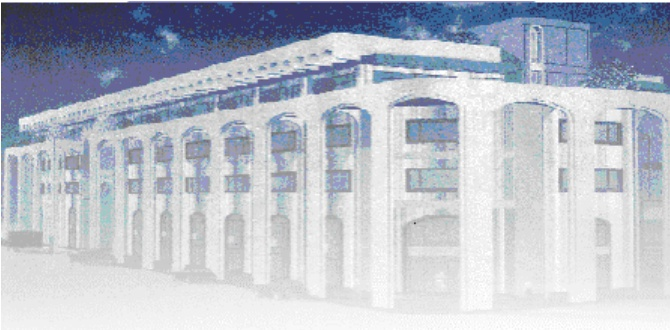

<!-- page 1 -->

Banque de la République d'Haïti

Note mensuelle d'inflation

Avril 2017

<!-- page 2 -->

## Table des matières

I.- Introduction.....2
II.- Évolution de l'inflation courante en avril 2017.....2
III.- Évolution des principales fonctions de consommation en avril 2017.....3
IV.- Évolution de l'inflation selon l'origine des produits et les régions géographiques du pays.....4
V.- Évolution de l'inflation sous-jacente .....5
VI.- Facteurs explicatifs de l'évolution de l'inflation mensuelle en avril 2017.....6
VII.- Prévisions d'inflation .....6

<!-- page 3 -->

### I. - Introduction

La note mensuelle d'inflation analyse l'évolution de l'Indice des Prix à la Consommation (IPC) en Haïti au cours du mois sous revue. Elle apporte des éléments explicatifs permettant de comprendre les facteurs qui influencent l'évolution de l'inflation et présente les prévisions de cette dernière pour les trois prochains mois.

### II. - Évolution de l'inflation globale en avril 2017

L’Indice des Prix à la Consommation (IPC), indicateur de mesure de l’inflation, a été estimé à 301,5 en avril 2017 contre 298,3 en mars 2017 et 263,1 en avril 2016. Par rapport au mois précédent, il ressort une hausse de 1,1 % de l’IPC tandis que, par rapport à avril 2016, la hausse est de 14,6 %. La tendance de l’inflation en rythme annuel, en raison d’un effet de base, indique une accentuation de la pression inflationniste alors qu’en rythme mensuel, il se produit une décélération.

La baisse de l'inflation enregistrée au cours du mois d'avril 2017 n'a pas influencé la tendance dégagée pour les sept premiers mois de cet exercice. En effet, le taux d'inflation mensuel cumulé d'octobre 2016 à avril 2017 a atteint 8,7 % contre 6,9 % au cours de la même période de l'exercice 2015-2016. De même, la moyenne des taux d'inflation pour la période allant d'Octobre 2016 à avril 2017 s'est établie à 1,2 % contre 1 % pour la même période de l'exercice fiscal 2015-2016. Ce niveau moyen de l'inflation mensuelle au cours de l'exercice fiscal 2016-2017 demeure supérieur à celui de nos principaux partenaires commerciaux (République Dominicaine : 0,35 % et les États-Unis : 0,2 %).

Graphique No. 1

Évolution de l'inflation mensuelle et annuelle en avril 2017 (en %)

| Period | Inflation Annuelle | Inflation Mensuelle |
| --- | --- | --- |
| Apr-15 | 6.2 | 4.8 |
| Jun-15 | 8.0 | 12.0 |
| Aug-15 | 10.0 | 11.0 |
| Oct-15 | 11.5 | 8.5 |
| Dec-15 | 12.5 | 7.0 |
| Feb-16 | 14.0 | 8.5 |
| Apr-16 | 15.0 | 7.0 |
| Jun-16 | 14.0 | 7.0 |
| Aug-16 | 12.5 | 8.5 |
| Oct-16 | 13.0 | 11.5 |
| Dec-16 | 14.2 | 10.0 |
| Feb-17 | 14.0 | 9.0 |
| Apr-17 | 14.5 | 10.5 |

<!-- page 4 -->

### III. - Évolution des principales fonctions de consommation en avril 2017

La baisse du rythme de progression mensuel de l'indice global est imputable à celle des indices de la majorité des fonctions de consommation, à l'exception des rubriques « Alimentation, Boisson, Tabac » et « Loisirs, Enseignement et Culture » dont les variations ont augmenté chacun de 10 points de base à 1,1% et 0,1% respectivement. De même, le rythme de progression de l'indice des prix de la fonction « Santé » a affiché le même comportement à la hausse (2,1 % contre 1,5%). Les fonctions de consommation ayant leurs indices en baisse sont :

• Habillement, Tissus, Chaussures : 2,3 % en avril 2017 contre 2,5 % en mars 2017

• Aménagement, Entretien et Logement : 0,8 % en avril contre 1,1 % le mois précédent

Loyer, Énergie et Eau : 1,6 % en avril 2017 contre 2 % en mars 2017

• Autres Biens et Services : 0,3 % en avril contre 2,3 % le mois antérieurement

Quant à la variation de l'indice mensuel du poste «Transport », elle est restée inchangée à 0,1 %.

En variation annuelle, les indices des prix de presque toutes les fonctions de consommation ont connu une variation plus importante, en avril 2017, par rapport à celle du mois précédent. Ceci s'applique notamment aux postes « Habillement, Tissus, Chaussures » (19,3 % contre 17,6 % le mois antérieur), « Santé » (13,2 % en avril contre 11 % en mars), « Loyer, Énergie, Eau » (19,4 % en avril 2017 contre 19,2 % le mois antérieur) et « Alimentation, Boisson, Tabac » (14,2 % en avril 2017 contre 14,1 % préalablement). Par contre, les taux de croissance des indices des postes « Autres Biens et Services » et « Transport », en glissement annuel, ont décléré, s'établissant respectivement à 19,4 %, et 3 % en avril 2017 contre 20,3 % et 3,2 % respectivement en mars 2017. Quant aux fonctions « Aménagement et Entretien du logement » et « Loisirs, Enseignement et Culture », en avril 2017, les rythmes de croissance en glissement annuel de leurs indices ont gardé leurs valeurs de mars 2017, soit 14,1% et 16,4% respectivement.

En outre, le poste « Alimentation, Boissons et Tabac » (50,4% du panier de consommation) a vu sa contribution à l'inflation mensuelle augmenter de 45,87% en mars 2017 à 53,57% en avril 2017. Par contre, la contribution à l'inflation annuelle de ce poste a diminué légèrement de 51,70% le mois antérieur à 51,48% ce mois-ci. Par ailleurs, la contribution à l'inflation mensuelle du poste « Autres

<!-- page 5 -->

Biens et Services » s'est considérablement réduite, passant de 9,52 % en mars 2017 à 1,43 % en avril 2017.

Tableau No. 1

Contributions à l'inflation mensuelle et annuelle (en %) en avril 2017

| Poste | Pondération | Contribution à l'inflation mensuelle | Contribution à l'inflation annuelle |
| --- | --- | --- | --- |
|   | en % | en % | en % |
| Indice Général | 100.00 | 100.00 | 100.00 |
| Alim, bois, tab | 50.35 | 53.57 | 51.48 |
| Habil, tis, chs. | 6.86 | 15.66 | 9.52 |
| Loyer, En, eau | 11.05 | 17.57 | 15.38 |
| Aménag, Ent. log. | 4.70 | 3.60 | 4.75 |
| Santé | 2.90 | 6.19 | 2.74 |
| Transport | 13.74 | 1.60 | 2.93 |
| Lois., sp. Ens., Clt. | 5.84 | 0.38 | 6.85 |
| Aut. biens & serv. | 4.56 | 1.43 | 6.35 |

Source: Calculs de la BRH

### IV. - Évolution de l'inflation selon l'origine des produits et les régions géographiques du pays

En avril 2017, le rythme de progression, en variation mensuelle, de l'indice des prix des produits importés a diminué de 10 points de base pour atteindre 1,1 %. Toutefois, en glissement annuel, cet indice a augmenté de 40 points de base pour atteindre 13,40 %. Pour sa part, l'indice des prix des produits locaux s'est accru en variation mensuelle de 10 points de base pour atteindre 1,2% et en glissement annuel de 40 points de base pour atteindre 15,1 %. En avril 2017, le rythme de progression de l'indice des prix des produits importés a diminué de 10 points de base à 1,1 % en variation mensuelle. Toutefois, en glissement annuel, ce dernier a augmenté de 40 points à 13,40 %. Pour sa part, l'indice des prix des produits locaux s'est accru de 10 et 40 points de base à 1,2 % et 15,1 % en variation mensuelle et glissement annuel respectivement.

Par ailleurs, le taux de croissance de l'indice des prix à la consommation pour l'ensemble des régions géographiques a, en variation mensuelle, évolué à la baisse exception faite de celui de la région « Nord » qui a augmenté de 10 points de base pour atteindre 0,9 %. Par contre, en glissement annuel, le rythme de progression de l'inflation au niveau de cette même région a ralenti à 13,2 % tandis que ceux

<!-- page 6 -->

des autres régions ont augmenté, à l'exception de celui de la Région Transversale qui est resté inchangé (13,2 %).

Tableau No. 2

Inflation mensuelle et annuelle (en %) par région géographique en avril 2017

<table><tr><td></td><td>Variation mensuelle</td><td>Variation annuelle</td></tr><tr><td>Mars-17</td><td>Avril-17</td><td>Mars-17</td><td>Avril-17</td></tr><tr><td>Aire Métropolitaine (AM)</td><td>1.2</td><td>1.0</td><td>14.8</td><td>15.0</td></tr><tr><td>Reste Ouest</td><td>1.1</td><td>1.0</td><td>13.0</td><td>13.4</td></tr><tr><td>Nord</td><td>0.8</td><td>0.9</td><td>13.3</td><td>13.2</td></tr><tr><td>Sud</td><td>1.5</td><td>1.2</td><td>16.8</td><td>17.2</td></tr><tr><td>Région Transversale</td><td>1.1</td><td>0.8</td><td>13.2</td><td>13.2</td></tr></table>

Source: IHSI, Calculs BRH

### V. - Évolution de l'inflation sous-jacente

L'inflation sous-jacente a évolué de manière contrastée en avril 2017. En variation annuelle, elle s'est établie à 14,50 % en avril 2017 contre 14,17 % le mois antérieur. En rythme mensuel, elle est passée de 1,28 % en mars 2017 à 1,05 % en avril 2017. Ainsi, l'inflation sous-jacente mensuelle (1,05 %) a évolué en dessous de l'inflation courante mensuelle (1,1 %); ce qui laisse présumer que l'inflation est alimentée par les composantes volatiles du panier.

Graphique No. 2

Inflation globale et inflation sous-jacente en variation mensuelle (en %)

| Date | Inflation globale | Inflation sous-jacente |
| --- | --- | --- |
| Apr-15 | 0.48 | 0.68 |
| May-15 | 0.85 | 0.80 |
| Jun-15 | 1.90 | 1.85 |
| Jul-15 | 2.00 | 1.95 |
| Aug-15 | 1.50 | 1.45 |
| Sep-15 | 1.20 | 1.10 |
| Oct-15 | 0.90 | 0.70 |
| Nov-15 | 0.75 | 0.65 |
| Dec-15 | 1.05 | 0.95 |
| Jan-16 | 1.05 | 1.00 |
| Feb-16 | 1.25 | 1.10 |
| Mar-16 | 0.85 | 0.80 |
| Apr-16 | 0.85 | 0.75 |
| May-16 | 0.65 | 0.55 |
| Jun-16 | 0.80 | 0.75 |
| Jul-16 | 1.10 | 1.15 |
| Aug-16 | 0.95 | 1.20 |
| Sep-16 | 1.30 | 1.40 |
| Oct-16 | 1.75 | 1.65 |
| Nov-16 | 1.40 | 1.35 |
| Dec-16 | 1.00 | 0.95 |
| Jan-17 | 0.90 | 0.90 |
| Feb-17 | 1.05 | 1.00 |
| Mar-17 | 1.20 | 1.25 |
| Apr-17 | 1.05 | 1.05 |

<!-- page 7 -->

### VI. - Facteurs explicatifs du ralentissement des pressions inflationnistes en rythme mensuel

Le ralentissement de l'inflation en variation mensuelle est imputable principalement à la légère hausse de l'offre alimentaire et le ralentissement de l'inflation chez nos principaux partenaires commerciaux en mars 2017.

### 1. - Légère hausse de l'offre alimentaire

En avril 2017, le ralentissement de l'inflation en variation mensuelle s'explique par la légère hausse de l'offre alimentaire après la période de rareté qui a suivi le passage du cyclone Matthew au début du mois d'octobre 2016. Conséquemment, un ralentissement de l'inflation a été remarqué au niveau de la région du Sud¹, laquelle a été la plus frappée par le cyclone. En effet, en avril 2017, ladite région a connu une baisse de 30 points de base du taux de croissance en variation mensuelle de l'Indice des Prix à la Consommation (IPC) par rapport à mars 2017.

### 2. -Ralentissement de l'inflation mensuelle chez nos principaux partenaires commerciaux

L'inflation en rythme mensuel chez nos principaux partenaires commerciaux a diminué en mars 2017. En effet, aux Etats-Unis, l'inflation a reculé de 20 et 30 points de base à la fois en variation mensuelle et en glissement annuel pour s'établir à 0,10 % et 2,4 % respectivement. En République Dominicaine, l'inflation mensuelle a considérablement baissé à -0,20 % en mars 2017 contre 0,42 % un mois auparavant. En glissement annuel, la variation de l'Indice des Prix à la Consommation s'est portée à 3,14 % contre contre 3,34 % en février 2017.

Par ailleurs, sur le marché international, les prix des produits alimentaires ont poursuivi leur évolution à la baisse entamée depuis le mois de février 2017. En effet, l'indice FAO des prix des produits alimentaires a reculé de 1,90 % à 168 en mars 2017 par rapport à février 2017.

## VII- Prévisions d'inflation

Pour les deux prochains mois, les prévisions d'inflation réalisées par la Direction de la Monnaie et de l'Analyse Economique (MAE) tablent sur une hausse de l'inflation tant en rythme mensuel qu'annuel. En effet, la variation de l'indice des prix à la consommation (IPC) pourrait atteindre, en glissement

<!-- page 8 -->

annuel, 15,2 % et 15,6 % en mai et juin respectivement, tandis qu'en variation mensuelle, elle augmenterait à 1,2 % et 1,3 % pour les mêmes périodes. Toutefois, en juillet 2017, l'inflation mensuelle et l'inflation annuelle diminueraient à 0,7 % et 15,2 % respectivement. Il convient de souligner que ces prévisions sont basées essentiellement sur le passé récent de l'inflation.

Graphique No. 3

Prévisions de l'inflation en variation mensuelle et annuelle sur trois mois (en %, à partir de mai 2017)

| Month | inflation mensuelle | Inflation annuelle |
| --- | --- | --- |
| Apr-14 | 0.55 | 0.08 |
| May-14 | 0.55 | 0.10 |
| Jun-14 | 0.70 | 0.20 |
| Jul-14 | 0.70 | 0.30 |
| Aug-14 | 0.50 | 0.35 |
| Sep-14 | 0.40 | 0.35 |
| Oct-14 | 0.60 | 0.45 |
| Nov-14 | 0.55 | 0.50 |
| Dec-14 | 0.55 | 0.55 |
| Jan-15 | 0.40 | 0.55 |
| Feb-15 | 0.35 | 0.55 |
| Mar-15 | 0.50 | 0.55 |
| Apr-15 | 0.50 | 0.55 |
| May-15 | 0.80 | 0.60 |
| Jun-15 | 1.90 | 0.85 |
| Jul-15 | 2.00 | 1.00 |
| Aug-15 | 1.50 | 1.20 |
| Sep-15 | 1.20 | 1.30 |
| Oct-15 | 1.00 | 1.35 |
| Nov-15 | 0.80 | 1.40 |
| Dec-15 | 1.10 | 1.50 |
| Jan-16 | 1.10 | 1.60 |
| Feb-16 | 1.30 | 1.70 |
| Mar-16 | 0.90 | 1.80 |
| Apr-16 | 0.85 | 1.85 |
| May-16 | 0.70 | 1.80 |
| Jun-16 | 1.00 | 1.60 |
| Jul-16 | 1.10 | 1.50 |
| Aug-16 | 1.00 | 1.45 |
| Sep-16 | 1.40 | 1.50 |
| Oct-16 | 1.80 | 1.60 |
| Nov-16 | 1.50 | 1.65 |
| Dec-16 | 1.20 | 1.65 |
| Jan-17 | 0.90 | 1.60 |
| Feb-17 | 1.05 | 1.60 |
| Mar-17 | 1.15 | 1.65 |
| Apr-17 | 1.10 | 1.60 |

Sources : Prévisions du Service de Modélisation et des Prévisions Macroéconomiques de la MAE

<!-- page 9 -->

Tableau No. 3

Indice des prix à la consommation (IPC) par postes de dépenses Variation et Contribution à l'inflation mensuelle et annuelle en avril 2017

<table><tr><td>Poste</td><td>Indice des Prix à la Consommation</td><td>Variation IPC (%)</td><td>Contribution à l'inflation (%)</td></tr><tr><td>Pondération (%)</td><td>Avril-16</td><td>Mars-17</td><td>Avril-17</td><td>Mensuelle</td><td>Annuelle</td><td>Mensuelle</td><td>Annuelle</td></tr><tr><td>Indice général</td><td>263.1</td><td>298.3</td><td>301.5</td><td>1.1</td><td>14.6</td><td>100</td><td>100</td></tr><tr><td>Alimentation, Boisson, Tabac</td><td>50.35</td><td>276.5</td><td>312.6</td><td>315.9</td><td>1.1</td><td>14.1</td><td>53.57</td><td>51.48</td></tr><tr><td>Habillement, Tissus, Chaussures</td><td>6.86</td><td>287.6</td><td>335.6</td><td>343.2</td><td>2.3</td><td>19.3</td><td>15.66</td><td>9.52</td></tr><tr><td>Loyer, Energie, Eau</td><td>11.05</td><td>307.3</td><td>361.2</td><td>366.9</td><td>1.6</td><td>19.4</td><td>17.57</td><td>15.38</td></tr><tr><td>Amenagement, Entretien Logement</td><td>4.70</td><td>267.2</td><td>302.1</td><td>304.8</td><td>0.8</td><td>14.1</td><td>3.60</td><td>4.75</td></tr><tr><td>Santé</td><td>2.90</td><td>268.4</td><td>297.4</td><td>303.7</td><td>2.1</td><td>13.2</td><td>6.19</td><td>2.74</td></tr><tr><td>Transport</td><td>13.74</td><td>168</td><td>172.8</td><td>173</td><td>0.1</td><td>3</td><td>1.60</td><td>2.93</td></tr><tr><td>Loisirs, Enseignement, Culture</td><td>5.84</td><td>268.4</td><td>312.1</td><td>312.3</td><td>0.1</td><td>16.4</td><td>0.38</td><td>6.85</td></tr><tr><td>Autres Biens et Services</td><td>4.56</td><td>243.1</td><td>289.7</td><td>290.3</td><td>0.3</td><td>19.4</td><td>1.43</td><td>6.35</td></tr></table>

Sources : IHSI et calculs du Service de la Macrééconomie et Analyse de Conjoncture de la MAE

<!-- page 10 -->

## Glossaire

| Variation mensuelle | : Variation par rapport au mois précédent. |
| --- | --- |
| Glissement annuel | : Variation par rapport au même mois de l'année antérieure. |
| Inflation | : Mouvement persistant à la hausse du niveau général des prix. |
| Désinflation | : Ralentissement de la croissance des prix. |
| Déflation | : Baisse du niveau général des prix associée à une contraction de la masse monétaire et du crédit. |
| Inflation sous-jacente | : Tendance de long terme des prix, tout en excluant la volatilité, les mouvements saisonniers, conjoncturels, et les chocs qui affectent les composantes du panier considéré. |
| Région Nord | : Elle couvre les départementes du Nord, Nord-Est et Nord-Ouest. |
| Région Sud | : Elle comprend les départementes du Sud de la Grand-Anse et des Nippes. |
| Région Reste Ouest | : Y sont incluses les départementes du Sud-Est et de l'Ouest à l'exception de l'aire métropolitaine |
| Région Transversale | : Elle regroupe les départementes du Centre et de l'Artibonite. |
| Aire Métropolitaine | : Elle contient les villes de Port-au-Prince, de Delmas, de Pétion-Ville, de Carrefour et de Croix des Bouquets. |
