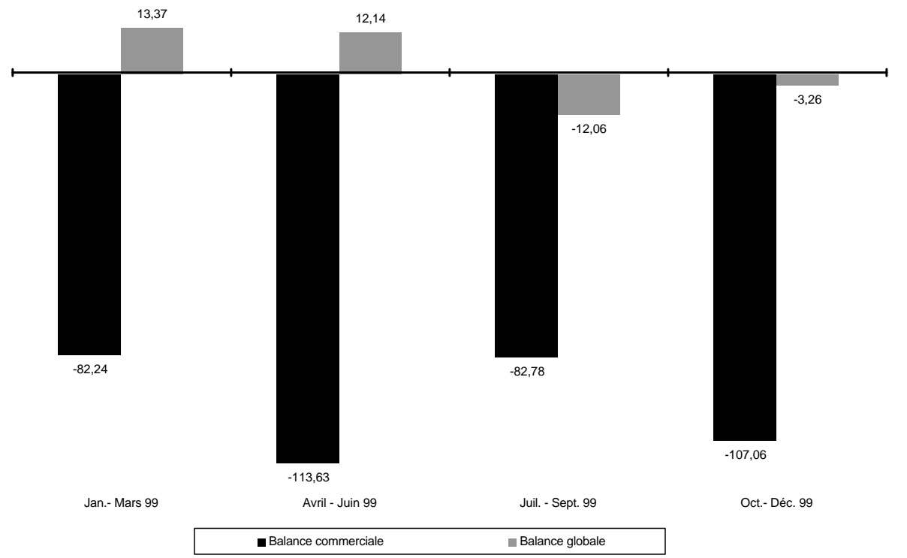
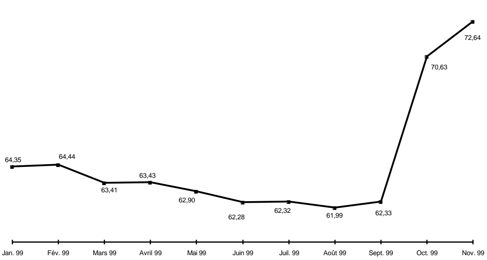
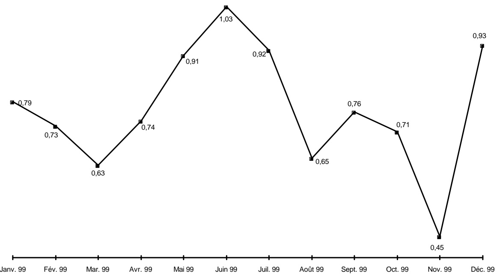
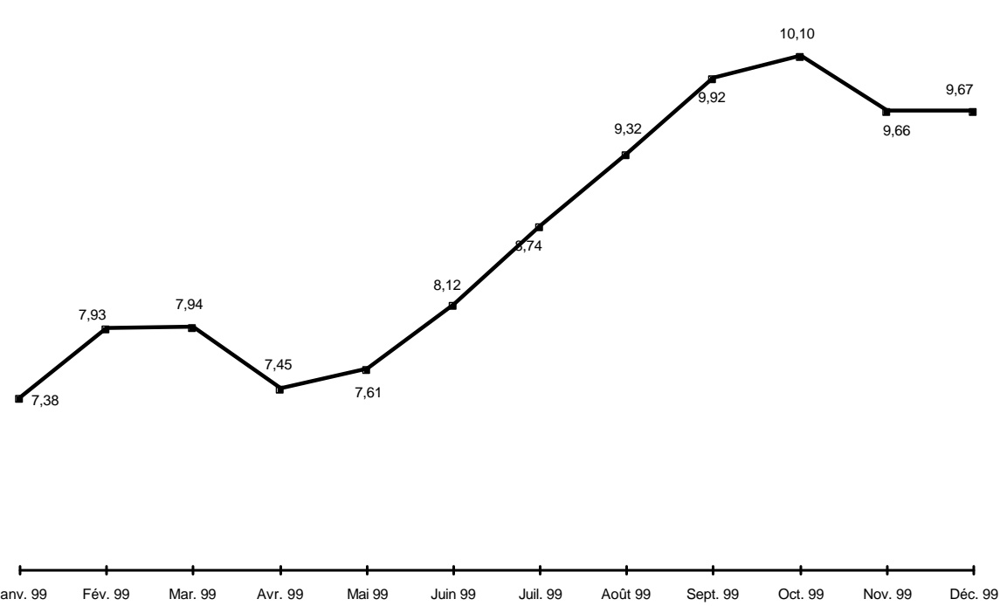

<!-- page 1 -->

# Bulletin Statistique 33

Octobre - Décembre 1999

<!-- page 2 -->

## Table des matières

Avertissement .....5
I- Statistiques monétaires et financières
Tableau 1.1 Principaux indicateurs monétaires .....10
Tableau 1.2 Situation monétaire .....11
Tableau 1.3 Liquidités du système bancaire .....13
Tableau 1.4 Taux de réserves obligatoires .....13
Tableau 1.5 Spread sur le marché formel des changes .....13
Tableau 1.6 Volume des transactions sur le marché formel des changes .....14
Tableau 1.7 Taux d'intérêt moyens mensuels du système bancaire .....16
Tableau 1.8 Taux d'intérêt moyens mensuels sur le marché monétaire .....16
Tableau 1.9 Dépôts du secteur privé .....17
Tableau 1.10 Dépôts : parts de marché .....19
Tableau 1.11 Crédit au secteur privé .....20
Tableau 1.12 Crédit : parts de marché .....22
Tableau 1.13 Bilan consolidé des banques commerciales .....23
Tableau 1.14 Bilan de la BRH .....25
Tableau 1.15 Encours des bons BRH .....27
Tableau 1.16 Avoirs extérieurs nets de la BRH .....28

II- Finances publiques
Tableau 2.1 Résumé des opérations financières des administrations publiques .....32
Tableau 2.2 Recettes des administrations publiques .....33
Tableau 2.3 Dépenses des administrations publiques .....34
Tableau 2.4 Endettement total du secteur public .....35
Tableau 2.5 Dette publique externe .....37

III- Balance des paiements
Tableau 3.1 Résumé de la balance des paiements .....40
Tableau 3.2 Principaux produits exportés .....41
Tableau 3.3 Exportations des industries d'assemblage vers les États-Unis d'Amérique à base de matières premières importées .....42
Tableau 3.4 Exportations vers les États-Unis d'Amérique à base de matières premières locales .....43
Tableau 3.5 Importations par grandes catégories de produits .....44
Tableau 3.5a Importations de produits pétroliers .....45
Tableau 3.6 Évolution de l'indice du taux de change réel bilatéral Haïti-États-Unis d'Amérique .....46

<!-- page 3 -->

## Table des matières (suite)

## IV- Prix et autres indicateurs économiques

Tableau 4.1 Indice des prix à la consommation (IPC) pour l'ensemble du pays.....48
Tableau 4.2 Taux d'inflation.....48
Tableau 4.3 Taux de change à Port-au-Prince.....49
Tableau 4.4 Prix moyen de détail de certains produits sur l'ensemble du pays.....50
Tableau 4.5 Prix moyen des matériaux de construction.....51
Tableau 4.6 Activités du secteur de la construction à Port-au-Prince.....51
Tableau 4.7 Nouvelles entreprises déclarées à Port-au-Prince et nombre correspondant d'employés.....52
Tableau 4.8 Nouvelles entreprises enregistrées à l'ONA et nombre correspondant d'assurés.....52
Tableau 4.9 Production industrielle de certains biens.....53
Tableau 4.10 Consommation d'électricité.....54
Tableau 4.11 Production brute d'électricité.....54
Tableau 4.12 Prix moyen des principaux produits pétroliers et dérivés sur le marché local.....55
Tableau 4.13 Véhicules importés enregistrés au port de Port-au-Prince.....56
Tableau 4.14 Nombre de touristes arrivés au pays.....58

## Annexe graphique

Graphique 1 Agrégats M1, M2, M3.....60
Graphique 2 Contreparties de M3.....61
Graphique 3 Encours des bons BRH.....62
Graphique 4 Dépôts du secteur privé.....63
Graphique 5 Crédit au secteur privé.....64
Graphique 6 Recettes et dépenses des administrations publiques.....65
Graphique 7 Endettement total du secteur public.....66
Graphique 8 Balances commerciale et globale.....67
Graphique 9 Indice du taux de change réel bilatéral Haiti-États Unis d'Amérique.....68
Graphique10 Taux d'inflation (variation mensuelle de l'IPC; novembre 1996=100).....69
Graphique11 Taux d'inflation (variation de l'IPC en glissement annuel).....70
Graphique12 Taux de change (marché informel; moyenne de période).....71

<!-- page 4 -->

# Avertissement

## Statistiques monétaires et financières

Les statistiques monétaires sont présentées selon les critères de classification établis dans le manuel Guide des Statistiques Monétaires et Bancaires publiées dans Statistiques Financières Internationales du Fonds Monétaire International (1987). Elles représentent des données de stock (fin de période) qui sont collectées mensuellement.

## Finances publiques

Les statistiques des finances publiques sont présentées selon les critères de classification établis dans le Manuel de Référence des Finances Publiques (1986) du FMI. Elles représentent des données de flux qui sont collectées mensuellement et sont enregistrées sur la base des encaissements-décaissements. Ces données subissent un traitement qui tient compte de la spécificité du contexte haïtien. Étant donné qu'Haïti ne dispose pas d'un budget général consolidé, les recettes enregistrées sont celles du Trésor excluant celles des unités de production marchande du secteur public. Les dépenses enregistrées sont celles effectuées par le Trésor pour le compte de l'Administration Centrale, et comprennent également les dépenses réalisées sur financement externe pour l'ensemble des administrations publiques.

## Balance des paiements

Les statistiques de la balance des paiements sont des données de flux. Elles sont présentées selon les critères établis dans la 5ème Édition du Manuel de la Balance des Paiements du FMI. Les transactions sur les biens sont enregistrées sur une base brute. Les transferts de capital réfèrent surtout à des annulations d'engagements par un ou plusieurs créanciers qui ne reçoivent rien en échange (remise de dette).

Les transferts courants sont ceux qui ne peuvent être dits transferts de capital. Ils comprennent les transferts en espèces entre administrations publiques destinés à financer leurs dépenses courantes, les transferts en nature (tels que dans d'aliments, de médicaments et d'autres biens de consommation), les envois de fonds de travailleurs émigrés, etc.

La variation des avoirs de réserves est présentée sous forme d'avoirs bruts à l'exclusion des engagements envers le FMI et des engagements envers le FIV (enregistrés dans les engagements constituent des réserves pour les autorités étrangères). Ceux-ci sont présentés séparément.

L'indice du taux de change réel bilatéral (1991=100) est calculé à partir de l'indice des prix à la consommation (IPC) des États-Unis produit par le US Department of Labor (1982-84=100). Le changement de base est effectué à partir de la moyenne annuelle de la série pour l'année 1991 (1982-84=100). L'indice du taux de change nominal (1991=100) est calculé de la manière suivante : Taux de référence de fin de période du mois X / Taux de référence moyen pour l'année 1991.

<!-- page 5 -->

## Avertissement (suite)

## Prix et autres indicateurs économiques

Les informations regroupées sous la dénomination Prix et autres indicateurs économiques réfèrent aux données de production, d'emploi, de prix et aussi d'activités de divers secteurs. Il s'agit dans la plupart des cas de données brutes agrégées et tabulées. Ces données correspondent pour la plupart à des informations statistiques disponibles au moment de la compilation; elles sont donc sujettes à modification éventuelle dans le futur. L'indice des prix à la consommation est un indice de Laspeyres (période de base novembre 1996 avec pondération de 1986-1987) qui couvre l'ensemble du territoire national.

Le taux de change de la monnaie nationale par rapport au dollar américain (Gde / $) est aussi présenté au niveau de cette section pour les marchés formel (banques et agents de change) et informel. Le taux de référence de la BRH représente une moyenne pondérée des taux de ces marchés.

## Liste des sigles utilisés dans le Bulletin Statistique

| AGD | Administration Générale des Douanes |
| --- | --- |
| AIB | Autres institutions bancaires |
| BEL | Banques d'épargne et de logement |
| BID | Banque Interaméricaine de Développement |
| BNC | Banque Nationale de Crédit |
| BRH | Banque de la République d'Haïti |
| BRI | Banque de Règlements Internationaux |
| CIF | Cost, Insurance and Freight |
| DTS | Droits de Tirage Spéciaux |
| EDH | Électricité d'Haïti |
| EU | États-Unis d'Amérique |
| FIV | Fonds d'Investissement Vénézuélien |
| FMI | Fonds Monétaire International |
| FOB | Free on Board |
| IFNB | Institutions financières non bancaires |
| IHSI | Institut Haïtien de Statistique et d'Informatique |
| IPC | Indice des prix à la consommation |
| MEF | Ministère de l'Économie et des Finances |
| MG | Millions de gourdes |
| OEA | Organisation des États Américains |
| OFATMA | Office Assurance-Accidents du Travail, Maladie et Maternité |
| OFI | Organisations financières internationales |
| (-) | Indique une valeur nulle |
| (...) | Indique l'absence de données statistiques qu'il est possible d'obtenir |
| (0.00) | Indique une valeur presque nulle |

<!-- page 6 -->

# I- Statistiques monétaires et financières

<!-- page 7 -->

Tableau 1.1

<table><tr><td></td><td>2e trimestre 1999</td><td>3e trimestre 1999</td><td>4e trimestre 1999</td><td>1er trimestre 2000</td></tr><tr><td></td><td>Jan. 99</td><td>Fév. 99</td><td>Mars 99</td><td>Avr. 99</td><td>Mai 99</td><td>Juin 99</td><td>Juil. 99</td><td>Aout 99</td><td>Sept. 99</td><td>Oct. 99</td><td>Nov. 99</td><td>Déc. 99</td></tr><tr><td>Monnaie en circulation</td><td>3 592,61</td><td>3 520,65</td><td>3 729,14</td><td>3 694,55</td><td>3 716,11</td><td>3 793,01</td><td>3 866,21</td><td>3 924,24</td><td>3 989,85</td><td>3 958,03</td><td>4 001,60</td><td>4 927,06</td></tr><tr><td>Base monétaire</td><td>9 843,59</td><td>9 889,25</td><td>10 156,32</td><td>10 370,88</td><td>10 726,17</td><td>10 925,79</td><td>11 033,24</td><td>11 242,31</td><td>11 337,90</td><td>11 592,05</td><td>11 836,17</td><td>12 285,21</td></tr><tr><td>M1</td><td>6 474,52</td><td>6 360,93</td><td>6 410,51</td><td>6 617,81</td><td>6 426,32</td><td>6 625,66</td><td>6 753,31</td><td>6 914,33</td><td>7 218,31</td><td>7 398,98</td><td>7 446,39</td><td>8 153,31</td></tr><tr><td>M2</td><td>14 843,86</td><td>14 832,88</td><td>15 003,77</td><td>15 546,63</td><td>15 506,42</td><td>15 821,45</td><td>15 988,96</td><td>16 096,27</td><td>16 432,50</td><td>16 751,42</td><td>16 873,87</td><td>17 720,27</td></tr><tr><td>M3</td><td>19 797,59</td><td>19 848,35</td><td>20 113,65</td><td>20 810,01</td><td>20 909,99</td><td>21 183,44</td><td>21 526,38</td><td>21 650,63</td><td>22 157,69</td><td>22 610,37</td><td>23 088,48</td><td>24 234,52</td></tr><tr><td>Crédit intérieur</td><td>15 565,45</td><td>15 586,55</td><td>15 728,75</td><td>16 019,44</td><td>16 214,28</td><td>16 382,37</td><td>16 729,89</td><td>17 062,26</td><td>17 326,49</td><td>17 750,64</td><td>18 497,90</td><td>18 458,30</td></tr><tr><td>Avoirs extérieurs nets</td><td>5 534,02</td><td>5 549,14</td><td>5 548,97</td><td>5 766,35</td><td>5 875,02</td><td>5 876,06</td><td>5 557,96</td><td>5 619,16</td><td>5 605,26</td><td>5 784,94</td><td>5 744,16</td><td>6 511,75</td></tr><tr><td>Total dépôts en gourdes</td><td>11 251,25</td><td>11 312,23</td><td>11 274,63</td><td>11 852,08</td><td>11 790,31</td><td>12 028,44</td><td>12 122,76</td><td>12 172,02</td><td>12 442,64</td><td>12 793,39</td><td>12 872,27</td><td>12 793,21</td></tr><tr><td>Total dépôts en dollars EU  $ ^{{1/}} $</td><td>4 953,73</td><td>5 015,46</td><td>5 109,88</td><td>5 263,39</td><td>5 403,57</td><td>5 361,99</td><td>5 537,42</td><td>5 554,37</td><td>5 725,20</td><td>5 858,95</td><td>6 214,61</td><td>6 514,25</td></tr><tr><td>Indice de dollarisation :</td><td></td><td></td><td></td><td></td><td></td><td></td><td></td><td></td><td></td><td></td><td></td><td></td></tr><tr><td>Dépôts en dollars en % de M3</td><td>25,02</td><td>25,27</td><td>25,41</td><td>25,29</td><td>25,84</td><td>25,31</td><td>25,72</td><td>25,65</td><td>25,84</td><td>25,91</td><td>26,92</td><td>26,88</td></tr><tr><td>Pour mémoire:</td><td></td><td></td><td></td><td></td><td></td><td></td><td></td><td></td><td></td><td></td><td></td><td></td></tr><tr><td>Taux de change de référence (Fin de mois)</td><td>16,7778</td><td>16,8943</td><td>16,6816</td><td>16,6876</td><td>16,6990</td><td>16,7046</td><td>16,8242</td><td>16,7961</td><td>16,9411</td><td>17,5482</td><td>17,9632</td><td>17,9654</td></tr></table>

Source : Direction Monnaie et Analyse Économique, BRH.

1/ Convertis en gourdes au taux de référence de fin de mois de la BRH.

<!-- page 8 -->

Tableau 1.2

<table><tr><td></td><td>2e trimestre 1999</td><td>3e trimestre 1999</td></tr><tr><td></td><td>Jan. 99</td><td>Fév. 99</td><td>Mars 99</td><td>Avr. 99</td><td>Mai 99</td><td>Juin 99</td></tr><tr><td>Avoirs extérieurs nets</td><td>5 534,02</td><td>5 549,14</td><td>5 548,97</td><td>5 766,35</td><td>5 875,02</td><td>5 876,06</td></tr><tr><td>Avoirs extérieurs  $ ^{{1/}} $</td><td>7 665,53</td><td>7 697,40</td><td>7 588,23</td><td>7 786,60</td><td>7 887,62</td><td>7 884,59</td></tr><tr><td>Engagements extérieurs  $ ^{{1/}} $</td><td>(2 131,52)</td><td>(2 148,26)</td><td>(2 039,26)</td><td>(2 020,25)</td><td>(2 012,60)</td><td>(2 008,53)</td></tr><tr><td>Crédit intérieur</td><td>15 565,45</td><td>15 586,55</td><td>15 728,75</td><td>16 019,44</td><td>16 214,28</td><td>16 382,37</td></tr><tr><td>Créances nettes sur secteur public</td><td>6 074,61</td><td>5 961,92</td><td>6 118,08</td><td>6 277,59</td><td>6 439,23</td><td>6 562,86</td></tr><tr><td>Créances nettes sur gouvernement central</td><td>6 136,07</td><td>6 027,99</td><td>6 196,54</td><td>6 346,52</td><td>6 511,82</td><td>6 636,11</td></tr><tr><td>Créances nettes sur collectivités locales</td><td>(36,97)</td><td>(44,39)</td><td>(56,36)</td><td>(53,51)</td><td>(52,95)</td><td>(48,67)</td></tr><tr><td>Créances nettes sur entreprises publiques</td><td>(24,48)</td><td>(21,67)</td><td>(22,10)</td><td>(15,42)</td><td>(19,63)</td><td>(24,58)</td></tr><tr><td>Créances sur secteur privé</td><td>9 490,84</td><td>9 624,62</td><td>9 610,67</td><td>9 741,85</td><td>9 775,04</td><td>9 819,50</td></tr><tr><td>ACTIF = PASSIF</td><td>21 099,47</td><td>21 135,69</td><td>21 277,71</td><td>21 785,79</td><td>22 089,29</td><td>22 258,43</td></tr><tr><td>M3</td><td>19 797,59</td><td>19 848,35</td><td>20 113,65</td><td>20 810,01</td><td>20 909,99</td><td>21 183,44</td></tr><tr><td>M2</td><td>14 843,86</td><td>14 832,88</td><td>15 003,77</td><td>15 546,63</td><td>15 506,42</td><td>15 821,45</td></tr><tr><td>M1</td><td>6 474,52</td><td>6 360,93</td><td>6 410,51</td><td>6 617,81</td><td>6 426,32</td><td>6 625,66</td></tr><tr><td>Monnaie en circulation</td><td>3 592,61</td><td>3 520,65</td><td>3 729,14</td><td>3 694,55</td><td>3 716,11</td><td>3 793,01</td></tr><tr><td>Dépôts à vue</td><td>2 881,90</td><td>2 840,27</td><td>2 681,37</td><td>2 923,26</td><td>2 710,21</td><td>2 832,65</td></tr><tr><td>Quasi-monnaie</td><td>8 369,34</td><td>8 471,96</td><td>8 593,26</td><td>8 928,81</td><td>9 080,10</td><td>9 195,79</td></tr><tr><td>Dépôts d'épargne</td><td>5 226,02</td><td>5 278,94</td><td>5 367,23</td><td>5 427,20</td><td>5 501,84</td><td>5 553,38</td></tr><tr><td>Dépôts à terme et autres</td><td>3 143,32</td><td>3 193,02</td><td>3 226,03</td><td>3 501,61</td><td>3 578,26</td><td>3 642,41</td></tr><tr><td>Dépôts en dollars EU  $ ^{{1/}} $</td><td>4 953,73</td><td>5 015,46</td><td>5 109,88</td><td>5 263,39</td><td>5 403,57</td><td>5 361,99</td></tr><tr><td>Dépôts à vue</td><td>1 235,12</td><td>1 263,47</td><td>1 255,09</td><td>1 279,04</td><td>1 295,15</td><td>1 218,34</td></tr><tr><td>Dépôts d'épargne</td><td>1 711,22</td><td>1 712,90</td><td>1 806,25</td><td>1 930,95</td><td>2 020,84</td><td>2 027,30</td></tr><tr><td>Dépôts à terme et autres</td><td>2 007,38</td><td>2 039,09</td><td>2 048,54</td><td>2 053,39</td><td>2 087,59</td><td>2 116,36</td></tr><tr><td>Autres postes nets</td><td>1 301,87</td><td>1 287,35</td><td>1 164,06</td><td>975,78</td><td>1 179,30</td><td>1 074,99</td></tr><tr><td>Comptes de capital</td><td>2 960,59</td><td>3 025,56</td><td>3 004,73</td><td>3 037,14</td><td>3 176,90</td><td>2 923,44</td></tr><tr><td>Créances nettes interbancaires</td><td>66,51</td><td>(46,61)</td><td>(38,15)</td><td>(200,38)</td><td>(205,80)</td><td>(187,23)</td></tr><tr><td>Autres postes non classés</td><td>(1 725,23)</td><td>(1 691,61)</td><td>(1 802,53)</td><td>(1 860,99)</td><td>(1 791,79)</td><td>(1 661,22)</td></tr></table>

Source : Direction Monnaie et Analyse Économique, BRH.

1/ Convertis au taux de référence de fin de mois de la BRH.

<!-- page 9 -->

Tableau 1.2 (suite)

<table><tr><td></td><td>4e trimestre 1999</td><td>1er trimestre 2000</td></tr><tr><td></td><td>Juil. 99</td><td>Août 99</td><td>Sept. 99</td><td>Oct. 99</td><td>Nov. 99</td><td>Déc. 99</td></tr><tr><td>Avoirs extérieurs nets</td><td>5 557,96</td><td>5 619,16</td><td>5 605,26</td><td>5 784,94</td><td>5 744,16</td><td>6 511,75</td></tr><tr><td>$ Avoirs extérieurs^{{1/}} $</td><td>7 581,65</td><td>7 680,64</td><td>7 692,68</td><td>7 916,21</td><td>7 919,12</td><td>8 622,73</td></tr><tr><td>$ Engagements extérieurs^{{1/}} $</td><td>(2 023,69)</td><td>(2 061,47)</td><td>(2 087,43)</td><td>(2 131,27)</td><td>(2 174,96)</td><td>(2 110,99)</td></tr><tr><td>Crédit intérieur</td><td>16 729,89</td><td>17 062,26</td><td>17 326,49</td><td>17 750,64</td><td>18 497,90</td><td>18 458,30</td></tr><tr><td>Créances nettes sur secteur public</td><td>7 004,41</td><td>7 176,98</td><td>7 405,41</td><td>7 646,22</td><td>8 027,37</td><td>8 056,54</td></tr><tr><td>Créances nettes sur gouvernement central</td><td>7 092,90</td><td>7 297,13</td><td>7 482,30</td><td>7 745,30</td><td>8 166,32</td><td>8 173,44</td></tr><tr><td>Créances nettes sur collectivités locales</td><td>(46,61)</td><td>(43,16)</td><td>(41,18)</td><td>(45,87)</td><td>(53,49)</td><td>(61,17)</td></tr><tr><td>Créances nettes sur entreprises publiques</td><td>(41,88)</td><td>(77,00)</td><td>(35,72)</td><td>(53,21)</td><td>(85,46)</td><td>(55,74)</td></tr><tr><td>Créances sur secteur privé</td><td>9 725,49</td><td>9 885,28</td><td>9 921,08</td><td>10 104,42</td><td>10 470,53</td><td>10 401,77</td></tr><tr><td>ACTIF = PASSIF</td><td>22 287,85</td><td>22 681,42</td><td>22 934,46</td><td>23 535,57</td><td>24 242,06</td><td>24 970,05</td></tr><tr><td>M3</td><td>21 526,38</td><td>21 650,63</td><td>22 157,69</td><td>22 610,37</td><td>23 088,48</td><td>24 234,52</td></tr><tr><td>M2</td><td>15 988,96</td><td>16 096,27</td><td>16 432,50</td><td>16 751,42</td><td>16 873,87</td><td>17 720,27</td></tr><tr><td>M1</td><td>6 753,31</td><td>6 914,33</td><td>7 218,31</td><td>7 398,98</td><td>7 446,39</td><td>8 153,31</td></tr><tr><td>Monnaie en circulation</td><td>3 866,21</td><td>3 924,24</td><td>3 989,85</td><td>3 958,03</td><td>4 001,60</td><td>4 927,06</td></tr><tr><td>Dépôts à vue</td><td>2 887,11</td><td>2 990,09</td><td>3 228,46</td><td>3 440,95</td><td>3 444,79</td><td>3 226,26</td></tr><tr><td>Quasi-monnaie</td><td>9 235,65</td><td>9 181,94</td><td>9 214,18</td><td>9 352,45</td><td>9 427,48</td><td>9 566,95</td></tr><tr><td>Dépôts d'épargne</td><td>5 560,24</td><td>5 569,88</td><td>5 583,75</td><td>5 669,85</td><td>5 678,76</td><td>5 703,35</td></tr><tr><td>Dépôts à terme et autres</td><td>3 675,41</td><td>3 612,06</td><td>3 630,43</td><td>3 682,59</td><td>3 748,72</td><td>3 863,60</td></tr><tr><td>Dépôts en dollars EU $ ^{{1/}} $</td><td>5 537,42</td><td>5 554,37</td><td>5 725,20</td><td>5 858,95</td><td>6 214,61</td><td>6 514,25</td></tr><tr><td>Dépôts à vue</td><td>1 293,95</td><td>1 318,79</td><td>1 293,46</td><td>1 298,86</td><td>1 332,60</td><td>1 530,62</td></tr><tr><td>Dépôts d'épargne</td><td>2 067,32</td><td>2 061,54</td><td>2 154,93</td><td>2 207,61</td><td>2 233,01</td><td>2 319,43</td></tr><tr><td>Dépôts à terme et autres</td><td>2 176,15</td><td>2 174,03</td><td>2 276,80</td><td>2 352,48</td><td>2 649,01</td><td>2 664,20</td></tr><tr><td>Autres postes nets</td><td>761,47</td><td>1 030,79</td><td>776,76</td><td>925,20</td><td>1 153,58</td><td>735,53</td></tr><tr><td>Comptes de capital</td><td>2 988,21</td><td>3 014,86</td><td>3 051,62</td><td>3 262,05</td><td>3 419,43</td><td>3 293,10</td></tr><tr><td>Créances nettes interbancaires</td><td>(330,92)</td><td>(221,56)</td><td>(345,22)</td><td>(352,53)</td><td>(230,01)</td><td>(251,34)</td></tr><tr><td>Autres postes non classés</td><td>(1 895,81)</td><td>(1 762,51)</td><td>(1 929,63)</td><td>(1 984,33)</td><td>(2 035,84)</td><td>(2 306,23)</td></tr></table>

Source : Direction Monnaie et Analyse Économique, BRH.

1/ Convertis au taux de référence de fin de mois de la BRH.

<!-- page 10 -->

Tableau 1.3

<table><tr><td></td><td>2e trimestre 1999</td><td>3e trimestre 1999</td><td>4e trimestre 1999</td><td>1er trimestre 2000</td></tr><tr><td></td><td>Jan. 99</td><td>Fév. 99</td><td>Mars 99</td><td>Avr. 99</td><td>Mai 99</td><td>Juin 99</td><td>Juil. 99</td><td>Août 99</td><td>Sept. 99</td><td>Oct. 99</td><td>Nov. 99</td><td>Déc. 99</td></tr><tr><td>Solde des encaisses et dépôts de réserves</td><td>3 966,27</td><td>4 068,11</td><td>3 992,03</td><td>4 044,40</td><td>4 235,11</td><td>4 226,19</td><td>4 199,70</td><td>4 285,70</td><td>4 233,65</td><td>4 323,24</td><td>4 486,73</td><td>4 660,88</td></tr><tr><td>Réserves obligatoires</td><td>3 784,77</td><td>3 832,96</td><td>3 862,69</td><td>3 889,67</td><td>4 035,53</td><td>4 041,89</td><td>4 084,79</td><td>4 094,76</td><td>4 061,21</td><td>4 189,01</td><td>4 343,20</td><td>4 590,62</td></tr><tr><td>Position de réserves</td><td>181,50</td><td>235,14</td><td>129,33</td><td>154,73</td><td>199,58</td><td>184,29</td><td>114,91</td><td>190,93</td><td>172,44</td><td>134,23</td><td>143,53</td><td>70,26</td></tr></table>

Source : Direction du Contrôle du Crédit, BRH.

Tableau 1.4

<table><tr><td></td><td>2e trimestre 1999</td><td>3e trimestre 1999</td><td>4e trimestre 1999</td><td>1er trimestre 2000</td></tr><tr><td></td><td>Jan. 99</td><td>Fév. 99</td><td>Mars 99</td><td>Avr. 99</td><td>Mai 99</td><td>Juin 99</td><td>Juil. 99</td><td>Aout 99</td><td>Sept. 99</td><td>Oct. 99</td><td>Nov. 99</td><td>Déc. 99</td></tr><tr><td>Passifs des banques commerciales</td><td></td><td></td><td></td><td></td><td></td><td></td><td></td><td></td><td></td><td></td><td></td><td></td></tr><tr><td>Gourdes</td><td>26,50</td><td>26,50</td><td>26,50</td><td>26,50</td><td>26,50</td><td>26,50</td><td>26,50</td><td>26,50</td><td>26,50</td><td>26,50</td><td>26,50</td><td>26,50</td></tr><tr><td>Devises</td><td>12,50</td><td>12,50</td><td>12,50</td><td>12,50</td><td>12,50</td><td>12,50</td><td>12,50</td><td>12,50</td><td>12,50</td><td>15,00</td><td>15,00</td><td>15,00</td></tr><tr><td>Passifs des banques d'épargne et de l'oement</td><td></td><td></td><td></td><td></td><td></td><td></td><td></td><td></td><td></td><td></td><td></td><td></td></tr><tr><td>Gourdes</td><td>15,00</td><td>15,00</td><td>15,00</td><td>15,00</td><td>15,00</td><td>15,00</td><td>15,00</td><td>15,00</td><td>15,00</td><td>15,00</td><td>15,00</td><td>15,00</td></tr><tr><td>Devises</td><td>12,00</td><td>12,00</td><td>12,00</td><td>12,00</td><td>12,00</td><td>12,00</td><td>12,00</td><td>12,00</td><td>12,00</td><td>14,50</td><td>14,50</td><td>14,50</td></tr></table>

Tableau 1.5

Source : Direction du Contrôle du Crédit, BRH.

<table><tr><td></td><td>2e trimestre 1999</td><td>3e trimestre 1999</td><td>4e trimestre 1999</td><td>1er trimestre 2000</td></tr><tr><td></td><td>Jan. 99</td><td>Fév. 99</td><td>Mars 99</td><td>Avr. 99</td><td>Mai 99</td><td>Juin 99</td><td>Juil. 99</td><td>Août 99</td><td>Sept. 99</td><td>Oct. 99</td><td>Nov. 99</td><td>Déc. 99</td></tr><tr><td>Agents de change</td><td>0,87</td><td>0,76</td><td>0,60</td><td>0,59</td><td>0,47</td><td>0,50</td><td>0,87</td><td>0,81</td><td>0,64</td><td>0,16</td><td>0,20</td><td>0,16</td></tr><tr><td>Banques</td><td>1,26</td><td>1,06</td><td>0,94</td><td>0,98</td><td>0,91</td><td>0,85</td><td>1,15</td><td>1,00</td><td>1,08</td><td>0,23</td><td>0,25</td><td>0,25</td></tr></table>

Source : Direction des Affaires Internationales, BRH.

<!-- page 11 -->

Tableau 1.6

<table><tr><td>Volume des transactions sur le marché formel des changes (en millions de dollars EU)</td></tr><tr><td></td><td>2e trimestre 1999</td><td>3e trimestre 1999</td></tr><tr><td></td><td>Jan. 99</td><td>Fév. 99</td><td>Mars 99</td><td>Avr. 99</td><td>Mai 99</td><td>Juin 99</td><td></td></tr><tr><td></td><td>Achat</td><td>Vente</td><td>Achat</td><td>Vente</td><td>Achat</td><td>Vente</td><td>Achat</td><td>Vente</td><td>Achat</td><td>Vente</td><td>Achat</td><td>Vente</td><td></td></tr><tr><td>Agents de change</td><td>4,84</td><td>4,79</td><td>3,98</td><td>4,12</td><td>5,97</td><td>6,09</td><td>5,72</td><td>5,28</td><td>5,29</td><td>5,80</td><td>6,58</td><td>6,48</td><td></td></tr><tr><td>Turnier</td><td>-</td><td>-</td><td>-</td><td>-</td><td>-</td><td>-</td><td>-</td><td>-</td><td>-</td><td>-</td><td>-</td><td>-</td><td></td></tr><tr><td>Fouchard</td><td>-</td><td>-</td><td>-</td><td>-</td><td>-</td><td>-</td><td>-</td><td>-</td><td>-</td><td>-</td><td>-</td><td>-</td><td></td></tr><tr><td>Bayard</td><td>3,38</td><td>3,28</td><td>2,61</td><td>2,73</td><td>4,24</td><td>4,37</td><td>4,05</td><td>3,71</td><td>3,87</td><td>4,29</td><td>4,42</td><td>4,35</td><td></td></tr><tr><td>Cobty</td><td>1,46</td><td>1,51</td><td>1,37</td><td>1,39</td><td>1,73</td><td>1,72</td><td>1,67</td><td>1,57</td><td>1,42</td><td>1,51</td><td>2,16</td><td>2,13</td><td></td></tr><tr><td>Banques</td><td>72,24</td><td>69,52</td><td>70,89</td><td>71,68</td><td>97,67</td><td>99,45</td><td>89,12</td><td>88,55</td><td>87,14</td><td>89,43</td><td>93,25</td><td>95,28</td><td></td></tr><tr><td>Promobank</td><td>8,48</td><td>7,42</td><td>6,01</td><td>6,16</td><td>7,74</td><td>8,20</td><td>8,99</td><td>9,25</td><td>7,62</td><td>6,92</td><td>7,94</td><td>9,25</td><td></td></tr><tr><td>Sogebank</td><td>12,03</td><td>11,98</td><td>10,24</td><td>11,64</td><td>14,20</td><td>14,70</td><td>12,39</td><td>11,70</td><td>11,83</td><td>15,40</td><td>16,21</td><td>14,91</td><td></td></tr><tr><td>Banque Intercontinental de Commerce</td><td>4,67</td><td>4,79</td><td>5,02</td><td>4,39</td><td>4,89</td><td>5,70</td><td>5,13</td><td>5,14</td><td>5,01</td><td>5,00</td><td>-</td><td>-</td><td></td></tr><tr><td>Scotiabank</td><td>0,91</td><td>0,81</td><td>1,71</td><td>1,89</td><td>1,92</td><td>1,70</td><td>0,77</td><td>0,94</td><td>1,96</td><td>1,57</td><td>1,04</td><td>1,08</td><td></td></tr><tr><td>Citibank NA</td><td>5,94</td><td>4,89</td><td>6,40</td><td>7,11</td><td>10,96</td><td>10,70</td><td>6,84</td><td>6,50</td><td>7,75</td><td>8,13</td><td>8,21</td><td>7,76</td><td></td></tr><tr><td>Banque de l'Union Haïtienne</td><td>5,32</td><td>5,22</td><td>8,16</td><td>7,77</td><td>11,17</td><td>10,20</td><td>10,00</td><td>10,42</td><td>9,45</td><td>9,29</td><td>9,25</td><td>10,18</td><td></td></tr><tr><td>Banque Populaire Haïtienne</td><td>1,56</td><td>1,98</td><td>0,78</td><td>0,85</td><td>1,24</td><td>1,10</td><td>0,79</td><td>1,66</td><td>1,03</td><td>1,25</td><td>0,84</td><td>0,82</td><td></td></tr><tr><td>Banque Nationale de Crédit</td><td>2,09</td><td>1,82</td><td>1,63</td><td>1,00</td><td>2,28</td><td>3,80</td><td>3,93</td><td>3,19</td><td>2,76</td><td>2,44</td><td>4,82</td><td>5,64</td><td></td></tr><tr><td>Unibank</td><td>14,63</td><td>14,19</td><td>13,66</td><td>14,03</td><td>20,07</td><td>19,90</td><td>17,38</td><td>17,56</td><td>18,41</td><td>18,13</td><td>18,44</td><td>18,15</td><td></td></tr><tr><td>Socabank</td><td>10,54</td><td>10,36</td><td>10,90</td><td>10,49</td><td>14,83</td><td>15,10</td><td>14,30</td><td>13,72</td><td>12,37</td><td>12,64</td><td>14,03</td><td>14,85</td><td></td></tr><tr><td>Capital Bank</td><td>5,29</td><td>5,23</td><td>5,38</td><td>5,36</td><td>7,34</td><td>7,40</td><td>7,74</td><td>7,68</td><td>8,31</td><td>8,06</td><td>11,64</td><td>11,82</td><td></td></tr><tr><td>Sogebel</td><td>0,71</td><td>0,75</td><td>0,89</td><td>0,90</td><td>0,92</td><td>0,924</td><td>0,81</td><td>0,75</td><td>0,54</td><td>0,57</td><td>0,83</td><td>0,82</td><td></td></tr><tr><td>Banque Métropolitaine d'Haïtï</td><td>0,06</td><td>0,08</td><td>0,11</td><td>0,09</td><td>0,11</td><td>0,025</td><td>0,06</td><td>0,04</td><td>0,10</td><td>0,02</td><td>-</td><td>-</td><td></td></tr><tr><td>Total</td><td>77,08</td><td>74,31</td><td>74,87</td><td>75,80</td><td>103,64</td><td>105,54</td><td>94,84</td><td>93,83</td><td>92,43</td><td>95,23</td><td>99,83</td><td>101,76</td><td></td></tr></table>

Source : Direction des Affaires Internationales, BRH.

<!-- page 12 -->

Tableau 1.6 (suite)

<table><tr><td>Volume des transactions sur le marché formel des changes (en millions de dollars EU)</td></tr><tr><td></td><td>4e trimestre 1999</td><td>1er trimestre 2000</td></tr><tr><td></td><td>Juil. 99</td><td>Août 99</td><td>Sept. 99</td><td>Oct. 99</td><td>Nov. 99</td><td>Déc. 99</td><td>Vente</td></tr><tr><td></td><td>Achat</td><td>Vente</td><td>Achat</td><td>Vente</td><td>Achat</td><td>Vente</td><td>Achat</td><td>Vente</td><td>Achat</td><td>Vente</td><td>Achat</td><td>Achat</td><td>Vente</td></tr><tr><td>Agents de change</td><td>5,34</td><td>5,34</td><td>3,41</td><td>3,67</td><td>7,83</td><td>8,35</td><td>4,79</td><td>4,26</td><td>4,68</td><td>4,51</td><td>10,09</td><td>10,32</td><td></td></tr><tr><td>Turnier</td><td>-</td><td>-</td><td>-</td><td>-</td><td>-</td><td>-</td><td>-</td><td>-</td><td>-</td><td>-</td><td>2,90</td><td>2,92</td><td></td></tr><tr><td>Fouchard</td><td>-</td><td>-</td><td>-</td><td>-</td><td>-</td><td>-</td><td>-</td><td>-</td><td>-</td><td>-</td><td>-</td><td>-</td><td></td></tr><tr><td>Bayard</td><td>3,56</td><td>3,62</td><td>3,41</td><td>3,67</td><td>3,99</td><td>4,64</td><td>3,18</td><td>2,74</td><td>2,97</td><td>2,86</td><td>4,23</td><td>4,344</td><td></td></tr><tr><td>Cobty</td><td>1,78</td><td>1,72</td><td>-</td><td>-</td><td>3,84</td><td>3,71</td><td>1,60</td><td>1,52</td><td>1,71</td><td>1,65</td><td>2,96</td><td>3,061</td><td></td></tr><tr><td>Banques</td><td>99,16</td><td>93,17</td><td>90,01</td><td>98,27</td><td>97,93</td><td>98,01</td><td>93,27</td><td>88,84</td><td>78,03</td><td>78,28</td><td>103,42</td><td>95,03</td><td></td></tr><tr><td>Promobank</td><td>8,60</td><td>9,69</td><td>7,14</td><td>8,11</td><td>7,61</td><td>7,67</td><td>9,17</td><td>8,16</td><td>6,59</td><td>7,89</td><td>9,75</td><td>9,289</td><td></td></tr><tr><td>Sogebank</td><td>17,39</td><td>15,63</td><td>14,61</td><td>17,94</td><td>15,16</td><td>15,49</td><td>15,01</td><td>13,67</td><td>14,05</td><td>15,04</td><td>22,85</td><td>18,75</td><td></td></tr><tr><td>Banque Intercontinental de Commerce</td><td>-</td><td>-</td><td>-</td><td>-</td><td>-</td><td>-</td><td>-</td><td>-</td><td>-</td><td>-</td><td>-</td><td>-</td><td></td></tr><tr><td>Scotiabank</td><td>0,86</td><td>0,71</td><td>1,28</td><td>1,43</td><td>3,75</td><td>2,07</td><td>1,57</td><td>1,56</td><td>1,39</td><td>1,51</td><td>1,66</td><td>1,72</td><td></td></tr><tr><td>Citibank NA</td><td>7,15</td><td>6,90</td><td>7,97</td><td>8,49</td><td>10,13</td><td>10,43</td><td>9,60</td><td>10,29</td><td>6,76</td><td>5,95</td><td>11,26</td><td>11,09</td><td></td></tr><tr><td>Banque de l'Union Haïtienne</td><td>9,22</td><td>8,03</td><td>7,17</td><td>8,33</td><td>5,42</td><td>5,95</td><td>5,27</td><td>5,37</td><td>5,99</td><td>5,32</td><td>7,47</td><td>6,22</td><td></td></tr><tr><td>Banque Populaire Haïtienne</td><td>1,75</td><td>1,70</td><td>1,31</td><td>1,41</td><td>1,70</td><td>1,49</td><td>0,92</td><td>1,05</td><td>0,94</td><td>1,05</td><td>0,95</td><td>0,95</td><td></td></tr><tr><td>Banque Nationale de Crédit</td><td>4,74</td><td>2,61</td><td>2,79</td><td>4,12</td><td>3,03</td><td>4,10</td><td>2,81</td><td>1,25</td><td>2,64</td><td>1,57</td><td>3,53</td><td>1,10</td><td></td></tr><tr><td>Unibank</td><td>22,66</td><td>22,06</td><td>20,06</td><td>19,37</td><td>21,05</td><td>20,81</td><td>17,43</td><td>17,68</td><td>16,93</td><td>17,17</td><td>23,81</td><td>22,63</td><td></td></tr><tr><td>Socabank</td><td>15,23</td><td>14,39</td><td>12,92</td><td>14,36</td><td>14,75</td><td>14,85</td><td>17,37</td><td>15,68</td><td>10,18</td><td>9,93</td><td>10,95</td><td>12,03</td><td></td></tr><tr><td>Capital Bank</td><td>10,90</td><td>10,82</td><td>13,75</td><td>13,69</td><td>14,38</td><td>14,26</td><td>13,37</td><td>13,43</td><td>11,81</td><td>12,04</td><td>10,09</td><td>10,12</td><td></td></tr><tr><td>Sogebel</td><td>0,66</td><td>0,63</td><td>1,01</td><td>1,02</td><td>0,95</td><td>0,89</td><td>0,76</td><td>0,71</td><td>0,75</td><td>0,82</td><td>1,11</td><td>1,14</td><td></td></tr><tr><td>Banque Métropolitaine d'Haïti</td><td>-</td><td>-</td><td>-</td><td>-</td><td>-</td><td>-</td><td>-</td><td>-</td><td>-</td><td>-</td><td>-</td><td>-</td><td></td></tr><tr><td>Total</td><td>104,50</td><td>98,51</td><td>93,42</td><td>101,94</td><td>105,76</td><td>106,36</td><td>98,05</td><td>93,10</td><td>82,71</td><td>82,79</td><td>113,51</td><td>105,35</td><td></td></tr></table>

Source : Direction des Affaires Internationales, BRH.

<!-- page 13 -->

Tableau 1.7

<table><tr><td></td><td>2e trimestre 1999</td><td>3e trimestre 1999</td><td>4e trimestre 1999</td><td>1er trimestre 2000</td></tr><tr><td></td><td>Jan. 99</td><td>Fév. 99</td><td>Mars 99</td><td>Avr. 99</td><td>Mai 99</td><td>Juin 99</td><td>Juil. 99</td><td>Aout 99</td><td>Sept. 99</td><td>Oct. 99</td><td>Nov. 99</td><td>Déc. 99</td></tr><tr><td>Prêts</td><td></td><td></td><td></td><td></td><td></td><td></td><td></td><td></td><td></td><td></td><td></td><td></td></tr><tr><td>Gourdes</td><td>23,00</td><td>21,50</td><td>23,00</td><td>21,75</td><td>23,00</td><td>24,00</td><td>23,31</td><td>24,25</td><td>22,50</td><td>22,50</td><td>23,00</td><td>22,00</td></tr><tr><td>Devises</td><td>12,00</td><td>12,30</td><td>12,00</td><td>13,30</td><td>12,10</td><td>12,50</td><td>13,00</td><td>12,00</td><td>12,50</td><td>12,50</td><td>13,00</td><td>13,50</td></tr><tr><td>Dépôts à terme</td><td></td><td></td><td></td><td></td><td></td><td></td><td></td><td></td><td></td><td></td><td></td><td></td></tr><tr><td>Gourdes</td><td>9,50</td><td>7,00</td><td>7,50</td><td>7,00</td><td>7,00</td><td>7,00</td><td>6,50</td><td>5,00</td><td>6,75</td><td>7,30</td><td>8,50</td><td>9,60</td></tr><tr><td>Devises</td><td>4,60</td><td>3,90</td><td>4,40</td><td>3,80</td><td>4,50</td><td>3,80</td><td>4,00</td><td>4,00</td><td>4,00</td><td>4,30</td><td>5,30</td><td>6,30</td></tr><tr><td>Dépôts d'épargne</td><td></td><td></td><td></td><td></td><td></td><td></td><td></td><td></td><td></td><td></td><td></td><td></td></tr><tr><td>Gourdes</td><td>5,00</td><td>4,00</td><td>3,00</td><td>3,50</td><td>3,75</td><td>3,25</td><td>3,25</td><td>3,25</td><td>3,50</td><td>3,30</td><td>2,80</td><td>3,50</td></tr><tr><td>Devises</td><td>2,80</td><td>2,30</td><td>1,50</td><td>1,50</td><td>2,30</td><td>1,50</td><td>2,00</td><td>2,00</td><td>2,30</td><td>1,80</td><td>2,00</td><td>2,00</td></tr></table>

Source : Direction du Contrôle du Crédit, BRH.

1/Moyenne de fin de période.

Tableau 1.8

<table><tr><td></td><td>2e trimestre 1999</td><td>3e trimestre 1999</td><td>4e trimestre 1999</td><td>1er trimestre 2000</td></tr><tr><td></td><td>Jan. 99</td><td>Fév. 99</td><td>Mars 99</td><td>Avr. 99</td><td>Mai 99</td><td>Juin 99</td><td>Juil. 99</td><td>Aout 99</td><td>Sept. 99</td><td>Oct. 99</td><td>Nov. 99</td><td>Déc. 99</td></tr><tr><td>Bons BRH  $ ^{{1/}} $</td><td></td><td></td><td></td><td></td><td></td><td></td><td></td><td></td><td></td><td></td><td></td><td></td></tr><tr><td>7 jours</td><td>6.50</td><td>6.90</td><td>6.90</td><td>6.90</td><td>6.90</td><td>7.00</td><td>7.00</td><td>6.90</td><td>6.80</td><td>10.50</td><td>10.00</td><td>10.00</td></tr><tr><td>28 jours</td><td>8,50</td><td>8,50</td><td>8,50</td><td>8,50</td><td>8,50</td><td>8,50</td><td>8,60</td><td>8,60</td><td>8,60</td><td>13,10</td><td>12,10</td><td>12,10</td></tr><tr><td>91 jours</td><td>9.80</td><td>10.20</td><td>10.30</td><td>10.20</td><td>10.20</td><td>10.30</td><td>10.30</td><td>10.30</td><td>10.30</td><td>15.30</td><td>17.80</td><td>21.10</td></tr><tr><td>Refinancement BRH</td><td></td><td></td><td></td><td></td><td></td><td></td><td></td><td></td><td></td><td></td><td></td><td></td></tr><tr><td>Mise en pension de bons BRH</td><td>22.00</td><td>22.00</td><td>18.00</td><td>18.00</td><td>18.00</td><td>18.00</td><td>18.00</td><td>18.00</td><td>18.00</td><td>20.00</td><td>20.00</td><td>25.00</td></tr></table>

Source : Direction du Contrôle du Crédit, BRH.

1/ Taux moyens précomptés de fin de période.

<!-- page 14 -->

Tableau 1.9

<table><tr><td></td><td>2e trimestre 1999</td><td>3e trimestre 1999</td></tr><tr><td></td><td>Jan. 99</td><td>Fév. 99</td><td>Mars 99</td><td>Avr. 99</td><td>Mai 99</td><td>Juin 99</td></tr><tr><td>Total des dépôts</td><td>16 170,92</td><td>16 294,64</td><td>16 351,24</td><td>17 115,69</td><td>17 193,88</td><td>17 390,43</td></tr><tr><td>Dépôts des banques commerciales</td><td>15 068,27</td><td>15 197,31</td><td>15 237,50</td><td>15 943,54</td><td>15 986,43</td><td>16 152,86</td></tr><tr><td>Banque Industrielle et Commerciale d'Haïti</td><td>4,96</td><td>4,53</td><td>4,56</td><td>3,92</td><td>4,05</td><td>4,19</td></tr><tr><td>Banque Intercontinental de Commerce</td><td>1 018,56</td><td>1 001,03</td><td>956,87</td><td>965,01</td><td>0,50</td><td>0,00</td></tr><tr><td>Banque Nationale de Crédit</td><td>1 364,12</td><td>1 335,08</td><td>1 344,90</td><td>1 360,78</td><td>1 349,62</td><td>1 328,62</td></tr><tr><td>Scotiabank</td><td>792,85</td><td>771,52</td><td>792,26</td><td>853,19</td><td>862,76</td><td>862,32</td></tr><tr><td>Banque Populaire Haïtienne</td><td>311,04</td><td>302,84</td><td>313,37</td><td>307,79</td><td>301,07</td><td>355,04</td></tr><tr><td>Banque de l'Union Haïtienne</td><td>1 607,87</td><td>1 655,68</td><td>1 669,39</td><td>1 737,76</td><td>1 708,86</td><td>1 768,10</td></tr><tr><td>Citibank NA</td><td>1 025,08</td><td>1 154,34</td><td>1 141,07</td><td>1 175,11</td><td>1 200,13</td><td>1 193,15</td></tr><tr><td>Métrobanque</td><td>41,61</td><td>44,25</td><td>44,30</td><td>47,65</td><td>0,24</td><td>0,00</td></tr><tr><td>Promobank</td><td>1 276,03</td><td>1 268,00</td><td>1 254,80</td><td>1 304,91</td><td>1 284,20</td><td>1 264,77</td></tr><tr><td>Socabank</td><td>1 388,16</td><td>1 402,16</td><td>1 449,61</td><td>1 701,99</td><td>1 777,66</td><td>1 897,51</td></tr><tr><td>Sogebank</td><td>3 518,60</td><td>3 517,88</td><td>3 429,83</td><td>3 553,53</td><td>4 499,74</td><td>4 498,33</td></tr><tr><td>Unibank</td><td>2 719,39</td><td>2 739,98</td><td>2 836,55</td><td>2 931,92</td><td>2 997,62</td><td>2 980,83</td></tr><tr><td>Banque Haitienne de Développement 1/</td></tr><tr><td>Dépôts des BEL</td><td>1 102,66</td><td>1 097,33</td><td>1 113,74</td><td>1 172,15</td><td>1 207,45</td><td>1 237,57</td></tr><tr><td>Capital Bank</td><td>644,80</td><td>647,52</td><td>676,21</td><td>732,76</td><td>764,63</td><td>798,79</td></tr><tr><td>Sogebel</td><td>457,86</td><td>449,81</td><td>437,52</td><td>439,39</td><td>442,82</td><td>438,78</td></tr></table>

Source : Direction Monnaie et Analyse Économique, BRH.

1/ Cette nouvelle banque a soumis son bilan à la BRH à partir de décembre 1999.

<!-- page 15 -->

Tableau 1.9 (suite)

<table><tr><td></td><td>4e trimestre 1999</td><td>1er trimestre 2000</td></tr><tr><td></td><td>Juil. 99</td><td>Août 99</td><td>Sept. 99</td><td>Oct. 99</td><td>Nov. 99</td><td>Déc. 99</td></tr><tr><td>Total des dépôts</td><td>17 660,17</td><td>17 726,39</td><td>18 167,84</td><td>18 652,34</td><td>19 086,88</td><td>19 307,46</td></tr><tr><td>Dépôts des banques commerciales</td><td>16 403,35</td><td>16 482,00</td><td>16 907,18</td><td>17 314,86</td><td>17 708,82</td><td>17 930,40</td></tr><tr><td>Banque Industrielle et Commerciale d'Haïti</td><td>3,80</td><td>4,39</td><td>4,19</td><td>3,62</td><td>3,53</td><td>5,37</td></tr><tr><td>Banque Intercontinentale de Commerce</td><td>0,00</td><td>0,00</td><td>0,00</td><td>0,00</td><td>0,00</td><td>0,00</td></tr><tr><td>Banque Nationale de Crédit</td><td>1 371,72</td><td>1 376,75</td><td>1 405,60</td><td>1 386,82</td><td>1 404,85</td><td>1 421,07</td></tr><tr><td>Scotiabank</td><td>878,44</td><td>920,27</td><td>868,86</td><td>917,63</td><td>876,85</td><td>872,25</td></tr><tr><td>Banque Populaire Haïtienne</td><td>319,69</td><td>310,45</td><td>371,58</td><td>372,97</td><td>384,72</td><td>367,87</td></tr><tr><td>Banque de l'Union Haïitienne</td><td>1 770,17</td><td>1 855,22</td><td>1 859,42</td><td>2 000,49</td><td>2 039,76</td><td>2 013,49</td></tr><tr><td>Citibank NA</td><td>1 268,31</td><td>1 228,90</td><td>1 247,67</td><td>1 279,22</td><td>1 348,93</td><td>1 411,44</td></tr><tr><td>Métrobanque</td><td>0,00</td><td>0,00</td><td>0,00</td><td>0,00</td><td>0,00</td><td>0,00</td></tr><tr><td>Promobank</td><td>1 287,82</td><td>1 284,72</td><td>1 319,22</td><td>1 406,61</td><td>1 428,15</td><td>1 389,94</td></tr><tr><td>Socabank</td><td>1 975,31</td><td>1 960,48</td><td>2 047,12</td><td>2 170,88</td><td>2 206,85</td><td>2 308,68</td></tr><tr><td>Sogebank</td><td>4 504,11</td><td>4 523,34</td><td>4 648,63</td><td>4 620,17</td><td>4 699,50</td><td>4 694,27</td></tr><tr><td>Unibank</td><td>3 023,99</td><td>3 017,47</td><td>3 134,90</td><td>3 156,45</td><td>3 315,68</td><td>3 437,43</td></tr><tr><td>Banque Haitienne de Développement 1/</td><td></td><td></td><td></td><td>0,00</td><td>0,00</td><td>8,59</td></tr><tr><td>Dépôts des BEL</td><td>1 256,83</td><td>1 244,39</td><td>1 260,65</td><td>1 337,49</td><td>1 378,06</td><td>1 377,07</td></tr><tr><td>Capital Bank</td><td>819,72</td><td>813,52</td><td>822,02</td><td>879,60</td><td>912,59</td><td>897,91</td></tr><tr><td>Sogebel</td><td>437,11</td><td>430,87</td><td>438,63</td><td>457,89</td><td>465,46</td><td>479,16</td></tr></table>

Source : Direction Monnaie et Analyse Économique, BRH.

1/ Cette nouvelle banque a soumis son bilan à la BRH à partir de décembre 1999.

<!-- page 16 -->

Tableau 1.10

<table><tr><td></td><td>2e trimestre 1999</td><td>3e trimestre 1999</td><td>4e trimestre 1999</td><td>1er trimestre 2000</td></tr><tr><td></td><td>Jan. 99</td><td>Fév. 99</td><td>Mars 99</td><td>Avr. 99</td><td>Mai 99</td><td>Juin 99</td><td>Juil. 99</td><td>Août 99</td><td>Sept. 99</td><td>Oct. 99</td><td>Nov. 99</td><td>Déc. 99</td></tr><tr><td>Total</td><td>100,00</td><td>100,00</td><td>100,00</td><td>100,00</td><td>100,00</td><td>100,00</td><td>100,00</td><td>100,00</td><td>100,00</td><td>100,00</td><td>100,00</td><td>100,00</td></tr><tr><td>Part de marché des banques commerciales</td><td>93,18</td><td>93,27</td><td>93,19</td><td>93,15</td><td>92,98</td><td>92,88</td><td>92,88</td><td>92,98</td><td>93,06</td><td>92,83</td><td>92,78</td><td>92,87</td></tr><tr><td>Banque Industrielle et Commerciale d'Haïti</td><td>0,03</td><td>0,03</td><td>0,03</td><td>0,02</td><td>0,02</td><td>0,02</td><td>0,02</td><td>0,02</td><td>0,02</td><td>0,02</td><td>0,02</td><td>0,03</td></tr><tr><td>Banque Intercontinental de Commerce</td><td>6,30</td><td>6,14</td><td>5,85</td><td>5,64</td><td>0,00</td><td>0,00</td><td>0,00</td><td>0,00</td><td>0,00</td><td>0,00</td><td>0,00</td><td>0,00</td></tr><tr><td>Banque Nationale de Crédit</td><td>8,44</td><td>8,19</td><td>8,23</td><td>7,95</td><td>7,85</td><td>7,64</td><td>7,77</td><td>7,77</td><td>7,74</td><td>7,44</td><td>7,36</td><td>7,36</td></tr><tr><td>Scotiabank</td><td>4,90</td><td>4,73</td><td>4,85</td><td>4,98</td><td>5,02</td><td>4,96</td><td>4,97</td><td>5,19</td><td>4,78</td><td>4,92</td><td>4,59</td><td>4,52</td></tr><tr><td>Banque Populaire Haïtienne</td><td>1,92</td><td>1,86</td><td>1,92</td><td>1,80</td><td>1,75</td><td>2,04</td><td>1,81</td><td>1,75</td><td>2,05</td><td>2,00</td><td>2,02</td><td>1,91</td></tr><tr><td>Banque de l'Union Haïtienne</td><td>9,94</td><td>10,16</td><td>10,21</td><td>10,15</td><td>9,94</td><td>10,17</td><td>10,02</td><td>10,47</td><td>10,23</td><td>10,73</td><td>10,69</td><td>10,43</td></tr><tr><td>Citibank NA</td><td>6,34</td><td>7,08</td><td>6,98</td><td>6,87</td><td>6,98</td><td>6,86</td><td>7,18</td><td>6,93</td><td>6,87</td><td>6,86</td><td>7,07</td><td>7,31</td></tr><tr><td>Métrobanque</td><td>0,26</td><td>0,27</td><td>0,27</td><td>0,28</td><td>0,00</td><td>0,00</td><td>0,00</td><td>0,00</td><td>0,00</td><td>-</td><td>-</td><td>-</td></tr><tr><td>Promobank</td><td>7,89</td><td>7,78</td><td>7,67</td><td>7,62</td><td>7,47</td><td>7,27</td><td>7,29</td><td>7,25</td><td>7,26</td><td>7,54</td><td>7,48</td><td>7,20</td></tr><tr><td>Socabank</td><td>8,58</td><td>8,61</td><td>8,87</td><td>9,94</td><td>10,34</td><td>10,91</td><td>11,19</td><td>11,06</td><td>11,27</td><td>11,64</td><td>11,56</td><td>11,96</td></tr><tr><td>Sogebank</td><td>21,76</td><td>21,59</td><td>20,98</td><td>20,76</td><td>26,17</td><td>25,87</td><td>25,50</td><td>25,52</td><td>25,59</td><td>24,77</td><td>24,62</td><td>24,31</td></tr><tr><td>Unibank</td><td>16,82</td><td>16,82</td><td>17,35</td><td>17,13</td><td>17,43</td><td>17,14</td><td>17,12</td><td>17,02</td><td>17,26</td><td>16,92</td><td>17,37</td><td>17,80</td></tr><tr><td>Banque Haitienne de Développement 1/</td></tr><tr><td>Part de marché des BEL</td><td>6,82</td><td>6,73</td><td>6,81</td><td>6,85</td><td>7,02</td><td>7,12</td><td>7,12</td><td>7,02</td><td>6,94</td><td>7,17</td><td>7,22</td><td>7,13</td></tr><tr><td>Capital Bank</td><td>3,99</td><td>3,97</td><td>4,14</td><td>4,28</td><td>4,45</td><td>4,59</td><td>4,64</td><td>4,59</td><td>4,52</td><td>4,72</td><td>4,78</td><td>4,65</td></tr><tr><td>Sogebel</td><td>2,83</td><td>2,76</td><td>2,68</td><td>2,57</td><td>2,58</td><td>2,52</td><td>2,48</td><td>2,43</td><td>2,41</td><td>2,45</td><td>2,44</td><td>2,48</td></tr></table>

Source : Direction Monnaie et Analyse Économique, BRH.

1/ Cette nouvelle banque a soumis son bilan à la BRH à partir de décembre 1999.

<!-- page 17 -->

Tableau 1.11

Crédit au secteur privé

(en millions de gourdes)

<table><tr><td></td><td>2e trimestre 1999</td><td>3e trimestre 1999</td></tr><tr><td></td><td>Jan. 99</td><td>Fév. 99</td><td>Mars 99</td><td>Avr. 99</td><td>Mai 99</td><td>Juin 99</td></tr><tr><td>Total</td><td>9 275.25</td><td>9 401.49</td><td>9 382.10</td><td>9 496.00</td><td>9 523.65</td><td>9 562.71</td></tr><tr><td>Crédit en gourdes</td><td>6 273.00</td><td>6 317.20</td><td>6 207.94</td><td>6 256.61</td><td>6 194.52</td><td>6 077.66</td></tr><tr><td>Crédit en dollars 1/</td><td>3 002.25</td><td>3 084.29</td><td>3 174.16</td><td>3 239.39</td><td>3 329.13</td><td>3 485.05</td></tr><tr><td>Crédit des banques commerciales</td><td>8 457.96</td><td>8 553.41</td><td>8 529.59</td><td>8 643.73</td><td>8 652.29</td><td>8 673.95</td></tr><tr><td>Banque Industrielle et Commerciale d'Haïti</td><td>3.55</td><td>3.60</td><td>3.43</td><td>3.60</td><td>3.69</td><td>3.93</td></tr><tr><td>Banque Intercontinental de Commerce</td><td>545.74</td><td>479.78</td><td>436.27</td><td>396.61</td><td>24.35</td><td>0.00</td></tr><tr><td>Banque Nationale de Crédit</td><td>691,15</td><td>663,83</td><td>655,39</td><td>648,86</td><td>641,20</td><td>643,76</td></tr><tr><td>Scotiabank</td><td>476.24</td><td>484.32</td><td>472.56</td><td>505.71</td><td>506.48</td><td>507.36</td></tr><tr><td>Banque Populaire Haïtienne</td><td>326,87</td><td>328,04</td><td>330,80</td><td>336,72</td><td>344,13</td><td>353,76</td></tr><tr><td>Banque de l'Union Haïtienne</td><td>764.15</td><td>806.25</td><td>797.05</td><td>790.63</td><td>784.25</td><td>736.69</td></tr><tr><td>Citibank N.A.</td><td>764,59</td><td>776,32</td><td>775,34</td><td>795,03</td><td>757,75</td><td>820,91</td></tr><tr><td>Métrobanque</td><td>7.51</td><td>7.94</td><td>8.50</td><td>8.89</td><td>(0.00)</td><td>0.00</td></tr><tr><td>Promobank</td><td>805,45</td><td>809,50</td><td>829,61</td><td>781,84</td><td>767,39</td><td>728,88</td></tr><tr><td>Socabank</td><td>969.65</td><td>1 023.01</td><td>1 052.81</td><td>1 112.63</td><td>1 147.79</td><td>1 219.78</td></tr><tr><td>Sogebank</td><td>1 681,12</td><td>1 737,68</td><td>1 716,19</td><td>1 788,00</td><td>2 186,90</td><td>2 155,65</td></tr><tr><td>Unibank</td><td>1 421.92</td><td>1 433.14</td><td>1 451.63</td><td>1 475.20</td><td>1 488.38</td><td>1 503.24</td></tr><tr><td>Banque Haitienne de Développement 2/</td><td></td><td></td><td></td><td></td><td></td><td></td></tr><tr><td>Crédit des BEL</td><td>817,29</td><td>848,08</td><td>852,50</td><td>852,28</td><td>871,36</td><td>888,76</td></tr><tr><td>Capital Bank</td><td>478.44</td><td>507.42</td><td>508.76</td><td>505.17</td><td>521.14</td><td>534.68</td></tr><tr><td>Sogebel</td><td>338.85</td><td>340.66</td><td>343.74</td><td>347.10</td><td>350.22</td><td>354.08</td></tr></table>

Source : Direction Monnaie et Analyse Économique, BRH.

1/ Convertis au taux de référence de fin de mois de la BRH.

2/ Cette nouvelle banque a soumis son bilan à la BRH à partir de décembre 1999.

<!-- page 18 -->

Tableau 1.11 (suite)

Crédit au secteur privé

(en millions de gourdes)

<table><tr><td></td><td>4e trimestre 1999</td><td>1er trimestre 2000</td></tr><tr><td></td><td>Juil. 99</td><td>Août 99</td><td>Sept. 99</td><td>Oct. 99</td><td>Nov. 99</td><td>Déc. 99</td></tr><tr><td>Total</td><td>9 459.38</td><td>9 627.08</td><td>9 657.92</td><td>9 843.23</td><td>10 203.46</td><td>10 128.88</td></tr><tr><td>Crédit en gourdes</td><td>5 834.36</td><td>5 910.71</td><td>5 847.11</td><td>5 953.04</td><td>6 143.84</td><td>6 239.73</td></tr><tr><td>Crédit en dollars 1/</td><td>3 625.02</td><td>3 716.37</td><td>3 810.82</td><td>3 890.19</td><td>4 059.61</td><td>3 889.16</td></tr><tr><td>Crédit des banques commerciales</td><td>8 563.93</td><td>8 719.74</td><td>8 729.35</td><td>8 907.01</td><td>9 260.49</td><td>9 173.07</td></tr><tr><td>Banque Industrielle et Commerciale d'Haïti</td><td>3.64</td><td>3.87</td><td>3.97</td><td>3.76</td><td>3.73</td><td>3.90</td></tr><tr><td>Banque Intercontinental de Commerce</td><td>-</td><td>-</td><td>-</td><td>-</td><td>-</td><td>-</td></tr><tr><td>Banque Nationale de Crédit</td><td>503.55</td><td>517.73</td><td>511.49</td><td>498.07</td><td>501.07</td><td>491.46</td></tr><tr><td>Scotiabank</td><td>522,71</td><td>520,71</td><td>510,33</td><td>517,07</td><td>519,57</td><td>522,33</td></tr><tr><td>Banque Populaire Haïtienne</td><td>359.03</td><td>364.92</td><td>357.71</td><td>361.99</td><td>374.85</td><td>374.21</td></tr><tr><td>Banque de l'Union Haïtienne</td><td>738,45</td><td>758,44</td><td>757,92</td><td>763,34</td><td>794,35</td><td>808,18</td></tr><tr><td>Citibank N.A.</td><td>787.80</td><td>792.47</td><td>796.86</td><td>820.60</td><td>802.00</td><td>772.35</td></tr><tr><td>Métrobanque</td><td>-</td><td>-</td><td>-</td><td>-</td><td>-</td><td>-</td></tr><tr><td>Promobank</td><td>733.07</td><td>776.97</td><td>812.43</td><td>816.03</td><td>885.01</td><td>884.23</td></tr><tr><td>Socabank</td><td>1 207,73</td><td>1 259,86</td><td>1 269,07</td><td>1 404,76</td><td>1 496,58</td><td>1 520,82</td></tr><tr><td>Sogebank</td><td>2 146.73</td><td>2 133.11</td><td>2 038.57</td><td>2 065.80</td><td>2 192.44</td><td>2 111.87</td></tr><tr><td>Unibank</td><td>1 561,23</td><td>1 591,65</td><td>1 671,00</td><td>1 655,59</td><td>1 690,89</td><td>1 676,28</td></tr><tr><td>Banque Haitienne de Développement 2/</td><td>-</td><td>-</td><td>-</td><td>-</td><td>-</td><td>7.42</td></tr><tr><td>Crédit des BEL</td><td>895.45</td><td>907.34</td><td>928.57</td><td>936.22</td><td>942.97</td><td>955.81</td></tr><tr><td>Capital Bank</td><td>544.52</td><td>554.16</td><td>571.40</td><td>574.10</td><td>575.00</td><td>587.40</td></tr><tr><td>Sogebel</td><td>350.93</td><td>353.18</td><td>357.17</td><td>362.12</td><td>367.98</td><td>368.41</td></tr></table>

Source : Direction Monnaie et Analyse Économique, BRH.

1/ Convertis au taux de référence de fin de mois de la BRH.

2/ Cette nouvelle banque a soumis son bilan à la BRH à partir de décembre 1999.

<!-- page 19 -->

Tableau 1.12

Crédit: parts de marché

(en pourcentage)

<table><tr><td></td><td>2e trimestre 1999</td><td>3e trimestre 1999</td><td>4e trimestre 1999</td><td>1er trimestre 2000</td></tr><tr><td></td><td>Jan. 99</td><td>Fév. 99</td><td>Mars 99</td><td>Avr. 99</td><td>Mai 99</td><td>Juin 99</td><td>Juil. 99</td><td>Août 99</td><td>Sept. 99</td><td>Oct. 99</td><td>Nov. 99</td><td>Déc. 99</td></tr><tr><td>Total</td><td>100,00</td><td>100,00</td><td>100,00</td><td>100,00</td><td>100,00</td><td>100,00</td><td>100,00</td><td>100,00</td><td>100,00</td><td>100,00</td><td>100,00</td><td>100,00</td></tr><tr><td>Part de marché des banques commerciales</td><td>91,19</td><td>90,98</td><td>90,91</td><td>91,02</td><td>90,85</td><td>90,71</td><td>90,53</td><td>90,58</td><td>90,39</td><td>90,49</td><td>90,76</td><td>90,56</td></tr><tr><td>Banque Industrielle et Commerciale d'Haïti</td><td>0,04</td><td>0,04</td><td>0,04</td><td>0,04</td><td>0,04</td><td>0,04</td><td>0,04</td><td>0,04</td><td>0,04</td><td>0,04</td><td>0,04</td><td>0,04</td></tr><tr><td>Banque Intercontinental e de Commerce</td><td>5,88</td><td>5,10</td><td>4,65</td><td>4,18</td><td>0,26</td><td>0,00</td><td>0,00</td><td>0,00</td><td>0,00</td><td>0,00</td><td>0,00</td><td>0,00</td></tr><tr><td>Banque Nationale de Crédit</td><td>7,45</td><td>7,06</td><td>6,99</td><td>6,83</td><td>6,73</td><td>6,73</td><td>5,32</td><td>5,38</td><td>5,30</td><td>5,06</td><td>4,91</td><td>4,85</td></tr><tr><td>Scotiabank</td><td>5,13</td><td>5,15</td><td>5,04</td><td>5,33</td><td>5,32</td><td>5,31</td><td>5,53</td><td>5,41</td><td>5,28</td><td>5,25</td><td>5,09</td><td>5,16</td></tr><tr><td>Banque Populaire Haïtienne</td><td>3,52</td><td>3,49</td><td>3,53</td><td>3,55</td><td>3,61</td><td>3,70</td><td>3,80</td><td>3,79</td><td>3,70</td><td>3,68</td><td>3,67</td><td>3,69</td></tr><tr><td>Banque de l'Union Haïtienne</td><td>8,24</td><td>8,58</td><td>8,50</td><td>8,33</td><td>8,23</td><td>7,70</td><td>7,81</td><td>7,88</td><td>7,85</td><td>7,76</td><td>7,79</td><td>7,98</td></tr><tr><td>Citibank N.A.</td><td>8,24</td><td>8,26</td><td>8,26</td><td>8,37</td><td>7,96</td><td>8,58</td><td>8,33</td><td>8,23</td><td>8,25</td><td>8,34</td><td>7,86</td><td>7,63</td></tr><tr><td>Métrobanque</td><td>0,08</td><td>0,08</td><td>0,09</td><td>0,09</td><td>0,00</td><td>0,00</td><td>0,00</td><td>0,00</td><td>0,00</td><td>0,00</td><td>0,00</td><td>0,00</td></tr><tr><td>Promobank</td><td>8,68</td><td>8,61</td><td>8,84</td><td>8,23</td><td>8,06</td><td>7,62</td><td>7,75</td><td>8,07</td><td>8,41</td><td>8,29</td><td>8,67</td><td>8,73</td></tr><tr><td>Socabank</td><td>10,45</td><td>10,88</td><td>11,22</td><td>11,72</td><td>12,05</td><td>12,76</td><td>12,77</td><td>13,09</td><td>13,14</td><td>14,27</td><td>14,67</td><td>15,01</td></tr><tr><td>Sogebank</td><td>18,12</td><td>18,48</td><td>18,29</td><td>18,83</td><td>22,96</td><td>22,54</td><td>22,69</td><td>22,16</td><td>21,11</td><td>20,99</td><td>21,49</td><td>20,85</td></tr><tr><td>Unibank</td><td>15,33</td><td>15,24</td><td>15,47</td><td>15,53</td><td>15,63</td><td>15,72</td><td>16,50</td><td>16,53</td><td>17,30</td><td>16,82</td><td>16,57</td><td>16,55</td></tr><tr><td>Banque Haitienne de Développement 1/</td><td></td><td></td><td></td><td></td><td></td><td></td><td></td><td></td><td>0,00</td><td>0,00</td><td>0,00</td><td>0,07</td></tr><tr><td>Part de marché des BEL</td><td>8,81</td><td>9,02</td><td>9,09</td><td>8,98</td><td>9,15</td><td>9,29</td><td>9,47</td><td>9,42</td><td>9,61</td><td>9,51</td><td>9,24</td><td>9,44</td></tr><tr><td>Capital Bank</td><td>5,16</td><td>5,40</td><td>5,42</td><td>5,32</td><td>5,47</td><td>5,59</td><td>5,76</td><td>5,76</td><td>5,92</td><td>5,83</td><td>5,64</td><td>5,80</td></tr><tr><td>Sogebel</td><td>3,65</td><td>3,62</td><td>3,66</td><td>3,66</td><td>3,68</td><td>3,70</td><td>3,71</td><td>3,67</td><td>3,70</td><td>3,68</td><td>3,61</td><td>3,64</td></tr></table>

Source : Direction Monnaie et Analyse Économique, BRH.

1/ Cette nouvelle banque a soumis son bilan à la BRH à partir de décembre 1999.

<!-- page 20 -->

Tableau 1.13

<table><tr><td></td><td>2e trimestre 1999</td><td>3e trimestre 1999</td></tr><tr><td></td><td>Jan. 99</td><td>Fév. 99</td><td>Mars 99</td><td>Avr. 99</td><td>Mai 99</td><td>Juin 99</td></tr><tr><td>Avoirs extérieurs nets</td><td>2 043,72</td><td>1 990,51</td><td>1 903,71</td><td>2 025,02</td><td>1 958,90</td><td>1 916,08</td></tr><tr><td>Avoirs extérieurs</td><td>2 221,63</td><td>2 172,04</td><td>2 051,66</td><td>2 160,50</td><td>2 086,32</td><td>2 096,27</td></tr><tr><td>Engagements extérieurs  $ ^{{1/}} $</td><td>-177,91</td><td>-181,53</td><td>-147,96</td><td>-135,48</td><td>-127,42</td><td>-180,18</td></tr><tr><td>Réserves/dépôts & bons BRH</td><td>5 876,83</td><td>5 983,62</td><td>6 091,51</td><td>6 231,32</td><td>6 598,95</td><td>6 623,87</td></tr><tr><td>Réserves/dépôts</td><td>4 174,83</td><td>3 827,62</td><td>4 113,51</td><td>4 009,32</td><td>4 185,95</td><td>3 903,87</td></tr><tr><td>Réserves/dépôts à la BRH</td><td>3 313,84</td><td>2 835,17</td><td>3 355,75</td><td>3 179,67</td><td>3 482,78</td><td>3 189,33</td></tr><tr><td>Encaisses en monnaie nationale</td><td>860,99</td><td>992,45</td><td>757,76</td><td>829,66</td><td>703,18</td><td>714,54</td></tr><tr><td>Bons BRH</td><td>1 702,00</td><td>2 156,00</td><td>1 978,00</td><td>2 222,00</td><td>2 413,00</td><td>2 720,00</td></tr><tr><td>Crédit intérieur</td><td>8 743,66</td><td>8 843,58</td><td>8 839,33</td><td>9 046,47</td><td>9 071,20</td><td>9 091,18</td></tr><tr><td>Créances nettes sur le secteur public  $ ^{{2/}} $</td><td>-531,58</td><td>-557,91</td><td>-542,77</td><td>-449,53</td><td>-452,45</td><td>-471,53</td></tr><tr><td>Créances nettes sur le gouvernement central</td><td>-527,91</td><td>-554,24</td><td>-539,09</td><td>-445,86</td><td>-448,77</td><td>-467,86</td></tr><tr><td>Créances nettes sur les collectivités locales</td><td>0,00</td><td>0,00</td><td>0,00</td><td>0,00</td><td>0,00</td><td>0,00</td></tr><tr><td>Créances nettes sur les entreprises publiques</td><td>-3,68</td><td>-3,68</td><td>-3,68</td><td>-3,68</td><td>-3,68</td><td>-3,68</td></tr><tr><td>Créances sur le secteur privé</td><td>9 275,25</td><td>9 401,49</td><td>9 382,10</td><td>9 496,00</td><td>9 523,65</td><td>9 562,71</td></tr><tr><td>Créances sur les AIB</td><td>-</td><td>-</td><td>-</td><td>-</td><td>-</td><td>-</td></tr><tr><td>Créances sur les IFNB</td><td>-</td><td>-</td><td>-</td><td>-</td><td>-</td><td>-</td></tr><tr><td>ACTIF = PASSIF</td><td>16 664,21</td><td>16 817,71</td><td>16 834,54</td><td>17 302,81</td><td>17 629,06</td><td>17 631,13</td></tr><tr><td>Engagements envers le secteur privé</td><td>16 170,92</td><td>16 294,64</td><td>16 351,24</td><td>17 115,69</td><td>17 193,88</td><td>17 390,43</td></tr><tr><td>Dépôts en gourdes</td><td>11 202,49</td><td>11 261,12</td><td>11 226,84</td><td>11 834,63</td><td>11 769,91</td><td>12 008,19</td></tr><tr><td>Dépôts à vue</td><td>2 881,60</td><td>2 840,50</td><td>2 681,37</td><td>2 923,49</td><td>2 710,21</td><td>2 832,65</td></tr><tr><td>Dépôts d'épargne</td><td>5 226,02</td><td>5 278,94</td><td>5 367,23</td><td>5 427,20</td><td>5 501,84</td><td>5 553,38</td></tr><tr><td>Dépôts à terme</td><td>3 094,87</td><td>3 141,68</td><td>3 178,25</td><td>3 483,94</td><td>3 557,86</td><td>3 622,16</td></tr><tr><td>Autres engagements envers les particuliers</td><td>14,70</td><td>18,07</td><td>14,51</td><td>17,67</td><td>20,40</td><td>20,25</td></tr><tr><td>Dépôts en dollars EU  $ ^{{1/}} $</td><td>4 953,73</td><td>5 015,46</td><td>5 109,88</td><td>5 263,39</td><td>5 403,57</td><td>5 361,99</td></tr><tr><td>Dépôts à vue</td><td>1 235,12</td><td>1 263,47</td><td>1 255,09</td><td>1 279,04</td><td>1 295,15</td><td>1 218,34</td></tr><tr><td>Dépôts d'épargne</td><td>1 711,22</td><td>1 712,90</td><td>1 806,25</td><td>1 930,95</td><td>2 020,84</td><td>2 027,30</td></tr><tr><td>Dépôts à terme et autres</td><td>2 007,38</td><td>2 039,09</td><td>2 048,54</td><td>2 053,39</td><td>2 087,59</td><td>2 116,36</td></tr><tr><td>Engagements envers la BRH</td><td>37,20</td><td>36,98</td><td>36,69</td><td>36,44</td><td>36,20</td><td>35,95</td></tr><tr><td>Autres postes nets</td><td>456,09</td><td>486,09</td><td>446,62</td><td>150,69</td><td>398,98</td><td>204,75</td></tr><tr><td>Comptes de capital</td><td>1 656,56</td><td>1 671,63</td><td>1 696,90</td><td>1 699,09</td><td>1 836,39</td><td>1 577,68</td></tr><tr><td>Créances nettes interbancaires</td><td>3,17</td><td>-44,95</td><td>-0,74</td><td>-322,51</td><td>-284,03</td><td>-339,29</td></tr><tr><td>Autres postes non classés</td><td>-1 203,64</td><td>-1 140,59</td><td>-1 249,55</td><td>-1 225,89</td><td>-1 153,38</td><td>-1 033,64</td></tr></table>

Source : Direction Monnaie et Analyse Économique, BRH.

1/ Convertis en gourdes au taux de référence de fin de mois de la BRH.

2/ Ce poste reflète le crédit net de la BNC au secteur public.

<!-- page 21 -->

Tableau 1.13 (suite)

<table><tr><td></td><td>4e trimestre 1999</td><td>1er trimestre 2000</td></tr><tr><td></td><td>Juil. 99</td><td>Août 99</td><td>Sept. 99</td><td>Oct. 99</td><td>Nov. 99</td><td>Déc. 99</td></tr><tr><td>Avoirs extérieurs nets</td><td>1 734,95</td><td>1 835,12</td><td>1 909,80</td><td>1 919,58</td><td>1 953,62</td><td>2 488,60</td></tr><tr><td>Avoirs extérieurs</td><td>1 905,82</td><td>2 031,19</td><td>2 115,79</td><td>2 151,55</td><td>2 190,81</td><td>2 706,81</td></tr><tr><td>Engagements extérieurs  $ ^{{1/}} $</td><td>-170,87</td><td>-196,06</td><td>-205,99</td><td>-231,97</td><td>-237,20</td><td>-218,21</td></tr><tr><td>Réserves/dépôts & bons BRH</td><td>6 720,16</td><td>6 764,93</td><td>6 874,36</td><td>7 122,63</td><td>7 247,83</td><td>6 729,09</td></tr><tr><td>Réserves/dépôts</td><td>4 500,16</td><td>4 277,93</td><td>3 769,36</td><td>4 155,63</td><td>4 731,83</td><td>4 394,09</td></tr><tr><td>Réserves/dépôts à la BRH</td><td>3 730,50</td><td>3 534,23</td><td>3 034,78</td><td>3 336,59</td><td>3 838,62</td><td>3 621,82</td></tr><tr><td>Encaisses en monnaie nationale</td><td>769,66</td><td>743,71</td><td>734,58</td><td>819,05</td><td>893,22</td><td>772,27</td></tr><tr><td>Bons BRH</td><td>2 220,00</td><td>2 487,00</td><td>3 105,00</td><td>2 967,00</td><td>2 516,00</td><td>2 335,00</td></tr><tr><td>Crédit intérieur</td><td>9 205,75</td><td>9 376,04</td><td>9 409,33</td><td>9 607,90</td><td>9 958,00</td><td>9 891,00</td></tr><tr><td>Créances nettes sur le secteur public  $ ^{{2/}} $</td><td>-253,63</td><td>-251,04</td><td>-248,59</td><td>-235,33</td><td>-245,45</td><td>-237,88</td></tr><tr><td>Créances nettes sur le gouvernement central</td><td>-249,35</td><td>-247,22</td><td>-244,78</td><td>-231,05</td><td>-241,17</td><td>-233,60</td></tr><tr><td>Créances nettes sur les collectivités locales</td><td>-0,61</td><td>-0,14</td><td>-0,14</td><td>-0,61</td><td>-0,61</td><td>-0,61</td></tr><tr><td>Créances nettes sur les entreprises publiques</td><td>-3,68</td><td>-3,68</td><td>-3,68</td><td>-3,68</td><td>-3,68</td><td>-3,68</td></tr><tr><td>Créances sur le secteur privé</td><td>9 459,38</td><td>9 627,08</td><td>9 657,92</td><td>9 843,23</td><td>10 203,46</td><td>10 128,88</td></tr><tr><td>Créances sur les AIB</td><td>-</td><td>-</td><td>-</td><td>-</td><td>-</td><td>-</td></tr><tr><td>Créances sur les IFNB</td><td>-</td><td>-</td><td>-</td><td>-</td><td>-</td><td>-</td></tr><tr><td>ACTIF = PASSIF</td><td>17 660,86</td><td>17 976,10</td><td>18 193,49</td><td>18 650,11</td><td>19 159,46</td><td>19 108,69</td></tr><tr><td>Engagements envers le secteur privé</td><td>17 660,17</td><td>17 726,39</td><td>18 167,84</td><td>18 652,34</td><td>19 086,88</td><td>19 307,46</td></tr><tr><td>Dépôts en gourdes</td><td>12 101,02</td><td>12 150,32</td><td>12 422,92</td><td>12 773,43</td><td>12 872,27</td><td>12 771,30</td></tr><tr><td>Dépôts à vue</td><td>2 887,11</td><td>2 990,09</td><td>3 228,46</td><td>3 440,95</td><td>3 444,79</td><td>3 226,26</td></tr><tr><td>Dépôts d'épargne</td><td>5 560,24</td><td>5 569,88</td><td>5 583,75</td><td>5 669,85</td><td>5 678,76</td><td>5 703,35</td></tr><tr><td>Dépôts à terme</td><td>3 653,67</td><td>3 590,36</td><td>3 610,72</td><td>3 662,64</td><td>3 748,72</td><td>3 841,69</td></tr><tr><td>Autres engagements envers les particuliers</td><td>21,74</td><td>21,70</td><td>19,72</td><td>19,96</td><td>70,14</td><td>21,91</td></tr><tr><td>Dépôts en dollars EU  $ ^{{1/}} $</td><td>5 537,42</td><td>5 554,37</td><td>5 725,20</td><td>5 858,95</td><td>6 144,48</td><td>6 514,25</td></tr><tr><td>Dépôts à vue</td><td>1 293,95</td><td>1 318,79</td><td>1 293,46</td><td>1 298,86</td><td>1 332,60</td><td>1 530,62</td></tr><tr><td>Dépôts d'épargne</td><td>2 067,32</td><td>2 061,54</td><td>2 154,93</td><td>2 207,61</td><td>2 233,01</td><td>2 319,43</td></tr><tr><td>Dépôts à terme et autres</td><td>2 176,15</td><td>2 174,03</td><td>2 276,80</td><td>2 352,48</td><td>2 578,87</td><td>2 664,20</td></tr><tr><td>Engagements envers la BRH</td><td>35,97</td><td>35,97</td><td>35,26</td><td>35,11</td><td>34,92</td><td>134,67</td></tr><tr><td>Autres postes nets</td><td>-35,29</td><td>213,74</td><td>-9,60</td><td>-37,34</td><td>37,65</td><td>-333,45</td></tr><tr><td>Comptes de capital</td><td>1 656,64</td><td>1 714,85</td><td>1 755,81</td><td>1 831,81</td><td>1 894,85</td><td>1 811,19</td></tr><tr><td>Créances nettes interbancaires</td><td>-424,93</td><td>-366,94</td><td>-471,33</td><td>-499,50</td><td>-431,94</td><td>-506,46</td></tr><tr><td>Autres postes non classés</td><td>-1 266,99</td><td>-1 134,16</td><td>-1 294,08</td><td>-1 369,65</td><td>-1 425,26</td><td>-1 638,18</td></tr></table>

Source : Direction Monnaie et Analyse Économique, BRH.

1/ Convertis en gourdes au taux de référence de fin de mois de la BRH.

2/ Ce poste reflète le crédit net de la BNC au secteur public.

<!-- page 22 -->

Tableau 1.14

Bilan de la BRH

(en millions de gourdes.)

<table><tr><td></td><td>2e trimestre 1999</td><td>3e trimestre 1999</td></tr><tr><td></td><td>Jan. 99</td><td>Fév. 99</td><td>Mars 99</td><td>Avr. 99</td><td>Mai 99</td><td>Juin 99</td></tr><tr><td>Avoirs extérieurs nets</td><td>3 490,00</td><td>3 558,85</td><td>3 645,26</td><td>3 741,55</td><td>3 916,12</td><td>3 959,97</td></tr><tr><td>Avoirs extérieurs</td><td>5 443,90</td><td>5 525,36</td><td>5 536,56</td><td>5 626,10</td><td>5 801,29</td><td>5 788,32</td></tr><tr><td>Engagements extérieurs</td><td>-1 953,90</td><td>-1 966,51</td><td>-1 891,31</td><td>-1 884,55</td><td>-1 885,18</td><td>-1 828,34</td></tr><tr><td>Crédit intérieur</td><td>8 744,11</td><td>8 800,18</td><td>8 962,17</td><td>8 945,00</td><td>9 196,73</td><td>9 291,93</td></tr><tr><td>Créances sur le gouvernement central</td><td>8 246,71</td><td>8 224,11</td><td>8 406,67</td><td>8 393,03</td><td>8 653,06</td><td>8 720,72</td></tr><tr><td>Créances sur les collectivités locales</td><td>4,44</td><td>4,44</td><td>4,44</td><td>3,91</td><td>3,91</td><td>3,38</td></tr><tr><td>Créances sur les entreprises publiques</td><td>106,63</td><td>97,49</td><td>113,24</td><td>116,72</td><td>106,50</td><td>119,58</td></tr><tr><td>Créances sur les banques</td><td>136,29</td><td>220,57</td><td>164,72</td><td>155,26</td><td>155,77</td><td>160,32</td></tr><tr><td>Créances sur les IFNB</td><td>19,72</td><td>19,30</td><td>19,19</td><td>15,06</td><td>14,89</td><td>14,75</td></tr><tr><td>Créances sur les particuliers</td><td>230,32</td><td>234,27</td><td>253,91</td><td>261,01</td><td>262,60</td><td>273,18</td></tr><tr><td>ACTIF = PASSIF</td><td>12 234,11</td><td>12 359,03</td><td>12 607,42</td><td>12 686,55</td><td>13 112,85</td><td>13 251,90</td></tr><tr><td>Base monétaire</td><td>9 843,59</td><td>9 889,25</td><td>10 156,32</td><td>10 370,88</td><td>10 726,17</td><td>10 925,79</td></tr><tr><td>Monnaie en circulation</td><td>3 592,61</td><td>3 520,65</td><td>3 705,11</td><td>3 674,55</td><td>3 716,11</td><td>3 793,01</td></tr><tr><td>Réserves/dépôts & bons BRH</td><td>6 007,85</td><td>6 154,57</td><td>6 190,88</td><td>6 443,57</td><td>6 760,21</td><td>6 833,33</td></tr><tr><td>Réserves/dépôts des banques</td><td>4 305,85</td><td>3 998,57</td><td>4 180,88</td><td>4 221,56</td><td>4 306,21</td><td>4 113,33</td></tr><tr><td>dont : dépôts en dollars EU  $ ^{{1/}} $</td><td>122,33</td><td>124,97</td><td>150,92</td><td>188,44</td><td>280,51</td><td>208,05</td></tr><tr><td>Bons BRH</td><td>1 702,00</td><td>2 156,00</td><td>1 978,00</td><td>2 222,00</td><td>2 413,00</td><td>2 720,00</td></tr><tr><td>Autres engagements envers les banques</td><td>0,00</td><td>-</td><td>32,00</td><td>0,01</td><td>41,00</td><td>0,00</td></tr><tr><td>Dépôts des AIB</td><td>3,07</td><td>3,07</td><td>3,07</td><td>3,07</td><td>3,07</td><td>3,07</td></tr><tr><td>Dépôts des IFNB</td><td>48,07</td><td>27,17</td><td>31,35</td><td>40,65</td><td>48,23</td><td>78,49</td></tr><tr><td>Dépôts des collectivités locales</td><td>41,41</td><td>48,83</td><td>60,80</td><td>57,42</td><td>56,87</td><td>52,04</td></tr><tr><td>Dépôts des entreprises publiques</td><td>127,44</td><td>115,48</td><td>131,66</td><td>128,47</td><td>122,45</td><td>140,49</td></tr><tr><td>Dépôts des particuliers</td><td>23,14</td><td>19,48</td><td>33,45</td><td>23,14</td><td>19,24</td><td>25,36</td></tr><tr><td>Dépôts du gouvernement central</td><td>1582,69</td><td>1641,73</td><td>1670,87</td><td>1600,80</td><td>1692,42</td><td>1616,75</td></tr><tr><td>Autres postes nets</td><td>807,83</td><td>828,05</td><td>780,23</td><td>714,87</td><td>694,26</td><td>709,36</td></tr><tr><td>Comptes de capital</td><td>1 304,03</td><td>1 353,93</td><td>1 307,83</td><td>1 338,05</td><td>1 340,51</td><td>1 345,75</td></tr><tr><td>dont : allocations de DTS</td><td>319,38</td><td>315,99</td><td>310,25</td><td>308,85</td><td>307,60</td><td>305,65</td></tr><tr><td>Autres postes non classés</td><td>-496,20</td><td>-525,88</td><td>-527,60</td><td>-623,18</td><td>-646,25</td><td>-636,39</td></tr></table>

Source : Direction Monnaie et Analyse Économique, BRH.

1/ Les dépôts en dollars EU des banques doivent être déduits des avoirs extérieurs de la BRH. Ils sont convertis en gourdes au taux de référence de fin de mois de la BRH.

<!-- page 23 -->

Tableau 1.14 (suite)

<table><tr><td></td><td>4e trimestre 1999</td><td>1er trimestre 2000</td></tr><tr><td></td><td>Juil. 99</td><td>Août 99</td><td>Sept. 99</td><td>Oct. 99</td><td>Nov. 99</td><td>Déc. 99</td></tr><tr><td>Avoirs extérieurs nets</td><td>3 823,01</td><td>3 784,04</td><td>3 695,46</td><td>3 865,36</td><td>3 790,54</td><td>4 023,15</td></tr><tr><td>Avoirs extérieurs</td><td>5 675,83</td><td>5 649,45</td><td>5 576,89</td><td>5 764,66</td><td>5 728,31</td><td>5 915,92</td></tr><tr><td>Engagements extérieurs</td><td>-1 852,82</td><td>-1 865,41</td><td>-1 881,44</td><td>-1 899,30</td><td>-1 937,77</td><td>-1 892,77</td></tr><tr><td>Crédit intérieur</td><td>9 550,54</td><td>9 892,72</td><td>10 148,31</td><td>10 323,39</td><td>10 741,78</td><td>10 971,17</td></tr><tr><td>Créances sur le gouvernement central</td><td>8 987,59</td><td>9 315,13</td><td>9 572,85</td><td>9 757,48</td><td>10 189,64</td><td>10 302,31</td></tr><tr><td>Créances sur les collectivités locales</td><td>2,81</td><td>2,53</td><td>2,25</td><td>1,97</td><td>1,69</td><td>1,69</td></tr><tr><td>Créances sur les entreprises publiques</td><td>115,38</td><td>107,17</td><td>108,85</td><td>88,96</td><td>96,91</td><td>84,48</td></tr><tr><td>Créances sur les banques</td><td>149,41</td><td>168,52</td><td>161,73</td><td>170,07</td><td>142,73</td><td>264,58</td></tr><tr><td>Créances sur les IFNB</td><td>14,60</td><td>14,45</td><td>14,38</td><td>14,22</td><td>14,07</td><td>13,95</td></tr><tr><td>Créances sur les particuliers</td><td>280,76</td><td>284,92</td><td>288,24</td><td>290,69</td><td>296,74</td><td>304,17</td></tr><tr><td>ACTIF = PASSIF</td><td>13 373,55</td><td>13 676,76</td><td>13 843,77</td><td>14 188,75</td><td>14 532,32</td><td>14 994,32</td></tr><tr><td>Base monétaire</td><td>11 033,24</td><td>11 242,31</td><td>11 337,90</td><td>11 592,05</td><td>11 836,17</td><td>12 285,21</td></tr><tr><td>Monnaie en circulation</td><td>3 866,21</td><td>3 924,24</td><td>3 989,85</td><td>3 958,03</td><td>4 001,60</td><td>4 927,06</td></tr><tr><td>Réserves/dépôts & bons BRH</td><td>6 841,59</td><td>6 950,18</td><td>7 029,28</td><td>7 299,98</td><td>7 444,33</td><td>7 047,78</td></tr><tr><td>Réserves/dépôts des banques</td><td>4 620,71</td><td>4 462,54</td><td>3 924,28</td><td>4 332,98</td><td>4 869,66</td><td>4 655,05</td></tr><tr><td>dont : dépôts en dollars EU  $ ^{{1/}} $</td><td>161,63</td><td>180,20</td><td>160,23</td><td>819,05</td><td>893,22</td><td>772,27</td></tr><tr><td>Bons BRH</td><td>2 220,00</td><td>2 487,00</td><td>3 105,00</td><td>2 967,00</td><td>2 516,00</td><td>2 335,00</td></tr><tr><td>Autres engagements envers les banques</td><td>0,88</td><td>0,64</td><td>-</td><td>-</td><td>58,67</td><td>57,73</td></tr><tr><td>Dépôts des AIB</td><td>3,07</td><td>3,07</td><td>3,07</td><td>3,07</td><td>3,07</td><td>3,07</td></tr><tr><td>Dépôts des IFNB</td><td>97,40</td><td>104,01</td><td>106,40</td><td>115,74</td><td>124,24</td><td>77,22</td></tr><tr><td>Dépôts des collectivités locales</td><td>48,81</td><td>45,54</td><td>43,28</td><td>47,23</td><td>54,57</td><td>62,25</td></tr><tr><td>Dépôts des entreprises publiques</td><td>153,59</td><td>180,50</td><td>140,90</td><td>138,49</td><td>178,69</td><td>136,55</td></tr><tr><td>Dépôts des particuliers</td><td>22,58</td><td>34,77</td><td>25,11</td><td>29,51</td><td>29,67</td><td>31,29</td></tr><tr><td>Dépôts du gouvernement central</td><td>1646,34</td><td>1770,78</td><td>1834,33</td><td>1 781,13</td><td>1 782,15</td><td>1 895,27</td></tr><tr><td>Autres postes nets</td><td>693,97</td><td>663,67</td><td>671,53</td><td>815,57</td><td>914,00</td><td>813,85</td></tr><tr><td>Comptes de capital</td><td>1 331,57</td><td>1 300,01</td><td>1 295,81</td><td>1 430,25</td><td>1 524,58</td><td>1 481,91</td></tr><tr><td>dont : allocations de DTS</td><td>314,37</td><td>315,14</td><td>322,00</td><td>331,87</td><td>336,99</td><td>337,42</td></tr><tr><td>Autres postes non classés</td><td>-637,60</td><td>-636,34</td><td>-624,28</td><td>-614,68</td><td>-610,59</td><td>-668,06</td></tr></table>

Source : Direction Monnaie et Analyse Économique, BRH.

1/ Les dépôts en dollars EU des banques doivent être déduits des avoirs extérieurs de la BRH. Ils sont convertis en gourdes au taux de référence de fin de mois de la BRH.

<!-- page 24 -->

Tableau 1.15

<table><tr><td></td><td>2e trimestre 1999</td><td>3e trimestre 1999</td><td>4e trimestre 1999</td><td>1er trimestre 2000</td></tr><tr><td></td><td>Jan. 99</td><td>Fév. 99</td><td>Mars 99</td><td>Avr. 99</td><td>Mai 99</td><td>Juin 99</td><td>Juil. 99</td><td>Aout 99</td><td>Sept. 99</td><td>Oct. 99</td><td>Nov. 99</td><td>Déc. 99</td></tr><tr><td>Encours total</td><td>1 702</td><td>2 156</td><td>1 978</td><td>2 222</td><td>2 413</td><td>2 720</td><td>2 220</td><td>2 487</td><td>3 105</td><td>2 967</td><td>2 516</td><td>2 335</td></tr><tr><td>7 jours</td><td>435</td><td>475</td><td>140</td><td>310</td><td>183</td><td>530</td><td>120</td><td>502</td><td>1 150</td><td>580</td><td>185</td><td>-</td></tr><tr><td>28 jours</td><td>151</td><td>455</td><td>352</td><td>345</td><td>370</td><td>270</td><td>65</td><td>80</td><td>60</td><td>430</td><td>75</td><td>30</td></tr><tr><td>91 jours</td><td>1 116</td><td>1 226</td><td>1 486</td><td>1 567</td><td>1 860</td><td>1 920</td><td>2 035</td><td>1 905</td><td>1 895</td><td>1 957</td><td>2 256</td><td>2 305</td></tr></table>

Source : Direction du Contrôle du Crédit, BRH.

<!-- page 25 -->

Tableau 1.16

<table><tr><td></td><td>2e trimestre 1999</td><td>3e trimestre 1999</td></tr><tr><td></td><td>Jan. 99</td><td>Fév. 99</td><td>Mars 99</td><td>Avr. 99</td><td>Mai 99</td><td>Juin 99</td></tr><tr><td>Avoirs extérieurs nets de la BRH</td><td>3 490,00</td><td>3 558,85</td><td>3 645,26</td><td>3 741,55</td><td>3 916,12</td><td>3 959,97</td></tr><tr><td>Avoirs extérieurs  $ ^{{1/}} $</td><td>5 443,90</td><td>5 525,36</td><td>5 536,56</td><td>5 626,10</td><td>5 801,29</td><td>5 788,32</td></tr><tr><td>Encaisse or</td><td>95,31</td><td>96,68</td><td>92,76</td><td>95,11</td><td>89,20</td><td>5,70</td></tr><tr><td>Avoirs liquides</td><td>4 519,15</td><td>4 594,42</td><td>4 612,77</td><td>4 704,07</td><td>4 881,79</td><td>4 957,60</td></tr><tr><td>Devises étrangères</td><td>141,86</td><td>143,21</td><td>30,11</td><td>84,72</td><td>70,32</td><td>137,69</td></tr><tr><td>Dépots à vue à l'étranger</td><td>2 027,90</td><td>2 081,15</td><td>2 236,64</td><td>2 256,29</td><td>2 408,21</td><td>2 717,99</td></tr><tr><td>(dont dépôts en dollars EU des banaues à la BRH)  $ ^{{2/}} $</td><td>122,33</td><td>124,97</td><td>150,92</td><td>188,44</td><td>280,51</td><td>208,05</td></tr><tr><td>Disponibilités de DTS</td><td>11,76</td><td>6,67</td><td>3,97</td><td>10,23</td><td>2,55</td><td>9,51</td></tr><tr><td>Position de réserve au FMI</td><td>1,04</td><td>1,04</td><td>1,02</td><td>1,02</td><td>1,02</td><td>1,01</td></tr><tr><td>Placements à l'étranger</td><td>2 336,59</td><td>2 362,34</td><td>2 341,03</td><td>2 351,81</td><td>2 399,69</td><td>2 091,39</td></tr><tr><td>Autres avoirs extérieurs</td><td>829,45</td><td>834,27</td><td>831,04</td><td>826,92</td><td>830,30</td><td>825,02</td></tr><tr><td>Dépôts à terme à l'étranger</td><td>0,00</td><td>0,00</td><td>0,00</td><td>0,00</td><td>0,00</td><td>0,00</td></tr><tr><td>Valeurs en transit à l'étranger</td><td>11,46</td><td>1,20</td><td>8,46</td><td>4,05</td><td>6,87</td><td>1,31</td></tr><tr><td>Autres valeurs en transit à l'étranger</td><td>0,00</td><td>0,00</td><td>0,00</td><td>0,00</td><td>0,00</td><td>0,00</td></tr><tr><td>Intérêts à recevoir sur placements à l'étranger</td><td>0,00</td><td>0,00</td><td>0,00</td><td>0,00</td><td>0,00</td><td>0,00</td></tr><tr><td>Participations au capital des OFI</td><td>817,98</td><td>833,07</td><td>822,57</td><td>822,87</td><td>823,43</td><td>823,71</td></tr><tr><td>Enaaements extérieurs (-)  $ ^{{1/}} $</td><td>-1 953,90</td><td>-1 966,51</td><td>-1 891,31</td><td>-1 884,55</td><td>-1 885,18</td><td>-1 828,34</td></tr><tr><td>ESAF</td><td>-353,84</td><td>-350,09</td><td>-343,73</td><td>-342,18</td><td>-340,79</td><td>-338,63</td></tr><tr><td>Encours du crédit FMI</td><td>-587,45</td><td>-587,45</td><td>-532,86</td><td>-532,86</td><td>-530,46</td><td>-479,22</td></tr><tr><td>Engagements envers OFI</td><td>-1 000,80</td><td>-1 017,23</td><td>-1 002,47</td><td>-999,69</td><td>-1 004,06</td><td>-1 000,55</td></tr><tr><td>Comptes spéciaux bureaux BID, OEA en Haïti.</td><td>0,00</td><td>0,00</td><td>0,00</td><td>0,00</td><td>0,00</td><td>0,00</td></tr><tr><td>Remise à Citicorp</td><td>-0,43</td><td>-0,32</td><td>-0,89</td><td>-0,48</td><td>-0,53</td><td>-0,60</td></tr><tr><td>Prêt 990 SF HA renforcement institutionnel BRH</td><td>-4,37</td><td>-4,40</td><td>-4,34</td><td>-9,33</td><td>-9,34</td><td>-9,34</td></tr><tr><td>Dû aux firmes d'impression</td><td>-7,02</td><td>-7,02</td><td>-7,02</td><td>0,00</td><td>0,00</td><td>0,00</td></tr></table>

Source : Direction Monnaie et Analyse Économique, BRH.

1/ Convertis en gourdes au taux de référence de fin de mois de la BRH.

2/ Les dépôts en dollars EU des banques doivent être déduits des avoirs extérieurs de la BRH.

Données préparées à partir de la Table 10R BRH selon les dernières recommandations du FMI.

<!-- page 26 -->

Tableau 1.16 (suite)

<table><tr><td></td><td>4e trimestre 1999</td><td>1er trimestre 2000</td></tr><tr><td></td><td>Juil. 99</td><td>Août 99</td><td>Sept. 99</td><td>Oct. 99</td><td>Nov. 99</td><td>Déc. 99</td></tr><tr><td>Avoirs extérieurs nets de la BRH</td><td>3 823,01</td><td>3 784,04</td><td>3 698,17</td><td>3 865,36</td><td>3 790,54</td><td>4 023,15</td></tr><tr><td>Avoirs extérieurs  $ ^{{1/}} $</td><td>5 675,83</td><td>5 649,45</td><td>5 576,89</td><td>5 764,65</td><td>5 728,31</td><td>5 915,92</td></tr><tr><td>Encaisse or</td><td>5,62</td><td>5,60</td><td>6,62</td><td>6,86</td><td>6,84</td><td>6,82</td></tr><tr><td>Avoirs liquides</td><td>4 842,67</td><td>4 798,04</td><td>4 733,08</td><td>4 891,64</td><td>4 835,67</td><td>5 023,13</td></tr><tr><td>Devises étrangères</td><td>86,70</td><td>193,67</td><td>49,42</td><td>130,02</td><td>30,26</td><td>207,10</td></tr><tr><td>Dépots à vue à l'étranger</td><td>2 127,91</td><td>2 161,23</td><td>2 202,17</td><td>2 182,23</td><td>2 161,92</td><td>2 148,47</td></tr><tr><td>(dont dépôts en dollars EU des banaues à la BRH)  $ ^{{2/}} $</td><td>161.63</td><td>180.20</td><td>160.23</td><td>285.51</td><td>252.87</td><td>279.54</td></tr><tr><td>Disponibilités de DTS</td><td>9,78</td><td>2,15</td><td>10,35</td><td>10,66</td><td>2,84</td><td>15,39</td></tr><tr><td>Position de réserve au FMI</td><td>1,01</td><td>1,04</td><td>1,04</td><td>1,19</td><td>1,19</td><td>1,19</td></tr><tr><td>Placements à l'étranger</td><td>2 617,26</td><td>2 439,96</td><td>2 470,11</td><td>2 567,54</td><td>2 639,46</td><td>2 650,99</td></tr><tr><td>Autres avoirs extérieurs</td><td>827,54</td><td>845,81</td><td>837,19</td><td>866,15</td><td>885,80</td><td>885,97</td></tr><tr><td>Dépôts à terme à l'étranger</td><td>0,00</td><td>0,00</td><td>0,00</td><td>0,00</td><td>0,00</td><td>0,00</td></tr><tr><td>Valeurs en transit à l'étranger</td><td>0,67</td><td>20,32</td><td>1,82</td><td>0,85</td><td>0,03</td><td>0,10</td></tr><tr><td>Autres valeurs en transit à l'étranger</td><td>0,00</td><td>0,00</td><td>0,00</td><td>0,00</td><td>0,00</td><td>0,00</td></tr><tr><td>Intérêts à recevoir sur placements à l'étranger</td><td>0,00</td><td>0,00</td><td>0,00</td><td>0,00</td><td>0,00</td><td>0,00</td></tr><tr><td>Participations au capital des OFI</td><td>826,87</td><td>825,49</td><td>835,37</td><td>865,31</td><td>885,77</td><td>885,88</td></tr><tr><td>Enaaàements extérieurs (-)  $ ^{{1/}} $</td><td>-1 852.82</td><td>-1 865.41</td><td>-1 878.72</td><td>-1 899.30</td><td>-1 937.77</td><td>-1 892.77</td></tr><tr><td>ESAF</td><td>-348,29</td><td>-349,15</td><td>-356,75</td><td>-367,68</td><td>-373,35</td><td>-373,83</td></tr><tr><td>Encours du crédit FMI</td><td>-479,22</td><td>-492,24</td><td>-492,24</td><td>-470,65</td><td>-477,91</td><td>-427,94</td></tr><tr><td>Engagements envers OFI</td><td>-1 015,62</td><td>-1 014,16</td><td>-1 019,97</td><td>-1 054,67</td><td>-1 080,06</td><td>-1 084,56</td></tr><tr><td>Comptes spéciaux bureaux BID, OEA en Haïti.</td><td>0,00</td><td>0,00</td><td>0,00</td><td>0,00</td><td>0,00</td><td>0,00</td></tr><tr><td>Remise à Citicorp</td><td>-0,26</td><td>-0,44</td><td>-0,26</td><td>0,00</td><td>0,00</td><td>0,00</td></tr><tr><td>Prêt 990 SF HA renforcement institutionnel BRH</td><td>-9,43</td><td>-9,42</td><td>-9,50</td><td>-6,30</td><td>-6,45</td><td>-6,45</td></tr><tr><td>Dû aux firmes d'impression</td><td>0,00</td><td>0,00</td><td>0,00</td><td>0,00</td><td>0,00</td><td>0,00</td></tr></table>

Source : Direction Monnaie et Analyse Économique, BRH.

1/ Convertis en gourdes au taux de référence de fin de mois de la BRH.

2/ Les dépôts en dollars EU des banques doivent être déduits des avoirs extérieurs de la BRH.

Données préparées à partir de la Table 10R BRH selon les dernières recommandations du FMI.

<!-- page 27 -->

## II- Finances publiques

<!-- page 28 -->

Tableau 2.1

<table><tr><td></td><td>2e trimestre 1999</td><td>3e trimestre 1999</td><td>4e trimestre 1999</td><td>1er trimestre 2000</td></tr><tr><td></td><td>Jan. 99</td><td>Fév. 99</td><td>Mars 99</td><td>Avr. 99</td><td>Mai 99</td><td>Juin 99</td><td>Juil. 99</td><td>Août 99</td><td>Sept. 99</td><td>Oct. 99</td><td>Nov. 99</td><td>Déc. 99</td></tr><tr><td>Recettes totales + Dons</td><td>533,40</td><td>582,30</td><td>560,50</td><td>513,30</td><td>537,80</td><td>483,10</td><td>478,10</td><td>509,80</td><td>503,30</td><td>606,90</td><td>530,20</td><td>631,20</td></tr><tr><td>Recettes totales</td><td>533,40</td><td>582,30</td><td>560,50</td><td>513,30</td><td>537,80</td><td>483,10</td><td>478,10</td><td>509,80</td><td>503,30</td><td>606,90</td><td>530,20</td><td>541,10</td></tr><tr><td>Recettes courantes</td><td>533,40</td><td>512,40</td><td>560,20</td><td>513,30</td><td>469,70</td><td>482,50</td><td>477,50</td><td>509,20</td><td>503,00</td><td>606,90</td><td>530,20</td><td>541,10</td></tr><tr><td>Recettes internes</td><td>436,50</td><td>405,40</td><td>449,50</td><td>389,00</td><td>346,20</td><td>376,20</td><td>358,30</td><td>374,70</td><td>371,60</td><td>485,70</td><td>402,90</td><td>408,70</td></tr><tr><td>Recettes douanières</td><td>89,90</td><td>100,90</td><td>108,10</td><td>118,10</td><td>122,30</td><td>102,00</td><td>116,90</td><td>117,70</td><td>128,90</td><td>120,50</td><td>119,90</td><td>125,20</td></tr><tr><td>Recettes non classées  $ ^{{1/}} $</td><td>7.00</td><td>6.10</td><td>2.60</td><td>6.20</td><td>1.20</td><td>4.30</td><td>2.30</td><td>16.80</td><td>2.50</td><td>0.70</td><td>7.40</td><td>7.20</td></tr><tr><td>Transferts des entreprises publiques</td><td>0,00</td><td>69,90</td><td>0,30</td><td>0,00</td><td>68,10</td><td>0,60</td><td>0,60</td><td>0,60</td><td>0,30</td><td>0,00</td><td>0,00</td><td>0,00</td></tr><tr><td>Dons externes au comptant</td><td>0,00</td><td>0,00</td><td>0,00</td><td>0,00</td><td>0,00</td><td>0,00</td><td>0,00</td><td>0,00</td><td>0,00</td><td>0,00</td><td>0,00</td><td>90,10</td></tr><tr><td>Dépenses totales</td><td>497,30</td><td>500,30</td><td>732,00</td><td>537,90</td><td>692,80</td><td>643,40</td><td>756,10</td><td>882,00</td><td>767,60</td><td>787,40</td><td>913,50</td><td>820,80</td></tr><tr><td>Dépenses courantes</td><td>365,70</td><td>426,30</td><td>644,00</td><td>484,60</td><td>549,80</td><td>528,60</td><td>569,30</td><td>626,30</td><td>598,60</td><td>538,40</td><td>611,50</td><td>719,80</td></tr><tr><td>Dépenses sur biens et services</td><td>312,80</td><td>344,80</td><td>556,30</td><td>330,50</td><td>451,60</td><td>458,70</td><td>470,70</td><td>522,40</td><td>490,00</td><td>466,00</td><td>515,90</td><td>636,00</td></tr><tr><td>Traitements et salaires</td><td>217,90</td><td>139,20</td><td>276,20</td><td>186,60</td><td>217,70</td><td>203,50</td><td>238,00</td><td>246,00</td><td>231,80</td><td>228,80</td><td>303,80</td><td>401,70</td></tr><tr><td>Dépenses de fonctionnement</td><td>94,90</td><td>205,60</td><td>280,10</td><td>143,90</td><td>233,90</td><td>255,20</td><td>232,70</td><td>276,40</td><td>258,20</td><td>237,40</td><td>212,10</td><td>234,30</td></tr><tr><td>Paiements d'intérêts</td><td>30,20</td><td>44,60</td><td>36,50</td><td>109,10</td><td>43,30</td><td>33,20</td><td>50,00</td><td>51,70</td><td>44,20</td><td>38,90</td><td>44,40</td><td>12,60</td></tr><tr><td>Subventions</td><td>13,50</td><td>28,40</td><td>28,60</td><td>28,20</td><td>40,50</td><td>18,50</td><td>32,80</td><td>36,40</td><td>47,90</td><td>16,60</td><td>32,70</td><td>44,80</td></tr><tr><td>Autres dépenses</td><td>9,20</td><td>8,50</td><td>22,60</td><td>16,80</td><td>14,40</td><td>18,20</td><td>15,80</td><td>15,80</td><td>16,50</td><td>16,70</td><td>18,50</td><td>26,40</td></tr><tr><td>Dépenses d'investissement</td><td>131,60</td><td>74,00</td><td>88,00</td><td>53,30</td><td>143,00</td><td>114,80</td><td>186,80</td><td>255,70</td><td>169,00</td><td>249,00</td><td>302,00</td><td>101,00</td></tr><tr><td>Solde courant</td><td>167,70</td><td>86,10</td><td>-83,80</td><td>28,70</td><td>-80,10</td><td>-46,10</td><td>-91,80</td><td>-117,10</td><td>-95,60</td><td>68,50</td><td>-81,30</td><td>-178,70</td></tr><tr><td>Ajustement  $ ^{{2/}} $</td><td>17,90</td><td>-104,60</td><td>82,30</td><td>25,00</td><td>-128,90</td><td>-155,90</td><td>147,60</td><td>-209,30</td><td>-171,70</td><td>36,60</td><td>-248,00</td><td>-44,60</td></tr><tr><td>Solde global  $ ^{{3/}} $</td><td>18,20</td><td>188,50</td><td>-89,30</td><td>-49,60</td><td>-92,50</td><td>-3,40</td><td>-425,40</td><td>-162,90</td><td>-92,60</td><td>-216,90</td><td>-135,20</td><td>-145,10</td></tr><tr><td>Financement total</td><td>-18,20</td><td>-188,50</td><td>89,30</td><td>49,60</td><td>92,50</td><td>3,40</td><td>425,40</td><td>162,90</td><td>92,60</td><td>216,90</td><td>135,20</td><td>145,10</td></tr><tr><td>Financement externe</td><td>-6,90</td><td>-47,80</td><td>-69,20</td><td>-40,60</td><td>-30,80</td><td>-76,10</td><td>-37,60</td><td>-42,30</td><td>-70,90</td><td>-28,30</td><td>-34,20</td><td>-45,80</td></tr><tr><td>Prêts concessionnels</td><td>0,00</td><td>0,00</td><td>0,00</td><td>0,00</td><td>0,00</td><td>0,00</td><td>0,00</td><td>0,00</td><td>0,00</td><td>0,00</td><td>0,00</td><td>0,00</td></tr><tr><td>Autres Prets</td><td>0,00</td><td>0,00</td><td>0,00</td><td>0,00</td><td>0,00</td><td>0,00</td><td>0,00</td><td>0,00</td><td>0,00</td><td>0,00</td><td>0,00</td><td>41,80</td></tr><tr><td>Amortissements</td><td>-6,90</td><td>-47,80</td><td>-69,20</td><td>-40,60</td><td>-30,80</td><td>-76,10</td><td>-37,60</td><td>-42,30</td><td>-70,90</td><td>-28,30</td><td>-34,20</td><td>-87,60</td></tr><tr><td>Financement interne</td><td>-11,30</td><td>-140,70</td><td>158,50</td><td>90,20</td><td>123,30</td><td>79,50</td><td>463,00</td><td>205,20</td><td>163,50</td><td>245,20</td><td>169,40</td><td>190,90</td></tr><tr><td>Financement BRH  $ ^{{4/}} $</td><td>0,90</td><td>-90,10</td><td>120,30</td><td>40,60</td><td>138,00</td><td>120,30</td><td>219,20</td><td>200,70</td><td>171,50</td><td>231,40</td><td>424,20</td><td>164,00</td></tr><tr><td>Financement BNC</td><td>-4,90</td><td>-24,30</td><td>14,80</td><td>16,60</td><td>-11,80</td><td>-21,70</td><td>188,10</td><td>2,40</td><td>-10,40</td><td>3,20</td><td>-8,30</td><td>0,80</td></tr><tr><td>Autres sources  $ ^{{5/}} $</td><td>-7,30</td><td>-26,30</td><td>23,40</td><td>33,00</td><td>-2,90</td><td>-19,10</td><td>55,70</td><td>2,10</td><td>2,40</td><td>10,60</td><td>-246,50</td><td>26,10</td></tr></table>

Sources : Direction du Contrôle du Crédit, BRH; Ministère de l'Économie et des Finances.

1/ Base : encaissements-décaissements.

2/ Le poste « ajustement » permet de rétablir l'équilibre comptable entre le solde global et le financement.

4/ Exclut les comptes STABEX, PL-480, Farine Canada et Don Japonais.

3/ Le solde global est déterminé à partir des opérations considérées comme les moyens de son financement.

5/ Incluant les dépôts du gouvernement dans les banques commerciales publiques et privées.

<!-- page 29 -->

Tableau 2.2

Recettes des administrations publiques

(en millions de gourdes et en variation mensuelle en pourcentage)

<table><tr><td></td><td>2e trimestre 1999</td><td>3e trimestre 1999</td><td>4e trimestre 1999</td><td>1er trimestre 2000</td></tr><tr><td></td><td>Jan. 99</td><td>Fév. 99</td><td>Mars 99</td><td>Avr. 99</td><td>Mai 99</td><td>Juin 99</td><td>Juil. 99</td><td>Août 99</td><td>Sept. 99</td><td>Oct. 99</td><td>Nov. 99</td><td>Déc. 99</td></tr><tr><td>En millions de gourdes</td></tr><tr><td>Recettes totales (incluant les dons) $ ^{1/} $</td><td>533,40</td><td>584,20</td><td>560,50</td><td>513,30</td><td>471,40</td><td>484,10</td><td>478,10</td><td>509,90</td><td>503,20</td><td>606,90</td><td>530,20</td><td>631,20</td></tr><tr><td>Dons externes au comptant</td><td>-</td><td>-</td><td>-</td><td>-</td><td>-</td><td>-</td><td>-</td><td>-</td><td>-</td><td>-</td><td>-</td><td>90,10</td></tr><tr><td>Recettes totales (hors dons)</td><td>533,40</td><td>584,20</td><td>560,50</td><td>513,30</td><td>471,40</td><td>484,10</td><td>478,10</td><td>509,90</td><td>503,20</td><td>606,90</td><td>530,20</td><td>541,10</td></tr><tr><td>Recettes courantes</td><td>533,40</td><td>512,40</td><td>560,20</td><td>513,30</td><td>469,80</td><td>482,50</td><td>477,50</td><td>509,30</td><td>502,90</td><td>606,90</td><td>530,20</td><td>541,10</td></tr><tr><td>Recettes douanières</td><td>89,90</td><td>100,90</td><td>108,10</td><td>118,10</td><td>122,40</td><td>102,00</td><td>116,90</td><td>117,80</td><td>128,80</td><td>120,50</td><td>119,90</td><td>125,20</td></tr><tr><td>Taxes sur les échanges extérieurs</td><td>287,30</td><td>347,20</td><td>320,40</td><td>317,90</td><td>329,40</td><td>294,20</td><td>316,10</td><td>292,30</td><td>293,40</td><td>279,70</td><td>260,40</td><td>289,70</td></tr><tr><td>dont : taxes perçues pour la DGI</td><td>197,40</td><td>246,30</td><td>212,30</td><td>199,80</td><td>207,00</td><td>192,20</td><td>-199,20</td><td>-174,50</td><td>-164,60</td><td>159,20</td><td>140,50</td><td>164,50</td></tr><tr><td>Taxes à l'importation</td><td>286,80</td><td>346,70</td><td>319,70</td><td>317,30</td><td>326,90</td><td>293,70</td><td>315,10</td><td>289,60</td><td>290,20</td><td>275,70</td><td>257,50</td><td>286,90</td></tr><tr><td>Taxes à l'exportation</td><td>-</td><td>-</td><td>-</td><td>-</td><td>-</td><td>-</td><td>-</td><td>-</td><td>-</td><td>-</td><td>-</td><td>-</td></tr><tr><td>Autres droits</td><td>0,50</td><td>0,50</td><td>0,60</td><td>0,60</td><td>2,50</td><td>0,50</td><td>1,00</td><td>2,60</td><td>3,20</td><td>-</td><td>2,90</td><td>2,80</td></tr><tr><td>Recettes internes</td><td>436,50</td><td>405,40</td><td>449,50</td><td>389,00</td><td>346,20</td><td>376,20</td><td>358,30</td><td>374,70</td><td>371,60</td><td>485,70</td><td>402,90</td><td>408,70</td></tr><tr><td>Droits d'accise</td><td>116,70</td><td>156,40</td><td>101,20</td><td>92,60</td><td>109,90</td><td>164,90</td><td>88,20</td><td>64,80</td><td>48,80</td><td>56,50</td><td>24,60</td><td>24,50</td></tr><tr><td>Impôts sur le revenu</td><td>136,10</td><td>58,80</td><td>117,10</td><td>100,50</td><td>54,60</td><td>45,20</td><td>59,00</td><td>104,20</td><td>83,20</td><td>183,90</td><td>143,60</td><td>144,10</td></tr><tr><td>Taxes sur le chiffre d'affaires</td><td>112,60</td><td>121,50</td><td>130,70</td><td>127,00</td><td>116,60</td><td>108,60</td><td>128,50</td><td>127,30</td><td>136,10</td><td>134,50</td><td>136,00</td><td>149,80</td></tr><tr><td>Autres recettes internes</td><td>71,10</td><td>68,70</td><td>100,50</td><td>68,90</td><td>65,10</td><td>57,50</td><td>82,60</td><td>78,40</td><td>103,50</td><td>110,80</td><td>98,70</td><td>90,30</td></tr><tr><td>Recettes non classées $ ^{2/} $</td><td>7,00</td><td>6,10</td><td>2,60</td><td>6,20</td><td>1,20</td><td>4,30</td><td>2,30</td><td>16,80</td><td>2,50</td><td>0,70</td><td>7,40</td><td>7,20</td></tr><tr><td>Transferts des entreprises publiques</td><td>-</td><td>71,80</td><td>0,30</td><td>-</td><td>1,60</td><td>1,60</td><td>0,60</td><td>0,60</td><td>0,30</td><td>-</td><td>-</td><td>-</td></tr><tr><td>Variation mensuelle en pourcentage</td></tr><tr><td>Recettes totales (incluant les dons) $ ^{1/} $</td><td>3,71</td><td>9,50</td><td>-4,10</td><td>-8,42</td><td>-8,20</td><td>2,70</td><td>-1,24</td><td>6,70</td><td>-1,30</td><td></td><td>-12,64</td><td>19,05</td></tr><tr><td>Dons externes au comptant</td><td>-100,00</td><td>-</td><td>-</td><td>-</td><td>-</td><td>-</td><td>-</td><td>-</td><td>-</td><td></td><td>-</td><td>-</td></tr><tr><td>Recettes totales (hors dons)</td><td>7,09</td><td>9,50</td><td>-4,10</td><td>-8,42</td><td>-8,20</td><td>2,70</td><td>-1,24</td><td>6,70</td><td>-1,30</td><td></td><td>-12,64</td><td>2,06</td></tr><tr><td>Recettes courantes</td><td>7,15</td><td>-3,90</td><td>9,30</td><td>-8,37</td><td>-8,50</td><td>2,70</td><td>-1,04</td><td>6,70</td><td>-1,30</td><td></td><td>-12,64</td><td>2,06</td></tr><tr><td>Recettes douanières</td><td>-18,20</td><td>12,20</td><td>7,10</td><td>9,25</td><td>3,60</td><td>-16,70</td><td>14,61</td><td>0,80</td><td>9,30</td><td></td><td>-0,50</td><td>4,42</td></tr><tr><td>Taxes sur les échanges extérieurs</td><td>-0,42</td><td>20,80</td><td>-7,70</td><td>-0,78</td><td>3,60</td><td>-10,70</td><td>7,44</td><td>-7,50</td><td>0,40</td><td></td><td>-6,90</td><td>11,25</td></tr><tr><td>dont taxes perçues pour la DGI</td><td>10,53</td><td>24,80</td><td>-13,80</td><td>-5,89</td><td>3,60</td><td>-7,10</td><td>-203,64</td><td>-12,40</td><td>-5,40</td><td></td><td>-11,75</td><td>17,08</td></tr><tr><td>Taxes à l'importation</td><td>-0,35</td><td>20,90</td><td>-7,80</td><td>-0,75</td><td>3,00</td><td>-10,20</td><td>7,29</td><td>-8,10</td><td>0,20</td><td></td><td>-6,60</td><td>11,42</td></tr><tr><td>Taxes à l'exportation</td><td>-</td><td>-</td><td>-</td><td>-</td><td>-</td><td>-</td><td>-</td><td>-</td><td>-</td><td></td><td>-</td><td>-</td></tr><tr><td>Autres droits</td><td>-28,57</td><td>-</td><td>20,00</td><td>-</td><td>316,70</td><td>-80,00</td><td>100,00</td><td>160,00</td><td>23,10</td><td></td><td>-</td><td>-3,45</td></tr><tr><td>Recettes internes</td><td>13,00</td><td>-7,10</td><td>10,90</td><td>-13,46</td><td>-11,00</td><td>8,70</td><td>-4,76</td><td>4,60</td><td>-0,80</td><td></td><td>-17,05</td><td>1,44</td></tr><tr><td>Droits d'accise</td><td>110,65</td><td>34,00</td><td>-35,30</td><td>-8,50</td><td>18,70</td><td>50,00</td><td>-46,51</td><td>-26,50</td><td>-24,70</td><td></td><td>-56,46</td><td>-0,41</td></tr><tr><td>Impôts sur le revenu</td><td>86,69</td><td>-56,80</td><td>99,10</td><td>-14,18</td><td>-45,70</td><td>-17,20</td><td>30,53</td><td>76,60</td><td>-20,20</td><td></td><td>-21,91</td><td>0,35</td></tr><tr><td>Taxes sur le chiffre d'affaires</td><td>-29,09</td><td>7,90</td><td>7,60</td><td>-2,83</td><td>-8,20</td><td>-6,90</td><td>18,32</td><td>-0,90</td><td>6,90</td><td></td><td>1,12</td><td>10,15</td></tr><tr><td>Autres recettes internes</td><td>-28,33</td><td>-3,40</td><td>46,30</td><td>-31,44</td><td>-5,50</td><td>-11,70</td><td>43,65</td><td>-5,10</td><td>32,00</td><td></td><td>-10,92</td><td>-8,51</td></tr><tr><td>Recettes non classées $ ^{2/} $</td><td>337,50</td><td>-12,90</td><td>-57,40</td><td>138,46</td><td>-80,60</td><td>258,30</td><td>-46,51</td><td>630,40</td><td>-85,10</td><td></td><td>957,14</td><td>-2,70</td></tr><tr><td>Transferts des entreprises publiques</td><td>-100,00</td><td>-</td><td>-99,60</td><td>-100,00</td><td>-</td><td>-</td><td>-62,50</td><td>-</td><td>-50,00</td><td></td><td>-</td><td>-</td></tr></table>

Sources: Direction du Contrôle du Crédit, BRH; MEF.

1/ Les encaissements au titre des recettes totales incluent les recettes fiscales et non fiscales et les dons, mais excluent les emprunts.

2/ Cette rubrique regroupe les recettes non identifiées au niveau des recettes internes et douanières.

<!-- page 30 -->

Tableau 2.3

<table><tr><td></td><td>2e trimestre 1999</td><td>3e trimestre 1999</td><td>4e trimestre 1999</td><td>1er trimestre 2000</td></tr><tr><td></td><td>Jan. 99</td><td>Fév. 99</td><td>Mars 99</td><td>Avr. 99</td><td>Mai 99</td><td>Juin 99</td><td>Juil. 99</td><td>Août 99</td><td>Sept. 99</td><td>Oct. 99</td><td>Nov. 99</td><td>Déc. 99</td></tr><tr><td></td><td>En millions de gourdes</td></tr><tr><td>Dépenses totales  $ ^{{1/}} $</td><td>497,30</td><td>500,30</td><td>732,10</td><td>537,90</td><td>692,80</td><td>643,40</td><td>756,10</td><td>882,00</td><td>767,60</td><td>787,40</td><td>913,50</td><td>820,80</td></tr><tr><td>Dépenses courantes</td><td>365,70</td><td>426,30</td><td>644,10</td><td>484,60</td><td>549,80</td><td>528,60</td><td>569,10</td><td>626,00</td><td>598,60</td><td>538,40</td><td>611,50</td><td>719,80</td></tr><tr><td>Traitements et salaires</td><td>217,90</td><td>139,20</td><td>276,20</td><td>186,60</td><td>217,70</td><td>203,50</td><td>238,00</td><td>246,00</td><td>231,80</td><td>228,80</td><td>303,80</td><td>401,70</td></tr><tr><td>Dépenses de fonctionnement</td><td>94,90</td><td>205,60</td><td>280,20</td><td>143,90</td><td>233,90</td><td>255,20</td><td>232,50</td><td>276,10</td><td>258,20</td><td>237,40</td><td>212,10</td><td>234,30</td></tr><tr><td>Opérations/comptes courants</td><td>79,60</td><td>104,70</td><td>126,20</td><td>133,30</td><td>81,50</td><td>221,00</td><td>234,10</td><td>285,60</td><td>216,50</td><td>124,40</td><td>25,40</td><td>191,90</td></tr><tr><td>Achats de biens et services</td><td>15,30</td><td>100,90</td><td>154,00</td><td>10,60</td><td>152,40</td><td>34,20</td><td>-1,60</td><td>-9,50</td><td>41,70</td><td>113,00</td><td>186,70</td><td>42,40</td></tr><tr><td>Paiements d'intérêts</td><td>30,20</td><td>44,60</td><td>36,50</td><td>109,10</td><td>43,30</td><td>33,20</td><td>50,00</td><td>51,70</td><td>44,20</td><td>38,90</td><td>44,40</td><td>12,60</td></tr><tr><td>Dette interne</td><td>18,50</td><td>18,50</td><td>18,50</td><td>22,50</td><td>22,60</td><td>22,50</td><td>22,50</td><td>22,50</td><td>22,50</td><td>20,50</td><td>20,50</td><td>-</td></tr><tr><td>Dette externe</td><td>11,70</td><td>26,10</td><td>18,00</td><td>86,60</td><td>20,70</td><td>10,70</td><td>27,50</td><td>29,20</td><td>21,70</td><td>18,40</td><td>23,90</td><td>12,60</td></tr><tr><td>Subventions</td><td>13,50</td><td>28,40</td><td>28,60</td><td>28,20</td><td>40,50</td><td>18,50</td><td>32,80</td><td>36,40</td><td>47,90</td><td>16,60</td><td>32,70</td><td>44,80</td></tr><tr><td>Arriérés de paiements</td><td>-</td><td>-</td><td>-</td><td>-</td><td>-</td><td>-</td><td>-</td><td>-</td><td>-</td><td>-</td><td>-</td><td>-</td></tr><tr><td>Autres dépenses</td><td>9,20</td><td>8,50</td><td>22,60</td><td>16,80</td><td>14,40</td><td>18,20</td><td>15,80</td><td>15,80</td><td>16,50</td><td>16,70</td><td>18,50</td><td>26,40</td></tr><tr><td>Dépenses d'investissement</td><td>131,60</td><td>74,00</td><td>88,00</td><td>53,30</td><td>143,00</td><td>114,80</td><td>187,00</td><td>256,00</td><td>169,00</td><td>249,00</td><td>302,00</td><td>101,00</td></tr><tr><td>Variation mensuelle en pourcentage</td></tr><tr><td>Dépenses totales  $ ^{{1/}} $</td><td>-26,27</td><td>0,60</td><td>46,30</td><td>-26,53</td><td>28,80</td><td>-7,10</td><td>17,52</td><td>16,70</td><td>-13,00</td><td></td><td>16,01</td><td>-10,15</td></tr><tr><td>Dépenses courantes</td><td>-43,22</td><td>16,60</td><td>51,10</td><td>-24,76</td><td>13,50</td><td>-3,90</td><td>7,66</td><td>10,00</td><td>-4,40</td><td></td><td>13,58</td><td>17,71</td></tr><tr><td>Traitements et salaires</td><td>-38,41</td><td>-36,10</td><td>98,40</td><td>-32,44</td><td>16,70</td><td>-6,50</td><td>16,95</td><td>3,40</td><td>-5,80</td><td></td><td>32,78</td><td>32,23</td></tr><tr><td>Dépenses de fonctionnement</td><td>-54,81</td><td>116,65</td><td>36,28</td><td>-48,64</td><td>62,54</td><td>9,11</td><td>-8,89</td><td>18,75</td><td>-6,48</td><td></td><td>-10,66</td><td>10,47</td></tr><tr><td>Opérations/comptes courants</td><td>31,57</td><td>31,53</td><td>20,53</td><td>5,63</td><td>-38,86</td><td>171,17</td><td>5,93</td><td>22,00</td><td>-24,19</td><td></td><td>-79,58</td><td>655,51</td></tr><tr><td>Achats de biens et services</td><td>-89,77</td><td>559,50</td><td>52,60</td><td>-93,12</td><td>1337,70</td><td>-77,60</td><td>-104,68</td><td>18,80</td><td>-6,50</td><td></td><td>65,22</td><td>-77,29</td></tr><tr><td>Paiements d'intérêts</td><td>-23,93</td><td>47,70</td><td>-18,20</td><td>198,90</td><td>-60,30</td><td>-23,30</td><td>50,60</td><td>3,40</td><td>-14,50</td><td></td><td>14,14</td><td>-71,62</td></tr><tr><td>Dette interne</td><td>-</td><td>-</td><td>-</td><td>21,62</td><td>0,44</td><td>-0,44</td><td>-</td><td>-</td><td>-</td><td></td><td>-</td><td>-100,00</td></tr><tr><td>Dette externe</td><td>-44,81</td><td>123,10</td><td>-31,00</td><td>381,11</td><td>-76,10</td><td>-48,30</td><td>157,01</td><td>6,20</td><td>-25,70</td><td></td><td>29,89</td><td>-47,28</td></tr><tr><td>Subventions</td><td>-41,30</td><td>110,40</td><td>0,70</td><td>-1,40</td><td>43,60</td><td>-54,30</td><td>77,30</td><td>11,00</td><td>31,60</td><td></td><td>96,99</td><td>37,00</td></tr><tr><td>Arriérés de paiements</td><td>-</td><td>-</td><td>-</td><td>-</td><td>-</td><td>-</td><td>-</td><td>-</td><td>-</td><td></td><td></td><td></td></tr><tr><td>Autres dépenses</td><td>-47,73</td><td>-7,60</td><td>165,90</td><td>-25,66</td><td>-14,30</td><td>26,40</td><td>-13,19</td><td>-</td><td>4,40</td><td></td><td>10,78</td><td>42,70</td></tr><tr><td>Dépenses d'investissement</td><td>332,89</td><td>-43,80</td><td>18,90</td><td>-39,43</td><td>168,30</td><td>-19,70</td><td>62,89</td><td>36,90</td><td>-34,00</td><td></td><td>21,29</td><td>-66,56</td></tr></table>

Sources : Direction du Contrôle du Crédit, BRH; MEF.

1/ Les décaissements au titre des dépenses totales incluent les paiements d'intérêts et excluent les amortissements de la dette publique.

<!-- page 31 -->

Tableau 2.4

<table><tr><td>Endetement total du secteur public\n(en millions de gourdes sauf indications contraires)</td></tr><tr><td>2e trimestre 1999</td><td>3e trimestre 1999</td></tr><tr><td></td><td>Jan. 99</td><td>Fév. 99</td><td>Mars 99</td><td>Avr. 99</td><td>Mai 99</td><td>Juin 99</td></tr><tr><td>Endetement total  $ ^{{1/}} $</td><td>27 473.80</td><td>27 483.09</td><td>27 394.49</td><td>27 340.03</td><td>27 435.98</td><td>27 516.70</td></tr><tr><td>Dette interne  $ ^{{2/}} $</td><td>8 305.50</td><td>8 273.60</td><td>8 490.40</td><td>8 449.00</td><td>8 696.70</td><td>8 801.20</td></tr><tr><td>Gouvernement central</td><td>8 208,10</td><td>8 185,40</td><td>8 386,40</td><td>8 342,00</td><td>8 600,00</td><td>8 691,90</td></tr><tr><td>Collectivités locales</td><td>4,40</td><td>4,40</td><td>4,40</td><td>3,90</td><td>3,90</td><td>3,40</td></tr><tr><td>Entreprises publiques</td><td>93,00</td><td>83,80</td><td>99,60</td><td>103,10</td><td>92,80</td><td>105,90</td></tr><tr><td>Dette externe  $ ^{{3/}} $</td><td>19 168.30</td><td>19 209.49</td><td>18 904.09</td><td>18 891.03</td><td>18 739.28</td><td>18 715.50</td></tr><tr><td>Gouvernement central</td><td>16 268,93</td><td>16 339,15</td><td>16 086,73</td><td>16 101,36</td><td>15 975,10</td><td>15 970,77</td></tr><tr><td>Collectivités locales</td><td>-</td><td>-</td><td>-</td><td>-</td><td>-</td><td>-</td></tr><tr><td>Entreprises publiques</td><td>2 899,37</td><td>2 870,34</td><td>2 817,36</td><td>2 789,67</td><td>2 764,19</td><td>2 744,73</td></tr><tr><td>Pour mémoire :</td></tr><tr><td>Taux de change de référence\n(Fin de mois)</td><td>16,7778</td><td>16,8943</td><td>16,6816</td><td>16,6876</td><td>16,6990</td><td>16,7046</td></tr></table>

Sources: Direction des Affaires Internationales, Direction du Contrôle du Crédit, BRH.

1/ L'endettement total n'inclut pas les engagements du secteur public envers les banques commerciales.

2/ La dette interne du secteur public indique la position nette du secteur public vis-à-vis de la BRH.

3/ L'encours de la dette externe a été convertì au taux de change de référence de fin de période déterminé par la BRH.

<!-- page 32 -->

Tableau 2.4 (suite)

<table><tr><td>Endetement total du secteur public\n(en millions de gourdes sauf indications contraires)</td></tr><tr><td></td><td>4e trimestre 1999</td><td>1er trimestre 2000</td></tr><tr><td></td><td>Juil. 99</td><td>Août 99</td><td>Sept. 99</td><td>Oct. 99</td><td>Nov.99</td><td>Déc. 99</td></tr><tr><td>Endetement total  $ ^{{1/}} $</td><td>28 186,26</td><td>28 589,24</td><td>29 413,41</td><td>30 278,21</td><td>31 499,37</td><td>31 624,71</td></tr><tr><td>Dette interne  $ ^{{2/}} $</td><td>9 059.00</td><td>9 408.60</td><td>9 668.90</td><td>9 812.80</td><td>10 252.50</td><td>10 352.60</td></tr><tr><td>Gouvernement central</td><td>8 954,50</td><td>9 312,60</td><td>9 571,50</td><td>9 735,50</td><td>10 167,50</td><td>10 280,00</td></tr><tr><td>Collectivités locales</td><td>2,80</td><td>2,50</td><td>2,20</td><td>2,00</td><td>1,70</td><td>1,70</td></tr><tr><td>Entreprises publiques</td><td>101,70</td><td>93,50</td><td>95,20</td><td>75,30</td><td>83,30</td><td>70,90</td></tr><tr><td>Dette externe  $ ^{{3/}} $</td><td>19 127.26</td><td>19 180.64</td><td>19 744.51</td><td>20 465.41</td><td>21 246.87</td><td>21 272.11</td></tr><tr><td>Gouvernement central</td><td>16 315,77</td><td>16 384,76</td><td>16 941,27</td><td>17 538,90</td><td>18 329,83</td><td>18 360,82</td></tr><tr><td>Collectivités locales</td><td>-</td><td>-</td><td>-</td><td>-</td><td>-</td><td>-</td></tr><tr><td>Entreprises publiques</td><td>2 811,49</td><td>2 795,88</td><td>2 803,24</td><td>2 926,51</td><td>2 917,04</td><td>2 911,29</td></tr><tr><td>Pour mémoire :</td><td></td><td></td><td></td><td></td><td></td><td></td></tr><tr><td>Taux de change de référence\n(Fin de mois)</td><td>16,8242</td><td>16,7961</td><td>16,9411</td><td>17,5482</td><td>17,9632</td><td>17,9654</td></tr></table>

Sources: Direction des Affaires Internationales, Direction du Contrôle du Crédit, BRH.

1/ L'endettement total n'inclut pas les engagements du secteur public envers les banques commerciales.

2/ La dette interne du secteur public indique la position nette du secteur public vis-à-vis de la BRH.

3/ L'encours de la dette externe a été convertì au taux de change de référence de fin de période déterminé par la BRH.

<!-- page 33 -->

Tableau 2.5

<table><tr><td></td><td>2e trimestre 1999</td><td>3e trimestre 1999</td><td>4e trimestre 1999</td><td>1er trimestre 2000</td></tr><tr><td></td><td>Jan.99</td><td>Fev.99</td><td>Mar.99</td><td>Avr.99</td><td>Mai.99</td><td>Juin.99</td><td>Juil.99</td><td>Août 99</td><td>Sept.99</td><td>Oct.99</td><td>Nov.99</td><td>Déc.99</td></tr><tr><td>Décaissements nets  $ ^{{1)}} $</td><td>2,82</td><td>2,21</td><td>3,22</td><td>2,76</td><td>-6,52</td><td>3,78</td><td>5,24</td><td>2,70</td><td>2,97</td><td>0,80</td><td>6,60</td><td>-2,20</td></tr><tr><td>Décaissements nets de l'État</td><td>1,17</td><td>2,65</td><td>3,13</td><td>2,12</td><td>-6,08</td><td>3,63</td><td>5,40</td><td>3,15</td><td>2,85</td><td>1,80</td><td>7,00</td><td>-1,80</td></tr><tr><td>Tirages</td><td>1,58</td><td>4,45</td><td>7,05</td><td>4,14</td><td>6,31</td><td>7,90</td><td>6,99</td><td>5,11</td><td>6,81</td><td>2,90</td><td>8,50</td><td>2,70</td></tr><tr><td>Amortissements</td><td>0,41</td><td>1,80</td><td>3,92</td><td>2,02</td><td>12,39</td><td>4,27</td><td>1,59</td><td>1,96</td><td>3,96</td><td>1,10</td><td>1,50</td><td>4,50</td></tr><tr><td>Décaissements nets</td><td>1,65</td><td>-0,44</td><td>0,09</td><td>0,64</td><td>-0,44</td><td>0,15</td><td>-0,16</td><td>-0,45</td><td>0,12</td><td>-1,00</td><td>-0,40</td><td>-0,40</td></tr><tr><td>des entreprises publiques</td><td></td><td></td><td></td><td></td><td></td><td></td><td></td><td></td><td></td><td></td><td></td><td></td></tr><tr><td>Tirages</td><td>1,65</td><td>-</td><td>0,24</td><td>0,68</td><td>0,32</td><td>0,41</td><td>-</td><td>0,24</td><td>0,27</td><td>-</td><td>-</td><td>-</td></tr><tr><td>Amortissements</td><td>-</td><td>0,44</td><td>0,15</td><td>0,04</td><td>0,76</td><td>0,26</td><td>0,16</td><td>0,69</td><td>0,15</td><td>1,00</td><td>0,40</td><td>0,40</td></tr><tr><td>Ajustements  $ ^{{2)}} $</td><td>9,24</td><td>5,91</td><td>-4,57</td><td>-2,93</td><td>-0,81</td><td>-2,54</td><td>14,28</td><td>3,56</td><td>21,70</td><td>-2,30</td><td>10,00</td><td>3,40</td></tr><tr><td>État</td><td>7,25</td><td>3,44</td><td>-3,72</td><td>-1,59</td><td>0,00</td><td>-1,57</td><td>11,32</td><td>3,52</td><td>20,27</td><td>-2,30</td><td>13,90</td><td>3,40</td></tr><tr><td>Entreprises publiques</td><td>1,99</td><td>2,47</td><td>-0,85</td><td>-1,34</td><td>-0,81</td><td>-0,97</td><td>2,96</td><td>0,04</td><td>1,43</td><td>-</td><td>-3,90</td><td>-</td></tr><tr><td>Intérêts</td><td>0,69</td><td>1,24</td><td>1,00</td><td>5,12</td><td>1,10</td><td>0,64</td><td>1,62</td><td>1,57</td><td>1,25</td><td>0,80</td><td>1,20</td><td>0,60</td></tr><tr><td>État</td><td>0,69</td><td>1,04</td><td>0,89</td><td>4,88</td><td>0,91</td><td>0,57</td><td>1,51</td><td>1,37</td><td>1,16</td><td>0,80</td><td>1,10</td><td>0,50</td></tr><tr><td>Entreprises publiques</td><td>-</td><td>0,20</td><td>0,11</td><td>0,24</td><td>0,19</td><td>0,07</td><td>0,11</td><td>0,20</td><td>0,09</td><td>-</td><td>0,10</td><td>0,10</td></tr></table>

Source : Direction des Affaires Internationales, BRH.

1/ Décaissements au titre des prêts.

public.

<!-- page 34 -->

## Ill- Balance des paiements

<!-- page 35 -->

Tableau 3.1

<table><tr><td>Résumé de la balance des paiements\n(en millions de dollars EU)</td></tr><tr><td></td><td>Jan.- Mars 99</td><td>Avril - Juin 99</td><td>Juil. - Sept. 99</td><td>Oct.- Déc. 99</td><td></td></tr><tr><td>A. Compte des transactions courantes</td><td></td><td></td><td></td><td></td><td></td></tr><tr><td>Biens et services</td><td></td><td>-12,21</td><td>-67,97</td><td>-21,21</td><td>-29,86</td></tr><tr><td></td><td></td><td>-142,09</td><td>-190,29</td><td>-164,20</td><td>-156,48</td></tr><tr><td></td><td>Crédit</td><td>114,17</td><td>128,43</td><td>147,62</td><td>147,37</td></tr><tr><td></td><td>Débit</td><td>-256,26</td><td>-318,72</td><td>-311,82</td><td>-303,85</td></tr><tr><td>Biens</td><td>Balance commerciale</td><td>-82,24</td><td>-113,63</td><td>-82,78</td><td>-107,06</td></tr><tr><td></td><td>Crédit</td><td>75,96</td><td>89,08</td><td>99,31</td><td>86,50</td></tr><tr><td></td><td>Débit</td><td>-158,20</td><td>-202,71</td><td>-182,09</td><td>-193,56</td></tr><tr><td>Services</td><td></td><td>-59,85</td><td>-76,66</td><td>-81,42</td><td>-49,42</td></tr><tr><td></td><td>Crédit</td><td>38,21</td><td>39,35</td><td>48,31</td><td>60,87</td></tr><tr><td></td><td>Débit</td><td>-98,06</td><td>-116,01</td><td>-129,73</td><td>-110,29</td></tr><tr><td>Revenus nets</td><td></td><td>-2,00</td><td>-6,13</td><td>-2,32</td><td>-1,79</td></tr><tr><td>Transferts courants nets</td><td></td><td>131,88</td><td>128,45</td><td>145,31</td><td>128,41</td></tr><tr><td>B. Compte de capital</td><td></td><td>-</td><td>-</td><td>-</td><td>-</td></tr><tr><td></td><td>Crédit</td><td>-</td><td>-</td><td>-</td><td>-</td></tr><tr><td></td><td>Débit</td><td>-</td><td>-</td><td>-</td><td>-</td></tr><tr><td>C. Comptes d'opérations financières</td><td></td><td>-10,13</td><td>7,38</td><td>23,30</td><td>-2,50</td></tr><tr><td>Investissements directs</td><td></td><td>1,00</td><td>2,00</td><td>6,30</td><td>1,50</td></tr><tr><td>Autres investissements</td><td></td><td>-11,13</td><td>5,38</td><td>17,00</td><td>-4,00</td></tr><tr><td></td><td>Secteur des administrations publiques (net)</td><td>6,80</td><td>4,96</td><td>3,28</td><td>6,75</td></tr><tr><td></td><td>Secteur bancaire (net)</td><td>2,06</td><td>-0,58</td><td>-1,92</td><td>-28,25</td></tr><tr><td></td><td>Secteur non bancaire (net)</td><td>-22,00</td><td>-1,00</td><td>14,00</td><td>14,00</td></tr><tr><td>Autres avoirs et engagements (nets)</td><td></td><td>2,01</td><td>2,00</td><td>1,64</td><td>1,50</td></tr><tr><td>D. Erreurs et omissions nettes</td><td></td><td>35,71</td><td>72,73</td><td>-14,15</td><td>29,10</td></tr><tr><td></td><td>Balance globale</td><td>13,37</td><td>12,14</td><td>-12,06</td><td>-3,26</td></tr><tr><td>E. Financement</td><td></td><td>-13,37</td><td>-12,14</td><td>12,06</td><td>3,26</td></tr><tr><td>Avoirs de réserves  $ ^{{1/}} $</td><td></td><td>-9,71</td><td>-11,21</td><td>14,32</td><td>5,82</td></tr><tr><td>Utilisation des crédits et prêts du FMI</td><td></td><td>-4,05</td><td>-0,65</td><td>-2,57</td><td>-3,21</td></tr><tr><td>Autres enqaements  $ ^{{2/}} $</td><td></td><td>0,39</td><td>-0,28</td><td>0,31</td><td>0,42</td></tr><tr><td>Variations arriérés paiement  $ ^{{3/}} $</td><td></td><td></td><td></td><td></td><td>0,23</td></tr></table>

Source : Direction des Affaires Internationales, BRH.

1/ Variation des avoirs de réserves bruts. Le signe (-) signifie une variation positive.

2/ Engagements à court terme envers les OFI.

3/ sans signe = accumulation; avec signe moins = remboursement

<!-- page 36 -->

Tableau 3.2

<table><tr><td></td><td>2e trimestre 1999</td><td>3e trimestre 1999</td><td>4e trimestre 1999</td><td>1er trimestre 2000</td></tr><tr><td></td><td>Jan. 99</td><td>Fév. 99</td><td>Mars 99</td><td>Avril 99</td><td>Mai 99</td><td>Juin 99</td><td>Juil. 99</td><td>Août 99</td><td>Sept.99</td><td>Oct. 99</td><td>Nov. 99</td><td>Déc. 99</td></tr><tr><td>Principaux Produits Primaires</td><td>2,81</td><td>2,42</td><td>2,25</td><td>4,07</td><td>4,38</td><td>4,24</td><td>4,60</td><td>2,67</td><td>3,50</td><td>4,21</td><td>3,95</td><td>4,79</td></tr><tr><td>Café</td><td>1,43</td><td>1,15</td><td>1,18</td><td>1,08</td><td>0,99</td><td>1,21</td><td>1,60</td><td>1,68</td><td>2,00</td><td>1,98</td><td>2,00</td><td>1,97</td></tr><tr><td>Cacao</td><td>0,44</td><td>0,44</td><td>0,37</td><td>0,63</td><td>0,59</td><td>0,67</td><td>0,30</td><td>0,13</td><td>0,20</td><td>0,60</td><td>0,64</td><td>0,68</td></tr><tr><td>Mangues</td><td>0,05</td><td>0,04</td><td>0,06</td><td>1,07</td><td>1,83</td><td>1,33</td><td>1,50</td><td>0,08</td><td>0,01</td><td>0,13</td><td>0,01</td><td>0,20</td></tr><tr><td>Pite et ficelles</td><td>0,04</td><td>0,05</td><td>0,02</td><td>0,20</td><td>0,19</td><td>0,22</td><td>0,30</td><td>0,25</td><td>0,19</td><td>0,20</td><td>0,10</td><td>0,14</td></tr><tr><td>Autres produits primaires</td><td>0,85</td><td>0,74</td><td>0,62</td><td>1,09</td><td>0,78</td><td>0,81</td><td>0,90</td><td>0,53</td><td>1,10</td><td>1,30</td><td>1,20</td><td>1,80</td></tr><tr><td>Produits industriels</td><td>11,15</td><td>9,03</td><td>10,63</td><td>9,96</td><td>10,31</td><td>11,68</td><td>13,57</td><td>12,95</td><td>12,84</td><td>10,14</td><td>10,02</td><td>11,60</td></tr><tr><td>Petite industrie  $ ^{{1/}} $</td><td>1,37</td><td>0,96</td><td>1,25</td><td>1,06</td><td>1,22</td><td>1,18</td><td>2,80</td><td>1,70</td><td>1,90</td><td>1,20</td><td>0,89</td><td>1,30</td></tr><tr><td>Articles manufacturés  $ ^{{2/}} $</td><td>9,18</td><td>7,57</td><td>8,76</td><td>8,01</td><td>8,28</td><td>9,79</td><td>9,57</td><td>10,00</td><td>9,51</td><td>8,03</td><td>7,80</td><td>8,42</td></tr><tr><td>Huiles essentielles</td><td>0,32</td><td>0,30</td><td>0,34</td><td>0,46</td><td>0,54</td><td>0,43</td><td>0,60</td><td>0,45</td><td>0,71</td><td>0,16</td><td>0,13</td><td>0,18</td></tr><tr><td>Autres produits industriels</td><td>0,28</td><td>0,20</td><td>0,28</td><td>0,43</td><td>0,27</td><td>0,28</td><td>0,60</td><td>0,80</td><td>0,72</td><td>0,75</td><td>1,20</td><td>1,70</td></tr><tr><td>Ajustements pour évaluation</td><td>1,19</td><td>0,98</td><td>1,10</td><td>1,20</td><td>1,26</td><td>1,36</td><td>1,55</td><td>1,34</td><td>1,40</td><td>1,23</td><td>1,20</td><td>1,40</td></tr><tr><td>Exportations nettes (F.O.B.)</td><td>15,15</td><td>12,43</td><td>13,98</td><td>15,23</td><td>15,94</td><td>17,29</td><td>19,72</td><td>16,96</td><td>17,74</td><td>15,58</td><td>15,17</td><td>17,80</td></tr><tr><td>Ajustements pour classification</td><td>14,35</td><td>11,84</td><td>13,70</td><td>12,53</td><td>12,94</td><td>15,32</td><td>14,96</td><td>14,96</td><td>14,96</td><td>12,57</td><td>12,21</td><td>13,18</td></tr><tr><td>Exportations brutes (F.O.B.)</td><td>29,50</td><td>24,27</td><td>27,68</td><td>27,76</td><td>28,89</td><td>32,60</td><td>34,68</td><td>31,92</td><td>32,70</td><td>28,15</td><td>27,37</td><td>30,97</td></tr></table>

Source : Administration Générale des Douanes.

1/ Chiffres obtenus à partir du tableau 3.4.

2/ Valeur ajoutée des industries d'assemblage.

<!-- page 37 -->

Tableau 3.3

Exportations des industries d'assemblage vers les États-Unis d'Amérique à base de matières premières importées (en milliers de dollars EU)

<table><tr><td></td><td>2e trimestre 1999</td><td>3e trimestre 1999</td><td>4e trimestre 1999</td><td>1er trimestre 2000</td></tr><tr><td></td><td>Jan. 99</td><td>Fév. 99</td><td>Mars 99</td><td>Avril 99</td><td>Mai 99</td><td>Juin 99</td><td>Juil. 99</td><td>Août 99</td><td>Sept. 99</td><td>Oct. 99</td><td>Nov. 99</td><td>Déc. 99</td></tr><tr><td>Tulles, dentelles et rubans, ouvrages brodés</td><td>40,20</td><td>54,60</td><td>186,00</td><td>67,20</td><td>103,60</td><td>69,30</td><td>142,90</td><td>105,30</td><td>105,80</td><td>51,60</td><td>44,70</td><td>106,20</td></tr><tr><td>Appareils et matériels électriques et électroniques</td><td>132,50</td><td>286,80</td><td>209,70</td><td>178,20</td><td>215,60</td><td>217,20</td><td>178,10</td><td>203,60</td><td>199,70</td><td>110,40</td><td>9,50</td><td>207,40</td></tr><tr><td>Machinerie et Accesoires</td><td>-</td><td>-</td><td>-</td><td>-</td><td>-</td><td>-</td><td>-</td><td>-</td><td>-</td><td>-</td><td>-</td><td>-</td></tr><tr><td>Articles de voyage et sacs à main, art. en cuir, bijouterie</td><td>91,90</td><td>77,50</td><td>84,70</td><td>148,40</td><td>118,20</td><td>124,80</td><td>325,60</td><td>99,00</td><td>114,00</td><td>71,30</td><td>85,60</td><td>78,60</td></tr><tr><td>Vêtements et articles pour vêtements</td><td>12 716,80</td><td>19 406,30</td><td>17 647,30</td><td>19 830,50</td><td>20 745,80</td><td>24 490,00</td><td>24 015,20</td><td>23 083,70</td><td>21 483,00</td><td>20 081,80</td><td>19 665,00</td><td>22 744,40</td></tr><tr><td>Chaussures</td><td>-</td><td>-</td><td>-</td><td>-</td><td>0,20</td><td>0,10</td><td>0,00</td><td>0,10</td><td>0,10</td><td>-</td><td>-</td><td>-</td></tr><tr><td>Jouets, ornements et articles de sport</td><td>45,30</td><td>123,40</td><td>84,40</td><td>250,10</td><td>154,50</td><td>81,80</td><td>74,50</td><td>103,60</td><td>86,60</td><td>255,20</td><td>172,22</td><td>359,11</td></tr><tr><td>Articles manufacturés en caoutchouc et en plastique</td><td>2,10</td><td>4,30</td><td>3,20</td><td>38,10</td><td>2,70</td><td>24,30</td><td>29,80</td><td>18,90</td><td>24,30</td><td>29,10</td><td>40,80</td><td>29,19</td></tr><tr><td>Autres: Appareils optiques et d'enreajstrement de sons</td><td>-</td><td>-</td><td>-</td><td>0,30</td><td>11,50</td><td>-</td><td>3,90</td><td>5,10</td><td>3,00</td><td>-</td><td>-</td><td>5,40</td></tr><tr><td>Total  $ ^{{1/}} $</td><td>13 028,80</td><td>19 952,90</td><td>18 215,30</td><td>20 512,80</td><td>21 352,10</td><td>25 007,50</td><td>24 770,00</td><td>23 619,30</td><td>22 016,50</td><td>20 599,40</td><td>20 017,82</td><td>23 530,30</td></tr></table>

Sources : Département du Commerce des Éats-Unis d'Amérique; BRH.

1/ Valeur brute permettant de déterminer les exportations nettes des industries d'assemblage figurant au tableau 3.2 sous la rubrique « Articles manufacturés ».

<!-- page 38 -->

Tableau 3.4

Exportations vers les États-Unis d'Amérique à base de matières premières locales (en milliers de dollars EU)

<table><tr><td></td><td>2e trimestre 1999</td><td>3e trimestre 1999</td><td>4e trimestre 1999</td><td>1er trimestre 2000</td></tr><tr><td></td><td>Jan. 99</td><td>Fév. 99</td><td>Mars 99</td><td>Avril 99</td><td>Mai 99</td><td>Juin 99</td><td>Juil. 99</td><td>Août 99</td><td>Sept. 99</td><td>Oct. 99</td><td>Nov. 99</td><td>Déc. 99</td></tr><tr><td>Articles manufacturés en cuir</td><td>202.70</td><td>279.60</td><td>382.70</td><td>351.80</td><td>402.80</td><td>394.20</td><td>422.00</td><td>304.00</td><td>279.00</td><td>193.09</td><td>239.50</td><td>395.23</td></tr><tr><td>Articles manufacturés en bois, bois pour meubles</td><td>17,80</td><td>31,70</td><td>24,80</td><td>24,10</td><td>41,70</td><td>17,70</td><td>26,40</td><td>24,20</td><td>33,00</td><td>17,30</td><td>17,70</td><td>9,50</td></tr><tr><td>Articles pour l'étention et sauvage, produits textiles</td><td>85,80</td><td>130,90</td><td>74,60</td><td>133,80</td><td>149,40</td><td>147,80</td><td>144,90</td><td>152,90</td><td>129,70</td><td>121,21</td><td>132,50</td><td>160,33</td></tr><tr><td>Tapis, articles pour tapis, Couvertures</td><td>10,30</td><td>2,30</td><td>6,30</td><td>8,40</td><td>6,30</td><td>1,30</td><td>2,90</td><td>8,80</td><td>1,40</td><td>8,10</td><td>2,20</td><td>14,90</td></tr><tr><td>Travaux d'art, objets de collection, antiquités</td><td>163,00</td><td>122,80</td><td>142,50</td><td>333,60</td><td>387,80</td><td>492,70</td><td>1 995,80</td><td>479,40</td><td>632,80</td><td>772,36</td><td>358,10</td><td>322,50</td></tr><tr><td>Balais, brosses, ficelles</td><td>177,00</td><td>215,00</td><td>139,00</td><td>214,10</td><td>214,70</td><td>119,30</td><td>136,80</td><td>88,40</td><td>25,50</td><td>15,04</td><td>29,40</td><td>60,71</td></tr><tr><td>Autres (Articles en verre et en céramique)</td><td>64,40</td><td>57,60</td><td>76,00</td><td>65,10</td><td>86,40</td><td>59,80</td><td>177,40</td><td>86,60</td><td>83,80</td><td>113,24</td><td>144,80</td><td>166,40</td></tr><tr><td>Sous-total</td><td>721,00</td><td>839,90</td><td>845,90</td><td>1 130,90</td><td>1 289,10</td><td>1 232,80</td><td>2 906,20</td><td>1 144,30</td><td>1 185,20</td><td>1 240,34</td><td>924,20</td><td>1 129,57</td></tr><tr><td>Marchandises retournées</td><td>14,40</td><td>17,40</td><td>16,90</td><td>67,70</td><td>68,50</td><td>69,60</td><td>64,90</td><td>62,70</td><td>38,70</td><td>(37,21)</td><td>(27,72)</td><td>(41,48)</td></tr><tr><td>Total net  $ ^{{1/}} $</td><td>706,60</td><td>822,50</td><td>829,00</td><td>1 063,20</td><td>1 220,60</td><td>1 163,20</td><td>2 841,30</td><td>1 081,60</td><td>1 146,50</td><td>1 277,55</td><td>951,92</td><td>1 171,05</td></tr></table>

Sources : Département du Commerce des États-Unis d'Amérique; BRH.

1/ Ce total sert de base pour le calcul de la rubrique "Petite Industrie" du tableau 3.2.

<!-- page 39 -->

Tableau 3.5

<table><tr><td></td><td>2e trimestre 1999</td><td>3e trimestre 1999</td><td>4e trimestre 1999</td><td>1er trimestre 2000</td></tr><tr><td></td><td>Jan. 99</td><td>Fév. 99</td><td>Mars 99</td><td>Avril 99</td><td>Mai 99</td><td>Juin 99</td><td>Juil. 99</td><td>Août 99</td><td>Sept. 99</td><td>Oct. 99</td><td>Nov. 99</td><td>Déc. 99</td></tr><tr><td>Produits alimentaires</td><td>18,37</td><td>21,56</td><td>20,07</td><td>25,78</td><td>26,78</td><td>23,16</td><td>23,24</td><td>19,87</td><td>16,00</td><td>17,57</td><td>28,25</td><td>27,76</td></tr><tr><td>Boissons et tabac</td><td>0,46</td><td>0,65</td><td>1,60</td><td>1,28</td><td>1,88</td><td>1,20</td><td>4,92</td><td>1,76</td><td>1,00</td><td>0,76</td><td>0,35</td><td>0,73</td></tr><tr><td>Matières brutes non comestibles</td><td>2,33</td><td>1,30</td><td>1,56</td><td>2,93</td><td>1,07</td><td>2,10</td><td>1,56</td><td>1,04</td><td>2,29</td><td>1,43</td><td>3,14</td><td>1,76</td></tr><tr><td></td><td>5,33</td><td>6,53</td><td>7,96</td><td>9,20</td><td>8,09</td><td>10,73</td><td>7,20</td><td>6,88</td><td>8,33</td><td>11,80</td><td>12,96</td><td>17,89</td></tr><tr><td>dont produits pétroliers $ ^{{1/}} $</td><td>4,40</td><td>5,98</td><td>7,17</td><td>8,28</td><td>7,28</td><td>9,67</td><td>6,13</td><td>5,86</td><td>7,09</td><td>10,04</td><td>11,20</td><td>15,22</td></tr><tr><td>Huiles et graisses animales et végétales</td><td>6,82</td><td>8,48</td><td>5,37</td><td>3,36</td><td>3,62</td><td>2,93</td><td>2,78</td><td>4,34</td><td>2,06</td><td>1,52</td><td>0,70</td><td>5,63</td></tr><tr><td>Produits chimiques</td><td>2,85</td><td>3,45</td><td>5,40</td><td>3,13</td><td>4,48</td><td>2,78</td><td>6,28</td><td>4,73</td><td>4,03</td><td>4,65</td><td>6,88</td><td>5,78</td></tr><tr><td>Articles manufacturés</td><td>12,60</td><td>10,90</td><td>13,26</td><td>24,43</td><td>17,87</td><td>19,84</td><td>21,53</td><td>14,19</td><td>15,77</td><td>13,29</td><td>15,20</td><td>13,40</td></tr><tr><td>Machine et matériel de transport</td><td>8,03</td><td>9,61</td><td>11,71</td><td>16,50</td><td>20,85</td><td>15,88</td><td>17,56</td><td>18,00</td><td>16,94</td><td>17,54</td><td>16,30</td><td>20,50</td></tr><tr><td>Articles manufacturés divers</td><td>3,91</td><td>3,54</td><td>7,00</td><td>5,76</td><td>4,51</td><td>4,13</td><td>5,49</td><td>4,40</td><td>3,89</td><td>4,54</td><td>4,61</td><td>4,35</td></tr><tr><td>Articles divers non définis ailleurs</td><td>6,76</td><td>4,93</td><td>5,63</td><td>6,21</td><td>5,12</td><td>4,02</td><td>4,50</td><td>5,49</td><td>5,11</td><td>6,32</td><td>4,67</td><td>5,80</td></tr><tr><td>Total importations (C.I.F)</td><td>71,86</td><td>76,93</td><td>86,73</td><td>106,86</td><td>101,55</td><td>96,44</td><td>101,19</td><td>86,56</td><td>82,51</td><td>79,42</td><td>93,06</td><td>103,60</td></tr><tr><td>Ajustement</td><td>-18,55</td><td>-19,51</td><td>-21,12</td><td>-27,11</td><td>-25,92</td><td>-23,86</td><td>-26,14</td><td>-22,19</td><td>-20,74</td><td>-21,01</td><td>-25,52</td><td>-23,19</td></tr><tr><td>Importations nettes (F.O.B)</td><td>53,31</td><td>57,42</td><td>65,61</td><td>79,75</td><td>75,63</td><td>72,58</td><td>75,05</td><td>64,37</td><td>61,77</td><td>58,41</td><td>67,54</td><td>80,41</td></tr></table>

Source : Administration Générale des Douanes.

 $ ^{1} $Voir Tableau 3.5a.

<!-- page 40 -->

### Tableau 3.5a

Importations de produits pétroliers.

(volume: en milliers de barils) $ ^{1} $

(valeur: en milliers de dollars EU)

<table><tr><td></td><td>2e trimestre 1999</td><td>3e trimestre 1999</td></tr><tr><td></td><td>Jan. 99</td><td>Fév. 99</td><td>Mars 99</td><td>Avr. 99</td><td>Mai 99</td><td>Juin 99</td></tr><tr><td></td><td>Volume</td><td>Valeur</td><td>Volume</td><td>Valeur</td><td>Volume</td><td>Valeur</td><td>Volume</td><td>Valeur</td><td>Volume</td><td>Valeur</td><td>Volume</td><td>Valeur</td></tr><tr><td>Gazoline</td><td>62,0</td><td>1 280,0</td><td>75,2</td><td>1 298,3</td><td>68,5</td><td>1 454,9</td><td>78,6</td><td>1 961,1</td><td>78,00</td><td>2 033,70</td><td>66,70</td><td>1 571,80</td></tr><tr><td>Kérosène</td><td>36,40</td><td>603,20</td><td>37,90</td><td>637,40</td><td>42,40</td><td>801,90</td><td>48,60</td><td>1 014,40</td><td>46,60</td><td>1 026,70</td><td>42,60</td><td>867,40</td></tr><tr><td>Gasoil</td><td>136,00</td><td>2 190,40</td><td>163,80</td><td>2 680,90</td><td>179,10</td><td>3 213,20</td><td>167,00</td><td>3 333,90</td><td>129,80</td><td>2 725,50</td><td>262,60</td><td>5 073,10</td></tr><tr><td>Fuel-oil (Mazout)</td><td>5,00</td><td>74,00</td><td>27,80</td><td>423,80</td><td>47,60</td><td>709,80</td><td>25,40</td><td>395,40</td><td>8,40</td><td>128,40</td><td>25,50</td><td>461,80</td></tr><tr><td>Lubrifiants et autres</td><td>0,80</td><td>113,70</td><td>0,40</td><td>66,00</td><td>4,00</td><td>627,40</td><td>1,90</td><td>249,60</td><td>0,70</td><td>82,50</td><td>0,50</td><td>77,80</td></tr><tr><td>Bitume</td><td>0,00</td><td>0,00</td><td>7,00</td><td>221,70</td><td>7,60</td><td>229,50</td><td>6,80</td><td>199,50</td><td>3,40</td><td>101,20</td><td>27,10</td><td>775,40</td></tr><tr><td>Gaz de pétrole liquéifié</td><td>6,90</td><td>138,00</td><td>28,80</td><td>653,30</td><td>11,60</td><td>135,50</td><td>51,90</td><td>1 129,50</td><td>53,60</td><td>1 184,30</td><td>40,10</td><td>840,10</td></tr><tr><td>Total</td><td>247,10</td><td>4 399,30</td><td>340,90</td><td>5 981,40</td><td>360,80</td><td>7 172,20</td><td>380,20</td><td>8 283,40</td><td>320,50</td><td>7 282,30</td><td>465,10</td><td>9 667,40</td></tr></table>

Tableau 3.5a (suite)

Importations de produits pétroliers

(volume : en milliers de barils) $ ^{1} $

(valeur : en milliers de dollars EU)

<table><tr><td></td><td>4e trimestre 1999</td><td>1er trimestre 2000</td></tr><tr><td></td><td>Juil. 99</td><td>Août 99</td><td>Sept. 99</td><td>Oct. 99</td><td>Nov. 99</td><td>Déc. 99</td></tr><tr><td></td><td>Volume</td><td>Valeur</td><td>Volume</td><td>Valeur</td><td>Volume</td><td>Valeur</td><td>Volume</td><td>Valeur</td><td>Volume</td><td>Valeur</td><td>Volume</td><td>Valeur</td></tr><tr><td>Gazoline</td><td>65,10</td><td>1 487,60</td><td>72,10</td><td>1 521,70</td><td>62,70</td><td>1 280,00</td><td>70,80</td><td>2 083,60</td><td>68,40</td><td>2 101,40</td><td>81,70</td><td>2 934,70</td></tr><tr><td>Kérosène</td><td>42,80</td><td>852,80</td><td>43,00</td><td>862,20</td><td>49,10</td><td>896,20</td><td>38,90</td><td>1 069,90</td><td>57,80</td><td>1 786,90</td><td>49,90</td><td>1 581,20</td></tr><tr><td>Gasoil</td><td>130,50</td><td>2 441,40</td><td>129,80</td><td>2 411,90</td><td>182,20</td><td>3 323,20</td><td>174,00</td><td>4 715,40</td><td>147,50</td><td>4 360,00</td><td>205,80</td><td>6 045,80</td></tr><tr><td>Fuel-oil (Mazout)</td><td>32,10</td><td>621,90</td><td>13,00</td><td>201,70</td><td>33,00</td><td>525,50</td><td>14,60</td><td>358,70</td><td>4,00</td><td>99,40</td><td>49,70</td><td>1 305,80</td></tr><tr><td>Lubrifiants et autres</td><td>1,20</td><td>128,30</td><td>0,50</td><td>52,50</td><td>1,70</td><td>237,70</td><td>2,50</td><td>367,70</td><td>1,50</td><td>217,80</td><td>6,10</td><td>944,50</td></tr><tr><td>Bitume</td><td>3,70</td><td>106,20</td><td>5,20</td><td>161,50</td><td>17,80</td><td>432,70</td><td>4,10</td><td>121,20</td><td>25,70</td><td>851,60</td><td>1,30</td><td>38,70</td></tr><tr><td>Gaz de pétrole liquéfié</td><td>23,00</td><td>490,50</td><td>28,80</td><td>643,50</td><td>22,90</td><td>390,80</td><td>44,80</td><td>1 321,10</td><td>64,20</td><td>1 780,90</td><td>113,30</td><td>2 365,80</td></tr><tr><td>Total</td><td>298,40</td><td>6 128,70</td><td>292,40</td><td>5 855,00</td><td>369,40</td><td>7 086,10</td><td>349,70</td><td>10 037,60</td><td>369,10</td><td>11 198,00</td><td>507,80</td><td>15 216,50</td></tr></table>

Sources : MEF, SHELL, ESSO & TEXACO.

1/1 baril = 42 Gallons

<!-- page 41 -->

Tableau 3.6

Évolution de l'indice du taux de change réel bilatéral Haïti-États-Unis d'Amérique (1991=100) 1/

<table><tr><td></td><td>2e trimestre 1999</td><td>3e trimestre 1999</td><td>4e trimestre 1999</td><td>1er trimestre 2000</td></tr><tr><td></td><td>Jan. 99</td><td>Fév. 99</td><td>Mars 99</td><td>Avril 99</td><td>Mai 99</td><td>Juin 99</td><td>Juil. 99</td><td>Août 99</td><td>Sept. 99</td><td>Oct. 99</td><td>Nov. 99</td><td>Déc. 99</td></tr><tr><td>Indice des prix à la consommation d'Haïti</td><td>409.0179</td><td>412.0041</td><td>414.6051</td><td>417.6876</td><td>421.4766</td><td>425.8112</td><td>429.7289</td><td>432.5225</td><td>435.8298</td><td>438.9445</td><td>440.9353</td><td>...</td></tr><tr><td>Indice des prix à la consommation des États-Unis</td><td>120.6334</td><td>120.8522</td><td>121.1879</td><td>122.0831</td><td>122.0831</td><td>122.0831</td><td>122.4188</td><td>122.7545</td><td>123.3100</td><td>123.5378</td><td>123.5378</td><td>...</td></tr><tr><td>Indice de taux de change nominal</td><td>218.1769</td><td>219.6918</td><td>216.9259</td><td>217.0039</td><td>217.1521</td><td>217.2250</td><td>218.7802</td><td>218.4148</td><td>220.3004</td><td>250.9600</td><td>259.2600</td><td>...</td></tr><tr><td>Indice de taux de change réel bilatéral  $ ^{2} $</td><td>64.3478</td><td>64.4417</td><td>63.4068</td><td>63.4266</td><td>62.8994</td><td>62.2799</td><td>62.3249</td><td>61.9885</td><td>62.3299</td><td>70.6309</td><td>72.6374</td><td>...</td></tr><tr><td>Rapport des prix relatifs (EU/Haïti)</td><td>0.2949</td><td>0.2933</td><td>0.2923</td><td>0.2923</td><td>0.2897</td><td>0.2867</td><td>0.2849</td><td>0.2838</td><td>0.2829</td><td>0.2814</td><td>0.2802</td><td>...</td></tr></table>

Sources : US Department of Labor ; BRH.

1/ Changement de base (1991 = 100) effectué à partir de l'IPC mensuel (1982-84=100) du US Dept. of Labor.

2/ Indice de taux de change nominal * (rapport des prix relatifs EU/Haiti).

<!-- page 42 -->

# IV- Prix et autres indicateurs économiques

<!-- page 43 -->

Tableau 4.1

Indice des prix à la consommation (IPC) pour l'ensemble du pays Novembre 1996=100

<table><tr><td></td><td>2e trimestre 1999</td><td>3e trimestre 1999</td><td>4e trimestre 1999</td><td>1er trimestre 2000</td></tr><tr><td></td><td>Janv. 99</td><td>Fév. 99</td><td>Mars 99</td><td>Avr. 99</td><td>Mai 99</td><td>Juin 99</td><td>Juil. 99</td><td>Aout 99</td><td>Sept. 99</td><td>Oct. 99</td><td>Nov. 99</td><td>Déc. 99</td></tr><tr><td>Indice général (pondération: 100%)</td><td>127,38</td><td>128,31</td><td>129,12</td><td>130,08</td><td>131,26</td><td>132,61</td><td>133,83</td><td>134,70</td><td>135,73</td><td>136,70</td><td>137,32</td><td>138,60</td></tr><tr><td>Alimentation, boissons et tabacs (49,42%)</td><td>124,96</td><td>126,29</td><td>125,38</td><td>126,92</td><td>127,04</td><td>126,30</td><td>127,76</td><td>128,30</td><td>129,02</td><td>127,63</td><td>128,20</td><td>127,51</td></tr><tr><td>Habillement et tissus, chaussures (8,48%)</td><td>130,62</td><td>132,19</td><td>137,37</td><td>137,97</td><td>138,47</td><td>139,58</td><td>141,66</td><td>143,70</td><td>144,65</td><td>149,18</td><td>151,47</td><td>154,71</td></tr><tr><td>Loyer du logement, énergie et eau (9,08%)</td><td>149,21</td><td>149,21</td><td>150,25</td><td>150,12</td><td>155,07</td><td>161,55</td><td>161,55</td><td>161,58</td><td>163,80</td><td>163,82</td><td>163,82</td><td>171,12</td></tr><tr><td>Aménagement et entretien du logement (4,96%)</td><td>123,41</td><td>123,82</td><td>127,14</td><td>127,15</td><td>128,10</td><td>129,13</td><td>128,11</td><td>130,62</td><td>130,73</td><td>137,34</td><td>137,51</td><td>139,36</td></tr><tr><td>Santé (3,21%)</td><td>129,12</td><td>130,75</td><td>137,98</td><td>138,73</td><td>139,90</td><td>141,55</td><td>141,32</td><td>141,32</td><td>143,70</td><td>144,34</td><td>144,64</td><td>145,38</td></tr><tr><td>Transport (8,72%)</td><td>109,64</td><td>109,90</td><td>110,03</td><td>110,16</td><td>112,97</td><td>116,06</td><td>116,15</td><td>117,12</td><td>117,11</td><td>118,55</td><td>119,30</td><td>119,88</td></tr><tr><td>Loisirs, spectacles, enseignement et culture (7,19%)</td><td>130,70</td><td>130,85</td><td>131,07</td><td>133,03</td><td>134,25</td><td>138,65</td><td>141,93</td><td>145,20</td><td>147,85</td><td>156,73</td><td>158,47</td><td>160,33</td></tr><tr><td>Autres biens et services (8,94%)</td><td>126,51</td><td>127,11</td><td>129,86</td><td>130,40</td><td>130,85</td><td>132,43</td><td>134,72</td><td>134,81</td><td>135,86</td><td>135,99</td><td>136,16</td><td>138,12</td></tr></table>

Source : Institut Haïtien de Statistique et d'Informatique (IHSI).

Tableau 4.2

<table><tr><td></td><td>2e trimestre 1999</td><td>3e trimestre 1999</td><td>4e trimestre 1999</td><td>1er trimestre 2000</td></tr><tr><td></td><td>Janv. 99</td><td>Fév. 99</td><td>Mar. 99</td><td>Avr. 99</td><td>Mai 99</td><td>Juin 99</td><td>Juil. 99</td><td>Août 99</td><td>Sept. 99</td><td>Oct. 99</td><td>Nov. 99</td><td>Déc. 99</td></tr><tr><td>Indice général\n(variation mensuelle de l'IPC en pourcentage)</td><td>0,79</td><td>0,73</td><td>0,63</td><td>0,74</td><td>0,91</td><td>1,03</td><td>0,92</td><td>0,65</td><td>0,76</td><td>0,71</td><td>0,45</td><td>0,93</td></tr><tr><td>Alimentation, boissons et tabacs</td><td>1,36</td><td>1,06</td><td>-0,72</td><td>1,23</td><td>0,09</td><td>-0,58</td><td>1,16</td><td>0,42</td><td>0,56</td><td>-1,08</td><td>0,45</td><td>-0,54</td></tr><tr><td>Habillement, tissus et chaussures</td><td>0,97</td><td>1,20</td><td>3,92</td><td>0,44</td><td>0,36</td><td>0,80</td><td>1,49</td><td>1,44</td><td>0,66</td><td>3,13</td><td>1,54</td><td>2,14</td></tr><tr><td>Loyer du logement, énergie et eau</td><td>0,15</td><td>-</td><td>0,70</td><td>-0,09</td><td>3,30</td><td>4,18</td><td>-</td><td>0,02</td><td>1,37</td><td>0,01</td><td>-</td><td>4,46</td></tr><tr><td>Aménagement et entretien du logement</td><td>0,57</td><td>0,33</td><td>2,68</td><td>0,01</td><td>0,75</td><td>0,80</td><td>-0,79</td><td>1,96</td><td>0,08</td><td>5,06</td><td>0,12</td><td>1,35</td></tr><tr><td>Santé</td><td>1,64</td><td>1,26</td><td>5,53</td><td>0,54</td><td>0,84</td><td>1,18</td><td>-0,16</td><td>-</td><td>1,68</td><td>0,45</td><td>0,21</td><td>0,51</td></tr><tr><td>Transport</td><td>-</td><td>0,24</td><td>0,12</td><td>0,12</td><td>2,55</td><td>2,74</td><td>0,08</td><td>0,84</td><td>-0,01</td><td>1,23</td><td>0,63</td><td>0,49</td></tr><tr><td>Loisirs, spectacles, enseignement et culture</td><td>-0,97</td><td>0,11</td><td>0,17</td><td>1,50</td><td>0,92</td><td>3,28</td><td>2,37</td><td>2,30</td><td>1,83</td><td>6,01</td><td>1,11</td><td>1,17</td></tr><tr><td>Autres biens et services</td><td>0,72</td><td>0,47</td><td>2,16</td><td>0,42</td><td>0,35</td><td>1,21</td><td>1,73</td><td>0,07</td><td>0,78</td><td>0,10</td><td>0,13</td><td>1,44</td></tr><tr><td>Indice général\n(variation de l'IPC en glissement annuel)</td><td>7,38</td><td>7,93</td><td>7,94</td><td>7,45</td><td>7,61</td><td>8,12</td><td>8,74</td><td>9,32</td><td>9,92</td><td>10,10</td><td>9,66</td><td>9,67</td></tr></table>

Source : Direction Monnaie et Analyse Économique, BRH.

<!-- page 44 -->

Tableau 4.3

<table><tr><td></td><td>2e trimestre 1999</td><td>3e trimestre 1999</td><td>4e trimestre 1999</td><td>1er trimestre 2000</td></tr><tr><td></td><td>Janv. 99</td><td>Fév. 99</td><td>Mars 99</td><td>Avr. 99</td><td>Mai 99</td><td>Juin 99</td><td>Juil. 99</td><td>Août 99</td><td>Sept. 99</td><td>Oct. 99</td><td>Nov. 99</td><td>Déc. 99</td></tr><tr><td>Marché informel $ ^{{1/}} $</td><td></td><td></td><td></td><td></td><td></td><td></td><td></td><td></td><td></td><td></td><td></td><td></td></tr><tr><td>À l'achat</td><td>16,7058</td><td>16,7765</td><td>16,7431</td><td>16,6733</td><td>16,6648</td><td>16,6641</td><td>16,7310</td><td>16,7205</td><td>16,8339</td><td>17,0418</td><td>17,4776</td><td>17,9607</td></tr><tr><td>À la vente</td><td>16,9554</td><td>16,9391</td><td>16,9855</td><td>16,8828</td><td>16,8577</td><td>16,8637</td><td>16,9552</td><td>16,9500</td><td>17,0927</td><td>17,2914</td><td>17,7235</td><td>18,1798</td></tr><tr><td>Marché bancaire $ ^{{1/}} $</td><td></td><td></td><td></td><td></td><td></td><td></td><td></td><td></td><td></td><td></td><td></td><td></td></tr><tr><td>À l'achat</td><td>16,7661</td><td>16,8365</td><td>16,8187</td><td>16,7151</td><td>16,7052</td><td>16,7153</td><td>16,8272</td><td>16,7647</td><td>16,9460</td><td>17,1647</td><td>17,5220</td><td>17,9221</td></tr><tr><td>À la vente</td><td>16,9771</td><td>17,0127</td><td>16,9771</td><td>16,8790</td><td>16,8565</td><td>16,8577</td><td>17,0233</td><td>16,9322</td><td>17,1257</td><td>17,4014</td><td>17,7672</td><td>18,1779</td></tr><tr><td>Taux de référence</td><td></td><td></td><td></td><td></td><td></td><td></td><td></td><td></td><td></td><td></td><td></td><td></td></tr><tr><td>Moyen</td><td>16,7420</td><td>16,8125</td><td>16,7885</td><td>16,6984</td><td>16,6891</td><td>16,6948</td><td>16,7887</td><td>16,7470</td><td>16,9011</td><td>17,1156</td><td>17,5042</td><td>17,9375</td></tr><tr><td>Fin de période</td><td>16,7778</td><td>17,0099</td><td>16,6816</td><td>16,6876</td><td>16,6990</td><td>16,7124</td><td>16,8242</td><td>16,7961</td><td>16,9411</td><td>17,5482</td><td>17,9632</td><td>17,9654</td></tr></table>

Source : Direction des Affaires Internationales, BRH.

1/ moyenne arithmétique de la période.

<!-- page 45 -->

Tableau 4.4

Prix moyen de détail de certains produits sur l'ensemble du pays (en gourdes)

<table><tr><td></td><td></td><td>2e trimestre 1999</td><td>3e trimestre 1999</td><td>4e trimestre 1999</td><td>1er trimestre 2000</td></tr><tr><td></td><td></td><td>Jan. 99</td><td>Fév. 99</td><td>Mars 99</td><td>Avr. 99</td><td>Mai 99</td><td>Juin 99</td><td>Juil. 99</td><td>Août 99</td><td>Sept. 99</td><td>Oct. 99</td><td>Nov. 99</td><td>Déc. 99</td></tr><tr><td>Produits</td><td>Unité de mesure</td><td></td><td></td><td></td><td></td><td></td><td></td><td></td><td></td><td></td><td></td><td></td><td></td></tr><tr><td>Riz</td><td>livre</td><td>6.32</td><td>6.39</td><td>6.44</td><td>6.46</td><td>6.51</td><td>6.48</td><td>7.90</td><td>7.92</td><td>6.48</td><td>6.46</td><td>6.47</td><td>6.50</td></tr><tr><td>Maïs moulu</td><td>livre</td><td>3.86</td><td>3.87</td><td>3.94</td><td>4.02</td><td>4.12</td><td>4.18</td><td>4.90</td><td>4.90</td><td>4.07</td><td>4.02</td><td>4.01</td><td>4.02</td></tr><tr><td>Farine de blé</td><td>livre</td><td>4.54</td><td>4.52</td><td>4.55</td><td>4.55</td><td>4.58</td><td>4.55</td><td>5.13</td><td>5.13</td><td>4.57</td><td>4.49</td><td>4.50</td><td>4.52</td></tr><tr><td>Pain</td><td>livre</td><td>6.58</td><td>6.53</td><td>6.59</td><td>6.51</td><td>6.43</td><td>6.22</td><td>5.30</td><td>5.30</td><td>6.48</td><td>6.12</td><td>6.08</td><td>6.12</td></tr><tr><td>Viande de boeuf</td><td>livre</td><td>19.85</td><td>19.21</td><td>19.43</td><td>19.39</td><td>19.75</td><td>19.91</td><td>23.00</td><td>23.00</td><td>20.18</td><td>20.27</td><td>20.44</td><td>21.02</td></tr><tr><td>Viande de cabri</td><td>livre</td><td>22.07</td><td>21.22</td><td>21.38</td><td>21.35</td><td>21.47</td><td>21.40</td><td>26.00</td><td>26.00</td><td>22.29</td><td>22.18</td><td>22.62</td><td>22.99</td></tr><tr><td>Poulets</td><td>livre</td><td>22.75</td><td>22.02</td><td>22.07</td><td>22.21</td><td>22.54</td><td>22.63</td><td>24.00</td><td>24.00</td><td>22.77</td><td>22.76</td><td>22.83</td><td>23.16</td></tr><tr><td>Poissons frais</td><td>livre</td><td>20.81</td><td>22.19</td><td>23.18</td><td>23.78</td><td>24.50</td><td>24.43</td><td>35.00</td><td>35.00</td><td>25.69</td><td>25.57</td><td>25.68</td><td>25.76</td></tr><tr><td>Lait évaporé non sucré</td><td>boite de 6 oz</td><td>6.48</td><td>6.49</td><td>6.49</td><td>6.49</td><td>6.54</td><td>6.54</td><td>6.51</td><td>6.51</td><td>6.51</td><td>6.48</td><td>6.48</td><td>6.49</td></tr><tr><td>Huile</td><td>gallon</td><td>79.28</td><td>78.99</td><td>78.98</td><td>78.94</td><td>78.93</td><td>78.92</td><td>79.92</td><td>79.92</td><td>78.90</td><td>77.87</td><td>77.16</td><td>76.13</td></tr><tr><td>Banane</td><td>livre</td><td>3.30</td><td>3.00</td><td>2.99</td><td>2.95</td><td>2.74</td><td>2.71</td><td>3.90</td><td>3.95</td><td>2.81</td><td>2.73</td><td>2.74</td><td>2.66</td></tr><tr><td>Pois sec</td><td>livre</td><td>9.29</td><td>9.17</td><td>9.17</td><td>9.15</td><td>9.07</td><td>8.95</td><td>10.43</td><td>10.35</td><td>8.96</td><td>8.87</td><td>8.87</td><td>8.86</td></tr><tr><td>Sucre</td><td>livre</td><td>6.00</td><td>6.01</td><td>6.01</td><td>6.01</td><td>5.99</td><td>5.94</td><td>5.40</td><td>5.40</td><td>5.92</td><td>5.32</td><td>5.32</td><td>5.34</td></tr><tr><td>Cola</td><td>bouteille de 33 cl</td><td>3.50</td><td>3.46</td><td>3.48</td><td>3.48</td><td>3.49</td><td>3.47</td><td>3.00</td><td>3.00</td><td>3.62</td><td>3.62</td><td>3.63</td><td>3.63</td></tr><tr><td>Savon de toilette</td><td>140 gr</td><td>8.93</td><td>8.93</td><td>9.08</td><td>9.21</td><td>9.25</td><td>9.38</td><td>9.83</td><td>9.83</td><td>9.44</td><td>9.48</td><td>9.48</td><td>9.51</td></tr><tr><td>Savon de lessive</td><td>barre</td><td>4.42</td><td>4.42</td><td>4.50</td><td>4.45</td><td>4.47</td><td>4.47</td><td>4.50</td><td>4.50</td><td>4.36</td><td>4.36</td><td>4.35</td><td>4.35</td></tr><tr><td>Charbon de bois</td><td>"gros sac"</td><td>101.33</td><td>101.33</td><td>103.77</td><td>102.53</td><td>105.50</td><td>109.13</td><td>160.67</td><td>160.67</td><td>110.10</td><td>110.17</td><td>110.17</td><td>114.67</td></tr></table>

Source : Institut Haïtien de Statistique et d'Informatique (IHSI).

<!-- page 46 -->

Tableau 4.5

<table><tr><td></td><td>2e trimestre 1999</td><td>3e trimestre 1999</td><td>4e trimestre 1999</td><td>1er trimestre 2000</td></tr><tr><td></td><td>Jan. 99</td><td>Fév. 99</td><td>Mars 99</td><td>Avr. 99</td><td>Mai 99</td><td>Juin 99</td><td>Juil. 99</td><td>Août 99</td><td>Sept. 99</td><td>Oct. 99</td><td>Nov. 99</td><td>Déc. 99</td></tr><tr><td>Ciment (sac)</td><td>85,00</td><td>85,00</td><td>85,00</td><td>85,00</td><td>85,00</td><td>85,00</td><td>85,00</td><td>85,00</td><td>85,00</td><td>85,00</td><td>85,00</td><td>92,50</td></tr><tr><td>Eau (3 000 gallons)</td><td>513,89</td><td>513,89</td><td>513,89</td><td>513,89</td><td>513,89</td><td>513,89</td><td>513,89</td><td>513,89</td><td>513,89</td><td>513,89</td><td>515,00</td><td>515,00</td></tr><tr><td>Sable (camion  $ 5m^{{3}} $)</td><td>875,00</td><td>900,00</td><td>900,00</td><td>900,00</td><td>900,00</td><td>900,00</td><td>875,00</td><td>875,00</td><td>875,00</td><td>875,00</td><td>875,00</td><td>875,00</td></tr><tr><td>Fer (½x30) (barre)</td><td>90,00</td><td>90,00</td><td>85,00</td><td>85,00</td><td>85,00</td><td>85,00</td><td>85,00</td><td>85,00</td><td>85,00</td><td>85,17</td><td>85,17</td><td>85,17</td></tr><tr><td>Blocs 10</td><td>...</td><td>...</td><td>...</td><td>...</td><td>...</td><td>...</td><td>...</td><td>...</td><td>...</td><td>5,00</td><td>5,00</td><td>5,00</td></tr><tr><td>Blocs 15</td><td>...</td><td>...</td><td>...</td><td>...</td><td>...</td><td>...</td><td>...</td><td>...</td><td>...</td><td>5,50</td><td>5,50</td><td>5,50</td></tr></table>

Sources : Entreprises de Matériaux de Construction; Direction Monnaie et Analyse Économique, BRH.

Tableau 4.6

<table><tr><td>Activités du secteur de la construction à Port-au-Prince</td></tr><tr><td></td><td>2e trimestre 1999</td><td>3e trimestre 1999</td><td>4e trimestre 1999</td><td>1er trimestre 2000</td></tr><tr><td></td><td>Jan. 99</td><td>Fév. 99</td><td>Mars 99</td><td>Avr. 99</td><td>Mai 99</td><td>Juin 99</td><td>Juil. 99</td><td>Août 99</td><td>Sept. 99</td><td>Oct. 99</td><td>Nov. 99</td><td>Déc. 99</td><td></td></tr><tr><td>Constructions</td><td>16</td><td>26</td><td>32</td><td>30</td><td>17</td><td>24</td><td>30</td><td>26</td><td>25</td><td>49</td><td>15</td><td>20</td><td></td></tr><tr><td>Travailleurs</td><td>128</td><td>208</td><td>256</td><td>240</td><td>136</td><td>192</td><td>240</td><td>208</td><td>200</td><td>392</td><td>120</td><td>160</td><td></td></tr></table>

Source : Office Assurance Accidents du Travail et Maternité (OFATMA).

<!-- page 47 -->

Tableau 4.7

<table><tr><td>Nouvelles entreprises déclarées à Port-au-Prince et nombre correspondant d'emplois</td></tr><tr><td></td><td>2e trimestre 1999</td><td>3e trimestre 1999</td><td>4e trimestre 1999</td><td>1er trimestre 2000</td></tr><tr><td></td><td>Jan. 99</td><td>Fév. 99</td><td>Mars 99</td><td>Avr. 99</td><td>Mai 99</td><td>Juin 99</td><td>Jul. 99</td><td>Aout 99</td><td>Sept. 99</td><td>Oct. 99</td><td>Nov. 99</td><td>Déc. 99</td></tr><tr><td>Nouvelles entreprises</td><td>4</td><td>2</td><td>5</td><td>5</td><td>-</td><td>4</td><td>1</td><td>5</td><td>3</td><td>7</td><td>4</td><td>4</td></tr><tr><td>Nombre de salariés</td><td>34</td><td>7</td><td>282</td><td>164</td><td>-</td><td>350</td><td>8</td><td>47</td><td>145</td><td>361</td><td>117</td><td>125</td></tr></table>

Source : Office Assurance Accidents du Travail et Maternité (OFATMA).

Tableau 4.8

<table><tr><td>Nouvelles entreprises enregistrées à l'ONA et nombre correspondant d'assurés $ ^{1} $</td></tr><tr><td></td><td>2e trimestre 1999</td><td>3e trimestre 1999</td><td></td><td></td><td>4e trimestre 1999</td><td></td><td>1er trimestre 2000</td><td></td></tr><tr><td></td><td>Jan. 99</td><td>Fév. 99</td><td>Mars 99</td><td>Avr. 99</td><td>Mai 99</td><td>Juin 99</td><td>Juil. 99</td><td>Août 99</td><td>Sept. 99</td><td>Oct. 99</td><td>Nov. 99</td><td>Déc. 99</td></tr><tr><td>Nouvelles entreprises</td><td>13</td><td>24</td><td>17</td><td>23</td><td>16</td><td>12</td><td>7</td><td>8</td><td>8</td><td>3</td><td>23</td><td>7</td></tr><tr><td>Nombre d'assurés</td><td>144</td><td>558</td><td>105</td><td>287</td><td>621</td><td>200</td><td>456</td><td>118</td><td>73</td><td>40</td><td>246</td><td>194</td></tr></table>

Source : Office National d'Assurance Vieillesse (ONA).

1/ Données enregistrées au bureau central de Port-au-Prince et aux annexes de l'institution.

<!-- page 48 -->

Tableau 4.9

Production industrielle de certains biens (en volume)

<table><tr><td></td><td></td><td>2e trimestre 1999</td><td>3e trimestre 1999</td><td>4e trimestre 1999</td><td>1er trimestre 2000</td></tr><tr><td></td><td></td><td>Jan. 99</td><td>Fév. 99</td><td>Mars 99</td><td>Avr. 99</td><td>Mai 99</td><td>Juin 99</td><td>Juil. 99</td><td>Aout 99</td><td>Sept. 99</td><td>Oct. 99</td><td>Nov. 99</td><td>Déc. 99</td></tr><tr><td>Huiles comestibles</td><td>tonnes métriques</td><td>3 175,48</td><td>3 297,21</td><td>3 885,00</td><td>3 263,28</td><td>3 314,74</td><td>3 044,06</td><td>3 241,75</td><td>3 990,71</td><td>4 033,00</td><td>3 734,52</td><td>2 704,27</td><td>3 166,43</td></tr><tr><td>Saindoux (mantègue)</td><td>tonnes métriques</td><td>...</td><td>...</td><td>...</td><td>...</td><td>...</td><td>...</td><td>...</td><td>...</td><td>...</td><td>221,46</td><td>209,60</td><td>177,15</td></tr><tr><td>Beurre de cuisine</td><td>tonnes métriques</td><td>...</td><td>...</td><td>...</td><td>...</td><td>...</td><td>...</td><td>...</td><td>...</td><td>...</td><td>262,74</td><td>590,82</td><td>270,39</td></tr><tr><td>Margarine</td><td>tonnes métriques</td><td>...</td><td>...</td><td>...</td><td>...</td><td>...</td><td>...</td><td>...</td><td>...</td><td>...</td><td>309,31</td><td>210,76</td><td>267,41</td></tr><tr><td>Farine de blé</td><td>tonnes métriques $ ^{{1}} $</td><td>...</td><td>...</td><td>...</td><td>...</td><td>...</td><td>...</td><td>...</td><td>...</td><td>...</td><td>10 688.19</td><td>11 010.42</td><td>10 914.81</td></tr><tr><td>Son de blé</td><td>tonnes métriques $ ^{{1}} $</td><td>...</td><td>...</td><td>...</td><td>...</td><td>...</td><td>...</td><td>...</td><td>...</td><td>...</td><td>6 417.02</td><td>3 671.83</td><td>4 064.06</td></tr><tr><td>Savon</td><td>tonnes métriques</td><td>1 983,81</td><td>1 943,84</td><td>2 077,22</td><td>1 691,30</td><td>2 279,17</td><td>2 243,35</td><td>3 404,73</td><td>2 741,78</td><td>2 547,00</td><td>2 101,83</td><td>1 529,96</td><td>1 940,04</td></tr><tr><td>Détergent</td><td>tonnes métriques</td><td>...</td><td>...</td><td>...</td><td>...</td><td>...</td><td>...</td><td>...</td><td>...</td><td>...</td><td>396,23</td><td>491,73</td><td>446,66</td></tr><tr><td>Bière (Prestige)</td><td>milliers de caisses $ ^{{2}} $</td><td>18.42</td><td>15.47</td><td>17.71</td><td>15.79</td><td>22.93</td><td>18.95</td><td>27.83</td><td>23.69</td><td>22.68</td><td>18.13</td><td>21.11</td><td>46.81</td></tr><tr><td>Malta</td><td>milliers de caisses</td><td>27,24</td><td>35,60</td><td>46,16</td><td>34,79</td><td>42,79</td><td>40,54</td><td>48,34</td><td>36,60</td><td>37,37</td><td>19,95</td><td>28,30</td><td>39,41</td></tr><tr><td>Guiness</td><td>milliers de caisses</td><td>4,96</td><td>4,85</td><td>6,46</td><td>4,34</td><td>5,98</td><td>5,82</td><td>6,56</td><td>6,42</td><td>5,54</td><td>5,15</td><td>5,21</td><td>8,53</td></tr><tr><td>Boissons gazeuses</td><td>milliers de caisses</td><td>...</td><td>...</td><td>...</td><td>...</td><td>...</td><td>...</td><td>...</td><td>...</td><td>...</td><td>214,05</td><td>248,14</td><td>246,88</td></tr><tr><td>Jus de fruits</td><td>milliers de gallons</td><td>...</td><td>...</td><td>...</td><td>...</td><td>...</td><td>...</td><td>...</td><td>...</td><td>...</td><td>5,90</td><td>6,19</td><td>6,38</td></tr><tr><td>Eau traitée</td><td>milliers de sachets</td><td>...</td><td>...</td><td>...</td><td>...</td><td>...</td><td>...</td><td>...</td><td>...</td><td>...</td><td>7,70</td><td>7,78</td><td>8,21</td></tr><tr><td>Eau traitée</td><td>milliers de bouteilles $ ^{{3}} $</td><td>...</td><td>...</td><td>...</td><td>...</td><td>...</td><td>...</td><td>...</td><td>...</td><td>...</td><td>7,99</td><td>8,65</td><td>8,77</td></tr><tr><td>Rhum</td><td>milliers de bouteilles de 750 ml</td><td>135,01</td><td>137,55</td><td>157,50</td><td>133,05</td><td>146,74</td><td>177,46</td><td>177,05</td><td>199,58</td><td>174,14</td><td>182,40</td><td>167,50</td><td>314,50</td></tr><tr><td>Électricité</td><td>millions de kw/h</td><td>47,96</td><td>36,35</td><td>31,07</td><td>52,17</td><td>55,98</td><td>59,86</td><td>64,11</td><td>59,38</td><td>59,14</td><td>63,08</td><td>61,52</td><td>62,40</td></tr></table>

Source : Entreprises industrielles haïtiennes.

1/ Données correspondant aux ventes en TM de l'entreprise productrice de ces biens.

2/ Caisse de 24 bouteilles.

3/ Bouteilles de 5 gallons

<!-- page 49 -->

Tableau 4.10

<table><tr><td></td><td>2e trimestre 1999</td><td>3e trimestre 1999</td><td>4e trimestre 1999</td><td>1er trimestre 2000</td></tr><tr><td></td><td>Jan. 99</td><td>Fév. 99</td><td>Mars 99</td><td>Avr. 99</td><td>Mai 99</td><td>Juin 99</td><td>Juil. 99</td><td>Aout 99</td><td>Sept. 99</td><td>Oct. 99</td><td>Nov. 99</td><td>Déc. 99</td></tr><tr><td>Résidences</td><td>12,52</td><td>8,60</td><td>6,67</td><td>9,48</td><td>9,63</td><td>10,50</td><td>12,16</td><td>12,15</td><td>...</td><td>12,40</td><td>11,98</td><td>9,79</td></tr><tr><td>Commercants et industriels</td><td>12,64</td><td>9,97</td><td>6,55</td><td>9,74</td><td>10,72</td><td>12,01</td><td>12,25</td><td>13,04</td><td>...</td><td>13,89</td><td>14,05</td><td>11,26</td></tr><tr><td>Éclairage de rue</td><td>1,00</td><td>0,80</td><td>0,90</td><td>0,97</td><td>0,97</td><td>1,00</td><td>0,98</td><td>0,99</td><td>...</td><td>0,92</td><td>0,97</td><td>0,93</td></tr><tr><td>Services publics et communaux</td><td>2,69</td><td>2,01</td><td>2,15</td><td>2,06</td><td>2,77</td><td>2,80</td><td>3,10</td><td>2,83</td><td>...</td><td>3,96</td><td>2,35</td><td>2,64</td></tr><tr><td>Total</td><td>28,85</td><td>21,38</td><td>16,27</td><td>22,25</td><td>24,09</td><td>26,31</td><td>28,49</td><td>29,01</td><td>...</td><td>31,17</td><td>29,35</td><td>24,62</td></tr></table>

Source : Électricité d'Haïti.

Tableau 4.11

<table><tr><td></td><td>2e trimestre 1999</td><td>3e trimestre 1999</td><td>4e trimestre 1999</td><td>1er trimestre 2000</td></tr><tr><td></td><td>Jan. 99</td><td>Fév. 99</td><td>Mars 99</td><td>Avr. 99</td><td>Mai 99</td><td>Juin 99</td><td>Juil. 99</td><td>Août 99</td><td>Sept. 99</td><td>Oct. 99</td><td>Nov. 99</td><td>Déc. 99</td></tr><tr><td>Hydraulique</td><td>12,74</td><td>6,62</td><td>2,24</td><td>17,44</td><td>19,06</td><td>29,66</td><td>34,79</td><td>36,53</td><td>23,05</td><td>24,49</td><td>30,73</td><td>27,78</td></tr><tr><td>Port-au-Prince et environs</td><td>11,20</td><td>4,80</td><td>0,46</td><td>15,52</td><td>16,99</td><td>27,98</td><td>33,25</td><td>35,08</td><td>22,52</td><td>22,73</td><td>28,92</td><td>25,72</td></tr><tr><td>Provinces</td><td>1,54</td><td>1,82</td><td>1,78</td><td>1,91</td><td>2,07</td><td>1,69</td><td>1,54</td><td>1,45</td><td>0,53</td><td>1,75</td><td>1,81</td><td>2,07</td></tr><tr><td>Thermique</td><td>35,23</td><td>29,73</td><td>28,83</td><td>34,73</td><td>36,93</td><td>30,20</td><td>29,31</td><td>22,85</td><td>36,09</td><td>38,59</td><td>30,79</td><td>34,61</td></tr><tr><td>Port-au-Prince et environs</td><td>31,71</td><td>25,42</td><td>24,89</td><td>30,07</td><td>32,28</td><td>25,22</td><td>24,36</td><td>18,34</td><td>32,41</td><td>34,18</td><td>26,47</td><td>29,42</td></tr><tr><td>Provinces</td><td>3,52</td><td>4,31</td><td>3,95</td><td>4,66</td><td>4,64</td><td>4,97</td><td>4,96</td><td>4,51</td><td>3,68</td><td>4,40</td><td>4,32</td><td>5,19</td></tr><tr><td>Total</td><td>47,96</td><td>36,35</td><td>31,07</td><td>52,17</td><td>55,98</td><td>59,86</td><td>64,11</td><td>59,38</td><td>59,14</td><td>63,08</td><td>61,52</td><td>62,40</td></tr></table>

Source : Électricité d'Haïti.

<!-- page 50 -->

Tableau 4.12

Prix moyen des principaux produits pétroliers et dérivés sur le marché local (en gourdes)

<table><tr><td></td><td>2e trimestre 1999</td><td>3e trimestre 1999</td><td>4e trimestre 1999</td><td>1er trimestre 2000</td></tr><tr><td></td><td>Jan. 99</td><td>Fév. 99</td><td>Mars 99</td><td>Avr. 99</td><td>Mai 99</td><td>Juin 99</td><td>Juil. 99</td><td>Aout 99</td><td>Sept. 99</td><td>Oct. 99</td><td>Nov. 99</td><td>Déc. 99</td></tr><tr><td>Gasoline avec plomb (gallon)</td><td>33,50</td><td>33,50</td><td>33,50</td><td>33,50</td><td>33,50</td><td>33,50</td><td>33,50</td><td>33,50</td><td>33,50</td><td>33,50</td><td>33,50</td><td>33,50</td></tr><tr><td>Gasoline sans plomb (gallon)</td><td>37,00</td><td>37,00</td><td>37,00</td><td>37,00</td><td>37,00</td><td>37,00</td><td>37,00</td><td>37,00</td><td>37,00</td><td>37,00</td><td>37,00</td><td>37,00</td></tr><tr><td>Diesel (gallon)</td><td>22,50</td><td>22,50</td><td>22,50</td><td>22,50</td><td>22,50</td><td>22,50</td><td>22,50</td><td>22,50</td><td>22,50</td><td>22,50</td><td>22,50</td><td>22,50</td></tr><tr><td>Kérosène (litre)</td><td>7,79</td><td>7,79</td><td>7,79</td><td>7,79</td><td>7,79</td><td>7,79</td><td>7,79</td><td>7,79</td><td>7,79</td><td>7,79</td><td>7,79</td><td>7,79</td></tr><tr><td>Propane (25 livres)</td><td>160,64</td><td>160,64</td><td>160,64</td><td>160,90</td><td>160,69</td><td>160,69</td><td>160,88</td><td>158,44</td><td>158,44</td><td>158,44</td><td>158,44</td><td>165,61</td></tr></table>

Sources : Compagnies pétrolières; IHSI.

<!-- page 51 -->

Tableau 4.13

<table><tr><td>Véhicules importés enregistrés au port de Port-au-Prince</td></tr><tr><td></td><td></td><td>2e trimestre 1999</td><td>3e trimestre 1999</td></tr><tr><td></td><td>Jan. 99</td><td>Fév. 99</td><td>Mars 99</td><td>Avr. 99</td><td>Mai 99</td><td>Juin 99</td></tr><tr><td></td><td>Neufs</td><td>Usagés</td><td>Neufs</td><td>Usagés</td><td>Neufs</td><td>Usagés</td><td>Neufs</td><td>Usagés</td><td>Neufs</td><td>Usagés</td><td>Neufs</td><td>Usagés</td></tr><tr><td>Tracteurs, engins agricoles et du BTP 1/</td><td>8</td><td>-</td><td>11</td><td>-</td><td>-</td><td>-</td><td>3</td><td>-</td><td>-</td><td>1</td><td>6</td><td>-</td></tr><tr><td>- à chenilles</td><td>4</td><td>-</td><td>1</td><td>-</td><td>-</td><td>-</td><td>3</td><td>-</td><td>-</td><td>-</td><td>4</td><td>-</td></tr><tr><td>- agricoles</td><td>4</td><td>-</td><td>4</td><td>-</td><td>-</td><td>-</td><td>-</td><td>-</td><td>-</td><td>-</td><td>2</td><td>-</td></tr><tr><td>- routiers</td><td>-</td><td>-</td><td>6</td><td>-</td><td>-</td><td>-</td><td>-</td><td>-</td><td>-</td><td>1</td><td>-</td><td>-</td></tr><tr><td>Camions</td><td>-</td><td>-</td><td>1</td><td>-</td><td>-</td><td>8</td><td>-</td><td>-</td><td>-</td><td>-</td><td>-</td><td>-</td></tr><tr><td>- Camions-grues</td><td>-</td><td>-</td><td>1</td><td>-</td><td>-</td><td>8</td><td>-</td><td>-</td><td>-</td><td>-</td><td>-</td><td>-</td></tr><tr><td>- Camions-bétonnières</td><td>-</td><td>-</td><td>-</td><td>-</td><td>-</td><td>-</td><td>-</td><td>-</td><td>-</td><td>-</td><td>-</td><td>-</td></tr><tr><td>Bus, autobus et mini-bus</td><td>10</td><td>6</td><td>-</td><td>14</td><td>9</td><td>6</td><td>14</td><td>4</td><td>17</td><td>2</td><td>7</td><td>7</td></tr><tr><td>- de 10 à 24 places</td><td>10</td><td>5</td><td>-</td><td>14</td><td>9</td><td>6</td><td>7</td><td>3</td><td>11</td><td>1</td><td>1</td><td>6</td></tr><tr><td>- de 25 places et plus</td><td>-</td><td>1</td><td>-</td><td>-</td><td>-</td><td>-</td><td>7</td><td>1</td><td>6</td><td>1</td><td>6</td><td>1</td></tr><tr><td>Véhicules</td><td>291</td><td>212</td><td>346</td><td>334</td><td>722</td><td>390</td><td>439</td><td>162</td><td>334</td><td>134</td><td>192</td><td>172</td></tr><tr><td>- utilitaires</td><td>35</td><td>79</td><td>33</td><td>131</td><td>74</td><td>92</td><td>45</td><td>49</td><td>32</td><td>48</td><td>13</td><td>59</td></tr><tr><td>- tourisme</td><td>73</td><td>84</td><td>19</td><td>114</td><td>164</td><td>138</td><td>129</td><td>60</td><td>112</td><td>44</td><td>87</td><td>62</td></tr><tr><td>- pick up</td><td>11</td><td>7</td><td>72</td><td>20</td><td>227</td><td>4</td><td>20</td><td>3</td><td>110</td><td>14</td><td>26</td><td>8</td></tr><tr><td>- tout terrain</td><td>172</td><td>42</td><td>222</td><td>69</td><td>257</td><td>156</td><td>245</td><td>50</td><td>80</td><td>28</td><td>66</td><td>43</td></tr><tr><td>Autres véhicules utilisaires</td><td>1</td><td>-</td><td>-</td><td>-</td><td>1</td><td>-</td><td>-</td><td>2</td><td>1</td><td>2</td><td>-</td><td>1</td></tr><tr><td>- ambulances</td><td>-</td><td>-</td><td>-</td><td>-</td><td>-</td><td>-</td><td>-</td><td>-</td><td>-</td><td>1</td><td>-</td><td>-</td></tr><tr><td>- corbillards</td><td>-</td><td>-</td><td>-</td><td>-</td><td>-</td><td>-</td><td>-</td><td>2</td><td>-</td><td>-</td><td>-</td><td>1</td></tr><tr><td>- autres</td><td>1</td><td>-</td><td>-</td><td>-</td><td>1</td><td>-</td><td>-</td><td>-</td><td>1</td><td>1</td><td>-</td><td>-</td></tr><tr><td>Motos et motoculteurs</td><td>-</td><td>-</td><td>-</td><td>-</td><td>-</td><td>-</td><td>-</td><td>-</td><td>-</td><td>-</td><td>-</td><td>-</td></tr><tr><td>Total</td><td>310</td><td>218</td><td>358</td><td>348</td><td>732</td><td>404</td><td>456</td><td>168</td><td>352</td><td>139</td><td>205</td><td>180</td></tr></table>

Source: Administration Générale des Douanes; Direction Monnaie et Analyse Economique, BRH

1/ BTP = bâtiments et travaux publics

<!-- page 52 -->

Tableau 4.13 (suite)

<table><tr><td>Véhicules importés enregistrés au port de Port-au-Prince</td></tr><tr><td></td><td></td><td>4e trimestre 1999</td><td>1er trimestre 2000</td></tr><tr><td></td><td>Juil. 99</td><td>Août 99</td><td>Sept. 99</td><td>Oct. 99</td><td>Nov. 99</td><td>Déc. 99</td></tr><tr><td></td><td>Neufs</td><td>Usagés</td><td>Neufs</td><td>Usagés</td><td>Neufs</td><td>Usagés</td><td>Neufs</td><td>Usagés</td><td>Neufs</td><td>Usagés</td><td>Neufs</td><td>Usagés</td></tr><tr><td>Tracteurs, engins agricoles et du BTP 1/</td><td>1</td><td>-</td><td>4</td><td>1</td><td>-</td><td>-</td><td>1</td><td>-</td><td>8</td><td>-</td><td>2</td><td>-</td></tr><tr><td>- à chenilles</td><td>-</td><td>-</td><td>4</td><td></td><td></td><td></td><td>-</td><td>-</td><td>8</td><td>-</td><td>1</td><td>-</td></tr><tr><td>- agricoles</td><td>1</td><td>-</td><td>-</td><td>-</td><td>-</td><td>-</td><td>1</td><td>-</td><td>-</td><td>-</td><td>1</td><td>-</td></tr><tr><td>- routiers</td><td>-</td><td>-</td><td>-</td><td>1</td><td>-</td><td>-</td><td>-</td><td>-</td><td>-</td><td>-</td><td>-</td><td>-</td></tr><tr><td>Camions</td><td>-</td><td>-</td><td>-</td><td>-</td><td>-</td><td>-</td><td>-</td><td>-</td><td>10</td><td>-</td><td>-</td><td>2</td></tr><tr><td>- Camions-grues</td><td>-</td><td>-</td><td>-</td><td>-</td><td>-</td><td>-</td><td>-</td><td>-</td><td>10</td><td>-</td><td>-</td><td>1</td></tr><tr><td>- Camions-bétonnières</td><td>-</td><td>-</td><td>-</td><td>-</td><td>-</td><td>-</td><td>-</td><td>-</td><td>-</td><td>-</td><td>-</td><td>1</td></tr><tr><td>Bus, autobus et mini-bus</td><td>20</td><td>7</td><td>9</td><td>5</td><td>4</td><td>6</td><td>6</td><td>4</td><td>1</td><td>3</td><td>31</td><td>2</td></tr><tr><td>- de 10 à 24 places</td><td>11</td><td>4</td><td>4</td><td>4</td><td>2</td><td>4</td><td>5</td><td>4</td><td>1</td><td>3</td><td>22</td><td>2</td></tr><tr><td>- de 25 places et plus</td><td>9</td><td>3</td><td>5</td><td>1</td><td>2</td><td>2</td><td>1</td><td>-</td><td>-</td><td>-</td><td>9</td><td>-</td></tr><tr><td>Véhicules</td><td>255</td><td>213</td><td>239</td><td>171</td><td>298</td><td>142</td><td>202</td><td>179</td><td>295</td><td>191</td><td>278</td><td>227</td></tr><tr><td>- utilitaires</td><td>82</td><td>69</td><td>52</td><td>43</td><td>25</td><td>54</td><td>60</td><td>69</td><td>65</td><td>80</td><td>67</td><td>79</td></tr><tr><td>- tourisme</td><td>82</td><td>76</td><td>47</td><td>74</td><td>46</td><td>51</td><td>39</td><td>68</td><td>102</td><td>57</td><td>51</td><td>76</td></tr><tr><td>- pick up</td><td>31</td><td>18</td><td>47</td><td>8</td><td>81</td><td>7</td><td>47</td><td>5</td><td>44</td><td>7</td><td>85</td><td>16</td></tr><tr><td>- tout terrain</td><td>60</td><td>50</td><td>93</td><td>46</td><td>146</td><td>30</td><td>56</td><td>37</td><td>84</td><td>47</td><td>75</td><td>56</td></tr><tr><td>Autres véhicules utilisaires</td><td>1</td><td>2</td><td>-</td><td>2</td><td>11</td><td>3</td><td>2</td><td>-</td><td>1</td><td>1</td><td>-</td><td>1</td></tr><tr><td>- ambulances</td><td>-</td><td>2</td><td>-</td><td>-</td><td>-</td><td>-</td><td>-</td><td>-</td><td>-</td><td>-</td><td>-</td><td>-</td></tr><tr><td>- corbillards</td><td>-</td><td>-</td><td>-</td><td>2</td><td>-</td><td>1</td><td>-</td><td>-</td><td>-</td><td>1</td><td>-</td><td>1</td></tr><tr><td>- autres</td><td>1</td><td>-</td><td>-</td><td>-</td><td>11</td><td>2</td><td>2</td><td>-</td><td>1</td><td>-</td><td>-</td><td>-</td></tr><tr><td>Motos et motoculteurs</td><td>-</td><td>-</td><td>2</td><td>-</td><td>1</td><td>-</td><td>1</td><td>-</td><td>-</td><td>-</td><td>-</td><td>-</td></tr><tr><td>Total</td><td>277</td><td>222</td><td>254</td><td>179</td><td>314</td><td>151</td><td>212</td><td>183</td><td>315</td><td>195</td><td>311</td><td>232</td></tr></table>

Source: Administration Général des Douanes; Direction Monnaie et Analyse Economique, BRH 1/ BTP = bâtiments et travaux publics

<!-- page 53 -->

Tableau 4.14

<table><tr><td></td><td>2e trimestre 1999</td><td>3e trimestre 1999</td><td>4e trimestre 1999</td><td>1er trimestre 2000</td></tr><tr><td></td><td>Jan. 99</td><td>Fév. 99</td><td>Mars 99</td><td>Avr. 99</td><td>Mai 99</td><td>Juin 99</td><td>Juil. 99</td><td>Août 99</td><td>Sent. 99</td><td>Oct. 99</td><td>Nov. 99</td><td>Déc. 99</td></tr><tr><td>Clientèle touristique</td><td></td><td></td><td></td><td></td><td></td><td></td><td></td><td></td><td></td><td></td><td></td><td></td></tr><tr><td>Croisiéristes (site Labadie)</td><td>20 920</td><td>19 471</td><td>20 474</td><td>21 127</td><td>21 521</td><td>22 334</td><td>19 774</td><td>26 739</td><td>15 658</td><td>18 302</td><td>19 453</td><td>17 552</td></tr><tr><td>Touristes internationaux de séjour</td><td>12 199</td><td>13 541</td><td>10 345</td><td>9 695</td><td>9 736</td><td>10 401</td><td>14 196</td><td>16 312</td><td>10 133</td><td>9 968</td><td>10 436</td><td>16 123</td></tr><tr><td>Autres excursionnistes $ ^{{1}} $</td><td>2 167</td><td>2 167</td><td>2 167</td><td>2 167</td><td>2 167</td><td>2 167</td><td>2 167</td><td>2 167</td><td>2 167</td><td>2 167</td><td>2 167</td><td>2 167</td></tr><tr><td>Total</td><td>35 286</td><td>21 638</td><td>32 986</td><td>32 989</td><td>33 424</td><td>34 902</td><td>36 137</td><td>45 218</td><td>27 958</td><td>30 437</td><td>32 056</td><td>35 842</td></tr></table>

Source : Office National du Tourisme / Secrétairerie d'État du Tourisme

1/ Données estimées pour les excursionnistes venant de la République Dominicaine

<!-- page 54 -->

Annexe graphique

<!-- page 55 -->

|   | M1 | M2 | M3 |
| --- | --- | --- | --- |
| Jan. 99 | 685 | 1520 | 2050 |
| Feb. 99 | 680 | 1525 | 2055 |
| Mar. 99 | 685 | 1540 | 2070 |
| Apr. 99 | 690 | 1570 | 2090 |
| May 99 | 685 | 1560 | 2100 |
| Jun. 99 | 685 | 1575 | 2110 |
| Jul. 99 | 690 | 1580 | 2120 |
| Aug. 99 | 695 | 1585 | 2125 |
| Sep. 99 | 700 | 1590 | 2130 |
| Oct. 99 | 710 | 1600 | 2150 |
| Nov. 99 | 715 | 1600 | 2170 |
| Dec. 99 | 740 | 1730 | 2280 |

<!-- page 56 -->

Graphique 2 Contreparties de M3 (en milliards de gourdes)

| Periatureta | Crédit intérieur | Avoirs extérieurs nets |
| --- | --- | --- |
| Jan. 99 | 1557 | 553 |
| Fév. 99 | 1559 | 555 |
| Mars 99 | 1573 | 555 |
| Avr. 99 | 1602 | 577 |
| Mai 99 | 1621 | 588 |
| Juin 99 | 1638 | 588 |
| Juil. 99 | 1673 | 556 |
| Août 99 | 1706 | 562 |
| Sept. 99 | 1733 | 561 |
| Oct. 99 | 1775 | 578 |
| Nov. 99 | 1850 | 574 |
| Déc. 99 | 1846 | 651 |

<!-- page 57 -->

Graphique 3 Encours des bons BRH $ ^{1} $ (en millions de gourdes)

| Jahr | Value |
| --- | --- |
| Jan. 99 | 1702 |
| Feb. 99 | 2156 |
| Mar. 99 | 1978 |
| Apr. 99 | 2222 |
| May. 99 | 2413 |
| Jun. 99 | 2720 |
| Jul. 99 | 2220 |
| Aug. 99 | 2487 |
| Sep. 99 | 3105 |
| Oct. 99 | 2967 |
| Nov. 99 | 2516 |
| Dec. 99 | 2335 |

 $ ^{1} $ Première émission réalisée le 11 novembre 1996.

<!-- page 58 -->

Graphique 4 Dépôts du secteur privé (en milliards de gourdes)

| Jahr | Total dépôts en gourdes | Total dépôts en dollars EU 1/ |
| --- | --- | --- |
| Jan. 99 | 11250 | 4950 |
| Fév. 99 | 11310 | 5020 |
| Mars 99 | 11270 | 5110 |
| Avr. 99 | 11850 | 5260 |
| Mai 99 | 11790 | 5400 |
| Juin 99 | 12030 | 5360 |
| Jul. 99 | 12120 | 5540 |
| Août 99 | 12170 | 5550 |
| Sept. 99 | 12440 | 5730 |
| Oct. 99 | 12790 | 5860 |
| Nov. 99 | 12870 | 6210 |
| Déc. 99 | 12790 | 6510 |

<!-- page 59 -->

Graphique 5 Crédit au secteur privé (en milliards de gourdes)

|   | Crédit en gourdes | Crédit en dollars 1/ |
| --- | --- | --- |
| Jan. 99 | 627 | 300 |
| Fév. 99 | 632 | 308 |
| Mars 99 | 621 | 317 |
| Avr. 99 | 626 | 324 |
| Mai 99 | 619 | 333 |
| Juin 99 | 608 | 349 |
| Jul. 99 | 583 | 363 |
| Août 99 | 591 | 372 |
| Sept. 99 | 585 | 381 |
| Oct. 99 | 595 | 389 |
| Nov. 99 | 614 | 406 |
| Déc. 99 | 624 | 389 |

<!-- page 60 -->

Graphique 6 Recettes et dépenses des administrations publiques (en millions de gourdes)

|   | Recettes totales | Dépenses totales |
| --- | --- | --- |
| Jan. 99 | 533.4 | 497.3 |
| Fév. 99 | 582.3 | 500.3 |
| Mars 99 | 560.5 | 732.0 |
| Avr. 99 | 513.3 | 537.9 |
| Mai 99 | 537.8 | 692.8 |
| Juin 99 | 483.1 | 643.4 |
| Juil. 99 | 478.1 | 756.1 |
| Aout 99 | 509.8 | 882.0 |
| Sept. 99 | 503.3 | 767.6 |
| Oct. 99 | 606.9 | 787.4 |
| Nov. 99 | 530.2 | 913.5 |
| Déc 99 | 541.1 | 820.8 |

<!-- page 61 -->

Graphique 7 Endettlement total du secteur public (en milliards de gourdes)

|   | Jan. 99 | Fév. 99 | Mars 99 | Avr. 99 | Mai 99 | Juin 99 | Juil. 99 | Août 99 | Sept. 99 | Oct. 99 | Nov. 99 | Déc. 99 |
| --- | --- | --- | --- | --- | --- | --- | --- | --- | --- | --- | --- | --- |
| Dette interne | 8,3 | 8,3 | 8,5 | 8,4 | 8,7 | 8,8 | 9,1 | 9,4 | 9,7 | 9,8 | 10,3 | 10,4 |
| Dette externe | 19,2 | 19,2 | 18,9 | 18,9 | 18,7 | 18,7 | 19,1 | 19,2 | 19,7 | 20,5 | 21,2 | 21,3 |

<!-- page 62 -->

Graphique 8 Balances commerciale et globale (en millions de dollars EU)

<!-- page 63 -->

Graphique 9

Indice du taux de change réel bilatéral Haïti-États-Unis d'Amérique

<!-- page 64 -->

<!-- page 65 -->

<!-- page 66 -->

Graphique 12

Taux de change

(marché informel; moyenne de période)

(gourdes/dollar EU)

| Janv. 99 | Fév. 99 | Mars 99 | Avr. 99 | Mai 99 | Juin 99 | Jul. 99 | Août 99 | Sept. 99 | Oct. 99 | Nov. 99 | Dec. 99 |
| --- | --- | --- | --- | --- | --- | --- | --- | --- | --- | --- | --- |
| À l'achat |   |   |   |   |   |   |   |   |   |   |   |
| À la vente | 17.00 | 17.00 | 16.90 | 16.90 | 16.90 | 17.00 | 16.95 | 17.00 | 17.10 | 17.30 | 18.20 |

<!-- page 67 -->

Coordination et mise en page :

Direction Monnaie et Analyse Économique - BRH

Pour toutes informations, s'adresser à:

Banque de la République d'Haïti

Direction Monnaie et Analyse Économique

Port-au-Prince, Haiti

Boîte Postale: BP 1570

Téléphone: 299-1130

Télécopieur: (Fax) 299-1149

Internet: http://www.brh.net

E-mail: brh_mae@brh.net
