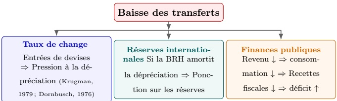
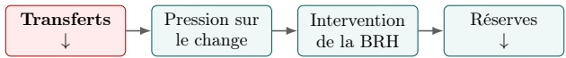
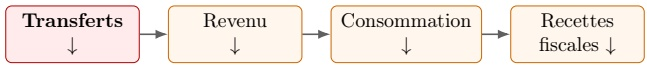
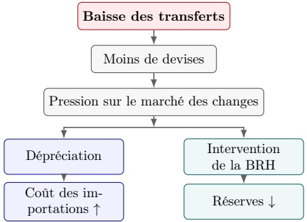
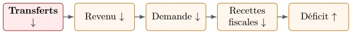

<!-- page 1 -->

## Choc des transferts et vulnérabilité macrofinancière en Haïti : les risques liés au TPS*

## Octobre 2026

Kensley Blaise, Jean Marie Cayemitte et Jean Gardy Victor

Département de Recherche en Économie et Finance (DREF)

Banque de la République d'Haïti (BRH)

<!-- page 2 -->

# Choc des transferts et vulnérabilité macrofinancière en Haïti : les risques liés au TPS*

Kensley Blaise Jean Marie Cayemitte Jean Gardy Victor

Banque de la République d'Haïti (BRH)

Département de Recherche en Economie et Finance (DREF)

Octobre 2026

## Résumé

Cette étude examine les répercussions macroéconomiques d'une contraction des transferts privés sans contrepartie vers Haïti, dans un contexte de durcissement de la politique migratoire américaine. L'analyse repose sur des données mensuelles couvrant la période d'octobre 2004 à septembre 2025 et mobilise cinq variables macrofinancières : les transferts privés, le taux de change, les réserves internationales nettes, le déficit public et l'indice des prix à la consommation (IPC). Les transferts permettent d'identifier le choc; les quatre autres variables servent, par la méthode des projections locales de Jordà (2005), à en estimer les canaux de transmission à l'économie haïtienne. Les résultats mettent en évidence des pressions significatives et persistantes à la dépréciation de la gourde, le taux de change constituent le canal de transmission le plus solidement identifié au cours de la première année suivant le choc. Une détérioration du déficit public est également observée. Bien que moins régulière, cette réponse se distingue par sa persistance, le test de surrogacité suggérant que les effets du choc continuent de se manifester sur l'ensemble de l'horizon de deux ans. Les réserves internationales nettes tendent également à diminuer, mais leur réponse n'est statistiquement significative qu'à certains horizons, témoignant d'une transmission moins nettement établie. Quant à l'inflation, les estimations suggèrent des pressions haussières compatibles avec un renchérissement des importations, sans toutefois révéler d'effet statistiquement significatif. Des simulations portant sur des contractions des transferts de 10%, 20% et 30% mettent par ailleurs en évidence une amplification proportionnelle des tensions sur le marché des changes, les réserves internationales et les finances publiques. Ces résultats soulignent la vulnérabilité de l'économie haïtienne aux chocs affectant les transferts de la diaspora et plaident pour une réponse préventive et coordonnée des autorités économiques, accordant une attention particulière à la stabilité du taux de change et à la soutenabilité des finances publiques.

Mots-clés. transferts de fonds, balance des paiements, réserves de change, dépréciation, stabilité financière, Haïti, choc identifié, projections locales.

Classification JEL. E58, F24, F31, F32, O54.

<!-- page 3 -->

## 1 Introduction

Les transferts privés de la diaspora constituent l'une des principales sources d'approvisionnement en devises étrangères de l'économie haïtienne. Représentant environ 17% du produit intérieur brut (PIB) en 2024, ils jouent un rôle essentiel dans le soutien à la consommation privée et l'alimentation du marché des changes (BRH, 2025). Leur importance s'est accrue dans un contexte marqué par une instabilité politique persistante et un affaiblissement des autres sources de financement extérieur. D'une part, l'incertitude politique et économique a pesé sur l'attractivité du pays auprès des investisseurs étrangers, limitant les entrées de capitaux sous forme d'investissements directs et de portefeuille. D'autre part, les difficultés structurelles de l'appareil productif ont freiné la capacité de l'économie à générer des recettes d'exportation suffisantes pour répondre à la demande de devises. À ces contraintes s'ajoute une incertitude croissante entourant les flux d'aide internationale, dans un contexte de réorientation des politiques d'assistance des principaux partenaires du pays. Les transferts de la diaspora apparaissent ainsi comme une source de devises relativement stable et essentielle au fonctionnement de l'économie haïtienne, dont la dépendance à ces flux s'est progressivement renforcée.

Cette dépendance soulève toutefois des préoccupations particulières dans un contexte de durcissement des conditions entourant le statut de protection temporaire (Temporary Protected Status, TPS) accordé aux ressortissants haïtiens aux États-Unis. L'expérience internationale montre en effet que les transferts peuvent être sensibles aux chocs affectant les revenus des migrants ou leurs conditions de séjour dans les pays d'accueil. Ainsi, la récession américaine de 2009 s'est accompagnée d'une diminution d'environ 15% des transferts vers le Mexique. $ ^{1} $ De même, au début de la pandémie de COVID-19, la Banque mondiale anticipait une contraction sans précédent des transferts internationaux, bien que ceux-ci se soient finalement révélés plus résilients que prévu (World Bank Group, 2020). Dans le cas d'Haïti, l'embargo économique imposé entre 1991 et 1994, puis renforcé par les États-Unis en 1994, constitue un précédent historique illustrant la vulnérabilité de l'économie aux chocs extérieurs. Cet épisode s'est notamment traduit par une contraction cumulée du PIB de l'ordre de 25% et un effondrement de l'emploi dans le secteur formel (Gibbons, 1999; Weiss et al., 1997).

Cette étude s'inscrit à l'intersection de trois courants de la littérature économique. Le premier porte sur les liens entre transferts de fonds des migrants et développementéconomique, en mettant notamment en évidence leur contribution au financement de la consommation des ménages et à la réduction de la pauvreté (Acosta et al., 2008; Chami et al., 2005; Barajas et al., 2009). Le deuxième, consacré plus spécifiquement à Haïti, souligne l'importance des transferts dans les revenus des ménages ainsi que la dépendance structurelle de l'économie à l'égard des ressources extérieures (Orozco, 2006; Fatton, 2002). Enfin, le troisième s'intéresse aux mécanismes de vulnérabilité externe et aux crises de balance des paiements, en particulier aux interactions entre les déséquilibres extérieurs, les mouvements du taux de change et l'évolution des réserves internationales (Krugman, 1979; Obstfeld, 1984; Kaminsky et Reinhart, 1999). En mobilisant ces trois perspectives, notre étude cherche à mieux comprendre comment une contraction des transferts de la diaspora se transmet aux principaux équilibres macroéconomiques haïtiens. Elle entend ainsi contribuer à la littérature sur les effets

<!-- page 4 -->

macroéconomiques des transferts, tout en apportant des éléments empiriques susceptibles d'éclairer les décisions de politique économique de la Banque de la République d'Haïti (BRH) et des autres autorités nationales.

Sur le plan méthodologique, cette étude mobilise la méthode des projections locales de Jordà (2005) afin d'estimer les réponses dynamiques de l'économie haïtienne à une contraction des transfertes privés sans contrepartie. L'analyse repose sur l'hypothèse selon laquelle un durcissement de la politique migratoire américaine, notamment des conditions entourant le statut de protection temporaire (TPS), pourrait entraîner une diminution des transferts de la diaspora et, par conséquent, engendrer un choc négatif susceptible de se propager à l'ensemble de l'économie haïtienne. Nous examinons cette transmission à travers quatre variables macrofinancières : le taux de change, les réserves internationales nettes, le déficit public et l'indice des prix à la consommation (IPC). Afin d'évaluer la fiabilité des réponses estimées, particulièrement aux horizons éloignés, nous recourons à la méthode de surrogacité proposée par Barnichon et Mesters (2026), utilisée ici comme outil d'évaluation de la robustesse des projections. Notre démarche empirique s'inspire également de la stratégie d'identification retenue dans l'étude de la Banque de la République d'Haïti consacrée aux chocs pétroliers (Blaise et al., 2026), assurant ainsi une cohérence méthodologique entre les deux exercices.²

La question centrale de cette étude est d'évaluer dans quelle mesure une contraction inattendue des transferts privés de la diaspora peut compromettre la stabilité macrofinancière d'Haïti et d'en identifier les principaux mécanismes de transmission. L'analyse privilégie quatre canaux : le taux de change, les réserves internationales nettes, le déficit public et le niveau général des prix, mesuré par l'indice des prix à la consommation (IPC). Notre hypothèse est qu'une diminution des transferts réduit l'offre de devises sur le marché des changes, accentuant ainsi les pressions à la dépréciation de la gourde. Lorsque la Banque centrale intervient pour atténuer ces pressions, cet ajustement peut également se traduire par une diminution des réserves internationales. Parallèlement, la contraction du revenu disponible des ménages et de la demande intérieure est susceptible de réduire les recettes fiscales et d'aggraver le déficit public. Dans un contexte de contraintes persistantes sur les financements intérieurs et extérieurs, un recours accru au financement monétaire du déficit pourrait, à son tour, alimenter les pressions inflationnistes. Ces mécanismes mettent en évidence les interdépendances entre les déséquilibres extérieurs, la situation budgétaire et la stabilité des prix dans l'économie haïtienne.

Pour examiner empiriquement ces mécanismes, nous identifions les innovations sur les transferts à partir des résidus d'un modèle autorégressif d'ordre six, AR(6), estimé sur leur taux de croissance mensuel. Cette approche permet de distinguer la composante prévisible des transferts, déterminée

<!-- page 5 -->

par leur dynamique passée, de leur composante inattendue. Les résidus du modèle sont ainsi interprétés comme des chocs non anticipés, correspondant aux écarts entre les variations effectivement observées et celles prédites à partir de l'information historique retenue. La section 4.2 présente les hypothèses sous-jacentes à cette stratégie d'identification ainsi que les conditions nécessaires à une interprétation causale des résultats. Nous mobilisons ensuite la méthode des projections locales de Jordà (2005) pour estimer, à différents horizons, les réponses dynamiques des variables macrofinancières à ces innovations. Afin d'apprécier l'ampleur des effets potentiels d'une contraction des transferts, nous construisons également trois scénarios correspondant à des baisses de 10%, 20% et 30% par rapport à leur niveau de référence. Les trajectories du taux de change, des réserves internationales nettes et du déficit public sont alors projetées sur un horizon de vingt-quatre mois.

Les résultats mettent en évidence une amplification des déséquilibres macrofinanciers à mesure que s'accentue la contraction des transferts. Une baisse de 10% se traduit, en moyenne sur l'horizon de projection, par une dépréciation de la gourde d'environ 0,7%, une diminution des réserves internationales nettes de 3,0% et une aggravation du déficit public de 71 millions de gourdes. Lorsque la contraction atteint 20%, ces effets s'élèvent respectivement à 1,6%, 6,1% et 151 millions de gourdes. Dans le scénario le plus défavorable, correspondant à une baisse de 30% des transferts, la dépréciation moyenne atteint 2,5%, la diminution des réserves 9,4% et le creusement du déficit public 241 millions de gourdes. Ces résultats, calculés relativement à un scénario de référence maintenant les variables à leurs niveaux initiaux, suggèrent une relation globalement proportionnelle entre l'ampleur du choc et l'intensité des ajustements macrofinanciers au cours des vingt-quatre mois suivant sa réalisation.

La robustesse des réponses estimées est examinée à l'aide du test de surrogacité proposé par Barnichon et Mesters (2026), qui permet d'évaluer dans quelle mesure les réponses initiales à un choc résument l'information contenue dans ses effets à des horizons plus éloignés. Cette approche vise notamment à déterminer si les ajustements observés à court terme constituent des indicateurs suffisamment représentatifs de la dynamique ultérieure ou si des effets additionnels continuent de se manifester au fil du temps. Les résultats suggèrent que cette propriété est largement vérifiée pour le taux de change et, dans une moindre mesure, pour les réserves internationales nettes. En revanche, son rejet à plusieurs horizons pour le déficit public indique que les ajustements budgétaires se déploient plus progressivement et ne peuvent être entièrement caractérisés par leur réponse initiale. Ces différences soulignent l'hétérogénéité des mécanismes de transmission et de leur persistance. Les résultats détaillés des tests sont présentés à l'annexe A.

Ces résultats mettent en lumière plusieurs enjeux pour la conduite de la politique économique en Haïti. Ils suggèrent qu'une réponse à une contraction des transferts ne saurait se limiter à la stabilisation du taux de change, mais devrait également tenir compte des interactions entre les réserves internationales, les finances publiques et les conditions monétaires. Dans cette perspective, la préservation des marges d'intervention de la Banque centrale, une gestion prudente des réserves, la mobilisation de financements extérieurs et le maintien de la crédibilité budgétaire apparaissent comme des composantes complémentaires d'une stratégie de stabilisation. Une telle coordination viserait à favoriser un ajustement macroéconomique ordonné et à limiter les effets de second tour susceptibles de transformer un choc initial sur les transferts en déséquilibres plus persistants sur les marchés des changes et dans les finances publiques.

La suite de l'article est organisée comme suit. La section 2 présente le contexte du TPS et les mécanismes de transmission en élargissant le cadre à d'autres économies présentant un niveau de dépendance aux transferts sans contrepartie similaires à celui d'Haïti. La section 3 expose le cadre théorique de l'ajustement de balance des paiements. La section 4 présente les données et le cadre de modélisation, en particulier l'identification du choc, avec l'indice des prix à la consommation (IPC) inclus comme contrôle et comme variable de réponse supplémentaire. La section 5 détaille

<!-- page 6 -->

les résultats empiriques et l'analyse de robustesse. La section 6 traduit ces résultats en scénarios de vulnérabilité et en tire la réponse de politique optimale. La section 7 conclut.

## 2 Contexte du TPS et canaux de transmission d'un choc de transferts

## erts

Le Temporary Protected Status (TPS) constitue un dispositif de protection temporaire permettant, sous certaines conditions, aux ressortissant(e)s de pays désignés de résider et de travailler légalement aux États-Unis. Pour Haïti, le dispositif a connu depuis 2010 une succession de désignations, prolongations, redésignations et décisions de terminaison. La chronologie retenue dans cette étude recense treize événements entre janvier 2010 et septembre 2025, dont plusieurs épisodes de prolongation du statut et deux périodes de durcissement particulièrement importantes, en novembre 2017 et au cours de la séquence février-septembre 2025. L'intérêt du TPS pour l'analyse macroéconomique ne réside pas dans son effet juridique en lui-même, mais dans son potentiel de transmission aux conditions économiques des migrants et, par cette voie, aux transferts vers Haïti. Le canal peut être représenté de manière stylisée par :

Facteurs d'atténuation : épargne, emploi alternatif, maintien des envois ou recomposition des transferts.

Cette relation n'est toutefois ni instantanée ni proportionnelle. Une modification du statut migratoire peut être partiellement absorbée par l'épargne des ménages de la diaspora, la recherche d'un emploi alternatif, les changements de composition des transferts ou encore la migration vers d'autres juridictions $ ^{3} $. Le TPS constitue ainsi un facteur de risque potentiel sur les transferts, plutôt qu'un déterminant dont l'effet quantitatif peut être déduit directement de la réglementation migratoire. Cette distinction est importante pour l'interprétation de l'analyse empirique. La stratégie principale ne cherche pas à identifier directement l'effet causal d'une décision relative au TPS. Elle mesure la transmission macrofinancière d'une innovation inattendue des transferts et utilise ensuite cette relation pour évaluer les conséquences de scénarios de baisse des flux.

Dans ce cadre, le TPS est traité dans ce travail comme le contexte institutionnel motivant les scénarios de risque, tandis que l'identification économétique repose sur les fluctuations inattendues des transferts elles-mêmes.

### 2.2 Les principaux canaux de transmission

Un choc de transferts affecte l'économie par l'intermédiaire de plusieurs mécanismes interdépendants. Dans le cadre retenu ici, quatre canaux sont privilégiés à savoir le marché des changes, les réserves internationales, les finances publiques et la dynamique des prix domestiques.

<!-- page 7 -->

Le canal du taux de change. Une réduction des transferts diminue les entrées nettes de devises. À politique inchangée, cette variation tend à accroître la pression sur le marché des changes. Une partie de l'ajustement peut alors être absorbée par une dépréciation de la monnaie nationale, conformément au mécanisme d'ajustement des déséquilibres extérieurs mis en évidence dans la littérature sur les crises de balance des paiements (Krugman, 1979; Obstfeld, 1984). Dans le cas d'une petite économie ouverte, comme celle d'Haiti, le taux de change constitue donc une variable d'ajustement centrale. Une dépréciation contribue au rétablissement de l'équilibre externe, mais elle peut également accroître le coût des biens importés et, par ce biais, exercer une pression à la hausse sur l'indice des prix à la consommation (IPC), un lien sur lequel nous revenons brièvement en sous-section 5.1. La dynamique du taux de change est en outre susceptible d'être amplifiée par les anticipations des agents, conformément au mécanisme mis en évidence par Dornbusch (1976).

Le canal des réserves internationales. Le taux de change ne constitue pas nécessairement l'unique variable d'ajustement. Si la Banque centrale cherche à limiter la vitesse ou l'ampleur de la dépréciation, elle peut intervenir sur le marché des changes en mobilisant ses réserves. Le mécanisme peut alors s'écrire :

L'intensité de ce canal dépend donc du comportement de la Banque centrale. Une forte flexibilité du taux de change peut limiter l'utilisation des réserves, tandis qu'une stratégie visant à amortir davantage l'ajustement du change peut entraîner une ponction plus importante sur le stock de réserves.

Le canal budgétaire. Le recul des transferts peut également affecter les finances publiques par l'intermédiaire de la demande intérieure. Une baisse du revenu des ménages peut réduire la consommation et, par conséquent, certaines recettes fiscales. Le mécanisme de premier ordre est alors :

La dépréciation du taux de change peut ensuite générer des effets supplémentaires sur les dépenses et les besoins de financement du secteur public. Dans une économie confrontée à des contraintes de financement, une détérioration simultanée des recettes et de la position extérieure peut accroître la pression sur les ressources domestiques et renforcer les risques de financement monétaire du déficit budgétaire.

### 2.3 Une architecture de transmission interdépendante

Les quatre canaux ne doivent pas être interprétés comme des mécanismes indépendants. Ils peuvent au contraire se renforcer successivement. Une représentation stylisée est :

<!-- page 8 -->

Parallèlement.

Les interactions entre ces mécanismes peuvent générer des effets de second tour. Une baisse des réserves réduit la capacité future d'intervention, tandis qu'une détérioration de la situation budgétaire peut accroître les besoins de financement. Par ailleurs, une dépréciation peut aggraver les déséquilibres macroéconomiques en rencherissant les importations et en alimentant les pressions inflationnistes. La littérature sur les crises de balance des paiements souligne précisément l'importance de ces interactions entre fondamentaux externes, réserves, anticipations et crédibilité des politiques économiques (Krugman, 1979; Obstfeld, 1984; Kaminsky et Reinhart, 1999). Dans cette perspective, le principal enjeu de politique économique n'est pas nécessairement de neutraliser intégralement le choc initial, mais de permettre un ajustement suffisamment ordonné pour éviter qu'une pression externe temporaire ne se transforme en dynamique cumulative de change, de réserves et de financement public.

### 2.4 Discussion de l'ajustement de court et de long terme

Un choc sur les transferts se transmet à l'économie haïtienne à travers plusieurs canaux. L'effet de premier tour attendu est une réduction des entrées en devises, conformément à la part estimée à environ 79 % des transferts reçus par Haïti qui proviendrait de la diaspora haïtienne résidant aux États-Unis (FMI, 2026). En l'absence d'intervention de la BRH, le taux de change doit absorber une partie de l'ajustement (Dornbusch, 1976). D'un autre côté, il faudra s'attendre à un creusement du déficit public, mécaniquement induit par la baisse des recettes fiscales qui accompagne celle de la consommation privée. En termes d'action, la BRH devra activement surveiller le marché pour éviter (i) un élargissement des écarts sur le marché des changes, (ii) une compression de la marge de réserves et (iii) une hausse de la probabilité d'un ajustement désordonné.

Dans un régime de quasi-dominance budgétaire, les chocs sur les transferts peuvent être déstabilisants. La perte de recettes fiscales contraint directement les options de financement du gouvernement et peut requérir la monétisation d'une partie du déficit public à long terme, ce qui affaiblit à son tour la monnaie. Cette boucle de rétroaction est particulièrement aiguë dans les économies dollarisées ou partiellement dollarisées comme Haïti, où les prix à l'importation sont rigides et où la dépréciation creuse directement les déséquilibres réels.

Notre compréhension est que les effets de long terme d'une contraction des transferts de la diaspora pourraient demeurer relativement limités si une réponse de politique économique appropriée

<!-- page 9 -->

et cohérente est mise en place. À long terme, la position externe nationale peut rester soutenable si la perte de transferts est partiellement compensée par un ajustement des importations et/ou par un financement externe. À court terme, en revanche, la contrainte de réserves peut créer une situation de forte volatilité (par exemple du taux de change) bien avant que les mécanismes d'ajustement de moyen et long terme ne produisent leurs effets. Dans ce contexte, une priorité de politique économique serait de préserver une capacité suffisante d'intervention pendant la fenêtre critique de la crise (les trois premiers mois), tout en évitant un basculement vers le financement monétaire du déficit public qui compromettrait l'ancrage nominal et la confiance des acteurs dans la volonté de faire ce qu'il faut pour défendre la stabilité macroéconomique.

## 3 Considérations théoriques

### 3.1 Une lecture néo-keynésienne du choc des transferts

Pour rendre claire la compréhension théorique de l'analyse, nous avons intégré de façon simplifiée le choc dans la structure d'un modèle néo-keynésien à la Galí et Monacelli (2005). La démarche n'est pas de créer un nouveau modèle d'équilibre général mais de démontrer comment un tel choc peut être lu dans la littérature macroéconomique. De ce fait, le choc des transferts est traité comme un choc de demande négatif, qui affecte le revenu disponible des ménages et, par conséquent, la consommation. La dépréciation du taux de change qui en résulte peut alimenter l'inflation importée et produire une configuration potentiellement stagflationniste. Dans ce cas, la politique monétaire se trouve alors confrontée à un arbitrage délicat entre contenir l'inflation et soutenir la production, avec des implications directes sur les réserves internationales et le déficit public.

Les transferts entrent dans le modèle comme un revenu exogène dans la contrainte budgétaire des ménages. Une baisse persistante réduit le revenu disponible et le revenu permanent, et, par l'équation d'Euler de la consommation, contracte la demande intérieure.

Nous résumons ci-dessous les trois relations standards d'un modèle néo-keynésien avec les chocs en question à travers la courbe de demande, la courbe de Phillips et la règle de politique monétaire,

 $$ x_{t}=\mathbb{E}_{t}x_{t+1}-\frac{1}{\sigma}\left(i_{t}-\mathbb{E}_{t}\pi_{t+1}-r_{t}^{n}\right)+\chi\tau_{t}, $$

 $$ \pi_{t}=\beta\mathbb{E}_{t}\pi_{t+1}+\kappa x_{t}+\lambda q_{t}, $$

 $$ i_{t}=\phi_{\pi}\pi_{t}+\phi_{x}x_{t}+\phi_{q}q_{t}, $$

où $x_t$ est l'écart de production, $\pi_t$ dénote l'inflation, $i_t$ est le taux directeur, $q_t$ dénote le taux de change réel et $\tau_t$ est considéré comme le choc de transferts, négatif en cas de baisse (positif dans le cas inverse). L'équilibre externe impose $q_t \approx -\psi \tau_t$ avec $\psi > 0$, de sorte qu'une baisse des transferts déprécie la monnaie.

Le choc de transferts apparaît à deux niveaux dans cet exercice simple. Dans l'équation (1), le terme  $ \chi \tau_t $, avec  $ \chi > 0 $, agit comme un choc de demande négatif qui affecte la production à la baisse. Dans l'équation (2), la dépréciation induite  $ q_t > 0 $ alimente un terme de coût  $ \lambda q_t $ qui pousse l'inflation à la hausse malgré l'écart de production négatif. La transmission de la politique monétaire s'en trouve compliquée, car les deux premiers termes de la règle (3) jouent en sens opposés, l'inflation appelant un resserrement et l'écart de production un assouplissement de la posture de la politique monétaire. En présence de crainte de la volatilité du taux de change, soit  $ \phi_q > 0 $, la banque centrale peut privilégier la défense du change à travers des interventions ciblées.

Le second canal est celui du taux de change réel. Les transferts constituent une entrée du compte des revenus secondaires de la balance des paiements produite par la Direction des Affaires

<!-- page 10 -->

Internationales de la BRH. Leur recul creuse le solde extérieur au taux de change réel initial, et le rétablissement de l'équilibre exige une dépréciation réelle. Dans une économie relativement dollarisée comme la nôtre où la répercussion des prix à l'importation est élevée, cette dépréciation renchérit les biens échangeables et engendre une inflation par les coûts. La configuration qui en résulte est potentiellement de nature stagflationniste, car la production se contracte tandis que l'inflation importée s'accélère.

Cette tension place la BRH devant un arbitrage important dans la mise en œuvre de sa politique pour faire face à une baisse de transferts. Une règle de type Taylor qui resserre pour contenir l'inflation approfondit la récession, tandis qu'un assouplissement soutient l'activité mais alimenté la dépréciation. La conclusion de cette discussion est qu'il y a beaucoup de paramètres dont il faut tenir compte pour évaluer l'ampleur du choc et la bonne combinaison de politiques économiques pour le contenir. Pour l'instant, le focus est mis sur une appréciation empirique d'un choc négatif des transferts, et les considérations en termes de politique économique feront l'objet d'une autre discussion.

Les signes que ce cadre de raisonnement analyse, à savoir une dépréciation du taux de change, une perte de réserves et un creusement du déficit, coïncideraient avec les réponses d'un modèle néo-keynésien de petite économie ouverte sous forte répercussion et contrainte de réserves. Notre identification empirique, présentée à la section 4, tente de procéder à un examen de ces prédictions.

## 4 Données et cadre de modélisation

### 4.1 Statistique descriptive

L'échantillon étudié compte 252 observations mensuelles couvrant la période d'octobre 2004 à septembre 2025. Le tableau 1 rassemble les statistiques descriptives des cinq séries observées, à savoir le nombre d'observations, la moyenne et la médiane comme paramètres de tendance centrale, l'écart-type comme mesure de dispersion, ainsi que l'asymétrie comme mesure de forme et l'aplatissement comme mesure du poids des valeurs extrêmes $ ^{4} $.

| Variable | N | Moyenne | Médiane | Écart-type | Asymétrie | Aplatissement |
| --- | --- | --- | --- | --- | --- | --- |
| Transferts | 252 | 166,73 | 132,49 | 96,41 | 0,79 | -0,52 |
| Taux de change | 252 | 67,77 | 47,20 | 34,46 | 0,99 | -0,43 |
| Réserves nettes (M USD) | 252 | 569,47 | 645,49 | 371,68 | -0,05 | -1,21 |
| Déficit public (M HTG) | 252 | -1 462,50 | -588,34 | 3 414,56 | -1,45 | 4,95 |
| IPC (indice) | 252 | 130,06 | 72,23 | 121,34 | 1,88 | 2,61 |

TABLE 1 – Statistiques descriptives des cinq séries observées, en niveau (M USD : millions de USD ; M HTG : millions de gourdes). L’aplatissement est exprimé en excès, nul pour la loi normale. Dans le modèle, le taux de change, les transferts et l’IPC entrent en logarithme, les réserves nettes entrent en logarithme après remplacement de ces huit valeurs négatives par un plancher positif (avec aucun effet sur l’analyse en question). Source : BRH.

À la lecture du tableau, les transferts et le taux de change présentent une asymétrie positive, ce qui est cohérent avec une tendance haussière. Les réserves nettes sont quasi symétriques, avec un aplatissement négatif traduisant une distribution s'étendant sur des régimes de niveau distincts. Le

<!-- page 11 -->

déficit public possède par une forte asymétrie négative et un aplatissement en excès élevé. L'IPC présente lui aussi une asymétrie et un aplatissement positifs marqués, cohérents avec des épisodes de forte accélération des prix sur certaines sous-périodes de l'échantillon.

La figure 1 présente les mêmes séries sous forme temporelle. Les flux de transferts, le taux de change, les réserves nettes et l'IPC évoluent d'une manière cohérente avec un cycle commun de transfert externe et une tendance haussière des prix domestiques. Le déficit public est de nature plus épisodique, mais des valeurs négatives importantes apparaissent surtout dans les périodes où la position externe est sous tension.

| Date | Transferts | Taux de change | Reserves nettes | Deficit public | IPC |
| --- | --- | --- | --- | --- | --- |
| 2004-01 | 4.0 | 3.60 | 4.5 | 0.0 | 3.60 |
| 2005-01 | 4.5 | 3.65 | 5.0 | 0.0 | 3.70 |
| 2006-01 | 4.2 | 3.55 | 6.0 | 0.0 | 3.90 |
| 2007-01 | 4.5 | 3.60 | 6.5 | 0.0 | 4.00 |
| 2008-01 | 4.8 | 3.70 | 7.0 | 0.0 | 4.10 |
| 2009-01 | 4.5 | 3.60 | 7.0 | 0.0 | 4.00 |
| 2010-01 | 4.8 | 3.70 | 7.5 | 0.0 | 4.10 |
| 2011-01 | 4.9 | 3.75 | 7.8 | 0.0 | 4.20 |
| 2012-01 | 4.8 | 3.70 | 7.8 | 0.0 | 4.20 |
| 2013-01 | 5.0 | 3.80 | 7.8 | 0.0 | 4.30 |
| 2014-01 | 5.2 | 3.90 | 7.5 | 0.0 | 4.50 |
| 2015-01 | 5.1 | 4.00 | 7.2 | 0.0 | 4.70 |
| 2016-01 | 5.3 | 4.10 | 7.0 | 0.0 | 4.90 |
| 2017-01 | 5.4 | 4.20 | 6.8 | 0.0 | 5.10 |
| 2018-01 | 5.5 | 4.30 | 6.5 | 0.0 | 5.30 |
| 2019-01 | 5.6 | 4.40 | 6.2 | 0.0 | 5.50 |
| 2020-01 | 5.7 | 4.50 | 6.0 | 0.0 | 5.70 |
| 2021-01 | 5.8 | 4.70 | 5.8 | 0.0 | 5.90 |
| 2022-01 | 5.9 | 4.80 | 5.5 | 0.0 | 6.10 |
| 2023-01 | 5.8 | 4.90 | 5.0 | 0.0 | 6.30 |
| 2024-01 | 5.9 | 4.90 | 4.0 | 0.0 | 6.50 |
| 2025-01 | 6.0 | 4.90 | 7.0 | 0.0 | 6.70 |

FIGURE 1 – Séries temporelles mensuelles des transferts, du taux de change, des réserves nettes, du déficit public et de l'indice des prix à la consommation (IPC). Les réserves nettes (en millions de USD) sont représentées après transformation en logarithme pour la lisibilité du graphique (valeurs négatives remplacées par un plancher positif) ; le déficit public est exprimé en millions de gourdes ; le taux de change, les transferts et l'IPC sont représentés en logarithme.

### 4.2 Identification du choc de transferts

Le modèle retrace les quatre canaux de stabilité économique par lesquels les chocs sur les transferts se propagent, à savoir le taux de change, les réserves, le déficit budgétaire et l'IPC. Les transferts entrent comme un bloc exogène au sens de Cushman et Zha (1997). Ce traitement des transferts sans contrepartie signifie que le pays subit les décisions américaines et que toute déviation anormales des transferts est indépendante de la structure de l'économie haïtienne. La portée économétique d'une telle hypothèse est qu'en régressant les quatre variables endogènes d'intérêt sur les transferts, le coefficient peut avoir une interprétation causale sans qu'il soit nécessaire d'imposer de fortes restrictions ou d'ajouter un vecteur de contrôles pour s'assurer que la covariance entre le choc et le terme d'erreur est égale à 0 $ ^{5} $.

Nous identifions le choc de transferts comme le résidu d'une régression autorégressive d'ordre 6 sur la croissance mensuelle des transferts,

 $$ \varepsilon_{t}=\Delta\log(\mathrm{rem}_{t})-\sum_{j=1}^{6}\hat{\rho}_{j}\Delta\log(\mathrm{rem}_{t-j}), $$

<!-- page 12 -->

où  $ \varepsilon_t $ est la part de la croissance des transferts que leur propre dynamique passée ne permet pas de prévoir, rem_t désigne les transferts sans contrepartie du mois t, l'opérateur  $ \Delta $ associé à une variable détermine son taux de croissance mensuel. En un mot, l'équation du choc représente la part de la croissance des transferts qui n'était pas prévisible à partir de leur propre dynamique récente. Une fenêtre de six mois couvre deux trimestres complets, ce qui permet de capter une partie de la saisonnalité des envois.

Cette procédure permet de disposer d'une série mensuelle d'innovations tout au long de l'échant-tillon, contrairement à une identification de type binaire pour capter les périodes de durcissement et de non-durcissement de la politique migratoire américaine. En effet, l'innovation ( $ \varepsilon_t $) représente une surprise dans la dynamique des transferts et non un choc structurel directement attribuable au TPS. Elle peut prendre en compte différentes sources d'innovations affectant les flux de transferts. Dans ce cadre, les résultats de la section suivante doivent être interprétés comme les réponses à un choc inattendu de transferts (non pas du TPS à proprement parler).

### 4.3 Estimation par projections locales

Pour chaque variable d'intérêt $w \in \{fx, nir, def, ipc\}$ et chaque horizon $h = 0, \ldots, 23$, nous estimons par projections locales à la Jordà (2005)

 $$ w_{t+h}-w_{t-1}=\tau_{h}\varepsilon_{t}+\sum_{j=1}^{6}\gamma_{h,j}\Delta x_{t-j}+\eta_{t+h}, $$

où  $ x_{t-j} $ contient les retards des cinq séries transformées. Nous estimons donc une régression séparée pour chaque horizon, au lieu d'ité per les mêmes coefficients d'un mois à l'autre. L'avantage est qu'une erreur dans la spécification dynamique ne se propage pas sur les vingt-quatre mois de l'horizon de prévision. Pour les erreurs-types, nous utilisons la correction de Newey et West (1987), qui tient compte de l'autocorrélation des résidus propre aux projections locales.

Le tableau 2 apporte les coefficients  $ \hat{\tau}_h $ estimés à une sélection d'horizons, y compris pour l'IPC, inclus comme quatrième variable de réponse.

| h | Taux de change $ \hat{\tau}_h $ | (log) t | Réserves $ \hat{\tau}_h $ | (arcsinh) t | Déficit (M HTG) $ \hat{\tau}_h $ | IPC $ \hat{\tau}_h $ | (log) t |
| --- | --- | --- | --- | --- | --- | --- | --- |
| 0 | -0,006 | -0,46 | +0,240 | +0,54 | -0,879 | -0,69 | -0,000 |
| 1 | -0,017 | -0,69 | +0,939 | +1,80 | +1,333 | +0,92 | -0,006 |
| 2 | -0,031 | -1,04 | +0,615 | +1,14 | +4,547 | +3,64 $ ^{*} $ | -0,005 |
| 3 | -0,052 | -1,59 | +1,108 | +1,85 | +2,092 | +1,38 | -0,010 |
| 5 | -0,163 | -2,11 $ ^{*} $ | +0,950 | +1,66 | -1,962 | -1,61 | -0,013 |
| 8 | -0,133 | -2,28 $ ^{*} $ | +0,024 | +0,05 | +0,204 | +0,18 | -0,018 |
| 11 | -0,131 | -1,91 | +0,447 | +0,49 | +3,219 | +2,38 $ ^{*} $ | -0,041 |
| 14 | -0,067 | -1,36 | +0,279 | +0,31 | +6,189 | +3,88 $ ^{*} $ | -0,052 |
| 17 | -0,037 | -0,61 | +0,250 | +0,28 | -1,320 | -0,83 | -0,041 |
| 20 | -0,018 | -0,31 | -0,606 | -0,92 | +1,281 | +0,55 | -0,066 |
| 23 | -0,026 | -0,56 | -1,559 | -1,90 | -0,526 | -0,31 | -0,039 |

* significatif à 5%. Réponse à une surprise positive de +1 sur  $ \varepsilon_t $ (hausse de la croissance des transferts); le signe attendu pour un choc négatif des transferts est l'opposé de celui affiché. Erreurs-types de Newey-West, troncature = h.

TABLE 2 – Fonctions de réponse par projections locales au choc  $ \varepsilon_{t} $ des transferts.

La colonne IPC est négative à l'ensemble des horizons rapportés, ce qui est cohérent avec le mécanisme théorique de la section 3.1. Notre interprétation est qu'une hausse des transferts apprécie

<!-- page 13 -->

la monnaie (colonne change, également négative) et réduit à due proportion l'inflation importée. Pour un choc négatif des transferts, la lecture en nous indique une inflation légèrement plus élevée que la référence, dans le sens attendu d'une dépréciation qui renchérit les biens importés. Aucun coefficient de la colonne IPC n'est cependant statistiquement distinguable de zéro, même au seuil de 10% ( $ |t| < 1,2 $ à tous les horizons rapportés), de sorte que ce signe doit être lu comme une indication directionnelle cohérente avec la théorie plutôt que comme une confirmation empirique du canal d'inflation importée.

Les fonctions de réponse associées permettent ensuite de suivre la trajectoire des quatre variables sur l'ensemble de l'horizon de vingt-quatre mois. Elles représentent la base empirique des scénarios présentés dans la section 6.

## 5 Résultats et analyse de robustesse

### 5.1 Fonctions de réponse impulsionnelle

La figure 2 rapporte les sentiers de réponse  $ \hat{\tau}_h $ du tableau 2, tracés directement à partir de la projection locale pour une innovation négative unitaire de  $ \varepsilon_t $, c'est-à-dire directement pour une baisse des transferts. Le premier cadran montre la trajectorye des transferts eux-mêmes. Il est important de souligner qu'il ne s'agit pas d'une nouvelle estimation, mais de la fonction de réponse impulsionnelle du modèle autorégressif d'ordre 6 qui sert déjà à construire  $ \varepsilon_t $ (équation (4)), cumulée de la même manière que les autres variables en niveau. Ce cadran ne comporte pas de bande d'erreur, car il s'agit de la réponse exacte du processus autorégressif lui-même, non d'une régression avec incertitude d'échantillonnage traitée de la même façon que les autres cadrans.

| Horizon (mois) | Transferts (Reponse centre) | Transferts (Intervalale à 90%) | Taux de change (Reponse centre) | Taux de change (Intervalale à 90%) | Réserves nettes (Reponse centre) | Réserves nettes (Intervalale à 90%) | Déficit public (Reponse centre) | Déficit public (Intervalale à 90%) | IPC (Reponse centre) | IPC (Intervalle à 90%) | Réserves nettes (Reponse centre) | Réserves nettes (Intervalle à 90%) |
| --- | --- | --- | --- | --- | --- | --- | --- | --- | --- | --- | --- | --- |
| 0 | -1.00 | 0.00 | 0.00 | 0.00 | -0.20 | 0.00 | 1.0 | 2.5 | 0.000 | 0.000 | 0.00 | 0.000 |
| 1 | -0.25 | 0.00 | 0.02 | 0.00 | -0.90 | -0.20 | 0.0 | 1.0 | 0.000 | 0.000 | -0.50 | 0.000 |
| 2 | -0.35 | 0.00 | 0.05 | 0.00 | -1.20 | -0.50 | -4.0 | 4.0 | 0.005 | 0.000 | -0.80 | 0.000 |
| 3 | -0.22 | 0.00 | 0.10 | 0.00 | -0.80 | -0.80 | 2.5 | 5.0 | 0.010 | 0.000 | -0.50 | 0.000 |
| 4 | -0.25 | 0.00 | 0.15 | 0.00 | -0.50 | -0.50 | 2.0 | 4.0 | 0.015 | 0.000 | -0.20 | 0.000 |
| 5 | -0.30 | 0.00 | 0.17 | 0.00 | -0.20 | -0.20 | 1.5 | 2.0 | 0.020 | 0.000 | -0.50 | 0.000 |
| 6 | -0.25 | 0.00 | 0.15 | 0.00 | -0.50 | -0.50 | 2.0 | 5.0 | 0.025 | 0.000 | -0.80 | 0.000 |
| 7 | -0.30 | 0.00 | 0.18 | 0.00 | -0.20 | -0.20 | 0.0 | 0.0 | 0.030 | 0.000 | -0.50 | 0.000 |
| 8 | -0.35 | 0.00 | 0.15 | 0.00 | -0.50 | -0.50 | -2.0 | -4.0 | 0.035 | 0.000 | -0.20 | 0.000 |
| 9 | -0.30 | 0.00 | 0.18 | 0.00 | -0.20 | -0.20 | 3.5 | 6.0 | 0.040 | 0.000 | -0.50 | 0.000 |
| 10 | -0.30 | 0.00 | 0.15 | 0.00 | 0.00 | 0.00 | -2.0 | -2.0 | 0.045 | 0.000 | -0.80 | 0.000 |
| 11 | -0.30 | 0.00 | 0.10 | 0.00 | -0.50 | -0.50 | 0.0 | 0.0 | 0.050 | 0.000 | -0.50 | 0.000 |
| 12 | -0.30 | 0.00 | 0.08 | 0.00 | -0.20 | -0.20 | -4.0 | -6.0 | 0.055 | 0.000 | -0.20 | 0.000 |
| 13 | -0.30 | 0.00 | 0.05 | 0.00 | -0.50 | -0.50 | 1.0 | 2.0 | 0.050 | 0.000 | -0.50 | 0.000 |
| 14 | -0.30 | 0.00 | 0.02 | 0.00 | -0.80 | -0.80 | -2.0 | -2.0 | 0.050 | 0.000 | -0.80 | 0.000 |
| 15 | -0.30 | 0.00 | 0.05 | 0.00 | -0.50 | -0.50 | 1.5 | 4.0 | 0.050 | 0.000 | -0.50 | 0.000 |
| 16 | -0.30 | 0.00 | 0.08 | 0.00 | -0.20 | -0.20 | -1.0 | -1.0 | 0.050 | 0.000 | -0.20 | 0.000 |
| 17 | -0.30 | 0.00 | 0.05 | 0.00 | 0.00 | 0.00 | 1.5 | 3.0 | 0.050 | 0.000 | 0.00 | 0.000 |
| 18 | -0.30 | 0.00 | 0.02 | 0.00 | 0.50 | 0.50 | -1.0 | -4.0 | 0.050 | 0.000 | 0.50 | 0.000 |
| 19 | -0.30 | 0.00 | 0.05 | 0.00 | 0.80 | 0.80 | 2.0 | 5.0 | 0.050 | 0.000 | 0.80 | 0.000 |
| 20 | -0.30 | 0.00 | 0.02 | 0.00 | 0.50 | 0.50 | -2.0 | -2.0 | 0.050 | 0.000 | 0.50 | 0.000 |
| 21 | -0.30 | 0.00 | 0.05 | 0.00 | 1.00 | 1.00 | 3.0 | 6.0 | 0.045 | 0.000 | 1.00 | 0.000 |
| 22 | -0.30 | 0.00 | 0.02 | 0.00 | 1.50 | 1.50 | -1.0 | -3.0 | 0.040 | 0.000 | 1.50 | 0.000 |

FIGURE 2 – Fonctions de réponse par projections locales à une innovation négative unitaire de  $ \varepsilon_{t} $. Les bandes ombrées rapportent un intervalle à 90%.

Le rebond visible sur le cadran des transferts, entre $h=0$ et $h=1$, est une propriété mécanique du modèle autorégressif sous-jacent et ne doit pas être lue comme le signe qu'un choc structurel comme une terminaison du TPS se résorberait aussi rapidement$^{6}$.

<!-- page 14 -->

Le taux de change affiche une réponse centrale positive tout au long de l'horizon de projection, ce qui correspond à une dépréciation de la monnaie nationale. La réponse est quasi nulle à l'impact, puis augmente progressivement au cours des mois suivants. Elle atteint ses niveaux les plus élevés entre le cinquième et le onzième mois, où elle oscille entre 0,13 et 0,18 point de log avec un pic de 0,175 au dixième mois, avant de diminuer progressivement pour se stabiliser autour de 0,02 à 0,04 point en fin d'horizon. Ce profil indique que la pression sur la gourde se construit avec un certain délai après le choc initial, compatible avec un marché des changes qui absorbe progressivement l'information sur la réduction des entrées de devises. Autrement dit, l'ajustement observé dans l'estimation est davantage compatible avec une accumulation progressive des tensions qu'avec une dépréciation instantanée suivie d'un retour rapide à la situation initiale. L'intervalle de confiance à 90% exclut zéro du quatrième au treizième mois environ, ce qui identifie le taux de change comme le canal le mieux identifié statistiquement, un résultat que confirme également le test de surrogacité de la section 5.2.

Les réserves internationales nettes présentent une dynamique qui oscille autour de zéro sans tendance marquée. La réponse est négative sur l'essentiel des douze premiers mois, avec un creux à -1,80 (échelle arsinh) vers le treizième mois, avant une remontée vers des valeurs positives à la fin de l'horizon (jusqu'à +1,56 aux vingt-deuxième et vingt-troisième mois). Cette dynamique est compatible avec une utilisation des réserves pour amortir les pressions exercées sur le marché des changes. Toutefois, l'intervalle de confiance à 90% n'exclut zéro qu'à quelques mois isolés, le premier, le troisième et le cinquième mois, puis à nouveau les vingt-deuxième et vingt-troisième, ce qui fait des réserves le canal le moins bien identifié statistiquement des trois canaux macrofinanciers. La direction dominante de la réponse centrale sur la première année reste cohérente avec une ponction sur les réserves, mais son ampleur exacte demeure entourée d'une incertitude substantielle, un message que confirme également, dans une moindre mesure que pour le change, le test de surrogacité de la section 5.2.

Le déficit public oscille nettement dans les deux sens tout au long de l'horizon de projection. Comme un déficit plus grand correspond ici à une valeur plus négative, une réponse qui plonge sous zéro signale un creusement du déficit, et une remontée au-dessus de zéro une atténuation passagère. En effet, le déficit se creuse au deuxième mois (-4,55,  $ |t| = 3,64 $), puis de nouveau au onzième (-3,22,  $ |t| = 2,38 $). L'effet atteint son maximum au quatorzième mois (-6,19,  $ |t| = 3,88 $) et reste marqué au quinzième (-4,02,  $ |t| = 2,40 $). Seul le vingt-et-unième mois montre une atténuation significative (+3,17,  $ |t| = 2,21 $).

En résumé, quatre épisodes sur cinq vont donc dans le sens d'une détérioration du déficit public. Le solde budgétaire tend nettement à se détériorer plutôt qu'à s'améliorer, ce qui rejoint le mécanisme décrit à la section 2.2. Quand le revenu disponible et la consommation baissent, les recettes fiscales devraient mécaniquement suivre la même trajectoire. C'est aussi le canal le plus persistant. Pour le change, et dans une moindre mesure pour les réserves, l'essentiel du contenu prédictif se concentre dans les six premiers mois. Le test de surrogacité de la section 5.2 montre au contraire que le canal budgétaire garde une influence propre sur les deux ans de l'horizon. Malgré sa volatilité à court terme, c'est donc lui qui pèse le plus sur la trajectoire des finances publiques à moyen terme.

Du côté des prix domestiques, sa réponse centrale est positive à l'ensemble des vingt-quatre horizons, cohérente en signe avec le mécanisme d'inflation importée du cadre théorique de la section 3.1.

<!-- page 15 -->

Donc, le mécanisme en question est que la dépréciation induite par le recul des transferts renchérit les biens échangeables. L'ampleur de la réponse croît progressivement sur l'horizon, jusqu'à un maximum de 0,066 point de log vers le vingtième mois. Comme déjà signalé au tableau 2, aucun coefficient n'est cependant statistiquement distinguable de zéro à un seuil conventionnel. Le rapport  $ |t| $ le plus élevé, atteint vers le treizième mois, reste inférieur à 1,2. Ce résultat directionnellement cohérent mais non significatif trouve sa justification dans un ensemble de facteurs : l'omission, dans cette spécification, d'autres déterminants importants des prix domestiques en Haïti, tels que les chocs sur les prix alimentaires et pétroliers internationaux ou le financement monétaire du déficit. Par ailleurs, les diagnostics de l'annexe D montrent que les propriétés de stationnarité de l'IPC sont plus ambiguës que celles des autres variables, ce qui appelle à une interprétation prudente de sa trajectoire, particulièrement au-delà des premiers mois (possible non reversion vers sa trajectoire de long terme).

À ce niveau, nous essayons de faire intervenir notre intuition d'économiste pour placer les résultats dans un contexte de prise de décision par la BRH. Premièrement, la réponse du taux de change n'est pas instantanée : elle se renforce sur les premiers mois avant d'atteindre son plein effet, ce qui laisse une fenêtre d'observation aux autorités avant que la pression ne devienne la plus vive. Deuxiè-mement, la BRH pourra se trouver dans une situation où il faudra intervenir pour renforcer le signal d'une banque centrale prête à défendre la monnaie nationale, sachant que l'ampleur statistiquement établie de la pression sur les réserves reste, à ce stade de l'identification, plus incertaine que celle sur le change. Troisièmement, l'effet budgétaire n'est pas immédiat au même titre que la réponse du change, mais il devient plus visible avec le temps et se distingue par sa persistance, ce qui explique l'importance d'une défense précoce des réserves avant que le poids du canal budgétaire ne s'accumule. Quatrièmement, le signal d'inflation importée, bien que cohérent avec le cadre théorique, n'est pas assez précisément estimé pour justifier à lui seul un arbitrage de politique monétaire; il renforce plutôt qualitativement l'argument en faveur d'une défense précoce du change développé aux points précédents.

### 5.2 Robustesse : test de surrogacité

Pour tester la qualité des résultats trouvés dans ce travail, nous mettons en œuvre un test fondé sur la notion de surrogacité de Barnichon et Mesters (2026). Les réponses causales de court terme sont estimées par projections locales sur les horizons  $ h = 0, \ldots, s $, où s est l'horizon de surrogacité et  $ w_t $ le vecteur des quatre variables,

 $$ w_{t+h}=\tau_{h}\varepsilon_{t}+B_{h}x_{t-1}+\zeta_{t+h}, $$

avec $x_{t-1}$ les retards des quatre séries. La condition de surrogacité affirme qu'une fois conditionné sur le bloc de substituts $y_{t:t+s} = (w_t', \ldots, w_{t+s}')$, le choc ne conserve pas de contenu prédictif pour les horizons lointains. Elle se teste dans la régression augmentée

 $$ w_{t+h}=\beta_{h s}y_{t:t+s}+\gamma_{h s}x_{t-1}+\delta_{h s}\varepsilon_{t}+\eta_{t+h},\qquad H_{0}:\delta_{h s}=0,h>s, $$

et, lorsqu'elle est acceptée, les effets de long terme se reconstruisent comme le produit des coefficients prédictifs et des réponses de court terme,

 $$ \begin{array}{r}{\hat{\theta}_{h}^{\mathrm{s u r}}=\hat{\beta}_{h s}\hat{\tau}_{0:s},\qquad h>s,}\end{array} $$

le lien prédictif  $ \hat{\beta}_{hs} $ étant estimé sur la variation inconditionnelle de l'échantillon entier, ce qui gagne en précision par rapport à la projection locale directe.

<!-- page 16 -->

Nous appliquons ce test aux trois canaux macrofinanciers du tableau 2 — le taux de change, les réserves nettes et le déficit public; l'IPC, inclus comme quatrième variable de réponse, n'est pas soumis à ce test. Les résultats détaillés par variable et par horizon de surrogacité figurent au tableau 5 de l'annexe A. La condition de surrogacité est acceptée pour le taux de change à la quasi-totalité des horizons testés et, dans une moindre mesure, pour les réserves nettes : à s = 6 mois, le choc ne conserve pratiquement aucun contenu prédictif propre au-delà de ce que les six premiers mois de réponse observée permettent déjà d'anticiper. Elle est en revanche rejetée à plusieurs horizons pour le déficit public, avec les statistiques  $ |t| $ les plus élevées de l'ensemble du test. Ce résultat est cohérent avec le mécanisme théorique de la section 3.1 : la perte de recettes fiscales liée au recul de la consommation privée est un canal qui se déploie avec un délai propre, distinct de la dynamique de court terme du choc lui-même, de sorte que la réponse à six mois ne suffit pas à résumer entièrement sa trajectoire à deux ans. Ce constat renforce, plutôt qu'il ne fragilise, la lecture du canal budgétaire comme le plus persistant des trois, le taux de change demeurant pour sa part le canal le mieux identifié statistiquement, tout en invitant à lire les horizons longs du canal des réserves avec davantage de prudence que ceux du change.

## 6 Scénarios de vulnérabilité et implications de politique économique

### 6.1 Construction des scénarios

Les résultats de la section précédente permettent de traduire la transmission estimée d'un choc de transferts en scénarios de vulnérabilité. L'objectif n'est pas de produire une prévision conditionnelle au sens strict, mais d'évaluer les conséquences macrofinancières de différentes amplitudes de contraction des transferts.

Nous projetons à vingt-quatre mois sous un régime de prévision conditionnelle. La variable de conditionnement est la trajectoire imposée des transferts, pour laquelle nous considérons trois scénarios correspondant à des pertes de transferts de 10%, 20% et 30% par rapport à la référence. Nous précisons que la référence est fixée aux derniers niveaux observés (taux de change : 130,64 ; réserves nettes : 1 342,75 millions USD ; déficit : -18 641,84 millions de gourdes ; transferts : 376,21 millions USD), maintenus constant sur tout l'horizon. L'échantillon se termine à des extrêmes historiques, les réserves étant proches d'un sommet et le déficit proche d'un creux, de sorte qu'une projection inconditionnelle en niveau reviendrait mécaniquement vers la moyenne de l'échantillon et confondrait cette réversion avec le choc. Présenter les scénarios comme des écarts à une référence plate isole l'effet du choc de transferts lui-même.

Pour chaque scénario, la trajectoire de choc cumulé, un recul de s% des transferts atteint progressivement sur six mois puis stabilisé, est décomposée en une séquence de surprises mensuelles  $ e_1, \ldots, e_6 $ (nulles au-delà). La réponse cumulée à l'horizon h pour chaque variable s'obtient par convolution causale avec les coefficients  $ \hat{\tau}_h $ estimés,

 $$ \widehat{\mathrm{d e v}}_{h}=\sum_{k=1}^{\min(h,6)}e_{k}\hat{\tau}_{h-k+1}, $$

une représentation de type moyenne mobile, valide sous l'hypothèse de linéarité habituelle des projections locales (Ramey, 2016). Cette approche de prévision conditionnelle est transparente quant au mécanisme de transmission du choc des transferts, dans la même veine que l'approche initialement retenue pour ce travail, mais ancrée directement dans la réponse estimée plutôt que dans un choix de paramètres.

<!-- page 17 -->

### 6.2 Résultats de scénarios

Les résultats des trois scénarios sont présentés dans le tableau 3 et la figure 3. Ils mesurent l'écart moyen, sur l'horizon de 24 mois, par rapport à une référence à niveaux constants. Une baisse des transferts de 10 %, 20 % et 30 % entraîne systématiquement une dépréciation du taux de change, une diminution des réserves internationales nettes, une détérioration du solde budgétaire et une hausse de l'IPC.

| Scénario | $ \bar{\Delta} $ change | $ \bar{\Delta} $ réserves | $ \bar{\Delta} $ déficit (M HTG) | $ \bar{\Delta} $ IPC |
| --- | --- | --- | --- | --- |
| -10% | +0,78% | -1,95% | -36,8 | +0,29% |
| -20% | +1,65% | -3,97% | -78,1 | +0,61% |
| -30% | +2,66% | -6,03% | -124,9 | +0,97% |

TABLE 3 – Écart moyen à la référence à niveaux constants sur l'horizon de prévision de vingt-quatre mois. Une variation positive du change est une dépréciation, une variation négative des réserves une déplétion, une variation négative du déficit un élargissement (un déficit plus grand entrant avec un signe plus négatif), et une variation positive de l'IPC une inflation par rapport à la référence.

Nous voudrions commencer cette partie du travail en rappelant que les scénarios doivent être lus comme des cas plausibles. Dans nos scénarios, même un recul de 10% s'accompagne d'un mouvement mesuré mais net sur le taux de change et les réserves dès la première année. Un recul de 20% double approximativement ces effets. Un recul de 30% les amplifie encore, sans que nos estimations ne fassent apparaître de rupture de régime entre les scénarios modéré et sévère, à la différence d'un exercice de calibrage où une telle non-linéarité pourrait être imposée sans être observée dans les données. La colonne IPC suit le même ordonnancement croissant avec la sévérité du choc, de +0,29% pour le scénario le plus modéré à +0,97% pour le plus sévère ; conformément à ce qui a déjà été signalé au tableau 2 et en section 5.1, ce signal doit être lu comme qualitativement cohérent avec le mécanisme d'inflation importée plutôt que comme une estimation précise, aucun coefficient sous-jacent n'étant statistiquement significatif.

Un point qui mériterait d'être signalé est que ces magnitudes sont d'une ampleur plus modérée que ne le suggérerait un calibrage non contraint par une identification statistique. Nous y voyons moins une faiblesse qu'une caractéristique : une identification resserrée, avec moins de degrés de liberté pour reproduire un récit préétabli, tend mécaniquement à produire des effets plus conservateurs. C'est le résultat le plus défendable que nous puissions produire sur cette question à ce stade. C'est également la raison pour laquelle la discussion de politique économique à la section 5 continue de se concentrer sur les 90 premiers jours : un recul qui arrive rapidement reste plus déstabilisant qu'un recul étalé sur plusieurs années, parce qu'il comprime la marge de réserves avant que les réponses budgétaire ou de financement ne puissent être mises en place.

<!-- page 18 -->

Prévisions par projections locales

| Transfers | 2025-10 | 2026-01 | 2026-04 | 2026-07 | 2026-10 | 2027-01 | 2027-04 | 2027-07 | 2027-10 |
| --- | --- | --- | --- | --- | --- | --- | --- | --- | --- |
| -10% | 370 | 350 | 338 | 338 | 338 | 338 | 338 | 338 | 338 |
| -20% | 363 | 330 | 300 | 300 | 300 | 300 | 300 |   |   |
| -30% | 358 | 308 | 263 | 263 | 263 | 263 | 263 |   |   |
| Reference | 378 | 378 | 378 | 378 | 378 | 378 | 378 | 378 | 378 |

| Date | Intervalle à 90 % (-30 %) | Red Line | Teal Line |
| --- | --- | --- | --- |
| 2025-10 | 130.7 | 130.7 | 130.7 |
| 2026-01 | 131.8 | 131.0 | 131.2 |
| 2026-04 | 134.5 | 132.2 | 133.0 |
| 2026-07 | 138.0 | 132.7 | 134.5 |
| 2026-10 | 138.2 | 132.8 | 135.4 |
| 2027-01 | 136.5 | 132.2 | 134.2 |
| 2027-04 | 133.2 | 131.5 | 132.3 |
| 2027-07 | 132.8 | 131.4 | 131.8 |
| 2027-10 | 132.8 | 131.5 | 131.9 |

| Date | Dark Blue | Yellow | Green | Red |
| --- | --- | --- | --- | --- |
| 2025-10 | 1330 | 1330 | 1330 | 1330 |
| 2026-01 | 1280 | 1220 | 1180 | 1240 |
| 2026-04 | 1220 | 1060 | 1040 | 1230 |
| 2026-07 | 1300 | 1200 | 1150 | 1320 |
| 2026-10 | 1350 | 1340 | 1340 | 1340 |
| 2027-01 | 1280 | 1240 | 1200 | 1280 |
| 2027-04 | 1220 | 1120 | 1180 | 1240 |
| 2027-07 | 1350 | 1350 | 1350 | 1350 |
| 2027-10 | 1620 | 1820 | 1600 | 1480 |

| Date | Dark Blue | Medium Blue | Light Blue |
| --- | --- | --- | --- |
| 2025-10 | -18600 | -18600 | -18600 |
| 2026-01 | -18850 | -18950 | -19050 |
| 2026-04 | -18700 | -18750 | -18800 |
| 2026-07 | -18400 | -18100 | -18000 |
| 2026-10 | -18600 | -18650 | -18700 |
| 2027-01 | -18900 | -19250 | -19550 |
| 2027-04 | -18850 | -19050 | -19250 |
| 2027-07 | -18600 | -18450 | -18550 |
| 2027-10 | -18600 | -18600 | -18650 |

| Date | Dark Blue | Medium Blue | Light Blue |
| --- | --- | --- | --- |
| 2025-10 | 556.0 | 556.0 | 556.0 |
| 2026-01 | 556.5 | 557.0 | 557.0 |
| 2026-04 | 557.0 | 559.0 | 559.0 |
| 2026-07 | 558.0 | 561.0 | 562.0 |
| 2026-10 | 559.0 | 563.0 | 566.0 |
| 2027-01 | 559.5 | 562.0 | 571.0 |
| 2027-04 | 559.5 | 562.5 | 573.0 |
| 2027-07 | 559.5 | 562.5 | 574.0 |
| 2027-10 | 559.5 | 562.0 | 575.5 |

FIGURE 3 – Prévisions par projections locales, référence et trois scénarios de choc. Les réserves nettes sont exprimées en millions de USD, le déficit public en millions de gourdes et l'IPC en indice. La bande ombrée rapporte un intervalle à 90% autour du scénario sévère.

| Month | -10% | -20% | -30% |
| --- | --- | --- | --- |
| 2025-10 | 0.0 | 0.0 | 0.0 |
| 2026-01 | 0.2 | 0.5 | 1.0 |
| 2026-04 | 1.2 | 2.8 | 4.5 |
| 2026-07 | 2.1 | 4.5 | 7.2 |
| 2026-10 | 2.0 | 4.0 | 6.5 |
| 2027-01 | 1.5 | 3.0 | 5.0 |
| 2027-04 | 0.8 | 1.5 | 2.5 |
| 2027-07 | 0.4 | 1.0 | 1.7 |
| 2027-10 | 0.5 | 1.2 | 2.0 |

| Date | -10% | -20% | -30% |
| --- | --- | --- | --- |
| 2025-10 | 0 | 0 | 0 |
| 2026-01 | -100 | -150 | -200 |
| 2026-04 | -120 | -200 | -280 |
| 2026-07 | -50 | -150 | -200 |
| 2026-10 | 0 | 0 | 0 |
| 2027-01 | -50 | -100 | -150 |
| 2027-04 | -80 | -150 | -250 |
| 2027-07 | 20 | 50 | 100 |
| 2027-10 | 120 | 280 | 450 |

| Date | -10% | -20% | -30% |
| --- | --- | --- | --- |
| 2025-10 | 25 | 25 | 25 |
| 2026-01 | -125 | -250 | -375 |
| 2026-04 | -50 | -100 | -200 |
| 2026-07 | 200 | 450 | 700 |
| 2026-10 | 50 | 50 | 50 |
| 2027-01 | -250 | -600 | -900 |
| 2027-04 | -150 | -250 | -500 |
| 2027-07 | 50 | 150 | 300 |
| 2027-10 | 25 | 50 | 50 |

| Date | -10% | -20% | -30% |
| --- | --- | --- | --- |
| 2025-10 | -5 | -15 | -20 |
| 2026-01 | -25 | -45 | -65 |
| 2026-04 | -38 | -75 | -98 |
| 2026-07 | -38 | -75 | -98 |
| 2026-10 | -38 | -75 | -98 |
| 2027-01 | -38 | -75 | -98 |
| 2027-04 | -38 | -75 | -98 |
| 2027-07 | -38 | -75 | -98 |
| 2027-10 | -38 | -75 | -98 |

| Date | -10% | -20% | -30% |
| --- | --- | --- | --- |
| 2025-10 | 0.0 | 0.0 | 0.0 |
| 2026-01 | 0.1 | 0.3 | 0.6 |
| 2026-04 | 0.4 | 1.2 | 2.0 |
| 2026-07 | 0.8 | 2.0 | 3.2 |
| 2026-10 | 1.6 | 3.5 | 5.5 |
| 2027-01 | 2.6 | 5.4 | 8.8 |
| 2027-04 | 2.8 | 6.0 | 9.8 |
| 2027-07 | 2.9 | 6.2 | 10.0 |
| 2027-10 | 2.8 | 6.0 | 9.8 |

FIGURE 4 – Trajectoires d'écart à la référence pour les cinq variables, y compris les transferts, dont la trajectoire de choc est imposée par construction et non estimée. Les écarts de réserves nettes et de transferts sont exprimés en millions de USD, l'écart de déficit public en millions de gourdes, et l'écart d'IPC en points d'indice.

### 6.3 Implications de politique économique

Les résultats plaident pour une réponse graduée et coordonnée, plutôt que pour une défense systématique du taux de change. Le premier enjeu est de préserver la liquidité et d'éviter qu'une contrac-

<!-- page 19 -->

tion rapide des transferts ne se traduise par un ajustement désordonné du marché des changes. Une utilisation prudente des réserves peut contribuer à lisser les mouvements excessifs du change, mais doit préserver une marge d'intervention suffisante pour les chocs ultérieurs. Un objectif stratégique central est d'éviter une boucle auto-renforçante dans laquelle les pertes de réserves conduisent à une panique de change, qui force à son tour de nouvelles pertes de réserves et des besoins d'emprunt budgétaire accrus. Cette dynamique est bien documentée dans la littérature des crises de marchés émergents, où l'interaction entre les ruées guidées par les anticipations et les pressions fondées sur les fondamentaux peut créer des équilibres multiples dans lesquels la crédibilité de la politique économique joue un rôle central (Morris et Shin, 2000).

Le deuxième enjeu est budgétaire. Le déficit constitue le canal dont la dynamique apparaît comme la plus persistante, le taux de change restant pour sa part le mieux identifié statistiquement. La réponse devrait donc préserver la crédibilité budgétaire et limiter le recours à des modes de financement susceptibles d'amplifier les tensions macroéconomiques. Le test de surrogacité confirme que les effets budgétaires ne se résument pas à leur dynamique des premiers mois, ce qui justifie un suivi au-delà de la phase initiale du choc.

Le troisième enjeu est la sécurisation rapide de financements externes. Celle-ci peut réduire la pression immédiate sur les réserves et donner davantage de temps aux autorités pour absorber le choc. L'analyse conduit ainsi à privilégier une séquence consistant à préserver la liquidité dans les premiers mois, limiter le surajustement du change, protéger l'ancrage budgétaire, mobiliser les appuis extérieurs et, après stabilisation, reconstituer les réserves

Le tableau 4 résume la logique de séquencement. Il s'agit d'abord de protéger la liquidité, ensuite de préserver l'ancrage du taux de change, et enfin de reconstituer les réserves une fois le choc passé. Cette séquence rejoint la pratique de gestion de crise des banques centrales décrite par Blinder (2013), avec une insistance particulière sur l'ancrage budgétaire compte tenu de la persistance propre de ce canal, établie en section 5 (le canal du taux de change demeurant pour sa part le mieux identifié statistiquement).

| Étape de politique | Justification |
| --- | --- |
| Défendre la liquidité durant les 90 premiers jours\nPlafonner le surajustement du change\nProtéger l'ancrage budgétaire | Préserver la confiance dans le système bancaire et réduire le risque de ruée.\nEmpêcher que les pertes de réserves ne se muent en un ajustement désordonné.\nÉviter le financement monétaire et empêcher que le déficit ne devienne un choc de second tour, canal le plus persistant de notre analyse (le change restant le mieux identifié statistiquement).\nLa facilité de crédit du FMI et le soutien de la Banque mondiale abaissent la probabilité d'épuisement des réserves. |
| Sécuriser l'assurance externe | La facilité de crédit du FMI et le soutien de la Banque mondiale abaissent la probabilité d'épuisement des réserves. |
| Reconstituer les réserves une fois la stabilisation acquise | Restaurer la marge pour les chocs futurs et réduire la probabilité d'une instabilité renouvelée. |

TABLE 4 – Séquencement de la réponse de politique économique sous un choc de transferts concentré en début de période.

Les résultats de cette séquence ne permettent pas de déterminer une combinaison optimale des

<!-- page 20 -->

instruments de politique économique au sens d'un problème formel d'optimisation. Ils permettent plutôt d'identifier les principaux arbitrages auxquels les autorités pourraient être confrontées sous différents scénarios de baisse des transferts. Ces arbitrages suggèrent qu'une stratégie de gestion du choc doit être graduée et coordonnée plutôt que fondée sur un instrument unique.

En définitive, l'analyse soutient une approche proactive centrée sur la gestion de la liquidité, la stabilité ordonnée du marché des changes, la préservation des réserves et la crédibilité budgétaire. Le premier trimestre suivant l'apparition d'un choc important constitue une période particulièrement sensible, car une contraction rapide des transferts peut réduire les marges de manœuvre externes avant que les mécanismes d'ajustement budgétaire et de financement externe ne produisent pleinement leurs effets.

## 7 Conclusion

Dans ce travail, nous avons mis en évidence qu'un arrêt soudain des transferts peut avoir des conséquences importantes sur la stabilité économique du pays. Surtout, la réponse des autorités face au choc de transferts est cruciale pour contenir ses effets de court terme et dès lors son impact direct sur l'économie. La banque centrale et le gouvernement ont par conséquent besoin d'une réponse coordonnée qui privilégie la liquidité, la défense des réserves et la crédibilité, avec une attention particulière portée au canal budgétaire, le plus persistant de notre analyse (le taux de change demeurant le canal le mieux identifié statistiquement). Les enseignements tirés d'autres marchés émergents confrontés à des chocs de transferts suggèrent qu'une action précoce et déterminée, en particulier sur les fronts des réserves et du change, peut contribuer à prévenir des crises monétaires auto-réalisatrices et préserver la marge de manœuvre pour un ajustement graduel (Kaminsky et Reinhart, 1999; Morris et Shin, 2000).

Sur le plan pratique, nous pensons que l'horizon de décision pertinent est le premier trimestre après le choc. Une défense mesurée des réserves, une stratégie de communication claire et un financement externe préarrangé figurent parmi les instruments qui comptent le plus dans cette fenêtre. L'analyse soutient ainsi une posture de politique économique proactive et centrée sur la gestion de la liquidité et de la confiance, plutôt que sur des ajustements réactifs, avec une ampleur d'intervention ancrée dans une identification statistique plutôt que dans un exercice de calibrage libre.

Le principal enseignement concernant le TPS est méthodologique. L'innovation de transferts utilisée comme choc principal ne constitue pas une identification directe de l'effet causal des décisions migratoires américaines. La stratégie narrative fondée sur le TPS s'est révélée trop faible pour être utilisée comme instrument principal. Le TPS doit donc être considéré comme une source potentielle de risque susceptible de provoquer une contraction des transferts, plutôt que comme un choc directement estimé.

L'étude présente néanmoins plusieurs limites, notamment la faiblesse de l'identification spécifique du TPS, le nombre réduit d'épisodes exploitables et l'hypothèse de transmission linéaire. Les prolongements prioritaires concernent l'utilisation de données de transferts à fréquence plus élevée et l'introduction de non-linéarités liées aux régimes de réserves ou de tension sur le marché des changes.

<!-- page 21 -->

### Annexe A. Résultats détaillés du test de surrogacité

Le tableau 5 apporte, pour chaque variable et chaque horizon de surrogacité s, le nombre de rejets de l'hypothèse nulle sur les horizons testés, la statistique de Student maximale en valeur absolue et le gain prédictif moyen défini à la section 5.2. La note sous le tableau en donne la lecture.

<table><tr><td></td><td>s = 3</td><td>s = 6</td></tr><tr><td>Variable</td><td>Rejets à 5%</td><td>|t| max</td><td>Gain prédictif</td><td>Rejets à 5%</td><td>|t| max</td><td>Gain prédictif</td></tr><tr><td>Taux de change</td><td>1/21</td><td>2,02</td><td>+0,84%</td><td>0/18</td><td>1,24</td><td>+0,54%</td></tr><tr><td>Réserves nettes</td><td>3/21</td><td>2,35</td><td>+0,44%</td><td>1/18</td><td>2,07</td><td>+0,29%</td></tr><tr><td>Déficit public</td><td>6/21</td><td>3,92</td><td>+1,39%</td><td>5/18</td><td>4,59</td><td>+1,47%</td></tr></table>

Résultats du test de surrogacité, hypothèse nulle  $ \delta_{hs} = 0 $ dans l'équation (7) pour  $ h > s $, avec des écarts-types de Newey et West. La colonne « Rejets à 5% » compte les horizons où l'innovation de transferts conserve un contenu prédictif significatif au-delà des substituts, sur les 21 (resp. 18) horizons testés au-delà de  $ s = 3 $ (resp.  $ s = 6 $), et « Gain prédictif » mesure le gain prédictif résiduel moyen du choc, soit la réduction moyenne de l'erreur quadratique attribuable à  $ \varepsilon_t $ une fois conditionné sur les substituts.

TABLE 5 – Résultats du test de surrogacité.

Lecture. La condition de surrogacité est acceptée pour le taux de change aux deux horizons et, pour l'essentiel, pour les réserves. Elle est rejetée à plusieurs horizons pour le déficit public, signe d'effets budgétaires différés que les réponses de court terme ne captent pas et qui invitent à lire les trajectories budgétaires à long horizon avec prudence, tout en confirmant que ce canal, déjà repéré comme le plus persistant au tableau 2, est aussi celui dont la dynamique s'étend le plus loin dans le temps. Calculs des auteurs à partir des données de la Banque de la République d'Haïti.

### Annexe B. Instrument narratif fondé sur la chronologie du TPS

Une voie alternative pour resserrer l'identification du choc de transferts consiste à instrumenter leur croissance par une chronologie narrative des décisions de politique migratoire américaine, plutôt que de s'en remettre à l'innovation autorégressive  $ \varepsilon_t $ de l'équation (4). Le tableau 6 recense treize décisions relatives au statut de protection temporaire (TPS) d'Haïti entre janvier 2010 et septembre 2025, codées selon leur sens (durcissement ou assouplissement), à partir des avis publiés au Federal Register et des annonces du Department of Homeland Security.

<!-- page 22 -->

| Date | Événement | Signe |
| --- | --- | --- |
| 2010-01 | Désignation initiale du TPS pour Haïti (post-séisme) | +2 |
| 2011-05 | Prolongation et redésignation, 18 mois | +1 |
| 2012-10 | Prolongation, 18 mois | +1 |
| 2014-03 | Prolongation, 18 mois | +1 |
| 2015-08 | Prolongation, 18 mois | +1 |
| 2017-05 | Kelly n'accorde que 6 mois au lieu de 18 (signal de durcissement) | -1 |
| 2017-11 | Duke annonce la terminaison du TPS (effet différé à juillet 2019) | -2 |
| 2019-04 | Le juge Kuntz bloque la terminaison | +1 |
| 2021-08 | Biden/Mayorkas redésigne pour 18 mois, éligibilité élargie | +2 |
| 2022-12 | Extension annoncée jusqu'à août 2024 | +1 |
| 2024-07 | Extension et redésignation, 18 mois, jusqu'à février 2026 | +1 |
| 2025-02 | Noem annonce l'écourtement à août 2025 | -2 |
| 2025-07 | Avis officiel de terminaison, effectif le 2 septembre 2025 | -2 |

TABLE 6 – Chronologie des décisions de politique migratoire américaine relatives au TPS d'Haïti, utilisée pour construire l'instrument narratif  $ D_{t} $. Sources : avis publiés au Federal Register et annonces du Department of Homeland Security.

Sur les treize événements recensés, deux seulement constituent de véritables épisodes de durcissement majeur (novembre 2017 et février-septembre 2025), ce dernier tombant en toute fin d'échantillon. Nous testons la force de  $ D_t $ comme instrument de  $ \varepsilon_t $ en régressant l'innovation de transferts sur  $ D_t $ cumulé sur différentes fenêtres, en présence des mêmes retards de contrôle que dans l'équation (5). Le tableau 7 rapporte les résultats.

| Fenêtre de cumul | Coefficient | Statistique F |
| --- | --- | --- |
| 1 mois | +0,0122 | 0,19 |
| 2 mois | -0,0053 | 0,07 |
| 3 mois | -0,0037 | 0,05 |
| 6 mois | -0,0141 | 1,47 |
| 9 mois | -0,0098 | 1,02 |
| 12 mois | -0,0074 | 0,72 |

TABLE 7 – Force de la première étape ( $ \varepsilon_{t} $ sur l’instrument  $ D_{t} $, cumulé sur différentes fenêtres). Le seuil usuel de robustesse (Staiger et Stock, 1997) est F = 10 ; il n’est jamais atteint.

La statistique $F$ ne dépasse jamais 1,5, très en deçà du seuil conventionnel de robustesse de 10. Un instrument aussi faible produirait, par une estimation en deux étapes, des coefficients biaisés vers l'estimation non instrumentée et des écarts-types qui ne reflètent pas l'incertitude réelle; nous ne rapportons donc pas de tels résultats. À titre de vérification, la réponse en forme réduite (directement de $D_t$ sur le taux de change, les réserves et le déficit, sans passer par les transferts) est instable en signe et rarement significative selon les horizons, ce qui confirme le diagnostic plutôt que de le contredire.

La raison de fond est que l'histoire du TPS haïtien ne contient pas assez d'épisodes de durcissement indépendants pour identifier une réponse dynamique sur vingt-quatre mois avec précision : la variation exploitable se résume, pour l'essentiel, à deux épisodes séparés de plusieurs années. C'est pourquoi ce travail retient l'innovation autorégressive  $ \varepsilon_t $, dont la variation est mensuelle et continue sur l'ensemble de l'échantillon, comme identification principale. La chronologie du tableau 6 garde une valeur de repère qualitatif et pourrait redevenir exploitable statistiquement si des données de

<!-- page 23 -->

fréquence plus élevée, des volumes hebdomadaires de transferts par exemple, devenaient disponibles.

### Annexe C. Prior hiérarchique informé par un panel de pays comparables

Une seconde voie non retenue consisterait à emprunter de la force statistique à un panel de pays comparables par leur dépendance aux transferts, tels le Salvador, le Honduras, le Guatemala, la Jamaïque et le Mexique, en estimant sur ce panel des élasticités de transmission transferts → change, transferts → réserves et transferts → déficit, puis en les utilisant comme moyenne a priori informative pour compléter l'identification haïtienne, plutôt qu'un prior centré sur zéro ou qu'une identification purement univariée.

L'intérêt de cette approche est direct : Haïti ne traverse, sur l'ensemble de son histoire de bénéficiaire du TPS, qu'un nombre limité d'épisodes de choc de grande ampleur, ce qui borne mécaniquement la précision atteignable par les données haïtiennes seules, comme le montre l'annexe B. Un panel de pays structurellement comparables, et pour certains également exposés à des changements de politique migratoire américaine, offrirait davantage de variation indépendante pour ancrer l'ampleur plausible de la transmission, tout en laissant les données haïtiennes déterminer la dynamique propre au pays.

Cette voie n'a pas été mise en œuvre dans le cadre de ce travail pour une raison d'accès aux données plutôt que de principe. Les séries de transferts et de taux de change à fréquence mensuelle existent pour ces pays comparables, notamment dans les International Financial Statistics du FMI, mais le solde budgétaire mensuel y est rarement publié : la plupart des pays cités ne rapportent leur solde budgétaire qu'à fréquence trimestrielle ou annuelle. Une mise en œuvre complète se limiterait donc, au mieux, aux deux canaux du change et des réserves, laissant le canal budgétaire, pourtant le plus persistant dans notre analyse haïtienne, sans bénéfice comparable. Réunir ces séries en masse dépasse par ailleurs l'accès dont nous disposions pour cet exercice. Nous recommandons que cette extension soit explorée avec un accès institutionnel direct aux bases de données du FMI, dont la BRH dispose en tant que banque centrale membre.

### Annexe D. Tests de diagnostic : stationnarité et sélection du nombre de retards

Cette annexe répond à deux remarques formulées lors de la relecture interne : l'absence de tests de stationnarité sur les séries mobilisées, et la justification du nombre de retards  $ P = 6 $ par des considérations institutionnelles plutôt que par des critères d'information formels.

### D.1 Tests de stationnarité

Le tableau 8 apporte les tests ADF, KPSS et Phillips-Perron sur les niveaux (avec constante et tendance) et les premières différences (avec constante) des quatre séries du corps du texte, et le tableau 9 refait cet exercice avec l'IPC ajouté comme cinquième série.

<!-- page 24 -->

| Série | ADF (stat) | ADF (p) | KPSS (stat) | KPSS (p) | PP (stat) | PP (p) |
| --- | --- | --- | --- | --- | --- | --- |
| log(taux de change) [niveau] | -2,606 | 0,277 | 0,460 | 0,000 | -2,192 | 0,494 |
| log(transferts) [niveau] | -2,378 | 0,392 | 0,223 | 0,009 | -16,378 | 0,000 |
| arcsinh(réserves nettes) [niveau] | -2,585 | 0,287 | 0,229 | 0,008 | -6,209 | 0,000 |
| déficit public (kHTG) [niveau] | -2,644 | 0,260 | 0,103 | 0,149 | -11,253 | 0,000 |
| $ \Delta $ log(taux de change) [ $ 1^{{re}} $ diff.] | -8,065 | 0,000 | 0,154 | 0,379 | -8,766 | 0,000 |
| $ \Delta $ log(transferts) [ $ 1^{{re}} $ diff.] | -5,315 | 0,000 | 0,013 | 0,997 | -58,137 | 0,000 |
| $ \Delta $ arcsinh(réserves nettes) [ $ 1^{{re}} $ diff.] | -4,901 | 0,000 | 0,044 | 0,909 | -31,465 | 0,000 |
| $ \Delta $ déficit public (kHTG) [ $ 1^{{re}} $ diff.] | -4,960 | 0,000 | 0,131 | 0,452 | -31,282 | 0,000 |

Tendance et constante pour les niveaux, constante seule pour les différences.  $ H_0 $ de l'ADF et du PP : racine unitaire.  $ H_0 $ du KPSS : stationnarité.

TABLE 8 – Tests de stationnarité sur les niveaux et premières différences des quatre séries du modèle.

| Série | ADF (stat) | ADF (p) | KPSS (stat) | KPSS (p) | PP (stat) | PP (p) |
| --- | --- | --- | --- | --- | --- | --- |
| log(taux de change) [niveau] | -2,606 | 0,277 | 0,460 | 0,000 | -2,192 | 0,494 |
| log(transferts) [niveau] | -2,378 | 0,392 | 0,223 | 0,009 | -16,378 | 0,000 |
| arcsinh(réserves nettes) [niveau] | -2,585 | 0,287 | 0,229 | 0,008 | -6,209 | 0,000 |
| déficit public (kHTG) [niveau] | -2,644 | 0,260 | 0,103 | 0,149 | -11,253 | 0,000 |
| log(IPC) [niveau] | +1,412 | 1,000 | 0,544 | 0,000 | +1,959 | 1,000 |
| $ \Delta $ log(taux de change) [ $ 1^{{re}} $ diff.] | -8,065 | 0,000 | 0,154 | 0,379 | -8,766 | 0,000 |
| $ \Delta $ log(transferts) [ $ 1^{{re}} $ diff.] | -5,315 | 0,000 | 0,013 | 0,997 | -58,137 | 0,000 |
| $ \Delta $ arcsinh(réserves nettes) [ $ 1^{{re}} $ diff.] | -4,901 | 0,000 | 0,044 | 0,909 | -31,465 | 0,000 |
| $ \Delta $ déficit public (kHTG) [ $ 1^{{re}} $ diff.] | -4,960 | 0,000 | 0,131 | 0,452 | -31,282 | 0,000 |
| $ \Delta $ log(IPC) [ $ 1^{{re}} $ diff.] | -2,064 | 0,259 | 1,506 | 0,000 | -8,139 | 0,000 |

Tendance et constante pour les niveaux, constante seule pour les différences.  $ H_0 $ de l'ADF et du PP : racine unitaire.  $ H_0 $ du KPSS : stationnarité.

TABLE 9 – Tests de stationnarité, avec l’IPC ajouté comme cinquième série.

Lecture. Pour les quatre séries du corps du texte, les trois tests donnent un diagnostic cohérent : aucun ne rejette la racine unitaire en niveau au seuil de 5% pour l'ADF, le KPSS rejette la stationnarité en niveau pour trois des quatre séries, et les premières différences rejettent nettement la racine unitaire selon les trois tests. Ce constat est cohérent avec le choix, déjà fait dans le corps du texte, de transformer les séries en logarithme ou en différence avant de les inclure dans les contrôles de l'équation (5). Le cas de l'IPC est plus délicat : en première différence, l'ADF ne rejette pas la racine unitaire ( $ p = 0,259 $) alors que le PP la rejette nettement ( $ p < 0,001 $) et le KPSS rejette la stationnarité, un diagnostic mixte qui n'apparaît pour aucune des quatre autres séries. Cette ambiguïté, plausiblement liée à des changements de régime dans la dynamique des prix sur la période d'étude, invite à traiter avec prudence les résultats du corps du texte qui mobilisent l'IPC (tableau 2, figure 2 et tableau 3), en particulier au-delà d'un horizon de quelques mois.

### D.2 Sélection du nombre de retards

Le tableau 10 rapporte l'ordre de retard sélectionné par les quatre critères d'information usuels sur un VAR du système différencié à quatre variables, pour des ordres testés jusqu'à 18 mois, et le tableau 11 refait cet exercice pour le système à cinq variables incluant  $ \Delta \log(\text{ipc}) $.

<!-- page 25 -->

| Critère | Ordre retenu (mois) |
| --- | --- |
| AIC | 16 |
| BIC | 2 |
| HQIC | 12 |
| FPE | 16 |
| Retenu dans le modèle (justification économique) | 6 |

TABLE 10 – Ordre de retard sélectionné par critère d’information, système à quatre variables.

| Critère | Ordre retenu (mois) |
| --- | --- |
| AIC | 17 |
| BIC | 2 |
| HQIC | 12 |
| FPE | 17 |
| Retenu dans le modèle (justification économique) | 6 |

TABLE 11 – Ordre de retard sélectionné par critère d’information, système à cinq variables avec IPC.

Les quatre critères ne convergent pas vers un ordre commun : le critère bayésien (BIC), le plus parcimonieux, retient 2 retards dans les deux systèmes, tandis que l'AIC et le FPE, moins pénalisants, en retiennent 16 à 17, le HQIC se situant à 12 dans les deux cas. L'ordre P = 6 retenu dans le modèle se situe entre ces extrêmes, sans coïncider exactement avec aucun des quatre critères. Il reste justifié, comme indiqué dans le corps du texte, par le cycle budgétaire trimestriel et le délai plausible de transmission du choc plutôt que par une optimisation statistique ; ce tableau documente explicitement que ce choix n'est pas dicté de façon univoque par les critères d'information usuels, sans qu'aucun des ordres alternatifs ne s'impose non plus comme un choix manifestement supérieur.

<!-- page 26 -->

## Références

Acosta, P. A., Calderon, C., Fajnzylber, P., and Lopez, H. (2008). What is the impact of international remittances on poverty in Latin America? World Development, 36(1):89–114.

Banque de la République d'Haïti (BRH) (2025). Double circulation monétaire : identification des risques. Document d'information, MAE/BRH, No. DI-0013, Port-au-Prince.

Barajas, A., Chami, R., Fullenkamp, C., Gapen, M., and Montiel, P. (2009). Do workers' remittances promote economic growth? IMF Working Paper 09/153, International Monetary Fund.

Barnichon, R. and Mesters, G. (2026). Surrogacy in time series. Unpublished manuscript.

Blaise, K., Cayemitte, J. M., Israel, E., Leandre, L. et Victor, J.G. (2026). Dépendance énergétique et chocs pétroliers : Une analyse empirique de la transmission macroéconomique en Haïti. Working Papers de la BRH, No. WP/2026/2.

Blinder, A. S. (2013). After the Music Stopped: The Financial Crisis, the Response, and the Work Ahead. Penguin Press, New York.

Chami, R., Fullenkamp, C., and Jahjah, S. (2005). Are immigrant remittance flows a source of capital for development? IMF Staff Papers, 52(1):55–81.

Dornbusch, R. (1976). Expectations and exchange rate dynamics. Journal of Political Economy, 84(6):1161–1176.

Fatton, R. (2002). Haiti's Predatory Republic: The Unending Transition to Democracy. Lynne Rienner, Boulder, CO.

Fonds monétaire international (FMI) (2026). Haiti : Third Review Under the Staff-Monitored Program and Request for Extension. IMF Country Report, No. 26/107, Washington, DC.

Galí, J. and Monacelli, T. (2005). Monetary policy and exchange rate volatility in a small open economy. Review of Economic Studies, 72(3):707–734.

Gibbons, E. D. (1999). Sanctions in Haiti: Human Rights and Democracy under Assault. Praeger, Center for Strategic and International Studies, Westport, CT.

Jordà, Ô. (2005). Estimation and inference of impulse responses by local projections. American Economic Review, 95(1):161–182.

Kaminsky, G. L. and Reinhart, C. M. (1999). The twin crises: The causes of banking and balance-of-payments problems. American Economic Review, 89(3):473–500.

Krugman, P. (1979). A model of balance-of-payments crises. Journal of Money, Credit and Banking, 11(3):311–325.

Litterman, R. B. (1986). Forecasting with Bayesian vector autoregressions—five years of experience. Journal of Business & Economic Statistics, 4(1):25–38.

Morris, S. and Shin, H. S. (2000). Rethinking multiple equilibria in macroeconomic modeling. NBER Macroeconomics Annual, 15:139–161.

Newey, W. K. and West, K. D. (1987). A simple, positive semi-definite, heteroskedasticity and autocorrelation consistent covariance matrix. Econometrica, 55(3):703–708.

Obstfeld, M. (1984). Balance-of-payments crises and devaluation. Journal of Money, Credit and Banking, 16(2):208–217.

Orozco, M. (2006). Understanding the remittance economy in Haiti. Paper commissioned by the World Bank, Inter-American Dialogue, Washington, DC.

<!-- page 27 -->

Ramey, V. A. (2016). Macroeconomic shocks and their propagation. In Handbook of Macroeconomics, vol. 2, pages 71–162. Elsevier.

Staiger, D. and Stock, J. H. (1997). Instrumental variables regression with weak instruments. Econometrica, 65(3):557–586.

Waggoner, D. F. and Zha, T. (1999). Conditional forecasts in dynamic multivariate models. Review of Economics and Statistics, 81(4):639–651.

Weiss, T. G., Cortright, D., Lopez, G. A., and Minear, L. (1997). Political Gain and Civilian Pain: Humanitarian Impacts of Economic Sanctions. Rowman & Littlefield, Lanham, MD.

World Bank Group (2020). COVID-19 crisis through a migration lens. Migration and Development Brief 32, World Bank, Washington, DC.

<!-- page 28 -->

Working Paper

WP | 2026 | no 4
