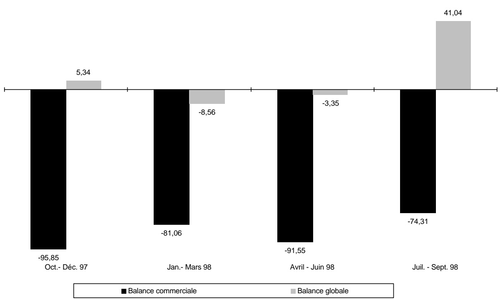

<!-- page 1 -->

## Bulletin Statistique 31

Octobre 1997 - Septembre 1998

<!-- page 2 -->

## Table des matières

Avertissement .....5
I- Statistiques monétaires et financières
Tableau 1.1 Principaux indicateurs monétaires .....10
Tableau 1.2 Situation monétaire .....11
Tableau 1.3 Liquidités du système bancaire .....13
Tableau 1.4 Taux de réserves obligatoires .....13
Tableau 1.5 Spread sur le marché formel des changes .....13
Tableau 1.6 Volume des transactions sur le marché formel des changes .....14
Tableau 1.7 Taux d'intérêt mensuels du système bancaire .....16
Tableau 1.8 Taux d'intérêt mensuels sur le marché monétaire .....16
Tableau 1.9 Dépôts du secteur privé .....17
Tableau 1.10 Dépôts : parts de marché .....18
Tableau 1.11 Crédit au secteur privé .....20
Tableau 1.12 Crédit : parts de marché .....22
Tableau 1.13 Bilan consolidé des banques commerciales .....24
Tableau 1.14 Bilan de la BRH .....26
Tableau 1.15 Encours des bons BRH .....28
Tableau 1.16 Avoirs extérieurs nets de la BRH .....29

II- Finances publiques
Tableau 2.1 Résumé des opérations financières des administrations publiques .....32
Tableau 2.2 Recettes des administrations publiques .....33
Tableau 2.3 Dépenses des administrations publiques .....35
Tableau 2.4 Endettemment total du secteur public .....36
Tableau 2.5 Dette publique externe .....37

III- Balance des paiements
Tableau 3.1 Résumé de la balance des paiements .....40
Tableau 3.2 Principaux produits exportés .....41
Tableau 3.3 Exportations des industries d'assemblage vers les États-Unis d'Amérique à base de matières premières importées .....42
Tableau 3.4 Exportations vers les États-Unis d'Amérique à base de matières premières locales .....43
Tableau 3.5 Importations par grandes catégories de produits .....45
Tableau 3.5a Importations de produits pétroliers .....46
Tableau 3.6 Évolution de l'indice du taux de change réel bilatéral Haiti-États-Unis d'Amérique .....47

<!-- page 3 -->

## Table des matières (suite)

IV- Prix et autres indicateurs economiques

Tableau 4.1 Indice des prix à la consommation (IPC) pour l'ensemble du pays .....50
Tableau 4.2 Taux d'inflation .....50
Tableau 4.3 Taux de change à Port-au-Prince .....51
Tableau 4.4 Prix moyen de détail de certains produits sur l'ensemble du pays .....51
Tableau 4.5 Prix moyen des matériaux de construction .....52
Tableau 4.6 Activités du secteur de la construction à Port-au-Prince .....52
Tableau 4.7 Nouvelles entreprises déclarées à Port-au-Prince et nombre correspondant d'employés .....53
Tableau 4.8 Nouvelles entreprises enregistrées à l'ONA et nombre correspondant d'assurés .....53
Tableau 4.9 Production de certaines industries .....53
Tableau 4.10 Évolution de la consommation d'électricité en Haiti .....54

Annexe graphique

Graphique 1 Agrégats M1, M2, M3 .....56
Graphique 2 Contreparties de M3 .....57
Graphique 3 Encours des bons BRH .....58
Graphique 4 Dépôts du secteur privé .....59
Graphique 5 Crédit au secteur privé .....60
Graphique 6 Recettes et dépenses des administrations publiques .....61
Graphique 7 Endettlement total du secteur public .....62
Graphique 8 Balances commerciale et globale .....63
Graphique 9 Indice du taux de change réel bilatéral Haiti-États Unis d'Amérique .....64
Graphique10 Taux d'inflation (variation mensuelle de l'IPC; novembre 1996=100) .....65
Graphique11 Taux d'inflation (variation en glissement annuel) .....66
Graphique12 Taux de change .....67

<!-- page 4 -->

# Avertissement

## Statistiques monétaires et financières

Les statistiques monétaires sont présentées selon les critères de classification établis dans le manuel Guide des Statistiques Monétaires et Bancaires publiées dans Statistiques Financières Internationales du Fonds Monétaire International (1987). Elles représentent des données de stock (fin de période) qui sont collectées mensuellement.

## Finances publiques

Les statistiques des finances publiques sont présentées selon les critères de classification établis dans le Manuel de Référence des Finances Publiques (1986) du FMI. Elles représentent des données de flux qui sont collectées mensuellement et sont enregistrées sur la base des encaissements-décaissements. Ces données subissent un traitement qui tient compte de la spécificité du contexte haïtien. Étant donné qu'Haïti ne dispose pas d'un budget général consolidé, les recettes enregistrées sont celles du Trésor excluant celles des unités de production marchande du secteur public. Les dépenses enregistrées sont celles effectuées par le Trésor pour le compte de l'Administration Centrale, et comprennent également les dépenses réalisées sur financement externe pour l'ensemble des administrations publiques.

## Balance des paiements

Les statistiques de la balance des paiements sont des données de flux. Elles sont présentées selon les critères établis dans la 5ème Édition du Manuel de la Balance des Paiements du FMI. Les transactions sur les biens sont enregistrées sur une base brute. Les transferts de capital réfèrent surtout à des annulations d'engagements par un ou plusieurs créanciers qui ne reçoivent rien en échange (remise de dette).

Les transferts courants sont ceux qui ne peuvent être dits transferts de capital. Ils comprennent les transferts en espèces entre administrations publiques destinés à financer leurs dépenses courantes, les transferts en nature (tels que dons d'aliments, de médicaments et d'autres biens de consommation), les envois de fonds de travailleurs émigrés, etc.

La variation des avoirs de réserves est présentée sous forme d'avoirs bruts à l'exclusion des engagements envers le FMI et des engagements envers le FIV (enregistrés dans les engagements constituent des réserves pour les autorités étrangères). Ceux-ci sont présentés séparément.

L'indice de taux de change réel bilatéral (1991=100) est calculé à partir de l'indice des prix à la consommation (IPC) des États-Unis produit par le US Department of Labor (1982-84=100). Le changement de base est effectué à partir de la moyenne annuelle de la série pour l'année 1991 (1982-84=100). L'indice de taux de change nominal (1991=100) est calculé de la manière suivante : Taux de référence de fin de période du mois X / Taux de référence moyen pour l'année 1991.

<!-- page 5 -->

## Avertissement (suite)

## Prix et autres indicateurs économiques

Les informations regroupées sous la dénomination Prix et autres indicateurs économiques réfèrent aux données de production, d'emplois, de prix et aussi d'activités du secteur de la construction. Il s'agit dans la plupart des cas de données brutes agrégées et tabulées. L'indice des prix à la consommation est un indice de Laspeyres (période de base novembre 1996 avec pondération de 1986-1987) qui couvre l'ensemble du territoire national.

Le taux de change de la monnaie nationale par rapport au dollar américain (Gde / $) est aussi présenté au niveau de cette section pour les marchés formel (banques et agents de change) et informel. Le taux de référence de la BRH représente une moyenne pondérée des taux de ces marchés.

## Liste des sigles utilisés dans le Bulletin Statistique

| AGD | Administration Générale des Douanes |
| --- | --- |
| AIB | Autres institutions bancaires |
| BEL | Banques d'épargne et de logement |
| BID | Banque Interaméricaine de Développement |
| BNC | Banque Nationale de Crédit |
| BRH | Banque de la République d'Haïti |
| BRI | Banque de Règlements Internationaux |
| CIF | Cost, Insurance and Freight |
| DTS | Droits de Tirage Spéciaux |
| EDH | Électricité d'Haïti |
| ERF | Établissements Raymond Flambert |
| EU | États-Unis d'Amérique |
| FIV | Fonds d'Investissement Vénézuélien |
| FMI | Fonds Monétaire International |
| FOB | Free on Board |
| IFNB | Institutions financières non bancaires |
| IHSI | Institut Haïtien de Statistique et d'Informatique |
| IPC | Indice des prix à la consommation |
| MEF | Ministère de l'Économie et des Finances |
| MG | Millions de gourdes |
| OEA | Organisation des États Américains |
| OFATMA | Office Assurance Accidents du Travail et Maternité |
| OFI | Organisations financières internationales |

<!-- page 6 -->

## I- Statistiques monétaires et financières

<!-- page 7 -->

Tableau 1.1

|   | Oct. 97 | Nov. 97 | Déc. 97 | Jan. 98 | Fév. 98 | Mars 98 | Avr. 98 | Mai 98 | Juin 98 | Juil. 98 | Août 98 | Sept. 98 |
| --- | --- | --- | --- | --- | --- | --- | --- | --- | --- | --- | --- | --- |
| Monnaie en circulation | 3 304,00 | 3 352,00 | 3 935,40 | 3 658,20 | 3 643,10 | 3 587,60 | 3 488,30 | 3 461,30 | 3 338,10 | 3 433,80 | 3 410,60 | 3 516,24 |
| Base monétaire | 7 832,68 | 8 082,27 | 8 518,62 | 8 374,31 | 8 367,36 | 8 555,14 | 8 560,00 | 8 591,82 | 8 544,56 | 8 786,02 | 9 125,75 | 9 290,70 |
| M1 | 5 717,79 | 5 800,74 | 6 353,97 | 6 288,01 | 6 265,94 | 6 055,67 | 5 724,33 | 5 842,26 | 5 675,12 | 5 829,71 | 6 052,42 | 6 143,45 |
| M2 | 12 933,73 | 13 059,31 | 13 672,61 | 13 705,14 | 13 693,48 | 13 627,97 | 13 395,07 | 13 707,44 | 13 676,24 | 13 852,61 | 14 121,96 | 13 332,39 |
| M3 | 16 592,85 | 16 713,68 | 17 815,98 | 17 826,69 | 17 807,25 | 17 880,07 | 17 667,74 | 17 771,19 | 17 664,92 | 18 001,67 | 18 380,00 | 18 874,73 |
| Crédit intérieur | 13 186,90 | 13 558,34 | 14 148,86 | 14 388,49 | 14 317,28 | 14 546,21 | 14 523,83 | 14 829,18 | 14 792,85 | 14 667,68 | 14 856,12 | 14 856,54 |
| Avoirs extérieurs nets | 4 722,36 | 4 558,96 | 4 996,73 | 4 701,99 | 4 726,29 | 4 801,25 | 4 533,75 | 4 310,24 | 4 028,25 | 4 410,23 | 4 641,25 | 5 114,78 |
| Total dépôts en gourdes | 9 629,73 | 9 707,32 | 9 737,24 | 10 046,95 | 10 050,42 | 10 040,38 | 9 906,75 | 10 246,17 | 10 338,13 | 10 418,83 | 10 711,34 | 10 816,15 |
| Total dépôts en dollars EU $ ^{{1/}} $ | 3 659,12 | 3 654,37 | 4 143,38 | 4 121,55 | 4 113,76 | 4 252,10 | 4 272,67 | 4 063,75 | 3 988,68 | 4 149,06 | 4 258,05 | 4 492,17 |
| Indice de dollarisation : |   |   |   |   |   |   |   |   |   |   |   |   |
| Dépôts en dollars en % de M3 | 22,05 | 21,86 | 23,26 | 23,12 | 23,10 | 23,78 | 24,18 | 22,87 | 22,58 | 23,05 | 23,17 | 23,80 |

Source : Direction Monnaie et Analyse Économique, BRH.

1/ Convertis en gourdes au taux de référence de fin de mois de la BRH.

<!-- page 8 -->

Tableau 1.2

<table><tr><td>Situation monétaire\n(en millions de gourdes)</td></tr><tr><td></td><td>Oct. 97</td><td>Nov. 97</td><td>Déc. 97</td><td>Jan. 98</td><td>Fév. 98</td><td>Mars 98</td></tr><tr><td>Avoirs extérieurs nets</td><td>4 722,37</td><td>4 558,96</td><td>4 996,73</td><td>4 701,99</td><td>4 726,29</td><td>4 801,25</td></tr><tr><td>$ ^{{1/}} $ Avoirs extérieurs</td><td>6 781,20</td><td>6 606,84</td><td>7 060,97</td><td>6 799,56</td><td>6 778,45</td><td>6 844,91</td></tr><tr><td>$ ^{{1/}} $ Enaaements extérieurs</td><td>-2 058,83</td><td>-2 047,88</td><td>-2 064,24</td><td>-2 097,58</td><td>-2 052,16</td><td>-2 043,66</td></tr><tr><td>Crédit intérieur</td><td>13 186,90</td><td>13 558,34</td><td>14 148,86</td><td>14 388,49</td><td>14 317,28</td><td>14 546,21</td></tr><tr><td>Créances nettes sur le secteur public</td><td>5 060,83</td><td>5 195,33</td><td>5 402,42</td><td>5 502,86</td><td>5 433,21</td><td>5 523,84</td></tr><tr><td>Créances nettes sur le gouvernement central</td><td>5 205,54</td><td>5 326,64</td><td>5 552,75</td><td>5 606,07</td><td>5 593,27</td><td>5 684,19</td></tr><tr><td>Créances nettes sur les collectivités locales</td><td>-15,30</td><td>-25,40</td><td>-30,59</td><td>-33,33</td><td>-35,35</td><td>-51,23</td></tr><tr><td>Créances nettes sur les entreprises publiques</td><td>-129,41</td><td>-105,91</td><td>-119,74</td><td>-69,88</td><td>-124,72</td><td>-109,13</td></tr><tr><td>Créances sur le secteur privé</td><td>8 126,07</td><td>8 363,00</td><td>8 746,44</td><td>8 885,63</td><td>8 884,08</td><td>9 022,37</td></tr><tr><td>ACTIF = PASSIF</td><td>17 909,26</td><td>18 117,30</td><td>19 145,59</td><td>19 090,47</td><td>19 043,57</td><td>19 347,46</td></tr><tr><td>M3</td><td>16 592,85</td><td>16 713,67</td><td>17 815,98</td><td>17 826,69</td><td>17 807,24</td><td>17 880,07</td></tr><tr><td>M2</td><td>12 933,73</td><td>13 059,30</td><td>13 672,61</td><td>13 705,14</td><td>13 693,48</td><td>13 627,97</td></tr><tr><td>M1</td><td>5 717,79</td><td>5 800,73</td><td>6 353,97</td><td>6 288,01</td><td>6 265,94</td><td>6 055,67</td></tr><tr><td>Monnaie en circulation</td><td>3 304,00</td><td>3 351,98</td><td>3 935,37</td><td>3 658,19</td><td>3 643,06</td><td>3 587,59</td></tr><tr><td>Dépôts à vue</td><td>2 413,79</td><td>2 448,75</td><td>2 418,60</td><td>2 629,82</td><td>2 622,88</td><td>2 468,08</td></tr><tr><td>Quasi-monnaie</td><td>7 215,95</td><td>7 258,57</td><td>7 318,64</td><td>7 417,13</td><td>7 427,55</td><td>7 572,30</td></tr><tr><td>Dépôts d'épargne</td><td>4 898,91</td><td>4 938,49</td><td>4 981,96</td><td>5 043,88</td><td>5 050,34</td><td>5 049,48</td></tr><tr><td>Dépôts à terme et autres</td><td>2 317,03</td><td>2 320,08</td><td>2 336,68</td><td>2 373,25</td><td>2 377,21</td><td>2 522,81</td></tr><tr><td>Dépôts en dollars EU  $ ^{{1/}} $</td><td>3 659,12</td><td>3 654,37</td><td>4 143,38</td><td>4 121,55</td><td>4 113,76</td><td>4 252,10</td></tr><tr><td>Dépôts à vue</td><td>975,82</td><td>995,06</td><td>1 166,56</td><td>1 103,68</td><td>1 146,07</td><td>1 225,68</td></tr><tr><td>Dépôts d'épargne</td><td>1 224,03</td><td>1 250,41</td><td>1 353,72</td><td>1 387,73</td><td>1 393,10</td><td>1 426,32</td></tr><tr><td>Dépôts à terme et autres</td><td>1 459,27</td><td>1 408,90</td><td>1 623,09</td><td>1 630,14</td><td>1 574,60</td><td>1 600,10</td></tr><tr><td>Autres postes nets</td><td>1 316,41</td><td>1 403,62</td><td>1 329,61</td><td>1 263,78</td><td>1 236,32</td><td>1 467,38</td></tr><tr><td>Comptes de capital</td><td>2 565,21</td><td>2 493,27</td><td>2 600,78</td><td>2 665,90</td><td>2 656,33</td><td>2 733,58</td></tr><tr><td>Créances nettes interbancaires</td><td>-157,39</td><td>-80,59</td><td>-99,03</td><td>-233,85</td><td>-319,55</td><td>-121,42</td></tr><tr><td>Autres postes non classés</td><td>-1 091,41</td><td>-1 009,06</td><td>-1 172,15</td><td>-1 168,27</td><td>-1 100,46</td><td>-1 144,78</td></tr></table>

Source : Direction Monnaie et Analyse Économique, BRH.

1/ Convertis au taux de référence de fin de mois de la BRH.

<!-- page 9 -->

Tableau 1.2 (suite)

|   | Avr. 98 | Mai 98 | Juin 98 | Juil. 98 | Août 98 | Sept. 98 |
| --- | --- | --- | --- | --- | --- | --- |
| Avoirs extérieurs nets | 4 533,75 | 4 310,24 | 4 028,25 | 4 410,23 | 4 641,25 | 5 115,12 |
| Avoirs extérieurs $ ^{{1/}} $ | 6 492,10 | 6 283,02 | 5 925,87 | 6 348,29 | 6 567,85 | 6 978,80 |
| Enaoements extérieurs $ ^{{1/}} $ | -1 958,34 | -1 972,78 | -1 897,62 | -1 938,06 | -1 926,60 | -1 863,68 |
| Crédit intérieur | 14 523,83 | 14 829,18 | 14 792,85 | 14 667,68 | 14 856,12 | 14 856,54 |
| Créances nettes sur le secteur public | 5 416,38 | 5 697,40 | 5 657,83 | 5 491,80 | 5 769,76 | 5 752,82 |
| Créances nettes sur le gouvernement central | 5 480,71 | 5 823,68 | 5 750,44 | 5 687,07 | 5 869,46 | 5 901,18 |
| Créances nettes sur les collectivités locales | -27,32 | -25,53 | -20,91 | -21,36 | -17,58 | -17,05 |
| Créances nettes sur les entreprises publiques | -37,01 | -100,75 | -71,70 | -173,92 | -82,12 | -131,31 |
| Créances sur le secteur privé | 9 107,46 | 9 131,78 | 9 135,02 | 9 175,88 | 9 086,36 | 9 103,72 |
| ACTIF = PASSIF | 19 057,59 | 19 139,43 | 18 821,10 | 19 077,90 | 19 497,37 | 19 971,65 |
| M3 | 17 667,74 | 17 771,19 | 17 664,92 | 18 001,67 | 18 380,00 | 18 824,56 |
| M2 | 13 395,07 | 13 707,44 | 13 676,24 | 13 852,61 | 14 121,95 | 14 332,39 |
| M1 | 5 724,33 | 5 842,25 | 5 675,11 | 5 829,71 | 6 052,42 | 6 143,54 |
| Monnaie en circulation | 3 488,32 | 3 461,27 | 3 338,11 | 3 433,78 | 3 410,61 | 3 516,24 |
| Dépôts à vue | 2 236,00 | 2 380,98 | 2 337,01 | 2 395,93 | 2 641,81 | 2 627,30 |
| Quasi-monnaie | 7 670,74 | 7 865,19 | 8 001,12 | 8 022,90 | 8 069,54 | 8 188,84 |
| Dépôts d'épargne | 5 111,60 | 5 024,01 | 5 028,35 | 4 972,12 | 4 924,11 | 4 955,50 |
| Dépôts à terme et autres | 2 559,14 | 2 841,18 | 2 972,77 | 3 050,78 | 3 145,43 | 3 233,35 |
| Dépôts en dollars EU $ ^{{1/}} $ | 4 272,67 | 4 063,75 | 3 988,68 | 4 149,06 | 4 258,05 | 4 492,17 |
| Dépôts à vue | 1 196,39 | 1 032,20 | 1 076,03 | 1 062,65 | 1 066,83 | 1 205,29 |
| Dépôts d'épargne | 1 395,07 | 1 436,12 | 1 371,12 | 1 461,35 | 1 511,24 | 1 516,37 |
| Dépôts à terme et autres | 1 681,21 | 1 595,44 | 1 541,54 | 1 625,06 | 1 679,98 | 1 770,51 |
| Autres postes nets | 1 389,84 | 1 368,23 | 1 156,18 | 1 076,23 | 1 117,37 | 1 147,09 |
| Comptes de capital | 2 738,65 | 2 717,11 | 2 532,44 | 2 532,56 | 2 684,27 | 2 880,58 |
| Créances nettes interbancaires | -174,26 | -161,30 | -143,55 | -346,47 | -396,49 | -338,92 |
| Autres postes non classés | -1 174,55 | -1 187,58 | -1 232,71 | -1 109,86 | -1 170,41 | -1 394,57 |

Source : Direction Monnaie et Analyse Économique, BRH.

1/ Convertis au taux de référence de fin de mois de la BRH.

<!-- page 10 -->

Tableau 1.3

<table><tr><td>Liquidités du système bancaire (en millions de gourdes)</td></tr><tr><td></td><td>Oct. 97</td><td>Nov. 97</td><td>Déc. 97</td><td>Jan. 98</td><td>Fév. 98</td><td>Mars 98</td><td>Avr. 98</td><td>Mai 98</td><td>Juin 98</td><td>Juil. 98</td><td>Aout 98</td><td>Sept. 98</td></tr><tr><td>Solde des encaisses et dépôts de réserves</td><td>3 113,00</td><td>3 234,18</td><td>3 271,12</td><td>3 374,61</td><td>3 447,08</td><td>3 378,25</td><td>3 470,09</td><td>3 450,13</td><td>3 543,31</td><td>3 514,11</td><td>3 675,74</td><td>3 684,38</td></tr><tr><td>Réserves obligatoires</td><td>3 017,84</td><td>3 164,96</td><td>3 235,81</td><td>3 315,37</td><td>3 342,08</td><td>3 364,20</td><td>3 381,45</td><td>3 400,97</td><td>3 430,46</td><td>3 419,80</td><td>3 478,75</td><td>3 570,79</td></tr><tr><td>Position de réserves</td><td>95,17</td><td>69,22</td><td>35,32</td><td>59,24</td><td>104,99</td><td>14,05</td><td>88,64</td><td>49,15</td><td>112,85</td><td>94,31</td><td>196,99</td><td>113,59</td></tr></table>

Source : Direction du Contrôle du Crédit, BRH.

Tableau 1.4

<table><tr><td>(en pourcentage)</td></tr><tr><td></td><td>Oct. 97</td><td>Nov. 97</td><td>Déc. 97</td><td>Jan. 98</td><td>Fév. 98</td><td>Mars 98</td><td>Avr. 98</td><td>Mai 98</td><td>Juin 98</td><td>Juil. 98</td><td>Aout 98</td><td>Sept. 98</td></tr><tr><td>Passifs des banques commerciales</td></tr><tr><td>Gourdes</td><td>26</td><td>27</td><td>27</td><td>27</td><td>27</td><td>27</td><td>27</td><td>27</td><td>27</td><td>27</td><td>27</td><td>27</td></tr><tr><td>Devises</td><td>12</td><td>13</td><td>13</td><td>13</td><td>13</td><td>13</td><td>13</td><td>13</td><td>13</td><td>13</td><td>13</td><td>13</td></tr><tr><td>Passifs des banques d'éparane et de loaement</td></tr><tr><td>Gourdes</td><td>15</td><td>15</td><td>15</td><td>15</td><td>15</td><td>15</td><td>15</td><td>15</td><td>15</td><td>15</td><td>15</td><td>15</td></tr><tr><td>Devises</td><td>12</td><td>12</td><td>12</td><td>12</td><td>12</td><td>12</td><td>12</td><td>12</td><td>12</td><td>12</td><td>12</td><td>12</td></tr></table>

Tableau 1.5

Source : Direction du Contrôle du Crédit, BRH.

<table><tr><td>(en pourcent)</td></tr><tr><td></td><td></td><td></td><td></td><td></td><td></td><td>Avr. 98</td><td>Mai 98</td><td>Juin 98</td><td>Juil. 98</td><td>Aout 98</td><td>Sept. 98</td></tr><tr><td>Agents de change</td><td></td><td></td><td></td><td>0,66</td><td>0,52</td><td>0,67</td><td>0,98</td><td>0,85</td><td>1,28</td><td>0,77</td><td>1,13</td></tr><tr><td>Banques</td><td>0,1</td><td>,01</td><td>0,91</td><td>1,08</td><td>1,08</td><td>1,01</td><td>0,86</td><td>0,97</td><td>1,53</td><td>1,32</td><td>1,29</td></tr></table>

Source : Direction des Affaires Internationales, BRH.

<!-- page 11 -->

Tableau 1.6

<table><tr><td>Volume des transactions sur le marché formel des changes (en milliers de dollars EU)</td></tr><tr><td></td><td>Octobre 97</td><td>Novembre 97</td><td>Décembre 97</td><td>Janvier 98</td><td>Février 98</td><td>Mars 98</td><td></td></tr><tr><td></td><td>Achat</td><td>Vente</td><td>Achat</td><td>Vente</td><td>Achat</td><td>Vente</td><td>Achat</td><td>Vente</td><td>Achat</td><td>Vente</td><td>Achat</td><td>Vente</td><td></td></tr><tr><td>Agents de Change</td><td>6 511,90</td><td>6 965,60</td><td>5 348,70</td><td>5 215,20</td><td>9 431,80</td><td>738,00</td><td>9 277,90</td><td>11 315,70</td><td>4 745,80</td><td>5 465,90</td><td>7 171,40</td><td>6 939,90</td><td></td></tr><tr><td>Ackmed</td><td>-</td><td>-</td><td>-</td><td>-</td><td>1 440,40</td><td>738,00</td><td>-</td><td>-</td><td>-</td><td>-</td><td>-</td><td>-</td><td></td></tr><tr><td>Torchon</td><td>-</td><td>-</td><td>-</td><td>-</td><td>-</td><td>-</td><td>-</td><td>-</td><td>-</td><td>-</td><td>-</td><td>-</td><td></td></tr><tr><td>Turnier</td><td>2 569,30</td><td>2 864,90</td><td>2 354,60</td><td>2 229,30</td><td>3 178,40</td><td>-</td><td>3 511,00</td><td>3 480,70</td><td>1 861,80</td><td>1 881,20</td><td>3 199,60</td><td>3 131,00</td><td></td></tr><tr><td>Fouchard</td><td>-</td><td>-</td><td>-</td><td>-</td><td>-</td><td>-</td><td>-</td><td>-</td><td>-</td><td>-</td><td>-</td><td>-</td><td></td></tr><tr><td>Lemène</td><td>-</td><td>-</td><td>-</td><td>-</td><td>-</td><td>-</td><td>-</td><td>-</td><td>-</td><td>-</td><td>-</td><td>-</td><td></td></tr><tr><td>Bayard</td><td>3 942,60</td><td>4 100,70</td><td>2 994,10</td><td>2 985,90</td><td>4 813,00</td><td>-</td><td>3 623,30</td><td>5 543,90</td><td>908,20</td><td>1 943,10</td><td>3 971,80</td><td>3 808,90</td><td></td></tr><tr><td>Cobty</td><td>-</td><td>-</td><td>-</td><td>-</td><td>-</td><td>-</td><td>2 143,60</td><td>2 291,10</td><td>1 975,80</td><td>1 641,60</td><td>-</td><td>-</td><td></td></tr><tr><td>Banques</td><td>65 004,50</td><td>60 724,50</td><td>53 197,10</td><td>53 695,10</td><td>73 991,90</td><td>76 652,70</td><td>69 894,00</td><td>67 197,80</td><td>49 542,40</td><td>48 157,70</td><td>61 383,90</td><td>71 892,10</td><td></td></tr><tr><td>Promobank</td><td>4 251,90</td><td>5 159,80</td><td>4 638,50</td><td>3 847,40</td><td>5 381,40</td><td>5 585,80</td><td>4 346,20</td><td>4 817,40</td><td>3 823,10</td><td>3 413,70</td><td>6 386,20</td><td>6 449,40</td><td></td></tr><tr><td>Sogebank</td><td>15 964,50</td><td>12 558,20</td><td>9 304,90</td><td>9 521,40</td><td>15 221,50</td><td>16 242,10</td><td>12 442,80</td><td>12 659,10</td><td>10 676,70</td><td>9 242,80</td><td>13 373,40</td><td>17 838,20</td><td></td></tr><tr><td>Banque Intercontinentale de Commerce</td><td>5 029,70</td><td>4 078,70</td><td>3 838,40</td><td>4 170,10</td><td>5 315,20</td><td>6 458,20</td><td>5 225,40</td><td>4 298,50</td><td>3 675,30</td><td>2 679,40</td><td>6 352,50</td><td>5 130,90</td><td></td></tr><tr><td>Scotiabank</td><td>867,10</td><td>830,20</td><td>859,40</td><td>711,80</td><td>984,00</td><td>1 230,40</td><td>691,40</td><td>548,10</td><td>771,70</td><td>883,60</td><td>1 304,80</td><td>970,50</td><td></td></tr><tr><td>Citibank NA</td><td>6 266,20</td><td>5 471,60</td><td>6 168,40</td><td>7 468,40</td><td>5 672,90</td><td>5 646,90</td><td>9 974,40</td><td>8 744,80</td><td>5 363,70</td><td>5 417,60</td><td>7 005,90</td><td>6 954,20</td><td></td></tr><tr><td>Banque de l'Union Haïtienne</td><td>5 561,80</td><td>6 117,50</td><td>5 357,40</td><td>5 372,10</td><td>6 914,10</td><td>6 142,10</td><td>4 338,80</td><td>4 175,50</td><td>2 932,70</td><td>3 184,70</td><td>4 306,00</td><td>4 293,30</td><td></td></tr><tr><td>Banque Populaire Haïtienne</td><td>1 285,20</td><td>1 242,40</td><td>600,50</td><td>595,40</td><td>3 815,40</td><td>3 912,80</td><td>5 993,00</td><td>5 855,80</td><td>2 074,30</td><td>2 143,00</td><td>1 631,10</td><td>2 056,60</td><td></td></tr><tr><td>Banque Nationale de Crédit</td><td>966,20</td><td>657,10</td><td>726,90</td><td>479,50</td><td>474,90</td><td>969,70</td><td>502,00</td><td>796,20</td><td>646,00</td><td>444,30</td><td>795,60</td><td>423,80</td><td></td></tr><tr><td>Unibank</td><td>13 021,80</td><td>12 695,70</td><td>9 316,20</td><td>9 202,50</td><td>15 120,10</td><td>15 147,30</td><td>12 483,30</td><td>12 261,20</td><td>9 755,30</td><td>10 485,10</td><td>13 241,10</td><td>13 684,50</td><td></td></tr><tr><td>Socabank</td><td>7 643,70</td><td>7 678,70</td><td>7 325,10</td><td>7 327,10</td><td>8 460,80</td><td>8 733,40</td><td>7 942,10</td><td>7 102,50</td><td>5 756,90</td><td>6 295,00</td><td>770,50</td><td>7 663,50</td><td></td></tr><tr><td>Capital Bank</td><td>4 146,40</td><td>4 234,60</td><td>4 915,10</td><td>4 857,30</td><td>6 026,40</td><td>5 980,00</td><td>5 238,90</td><td>5 217,10</td><td>3 715,80</td><td>3 609,10</td><td>5 531,30</td><td>5 762,70</td><td></td></tr><tr><td>Sogebel</td><td>-</td><td>-</td><td>146,30</td><td>142,10</td><td>605,20</td><td>604,00</td><td>715,70</td><td>721,60</td><td>350,90</td><td>359,40</td><td>599,40</td><td>585,00</td><td></td></tr><tr><td>Banque Métropolitaine d'Haïti</td><td>-</td><td>-</td><td>-</td><td>-</td><td>-</td><td>-</td><td>-</td><td>-</td><td>-</td><td>-</td><td>86,10</td><td>79,50</td><td></td></tr><tr><td>Total</td><td>71 516,40</td><td>67 690,10</td><td>58 545,80</td><td>58 910,30</td><td>83 423,70</td><td>77 390,70</td><td>79 171,90</td><td>78 513,50</td><td>54 288,20</td><td>53 623,60</td><td>68 555,30</td><td>78 832,00</td><td></td></tr></table>

Source : Direction des Affaires Internationales, BRH.

<!-- page 12 -->

Tableau 1.6 (suite)

<table><tr><td>Volume des transactions sur le marché formel des changes (en milliers de dollars EU)</td></tr><tr><td></td><td>Avril 98</td><td>Mai 98</td><td>Juin 98</td><td>Juillet 98</td><td>Août 98</td><td>Septembre 98</td><td></td></tr><tr><td></td><td>Achat</td><td>Vente</td><td>Achat</td><td>Vente</td><td>Achat</td><td>Vente</td><td>Achat</td><td>Vente</td><td>Achat</td><td>Vente</td><td>Achat</td><td>Vente</td><td></td></tr><tr><td>Agents de Change</td><td>3 651,60</td><td>3 766,20</td><td>2 961,70</td><td>2 649,90</td><td>4 679,70</td><td>4 508,20</td><td>3 445,90</td><td>3 134,20</td><td>2 083,20</td><td>2 235,00</td><td>3 839,80</td><td>3 789,10</td><td></td></tr><tr><td>Ackmed</td><td>-</td><td>-</td><td>-</td><td>-</td><td>-</td><td>-</td><td>-</td><td>-</td><td>-</td><td>-</td><td>-</td><td>-</td><td></td></tr><tr><td>Torchon</td><td>-</td><td>-</td><td>-</td><td>-</td><td>-</td><td>-</td><td>-</td><td>-</td><td>-</td><td>-</td><td>-</td><td>-</td><td></td></tr><tr><td>Turnier</td><td>1 039,60</td><td>922,90</td><td>-</td><td>-</td><td>-</td><td>-</td><td>-</td><td>-</td><td>-</td><td>-</td><td>-</td><td>-</td><td></td></tr><tr><td>Fouchard</td><td>-</td><td>-</td><td>-</td><td>-</td><td>-</td><td>-</td><td>-</td><td>-</td><td>-</td><td>-</td><td>-</td><td>-</td><td></td></tr><tr><td>Lemène</td><td>-</td><td>-</td><td>-</td><td>-</td><td>-</td><td>-</td><td>-</td><td>-</td><td>-</td><td>-</td><td>-</td><td>-</td><td></td></tr><tr><td>Bayard</td><td>2 612,00</td><td>2 843,30</td><td>1 292,50</td><td>1 071,70</td><td>2 970,70</td><td>2 858,50</td><td>1 753,00</td><td>1 511,50</td><td>567,30</td><td>661,80</td><td>1 965,80</td><td>1 851,40</td><td></td></tr><tr><td>Cobty</td><td>-</td><td>-</td><td>1 669,20</td><td>1 578,20</td><td>1 709,00</td><td>1 649,70</td><td>1 692,90</td><td>1 622,70</td><td>1 515,90</td><td>1 573,20</td><td>1 874,00</td><td>1 937,70</td><td></td></tr><tr><td>Banques</td><td>69 573,30</td><td>69 289,80</td><td>61 762,40</td><td>60 128,40</td><td>76 532,20</td><td>74 769,80</td><td>64 531,20</td><td>64 574,10</td><td>65 436,80</td><td>65 337,40</td><td>66 709,60</td><td>64 255,40</td><td></td></tr><tr><td>Promobank</td><td>6 027,50</td><td>6 156,70</td><td>-</td><td>-</td><td>4 748,90</td><td>4 992,70</td><td>-</td><td>-</td><td>-</td><td>-</td><td>-</td><td>-</td><td></td></tr><tr><td>Sogebank</td><td>18 266,60</td><td>18 916,50</td><td>13 633,00</td><td>10 945,10</td><td>16 257,40</td><td>16 092,00</td><td>14 374,50</td><td>14 600,00</td><td>13 294,90</td><td>11 756,00</td><td>14 067,20</td><td>11 951,80</td><td></td></tr><tr><td>Banque Intercontinental de Commerce</td><td>4 763,70</td><td>4 816,90</td><td>4 811,40</td><td>4 695,00</td><td>5 150,40</td><td>4 716,90</td><td>5 906,80</td><td>5 692,30</td><td>5 536,80</td><td>5 515,80</td><td>5 334,40</td><td>4 746,80</td><td></td></tr><tr><td>Scotiabank</td><td>975,70</td><td>1 071,30</td><td>1 311,30</td><td>1 831,70</td><td>7 183,90</td><td>4 722,20</td><td>969,70</td><td>3 009,50</td><td>1 075,00</td><td>1 473,90</td><td>1 984,80</td><td>1 360,90</td><td></td></tr><tr><td>Citibank NA</td><td>6 221,40</td><td>6 064,90</td><td>8 383,40</td><td>7 810,00</td><td>7 600,80</td><td>8 234,50</td><td>6 899,00</td><td>6 260,70</td><td>6 716,40</td><td>6 415,80</td><td>7 520,70</td><td>7 480,30</td><td></td></tr><tr><td>Banque de l'Union Haïtienne</td><td>3 991,30</td><td>3 616,60</td><td>3 701,80</td><td>4 284,00</td><td>4 475,40</td><td>4 378,70</td><td>4 738,20</td><td>4 600,90</td><td>4 095,80</td><td>4 180,40</td><td>3 902,60</td><td>3 888,40</td><td></td></tr><tr><td>Banque Populaire Haïtienne</td><td>1 556,00</td><td>1 244,40</td><td>739,60</td><td>1 422,00</td><td>1 124,10</td><td>1 092,50</td><td>2 371,80</td><td>2 058,40</td><td>2 081,90</td><td>2 591,60</td><td>3 007,90</td><td>2 700,90</td><td></td></tr><tr><td>Banque Nationale de Crédit</td><td>771,20</td><td>451,60</td><td>556,10</td><td>463,20</td><td>863,30</td><td>528,10</td><td>973,00</td><td>830,90</td><td>1 467,20</td><td>2 549,40</td><td>2 071,20</td><td>3 464,40</td><td></td></tr><tr><td>Unibank</td><td>13 462,90</td><td>13 546,10</td><td>13 172,10</td><td>12 967,50</td><td>14 136,00</td><td>15 498,10</td><td>12 355,00</td><td>11 389,30</td><td>15 466,40</td><td>15 744,70</td><td>13 214,60</td><td>13 271,30</td><td></td></tr><tr><td>Socabank</td><td>7 622,70</td><td>7 908,00</td><td>8 516,00</td><td>8 537,70</td><td>8 855,90</td><td>8 394,70</td><td>8 282,70</td><td>8 314,30</td><td>8 183,70</td><td>7 806,70</td><td>9 306,40</td><td>9 272,80</td><td></td></tr><tr><td>Capital Bank</td><td>5 068,60</td><td>4 810,70</td><td>6 080,20</td><td>6 165,70</td><td>5 686,20</td><td>5 737,30</td><td>6 966,90</td><td>7 027,50</td><td>6 761,10</td><td>6 597,50</td><td>5 690,30</td><td>5 565,90</td><td></td></tr><tr><td>Sogebel</td><td>476,80</td><td>485,70</td><td>666,80</td><td>678,50</td><td>348,90</td><td>361,60</td><td>564,30</td><td>553,50</td><td>619,00</td><td>624,40</td><td>475,70</td><td>471,50</td><td></td></tr><tr><td>Banque Métropolitaine d'Haïti</td><td>368,90</td><td>200,40</td><td>190,70</td><td>328,00</td><td>101,00</td><td>20,50</td><td>129,30</td><td>236,80</td><td>138,60</td><td>81,20</td><td>133,80</td><td>80,40</td><td></td></tr><tr><td>Total</td><td>73 224,90</td><td>73 056,00</td><td>64 724,10</td><td>62 778,30</td><td>81 211,90</td><td>79 278,00</td><td>67 977,10</td><td>67 708,30</td><td>67 520,00</td><td>67 572,40</td><td>70 549,40</td><td>68 044,50</td><td></td></tr></table>

Source : Direction des Affaires Internationales, BRH.

<!-- page 13 -->

Tableau 1.7

<table><tr><td>Taux d'intérêt mensuels du svstème bancaire $ ^{{1}} $\n(en pourcentage)</td></tr><tr><td></td><td>Oct. 97</td><td>Nov. 97</td><td>Déc. 97</td><td>Jan. 98</td><td>Fév. 98</td><td>Mars 98</td><td>Avr. 98</td><td>Mai 98</td><td>Juin 98</td><td>Juil. 98</td><td>Aout 98</td><td>Sept. 98</td></tr><tr><td>Prêts</td><td></td><td></td><td></td><td></td><td></td><td></td><td></td><td></td><td></td><td></td><td></td><td></td></tr><tr><td>Gourdes</td><td>23,00</td><td>23,50</td><td>23,50</td><td>23,00</td><td>24,30</td><td>22,50</td><td>24,50</td><td>24,00</td><td>23,50</td><td>23,50</td><td>25,00</td><td>22,50</td></tr><tr><td>Devises</td><td>11,50</td><td>12,30</td><td>12,00</td><td>10,10</td><td>12,00</td><td>10,80</td><td>12,80</td><td>12,30</td><td>11,00</td><td>12,00</td><td>12,00</td><td>12,50</td></tr><tr><td>Dépôts à terme</td><td></td><td></td><td></td><td></td><td></td><td></td><td></td><td></td><td></td><td></td><td></td><td></td></tr><tr><td>Gourdes</td><td>11,50</td><td>13,00</td><td>10,50</td><td>11,50</td><td>12,50</td><td>12,50</td><td>15,00</td><td>13,00</td><td>13,50</td><td>15,30</td><td>15,00</td><td>14,80</td></tr><tr><td>Devises</td><td>4,80</td><td>4,00</td><td>4,80</td><td>4,80</td><td>4,30</td><td>4,30</td><td>4,30</td><td>5,00</td><td>4,50</td><td>4,30</td><td>4,00</td><td>4,80</td></tr><tr><td>Dépôts d'épargne</td><td></td><td></td><td></td><td></td><td></td><td></td><td></td><td></td><td></td><td></td><td></td><td></td></tr><tr><td>Gourdes</td><td>5,50</td><td>5,50</td><td>5,50</td><td>5,30</td><td>5,50</td><td>5,50</td><td>5,50</td><td>5,50</td><td>5,50</td><td>5,50</td><td>5,50</td><td>5,50</td></tr><tr><td>Devises</td><td>2,80</td><td>2,80</td><td>2,80</td><td>2,80</td><td>2,80</td><td>2,80</td><td>3,00</td><td>2,80</td><td>2,80</td><td>2,80</td><td>2,80</td><td>3,00</td></tr></table>

Source : Direction du Contrôle du Crédit, BRH.

1/ Moyenne de fin de période.

Tableau 1.8

<table><tr><td>Taux d'intérêt mensuels sur le marché monétaire\n(en pourcentage)</td></tr><tr><td></td><td>Oct. 97</td><td>Nov. 97</td><td>Déc. 97</td><td>Jan. 98</td><td>Fév. 98</td><td>Mars 98</td><td>Avr. 98</td><td>Mai 98</td><td>Juin 98</td><td>Juil. 98</td><td>Août 98</td><td>Sept. 98</td></tr><tr><td>Bons BRH  $ ^{{1/}} $</td><td></td><td></td><td></td><td></td><td></td><td></td><td></td><td></td><td></td><td></td><td></td><td></td></tr><tr><td>7 jours</td><td>13,60</td><td>13,60</td><td>13,30</td><td>16,10</td><td>19,00</td><td>19,70</td><td>19,50</td><td>20,10</td><td>19,90</td><td>19,90</td><td>17,50</td><td>14,00</td></tr><tr><td>28 jours</td><td>14,40</td><td>14,70</td><td>15,10</td><td>17,20</td><td>17,40</td><td>20,60</td><td>20,60</td><td>20,60</td><td>20,60</td><td>21,00</td><td>20,30</td><td>18,80</td></tr><tr><td>91 jours</td><td>16,30</td><td>16,40</td><td>17,20</td><td>20,50</td><td>25,40</td><td>25,40</td><td>25,50</td><td>25,40</td><td>25,40</td><td>25,20</td><td>23,30</td><td>21,30</td></tr><tr><td>Refinancement BRH</td><td></td><td></td><td></td><td></td><td></td><td></td><td></td><td></td><td></td><td></td><td></td><td></td></tr><tr><td>Mise en pension de bons BRH</td><td>22,00</td><td>22,00</td><td>22,00</td><td>25,00</td><td>28,00</td><td>28,00</td><td>28,00</td><td>28,00</td><td>28,00</td><td>28,00</td><td>28,00</td><td>28,00</td></tr><tr><td>Marché interbancaire</td><td>15,91</td><td>16,39</td><td>17,47</td><td>19,49</td><td>21,81</td><td>22,39</td><td>23,97</td><td>23,88</td><td>23,74</td><td>23,21</td><td>19,56</td><td>15,84</td></tr></table>

Source : Direction du Contrôle du Crédit, BRH.

1/ Taux moyens précomptés de fin de période.

<!-- page 14 -->

Tableau 1.9

|   | Oct. 97 | Nov. 97 | Déc. 97 | Jan. 98 | Fév. 98 | Mars 98 | Avr. 98 | Mai 98 | Juin 98 | Juil. 98 | Août 98 | Sept. 98 |
| --- | --- | --- | --- | --- | --- | --- | --- | --- | --- | --- | --- | --- |
| Total des dépôts | 13 371,88 | 13 373,96 | 13 880,55 | 14 168,64 | 14 164,13 | 14 292,43 | 14 176,47 | 14 309,79 | 14 326,72 | 14 567,81 | 14 969,33 | 15 358,40 |
| Dépôts des banques commerciales | 12 598,92 | 12 564,20 | 13 061,68 | 13 325,37 | 13 321,37 | 13 424,95 | 13 279,50 | 13 404,29 | 13 411,13 | 13 659,93 | 14 063,38 | 14 425,26 |
| Banque Industrielle et Commerciale d'Haïti | 4,05 | 4,07 | 3,95 | 3,68 | 3,86 | 3,68 | 3,60 | 3,79 | 4,37 | 4,04 | 4,38 | 4,45 |
| Banque Intercontinental de Commerce | 1 169,60 | 1 148,92 | 1 189,99 | 1 204,30 | 1 180,97 | 1 143,32 | 840,52 | 1 030,97 | 959,56 | 946,04 | 1 088,52 | 1 090,04 |
| Banque Nationale de Crédit | 1 440,35 | 1 448,86 | 1 447,84 | 1 489,53 | 1 493,19 | 1 478,36 | 1 483,01 | 1 482,83 | 1 458,50 | 1 422,29 | 1 494,95 | 1 388,69 |
| Scotiabank | 725,51 | 734,33 | 727,64 | 742,65 | 753,30 | 762,86 | 747,49 | 751,44 | 713,91 | 722,17 | 705,48 | 694,45 |
| Banque Populaire Haïtienne | 269,52 | 274,66 | 324,77 | 327,84 | 288,00 | 288,33 | 297,06 | 276,89 | 276,29 | 276,56 | 275,21 | 285,83 |
| Banque de l'Union Haïtienne | 1 383,88 | 1 414,42 | 1 448,95 | 1 488,63 | 1 501,09 | 1 481,32 | 1 420,43 | 1 421,50 | 1 427,15 | 1 432,26 | 1 524,58 | 1 629,43 |
| Citibank NA | 740,19 | 697,43 | 742,54 | 779,41 | 763,09 | 771,34 | 833,82 | 807,57 | 809,64 | 839,12 | 852,34 | 923,58 |
| Métrobanque | 2,74 | 2,55 | 2,34 | 12,99 | 12,32 | 20,65 | 24,33 | 27,78 | 27,57 | 30,34 | 29,54 | 31,69 |
| Promobank | 1 148,09 | 1 145,20 | 1 214,00 | 1 228,15 | 1 205,85 | 1 229,94 | 1 226,85 | 1 127,11 | 1 127,11 | 1 124,92 | 1 126,90 | 1 155,24 |
| Socabank | 950,85 | 978,75 | 1 069,34 | 1 070,14 | 1 154,69 | 1 151,29 | 1 172,65 | 1 177,00 | 1 214,12 | 1 305,78 | 1 276,94 | 1 373,83 |
| Sogebank | 2 605,60 | 2 586,79 | 2 707,79 | 2 762,30 | 2 731,53 | 2 853,44 | 2 980,91 | 3 012,37 | 3 092,83 | 3 173,97 | 3 215,37 | 3 328,08 |
| Unibank | 2 158,54 | 2 128,22 | 2 182,53 | 2 215,75 | 2 233,48 | 2 240,42 | 2 248,83 | 2 285,04 | 2 300,08 | 2 382,44 | 2 469,17 | 2 519,95 |
| Dépôts des BEL | 772,96 | 809,76 | 818,87 | 843,27 | 842,76 | 867,48 | 896,97 | 905,50 | 915,59 | 907,88 | 905,95 | 933,14 |
| Capital Bank | 415,40 | 443,75 | 447,94 | 464,72 | 461,81 | 464,26 | 486,45 | 486,89 | 512,84 | 520,44 | 516,75 | 535,60 |
| Sogebel | 357,56 | 366,01 | 370,93 | 378,55 | 380,95 | 403,22 | 410,52 | 418,61 | 402,75 | 387,44 | 389,20 | 397,54 |

Source : Direction Monnaie et Analyse Économique, BRH.

<!-- page 15 -->

Tableau 1.10

<table><tr><td>Dépôts: parts de marché\n(en pourcentage)</td></tr><tr><td></td><td>Oct. 97</td><td>Nov. 97</td><td>Déc. 97</td><td>Jan. 98</td><td>Fév. 98</td><td>Mars 98</td></tr><tr><td>Total</td><td>100,00</td><td>100,00</td><td>100,00</td><td>100,00</td><td>100,00</td><td>100,00</td></tr><tr><td>Part de marché des banques commerciales</td><td>94,22</td><td>93,95</td><td>94,10</td><td>94,05</td><td>94,05</td><td>93,93</td></tr><tr><td>Banque Industrielle et Commerciale d'Haïti</td><td>0,03</td><td>0,03</td><td>0,03</td><td>0,03</td><td>0,03</td><td>0,03</td></tr><tr><td>Banque Intercontinental de Commerce</td><td>8,75</td><td>8,59</td><td>8,57</td><td>8,50</td><td>8,34</td><td>8,00</td></tr><tr><td>Banque Nationale de Crédit</td><td>10,77</td><td>10,83</td><td>10,43</td><td>10,51</td><td>10,54</td><td>10,34</td></tr><tr><td>Scotiabank</td><td>5,43</td><td>5,49</td><td>5,24</td><td>5,24</td><td>5,32</td><td>5,34</td></tr><tr><td>Banque Populaire Haïtienne</td><td>2,02</td><td>2,05</td><td>2,34</td><td>2,31</td><td>2,03</td><td>2,02</td></tr><tr><td>Banque de l'Union Haïtienne</td><td>10,35</td><td>10,58</td><td>10,44</td><td>10,51</td><td>10,60</td><td>10,36</td></tr><tr><td>Citibank NA</td><td>5,54</td><td>5,21</td><td>5,35</td><td>5,50</td><td>5,39</td><td>5,40</td></tr><tr><td>Métrobanque</td><td>0,02</td><td>0,02</td><td>0,02</td><td>0,09</td><td>0,09</td><td>0,14</td></tr><tr><td>Promobank</td><td>8,59</td><td>8,56</td><td>8,75</td><td>8,67</td><td>8,51</td><td>8,61</td></tr><tr><td>Socabank</td><td>7,11</td><td>7,32</td><td>7,70</td><td>7,55</td><td>8,15</td><td>8,06</td></tr><tr><td>Sogebank</td><td>19,49</td><td>19,34</td><td>19,51</td><td>19,50</td><td>19,28</td><td>19,96</td></tr><tr><td>Unibank</td><td>16,14</td><td>15,91</td><td>15,72</td><td>15,64</td><td>15,77</td><td>15,68</td></tr><tr><td>Part de marché des BEL</td><td>5,78</td><td>6,05</td><td>5,90</td><td>5,95</td><td>5,95</td><td>6,07</td></tr><tr><td>Capital Bank</td><td>3,11</td><td>3,32</td><td>3,23</td><td>3,28</td><td>3,26</td><td>3,25</td></tr><tr><td>Sogebel</td><td>2,67</td><td>2,74</td><td>2,67</td><td>2,67</td><td>2,69</td><td>2,82</td></tr></table>

Source : Direction Monnaie et Analyse Économique, BRH.

<!-- page 16 -->

Tableau 1.10 (suite)

<table><tr><td>Dépôts: parts de marché\n(en pourcentage)</td></tr><tr><td></td><td>Avr. 98</td><td>Mai 98</td><td>Juin 98</td><td>Juil. 98</td><td>Août 98</td><td>Sept. 98</td></tr><tr><td>Total</td><td>100,00</td><td>100,00</td><td>100,00</td><td>100,00</td><td>100,00</td><td>100,00</td></tr><tr><td>Part de marché des banques commerciales</td><td>93,67</td><td>93,67</td><td>93,61</td><td>93,77</td><td>93,95</td><td>93,92</td></tr><tr><td>Banque Industrielle et Commerciale d'Haïti</td><td>0,03</td><td>0,03</td><td>0,03</td><td>0,03</td><td>0,03</td><td>0,03</td></tr><tr><td>Banque Intercontinental de Commerce</td><td>5,93</td><td>7,20</td><td>6,70</td><td>6,49</td><td>7,27</td><td>7,10</td></tr><tr><td>Banque Nationale de Crédit</td><td>10,46</td><td>10,36</td><td>10,18</td><td>9,76</td><td>9,99</td><td>9,04</td></tr><tr><td>Scotiabank</td><td>5,27</td><td>5,25</td><td>4,98</td><td>4,96</td><td>4,71</td><td>4,52</td></tr><tr><td>Banque Populaire Haïtienne</td><td>2,10</td><td>1,93</td><td>1,93</td><td>1,90</td><td>1,84</td><td>1,86</td></tr><tr><td>Banque de l'Union Haïtienne</td><td>10,02</td><td>9,93</td><td>9,96</td><td>9,83</td><td>10,18</td><td>10,61</td></tr><tr><td>Citibank NA</td><td>5,88</td><td>5,64</td><td>5,65</td><td>5,76</td><td>5,69</td><td>6,01</td></tr><tr><td>Métrobanque</td><td>0,17</td><td>0,19</td><td>0,19</td><td>0,21</td><td>0,20</td><td>0,21</td></tr><tr><td>Promobank</td><td>8,65</td><td>7,88</td><td>7,87</td><td>7,72</td><td>7,53</td><td>7,52</td></tr><tr><td>Socabank</td><td>8,27</td><td>8,23</td><td>8,47</td><td>8,96</td><td>8,53</td><td>8,95</td></tr><tr><td>Sogebank</td><td>21,03</td><td>21,05</td><td>21,59</td><td>21,79</td><td>21,48</td><td>21,67</td></tr><tr><td>Unibank</td><td>15,86</td><td>15,97</td><td>16,05</td><td>16,35</td><td>16,49</td><td>16,41</td></tr><tr><td>Part de marché des BEL</td><td>6,33</td><td>6,33</td><td>6,39</td><td>6,23</td><td>6,05</td><td>6,08</td></tr><tr><td>Capital Bank</td><td>3,43</td><td>3,40</td><td>3,58</td><td>3,57</td><td>3,45</td><td>3,49</td></tr><tr><td>Sogebel</td><td>2,90</td><td>2,93</td><td>2,81</td><td>2,66</td><td>2,60</td><td>2,59</td></tr></table>

Source : Direction Monnaie et Analyse Économique, BRH.

<!-- page 17 -->

Tableau 1.11

Crédit au secteur privé

(en millions de gourdes)

|   | Oct. 97 | Nov. 97 | Déc. 97 | Jan. 98 | Fév. 98 | Mars 98 |
| --- | --- | --- | --- | --- | --- | --- |
| Total | 7 886.36 | 8 122.19 | 8 512.20 | 8 661.11 | 8 646.70 | 8 768.46 |
| Crédit en gourdes | 6 030,94 | 6 275,75 | 6 473,01 | 6 478,08 | 6 352,51 | 6 427,16 |
| Crédit en dollars | 1 855.42 | 1 846.45 | 2 039.19 | 2 183.03 | 2 294.19 | 2 341.30 |
| Crédit des banques commerciales | 7 331,77 | 7 505,05 | 7 884,99 | 8 015,27 | 7 982,69 | 8 061,37 |
| Banque Industrielle et Commerciale d'Haïti | 2.59 | 2.84 | 2.87 | 3.12 | 3.13 | 3.12 |
| Banque Intercontinental de Commerce | 861.30 | 906.16 | 971.72 | 949.11 | 940.58 | 899.15 |
| Banque Nationale de Crédit | 827.89 | 847.92 | 858.58 | 867.52 | 877.78 | 893.60 |
| Scotiabank | 440.46 | 462.71 | 446.33 | 451.74 | 441.72 | 448.96 |
| Banque Populaire Haïtienne | 332.68 | 342.95 | 401.86 | 397.07 | 287.50 | 288.14 |
| Banque de l'Union Haïtienne | 653.75 | 672.30 | 687.86 | 645.65 | 673.70 | 683.73 |
| Citibank N.A. | 588.45 | 609.85 | 605.50 | 645.56 | 691.33 | 698.88 |
| Métrobanque | 0,00 | 0,00 | 0,00 | 0,07 | 0,18 | 4,26 |
| Promobank | 795.87 | 773.35 | 820.59 | 838.27 | 858.76 | 852.87 |
| Socabank | 602.13 | 674.97 | 656.75 | 729.26 | 749.66 | 782.18 |
| Sogebank | 1 139,01 | 1 173,98 | 1 302,39 | 1 308,74 | 1 293,89 | 1 370,98 |
| Unibank | 1 087.66 | 1 038.03 | 1 130.56 | 1 179.16 | 1 164.47 | 1 135.52 |
| Crédit des BEL | 554,58 | 617,14 | 627,20 | 645,84 | 664,00 | 707,08 |
| Capital Bank | 293.11 | 348.03 | 353.62 | 372.63 | 371.89 | 412.65 |
| Sogebel | 261.48 | 269.11 | 273.59 | 273.21 | 292.11 | 294.43 |

Source : Direction Monnaie et Analyse Économique, BRH.

<!-- page 18 -->

Tableau 1.11 (suite)

<table><tr><td>Crédit au secteur privé\n(en millions de gourdes)</td></tr><tr><td></td><td>Avr. 98</td><td>Mai 98</td><td>Juin 98</td><td>Juil. 98</td><td>Août 98</td><td>Sept. 98</td></tr><tr><td>Total</td><td>8 844.89</td><td>8 867.15</td><td>8 868.39</td><td>8 890.16</td><td>8 792.34</td><td>8 900.24</td></tr><tr><td>Crédit en gourdes</td><td>6 461.51</td><td>6 458.54</td><td>6 491.08</td><td>6 332.48</td><td>6 165.75</td><td>6 230.82</td></tr><tr><td>Crédit en dollars</td><td>2 383.38</td><td>2 408.62</td><td>2 377.31</td><td>2 557.68</td><td>2 626.59</td><td>2 669.43</td></tr><tr><td>Crédit des banques commerciales</td><td>8 124.79</td><td>8 130.27</td><td>8 139.57</td><td>8 132.93</td><td>8 041.34</td><td>8 175.53</td></tr><tr><td>Banque Industrielle et Commerciale d'Haïti</td><td>3.37</td><td>3.48</td><td>3.64</td><td>3.73</td><td>3.56</td><td>3.41</td></tr><tr><td>Banque Intercontinental de Commerce</td><td>871.86</td><td>745.59</td><td>745.00</td><td>722.87</td><td>714.60</td><td>691.60</td></tr><tr><td>Banque Nationale de Crédit</td><td>876.82</td><td>854.62</td><td>832.53</td><td>800.98</td><td>779.52</td><td>764.76</td></tr><tr><td>Scotiabank</td><td>448.86</td><td>448.42</td><td>431.27</td><td>446.19</td><td>450.54</td><td>445.36</td></tr><tr><td>Banque Populaire Haïtienne</td><td>293.43</td><td>297.78</td><td>292.04</td><td>286.06</td><td>286.99</td><td>290.31</td></tr><tr><td>Banque de l'Union Haïtienne</td><td>681.73</td><td>697.94</td><td>695.14</td><td>712.26</td><td>716.84</td><td>715.87</td></tr><tr><td>Citibank N.A.</td><td>699.22</td><td>690.12</td><td>709.24</td><td>708.92</td><td>685.53</td><td>701.80</td></tr><tr><td>Métrobanque</td><td>6.06</td><td>5.78</td><td>6.14</td><td>5.94</td><td>6.10</td><td>7.53</td></tr><tr><td>Promobank</td><td>879.79</td><td>816.64</td><td>838.90</td><td>818.85</td><td>809.03</td><td>801.70</td></tr><tr><td>Socabank</td><td>793.01</td><td>826.65</td><td>879.02</td><td>867.65</td><td>831.24</td><td>970.30</td></tr><tr><td>Sogebank</td><td>1 429.60</td><td>1 523.15</td><td>1 510.86</td><td>1 481.54</td><td>1 446.82</td><td>1 425.64</td></tr><tr><td>Unibank</td><td>1 141.04</td><td>1 220.09</td><td>1 195.81</td><td>1 277.94</td><td>1 310.59</td><td>1 357.25</td></tr><tr><td>Crédit des BEL</td><td>720.09</td><td>736.88</td><td>728.81</td><td>757.22</td><td>750.99</td><td>724.71</td></tr><tr><td>Capital Bank</td><td>418.85</td><td>435.02</td><td>428.02</td><td>452.36</td><td>446.75</td><td>409.29</td></tr><tr><td>Sogebel</td><td>301.24</td><td>301.86</td><td>300.79</td><td>304.86</td><td>304.24</td><td>315.42</td></tr></table>

Source : Direction Monnaie et Analyse Économique, BRH.

<!-- page 19 -->

Tableau 1.12

|   | Oct. 97 | Nov. 97 | Déc. 97 | Jan. 98 | Fév. 98 | Mars 98 |
| --- | --- | --- | --- | --- | --- | --- |
| Total | 100,00 | 100,00 | 100,00 | 100,00 | 100,00 | 100,00 |
| Part de marché des banques commerciales | 92,97 | 92,40 | 92,63 | 92,54 | 92,32 | 91,94 |
| Banque Industrielle et Commerciale d'Haïti | 0,03 | 0,04 | 0,03 | 0,04 | 0,04 | 0,04 |
| Banque Intercontinental de Commerce | 10,92 | 11,16 | 11,42 | 10,96 | 10,88 | 10,25 |
| Banque Nationale de Crédit | 10,50 | 10,44 | 10,09 | 10,02 | 10,15 | 10,19 |
| Scotiabank | 5,59 | 5,70 | 5,24 | 5,22 | 5,11 | 5,12 |
| Banque Populaire Haïtienne | 4,22 | 4,22 | 4,72 | 4,58 | 3,32 | 3,29 |
| Banque de l'Union Haïtienne | 8,29 | 8,28 | 8,08 | 7,45 | 7,79 | 7,80 |
| Citibank N.A. | 7,46 | 7,51 | 7,11 | 7,45 | 8,00 | 7,97 |
| Métrobanque | 0,00 | 0,00 | 0,00 | 0,00 | 0,00 | 0,05 |
| Promobank | 10,09 | 9,52 | 9,64 | 9,68 | 9,93 | 9,73 |
| Socabank | 7,64 | 8,31 | 7,72 | 8,42 | 8,67 | 8,92 |
| Sogebank | 14,44 | 14,45 | 15,30 | 15,11 | 14,96 | 15,64 |
| Unibank | 13,79 | 12,78 | 13,28 | 13,61 | 13,47 | 12,95 |
| Part de marché des BEL | 7,03 | 7,60 | 7,37 | 7,46 | 7,68 | 8,06 |
| Capital Bank | 3,72 | 4,28 | 4,15 | 4,30 | 4,30 | 4,71 |
| Sogebel | 3,32 | 3,31 | 3,21 | 3,15 | 3,38 | 3,36 |

Source : Direction Monnaie et Analyse Économique, BRH.

<!-- page 20 -->

Tableau 1.12 (suite)

<table><tr><td>Crédit : parts de marché (en pourcentage)</td></tr><tr><td></td><td>Avr. 98</td><td>Mai 98</td><td>Juin 98</td><td>Juil. 98</td><td>Août 98</td><td>Sept.98</td></tr><tr><td>Total</td><td>100,00</td><td>100,00</td><td>100,00</td><td>100,00</td><td>100,00</td><td>100,00</td></tr><tr><td>Part de marché des banques commerciales</td><td>91,86</td><td>91,69</td><td>91,78</td><td>91,48</td><td>91,46</td><td>91,86</td></tr><tr><td>Banque Industrielle et Commerciale d'Haïti</td><td>0,04</td><td>0,04</td><td>0,04</td><td>0,04</td><td>0,04</td><td>0,04</td></tr><tr><td>Banque Intercontinental de Commerce</td><td>9,86</td><td>8,41</td><td>8,40</td><td>8,13</td><td>8,13</td><td>7,77</td></tr><tr><td>Banque Nationale de Crédit</td><td>9,91</td><td>9,64</td><td>9,39</td><td>9,01</td><td>8,87</td><td>8,59</td></tr><tr><td>Scotiabank</td><td>5,07</td><td>5,06</td><td>4,86</td><td>5,02</td><td>5,12</td><td>5,00</td></tr><tr><td>Banque Populaire Haïtienne</td><td>3,32</td><td>3,36</td><td>3,29</td><td>3,22</td><td>3,26</td><td>3,26</td></tr><tr><td>Banque de l'Union Haïtienne</td><td>7,71</td><td>7,87</td><td>7,84</td><td>8,01</td><td>8,15</td><td>8,04</td></tr><tr><td>Citibank N.A.</td><td>7,91</td><td>7,78</td><td>8,00</td><td>7,97</td><td>7,80</td><td>7,89</td></tr><tr><td>Métrobanque</td><td>0,07</td><td>0,07</td><td>0,07</td><td>0,07</td><td>0,07</td><td>0,08</td></tr><tr><td>Promobank</td><td>9,95</td><td>9,21</td><td>9,46</td><td>9,21</td><td>9,20</td><td>9,01</td></tr><tr><td>Socabank</td><td>8,97</td><td>9,32</td><td>9,91</td><td>9,76</td><td>9,45</td><td>10,90</td></tr><tr><td>Sogebank</td><td>16,16</td><td>17,18</td><td>17,04</td><td>16,66</td><td>16,46</td><td>16,02</td></tr><tr><td>Unibank</td><td>12,90</td><td>13,76</td><td>13,48</td><td>14,37</td><td>14,91</td><td>15,25</td></tr><tr><td>Part de marché des BEL</td><td>8,14</td><td>8,31</td><td>8,22</td><td>8,52</td><td>8,54</td><td>8,14</td></tr><tr><td>Capital Bank</td><td>4,74</td><td>4,91</td><td>4,83</td><td>5,09</td><td>5,08</td><td>4,60</td></tr><tr><td>Sogebel</td><td>3,41</td><td>3,40</td><td>3,39</td><td>3,43</td><td>3,46</td><td>3,54</td></tr></table>

Source : Direction Monnaie et Analyse Économique, BRH.

<!-- page 21 -->

Tableau 1.13

|   | Oct. 97 | Nov. 97 | Déc. 97 | Jan. 98 | Fév. 98 | Mars 98 |
| --- | --- | --- | --- | --- | --- | --- |
| Avoirs extérieurs nets $ ^{{1/}} $ | 1 842,56 | 1 840,64 | 1 993,63 | 1 829,83 | 1 916,11 | 2 020,77 |
| Avoirs extérieurs | 2 141,33 | 2 155,22 | 2 303,91 | 2 158,08 | 2 208,71 | 2 304,59 |
| Ennaaements extérieurs | -298,77 | -314,59 | -310,28 | -328,25 | -292,60 | -283,82 |
| Réserves/dépôts & bons BRH | 4 228,30 | 4 356,08 | 4 180,57 | 4 360,11 | 4 324,78 | 4 513,32 |
| Réserves/dépôts | 2 978,30 | 3 302,08 | 3 323,57 | 3 325,11 | 3 546,78 | 3 492,32 |
| Réserves/dépôts à la BRH | 2 331,28 | 2 671,43 | 2 810,61 | 2 634,39 | 2 808,34 | 2 771,60 |
| Encaisses en monnaie nationale | 647,02 | 630,65 | 512,97 | 690,71 | 738,44 | 720,71 |
| Bons BRH | 1250,00 | 1054,00 | 857,00 | 1035,00 | 778,00 | 1021,00 |
| Crédit intérieur | 7 382,09 | 7 514,77 | 7 915,34 | 8 065,01 | 8 003,03 | 8 113,23 |
| Créances nettes sur le secteur public $ ^{{2/}} $ | -504,28 | -607,43 | -596,86 | -596,10 | -643,67 | -655,23 |
| Créances nettes sur le gouvernement central | -501,59 | -604,89 | -594,32 | -593,56 | -641,13 | -652,08 |
| Créances nettes sur les collectivités locales | -0,18 | -0,04 | -0,04 | -0,04 | -0,04 | -0,65 |
| Créances nettes sur les entreprises publiques | -2,50 | -2,50 | -2,50 | -2,50 | -2,50 | -2,50 |
| Créances sur le secteur privé | 7 886,36 | 8 122,19 | 8 512,20 | 8 661,11 | 8 646,70 | 8 768,46 |
| Créances sur les AIB | 0,00 | 0,00 | 0,00 | 0,00 | 0,00 | 0,00 |
| Créances sur les IFNB | 0,00 | 0,00 | 0,00 | 0,00 | 0,00 | 0,00 |
| ACTIF = PASSIF | 13 452,95 | 13 711,48 | 14 089,55 | 14 254,95 | 14 243,92 | 14 647,31 |
| Engagements envers le secteur privé | 13 329,43 | 13 399,73 | 13 880,61 | 14 168,71 | 14 164,18 | 14 292,48 |
| Dépôts en gourdes | 9 629,73 | 9 707,32 | 9 737,24 | 10 047,17 | 10 050,42 | 10 040,38 |
| Dépôts à vue | 2 413,79 | 2 448,75 | 2 418,60 | 2 629,79 | 2 622,88 | 2 468,08 |
| Dépôts d'épargne | 4 898,91 | 4 938,49 | 4 981,96 | 5 043,88 | 5 050,34 | 5 049,48 |
| Dépôts à terme | 2 317,03 | 2 320,08 | 2 336,68 | 2 373,50 | 2 377,21 | 2 522,81 |
| Autres engagements envers les particuliers | 46,64 | 46,32 | 46,06 | 49,41 | 58,83 | 45,29 |
| Dépôts en dollars EU $ ^{{1/}} $ | 3 653,06 | 3 646,08 | 4 097,31 | 4 072,14 | 4 054,94 | 4 206,81 |
| Dépôts à vue | 1 016,40 | 1 033,09 | 1 166,56 | 1 103,68 | 1 146,07 | 1 225,68 |
| Dépôts d'épargne | 1 224,03 | 1 250,41 | 1 353,72 | 1 387,73 | 1 393,10 | 1 426,32 |
| Dépôts à terme et autres | 1 412,64 | 1 362,58 | 1 577,03 | 1 580,72 | 1 515,77 | 1 554,81 |
| Engagements envers la BRH | 30,78 | 29,00 | 49,00 | 29,00 | 29,00 | 29,00 |
| Autres postes nets | 92,75 | 282,76 | 159,93 | 57,24 | 50,74 | 325,84 |
| Comptes de capital | 1329,27 | 1364,46 | 1373,88 | 1380,90 | 1408,10 | 1486,30 |
| Créances nettes interbancaires | -198,81 | -170,34 | -172,31 | -309,28 | -453,48 | -247,72 |
| Autres postes non classés | -1 037,72 | -911,37 | -1 041,64 | -1 014,38 | -903,88 | -912,74 |

Source : Direction Monnaie et Analyse Économique, BRH.

1/ Convertis en gourdes au taux de référence de fin de mois de la BRH.

2/ Ce poste reflète le crédit net de la BNC au secteur public.

<!-- page 22 -->

Tableau 1.13 (suite)

|   | Avr. 98 | Mai 98 | Juin 98 | Juil. 98 | Août 98 | Sept. 98 |
| --- | --- | --- | --- | --- | --- | --- |
| Avoirs extérieurs nets $ ^{{1/}} $ | 1 880,93 | 1 714,49 | 1 616,22 | 1 711,62 | 1 824,60 | 1 833,38 |
| Avoirs extérieurs | 2 112,16 | 1 973,96 | 1 899,97 | 2 015,58 | 2 092,22 | 2 047,12 |
| Enaoaements extérieurs | -231,23 | -259,47 | -283,75 | -303,96 | -267,62 | -213,74 |
| Réserves/dépôts & bons BRH | 4 624,29 | 4 670,26 | 4 739,17 | 5 020,62 | 5 292,65 | 5 412,22 |
| Réserves/dépôts | 3 467,93 | 3 394,64 | 3 322,35 | 3 660,62 | 3 902,66 | 3 753,22 |
| Réserves/dépôts à la BRH | 2 703,28 | 2 598,97 | 2 437,60 | 2 876,07 | 3 083,15 | 3 043,24 |
| Encaisses en monnaie nationale | 764,65 | 795,68 | 884,75 | 784,55 | 819,51 | 709,98 |
| Bons BRH | 1156,36 | 1275,61 | 1416,81 | 1360,00 | 1390,00 | 1659,00 |
| Crédit intérieur | 7 941,23 | 8 189,82 | 8 203,34 | 8 194,97 | 8 238,98 | 8 349,60 |
| Créances nettes sur le secteur public $ ^{{2/}} $ | -903,66 | -677,33 | -665,05 | -695,19 | -553,36 | -550,64 |
| Créances nettes sur le gouvernement central | -900,98 | -674,65 | -662,37 | -692,65 | -550,21 | -547,96 |
| Créances nettes sur les collectivités locales | -0,18 | -0,18 | -0,18 | -0,04 | -0,65 | -0,18 |
| Créances nettes sur les entreprises publiques | -2,50 | -2,50 | -2,50 | -2,50 | -2,50 | -2,50 |
| Créances sur le secteur privé | 8 844,89 | 8 867,15 | 8 868,39 | 8 890,16 | 8 792,34 | 8 900,24 |
| Créances sur les AIB | 0,00 | 0,00 | 0,00 | 0,00 | 0,00 | 0,00 |
| Créances sur les IFNB | 0,00 | 0,00 | 0,00 | 0,00 | 0,00 | 0,00 |
| ACTIF = PASSIF | 14 446,45 | 14 574,56 | 14 558,72 | 14 927,20 | 15 356,24 | 15 595,21 |
| Engagements envers le secteur privé | 14 176,52 | 14 309,92 | 14 326,81 | 14 567,89 | 14 969,39 | 15 358,48 |
| Dépôts en gourdes | 9 903,85 | 10 246,17 | 10 338,13 | 10 418,83 | 10 711,34 | 10 818,29 |
| Dépôts à vue | 2 236,51 | 2 380,98 | 2 337,01 | 2 395,93 | 2 641,81 | 2 627,21 |
| Dépôts d'épargne | 5 111,60 | 5 024,01 | 5 028,35 | 4 972,12 | 4 924,11 | 4 955,50 |
| Dépôts à terme | 2 555,74 | 2 841,18 | 2 972,77 | 3 050,78 | 3 145,43 | 3 235,58 |
| Autres engagements envers les particuliers | 45,24 | 45,20 | 48,61 | 49,19 | 48,98 | 48,02 |
| Dépôts en dollars EU $ ^{{1/}} $ | 4 227,43 | 4 018,55 | 3 940,07 | 4 099,86 | 4 209,06 | 4 492,17 |
| Dépôts à vue | 1 196,39 | 1 032,20 | 1 076,03 | 1 062,65 | 1 066,83 | 1 205,29 |
| Dépôts d'épargne | 1 395,07 | 1 436,12 | 1 371,12 | 1 461,35 | 1 511,24 | 1 516,37 |
| Dépôts à terme et autres | 1 635,97 | 1 550,23 | 1 492,93 | 1 575,87 | 1 630,99 | 1 770,51 |
| Engagements envers la BRH | 29,00 | 29,00 | 39,77 | 39,64 | 39,51 | 39,34 |
| Autres postes nets | 240,94 | 235,65 | 192,14 | 319,67 | 347,34 | 197,38 |
| Comptes de capital | 1511,65 | 1535,81 | 1540,12 | 1549,63 | 1584,72 | 1636,47 |
| Créances nettes interbancaires | -336,02 | -331,06 | -352,83 | -359,59 | -393,30 | -389,30 |
| Autres postes non classés | -934,69 | -969,10 | -995,16 | -870,37 | -844,08 | -1 049,79 |

Source : Direction Monnaie et Analyse Économique, BRH.

1/ Convertis en gourdes au taux de référence de fin de mois de la BRH.

2/ Ce poste reflète le crédit net de la BNC au secteur public.

<!-- page 23 -->

Tableau 1.14

|   | Oct. 97 | Nov. 97 | Déc. 97 | Jan. 98 | Fév. 98 | Mars 98 |
| --- | --- | --- | --- | --- | --- | --- |
| Avoirs extérieurs nets | 2 877,81 | 2 716,40 | 3 001,14 | 2 870,16 | 2 808,22 | 2 784,67 |
| Avoirs extérieurs | 4 639,80 | 4 451,60 | 4 757,03 | 4 641,43 | 4 569,71 | 4 540,29 |
| Engagements extérieurs | -1 761,99 | -1 735,20 | -1 755,89 | -1 771,27 | -1 761,49 | -1 755,63 |
| Crédit intérieur | 7 671,06 | 7 782,77 | 8 042,54 | 8 132,26 | 8 197,85 | 8 353,84 |
| Créances sur le gouvernement central | 7 368,35 | 7 451,53 | 7 668,14 | 7 763,70 | 7 868,76 | 7 965,34 |
| Créances sur les collectivités locales | 8,78 | 8,47 | 8,47 | 8,47 | 7,76 | 7,52 |
| Créances sur les entreprises publiques | 40,30 | 67,14 | 50,87 | 113,71 | 37,27 | 70,82 |
| Créances sur les banques | 75,24 | 73,47 | 129,18 | 61,68 | 89,65 | 105,92 |
| Créances sur les IFNB | 22,96 | 22,65 | 22,44 | 22,19 | 21,99 | 21,75 |
| Créances sur les particuliers | 155,44 | 159,52 | 163,45 | 162,51 | 172,42 | 182,50 |
| ACTIF = PASSIF | 10 548,88 | 10 499,17 | 11 043,68 | 11 002,42 | 11 006,07 | 11 138,51 |
| Base monétaire | 7 832,68 | 8 082,27 | 8 518,62 | 8 374,31 | 8 367,36 | 8 555,14 |
| Monnaie en circulation | 3 304,00 | 3 351,98 | 3 935,37 | 3 658,19 | 3 643,06 | 3 587,59 |
| Réserves/dépôts & bons BRH | 4 301,55 | 4 478,82 | 4 311,95 | 4 446,47 | 4 468,98 | 4 669,36 |
| Réserves/dépôts des banques | 2 404,53 | 2 794,17 | 2 941,97 | 2 720,75 | 2 952,54 | 2 927,54 |
| dont : dépôts en dollars EU $ ^{{1/}} $ | 116,16 | 128,22 | 229,61 | 166,35 | 70,21 | 149,87 |
| Bons BRH | 1 250,00 | 1 054,00 | 857,00 | 1 035,00 | 778,00 | 1 021,00 |
| Autres engagements envers les banques | 647,02 | 630,65 | 512,98 | 690,72 | 738,44 | 720,82 |
| Dépôts des AIB | 0,00 | 0,00 | 3,07 | 3,07 | 3,07 | 3,07 |
| Dépôts des IFNB | 21,12 | 26,10 | 35,59 | 20,17 | 24,83 | 38,25 |
| Dépôts des collectivités locales | 23,90 | 33,83 | 39,02 | 41,75 | 43,07 | 58,11 |
| Dépôts des entreprises publiques | 167,21 | 170,56 | 168,11 | 181,09 | 159,49 | 177,45 |
| Dépôts des particuliers | 14,89 | 20,98 | 25,51 | 23,57 | 24,87 | 21,30 |
| Dépôts du gouvernement central | 1621,86 | 1 477,15 | 1 514,22 | 1 572,24 | 1 635,88 | 1 620,01 |
| Autres postes nets | 1 094,33 | 939,75 | 1 010,84 | 1 055,86 | 1 002,84 | 963,37 |
| Comptes de capital | 1 236,84 | 1 129,69 | 1 228,38 | 1 286,49 | 1 249,72 | 1 248,22 |
| dont : allocations de DTS | 316,95 | 316,95 | 316,95 | 316,95 | 316,95 | 317,33 |
| Autres postes non classés | -142,51 | -189,94 | -217,54 | -230,63 | -246,88 | -284,85 |

Source : Direction Monnaie et Analyse Économique, BRH.

1/ Les dépôts en dollars EU des banques doivent être déduits des avoirs extérieurs de la BRH. Ils sont convertis en gourdes au taux de référence de fin de mois de la BRH

<!-- page 24 -->

Tableau 1.14 (suite)

|   | Avr. 98 | Mai 98 | Juin 98 | Juil. 98 | Août 98 | Sept. 98 |
| --- | --- | --- | --- | --- | --- | --- |
| Avoirs extérieurs nets | 2 632,57 | 2 575,61 | 2 393,30 | 2 623,06 | 2 565,84 | 3 281,41 |
| Avoirs extérieurs | 4 379,94 | 4 309,09 | 4 026,00 | 4 251,18 | 4 193,77 | 4 931,34 |
| Engagements extérieurs | -1 747,36 | -1 733,48 | -1 632,70 | -1 628,13 | -1 627,92 | -1 649,94 |
| Crédit intérieur | 8 442,92 | 8 481,39 | 8 328,58 | 8 313,81 | 8 439,49 | 8 415,06 |
| Créances sur le gouvernement central | 7 984,37 | 8 081,88 | 7 902,55 | 7 880,09 | 8 034,52 | 7 924,74 |
| Créances sur les collectivités locales | 7,13 | 6,45 | 6,45 | 5,96 | 5,71 | 5,47 |
| Créances sur les entreprises publiques | 105,10 | 62,20 | 92,05 | 15,52 | 81,41 | 45,50 |
| Créances sur les banques | 134,20 | 108,77 | 101,45 | 168,35 | 59,73 | 179,32 |
| Créances sur les IFNB | 21,54 | 21,33 | 21,22 | 20,91 | 22,53 | 20,48 |
| Créances sur les particuliers | 190,58 | 200,76 | 204,86 | 222,97 | 235,58 | 239,56 |
| ACTIF = PASSIF | 11 075,49 | 11 057,00 | 10 721,88 | 10 936,86 | 11 005,33 | 11 696,47 |
| Base monétaire | 8 560,00 | 8 591,82 | 8 544,56 | 8 786,02 | 9 125,75 | 9 290,70 |
| Monnaie en circulation | 3 488,32 | 3 461,27 | 3 338,11 | 3 433,96 | 3 410,31 | 3 516,24 |
| Réserves/dépôts & bons BRH | 4 843,74 | 4 876,06 | 4 975,62 | 5 095,64 | 5 491,41 | 5 532,35 |
| Réserves/dépôts des banques | 2 859,95 | 2 786,64 | 2 698,49 | 2 981,43 | 3 266,16 | 3 193,04 |
| dont : dépôts en dollars EU $ ^{{1/}} $ | 120,18 | 128,76 | 88,98 | 108,32 | 264,24 | 92,40 |
| Bons BRH | 1 157,00 | 1 276,00 | 1 417,00 | 1 360,00 | 1 390,00 | 1 629,00 |
| Autres engagements envers les banques | 826,78 | 813,43 | 860,13 | 754,21 | 835,24 | 710,31 |
| Dépôts des AIB | 3,07 | 3,07 | 3,07 | 3,07 | 3,07 | 3,07 |
| Dépôts des IFNB | 28,76 | 31,12 | 13,69 | 21,58 | 10,84 | 21,93 |
| Dépôts des collectivités locales | 34,27 | 31,81 | 27,18 | 27,29 | 21,59 | 22,34 |
| Dépôts des entreprises publiques | 139,61 | 160,45 | 161,25 | 183,01 | 167,21 | 174,31 |
| Dépôts des particuliers | 22,22 | 28,04 | 25,66 | 21,46 | 21,33 | 20,47 |
| Dépôts du gouvernement central | 1603,489 | 1 578,33 | 1 498,18 | 1 539,68 | 1 467,73 | 1 515,61 |
| Autres postes nets | 912,01 | 886,84 | 679,14 | 611,16 | 411,85 | 890,16 |
| Comptes de capital | 1 213,03 | 1 167,34 | 978,41 | 951,99 | 924,98 | 1 243,82 |
| dont : allocations de DTS | 317,33 | 317,33 | 317,33 | 317,33 | 317,33 | 316,45 |
| Autres postes non classés | -301,03 | -280,50 | -299,27 | -340,83 | -513,13 | -353,65 |

Source : Direction Monnaie et Analyse Économique, BRH.

1/ Les dépôts en dollars EU des banques doivent être déduits des avoirs extérieurs de la BRH. Ils sont convertis en gourdes au taux de référence de fin de mois de la BRH

<!-- page 25 -->

Tableau 1.15

|   | Oct. 97 | Nov. 97 | Déc. 97 | Jan. 98 | Fév. 98 | Mars 98 | Avr. 98 | Mai 98 | Juin 98 | Juil. 98 | Août 98 | Sept. 98 |
| --- | --- | --- | --- | --- | --- | --- | --- | --- | --- | --- | --- | --- |
| Encours total | 1 250 | 1 054 | 857 | 1 035 | 778 | 1 021 | 1 157 | 1 276 | 1 417 | 1 360 | 1 390 | 1 629 |
| 7 jours | 423 | 225 | 0 | 263 | 0 | 62 | 67 | 38 | 221 | 65 | 80 | 250 |
| 28 jours | 130 | 60 | 75 | 25 | 25 | 55 | 5 | 40 | 20 | 65 | 60 | 9 |
| 91 jours | 697 | 769 | 782 | 747 | 753 | 904 | 1 085 | 1 198 | 1 176 | 1 230 | 1 250 | 1 370 |

Source : Direction du Contrôle du Crédit, BRH.

<!-- page 26 -->

Tableau 1.16

|   | Oct. 97 | Nov. 97 | Déc. 97 | Jan. 98 | Fév. 98 | Mars 98 |
| --- | --- | --- | --- | --- | --- | --- |
| Avoirs extérieurs nets de la BRH | 2 877,81 | 2 716,41 | 3 001,14 | 2 870,17 | 2 808,22 | 2 784,67 |
| Avoirs extérieurs $ ^{{1/}} $ | 4 639,80 | 4 451,60 | 4 757,03 | 4 641,43 | 4 569,71 | 4 540,29 |
| Encaisse or | 105,60 | 97,52 | 97,72 | 104,89 | 101,57 | 102,65 |
| Avoirs liquides | 3 670,14 | 3 532,76 | 3 814,34 | 3 677,53 | 3 613,96 | 3 568,62 |
| Devises étrangères | 89,60 | 194,91 | 775,58 | 236,29 | 120,14 | 127,90 |
| Dépôts à vue à l'étranger | 1 345,52 | 1 172,99 | 785,18 | 1 134,81 | 1 201,62 | 1 151,22 |
| (dont dépôts en dollars EU des banques à la BRH) $ ^{{2/}} $ | 116,16 | 128,22 | 229,61 | 166,35 | 70,21 | 149,87 |
| Disponibilités en DTS | 2,25 | 1,28 | 1,28 | 9,43 | 9,43 | 1,48 |
| Position de réserve au FMI | 1,03 | 1,03 | 1,03 | 1,03 | 1,03 | 1,03 |
| Placements à l'étranger | 2 231,75 | 2 162,55 | 2 251,26 | 2 295,98 | 2 281,73 | 2 286,99 |
| Autres avoirs extérieurs | 864,06 | 821,32 | 844,98 | 859,01 | 854,18 | 869,02 |
| Dépôts à terme à l'étranger | 0,00 | 0,00 | 0,00 | 0,00 | 0,00 | 0,00 |
| Valeurs en transit à l'étranger | 7,93 | -8,21 | -6,14 | -7,11 | -2,81 | 13,63 |
| Autres valeurs en transit à l'étranger | 0,00 | 0,00 | 0,00 | 0,00 | 0,00 | 0,00 |
| Intérêts à recevoir sur placements à l'étranger | 19,12 | 18,52 | 19,01 | 19,28 | 19,08 | 19,04 |
| Participations au capital des OFI | 837,02 | 811,00 | 832,11 | 846,84 | 837,92 | 836,35 |
| Enqagements extérieurs (-) $ ^{{1/}} $ | -1 762,00 | -1 735,20 | -1 755,89 | -1 771,27 | -1 761,49 | -1 755,62 |
| ESAF | -351,15 | -351,15 | -351,15 | -351,15 | -351,15 | -351,57 |
| Encours du crédit FMI | -373,80 | -373,80 | -373,80 | -373,80 | -373,80 | -373,80 |
| Engagements envers OFI | -1 035,79 | -1 008,81 | -1 030,05 | -1 045,30 | -1 035,64 | -1 029,19 |
| Comptes spéciaux bureaux BID et OEA en Haïti. | 0,00 | 0,00 | 0,00 | 0,00 | 0,00 | 0,00 |
| Remise à Citicorp | -0,36 | -0,56 | 0,00 | -0,11 | 0,00 | -0,17 |
| Prêt 990 SF HA renforcement institutionnel BRH | -0,91 | -0,88 | -0,90 | -0,91 | -0,90 | -0,90 |

Source : Direction Monnaie et Analyse Économique, BRH.

1/ Convertis en gourdes au taux de référence de fin de mois de la BRH.

2/ Les dépôts en dollars EU des banques doivent être déduits des avoirs extérieurs de la BRH.

Données préparées à partir de la Table 610 BRH selon les dernières recommandations du FMI.

<!-- page 27 -->

Tableau 1.16 (suite)

|   | Avr. 98 | Mai 98 | Juin 98 | Juil. 98 | Août 98 | Sept.98 |
| --- | --- | --- | --- | --- | --- | --- |
| Avoirs extérieurs nets de la BRH | 2 632,58 | 2 575,61 | 2 393,30 | 2 623,06 | 2 565,84 | 3 281,41 |
| Avoirs extérieurs $ ^{{1/}} $ | 4 379,94 | 4 309,09 | 4 026,00 | 4 251,18 | 4 193,77 | 4 931,34 |
| Encaisse or | 103,56 | 96,34 | 92,59 | 92,59 | 92,59 | 98,26 |
| Avoirs liquides | 3 429,34 | 3 369,46 | 3 150,78 | 3 352,97 | 3 303,72 | 3 992,64 |
| Devises étrangères | 121,48 | 216,91 | 126,58 | 54,96 | -10,59 | 138,84 |
| Dépôts à vue à l'étranger | 1 052,79 | 925,34 | 919,50 | 1 184,23 | 1 207,56 | 1 558,55 |
| (dont dépôts en dollars EU des banoues à la BRH) $ ^{{2/}} $ | 120,18 | 128,76 | 88,98 | 108,32 | 264,24 | 92,40 |
| Disponibilités en DTS | 8,70 | 5,29 | 9,22 | 8,26 | 1,24 | 7,81 |
| Position de réserve au FMI | 1,04 | 1,04 | 1,04 | 1,04 | 1,04 | 1,04 |
| Placements à l'étranger | 2 245,33 | 2 220,88 | 2 094,44 | 2 104,47 | 2 104,47 | 2 286,41 |
| Autres avoirs extérieurs | 847,04 | 843,29 | 782,62 | 805,62 | 797,46 | 840,43 |
| Dépôts à terme à l'étranger | 0,00 | 0,00 | 0,00 | 0,00 | 0,00 | 0,00 |
| Valeurs en transit à l'étranger | 2,35 | 11,41 | 1,71 | 24,71 | 16,55 | 0,55 |
| Autres valeurs en transit à l'étranger | 0,00 | 0,00 | 0,00 | 0,00 | 0,00 | 0,00 |
| Intérêts à recevoir sur placements à l'étranger | 18,61 | 18,32 | 17,20 | 17,20 | 17,20 | 18,50 |
| Participations au capital des OFI | 826,09 | 813,56 | 763,71 | 763,71 | 763,71 | 821,38 |
| Engagements extérieurs (-) $ ^{{1/}} $ | -1 747,36 | -1 733,48 | -1 632,70 | -1 628,13 | -1 627,92 | -1 649,93 |
| ESAF | -351,57 | -351,57 | -351,57 | -348,57 | -348,57 | -350,59 |
| Encours du crédit FMI | -376,70 | -376,70 | -333,06 | -333,06 | -333,06 | -285,97 |
| Engagements envers OFI | -1 014,91 | -1 000,71 | -943,53 | -942,06 | -942,28 | -1 008,17 |
| Comptes spéciaux bureaux BID et OEA en Haïti. | 0,00 | 0,00 | 0,00 | 0,00 | 0,00 | 0,00 |
| Remise à Citicorp | 0,00 | -0,39 | -0,62 | -0,52 | -0,10 | -0,88 |
| Prêt 990 SF HA renforcement institutionnel BRH | -4,17 | -4,11 | -3,92 | -3,92 | -3,92 | -4,32 |

Source : Direction Monnaie et Analyse Économique, BRH.

1/ Convertis en gourdes au taux de référence de fin de mois de la BRH.

2/ Les dépôts en dollars EU des banques doivent être déduits des avoirs extérieurs de la BRH.

Données préparées à partir de la Table 610 BRH selon les dernières recommandations du FMI.

<!-- page 28 -->

## II- Finances publiques

<!-- page 29 -->

Tableau 2.1

<table><tr><td>Résumé des opérations financières des administrations publiques 1/(en millions de gourdes)</td></tr><tr><td></td><td>Oct. 97</td><td>Nov. 97</td><td>Déc. 97</td><td>Jan. 98</td><td>Fév. 98</td><td>Mars 98</td><td>Avr. 98</td><td>Mai 98</td><td>Juin 98</td><td>Juil. 98</td><td>Août 98</td><td>Sept. 98</td></tr><tr><td>Recettes totales + Dons</td><td>491,3</td><td>484,7</td><td>527,2</td><td>468,1</td><td>314,8</td><td>504,7</td><td>460,0</td><td>407,3</td><td>631,2</td><td>525,0</td><td>517,9</td><td>695,2</td></tr><tr><td>Recettes totales</td><td>491,3</td><td>433,1</td><td>380,2</td><td>449,9</td><td>307,6</td><td>428,2</td><td>460,0</td><td>407,3</td><td>556,2</td><td>521,0</td><td>396,3</td><td>551,6</td></tr><tr><td>Recettes courantes</td><td>489,4</td><td>430,1</td><td>378,7</td><td>449,4</td><td>304,5</td><td>427,4</td><td>458,2</td><td>404,5</td><td>506,7</td><td>513,6</td><td>394,8</td><td>501,6</td></tr><tr><td>Recettes internes</td><td>402,7</td><td>343,6</td><td>287,2</td><td>360,2</td><td>234,7</td><td>320,2</td><td>348,5</td><td>312,9</td><td>398,3</td><td>414,0</td><td>305,7</td><td>407,3</td></tr><tr><td>Recettes douanières</td><td>85,8</td><td>84,3</td><td>90,3</td><td>88,4</td><td>69,4</td><td>99,9</td><td>107,5</td><td>90,7</td><td>106,9</td><td>98,2</td><td>87,4</td><td>94,1</td></tr><tr><td>Recettes non classées  $ ^{{1/}} $</td><td>0,9</td><td>2,2</td><td>1,2</td><td>0,8</td><td>0,4</td><td>7,3</td><td>2,2</td><td>0,9</td><td>1,5</td><td>1,4</td><td>1,7</td><td>0,2</td></tr><tr><td>Transferts des entreprises publiques</td><td>1,9</td><td>3,0</td><td>1,5</td><td>0,5</td><td>3,1</td><td>0,8</td><td>1,8</td><td>2,8</td><td>49,5</td><td>7,4</td><td>1,5</td><td>50,0</td></tr><tr><td>Dons externes au comptant</td><td>0</td><td>51,6</td><td>147</td><td>18,2</td><td>7,2</td><td>76,5</td><td>0</td><td>0</td><td>75</td><td>4</td><td>121,6</td><td>143,6</td></tr><tr><td>Dépenses totales</td><td>586,7</td><td>527,2</td><td>787,5</td><td>561,4</td><td>425,5</td><td>602,5</td><td>575,1</td><td>499,7</td><td>552,8</td><td>446,1</td><td>623,1</td><td>600,8</td></tr><tr><td>Dépenses courantes</td><td>551,4</td><td>374,9</td><td>529,8</td><td>510,6</td><td>391,7</td><td>431,4</td><td>534,7</td><td>351,9</td><td>470,9</td><td>321,1</td><td>559,1</td><td>521,8</td></tr><tr><td>Dépenses sur biens et services</td><td>441,1</td><td>300,6</td><td>456,0</td><td>468,4</td><td>339,7</td><td>342,4</td><td>323,6</td><td>277,3</td><td>407,8</td><td>242,5</td><td>463,4</td><td>399,8</td></tr><tr><td>Traitements et salaires</td><td>238,1</td><td>177,6</td><td>334,6</td><td>286,3</td><td>213,1</td><td>246,1</td><td>225,8</td><td>238,9</td><td>183,7</td><td>230,6</td><td>209,4</td><td>240,5</td></tr><tr><td>Dépenses de fonctionnement</td><td>203,0</td><td>123,0</td><td>121,4</td><td>182,1</td><td>126,6</td><td>96,3</td><td>97,8</td><td>38,4</td><td>224,1</td><td>11,9</td><td>254,0</td><td>159,3</td></tr><tr><td>Paiements d'intérêts</td><td>18,4</td><td>30,4</td><td>11,7</td><td>15,2</td><td>18,9</td><td>8,7</td><td>151,0</td><td>40,2</td><td>36,9</td><td>38,1</td><td>45,7</td><td>28,8</td></tr><tr><td>Subventions</td><td>80,5</td><td>34,1</td><td>43,1</td><td>16,1</td><td>22,2</td><td>64,8</td><td>46,2</td><td>21,3</td><td>13,3</td><td>23,7</td><td>37,9</td><td>76,4</td></tr><tr><td>Autres dépenses</td><td>11,4</td><td>9,8</td><td>19,0</td><td>10,9</td><td>10,9</td><td>15,5</td><td>13,9</td><td>13,1</td><td>12,9</td><td>16,8</td><td>12,1</td><td>16,8</td></tr><tr><td>Dépenses d'investissement</td><td>35,3</td><td>152,3</td><td>257,7</td><td>50,8</td><td>33,8</td><td>171,1</td><td>40,4</td><td>147,8</td><td>81,9</td><td>125,0</td><td>64,0</td><td>79,0</td></tr><tr><td>Solde courant</td><td>-62,0</td><td>55,2</td><td>-151,1</td><td>-61,2</td><td>-87,2</td><td>-4,0</td><td>-76,5</td><td>52,6</td><td>35,8</td><td>192,5</td><td>-164,3</td><td>-20,2</td></tr><tr><td>Ajustement  $ ^{{2/}} $</td><td>-212,7</td><td>49,3</td><td>-86,3</td><td>-36,1</td><td>-60,6</td><td>-1,5</td><td>-92,8</td><td>30,8</td><td>-162,1</td><td>-30,3</td><td>-88,8</td><td>-52,0</td></tr><tr><td>Solde global  $ ^{{3/}} $</td><td>117,3</td><td>-91,8</td><td>-174,0</td><td>-57,2</td><td>-50,1</td><td>-96,3</td><td>-22,3</td><td>-123,2</td><td>240,5</td><td>109,2</td><td>-16,4</td><td>146,4</td></tr><tr><td>Financement total</td><td>-117,3</td><td>91,8</td><td>174,0</td><td>57,2</td><td>50,1</td><td>96,3</td><td>22,3</td><td>123,2</td><td>-240,5</td><td>-109,2</td><td>16,4</td><td>-146,4</td></tr><tr><td>Financement externe</td><td>-29,1</td><td>-33,5</td><td>-27,3</td><td>-28,9</td><td>-32,5</td><td>-13,6</td><td>-22,4</td><td>-34,5</td><td>-80,2</td><td>-17,7</td><td>-38,7</td><td>-63,3</td></tr><tr><td>Prêts concessionnels</td><td>0,0</td><td>0,0</td><td>0,0</td><td>0,0</td><td>0,0</td><td>0,0</td><td>0,0</td><td>0,0</td><td>0,0</td><td>0,0</td><td>0,0</td><td>0,0</td></tr><tr><td>Amortissements</td><td>-29,1</td><td>-33,5</td><td>-27,3</td><td>-28,9</td><td>-32,5</td><td>-13,6</td><td>-22,4</td><td>-34,5</td><td>-80,2</td><td>-17,70</td><td>-38,7</td><td>-63,3</td></tr><tr><td>Financement interne</td><td>-88,2</td><td>125,3</td><td>201,3</td><td>86,1</td><td>82,6</td><td>109,9</td><td>44,7</td><td>157,7</td><td>-160,3</td><td>-91,5</td><td>55,1</td><td>-83,1</td></tr><tr><td>Financement BRH  $ ^{{4/}} $</td><td>-32,5</td><td>237,5</td><td>181,3</td><td>82,0</td><td>84,3</td><td>118,3</td><td>52,2</td><td>162,6</td><td>-152,9</td><td>-57,70</td><td>31,2</td><td>-88,6</td></tr><tr><td>Financement BNC</td><td>-2,7</td><td>-11,2</td><td>10,0</td><td>2,1</td><td>0,3</td><td>-4,4</td><td>-2,5</td><td>-0,9</td><td>-6,4</td><td>-21,8</td><td>12,9</td><td>6,5</td></tr><tr><td>Autres sources  $ ^{{5/}} $</td><td>-53,0</td><td>-101,0</td><td>10,0</td><td>2,0</td><td>-2,0</td><td>-4,0</td><td>-5,0</td><td>-4,0</td><td>-1,0</td><td>-12,0</td><td>11,0</td><td>-1,0</td></tr><tr><td>Pour mémoire :</td><td></td><td></td><td></td><td></td><td></td><td></td><td></td><td></td><td></td><td></td><td></td><td></td></tr><tr><td>Avances en comptes courants</td><td>89,9</td><td>99,7</td><td>202,9</td><td>90,4</td><td>17,7</td><td>47,3</td><td>43,3</td><td>52,7</td><td>123,2</td><td>101,6</td><td>56,1</td><td>77,9</td></tr><tr><td>Arriérés nets  $ ^{{6/}} $</td><td>-108,0</td><td>0,0</td><td>0,0</td><td>12,3</td><td>0,0</td><td>39,7</td><td>84,0</td><td>-88,0</td><td>196,0</td><td>-101,0</td><td>-30,0</td><td>-86,0</td></tr></table>

Sources : Direction du Contrôle du Crédit, BRH; Ministère de l'Économie et des Finances.

1/ Base : encaissements-décaissements.

2/ Le poste « ajustement » permet de rétablir l'équilibre comptable entre le solde global et le financement.

3/ Le solde global est déterminé à partir des opérations considérées comme les moyens de son financement.

4/ Exclut les comptes STABEX, PL-480, Farine Canada et Don Japonais.

5/ Incluant les dépôts du gouvernement dans les banques commerciales publiques et privées.

6/ Accumulation d'arriérés moins Paiements d'arriérés pour l'exercice 97/98 (base engagements).

<!-- page 30 -->

Tableau 2.2

<table><tr><td>Recettes des administrations publiques\n(en millions de gourdes)</td></tr><tr><td></td><td>Oct. 97</td><td>Nov. 97</td><td>Déc. 97</td><td>Jan. 98</td><td>Fév. 98</td><td>Mars 98</td></tr><tr><td>Recettes totales (incluant les dons) $ ^{1/} $</td><td>491,40</td><td>484,90</td><td>527,20</td><td>468,10</td><td>314,80</td><td>504,70</td></tr><tr><td>Dons externes au comptant</td><td>0,00</td><td>51,70</td><td>147,00</td><td>18,20</td><td>7,20</td><td>76,50</td></tr><tr><td>Recettes totales (hors dons)</td><td>491,40</td><td>433,20</td><td>380,20</td><td>449,90</td><td>307,60</td><td>428,20</td></tr><tr><td>Recettes courantes</td><td>489,50</td><td>430,20</td><td>378,70</td><td>449,40</td><td>304,50</td><td>427,40</td></tr><tr><td>Recettes douanières</td><td>85,80</td><td>84,30</td><td>90,30</td><td>88,40</td><td>69,40</td><td>100,00</td></tr><tr><td>Taxes sur les échanges extérieurs</td><td>207,40</td><td>174,10</td><td>226,00</td><td>196,50</td><td>172,50</td><td>245,40</td></tr><tr><td>dont : taxes perçues pour la DGI</td><td>121,60</td><td>89,80</td><td>135,70</td><td>108,10</td><td>103,10</td><td>145,40</td></tr><tr><td>Taxes à l'importation</td><td>206,80</td><td>173,50</td><td>225,30</td><td>195,90</td><td>171,50</td><td>244,70</td></tr><tr><td>Taxes à l'exportation</td><td>0,00</td><td>0,00</td><td>0,00</td><td>0,00</td><td>0,00</td><td>0,00</td></tr><tr><td>Autres droits</td><td>0,60</td><td>0,60</td><td>0,70</td><td>0,60</td><td>1,00</td><td>0,70</td></tr><tr><td>Recettes internes</td><td>402,80</td><td>343,70</td><td>287,20</td><td>360,10</td><td>234,70</td><td>320,10</td></tr><tr><td>Droits d'accise</td><td>40,40</td><td>53,70</td><td>24,70</td><td>35,60</td><td>18,70</td><td>40,50</td></tr><tr><td>Impôts sur le revenu</td><td>117,10</td><td>61,40</td><td>32,20</td><td>119,20</td><td>40,10</td><td>53,80</td></tr><tr><td>Taxes sur le chiffre d'affaires</td><td>135,40</td><td>97,80</td><td>131,90</td><td>127,70</td><td>97,10</td><td>130,60</td></tr><tr><td>Autres recettes internes</td><td>109,90</td><td>130,80</td><td>98,40</td><td>77,60</td><td>78,80</td><td>95,20</td></tr><tr><td>Recettes non classées $ ^{2/} $</td><td>0,90</td><td>2,20</td><td>1,20</td><td>0,90</td><td>0,40</td><td>7,30</td></tr><tr><td>Transferts des entreprises publiques</td><td>1,90</td><td>3,00</td><td>1,50</td><td>0,50</td><td>3,10</td><td>0,80</td></tr><tr><td></td><td>Variation mensuelle en pourcentage</td></tr><tr><td>Recettes totales (incluant les dons) $ ^{1/} $</td><td>-1,32</td><td>8,72</td><td>-11,21</td><td>-32,75</td><td>60,32</td><td></td></tr><tr><td>Dons externes au comptant</td><td>0,00</td><td>184,33</td><td>-87,62</td><td>-60,44</td><td>962,50</td><td></td></tr><tr><td>Recettes totales (hors dons)</td><td>-11,84</td><td>-12,23</td><td>18,33</td><td>-31,63</td><td>39,21</td><td></td></tr><tr><td>Recettes courantes</td><td>-12,11</td><td>-11,97</td><td>18,67</td><td>-32,24</td><td>40,36</td><td></td></tr><tr><td>Recettes douanières</td><td>-1,75</td><td>7,12</td><td>-2,10</td><td>-21,49</td><td>44,09</td><td></td></tr><tr><td>Taxes sur les échanges extérieurs</td><td>-16,06</td><td>29,81</td><td>-13,05</td><td>-12,21</td><td>42,26</td><td></td></tr><tr><td>dont taxes perçues pour la DGI</td><td>-26,15</td><td>51,11</td><td>-20,34</td><td>-4,63</td><td>41,03</td><td></td></tr><tr><td>Taxes à l'importation</td><td>-16,10</td><td>29,86</td><td>-13,05</td><td>-12,46</td><td>42,68</td><td></td></tr><tr><td>Taxes à l'exportation</td><td>0,00</td><td>0,00</td><td>0,00</td><td>0,00</td><td>0,00</td><td>0,00</td></tr><tr><td>Autres droits</td><td>0,00</td><td>16,67</td><td>-14,29</td><td>66,67</td><td>-30,00</td><td></td></tr><tr><td>Recettes internes</td><td>-14,67</td><td>-16,44</td><td>25,38</td><td>-34,82</td><td>36,39</td><td></td></tr><tr><td>Droits d'accise</td><td>32,92</td><td>-54,00</td><td>44,13</td><td>-47,47</td><td>116,58</td><td></td></tr><tr><td>Impôts sur le revenu</td><td>-47,57</td><td>-47,56</td><td>270,19</td><td>-66,36</td><td>34,16</td><td></td></tr><tr><td>Taxes sur le chiffre d'affaires</td><td>-27,77</td><td>34,87</td><td>-3,18</td><td>-23,96</td><td>34,50</td><td></td></tr><tr><td>Autres recettes internes</td><td>19,02</td><td>-24,77</td><td>-21,14</td><td>1,55</td><td>20,81</td><td></td></tr><tr><td>Recettes non classées $ ^{2/} $</td><td>144,44</td><td>-45,45</td><td>-25,00</td><td>-55,56</td><td>1 725,00</td><td></td></tr><tr><td>Transferts des entreprises publiques</td><td>57,89</td><td>-50,00</td><td>-66,67</td><td>520,00</td><td>-74,19</td><td></td></tr></table>

Sources : Direction du Contrôle du Crédit, BRH; MEF.

1/ Les encaissements au titre des recettes totales incluent les recettes fiscales et non fiscales et les dons, mais excluent les emprunts.

2/ Cette rubrique regroupe les recettes non identifiées au niveau des recettes internes et douanières.

<!-- page 31 -->

Tableau 2.2 (suite)

<table><tr><td>Recettes des administrations publiques (en millions de gourdes)</td></tr><tr><td></td><td>Avr. 98</td><td>Mai 98</td><td>Juin 98</td><td>Juil. 98</td><td>Août 98</td><td>Sept. 98</td></tr><tr><td>Recettes totales (incluant les dons) $ ^{1/} $</td><td>460,00</td><td>407,30</td><td>631,20</td><td>525,00</td><td>517,80</td><td>695,50</td></tr><tr><td>Dons externes au comptant</td><td>0,00</td><td>0,00</td><td>75,00</td><td>4,00</td><td>121,60</td><td>143,60</td></tr><tr><td>Recettes totales (hors dons)</td><td>460,00</td><td>407,30</td><td>556,20</td><td>521,00</td><td>396,20</td><td>551,90</td></tr><tr><td>Recettes courantes</td><td>458,20</td><td>404,50</td><td>506,70</td><td>513,60</td><td>394,70</td><td>501,70</td></tr><tr><td>Recettes douanières</td><td>107,50</td><td>90,70</td><td>106,90</td><td>98,20</td><td>87,40</td><td>94,20</td></tr><tr><td>Taxes sur les échanges extérieurs</td><td>257,50</td><td>225,90</td><td>252,50</td><td>269,40</td><td>245,10</td><td>307,10</td></tr><tr><td>dont : taxes perçues pour la DGI</td><td>150,00</td><td>135,20</td><td>145,60</td><td>171,20</td><td>157,70</td><td>212,90</td></tr><tr><td>Taxes à l'importation</td><td>256,70</td><td>225,40</td><td>252,00</td><td>268,60</td><td>244,70</td><td>306,50</td></tr><tr><td>Taxes à l'exportation</td><td>0,00</td><td>0,00</td><td>0,00</td><td>0,00</td><td>0,00</td><td>0,00</td></tr><tr><td>Autres droits</td><td>0,80</td><td>0,50</td><td>0,50</td><td>0,80</td><td>0,40</td><td>0,60</td></tr><tr><td>Recettes internes</td><td>348,50</td><td>312,80</td><td>398,30</td><td>414,00</td><td>305,60</td><td>407,30</td></tr><tr><td>Droits d'accise</td><td>46,50</td><td>86,80</td><td>164,90</td><td>148,90</td><td>67,00</td><td>127,80</td></tr><tr><td>Impôts sur le revenu</td><td>67,40</td><td>38,30</td><td>35,60</td><td>35,90</td><td>37,80</td><td>31,70</td></tr><tr><td>Taxes sur le chiffre d'affaires</td><td>129,60</td><td>105,60</td><td>108,40</td><td>132,90</td><td>118,40</td><td>104,70</td></tr><tr><td>Autres recettes internes</td><td>105,00</td><td>82,10</td><td>89,40</td><td>96,30</td><td>82,40</td><td>143,10</td></tr><tr><td>Recettes non classées $ ^{2/} $</td><td>2,20</td><td>1,00</td><td>1,50</td><td>1,40</td><td>1,70</td><td>0,20</td></tr><tr><td>Transferts des entreprises publiques</td><td>1,80</td><td>2,80</td><td>49,50</td><td>7,40</td><td>1,50</td><td>50,00</td></tr><tr><td></td><td>Variation mensuelle en pourcentage</td></tr><tr><td>Recettes totales (incluant les dons) $ ^{1/} $</td><td>-8,86</td><td>-11,46</td><td>54,97</td><td>-16,83</td><td>-1,37</td><td>34,32</td></tr><tr><td>Dons externes au comptant</td><td>-100,00</td><td>0,00</td><td>0,00</td><td>-94,67</td><td>2 940,00</td><td>18,09</td></tr><tr><td>Recettes totales (hors dons)</td><td>7,43</td><td>-11,46</td><td>36,56</td><td>-6,33</td><td>-23,95</td><td>39,30</td></tr><tr><td>Recettes courantes</td><td>7,21</td><td>-11,72</td><td>25,27</td><td>1,36</td><td>-23,15</td><td>27,11</td></tr><tr><td>Recettes douanières</td><td>7,50</td><td>-15,63</td><td>17,86</td><td>-8,14</td><td>-11,00</td><td>7,78</td></tr><tr><td>Taxes sur les échanges extérieurs</td><td>4,93</td><td>-12,27</td><td>11,78</td><td>6,69</td><td>-9,02</td><td>25,30</td></tr><tr><td>dont taxes perçues pour la DGI</td><td>3,16</td><td>-9,87</td><td>7,69</td><td>17,58</td><td>-7,89</td><td>35,00</td></tr><tr><td>Taxes à l'importation</td><td>4,90</td><td>-12,19</td><td>11,80</td><td>6,59</td><td>-8,90</td><td>25,26</td></tr><tr><td>Taxes à l'exportation</td><td>0,00</td><td>0,00</td><td>0,00</td><td>0,00</td><td>0,00</td><td>0,00</td></tr><tr><td>Autres droits</td><td>14,29</td><td>-37,50</td><td>0,00</td><td>60,00</td><td>-50,00</td><td>50,00</td></tr><tr><td>Recettes internes</td><td>8,87</td><td>-10,24</td><td>27,33</td><td>3,94</td><td>-26,18</td><td>33,28</td></tr><tr><td>Droits d'accise</td><td>14,81</td><td>86,67</td><td>89,98</td><td>-9,70</td><td>-55,00</td><td>90,75</td></tr><tr><td>Impôts sur le revenu</td><td>25,28</td><td>-43,18</td><td>-7,05</td><td>0,84</td><td>5,29</td><td>-16,14</td></tr><tr><td>Taxes sur le chiffre d'affaires</td><td>-0,77</td><td>-18,52</td><td>2,65</td><td>22,60</td><td>-10,91</td><td>-11,57</td></tr><tr><td>Autres recettes internes</td><td>10,29</td><td>-21,81</td><td>8,89</td><td>7,72</td><td>-14,43</td><td>73,67</td></tr><tr><td>Recettes non classées $ ^{2/} $</td><td>-69,86</td><td>-54,55</td><td>50,00</td><td>-6,67</td><td>21,43</td><td>-88,24</td></tr><tr><td>Transferts des entreprises publiques</td><td>125,00</td><td>55,56</td><td>1 667,86</td><td>-85,05</td><td>-79,73</td><td>3 233,33</td></tr></table>

Sources: Direction du Contrôle du Crédit, BRH; MEF.

1/ Les encaissements au titre des recettes totales incluent les recettes fiscales et non fiscales et les dons, mais excluent les emprunts.

2/ Cette rubrique regroupe les recettes non identifiées au niveau des recettes internes et douanières.

<!-- page 32 -->

Tableau 2.3

<table><tr><td></td><td>Oct. 97</td><td>Nov. 97</td><td>Déc. 97</td><td>Jan. 98</td><td>Fév. 98</td><td>Mars 98</td><td>Avr. 98</td><td>Mai 98</td><td>Juin 98</td><td>Juil. 98</td><td>Août 98</td><td>Sept. 98</td></tr><tr><td>Dépenses totales  $ ^{{1/}} $</td><td>586.70</td><td>527.20</td><td>787.50</td><td>561.30</td><td>425.50</td><td>602.50</td><td>575.00</td><td>499.70</td><td>552.80</td><td>446.10</td><td>623.10</td><td>600.70</td></tr><tr><td>Dépenses courantes</td><td>551,40</td><td>374,90</td><td>529,80</td><td>510,50</td><td>391,70</td><td>431,40</td><td>534,60</td><td>351,90</td><td>470,90</td><td>321,10</td><td>559,10</td><td>521,70</td></tr><tr><td>Traitements et salaires</td><td>238,10</td><td>177,60</td><td>334,60</td><td>286,30</td><td>213,10</td><td>246,10</td><td>225,80</td><td>238,90</td><td>183,70</td><td>230,60</td><td>209,40</td><td>240,50</td></tr><tr><td>Dépenses de fonctionnement</td><td>203,00</td><td>123,00</td><td>121,40</td><td>182,00</td><td>112,20</td><td>96,30</td><td>97,70</td><td>38,40</td><td>224,10</td><td>11,90</td><td>254,00</td><td>159,20</td></tr><tr><td>Opérations/comptes courants</td><td>89,90</td><td>99,70</td><td>92,20</td><td>90,40</td><td>17,70</td><td>47,30</td><td>43,30</td><td>38,40</td><td>123,20</td><td>11,90</td><td>56,10</td><td>77,90</td></tr><tr><td>Achats de biens et services</td><td>113,10</td><td>23,30</td><td>29,20</td><td>91,60</td><td>108,90</td><td>49,00</td><td>54,40</td><td>0,00</td><td>100,90</td><td>0,00</td><td>197,90</td><td>81,30</td></tr><tr><td>Paiements d'intérêts</td><td>18,40</td><td>30,40</td><td>11,70</td><td>15,20</td><td>18,90</td><td>8,70</td><td>151,00</td><td>40,20</td><td>36,90</td><td>38,10</td><td>45,70</td><td>28,80</td></tr><tr><td>Dette interne</td><td>0,00</td><td>0,00</td><td>0,00</td><td>0,00</td><td>0,00</td><td>0,00</td><td>129,50</td><td>18,50</td><td>18,50</td><td>18,50</td><td>18,50</td><td>18,50</td></tr><tr><td>Dette externe</td><td>18,40</td><td>30,40</td><td>11,70</td><td>15,20</td><td>18,90</td><td>8,70</td><td>21,50</td><td>21,70</td><td>18,40</td><td>19,60</td><td>27,20</td><td>10,30</td></tr><tr><td>Subventions</td><td>80,50</td><td>34,10</td><td>43,10</td><td>16,10</td><td>22,20</td><td>64,80</td><td>46,20</td><td>21,30</td><td>13,30</td><td>23,70</td><td>37,90</td><td>76,40</td></tr><tr><td>Arriérés de paiements</td><td>0,00</td><td>0,00</td><td>0,00</td><td>0,00</td><td>0,00</td><td>0,00</td><td>0,00</td><td>0,00</td><td>0,00</td><td>0,00</td><td>0,00</td><td>0,00</td></tr><tr><td>Autres dépenses</td><td>11,40</td><td>9,80</td><td>19,00</td><td>10,90</td><td>10,90</td><td>15,50</td><td>13,90</td><td>13,10</td><td>12,90</td><td>16,80</td><td>12,10</td><td>16,80</td></tr><tr><td>Dépenses d'investissement</td><td>35,30</td><td>152,30</td><td>257,70</td><td>50,80</td><td>33,80</td><td>171,10</td><td>40,40</td><td>147,80</td><td>81,90</td><td>125,00</td><td>64,00</td><td>79,00</td></tr><tr><td>Variation mensuelle en pourcentage</td></tr><tr><td>Dépenses totales  $ ^{{1/}} $</td><td></td><td>-10,14</td><td>49,37</td><td>-28,72</td><td>-24,19</td><td>7,34</td><td>-4,56</td><td>-13,10</td><td>10,63</td><td>-19,30</td><td>39,68</td><td>-3,59</td></tr><tr><td>Dépenses courantes</td><td></td><td>-32,01</td><td>41,32</td><td>-3,64</td><td>-23,27</td><td>-15,49</td><td>23,92</td><td>-34,18</td><td>33,82</td><td>-31,81</td><td>74,12</td><td>-6,69</td></tr><tr><td>Traitements et salaires</td><td></td><td>-25,41</td><td>88,40</td><td>-14,44</td><td>-25,57</td><td>15,49</td><td>-8,25</td><td>5,80</td><td>-23,11</td><td>25,53</td><td>-9,19</td><td>14,85</td></tr><tr><td>Dépenses de fonctionnement</td><td></td><td>-39,41</td><td>-1,30</td><td>49,92</td><td>-38,35</td><td>-14,17</td><td>1,45</td><td>-60,70</td><td>483,59</td><td>-94,69</td><td>2034,45</td><td>-37,32</td></tr><tr><td>Opérations/comptes courants</td><td></td><td>10,90</td><td>-7,52</td><td>-1,95</td><td>-80,42</td><td>167,23</td><td>-8,46</td><td>-11,32</td><td>220,83</td><td>-90,34</td><td>371,43</td><td>38,86</td></tr><tr><td>Achats de biens et services</td><td></td><td>-79,40</td><td>25,32</td><td>213,70</td><td>18,89</td><td>-55,00</td><td>11,02</td><td>-100,00</td><td>0,00</td><td>-100,00</td><td>0,00</td><td>-58,92</td></tr><tr><td>Paiements d'intérêts</td><td></td><td>65,22</td><td>-61,51</td><td>29,91</td><td>24,34</td><td>-53,97</td><td>1635,63</td><td>-73,38</td><td>-8,21</td><td>3,25</td><td>19,95</td><td>-36,98</td></tr><tr><td>Dette interne</td><td></td><td>0,00</td><td>0,00</td><td>0,00</td><td>0,00</td><td>0,00</td><td>0,00</td><td>-85,71</td><td>0,00</td><td>0,00</td><td>0,00</td><td>0,00</td></tr><tr><td>Dette externe</td><td></td><td>65,22</td><td>-61,51</td><td>29,91</td><td>24,34</td><td>-53,97</td><td>147,13</td><td>0,93</td><td>-15,21</td><td>6,52</td><td>38,78</td><td>-62,13</td></tr><tr><td>Subventions</td><td></td><td>-57,64</td><td>26,39</td><td>-62,65</td><td>37,89</td><td>191,89</td><td>-28,70</td><td>-53,90</td><td>-37,56</td><td>78,20</td><td>59,92</td><td>101,58</td></tr><tr><td>Arriérés de paiements</td><td></td><td>0,00</td><td>0,00</td><td>0,00</td><td>0,00</td><td>0,00</td><td>0,00</td><td>0,00</td><td>0,00</td><td>0,00</td><td>0,00</td><td>0,00</td></tr><tr><td>Autres dépenses</td><td></td><td>-14,04</td><td>93,88</td><td>-42,63</td><td>0,00</td><td>42,20</td><td>-10,32</td><td>-5,76</td><td>-1,53</td><td>30,23</td><td>-27,98</td><td>38,84</td></tr><tr><td>Dépenses d'investissement</td><td></td><td>331,44</td><td>69,21</td><td>-80,29</td><td>-33,46</td><td>406,21</td><td>-76,39</td><td>265,84</td><td>-44,59</td><td>52,63</td><td>-48,80</td><td>23,44</td></tr></table>

Sources : Direction du Contrôle du Crédit, BRH; MEF.

1/ Les décaissements au titre des dépenses totales incluent les paiements d'intérêts et excluent les amortissements de la dette publique.

<!-- page 33 -->

Tableau 2.4

<table><tr><td>Endetement total du secteur public (en millions de gourdes)</td></tr><tr><td></td><td>Oct. 97</td><td>Nov. 97</td><td>Déc. 97</td><td>Jan. 98</td><td>Fév. 98</td><td>Mars 98</td><td>Avr. 98</td><td>Mai 98</td><td>Juin 98</td><td>Juil. 98</td><td>Aout 98</td><td>Sept. 98</td><td></td></tr><tr><td>Endetement total  $ ^{{1/}} $</td><td>24 041.53</td><td>23 722.39</td><td>24 438.10</td><td>24 834.17</td><td>24 773.43</td><td>24 923.78</td><td>24 751.46</td><td>24 431.85</td><td>23 518.00</td><td>23 736.65</td><td>24 484.72</td><td>25 290.44</td><td></td></tr><tr><td>Dette interne  $ ^{{2/}} $</td><td>5 927.73</td><td>6 155.41</td><td>6 320.24</td><td>6 432.14</td><td>6 459.63</td><td>6 577.46</td><td>6 705.82</td><td>6 806.51</td><td>6 762.20</td><td>6 620.64</td><td>6 748.07</td><td>6 687.09</td><td></td></tr><tr><td>Gouvernement central</td><td>6 069.76</td><td>6 284.18</td><td>6 468.03</td><td>6 532.81</td><td>6 617.16</td><td>6 734.67</td><td>6 767.47</td><td>6 930.11</td><td>6 852.13</td><td>6 813.38</td><td>6 844.62</td><td>6 832.90</td><td></td></tr><tr><td>Collectivités locales</td><td>-15,12</td><td>-25,36</td><td>-30,55</td><td>-33,29</td><td>-35,31</td><td>-50,58</td><td>-27,14</td><td>-25,36</td><td>-20,73</td><td>-21,33</td><td>-16,94</td><td>-17,00</td><td></td></tr><tr><td>Entreprises publiques</td><td>-126,91</td><td>-103,41</td><td>-117,24</td><td>-67,38</td><td>-122,22</td><td>-106,63</td><td>-34,51</td><td>-98,25</td><td>-69,20</td><td>-171,42</td><td>-79,62</td><td>-128,81</td><td></td></tr><tr><td>Dette externe  $ ^{{3/}} $</td><td>18 113.80</td><td>17 566.98</td><td>18 117.86</td><td>18 402.03</td><td>18 313.80</td><td>18 346.32</td><td>18 045.64</td><td>17 625.34</td><td>16 755.80</td><td>17 116.01</td><td>17 736.65</td><td>18 603.35</td><td></td></tr><tr><td>Gouvernement central</td><td>15 088.97</td><td>14 659.99</td><td>15 147.12</td><td>15 390.81</td><td>15 344.21</td><td>15 390.08</td><td>15 156.14</td><td>14 977.08</td><td>14 107.54</td><td>14 412.74</td><td>14 941.27</td><td>15 706.59</td><td></td></tr><tr><td>Collectivités locales</td><td>0,00</td><td>0,00</td><td>0,00</td><td>0,00</td><td>0,00</td><td>0,00</td><td>0,00</td><td>0,00</td><td>0,00</td><td>0,00</td><td>0,00</td><td>0,00</td><td></td></tr><tr><td>Entreprises publiques</td><td>3 024.83</td><td>2 906.99</td><td>2 970.74</td><td>3 011.22</td><td>2 969.59</td><td>2 956.24</td><td>2 889.50</td><td>2 648.26</td><td>2 648.26</td><td>2 703.27</td><td>2 795.38</td><td>2 896.76</td><td></td></tr><tr><td>Pour mémoire :</td><td></td><td></td><td></td><td></td><td></td><td></td><td></td><td></td><td></td><td></td><td></td><td></td><td></td></tr><tr><td>Taux de change de référence (Fin de période)</td><td>17,4131</td><td>16,8717</td><td>17,3110</td><td>17,5602</td><td>17,3752</td><td>17,3427</td><td>16,9492</td><td>16,6870</td><td>15,6646</td><td>16,0670</td><td>16,5075</td><td>16,8475</td><td></td></tr></table>

Sources : Direction des Affaires Internationales, Direction du Contrôle du Crédit, BRH.

1/ L'endettement total n'inclut pas les engagements du secteur public envers les banques commerciales.

2/ La dette interne du secteur public indique la position nette du secteur public vis-à-vis de la BRH.

3/ L'encours de la dette externe a été convertì au taux de change de référence de fin de période déterminé par la BRH.

<!-- page 34 -->

Tableau 2.5

<table><tr><td>Dette publique externe\n(en millions de dollars EU)</td></tr><tr><td></td><td>Oct. 97</td><td>Nov. 97</td><td>Déc. 97</td><td>Jan. 98</td><td>Fév. 98</td><td>Mars 98</td><td>Avr. 98</td><td>Mai 98</td><td>Juin 98</td><td>Juil. 98</td><td>Août 98</td><td>Sept. 98</td></tr><tr><td>Décaissements nets  $ ^{{1/}} $</td><td>5.38</td><td>2.08</td><td>2.26</td><td>1.28</td><td>5.99</td><td>2.72</td><td>6.49</td><td>3.94</td><td>2.71</td><td>8.40</td><td>3.53</td><td>2.12</td></tr><tr><td>Décaissements nets de l'État</td><td>5,79</td><td>2,76</td><td>2,33</td><td>1,44</td><td>6,43</td><td>2,87</td><td>6,52</td><td>4,69</td><td>3,07</td><td>8,56</td><td>3,96</td><td>2,26</td></tr><tr><td>Tirages</td><td>6,73</td><td>4,03</td><td>3,89</td><td>2,15</td><td>7,98</td><td>3,38</td><td>7,69</td><td>6,00</td><td>7,55</td><td>9,53</td><td>5,71</td><td>5,67</td></tr><tr><td>Amortissements</td><td>0,95</td><td>1,27</td><td>1,56</td><td>0,71</td><td>1,55</td><td>0,51</td><td>1,17</td><td>1,31</td><td>4,48</td><td>0,96</td><td>1,75</td><td>3,41</td></tr><tr><td>Décaissements nets des entreprises publiques</td><td>-0.41</td><td>-0.68</td><td>-0.07</td><td>-0.16</td><td>-0.44</td><td>-0.15</td><td>-0.03</td><td>-0.75</td><td>-0.36</td><td>-0.16</td><td>-0.43</td><td>-0.14</td></tr><tr><td>Tirages</td><td>0,00</td><td>0,00</td><td>0,00</td><td>0,00</td><td>0,00</td><td>0,00</td><td>0,00</td><td>0,00</td><td>0,00</td><td>0,00</td><td>0,00</td><td>0,00</td></tr><tr><td>Amortissements</td><td>0,41</td><td>0,68</td><td>0,07</td><td>0,16</td><td>0,31</td><td>0,26</td><td>0,32</td><td>0,75</td><td>0,36</td><td>0,16</td><td>0,43</td><td>0,14</td></tr><tr><td>Ajustements  $ ^{{2/}} $</td><td>10,03</td><td>-1,12</td><td>3,18</td><td>0,00</td><td>-0,03</td><td>1,24</td><td>0,33</td><td>-1,63</td><td>0,00</td><td>-12,78</td><td>5,64</td><td>27,65</td></tr><tr><td>État</td><td>8,96</td><td>-0,38</td><td>3,78</td><td>0,00</td><td>0,23</td><td>1,43</td><td>0,27</td><td>-1,31</td><td>0,00</td><td>-12,12</td><td>4,12</td><td>24,90</td></tr><tr><td>Entreprises publiques</td><td>1,07</td><td>-0,74</td><td>-0,60</td><td>0,00</td><td>-0,26</td><td>-0,19</td><td>0,06</td><td>-0,32</td><td>0,00</td><td>-0,66</td><td>1,52</td><td>2,74</td></tr><tr><td>Intérêts</td><td>1,08</td><td>1,12</td><td>0,70</td><td>0,87</td><td>1,09</td><td>0,48</td><td>1,20</td><td>1,27</td><td>0,88</td><td>1,23</td><td>1,21</td><td>0,54</td></tr><tr><td>État</td><td>0,82</td><td>0,89</td><td>0,65</td><td>0,76</td><td>0,94</td><td>0,31</td><td>1,19</td><td>0,91</td><td>0,74</td><td>1,13</td><td>1,01</td><td>0,44</td></tr><tr><td>Entreprises publiques</td><td>0,26</td><td>0,22</td><td>0,05</td><td>0,12</td><td>0,15</td><td>0,17</td><td>0,01</td><td>0,36</td><td>0,14</td><td>0,10</td><td>0,20</td><td>0,10</td></tr></table>

Source : Direction des Affaires Internationales, BRH.

1/ Décaissements au titre des prêts.

2/ Cette rubrique reflète les variations du taux de change des devises dans lesquelles sont libellés les engagements extérieurs du secteur public.

<!-- page 35 -->

## Ill- Balance des paiements

<!-- page 36 -->

Tableau 3.1

<table><tr><td>Résumé de la balance des paiements\n(en millions de dollars EU)</td></tr><tr><td></td><td>Oct.- Déc. 97</td><td>Jan.- Mars 98</td><td>Avril - Juin 98</td><td>Juil. - Sept. 98</td><td></td></tr><tr><td>A. Compte des transactions courantes</td><td>-28,76</td><td>-34,76</td><td>-3,87</td><td>27,94</td><td></td></tr><tr><td>Biens et services</td><td>-134,41</td><td>-127,05</td><td>-150,15</td><td>-131,77</td><td></td></tr><tr><td></td><td>Crédit</td><td>110,62</td><td>112,36</td><td>116,69</td><td>138,27</td></tr><tr><td></td><td>Débit</td><td>-245,03</td><td>-239,41</td><td>-266,84</td><td>-270,04</td></tr><tr><td>Biens</td><td>Balance commerciale</td><td>-95,85</td><td>-81,06</td><td>-91,55</td><td>-74,31</td></tr><tr><td></td><td>Crédit</td><td>63,18</td><td>69,88</td><td>71,79</td><td>86,41</td></tr><tr><td></td><td>Débit</td><td>-159,03</td><td>-150,94</td><td>-170,04</td><td>-160,72</td></tr><tr><td>Services</td><td></td><td>-38,56</td><td>-45,99</td><td>-58,60</td><td>-57,46</td></tr><tr><td></td><td>Crédit</td><td>47,44</td><td>42,48</td><td>38,20</td><td>51,86</td></tr><tr><td></td><td>Débit</td><td>-86,00</td><td>-88,47</td><td>-96,80</td><td>-109,32</td></tr><tr><td>Revenus nets</td><td></td><td>-2,89</td><td>-2,43</td><td>-3,35</td><td>-2,98</td></tr><tr><td>Transferts courants nets</td><td></td><td>108,54</td><td>94,72</td><td>149,63</td><td>162,69</td></tr><tr><td>B. Compte de capital</td><td></td><td>0,00</td><td>0,00</td><td>0,00</td><td>0,00</td></tr><tr><td></td><td>Crédit</td><td>0,00</td><td>0,00</td><td>0,00</td><td>0,00</td></tr><tr><td></td><td>Débit</td><td>0,00</td><td>0,00</td><td>0,00</td><td>0,00</td></tr><tr><td>C. Comptes d'opérations financières</td><td></td><td>86,82</td><td>-8,38</td><td>86,07</td><td>28,59</td></tr><tr><td>Investissements directs</td><td></td><td>7,30</td><td>1,50</td><td>1,16</td><td>0,80</td></tr><tr><td>Autres investissements</td><td></td><td>79,52</td><td>-9,88</td><td>84,91</td><td>27,79</td></tr><tr><td></td><td>Secteur des administrations publiques (net)</td><td>9,72</td><td>7,86</td><td>8,61</td><td>16,83</td></tr><tr><td></td><td>Secteur bancaire (net)</td><td>-8,07</td><td>-1,35</td><td>13,34</td><td>-5,64</td></tr><tr><td></td><td>Secteur non bancaire (net)</td><td>83,00</td><td>-15,00</td><td>58,00</td><td>14,00</td></tr><tr><td>Autres avoirs et engagements (nets)</td><td></td><td>-5,13</td><td>-1,39</td><td>4,96</td><td>2,60</td></tr><tr><td>D. Erreurs et omissions nettes</td><td></td><td>-52,72</td><td>34,58</td><td>-85,55</td><td>-15,49</td></tr><tr><td></td><td>Balance globale</td><td>5,34</td><td>-8,56</td><td>-3,35</td><td>41,04</td></tr><tr><td>E. Financement</td><td></td><td>-5,34</td><td>8,56</td><td>3,35</td><td>-41,04</td></tr><tr><td>Avoirs de réserves  $ ^{{1/}} $</td><td></td><td>-3,39</td><td>8,38</td><td>1,80</td><td>-35,89</td></tr><tr><td>Utilisation des crédits et prêts du FMI</td><td></td><td>-1,30</td><td>0,30</td><td>0,63</td><td>-4,95</td></tr><tr><td>Autres engagements  $ ^{{2/}} $</td><td></td><td>-0,65</td><td>-0,12</td><td>0,92</td><td>-0,2</td></tr></table>

Source : Direction des Affaires Internationales, BRH.

1/ Variation des avoirs de réserves bruts. Le signe (-) signifie une variation positive.

2/ Engagements à court terme envers les OFI.

<!-- page 37 -->

Tableau 3.2

<table><tr><td>Principaux produits exportés (en millions de dollars EU)</td></tr><tr><td></td><td>Oct. 97</td><td>Nov. 97</td><td>Déc. 97</td><td>Jan. 98</td><td>Fév. 98</td><td>Mars 98</td><td>Avril 98</td><td>Mai 98</td><td>Juin 98</td><td>Juil. 98</td><td>Août 98</td><td>Sept. 98</td></tr><tr><td>Produits Primaires</td><td>2,54</td><td>3,60</td><td>2,96</td><td>5,29</td><td>4,88</td><td>5,57</td><td>3,72</td><td>5,04</td><td>4,79</td><td>4,16</td><td>2,30</td><td>1,67</td></tr><tr><td>Café</td><td>1,66</td><td>1,95</td><td>1,49</td><td>3,00</td><td>2,60</td><td>3,10</td><td>1,38</td><td>1,70</td><td>1,39</td><td>1,24</td><td>1,22</td><td>1,02</td></tr><tr><td>Cacao</td><td>0,50</td><td>1,33</td><td>0,83</td><td>1,00</td><td>0,50</td><td>0,80</td><td>0,46</td><td>0,57</td><td>0,46</td><td>0,37</td><td>0,37</td><td>0,31</td></tr><tr><td>Mangues</td><td>0,03</td><td>0,00</td><td>0,07</td><td>0,10</td><td>0,30</td><td>0,30</td><td>0,69</td><td>1,16</td><td>1,39</td><td>1,37</td><td>0,38</td><td>0,00</td></tr><tr><td>Pite et ficelles</td><td>0,19</td><td>0,19</td><td>0,23</td><td>0,00</td><td>0,00</td><td>0,00</td><td>0,48</td><td>0,37</td><td>0,35</td><td>0,07</td><td>0,02</td><td>0,05</td></tr><tr><td>Autres produits primaires</td><td>0,16</td><td>0,13</td><td>0,34</td><td>1,19</td><td>1,48</td><td>1,37</td><td>0,71</td><td>1,24</td><td>1,20</td><td>1,11</td><td>0,31</td><td>0,29</td></tr><tr><td>Produits industriels</td><td>7,87</td><td>6,38</td><td>8,17</td><td>6,07</td><td>7,81</td><td>8,66</td><td>7,01</td><td>7,34</td><td>10,99</td><td>12,18</td><td>11,11</td><td>12,48</td></tr><tr><td>Petite industrielle</td><td>1,12</td><td>0,89</td><td>1,10</td><td>0,58</td><td>1,10</td><td>1,24</td><td>0,92</td><td>0,93</td><td>2,50</td><td>2,70</td><td>2,68</td><td>2,71</td></tr><tr><td>Articles manufacturés</td><td>6,33</td><td>5,29</td><td>6,45</td><td>4,49</td><td>6,41</td><td>7,02</td><td>5,35</td><td>5,47</td><td>7,90</td><td>8,46</td><td>7,58</td><td>8,90</td></tr><tr><td>Huiles essentielles</td><td>0,28</td><td>0,13</td><td>0,54</td><td>0,70</td><td>0,00</td><td>0,20</td><td>0,34</td><td>0,44</td><td>0,39</td><td>0,27</td><td>0,32</td><td>0,11</td></tr><tr><td>Autres produits industriels</td><td>0,14</td><td>0,07</td><td>0,08</td><td>0,30</td><td>0,30</td><td>0,20</td><td>0,40</td><td>0,50</td><td>0,20</td><td>0,75</td><td>0,53</td><td>0,76</td></tr><tr><td>Ajustements pour évaluation</td><td>1,15</td><td>1,00</td><td>1,20</td><td>1,09</td><td>1,18</td><td>1,30</td><td>1,09</td><td>1,18</td><td>1,30</td><td>1,31</td><td>1,07</td><td>1,13</td></tr><tr><td>Exportations nettes (F.O.B.)</td><td>11,57</td><td>11,00</td><td>12,33</td><td>12,44</td><td>13,87</td><td>15,53</td><td>11,82</td><td>13,56</td><td>17,08</td><td>17,65</td><td>14,48</td><td>15,28</td></tr><tr><td>Ajustements pour classification</td><td>9,91</td><td>8,28</td><td>10,09</td><td>7,02</td><td>10,03</td><td>10,99</td><td>8,36</td><td>8,56</td><td>12,35</td><td>13,22</td><td>11,86</td><td>13,92</td></tr><tr><td>Exportations brutes (F.O.B.)</td><td>21,48</td><td>19,28</td><td>22,42</td><td>19,46</td><td>23,90</td><td>26,52</td><td>20,19</td><td>22,12</td><td>29,43</td><td>30,87</td><td>26,34</td><td>29,20</td></tr></table>

Source : Administration Générale des Douanes.

1/ Chiffres obtenus à partir du tableau 3.4.

2/ Valeur ajoutée des industries d'assemblage.

<!-- page 38 -->

Tableau 3.3

<table><tr><td>Exportations des industries d'assemblage vers les États-Unis d'Amérique à base de matières premières importées (en milliers de dollars EU)</td></tr><tr><td></td><td>Oct. 97</td><td>Nov. 97</td><td>Déc. 97</td><td>Jan. 98</td><td>Fév. 98</td><td>Mars 98</td><td>Avril 98</td><td>Mai 98</td><td>Juin 98</td><td>Juil. 98</td><td>Août 98</td><td>Sept. 98</td></tr><tr><td>Tulles. dentelles et rubans. ouvraages brodés</td><td>70,31</td><td>82,32</td><td>66,86</td><td>56,10</td><td>71,30</td><td>76,40</td><td>0,00</td><td>3,60</td><td>25,40</td><td>73,83</td><td>75,10</td><td>77,29</td></tr><tr><td>Appareils et matériels électriques et électroniques</td><td>449,89</td><td>380,63</td><td>326,79</td><td>298,10</td><td>299,40</td><td>283,70</td><td>552,50</td><td>419,28</td><td>172,07</td><td>219,02</td><td>178,82</td><td>175,52</td></tr><tr><td>Machinerie et accessoires</td><td>0,00</td><td>0,00</td><td>0,00</td><td>0,00</td><td>0,00</td><td>0,00</td><td>0,00</td><td>0,00</td><td>0,00</td><td>84,99</td><td>0,00</td><td>0,00</td></tr><tr><td>Articles de voyage et sacs à main, articles en cuir, bijouterie</td><td>263,38</td><td>161,58</td><td>103,88</td><td>0,00</td><td>0,00</td><td>4,80</td><td>45,20</td><td>16,54</td><td>234,50</td><td>468,16</td><td>836,05</td><td>247,36</td></tr><tr><td>Vêtements et articles pour vêtements</td><td>15 143,00</td><td>12 563,00</td><td>15 598,00</td><td>11 093,20</td><td>15 865,80</td><td>17 334,00</td><td>12 219,40</td><td>12 793,60</td><td>18 707,20</td><td>20 662,50</td><td>18 153,65</td><td>22 063,46</td></tr><tr><td>Chaussures</td><td>64,16</td><td>79,48</td><td>36,87</td><td>0,00</td><td>78,10</td><td>174,30</td><td>189,20</td><td>71,50</td><td>280,50</td><td>9,95</td><td>14,70</td><td>198,17</td></tr><tr><td>Jouets, ornements et articles de sport</td><td>248,89</td><td>304,76</td><td>403,89</td><td>54,60</td><td>122,30</td><td>136,10</td><td>189,05</td><td>126,60</td><td>176,30</td><td>150,40</td><td>170,70</td><td>52,03</td></tr><tr><td>Articles manufacturés en caoutchouc et en plastique</td><td>0,00</td><td>0,00</td><td>0,00</td><td>0,00</td><td>0,00</td><td>0,00</td><td>521,60</td><td>596,70</td><td>650,00</td><td>14,07</td><td>15,92</td><td>2,29</td></tr><tr><td>Autres: Appareils optiques et d'enreajtrement de sons</td><td>0,00</td><td>0,00</td><td>0,00</td><td>0,00</td><td>0,00</td><td>0,00</td><td>0,00</td><td>0,00</td><td>1,00</td><td>1,59</td><td>0,46</td><td>0,27</td></tr><tr><td>Total  $ ^{{1/}} $</td><td>16 239,63</td><td>13 571,77</td><td>16 536,29</td><td>11 502,00</td><td>16 436,90</td><td>18 009,30</td><td>13 716,95</td><td>14 027,82</td><td>20 246,97</td><td>21 684,51</td><td>19 445,40</td><td>22 816,39</td></tr></table>

Sources : Département du Commerce des États-Unis d'Amérique; BRH.

1/ Valeur brute permettant de déterminer les exportations nettes des industries d'assemblage figurant au tableau 3.2 sous la rubrique « Articles manufacturés ».

<!-- page 39 -->

Tableau 3.4

<table><tr><td>Exportations vers les États-Unis d'Amérique à base de matières premières locales (en milliers de dollars EU)</td></tr><tr><td></td><td>Oct. 97</td><td>Nov. 97</td><td>Déc. 97</td><td>Jan. 98</td><td>Fév. 98</td><td>Mars 98</td></tr><tr><td>Articles manufacturés en cuir</td><td>285,04</td><td>189,73</td><td>127,74</td><td>96,97</td><td>96,07</td><td>170,36</td></tr><tr><td>Articles manufacturés en bois, bois pour meubles</td><td>75,01</td><td>33,81</td><td>60,48</td><td>75,16</td><td>30,21</td><td>81,42</td></tr><tr><td>Articles pour vêtements et autres ouvrages, produits textiles</td><td>424,14</td><td>296,66</td><td>307,10</td><td>191,91</td><td>490,70</td><td>509,57</td></tr><tr><td>Tapis, articles pour tapis, couvertures</td><td>9,92</td><td>3,71</td><td>4,23</td><td>5,52</td><td>12,19</td><td>4,76</td></tr><tr><td>Travaux d'art, objets de collection, antiquités</td><td>267,33</td><td>268,20</td><td>349,60</td><td>27,92</td><td>14,98</td><td>21,63</td></tr><tr><td>Balais, brosses, ficelles</td><td>0,00</td><td>0,00</td><td>127,01</td><td>112,90</td><td>386,25</td><td>420,10</td></tr><tr><td>Articles déclarés et non déclarés</td><td>49,73</td><td>50,15</td><td>66,61</td><td>0,00</td><td>0,00</td><td>0,00</td></tr><tr><td>Autres (articles en verre et en céramique)</td><td>95,73</td><td>118,69</td><td>115,73</td><td>91,19</td><td>95,19</td><td>107,22</td></tr><tr><td>Sous-total</td><td>1206,90</td><td>960,95</td><td>1158,50</td><td>601,57</td><td>1125,59</td><td>1315,06</td></tr><tr><td>Marchandises retournées</td><td>-80,24</td><td>-74,00</td><td>-65,00</td><td>-33,75</td><td>-63,16</td><td>-73,79</td></tr><tr><td>Total net  $ ^{{1/}} $</td><td>1126,66</td><td>886,95</td><td>1093,50</td><td>567,82</td><td>1062,43</td><td>1241,27</td></tr></table>

Sources : Département du Commerce des États-Unis d'Amérique; BRH.

1/ Ce total sert de base pour le calcul de la rubrique "Petite Industrie" du tableau 3.2.

<!-- page 40 -->

Tableau 3.4 (suite)

<table><tr><td>Exportations vers les États-Unis d'Amérique à base de matières premières locales (en milliers de dollars EU)</td></tr><tr><td></td><td>Avril 98</td><td>Mai 98</td><td>Juin 98</td><td>Juil. 98</td><td>Août 98</td><td>Sept. 98</td></tr><tr><td>Articles manufacturés en cuir</td><td>127,50</td><td>148,30</td><td>219,68</td><td>468,16</td><td>836,05</td><td>771,29</td></tr><tr><td>Articles manufacturés en bois, bois pour meubles</td><td>151,25</td><td>191,70</td><td>125,60</td><td>90,06</td><td>48,35</td><td>36,79</td></tr><tr><td>Articles pour vêtements et autres ouvrages, produits textiles</td><td>283,20</td><td>207,10</td><td>893,60</td><td>138,87</td><td>125,80</td><td>153,96</td></tr><tr><td>Tapis, articles pour tapis, couvertures</td><td>7,40</td><td>5,41</td><td>19,32</td><td>153,24</td><td>36,30</td><td>9,09</td></tr><tr><td>Travaux d'art, objets de collection, antiquités</td><td>10,00</td><td>18,10</td><td>69,84</td><td>687,67</td><td>464,80</td><td>603,06</td></tr><tr><td>Balais, brosses, ficelles</td><td>307,60</td><td>263,90</td><td>1 144,35</td><td>1 168,00</td><td>1 230,00</td><td>1 238,00</td></tr><tr><td>Articles déclarés et non déclarés</td><td>0,00</td><td>0,00</td><td>0,00</td><td>0,00</td><td>0,00</td><td>0,00</td></tr><tr><td>Autres (articles en verre et en céramique)</td><td>87,50</td><td>146,30</td><td>174,38</td><td>169,08</td><td>112,20</td><td>68,25</td></tr><tr><td>Sous-total</td><td>974,45</td><td>980,81</td><td>2646,77</td><td>2875,08</td><td>2853,50</td><td>2880,44</td></tr><tr><td>Marchandises retournées</td><td>-54,67</td><td>-55,02</td><td>-148,48</td><td>-172,50</td><td>-171,21</td><td>-172,83</td></tr><tr><td>Total net  $ ^{{1/}} $</td><td>919,78</td><td>925,79</td><td>2498,29</td><td>2702,58</td><td>2682,29</td><td>2707,61</td></tr></table>

Sources : Département du Commerce des États-Unis d'Amérique; BRH.

1/ Ce total sert de base pour le calcul de la rubrique "Petite Industrie" du tableau 3.2.

<!-- page 41 -->

Tableau 3.5

<table><tr><td>Importations par grandes catégories de produits (en millions de dollars EU)</td></tr><tr><td></td><td>Oct. 97</td><td>Nov. 97</td><td>Déc. 97</td><td>Jan. 98</td><td>Fév. 98</td><td>Mars 98</td><td>Avril 98</td><td>Mai 98</td><td>Juin 98</td><td>Juil. 98</td><td>Août 98</td><td>Sept. 98</td></tr><tr><td>Produits alimentaires</td><td>25,00</td><td>19,43</td><td>23,43</td><td>23,43</td><td>11,42</td><td>19,57</td><td>23,43</td><td>20,00</td><td>21,17</td><td>16,10</td><td>17,28</td><td>16,22</td></tr><tr><td>Boissons et tabac</td><td>0,32</td><td>0,64</td><td>0,31</td><td>0,79</td><td>0,63</td><td>0,48</td><td>0,32</td><td>0,95</td><td>0,60</td><td>0,95</td><td>0,79</td><td>0,66</td></tr><tr><td>Matières brutes non comestibles</td><td>1,89</td><td>1,78</td><td>1,22</td><td>1,22</td><td>2,33</td><td>2,00</td><td>3,11</td><td>1,78</td><td>1,19</td><td>1,59</td><td>1,22</td><td>3,20</td></tr><tr><td>Combustibles minéraux</td><td>6,20</td><td>5,20</td><td>3,30</td><td>9,30</td><td>6,80</td><td>7,80</td><td>7,70</td><td>8,30</td><td>6,50</td><td>5,20</td><td>8,40</td><td>6,30</td></tr><tr><td>dont produits pétroliers  $ ^{{1/}} $</td><td>5,81</td><td>4,87</td><td>3,12</td><td>7,90</td><td>5,78</td><td>6,60</td><td>6,89</td><td>7,43</td><td>5,89</td><td>4,40</td><td>7,12</td><td>5,35</td></tr><tr><td>Huiles et graisses animales et végétales</td><td>1,78</td><td>3,56</td><td>1,78</td><td>2,39</td><td>5,05</td><td>8,89</td><td>2,97</td><td>5,34</td><td>2,08</td><td>13,64</td><td>13,94</td><td>2,55</td></tr><tr><td>Produits chimiques</td><td>4,67</td><td>3,11</td><td>4,00</td><td>3,25</td><td>3,25</td><td>5,75</td><td>4,25</td><td>4,00</td><td>4,25</td><td>6,05</td><td>2,75</td><td>4,35</td></tr><tr><td>Articles manufacturés</td><td>16,53</td><td>18,53</td><td>16,80</td><td>9,20</td><td>10,67</td><td>13,33</td><td>14,00</td><td>18,67</td><td>14,95</td><td>10,93</td><td>16,67</td><td>9,70</td></tr><tr><td>Machine et matériel de transport</td><td>11,64</td><td>11,82</td><td>12,73</td><td>11,20</td><td>11,60</td><td>12,00</td><td>14,00</td><td>11,80</td><td>15,14</td><td>13,42</td><td>9,84</td><td>6,89</td></tr><tr><td>Articles manufacturés divers</td><td>4,14</td><td>4,00</td><td>3,29</td><td>3,43</td><td>4,57</td><td>4,14</td><td>4,29</td><td>5,00</td><td>4,54</td><td>6,71</td><td>5,14</td><td>3,97</td></tr><tr><td>Articles divers non définis ailleurs</td><td>3,70</td><td>4,10</td><td>4,60</td><td>3,60</td><td>5,10</td><td>5,10</td><td>4,40</td><td>4,40</td><td>5,40</td><td>4,50</td><td>6,00</td><td>6,80</td></tr><tr><td>Total importations (C.I.F.)</td><td>75,81</td><td>72,16</td><td>71,43</td><td>67,76</td><td>61,44</td><td>79,04</td><td>78,47</td><td>80,24</td><td>75,88</td><td>79,10</td><td>82,04</td><td>60,58</td></tr><tr><td>Ajustement</td><td>-20,86</td><td>-19,85</td><td>-19,65</td><td>-18,64</td><td>-16,90</td><td>-21,74</td><td>-21,59</td><td>-22,07</td><td>-20,87</td><td>-21,76</td><td>-22,57</td><td>-16,67</td></tr><tr><td>Importations nettes (F.O.B.)</td><td>54,96</td><td>52,31</td><td>51,78</td><td>49,12</td><td>44,54</td><td>57,30</td><td>56,88</td><td>58,16</td><td>55,00</td><td>57,34</td><td>59,47</td><td>43,92</td></tr></table>

Source : Administration Générale des Douanes.

 $ ^{1} $Voir Tableau 3.5a.

<!-- page 42 -->

Tableau 3.5 a

<table><tr><td>Importations de produits pétroliers (volume en milliers de barils) $ ^{{1/}} $ (valeur en milliers de dollars EU)</td><td>Oct. 97</td><td>Nov. 97</td><td>Déc. 97</td><td>Jan. 98</td><td>Fév. 98</td><td>Mars 98</td></tr><tr><td>Volume</td><td>Valeur</td><td>Volume</td><td>Valeur</td><td>Volume</td><td>Valeur</td><td>Volume</td><td>Valeur</td><td>Volume</td><td>Valeur</td><td>Volume</td><td>Valeur</td></tr><tr><td>Gazoline</td><td>35,40</td><td>963,60</td><td>33,60</td><td>1 126,50</td><td>31,20</td><td>764,40</td><td>72,10</td><td>1 758,70</td><td>53,60</td><td>1 250,60</td><td>71,70</td><td>1 449,90</td></tr><tr><td>Kérosène</td><td>37,40</td><td>1 076,30</td><td>14,10</td><td>382,70</td><td>18,40</td><td>443,60</td><td>38,70</td><td>918,80</td><td>45,70</td><td>1 066,30</td><td>36,20</td><td>729,30</td></tr><tr><td>Gasoil</td><td>106,90</td><td>2 947,30</td><td>107,00</td><td>2 918,90</td><td>66,30</td><td>1 580,00</td><td>157,50</td><td>3 604,70</td><td>137,10</td><td>2 994,50</td><td>135,60</td><td>2 624,20</td></tr><tr><td>Fuel-oil (Mazout)</td><td>23,20</td><td>564,70</td><td>0,0</td><td>0,0</td><td>0,0</td><td>0,0</td><td>22,10</td><td>470,90</td><td>7,40</td><td>144,70</td><td>78,30</td><td>1 114,90</td></tr><tr><td>Lubrifiants et autres</td><td>0,70</td><td>115,70</td><td>3,20</td><td>273,90</td><td>0,50</td><td>78,30</td><td>2,30</td><td>341,60</td><td>1,10</td><td>172,10</td><td>1,50</td><td>197,40</td></tr><tr><td>Bitume</td><td>n/d</td><td>n/d</td><td>n/d</td><td>n/d</td><td>n/d</td><td>n/d</td><td>19,40</td><td>538,20</td><td>1,60</td><td>46,60</td><td>4,70</td><td>119,70</td></tr><tr><td>Gaz de pétrole liquéfié</td><td>5,70</td><td>146,30</td><td>6,10</td><td>166,90</td><td>10,90</td><td>253,00</td><td>10,40</td><td>265,70</td><td>5,00</td><td>107,00</td><td>17,40</td><td>364,10</td></tr><tr><td>Total</td><td>209,30</td><td>5 813,90</td><td>164,00</td><td>4 868,90</td><td>127,30</td><td>3 119,30</td><td>322,50</td><td>7 898,60</td><td>251,50</td><td>5 781,80</td><td>345,40</td><td>6 599,50</td></tr></table>

Tableau 3.5 a (suite)

<table><tr><td>Importations de produits pétroliers (volume en milliers de barils) $ ^{{1/}} $ (valeur en milliers de dollars EU)</td></tr><tr><td></td><td>Avr. 98</td><td>Mai 98</td><td>Juin 98</td><td>Juil. 98</td><td>Août 98</td><td>Sept. 98</td></tr><tr><td></td><td>Volume</td><td>Valeur</td><td>Volume</td><td>Valeur</td><td>Volume</td><td>Valeur</td><td>Volume</td><td>Valeur</td><td>Volume</td><td>Valeur</td><td>Volume</td><td>Valeur</td></tr><tr><td>Gazoline</td><td>51,30</td><td>1 194,30</td><td>62,30</td><td>1 506,40</td><td>53,40</td><td>1 495,60</td><td>59,10</td><td>1 306,00</td><td>74,60</td><td>1 569,20</td><td>55,30</td><td>1 104,50</td></tr><tr><td>Kérosène</td><td>36,70</td><td>778,40</td><td>36,50</td><td>782,50</td><td>34,10</td><td>687,50</td><td>36,70</td><td>739,90</td><td>32,10</td><td>619,90</td><td>34,20</td><td>683,20</td></tr><tr><td>Gasoil</td><td>115,90</td><td>3 208,27</td><td>206,00</td><td>4 202,20</td><td>60,50</td><td>1 144,00</td><td>66,40</td><td>1 297,20</td><td>180,80</td><td>3 227,40</td><td>103,30</td><td>1 931,50</td></tr><tr><td>Fuel-oil (Mazout)</td><td>71,00</td><td>1 104,10</td><td>28,80</td><td>495,80</td><td>104,90</td><td>1 866,10</td><td>32,40</td><td>537,00</td><td>18,20</td><td>307,10</td><td>83,40</td><td>1 241,40</td></tr><tr><td>Lubrifiants et autres</td><td>3,30</td><td>479,60</td><td>2,00</td><td>307,70</td><td>2,10</td><td>372,90</td><td>2,10</td><td>313,90</td><td>4,50</td><td>618,80</td><td>1,20</td><td>344,90</td></tr><tr><td>Bitume</td><td>n/d</td><td>n/d</td><td>n/d</td><td>n/d</td><td>n/d</td><td>n/d</td><td>2,40</td><td>57,90</td><td>20,20</td><td>533,20</td><td>1,40</td><td>33,70</td></tr><tr><td>Gaz de pétrole liquéfié</td><td>6,50</td><td>129,90</td><td>6,40</td><td>137,00</td><td>17,10</td><td>328,00</td><td>7,80</td><td>150,90</td><td>13,20</td><td>247,00</td><td>4,70</td><td>8,50</td></tr><tr><td>Total</td><td>284,70</td><td>6 894,57</td><td>342,00</td><td>7 431,60</td><td>272,10</td><td>5 894,10</td><td>206,90</td><td>4 402,80</td><td>343,60</td><td>7 122,60</td><td>283,50</td><td>5 347,70</td></tr></table>

Sources : MEF, SHELL, ESSO & TEXACO.

1/1 baril = 42 gallons

n/d : Donnée non disponible.

<!-- page 43 -->

### Tableau 3.6

<table><tr><td>Évolution de l'indice du taux de change réel bilatéral Haïti-États-Unis d'Amérique (1991=100) 1/</td></tr><tr><td></td><td>Oct. 97</td><td>Nov. 97</td><td>Déc. 97</td><td>Jan. 98</td><td>Fév. 98</td><td>Mars 98</td><td>Avril 98</td><td>Mai 98</td><td>juin 98</td><td>Juil. 98</td><td>Aout 98</td><td>Sept. 98</td></tr><tr><td>Indice des prix à la consommation d'Haïti</td><td>370,87</td><td>371,98</td><td>377,61</td><td>380,85</td><td>381,65</td><td>382,66</td><td>386,49</td><td>389,19</td><td>391,15</td><td>392,32</td><td>392,79</td><td>397,63</td></tr><tr><td>Indice des prix à la consommation des États-Unis</td><td>118,71</td><td>118,62</td><td>118,52</td><td>118,71</td><td>118,91</td><td>119,10</td><td>119,39</td><td>119,58</td><td>119,77</td><td>119,87</td><td>120,06</td><td>120,15</td></tr><tr><td>Indice du taux de change nominal</td><td>248,26</td><td>236,88</td><td>246,22</td><td>251,20</td><td>247,50</td><td>246,85</td><td>238,84</td><td>233,74</td><td>213,29</td><td>221,26</td><td>228,29</td><td>235,60</td></tr><tr><td>Indice du taux de change réel bilatéral  $ ^{{2/}} $</td><td>79,47</td><td>75,54</td><td>77,28</td><td>78,30</td><td>77,11</td><td>76,83</td><td>73,78</td><td>71,82</td><td>65,31</td><td>67,60</td><td>69,78</td><td>71,19</td></tr><tr><td>Rapport des prix relatifs (EU/Haïti)</td><td>0,32</td><td>0,32</td><td>0,31</td><td>0,31</td><td>0,31</td><td>0,31</td><td>0,31</td><td>0,31</td><td>0,31</td><td>0,31</td><td>0,31</td><td>0,30</td></tr></table>

Sources : US Department of Labor; BRH.

1/ Changement de base (1991 = 100) effectué à partir de l'IPC mensuel (1982-84=100) du US Dept. of Labor.

2/ Indice du taux de change nominal * (rapport des prix relatifs EU/Haïti).

<!-- page 44 -->

## IV- Prix et autres indicateurs économiques

<!-- page 45 -->

Tableau 4.1

<table><tr><td>Indice des prix à la consommation (IPC) pour l'ensemble du pays</td></tr><tr><td>Novembre 1996=100</td></tr><tr><td></td><td>Oct. 97</td><td>Nov. 97</td><td>Déc. 97</td><td>Jan. 98</td><td>Fév. 98</td><td>Mars 98</td><td>Avr. 98</td><td>Mai 98</td><td>Juin 98</td><td>Juil. 98</td><td>Août 98</td><td>Sept. 98</td></tr><tr><td>Indice général (ponderation : 100%)</td><td>115,50</td><td>115,92</td><td>117,62</td><td>118,63</td><td>118,88</td><td>119,62</td><td>121,06</td><td>121,98</td><td>122,65</td><td>123,07</td><td>123,22</td><td>123,48</td></tr><tr><td>Alimentation, boissons et tabac (49,42%)</td><td>120,50</td><td>121,08</td><td>121,31</td><td>123,09</td><td>123,36</td><td>124,13</td><td>126,25</td><td>126,91</td><td>127,02</td><td>127,72</td><td>125,25</td><td>124,23</td></tr><tr><td>Habillement et tissus, chaussures (8,48%)</td><td>107,70</td><td>108,15</td><td>110,47</td><td>110,95</td><td>111,69</td><td>114,26</td><td>115,67</td><td>117,24</td><td>118,87</td><td>119,29</td><td>121,25</td><td>123,41</td></tr><tr><td>Loyer du logement, énergie et eau (9,08%)</td><td>122,40</td><td>123,50</td><td>129,11</td><td>129,12</td><td>128,74</td><td>129,49</td><td>129,89</td><td>132,05</td><td>134,88</td><td>135,11</td><td>141,55</td><td>144,71</td></tr><tr><td>Aménagement et entretien du logement (4,96%)</td><td>104,10</td><td>105,29</td><td>108,26</td><td>108,19</td><td>108,26</td><td>108,37</td><td>109,68</td><td>109,68</td><td>111,64</td><td>111,01</td><td>112,20</td><td>112,67</td></tr><tr><td>Santé (3,21%)</td><td>108,50</td><td>108,82</td><td>109,19</td><td>110,32</td><td>111,36</td><td>112,33</td><td>113,13</td><td>114,10</td><td>114,61</td><td>114,82</td><td>117,18</td><td>117,56</td></tr><tr><td>Transport (8,72%)</td><td>103,30</td><td>103,29</td><td>105,83</td><td>106,05</td><td>106,05</td><td>106,45</td><td>106,46</td><td>106,48</td><td>106,56</td><td>106,94</td><td>106,97</td><td>107,28</td></tr><tr><td>Loisirs, spectacles, enseignement et culture (7,19%)</td><td>114,70</td><td>115,36</td><td>118,77</td><td>118,79</td><td>119,04</td><td>119,90</td><td>121,21</td><td>123,11</td><td>123,11</td><td>123,46</td><td>123,84</td><td>125,49</td></tr><tr><td>Autres biens et services (8,94%)</td><td>108,80</td><td>107,90</td><td>109,89</td><td>110,27</td><td>111,20</td><td>112,24</td><td>112,86</td><td>114,33</td><td>114,76</td><td>115,12</td><td>118,23</td><td>119,24</td></tr></table>

Source : Institut Haïtien de Statistique et d'Informatique.

Tableau 4.2

|   | Oct. 97 | Nov. 97 | Déc. 97 | Jan. 98 | Fév. 98 | Mars 98 | Avr. 98 | Mai 98 | Juin 98 | Juil. 98 | Août 98 | Sept. 98 |
| --- | --- | --- | --- | --- | --- | --- | --- | --- | --- | --- | --- | --- |
| Indice général\n(variation mensuelle de l'IPC en pourcentage) | 1,27 | 0,36 | 1,47 | 0,86 | 0,21 | 0,62 | 1,20 | 0,76 | 0,55 | 0,34 | 0,12 | 0,21 |
| Alimentation, boissons et tabac | 1,27 | 0,36 | 1,47 | 0,86 | 0,21 | 0,62 | 1,20 | 0,76 | 0,55 | 0,34 | 0,12 | 0,21 |
| Habillement, tissus et chaussures | 1,26 | 0,44 | 0,19 | 1,47 | 0,22 | 0,62 | 1,71 | 0,52 | 0,09 | 0,55 | -1,93 | -0,81 |
| Loyer du logement, énergie et eau | 1,35 | 0,43 | 2,15 | 0,43 | 0,67 | 2,30 | 1,23 | 1,36 | 1,39 | 0,35 | 1,64 | 1,78 |
| Aménagement et entretien du logement | 1,55 | 1,10 | 2,82 | -0,06 | 0,06 | 0,10 | 1,21 | 0,27 | 1,51 | -0,56 | 1,07 | 0,42 |
| Santé | 1,72 | 0,29 | 0,34 | 1,03 | 0,94 | 0,87 | 0,71 | 0,86 | 0,45 | 0,18 | 2,06 | 0,32 |
| Transport | 0,74 | 0,00 | 2,46 | 0,21 | 0,00 | 0,38 | 0,01 | 0,02 | 0,08 | 0,36 | 0,03 | 0,29 |
| Loisirs, spectacles, enseignement et culture | 5,72 | 0,60 | 2,96 | 0,02 | 0,21 | 0,72 | 1,09 | 1,57 | 0,00 | 0,28 | 0,31 | 1,33 |
| Autres biens et services | 0,45 | -0,83 | 1,84 | 0,35 | 0,84 | 0,94 | 0,55 | 1,30 | 0,38 | 0,31 | 2,70 | 0,85 |
| Indice général\n(variation de l'IPC en glissement annuel) | 16,68 | 15,92 | 15,59 | 15,71 | 14,82 | 12,81 | 12,79 | 11,87 | 10,91 | 9,74 | 9,13 | 8,27 |

Source : Direction Monnaie et Analyse Économique, BRH.

<!-- page 46 -->

Tableau 4.3

<table><tr><td>Taux de change à Port-au-Prince (gourdes/dollar FLI)</td></tr><tr><td></td><td>Oct. 97</td><td>Nov. 97</td><td>Déc. 97</td><td>Jan. 98</td><td>Fév. 98</td><td>Mars 98</td><td>Avr. 98</td><td>Mai 98</td><td>Juin 98</td><td>Juil. 98</td><td>Août 98</td><td>Sept. 98</td></tr><tr><td>Marché informel  $ ^{{1/}} $</td><td></td><td></td><td></td><td></td><td></td><td></td><td></td><td></td><td></td><td></td><td></td><td></td></tr><tr><td>À l'achat</td><td>17,1780</td><td>17,1182</td><td>16,8264</td><td>17,2484</td><td>17,3852</td><td>17,3835</td><td>17,1557</td><td>16,7538</td><td>16,4239</td><td>16,0411</td><td>16,3681</td><td>16,7462</td></tr><tr><td>À la vente</td><td>17,4039</td><td>17,3680</td><td>17,0573</td><td>17,4786</td><td>17,6304</td><td>17,6342</td><td>17,3852</td><td>17,0039</td><td>16,6553</td><td>16,2873</td><td>16,6163</td><td>16,9962</td></tr><tr><td>Taux de référence</td><td></td><td></td><td></td><td></td><td></td><td></td><td></td><td></td><td></td><td></td><td></td><td></td></tr><tr><td>Moyen</td><td>17,2022</td><td>17,1843</td><td>16,8441</td><td>17,3089</td><td>17,4239</td><td>17,4209</td><td>17,1673</td><td>16,7847</td><td>16,4381</td><td>16,0417</td><td>16,4145</td><td>16,7801</td></tr><tr><td>Fin de période</td><td>17,4131</td><td>16,8719</td><td>17,3110</td><td>17,5602</td><td>17,3752</td><td>17,3427</td><td>16,9492</td><td>16,6870</td><td>15,6646</td><td>16,0670</td><td>16,5075</td><td>16,8475</td></tr></table>

Source : Direction des Affaires Internationales, BRH.

1/ moyenne arithmétique de la période.

Tableau 4.4

Prix moyen de détail de certains produits sur l'ensemble du pays

<table><tr><td>(en gourdes)</td></tr><tr><td>Produits</td><td>Unité de mesure</td><td>Oct. 97</td><td>Nov. 97</td><td>Déc. 97</td><td>Jan. 98</td><td>Fév. 98</td><td>Mars 98</td><td>Avr. 98</td><td>Mai 98</td><td>Juin 98</td><td>Juil. 98</td><td>Août 98</td><td>Sept. 98</td></tr><tr><td>Riz</td><td>livre</td><td>5,77</td><td>5,75</td><td>5,76</td><td>5,88</td><td>5,91</td><td>5,97</td><td>5,98</td><td>5,96</td><td>5,95</td><td>6,03</td><td>6,03</td><td>6,13</td></tr><tr><td>Maïs moulu</td><td>livre</td><td>4,13</td><td>4,09</td><td>4,06</td><td>3,98</td><td>4,01</td><td>4,06</td><td>4,04</td><td>4,08</td><td>4,04</td><td>3,98</td><td>3,89</td><td>3,81</td></tr><tr><td>Farine de blé</td><td>livre</td><td>4,72</td><td>4,62</td><td>4,45</td><td>4,30</td><td>4,35</td><td>4,44</td><td>4,42</td><td>4,45</td><td>4,55</td><td>4,56</td><td>4,60</td><td>4,59</td></tr><tr><td>Pain</td><td>livre</td><td>6,96</td><td>6,85</td><td>6,88</td><td>6,93</td><td>6,54</td><td>6,71</td><td>6,76</td><td>6,81</td><td>6,83</td><td>6,94</td><td>6,94</td><td>6,95</td></tr><tr><td>Viande de boeuf</td><td>livre</td><td>16,58</td><td>17,05</td><td>17,28</td><td>17,30</td><td>16,83</td><td>17,12</td><td>17,40</td><td>17,50</td><td>17,91</td><td>18,44</td><td>18,48</td><td>18,43</td></tr><tr><td>Viande de cabri</td><td>livre</td><td>17,91</td><td>18,72</td><td>19,53</td><td>19,41</td><td>20,02</td><td>20,77</td><td>19,79</td><td>19,70</td><td>20,31</td><td>20,75</td><td>21,09</td><td>20,85</td></tr><tr><td>Poulets</td><td>livre</td><td>18,84</td><td>19,72</td><td>20,20</td><td>21,08</td><td>20,42</td><td>20,45</td><td>20,35</td><td>20,70</td><td>21,26</td><td>21,36</td><td>21,49</td><td>21,24</td></tr><tr><td>Poissons frais</td><td>livre</td><td>20,15</td><td>20,56</td><td>20,82</td><td>20,97</td><td>21,37</td><td>21,68</td><td>23,64</td><td>23,53</td><td>23,18</td><td>23,51</td><td>21,50</td><td>21,4</td></tr><tr><td>Lait évaporé non sucré</td><td>boite de 6 oz</td><td>6,58</td><td>6,56</td><td>6,56</td><td>6,54</td><td>6,54</td><td>6,53</td><td>6,52</td><td>6,54</td><td>6,54</td><td>6,53</td><td>6,53</td><td>6,53</td></tr><tr><td>Huile</td><td>gallon</td><td>70,32</td><td>71,88</td><td>73,21</td><td>73,30</td><td>73,80</td><td>74,17</td><td>75,87</td><td>76,33</td><td>80,47</td><td>80,23</td><td>80,15</td><td>80,07</td></tr><tr><td>Banane</td><td>livre</td><td>2,70</td><td>2,67</td><td>2,63</td><td>2,76</td><td>2,69</td><td>2,89</td><td>2,94</td><td>2,91</td><td>2,65</td><td>2,93</td><td>2,85</td><td>2,75</td></tr><tr><td>Pois sec</td><td>livre</td><td>8,21</td><td>8,07</td><td>8,24</td><td>8,72</td><td>8,92</td><td>9,00</td><td>9,34</td><td>10,10</td><td>10,10</td><td>9,90</td><td>9,70</td><td>9,52</td></tr><tr><td>Sucre</td><td>livre</td><td>6,12</td><td>6,16</td><td>5,94</td><td>5,93</td><td>5,89</td><td>5,89</td><td>5,90</td><td>5,89</td><td>5,88</td><td>5,89</td><td>4,61</td><td>5,88</td></tr><tr><td>Cola</td><td>bouteille de 33 cl</td><td>3,35</td><td>3,34</td><td>3,34</td><td>3,38</td><td>3,38</td><td>3,38</td><td>3,37</td><td>3,42</td><td>3,45</td><td>3,42</td><td>3,50</td><td>3,5</td></tr><tr><td>Savon de toilette</td><td>140 gr</td><td>8,03</td><td>7,58</td><td>8,07</td><td>8,13</td><td>8,14</td><td>8,23</td><td>8,44</td><td>8,45</td><td>8,31</td><td>8,26</td><td>8,46</td><td>8,63</td></tr><tr><td>Savon de lessive</td><td>barre</td><td>4,07</td><td>4,18</td><td>4,28</td><td>4,15</td><td>4,11</td><td>4,09</td><td>4,09</td><td>4,08</td><td>4,19</td><td>4,13</td><td>4,29</td><td>4,31</td></tr><tr><td>Charbon de bois</td><td>"gros sac"</td><td>83,13</td><td>84,95</td><td>85,40</td><td>85,45</td><td>82,33</td><td>87,47</td><td>86,56</td><td>91,46</td><td>93,27</td><td>94,27</td><td>100,27</td><td>106,27</td></tr></table>

Source : Institut Haïtien de Statistique et d'Informatique.

<!-- page 47 -->

Tableau 4.5

<table><tr><td>Prix moyen des matériaux de construction (en gourdes)</td></tr><tr><td></td><td>Oct. 97</td><td>Nov. 97</td><td>Déc. 97</td><td>Jan. 98</td><td>Fév. 98</td><td>Mars 98</td><td>Avril 98</td><td>Mai 98</td><td>Juin 98</td><td>Juil. 98</td><td>Août 98</td><td>Sept. 98</td><td></td></tr><tr><td>Ciment (sac)</td><td>82,5</td><td>82,5</td><td>82,5</td><td>82,5</td><td>82,5</td><td>82,5</td><td>82,5</td><td>82,5</td><td>85,0</td><td>85,0</td><td>85,0</td><td>85,0</td><td>85,0</td></tr><tr><td>Eau (3 000 gallons)</td><td>n/d</td><td>n/d</td><td>n/d</td><td>n/d</td><td>n/d</td><td>n/d</td><td>n/d</td><td>n/d</td><td>n/d</td><td>n/d</td><td>n/d</td><td>n/d</td><td>n/d</td></tr><tr><td>Sable (camion  $ 5m^{{3}} $)</td><td>n/d</td><td>n/d</td><td>n/d</td><td>n/d</td><td>n/d</td><td>n/d</td><td>n/d</td><td>n/d</td><td>n/d</td><td>n/d</td><td>n/d</td><td>n/d</td><td>n/d</td></tr><tr><td>Fer (½x30) (barre)</td><td>100,2</td><td>95,2</td><td>100,2</td><td>100,2</td><td>100,2</td><td>100,2</td><td>100,2</td><td>100,2</td><td>90,0</td><td>90,0</td><td>90,0</td><td>90,0</td><td>85,5</td></tr></table>

Source : Établissements Raymond Flambert.

n/d : Donnée non disponible.

Tableau 4.6

<table><tr><td>Activités du secteur de la construction à Port-au-Prince</td></tr><tr><td></td><td>Oct. 97</td><td>Nov. 97</td><td>Déc. 97</td><td>Jan. 98</td><td>Fév. 98</td><td>Mars 98</td><td>Avril 98</td><td>Mai 98</td><td>Juin 98</td><td>Juil. 98</td><td>Août 98</td><td>Sept. 98</td></tr><tr><td>Constructions</td><td>22</td><td>23</td><td>42</td><td>12</td><td>12</td><td>52</td><td>13</td><td>10</td><td>24</td><td>29</td><td>57</td><td>17</td></tr><tr><td>Travailleurs</td><td>176</td><td>184</td><td>336</td><td>96</td><td>96</td><td>416</td><td>104</td><td>80</td><td>192</td><td>232</td><td>456</td><td>136</td></tr></table>

Source : OFATMA.

<!-- page 48 -->

Tableau 4.7

<table><tr><td>Nouvelles entreprises déclarées à Port-au-Prince et nombre correspondant d'emplois</td></tr><tr><td></td><td>Oct. 97</td><td>Nov. 97</td><td>Déc. 97</td><td>Jan. 98</td><td>Fév. 98</td><td>Mars 98</td><td>Avril 98</td><td>Mai 98</td><td>Juin 98</td><td>Juil. 98</td><td>Août 98</td><td>Sept. 98</td></tr><tr><td>Nouvelles entreprises</td><td>5</td><td>2</td><td>10</td><td>7</td><td>20</td><td>27</td><td>1</td><td>1</td><td>2</td><td>3</td><td>6</td><td>2</td></tr><tr><td>Nombre de salariés</td><td>157</td><td>70</td><td>149</td><td>239</td><td>471</td><td>488</td><td>140</td><td>7</td><td>32</td><td>42</td><td>111</td><td>59</td></tr></table>

Source : OFATMA.

Tableau 4.8

<table><tr><td>Nouvelles entreprises enregistrées à l'ONA et nombre correspondant d'assurés $ ^{{1/}} $</td></tr><tr><td></td><td>Oct. 97</td><td>Nov. 97</td><td>Déc. 97</td><td>Jan. 98</td><td>Fév. 98</td><td>Mars 98</td><td>Avril 98</td><td>Mai 98</td><td>Juin 98</td><td>Juil. 98</td><td>Août 98</td><td>Sept. 98</td></tr><tr><td>Nouvelles entreprises</td><td>21</td><td>21</td><td>35</td><td>19</td><td>32</td><td>22</td><td>5</td><td>15</td><td>12</td><td>8</td><td>12</td><td>12</td></tr><tr><td>Nombre de salariés</td><td>144</td><td>290</td><td>311</td><td>140</td><td>257</td><td>143</td><td>28</td><td>707</td><td>76</td><td>87</td><td>86</td><td>142</td></tr></table>

Source : Office National d'Assurance Vieillesse.

1/ Données enregistrées au bureau central de Port-au-Prince et aux annexes de Pétion-Ville et des Gonaïves.

Tableau 4.9

| (en volume) |   |   |   |   |   |   |   |   |   |   |   |   |   |   |
| --- | --- | --- | --- | --- | --- | --- | --- | --- | --- | --- | --- | --- | --- | --- |
|   |   | Oct. 97 | Nov. 97 | Dec. 97 | Jan. 98 | Fév. 98 | Mars 98 | Avr. 98 | Mai 98 | Juin 98 | Juil. 98 | Aout 98 | Sept. 98 |   |
| Huiles comestibles | tonnes métriques | 4 457,26 | 3 492,75 | 4 385,97 | 4 390,93 | 3 482,27 | 4 473,85 | 3 853,42 | 3 102,02 | 2 999,94 | 3 194,34 | 3 360,52 | 2 570,35 |   |
| Savon | tonnes métriques | 1 522,65 | 1 240,76 | 1 251,55 | 1 570,85 | 1 303,04 | 1 242,99 | 1 310,76 | 1 202,31 | 1 291,02 | 1 477,91 | 1 119,93 | 1 606,23 |   |
| Bière (Prestige) | milliers de caisses $ ^{{2)}} $ | 13.37 | 15.48 | 28.23 | 15.39 | 15.33 | 13.27 | 15.74 | 19.87 | 18.06 | 29.12 | 18.68 | 14.99 |   |
| Malta | milliers de caisses | 38,02 | 21,82 | 32,17 | 29,23 | 33,29 | 52,52 | 37,50 | 40,21 | 34,31 | 51,64 | 34,10 | 35,60 |   |
| Guiness | milliers de caisses | 13,56 | 12,01 | 6,22 | 4,01 | 3,05 | 5,03 | 4,96 | 4,88 | 4,49 | 7,24 | 4,75 | 4,33 |   |
| Électricité | millions de kw/h | 49,61 | 44,78 | 50,99 | 54,54 | 44,87 | 37,09 | 47,67 | 53,20 | 66,40 | 64,78 | 60,36 | 59,11 |   |

Source : Entreprises industrielles haïtiennes.

1/ Données collectées dans deux entreprises de production de savon sur trois de la capitale.

2/ Caisses de 24 bouteilles.

<!-- page 49 -->

Tableau 4.10

<table><tr><td>Évolution de la consommation d'électricité en Haiti (en millions de kw/h)</td></tr><tr><td></td><td>Oct. 97</td><td>Nov. 97</td><td>Déc. 97</td><td>Jan. 98</td><td>Fév. 98</td><td>Mars 98</td><td>Avril 98</td><td>Mai 98</td><td>juin 98</td><td>juil. 98</td><td>Août 98</td><td>Sept. 98</td></tr><tr><td>Résidences</td><td>8,80</td><td>8,40</td><td>7,10</td><td>9,70</td><td>8,60</td><td>7,50</td><td>8,50</td><td>8,50</td><td>10,30</td><td>10,70</td><td>11,10</td><td>11,00</td></tr><tr><td>Commerçants et industriels</td><td>10,40</td><td>10,70</td><td>8,20</td><td>10,70</td><td>10,70</td><td>8,20</td><td>9,40</td><td>10,80</td><td>10,40</td><td>14,10</td><td>13,20</td><td>12,10</td></tr><tr><td>Éclairage de rue</td><td>1,00</td><td>1,00</td><td>1,00</td><td>1,00</td><td>1,00</td><td>0,90</td><td>1,00</td><td>1,00</td><td>1,00</td><td>1,00</td><td>1,00</td><td>1,00</td></tr><tr><td>Services publics et communaux</td><td>2,20</td><td>2,50</td><td>1,90</td><td>2,50</td><td>2,70</td><td>3,40</td><td>1,90</td><td>3,00</td><td>3,10</td><td>3,00</td><td>2,80</td><td>2,60</td></tr><tr><td>Total</td><td>22,40</td><td>22,60</td><td>18,20</td><td>23,90</td><td>23,00</td><td>20,00</td><td>20,80</td><td>23,30</td><td>24,80</td><td>28,80</td><td>28,10</td><td>26,70</td></tr></table>

Source : Électricité d'Haïti.

<!-- page 50 -->

## Annexe graphique

<!-- page 51 -->

|   | M1 | M2 | M3 |
| --- | --- | --- | --- |
| Oct. 97 | 580 | 1300 | 1660 |
| Nov. 97 | 580 | 1310 | 1680 |
| Dec. 97 | 640 | 1370 | 1780 |
| Jan. 98 | 630 | 1370 | 1780 |
| Feb. 98 | 630 | 1370 | 1780 |
| Mar. 98 | 610 | 1360 | 1790 |
| Apr. 98 | 580 | 1340 | 1770 |
| May 98 | 590 | 1370 | 1780 |
| Jun. 98 | 570 | 1360 | 1770 |
| Jul. 98 | 580 | 1380 | 1800 |
| Aug. 98 | 600 | 1420 | 1840 |
| Sept. 98 | 620 | 1330 | 1880 |

<!-- page 52 -->

Graphique 2 Contreparties de M3 (en milliards de gourdes)

|   | Crédit intérieur | Avoirs extérieurs nets |
| --- | --- | --- |
| Oct. 97 | 1319 | 472 |
| Nov. 97 | 1356 | 456 |
| Déc. 97 | 1415 | 500 |
| Jan. 98 | 1439 | 470 |
| Fév. 98 | 1432 | 473 |
| Mars 98 | 1455 | 480 |
| Avr. 98 | 1452 | 453 |
| Mai 98 | 1483 | 431 |
| Juin 98 | 1479 | 403 |
| Juil. 98 | 1467 | 441 |
| Août 98 | 1486 | 464 |
| Sept. 98 | 1486 | 511 |

<!-- page 53 -->

Graphique 3 Encours des bons BRH $ ^{1} $ (en millions de gourdes)

| Category | Value |
| --- | --- |
| Oct. 97 | 1250 |
| Nov. 97 | 1054 |
| Dec. 97 | 857 |
| Jan. 98 | 1035 |
| Fév. 98 | 778 |
| Mars 98 | 1021 |
| Avr. 98 | 1157 |
| Mai 98 | 1276 |
| Juin 98 | 1417 |
| Juli. 98 | 1360 |
| Août 98 | 1390 |
| Sept. 98 | 1629 |

 $ ^{1} $ Première émission réalisée le 11 novembre 1996.

<!-- page 54 -->

Graphique 4 Dépôts du secteur privé (en milliards de gourdes)

|   | Total dépôts en gourdes | Total dépôts en dollars EU 1/ |
| --- | --- | --- |
| Oct. 97 | 9630 | 366 |
| Nov. 97 | 9710 | 365 |
| Déc. 97 | 9740 | 414 |
| Jan. 98 | 10050 | 412 |
| Fév. 98 | 10050 | 411 |
| Mars 98 | 10040 | 425 |
| Avr. 98 | 9910 | 427 |
| Mai 98 | 10250 | 406 |
| Juin 98 | 10340 | 399 |
| Juil. 98 | 10420 | 415 |
| Août 98 | 10710 | 426 |
| Sept. 98 | 10820 | 449 |

<!-- page 55 -->

Graphique 5 Crédit au secteur privé (en milliards de gourdes)

|   | Crédit en gourdes | Crédit en dollars |
| --- | --- | --- |
| Oct. 97 | 603 | 186 |
| Nov. 97 | 628 | 185 |
| Déc. 97 | 647 | 204 |
| Jan. 98 | 648 | 218 |
| Fév. 98 | 635 | 229 |
| Mars 98 | 643 | 234 |
| Avr. 98 | 646 | 238 |
| Mai 98 | 646 | 241 |
| Juin 98 | 649 | 238 |
| Juil. 98 | 633 | 256 |
| Août 98 | 617 | 263 |
| Sept. 98 | 623 | 267 |

<!-- page 56 -->

## Graphique 6 Recettes et dépenses des administrations publiques (en millions de gourdes)

|   | Recettes courantes | Dépenses courantes |
| --- | --- | --- |
| Oct. 97 | 489.4 | 551.4 |
| Nov. 97 | 430.1 | 374.9 |
| Déc. 97 | 378.7 | 529.8 |
| Jan. 98 | 449.4 | 510.6 |
| Fév. 98 | 304.5 | 391.7 |
| Mars 98 | 427.4 | 431.4 |
| Avr. 98 | 458.2 | 534.7 |
| Mai 98 | 404.5 | 351.9 |
| Juin 98 | 506.7 | 470.9 |
| Juil. 98 | 513.6 | 321.1 |
| Août 98 | 394.8 | 559.1 |
| Sept. 98 | 501.6 | 521.8 |

<!-- page 57 -->

Graphique 7 Endettlement total du secteur public (en milliards de gourdes)

|   | Dette interne | Dette externe |
| --- | --- | --- |
| Oct. 97 | 56 | 181 |
| Nov. 97 | 58 | 176 |
| Dec. 97 | 60 | 181 |
| Jan. 98 | 61 | 184 |
| Fév. 98 | 61 | 183 |
| Mars 98 | 62 | 183 |
| Avr. 98 | 63 | 180 |
| Mai 98 | 64 | 176 |
| Juin 98 | 63 | 168 |
| Juli. 98 | 62 | 171 |
| Août 98 | 63 | 177 |
| Sept. 98 | 63 | 186 |

<!-- page 58 -->

Graphique 8 Balances commerciale et globale (en millions de dollars EU)

<!-- page 59 -->

## Graphique 9

| Date | Value |
| --- | --- |
| Oct. 97 | 7947 |
| Nov. 97 | 7554 |
| Dec. 97 | 7728 |
| Jan. 98 | 7830 |
| Feb. 98 | 7711 |
| Mar. 98 | 7683 |
| Apr. 98 | 7378 |
| May 98 | 7182 |
| Jun. 98 | 6531 |
| Jul. 98 | 6760 |
| Aug. 98 | 6978 |
| Sept. 98 | 7119 |

<!-- page 60 -->

| Sept. | Value |
| --- | --- |
| Oct. 97 | 127 |
| Nov. 97 | 036 |
| Dec. 97 | 147 |
| Jan. 98 | 086 |
| Feb. 98 | 021 |
| Mar. 98 | 062 |
| Apr. 98 | 120 |
| May 98 | 076 |
| Jun. 98 | 055 |
| Jul. 98 | 034 |
| Aug. 98 | 012 |
| Sept. 98 | 021 |

<!-- page 61 -->

Graphique 11 Taux d'inflation (variation de l'IPC en glissement annuel)

| Date | Value |
| --- | --- |
| Oct. 97 | 16.68 |
| Nov. 97 | 15.92 |
| Dec. 97 | 15.59 |
| Jan. 98 | 15.71 |
| Feb. 98 | 14.82 |
| Mar. 98 | 12.81 |
| Apr. 98 | 12.79 |
| May. 98 | 11.87 |
| Jun. 98 | 10.91 |
| Jul. 98 | 9.74 |
| Aug. 98 | 9.13 |
| Sept. 98 | 8.27 |

<!-- page 62 -->

Graphique 12

Taux de change

(marché informel; moyenne de période)

(gourdes/dollar EU)

| Mare Tale | Å l'achat | Å la vente |
| --- | --- | --- |
| Oct. 97 | 17150 | 17400 |
| Nov. 97 | 17100 | 17400 |
| Dec. 97 | 16850 | 17050 |
| Jan. 98 | 17250 | 17500 |
| Fév. 98 | 17400 | 17600 |
| Mars 98 | 17400 | 17600 |
| Avr. 98 | 17200 | 17400 |
| Mai 98 | 16700 | 17000 |
| Juin 98 | 16400 | 16600 |
| Juil. 98 | 16050 | 16300 |
| Août 98 | 16400 | 16700 |
| Sept. 98 | 16750 | 17000 |

<!-- page 63 -->

Coordination et mise en page :

Direction Monnaie et Analyse Économique - BRH

Pour toutes informations, s'adresser à:

Banque de la République d'Haïti

Direction Monnaie et Analyse Économique

Port-au-Prince, Haiti

Boîte Postale: BP 1570

Téléphone: 299-1130

Télécopieur: (Fax) 299-1149

Internet: http://www.brh.net

E-mail: brh_mae@brh.net
