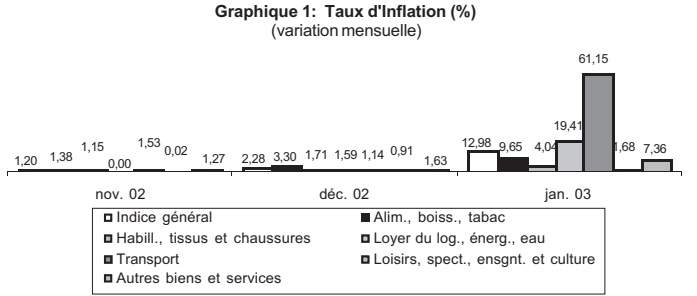

<!-- page 1 -->

## Table des Matières

I. Inflation et change .....2
II. Instruments de Politique Monétaire .....3
III. Liquidité, Crédit et Dépôts des Banques .....4
IV. Bilan des Autorités Monétaires .....5
V. Situation Monétaire .....6
VI. Finances Publiques .....7
VII. Dette Externe .....8
VIII. Croissance du Bilan .....9
IX. Parts de Marché .....10
X. Qualité de l'Actif .....12
XI. Rentabilité .....13
Glossaire .....15

La publication mensuelle des Indicateurs Économiques et Financiers a pour objectif de mettre à la disposition du public en général, et des décideurs et agents économiques en particulier, des informations pertinentes sur les secteurs monétaire et financier. Les informations sont présentées de façon factuelle et sous forme de descriptions lapidaires, du type «bullet points», accompagnées de graphes et tableaux illustratifs.
Un accent particulier a été porté sur l'évolution des indicateurs au cours du mois considéré selon trois repères :
1. le mois antérieur,
2. le début de l'année fiscale, et
3. le même mois de l'année précédente (glissement annuel). Ainsi les tendances qui se dégagent pour un mois donné peuvent être aisément mises en perspective.
Statistiques monétaires et bancaires : Les statistiques monétaires et bancaires sont des données de stock (fin de période). Elles sont présentées avec deux mois de décalage pour des raisons de disponibilité des données bancaires.
Finances publiques : Les statistiques de finances publiques sont des données de flux et sont enregistrées sur la base des encaissements-décaissements. Elles sont décalées de deux mois.
Inflation : La présentation par la BRH des données fournies par l'Institut Haïtien de Statistiques et d'Informatique sur l'évolution de l'indice des prix à la consommation (IPC) se fait avec deux mois de retard; pour les données du change le retard n'est que d'un mois.
Certaines données publiées dans la présente édition des Indicateurs Économiques et Financiers sont provisoires et, par conséquent, sujettes à révision dans des publications futures.

<!-- page 2 -->

### I. Inflation et Change

## Inflation

- En janvier 2003, l'indice des prix à la consommation est en hausse (12,98 %) par rapport au mois de décembre 2002 (2,28 %).

- Ce résultat reflète l’accélération du taux de croissance des indices des principaux groupes de dépenses : les prix des groupes Alimentation, boisson et tabac, Habillement, tissus et chaussures, Loyer du logement, énergie et eau, Transport, Loisirs, spectacles, enseignement et culture et Autres biens et services se sont accrus respectivement de 9,65 %, 4,04 %, 19,41 %, 61,15 %, 1,68 % et 7,36 % par rapport à ceux du mois de décembre 2002 (3,30 %, 1,71 %, 1,59 %, 1,14 %, 0,91 %, et 1,63 %).

- En glissement annuel, le taux d'inflation est passé de 14,77 % en décembre 2002 à 28,88 % en janvier 2003. En moyenne mensuelle, la hausse des prix à la consommation est de 4,66 %.

## Change

## Taux

Le taux de référence de fin de période de la BRH est passé de 41,5097 gdes en janvier 2003 à 44,5181 gdes en février 2003, atteignant un maximum de 51,3522 gdes le 13 février 2003.

- En février 2003, le taux de référence de fin de période s'est déprécié de 7,25 % par rapport au mois précédent. Il s'est déprécié de 69,02 % et de 63,68 % par rapport à décembre 2001 et février 2002 respectivement.

## Achats et ventes de devises des banques

- Les achats de devises ont augmenté de 7,20 % par rapport à janvier 2003. Ils ont diminué de 8,68 % et augmenté de 21,12 % par rapport à octobre 2002 et février 2002 respectivement.

- Les ventes de devises ont augmenté de 4,34 % par rapport à janvier 2003. Elles ont diminué de 8,36 % par rapport à octobre 2002 et augmenté de 21,12 % par rapport à février 2002.

- En février 2003, la position cambiste de change s'est située à -1,418 million de $ ÉU contre -3,18 millions le mois précédent.

- D’octobre 2002 à février 2003, les achats et ventes ont totalisé respectivement 281,28 et 284,97 millions de $ ÉU contre 265,83 et 271,37 millions pour la même période de l’exercice précédent.

- En février 2003, le spread des banques a représenté 1,30 % du taux à l'achat, contre 1,25 % le mois précédent. Il était de 1,18 % en septembre 2002 et de 1,61 % en février 2003.

## Achats et ventes de devises des agents de change

Selon les données disponibles à date, reçues d'agents de change enregistrés, les achats se sont chiffrés à 2,62 millions de $ ÉU et les ventes à 2,71 millions en février 2003.

## Transferts reçus de l'étranger

- Selon les données disponibles à date reçues des maisons de transfert enregistrées, les transferts privés se sont chiffrés à 25,34 millions de $ ÉU en janvier 2003 comparé à 28,97 millions le mois précédent. Ils s'élevaient à 20,88 millions de $ ÉU en janvier 2002.

D'octobre 2002 à janvier 2003, les transferts privés ont atteint 100,72 millions de $ ÉU contre 86,29 millions pour la même période de l'exercice précédent.

Graphique 1: Taux d'Inflation (%) (variation mensuelle)

| Período | Achats | Ventes |
| --- | --- | --- |
| 3/2/03 | 41.2 | 42.0 |
| 6/2/03 | 43.0 | 44.0 |
| 11/2/03 | 46.5 | 48.0 |
| 14/2/03 | 51.0 | 52.5 |
| 19/2/03 | 47.0 | 48.5 |
| 24/2/03 | 43.0 | 44.5 |
| 27/2/03 | 44.5 | 46.0 |

Graphique 3: Volume des Transactions de Change des Banques (millions de dollars ÉU)

|   | Achatas | Ventes |
| --- | --- | --- |
| nov. 02 | 60.0 | 58.6 |
| déc. 02 | 77.4 | 78.0 |
| jan. 03 | 66.2 | 69.4 |
| fév. 03 | 71.0 | 72.4 |

<!-- page 3 -->

### II. Instruments de Politique Monétaire

## Coefficients de réserves obligatoires

- La circulaire 86-12 du 15 juin 2001 porte au même niveau les coefficients de réserves obligatoires sur les passifs libellés aussi bien en monnaie étrangère qu'en monnaie nationale soit 31 % pour les banques commerciales et 19,50 % pour les banques d'épargne et de logement.

- Les banques ont l'obligation de constituer en gourdes 30 % des réserves obligatoires sur les passifs libellés en devises étrangères conformément aux dispositions de la circulaire # 86-12A du 15 juin 2001.

## Interventions de la BRH sur le marché des changes

• En janvier 2003, la BRH a acheté 1,249 million de $ ÉU.

D'octobre 2002 à janvier 2003, la BRH a acheté 5,938 millions de $ ÉU.

## Bons BRH

- L’encours des bons BRH au 28 février 2003 a diminué de 15,04 % sur un mois et de 5,56 % en glissement annuel. Entre septembre 2002 et février 2003, l’encours a diminué de 31,05 %. Les bons à 91 jours représentent 100 % du total.

- La BNC (820 MG), la Sogebank (785 MG), la BUH (270 MG), la Unibank (140 MG) et la Sogebel (94 MG) détiennent 97,01 % de l'encours des bons BRH émis.

Au 28 février 2003, l'encours des bons BRH s'élève à 30,04 % des réserves effectives contre 36,37 % au 31 janvier 2003.

- Sur le marché monétaire, le taux interbancaire a augmenté passant de 18,05 % à 23,40 % entre le 31 janvier et le 28 février 2003. Les taux sur les bons à 7 et 91 jours sont passés respectivement de 11,00 % à 19,00 % et 15,6 % à 24,40 %.

| Nov. 02 | Passifs en gourdes BEL | Passifs en gourdes banques com. |
| --- | --- | --- |
| decc. 02 | 3100% | 3100% |
| jan. 03 | 1950% | 3100% |
| fév. 03 | 1950% | 3100% |

Graphique 5: Encours de Bons BRH (millions de gourdes)

|   | 5/2/03 | 12/2/03 | 19/2/03 | 26/2/03 |
| --- | --- | --- | --- | --- |
| Encours total des bons | 2 339 | 2 214 | 2 239 | 2 174 |
| Encours des bons de 91 jours | 2 189 | 2 189 | 2 239 | 2 174 |

Graphique 6: Taux d'Intérêt sur le Marché Monétaire (% l'an)

|   | 5/2/03 | 12/2/03 | 19/2/03 | 26/2/03 |
| --- | --- | --- | --- | --- |
| Bons BRH 7 jours | 11.00% | 11.00% | 11.00% | 19.00% |
| Marché interbancaire | 18.05% | 18.24% | 17.95% | 23.40% |

<!-- page 4 -->

### III. Liquidité, Crédit et Dépôts des Banques

## Position de réserves

Au 28 février 2003, le système bancaire a accusé un déficit de 247,97 MG contre un excédent de 358,1 MG pour le même mois de l'exercice précédent.

- En février 2003, la position moyenne de réserve était déficitaire de 59,05 MG contre un excédent de 333,98 MG pour le même mois de l'exercice précédent.

## Crédit brut au secteur privé

Au 28 février 2003, le crédit total au secteur privé (en gourdes et en devises) a augmenté de 7,93 % sur un mois et de 49,48 % en glissement annuel. Entre septembre 2002 et février 2003, le crédit total au secteur privé a augmenté de 35,76 %.

- Au 28 février 2003, le crédit en gourdes a augmenté de 11,74 % sur un mois et de 37,81 % en glissement annuel. L'augmentation du crédit en gourdes au 28 février 2003 s'explique essentiellement par l'augmentation du portefeuille de crédit de onze (11) banques dont la Unibank (425,8 MG), la Sogebank (316,5 MG), la Promobank (119,7 MG). Deux (2) banques dont la Citibank ont diminué leur portefeuille de crédit en gourdes en février 2003.

Au 28 février 2003, le crédit en devises exprimé en dollars ÉU a diminué de 2,63 % sur un mois et de 0,39 % en glissement annuel.

## Dépôts

- L'ensemble des dépôts du système bancaire (en gourdes et en devises) au 28 février 2003 a augmenté de 6,53 % sur un mois et de 47,46 % en glissement annuel. Entre septembre 2002 et février 2003, l'ensemble des dépôts a augmenté de 20,56 %.

Au 28 février 2003, les dépôts en gourdes ont augmenté de 2,37 % sur un mois et de 21,78 % en glissement annuel.

- Les dépôts en devises exprimés en gourdes ont augmenté de 10,77 % sur un mois et de 52,67 % en glissement annuel.

## Taux d'intérêt

- Sur le marché bancaire des opérations en gourdes, entre le 31 janvier 2003 et le 28 février 2003, les taux sur les prêts et les dépôts à terme ont augmenté passant respectivement de 25,00 % à 26,00 % et de 7,75 % à 14,50 %; alors que le taux sur les dépôts d'épargne a diminué en passant de 2,75 % à 2,25 % sur la même période.

- Sur le marché bancaire des opérations en devises, entre le 31 janvier 2003 et le 28 février 2003, les taux sur les prêts et les dépôts d'épargne ont diminué en passant respectivement de 14,50 % à 12,50 et de 1,38 % à 1,31 %; alors que le taux sur les dépôts à terme est demeuré stable à 3,38 % sur la même période.

| Period | (millions de gourdes) |
| --- | --- |
| nov. 02 | -13,2 |
| déc. 02 | -168,8 |
| jan. 03 | -95,6 |
| fév. 03 | -248,0 |

Graphique 8: Crédit Brut au Secteur Privé (milliards de gourdes)

|   | Credit en gourdes | Crédit en devises |
| --- | --- | --- |
| nov. 02 | 740 | 790 |
| déc. 02 | 780 | 790 |
| jan. 03 | 770 | 850 |
| fév. 03 | 870 | 880 |

Graphique 9: Taux d'Intérêt sur le Marché Bancaire (en % l'an)

|   | nov. 02 | déc. 02 | jan. 03 | fév. 03 |
| --- | --- | --- | --- | --- |
| Dépôts d'épargne | 2250 | 2250 | 2250 | 2250 |
| Dépôts à terme | 863 | 763 | 775 | 1450 |
| Prêts | 2450 | 2600 | 2500 | 2600 |

<!-- page 5 -->

### IV. Bilan des Autorités Monétaires

## Avoirs extérieurs nets

- Les avoirs extérieurs nets sont passés de 104 millions de dollars ÉU en décembre 2002 à 94 millions $ ÉU en janvier 2003. Ce montant inclut les dépôts en dollars ÉU des banques à la BRH, lesquels sont passés de 62 millions en décembre 2002 à 61 millions en janvier 2003. Le niveau de janvier 2002 a été de 164 millions de dollars ÉU.

- Les réserves brutes de change ont totalisé 135 millions de $ ÉU en janvier 2003 contre 134 millions de $ ÉU le mois précédent. Par comparaison, leur niveau a été de 209 millions de $ ÉU en janvier 2002.

Le rendement actuariel moyen des portefeuilles de titres est passé à 0,24 % en janvier 2003 de 10,14 % qu'il était le mois précédent. Il était de 3,93 % en janvier 2002.

- En janvier 2002, le taux moyen offert sur les placements en overnight a atteint 1,12 % contre 1,16 % qu'il était le mois précédent. Il était de 1,55 % en janvier 2002.

## Créances nettes sur le gouvernement central

- Les créances nettes de la BRH sur le gouvernement central ont connu une augmentation de 2,98 % en janvier 2003 par rapport à décembre 2002. Elles ont augmenté de 11,93 % par rapport à septembre 2002 et de 31,96 % par rapport à janvier 2002.

## Base monétaire

- La base monétaire a augmenté de 1,76 % par rapport à décembre 2002, de 9,42 % par rapport à septembre 2002 et de 21,57 % par rapport à janvier 2002.

- Les composantes principales de la base monétaire ont évolué ainsi en janvier 2003 :

- La monnaie en circulation a diminué de 3,62 %;

• Les bons BRH et les réserves des banques ont augmenté de 5,56 %.

Graphique 10: Base Monétaire et ses Sources

|   | Base monétaire (millions de gourdes) | Crédit intérieur (millions de gourdes) | Avoirs extérieurs nets (millions de gourdes) |
| --- | --- | --- | --- |
| sept. 02 | 19.27 | 16.13 | 3.93 |
| oct. 02 | 18.61 | 16.34 | 3.04 |
| nov. 02 | 19.37 | 16.54 | 3.65 |
| déc. 02 | 20.72 | 17.78 | 3.91 |
| jan. 03 | 21.09 | 18.11 | 3.87 |

|   | sept. 02 | oct. 02 | nov. 02 | déc. 02 | jan. 03 |
| --- | --- | --- | --- | --- | --- |
| Avoirs extérieurs nets 1/ | 3 939,1 | 3 040,5 | 3 653,5 | 3 913,8 | 3 874,6 |
| Avoirs extérieurs | 6 762,1 | 6 139,6 | 7 080,1 | 7 273,7 | 7 326,4 |
| Engagements extérieurs | -2 822,9 | -3 099,0 | -3 426,6 | -3 359,9 | -3 451,9 |
| Crédit intérieur | 16 139,0 | 16 344,7 | 16 546,6 | 17 784,4 | 18 113,5 |
| Créances nettes sur gouvernement central | 15 143,0 | 15 172,9 | 15 484,4 | 16 458,8 | 16 949,6 |
| Créances sur le système bancaire | 81,1 | 232,0 | 171,0 | 423,7 | 203,4 |
| Créances sur les autres secteurs économiques | 914,9 | 939,8 | 891,2 | 901,9 | 960,5 |
| Actif = Passif | 20 078,1 | 19 385,2 | 20 200,1 | 21 698,2 | 21 988,0 |
| Base monétaire | 19 275,2 | 18 612,9 | 19 372,8 | 20 725,5 | 21 090,5 |
| Monnaie en circulation | 6 652,4 | 6 889,9 | 7 410,6 | 8 687,5 | 8 373,2 |
| Réserves/dépôts & bons BRH des banques | 12 122,6 | 11 172,0 | 11 380,5 | 11 493,9 | 12 133,0 |
| Réserves/dépôts des banques | 8969,621 | 8023,97 | 8826,51 | 8930,91 | 9573,99 |
| dont: dépôts en dollars EU 1/ | 2 439,0 | 1 520,6 | 2 170,8 | 2 338,4 | 2 531,6 |
| Bons BRH | 3 153,0 | 3 148,0 | 2 554,0 | 2 563,0 | 2 559,0 |
| Autres engagements envers les BCM | 0,0 | 0,0 | 0,0 | 0,0 | 0,0 |
| Dépôts des autres secteurs économiques | 500,2 | 551,0 | 581,7 | 544,1 | 584,3 |
| Autres postes nets | 802,9 | 772,1 | 827,1 | 972,6 | 897,5 |
| Comptes de capital | 4 255,1 | 4 272,4 | 4 412,4 | 4 315,0 | 4 317,7 |
| dont: Allocations de DTS | 538,0 | 596,6 | 676,0 | 700,3 | 700,3 |
| Autres postes non classés | -3 452,2 | -3 500,3 | -3 585,2 | -3 342,3 | -3 420,2 |

Source : Banque de la République d'Haïti / MAE / Monnaie

1/ Convertis en gourdes au taux de référence de la BRH.

<!-- page 6 -->

### V. Situation Monétaire

## Agrégats Monétaires

• M1 a augmenté de 0,10 % en janvier 2003 par rapport à décembre 2002, de 16,39 % par rapport à septembre 2002 et de 27,64 % par rapport à janvier 2002.

- M2 a augmenté de 1,77 % par rapport à décembre 2002, de 13,61 % par rapport à septembre 2002 et de 22,28 % par rapport à janvier 2002.

M3 a connu une augmentation de 5,48 % en janvier 2003 par rapport à décembre 2002, de 15,97 % par rapport à septembre 2002 et de 29,57 % par rapport à janvier 2002.

## Contreparties de M3

- Les avoirs extérieurs nets du système bancaire ont augmenté de 6,76 % en janvier 2003 par rapport au mois précédent, de 5,23 % par rapport à septembre 2002 et de 2,84 % par rapport à janvier 2002.

Le crédit intérieur net du système bancaire a augmenté de 3,39 % en janvier 2003 par rapport à décembre 2002, de 17,43 % par rapport à septembre 2002 et de 33,63 % par rapport à janvier 2002.

## Dollarisation

- L'ensemble des dépôts en dollars est passé de 392 millions de dollars ÉU en décembre 2002 à 398 millions en janvier 2003. L'encours de janvier 2003 représente une augmentation de 12,08 % par rapport à décembre, de 19,99 % par rapport à septembre 2002 et de 43,35 % par rapport à janvier 2002.

- Les dépôts à vue en dollars ont augmenté de 9,28 % par rapport à décembre 2002, de 13,40 % par rapport à septembre 2002 et de 60,01 % par rapport à janvier 2002.

- Les dépôts d'épargne en dollars ont augmenté de 14,34 % par rapport au mois précédent, de 26,07 % par rapport à septembre 2002 et de 54,50 % par rapport à janvier 2002.

- Les dépôts à terme en dollars ont connu une augmentation de 12,17 % par rapport à décembre, de 19,80 % par rapport à septembre 2002 et de 24,97 % par rapport à janvier 2002.

- La part des dépôts en dollars dans l'ensemble des dépôts est passée de 45,71 % en décembre 2002 à 47,46 % en janvier 2003.

Graphique 11: Agrégats Monétaires (millions de gourdes)

Le ratio des dépôts en dollars par rapport à M3 est passé de 36,01 % en décembre 2002 à 38,26 % en janvier 2003. Ce ratio était de 34,58 % en janvier 2002.

|   | M1 | M2 | M3 |
| --- | --- | --- | --- |
| oct. 02 | 11564.5 | 24058.9 | 36380.4 |
| nov. 02 | 11979.6 | 24822.3 | 38646.7 |
| déc. 02 | 13066.6 | 26193.0 | 40930.4 |
| jan. 03 | 13079.2 | 26656.1 | 43174.5 |

Situation monétaire

(En millions de gourdes)

|   | sept. 02 | oct. 02 | nov. 02 | déc. 02 | jan. 03 |
| --- | --- | --- | --- | --- | --- |
| Avoirs extérieurs nets 1/ | 8 346,1 | 6 078,4 | 7 212,5 | 8 226,3 | 8 782,2 |
| Avoirs extérieurs | 11 884,5 | 9 867,2 | 11 471,1 | 12 456,8 | 13 397,2 |
| Engagements extérieurs | (3 538,5) | (3 788,8) | (4 258,6) | (4 230,5) | (4 615,0) |
| Créances nettes sur secteur public | 15 118,8 | 15 122,5 | 15 313,6 | 16 317,0 | 16 833,0 |
| Créances nettes sur gouvernement central | 15 106,2 | 15 143,9 | 15 461,4 | 16 437,8 | 16 928,4 |
| Créances nettes sur collectivités locales | (28,8) | (35,9) | (44,1) | (66,4) | (73,6) |
| Créances nettes sur entreprises publiques | 41,4 | 14,5 | (103,7) | (54,4) | (21,7) |
| Créances sur secteur privé | 14 446,5 | 15 663,7 | 16 787,1 | 17 262,3 | 17 886,2 |
| Avoirs = Engagements | 37 911,4 | 36 865,3 | 39 313,8 | 41 805,6 | 43 501,4 |
| M3 | 37 228,7 | 36 380,4 | 38 646,7 | 40 930,4 | 43 174,5 |
| M2 | 23 462,6 | 24 058,9 | 24 822,3 | 26 193,0 | 26 656,1 |
| M1 | 11 237,3 | 11 564,5 | 11 979,6 | 13 066,6 | 13 079,2 |
| Monnaie en circulation | 6 652,4 | 6 889,9 | 7 410,6 | 8 687,5 | 8 373,2 |
| Dépôts à vue | 4 584,9 | 4 674,6 | 4 569,0 | 4 379,0 | 4 706,0 |
| Quasi-monnaie | 12 225,3 | 12 494,3 | 12 842,7 | 13 126,4 | 13 576,9 |
| Dépôts d'épargne | 7 468,9 | 7 687,6 | 7 985,8 | 8 237,6 | 8 647,7 |
| Dépôts à terme | 4 756,5 | 4 806,7 | 4 856,9 | 4 888,8 | 4 929,2 |
| Dépôts en dollars 1/ | 13 766,1 | 12 321,5 | 13 824,3 | 14 737,5 | 16 518,4 |
| Dépôts à vue | 4 076,3 | 3 424,9 | 3 949,0 | 4 230,1 | 4 622,6 |
| Dépôts d'épargne | 4 588,4 | 4 204,1 | 4 717,9 | 5 059,1 | 5 784,5 |
| Dépôts à terme | 5 101,4 | 4 692,5 | 5 157,4 | 5 448,3 | 6 111,4 |
| Autres postes nets | 682,7 | 484,9 | 667,1 | 875,2 | 326,9 |
| Comptes de capital | 7 248,5 | 7 339,0 | 7 581,3 | 7 573,1 | 7 722,3 |
| Créances interbancaires | (962,4) | (1 086,9) | (1 014,2) | (863,2) | (1 455,5) |
| Autres postes non classés | (5 603,4) | (5 767,2) | (5 900,0) | (5 834,6) | (5 939,9) |

Source: Banque de la République d'Haïti (BRH)

1/ Convertis en gourdes au taux de référence de la BRH

<!-- page 7 -->

### VI. Finances Publiques

## Recettes

- Les recettes totales au cours du mois de janvier 2003 ont augmenté de 20,52 % par rapport à décembre 2002 et de 8,27 % en glissement annuel. Elles ont atteint 735,8 MG contre 679,6 MG pour le même mois de l'exercice précédent. Entre octobre 2002 et janvier 2003, elles totalisent 2 839,4 MG contre 2 578,0 MG pour la même période de l'exercice précédent.

- Au mois de janvier 2003, les taxes sur le chiffre d'affaires, les droits d'accise, l'impôt sur le revenu et les autres taxes représentent respectivement 38,78 %, 2,81 %, 40,81 % et 17,60 % des recettes internes. Les parts respectives des droits de douane et les frais de vérification dans le total des recettes douanières sont de 41,42 % et 44,06 %.

Graphique 12: Recettes et Dépenses Totales (millions de gourdes)

## Dépenses

|   | Recettes totales (millions de gourdes) | Dépenses totales (millions de gourdes) |
| --- | --- | --- |
| sept. 02 | 614.5 | 999.40 |
| oct. 02 | 860.5 | 845.30 |
| nov. 02 | 632.6 | 1240.40 |
| déc. 02 | 610.5 | 1413.50 |
| jan. 03 | 735.8 | 1208.70 |

Au mois de janvier 2003, les dépenses totales ont diminué de 14,50 % sur un mois mais ont augmenté de 33,35 % en glissement annuel. Elles ont atteint 1 208,7 MG contre 906,4 MG pour le même mois de l'exercice précédent. Entre octobre 2002 et janvier 2003, elles totalisent 4 707,9 MG contre 3 072,2 MG pour la même période de l'exercice précédent. Les dépenses de salaires ont augmenté de 36,50 % par rapport à décembre 2002 et de 25,98 % en glissement annuel.

Au mois de janvier 2003, les avances en comptes courants ont atteint 533,5 MG contre 307,2 MG en janvier 2002. Entre octobre 2002 et janvier 2003, les dépenses d'investissements ont totalisé 1 019,0 MG contre 510,0 MG pour la même période de l'exercice précédent.

Graphique 13: Composition des Recettes Internes

|   | Oct. 02 | Nov. 02 | déc. 02 | jan. 03 |
| --- | --- | --- | --- | --- |
| Droits d'accise | 02 | 02 | 02 | 03 |
| Impôts sur le revenu | 02 | 02 | 02 | 02 |
| TCA | 02 | 02 | 02 | 02 |
| Autres recettes internes | 02 | 02 | 02 | 02 |
| Total | **16,77** | **20,60** | **25,83** | **17,60** |

## Financement

- Durant le mois de janvier 2003, les créances de la BRH sur le gouvernement central ont augmenté de 525,3 MG et les dépôts de 49,0 MG pour un financement de 476,3 MG. Entre octobre 2002 et janvier 2003, le gouvernement central a absorbé un déficit de 1 826,6 MG contre 661,8 MG pour la même période de l'exercice précédent

Graphique 14: Financement des Administrations Publiques (millions de gourdes)

|   | Financeement net | Financement interne | Financement externe |
| --- | --- | --- | --- |
| oct. 02 | 28.5 | -1.5 | 30.0 |
| nov. 02 | 386.4 | 460.1 | -73.7 |
| déc. 02 | 701.3 | 824.6 | -123.3 |
| jan. 03 | 471.0 | 476.4 | -5.4 |

<!-- page 8 -->

### VII. Dette externe

## Dette externe

- En janvier 2003, le service de la dette externe a affiché un montant de 0,24 million de $ ÉU, soit une baisse de 3,28 millions de $ ÉU par rapport au mois de décembre 2002. En glissement annuel, le service de la dette a diminué 0,76 million de $ ÉU.

Le service réel de la dette a baissé de 3,19 millions de $ ÉU pour le mois de janvier 2003 par rapport au mois de décembre 2002 et de 0,57 million de $ ÉU en glissement annuel.

- En janvier 2003, l’encours de la dette a augmenté de 1,59 % par rapport à décembre 2002, pour atteindre 1 248,30 millions de $ ÉU. En glissement annuel, il a progressé de 7,05 %.

• En janvier 2003, les décaissements bruts sur les prêts étaient nuls. Une baisse de 100 % a été enregistré par rapport à décembre 2002 et en glissement annuel.

Dette Externe (en millions de dollars ÉU)

- En janvier 2003, les arriérés de paiement au titre du service de la dette s’élevaient à 61,68 millions $ ÉU contre 58,76 millions de $ ÉU en décembre 2002. En glissement annuel, ils ont cru de 31,78 millions de $ ÉU.

|   | oct 02 | nov 02 | déc 02 | jan 03 |
| --- | --- | --- | --- | --- |
| Service de la dette | 0,11 | 2,74 | 3,52 | 0,24 |
| • Amortissements | 0,05 | 2,20 | 3,32 | 0,13 |
| • Intérêt/commission/frais de service | 0,06 | 0,54 | 0,20 | 0,11 |
| Décaissements | 0,47 | 0,71 | 3,00 | 0,00 |
| Flux nets (Décais, -Amortis.) | 0,40 | -1,49 | -0,3 | -0,13 |
| Encours de la dette | 1 212,50 | 1 211,90 | 1 228,80 | 1 248,30 |
| • Multilateral | 1 009,00 | 1 008,20 | 1 020,60 | 1 031,40 |
| • Bilateral | 203,50 | 203,70 | 208,2 | 216,90 |
| Arriérés de Paiements | 53,97 | 57,24 | 58,76 | 61,68 |

Source : Dette Externe, Direction Affaires Internationales, BRH.

<!-- page 9 -->

### VIII. Croissance du Bilan des Banques

## Actif total

- L'actif total des banques a enregistré une hausse de 8,49 % au mois de janvier 2003. Au mois de décembre 2002, l'actif total avait accusé une hausse de 1,86 %.

- La croissance de l'actif total pour l'année fiscale 2001-2002 fut de 16,63 %. En extrapolant à partir de la hausse enregistrée pour les quatre premiers mois de l'exercice en cours, on prévoit une augmentation de l'actif de 44,21 % pour l'exercice fiscal 2002 – 2003.

- La variation de l’actif de chaque banque au cours du mois de janvier 2003, en termes absolus et relatifs, se présente comme suit : la BICH (0,59 MG; 6,02 %), la BNC (263,8 MG; 8,36 %), la BPH (19,4 MG; 2,21 %), la BUH (132,4 MG; 6,54 %), la Promobank (231,0 MG; 10,53 %), la Socabank (341,4 MG; 7,27 %), la Sogebank (822,1 MG; 8,90 %), la Unibank (697,8 MG; 8,22 %), la Capital Bank (173,2 MG; 10,78 %), la Sogebel (140,7 MG; 11,99 %), la Socabel (21,8 MG; 15,76 %), la Citibank (187,8 MG; 7,82 %), la Scotiabank (138,7 MG; 10,15 %).

## Avoir des Actionnaires

• En janvier 2003, l'avoir des actionnaires du système bancaire a enregistré une hausse de 2,39 %. Au mois de décembre 2002, il avait cru de 3,37 %.

- L’avoir des actionnaires avait enregistré une hausse de 16,49 % au cours de l’exercice fiscal 2001–2002. En extrapolant à partir de la hausse de 8,38 % constatée au cours des quatre premiers mois de l’exercice, on prévoit une augmentation de 33,92 % pour l’année fiscale 2002–2003.

L'accroissement de l'avoir des actionnaires de chaque banque au cours du mois de janvier 2003, en termes absolus et relatifs, se présente comme suit : la BICH (-0,05 MG; -0,97 %), la BNC (9,9 MG; 4,18 %), la BPH (0,2 MG; 0,63 %), la BUH (1,4 MG; 1,48 %), la Capital Bank (1,7 MG; 1,26 %), la Promobank (7,9 MG; 6,94 %), la Socabank (-3,5 MG; -1,30 %), la Sogebank (7,1 MG; 1,56 %), la Unibank (10,0 MG; 2,18 %), la Socabel (-0,40 MG; -3,37 %), la Sogebel (4,9 MG; 4,48 %), la Citibank (9,8 MG; 4,47 %), la Scotiabank (4,0 MG; 5,98 %).

Le ratio avoir des actionnaires en pourcentage de l'actif total a évolué ainsi depuis la fin de l'année fiscale 2001-2002 : 5,79 % en septembre 2002, 6,08 % en octobre 2002, 5,85 % en novembre 2002, 5,93 % en décembre 2002 et 5,60 % en janvier 2003. Ainsi, ce ratio a décru de 3,28 % par rapport au 30 septembre 2002.

Graphique 15: Actif total (en millions de gourdes)

| Category | Value |
| --- | --- |
| sept. 02 | 35330.0 |
| oct.02 | 34321.0 |
| nov.02 | 36683.8 |
| déc.02 | 37365.8 |
| janv.03 | 40536.5 |

Graphique 16: Evolution des principaux postes du bilan (en millions de gourdes)

| Sept. 02 | Bons BRH | Prêts bruts | Dépôts |
| --- | --- | --- | --- |
| oct.02 | 3 151,4 | 12 867,5 | 30 204,5 |
| nov.02 | 3 046,2 | 14 254,9 | 28 982,3 |
| déc.02 | 2 513,4 | 15 357,2 | 30 866,5 |
| janv.03 | 2 212,8 | 15 710,0 | 31 724,5 |

Graphique 17: Avoir des actionnaires (en millions de gourdes)

| Category | Value |
| --- | --- |
| sept. 02 | 20453 |
| oct.02 | 20876 |
| nov.02 | 21444 |
| déc.02 | 22167 |
| janv.03 | 22697 |

N.B. : Dans cette section du rapport, les comptes de bilan et les ratios utilisant des comptes de bilan sont déterminés au dernier jour du mois.

<!-- page 10 -->

### IX. Parts de Marché

## Actif total

- En janvier 2003, toutes les banques du système ont gardé les rangs qu'elles détenaient en décembre 2002.

- En janvier 2003, les augmentations de parts de marché sont les suivantes : la Promobank (0,11 %), la Sogebel (0,10 %), la Sogebank (0,09 %), la Capital Bank (0,09 %), la Scotiabank (0,05 %), la Socabel (0,02 %). Les parts de marché des banques suivantes ont diminué : la BNC (-0,01 %), la Citibank (-0,03 %), la Unibank (-0,06 %), la BUH (-0,10 %), la Socabank (-0,14 %), la BPH (-0,13 %). Les parts de marché de la BICH.

- La part des banques occupant les cinq premières places du système bancaire a décru de 0,15 point. Elle est passée de 74,86 % en décembre 2002 à 74,71 % en janvier 2003. En novembre 2002, elle était de 74,05 %.

## Actif Total - Parts de Marché

<table><tr><td>Banques</td><td>Au 31 janvier 03</td><td>Au 30 décembre 02</td><td>Au 30 novembre 02</td></tr><tr><td>%</td><td>Rang</td><td>%</td><td>Rang</td><td>%</td><td>Rang</td></tr><tr><td>SOGEBANK</td><td>24,80%</td><td>1</td><td>24,71%</td><td>1</td><td>24,46%</td><td>1</td></tr><tr><td>UNIBANK</td><td>22,65%</td><td>2</td><td>22,71%</td><td>2</td><td>22,03%</td><td>2</td></tr><tr><td>SOCABANK</td><td>12,43%</td><td>3</td><td>12,57%</td><td>3</td><td>12,56%</td><td>3</td></tr><tr><td>BNC</td><td>8,44%</td><td>4</td><td>8,45%</td><td>4</td><td>8,39%</td><td>4</td></tr><tr><td>CITIBANK</td><td>6,39%</td><td>5</td><td>6,42%</td><td>5</td><td>6,61%</td><td>5</td></tr><tr><td>PROMOBANK</td><td>5,98%</td><td>6</td><td>5,87%</td><td>6</td><td>5,70%</td><td>6</td></tr><tr><td>BUH</td><td>5,32%</td><td>7</td><td>5,42%</td><td>7</td><td>5,59%</td><td>7</td></tr><tr><td>CAPITALBANK</td><td>4,39%</td><td>8</td><td>4,30%</td><td>8</td><td>4,43%</td><td>8</td></tr><tr><td>SCOTIABANK</td><td>3,71%</td><td>9</td><td>3,66%</td><td>9</td><td>3,75%</td><td>9</td></tr><tr><td>SOGEBEL</td><td>3,24%</td><td>10</td><td>3,14%</td><td>10</td><td>3,12%</td><td>10</td></tr><tr><td>BPH</td><td>2,22%</td><td>11</td><td>2,35%</td><td>11</td><td>2,96%</td><td>11</td></tr><tr><td>SOCABEL</td><td>0,39%</td><td>12</td><td>0,37%</td><td>12</td><td>0,37%</td><td>12</td></tr><tr><td>BICH</td><td>0,03%</td><td>13</td><td>0,03%</td><td>13</td><td>0,03%</td><td>13</td></tr></table>

## Prêts bruts

- En janvier 2003, toutes les banques du système ont gardé les rangs qu'elles détenaient en décembre 2002.

- La part des banques occupant les cinq premières places du système bancaire a décru de 0,11 point. Elle est passée de 77,39 % en décembre 2002 à 77,28 % en janvier 2003. En novembre 2002, elle était de 76,91 %.

- La Socabank a connu l’augmentation de part de marché la plus importante (0,43 %). Elle est suivie de la Promobank (0,31 %), de la CapitalBank (0,19 %), de la Sogebel (0,18 %), de la BUH (0,08 %) et de la Sogebank (0,07 %). Les parts de marché des banques suivantes ont diminué : BICH (-0,01 %), BPH (-0,02 %), BNC (-0,08 %), Scotiabank (-0,23 %), Citibank (-0,37 %), Unibank (-0,55 %). Les parts de marché de la Socabel n’ont pas changé.

## Prêts Bruts - Parts de Marché

<table><tr><td>Banques</td><td>Au 31 janvier 03</td><td>Au 30 décembre 02</td><td>Au 30 novembre 02</td></tr><tr><td>%</td><td>Rang</td><td>%</td><td>Rang</td><td>%</td><td>Rang</td></tr><tr><td>UNIBANK</td><td>21,15%</td><td>1</td><td>21,70%</td><td>1</td><td>21,66%</td><td>1</td></tr><tr><td>SOGEBANK</td><td>20,95%</td><td>2</td><td>20,88%</td><td>2</td><td>20,50%</td><td>2</td></tr><tr><td>SOCABANK</td><td>17,41%</td><td>3</td><td>16,98%</td><td>3</td><td>17,39%</td><td>3</td></tr><tr><td>CITIBANK</td><td>9,54%</td><td>4</td><td>9,91%</td><td>4</td><td>9,62%</td><td>4</td></tr><tr><td>PROMOBANK</td><td>8,23%</td><td>5</td><td>7,92%</td><td>5</td><td>7,74%</td><td>5</td></tr><tr><td>CAPITALBANK</td><td>4,99%</td><td>6</td><td>4,80%</td><td>6</td><td>4,92%</td><td>6</td></tr><tr><td>SCOTIABANK</td><td>4,17%</td><td>7</td><td>4,40%</td><td>7</td><td>4,39%</td><td>7</td></tr><tr><td>BUH</td><td>3,93%</td><td>8</td><td>3,85%</td><td>8</td><td>4,09%</td><td>8</td></tr><tr><td>SOGEBEL</td><td>3,68%</td><td>9</td><td>3,50%</td><td>9</td><td>3,53%</td><td>9</td></tr><tr><td>BNC</td><td>3,12%</td><td>10</td><td>3,20%</td><td>10</td><td>3,25%</td><td>10</td></tr><tr><td>BPH</td><td>2,62%</td><td>11</td><td>2,64%</td><td>11</td><td>2,70%</td><td>11</td></tr><tr><td>SOCABEL</td><td>0,20%</td><td>12</td><td>0,20%</td><td>12</td><td>0,19%</td><td>12</td></tr><tr><td>BICH</td><td>0,01%</td><td>13</td><td>0,02%</td><td>13</td><td>0,02%</td><td>13</td></tr></table>

<!-- page 11 -->

## Dépôts totaux

- En janvier 2003, toutes les banques du système ont gardé la place qu'elles occupaient au cours du mois de décembre 2002.

- En janvier 2003, les augmentations de parts de marché sont les suivantes : la Capital Bank (0,24 %), la Sogebel (0,13 %), la Scotiabank (0,10 %), la Unibank (0,10 %), la Sogebank (0,09 %), la Promobank (0,04 %), et la Socabel (0,03 %). Les parts de marché des banques suivantes ont diminué : Citibank (-0,03 %), BNC (-0,07 %), BUH (-0,08 %), BPH (-0,22 %), Socabank (-0,33 %). Les parts de marché de la BICH restent inchangées.

- La part des banques occupant les cinq premières places du système bancaire a décru de 0,17 point. Elle est passée de 75,89 % en décembre 2002 à 75,72 % en janvier 2003. En novembre 2002, elle était de 74,85 %.

## Dépôts $ ÉU

- En janvier 2003, mises à part la Promobank et la Citibank qui ont interchangé de place, la BNC qui est passé de la dixième à la huitième place, la BUH de la huitième à la neuvième place, la Scotiabank de la onzième à la dixième place et la BPH de la neuvième à la onzième place, toutes les autres banques du système ont gardé les rangs qu'elles détenaient en décembre 2002.

- La Capital Bank a connu l'augmentation de part de marché la plus importante (0,37 %). Elle est suivie de la Sogebel (0,33 %), de la Promobank (0,30 %), de la BNC (0,29 %), de la Scotiabank (0,23 %), de la Sogebank (0,20 %) et de la Socabel (0,03 %). Les parts de marché des banques suivantes ont diminué : Unibank (-0,01 %), BUH (-0,02 %), BPH (-0,45 %), Citibank (-0,50 %), Socabank (-0,78 %). Les parts de marché de la BICH n'ont pas changé.

- La part des banques occupant les cinq premières places du système bancaire a décru de 0,79 point. Elle est passée de 81,86 % en décembre 2002 à 81,07 % en janvier 2003. En novembre 2002, elle était de 81,02 %.

## Dépôts Totaux - Parts de Marché

<table><tr><td></td><td>Au 31 janvier 03</td><td>Au 30 décembre 02</td><td>Au 30 novembre 02</td></tr><tr><td>Banques</td><td>%</td><td>Rang</td><td>%</td><td>Rang</td><td>%</td><td>Rang</td></tr><tr><td>SOGEBANK</td><td>26,15%</td><td>1</td><td>26,06%</td><td>1</td><td>25,92%</td><td>1</td></tr><tr><td>UNIBANK</td><td>23,61%</td><td>2</td><td>23,51%</td><td>2</td><td>22,97%</td><td>2</td></tr><tr><td>SOCABANK</td><td>12,45%</td><td>3</td><td>12,78%</td><td>3</td><td>12,39%</td><td>3</td></tr><tr><td>BNC</td><td>7,54%</td><td>4</td><td>7,61%</td><td>4</td><td>7,76%</td><td>4</td></tr><tr><td>PROMOBANK</td><td>5,97%</td><td>5</td><td>5,93%</td><td>5</td><td>5,81%</td><td>5</td></tr><tr><td>CITIBANK</td><td>5,34%</td><td>6</td><td>5,37%</td><td>6</td><td>5,56%</td><td>6</td></tr><tr><td>BUH</td><td>5,18%</td><td>7</td><td>5,26%</td><td>7</td><td>5,44%</td><td>7</td></tr><tr><td>CAPITALBANK</td><td>4,52%</td><td>8</td><td>4,28%</td><td>8</td><td>4,45%</td><td>8</td></tr><tr><td>SCOTIABANK</td><td>3,95%</td><td>9</td><td>3,85%</td><td>9</td><td>3,98%</td><td>9</td></tr><tr><td>SOGEBEL</td><td>2,91%</td><td>10</td><td>2,78%</td><td>10</td><td>2,78%</td><td>10</td></tr><tr><td>BPH</td><td>2,09%</td><td>11</td><td>2,31%</td><td>11</td><td>2,68%</td><td>11</td></tr><tr><td>SOCABEL</td><td>0,28%</td><td>12</td><td>0,25%</td><td>12</td><td>0,25%</td><td>12</td></tr><tr><td>BICH</td><td>0,01%</td><td>13</td><td>0,01%</td><td>13</td><td>0,01%</td><td>13</td></tr></table>

## Dépôts US - Parts de Marché

<table><tr><td></td><td>Au 31 janvier 03</td><td>Au 30 décembre 02</td><td>Au 30 novembre 02</td></tr><tr><td>Banques</td><td>%</td><td>Rang</td><td>%</td><td>Rang</td><td>%</td><td>Rang</td></tr><tr><td>UNIBANK</td><td>27,29%</td><td>1</td><td>27,30%</td><td>1</td><td>26,87%</td><td>1</td></tr><tr><td>SOGEBANK</td><td>26,43%</td><td>2</td><td>26,23%</td><td>2</td><td>26,22%</td><td>2</td></tr><tr><td>SOCABANK</td><td>13,54%</td><td>3</td><td>14,32%</td><td>3</td><td>14,06%</td><td>3</td></tr><tr><td>PROMOBANK</td><td>7,06%</td><td>4</td><td>6,76%</td><td>5</td><td>6,52%</td><td>5</td></tr><tr><td>CITIBANK</td><td>6,75%</td><td>5</td><td>7,25%</td><td>4</td><td>7,35%</td><td>4</td></tr><tr><td>CAPITALBANK</td><td>4,69%</td><td>6</td><td>4,30%</td><td>6</td><td>4,33%</td><td>6</td></tr><tr><td>SOGEBEL</td><td>3,62%</td><td>7</td><td>3,29%</td><td>7</td><td>3,31%</td><td>7</td></tr><tr><td>BNC</td><td>3,04%</td><td>8</td><td>2,75%</td><td>10</td><td>2,82%</td><td>10</td></tr><tr><td>BUH</td><td>3,00%</td><td>9</td><td>3,02%</td><td>8</td><td>3,08%</td><td>8</td></tr><tr><td>SCOTIABANK</td><td>2,42%</td><td>10</td><td>2,19%</td><td>11</td><td>2,19%</td><td>11</td></tr><tr><td>BPH</td><td>1,82%</td><td>11</td><td>2,27%</td><td>9</td><td>2,93%</td><td>9</td></tr><tr><td>SOCABEL</td><td>0,36%</td><td>12</td><td>0,33%</td><td>12</td><td>0,34%</td><td>12</td></tr><tr><td>BICH</td><td>0,00%</td><td>13</td><td>0,00%</td><td>13</td><td>0,00%</td><td>13</td></tr></table>

<!-- page 12 -->

### X. Qualité de l'Actif

## Ratio des prêts improductifs bruts sur le portefeuille de prêts bruts

- En janvier 2003, les prêts improductifs bruts étaient de 1 005,4 MG, en hausse de 2,71 % par rapport à ceux du mois de décembre 2002 (978,8 MG). Parallèlement, les prêts bruts ont augmenté de 3,24 % (de 15 710,0 MG en décembre 2002 à 16 218,8 MG)

Le ratio des prêts improductifs bruts en pourcentage des prêts bruts était de 6,20 % en janvier 2003, en baisse de 0,48 point par rapport à celui du mois de décembre 2002 (6,23 %).

## Ratio des provisions pour créances douteuses sur les prêts improductifs bruts

- Les provisions pour créances douteuses étaient de 835,2 MG en janvier 2003, en hausse de 7,56 % par rapport à celles du mois de décembre 2002 (776,5 MG).

Graphique 18: Prêts improductifs bruts / prêts bruts (en %)

- Les provisions pour créances douteuses représentaient 83,08 % des prêts improductifs bruts en janvier 2003. Ce ratio est en hausse par rapport à celui du mois de décembre 2002 (79,33 %).

| Month | Graphique (%) |
| --- | --- |
| sept. 02 | 6.51 |
| oct.02 | 6.32 |
| nov.02 | 6.18 |
| déc.02 | 6.23 |
| janv.03 | 6.20 |

Graphique 19: Provisions pour créances douteuses / prêts improductifs bruts (en %)

Le ratio des prêts improductifs nets sur l'avoir des actionnaires s'est amélioré. Il est passé de 9,13 % en décembre 2002 à 7,50 % en janvier 2003.

• En janvier 2003, les prêts improductifs nets étaient de 170,1 MG, en baisse de 15,90 % par rapport à ceux du mois de décembre 2002 (202,3 MG).

| Month | Value |
| --- | --- |
| sept. 02 | 8439 |
| oct.02 | 8034 |
| nov.02 | 7246 |
| dec.02 | 7933 |
| janv.03 | 8308 |

## Ratio des prêts improductifs nets sur l'avoir des actionnaires

Graphique 20: Prêts improductifs nets / avoir des actionnaires (en %)

| Month | Value (en %) |
| --- | --- |
| sept. 02 | 639 |
| oct.02 | 848 |
| nov.02 | 1218 |
| dec.02 | 913 |
| janv.03 | 75 |

<!-- page 13 -->

### XI. Rentabilité

## Rendement de l'actif (ROA)

Le ROA annualisé du mois de janvier 2003 était de 2,13 %. Par rapport à son niveau de décembre 2002 (2,25 %), il a diminué de plus de 5 %.

- En comparaison avec la même période de l'exercice précédent, le ROA est en hausse de plus de 100 %. Il est passé de 1,06 % en janvier 2002 à 2,13 % en janvier 2003.

## Rendement de l'avoir des actionnaires (ROE)

Le ROE annualisé du mois de janvier 2003 est de 37,02 %, en baisse de plus de 2 % par rapport à celui du mois de décembre 2002 (38,14 %).

- En comparaison avec la même période de l'exercice précédent, le ROE annualisé a enregistré une hausse de plus de 100 %. Il est passé de 18,49 % en janvier 2002 à 37,02 % en janvier 2003.

## Revenus nets d'intérêt et autres revenus

- En janvier 2003, les revenus nets d'intérêt sont de 217,2 MG, en hausse de 12,35 % par rapport à ceux du mois de décembre 2002 (193,3 MG). Par rapport à ceux du mois de janvier 2002 (159,5 MG), les revenus nets d'intérêt du mois de janvier 2003 ont augmenté de plus de 36 %.

- Les revenus nets d'intérêt exprimés en pourcentage des revenus d'intérêt étaient de 74,22 % en janvier 2003. Ce ratio était en hausse de 1,81 % par rapport à celui du mois de décembre 2002 (72,90 %), et de 13,90 % par rapport à celui de janvier 2002 (65,16 %).

- En janvier 2003, les autres revenus étaient de 97,2 MG, en baisse de 28,17 % par rapport à ceux du mois de décembre 2002 (135,3 MG). Par rapport à ceux de janvier 2002 (61,5 MG), ils ont augmenté de plus de 57 %.

Le produit net bancaire du mois de janvier 2003 était de 314,4 MG. Il est en baisse de 4,33 % par rapport à celui du mois de décembre 2002 (328,6 MG) mais en hausse de 42,20 % par rapport à celui de janvier 2002 (221,1 MG).

| Period | (en %) |
| --- | --- |
| ept. 02 | 1.66 |
| oct.02 | 1.60 |
| nov.02 | 1.76 |
| déc.02 | 2.25 |
| janv.03 | 2.13 |

Graphique 22: Rendement de l'avoir des actionnaires (ROE) $ ^{1} $ (en %)

| Month | (en %) |
| --- | --- |
| sept. 02 | 28.94 |
| oct.02 | 26.94 |
| nov.02 | 29.49 |
| dec.02 | 38.14 |
| jan.03 | 37.02 |

Graphique 23: Revenus nets d'intérêt / Revenus d'intérêt $ ^{1} $ (en %)

| Month | Value |
| --- | --- |
| sept. 02 | 6973 |
| oct.02 | 734 |
| nov.02 | 7594 |
| dec.02 | 729 |
| janv.03 | 7422 |

<!-- page 14 -->

## Rentabilité (Suite)

## Ratio des dépenses d'exploitation sur le produit net bancaire (ratio de productivité)

- Les dépenses d'exploitation du mois de janvier 2003 sont de 207,1 MG. Elles ont accusé une baisse de 13,07 % par rapport à celles du mois de décembre 2002 (238,2 MG) mais sont en hausse de 14,88 % par rapport à celles de janvier 2002 (180,2 MG).

- En janvier 2003, les banques ont dépensé en moyenne 65,87 centimes pour générer chaque gourde de revenu, soit 9,13 centimes de moins qu'au cours du mois de décembre 2002 (72,49 centimes) et 15,66 centimes de moins qu'au mois de janvier 2002 (81,53 centimes).

## Bénéfice net

- En janvier 2003, le système bancaire a enregistré un bénéfice net de 69,1 MG, en baisse de 0,17 % par rapport à celui du mois de décembre 2002 (69,3 MG), et de plus de 151 % par rapport à celui du mois de janvier 2002 (27,5 MG).

- En janvier 2003, les intérêts sur les bons BRH étaient de 28,7 MG, en hausse de 34,11 % par rapport à ceux de décembre 2002 (21,4 MG) mais en baisse de plus de 32 % par rapport à ceux de janvier 2002 (42,5 MG).

## Revenus nets d'intérêt, Intérêts sur Bons BRH et Bénéfices nets

(en millions de gourdes)

|   | Revenus nets d'intérêt | Intérêts sur bons BRH | Bénéfices nets |
| --- | --- | --- | --- |
| jan. 02 | 159,5 | 42,5 | 27,5 |
| fév. 02 | 147,6 | 32,1 | 25,7 |
| mars 02 | 153,6 | 29,0 | 25,6 |
| avril 02 | 151,8 | 27,7 | 13,1 |
| mai 02 | 145,1 | 31,9 | 23,0 |
| juin 02 | 153,2 | 23,5 | 46,7 |
| juil. 02 | 157,3 | 28,4 | 39,8 |
| août 02 | 152,0 | 22,7 | 23,8 |
| sept. 02 | 148,6 | 27,2 | 48,1 |
| oct. 02 | 260,9 | 25,8 | 46,4 |
| nov. 02 | 181,3 | 23,7 | 52,0 |
| déc. 02 | 193,3 | 21,4 | 69,3 |
| jan. 03 | 217,2 | 28,7 | 69,2 |

Graphique 24: Dépenses d'exploitation (en millions de gourdes)

| Category | Value |
| --- | --- |
| sept. 02 | 242.7 |
| oct.02 | 192.7 |
| nov.02 | 196.1 |
| déc.02 | 238.2 |
| janv.03 | 207.1 |

Graphique 25: Dépenses d'exploitation / produit net bancaire (en %)

| Sept. 02 | Value |
| --- | --- |
| oct.02 | 7383 |
| nov.02 | 7046 |
| déc.02 | 7249 |
| janv.03 | 6587 |

Graphique 26: Revenus nets d'intérêt, Intérêts sur bons BRH et Bénéfices nets (en millions de gourdes)

|   | Revenue nets d'intérêt | Intérêts sur bons BRH | Bénéfices nets |
| --- | --- | --- | --- |
| sept. 02 | 148.6 | 27.2 | 48.1 |
| oct.02 | 167.0 | 25.8 | 46.4 |
| nov.02 | 183.8 | 23.7 | 52.0 |
| déc.02 | 193.3 | 21.4 | 69.3 |
| janv.03 | 217.2 | 28.7 | 69.2 |

<!-- page 15 -->

| Actif total : Ensemble des soldes débiteurs des comptes du bilan, notamment les liquidités, les placements, les prêts et les immobilisations. | M2 : Agrégat monétaire qui correspond à M1 augmenté des dépôts d'épargne et à terme en gourdes qui sont susceptibles d'être transformés aisément et rapidement en moyens de règlement sans risque important de perte en capital. |
| --- | --- |
| Autres revenus : Revenus autres que ceux d'intérêt. | M3 : Agrégat monétaire qui s'obtient par la somme de M2 et de tous les dépôts en devises des résidents de l'économie. |
| Avoir des actionnaires : Intérêt que les actionnaires possèdent dans une société sous forme, notamment, de capital-actions entièrement payé et de bénéfices non répartis. | Revenus net d'intérêt : Différence entre les revenus d'intérêt et les dépenses d'intérêt. |
| Avoirs extérieurs : Moyens de paiement susceptibles d'être acceptés à l'échelon international et dont les autorités monétaires disposent directement soit pour financer les déséquilibres des paiements extérieurs, soit pour corriger les déséquilibres internes en intervenant sur le marché des changes. Les avoirs extérieurs nets comprennent : l'or monétaire, les DTS, la position de réserve au FMI, les avoirs en devises dans les banques à l'étranger et les autres créances. | MG : Millions de gourdes. |
| Base monétaire : Engagements des autorités monétaires prenant la forme de : 1) circulation fiduciaire hors banques, 2) réserves des banques (encassées détenues en billets et pièces de monnaie par les banques créatrices de monnaie, bons BRH et dépôts obligatoirement ou librement effectués par celles-ci à la Banque Centrale). | Part de marché : Portion détenue par une banque dans l'actif total, les prêts bruts, les dépôts en gourdes et les dépôts en dollars américains du système bancaire. |
| Crédit au secteur privé : Avoirs détenus par les banques sous forme d'engagements contractés par les entreprises privées non financières, les ménages et les institutions privées sans but lucratif. | Position cambiste de change : Différence entre le total des achats et des ventes de devises durant la période considérée. Elle est dite longue si elle est positive et courte dans le cas contraire. Elle est dite fermée ou équilibrée si elle est nulle. |
| Dépenses courantes : Somme des dépenses de consommation et des dépenses de transfert. | Prêts improductifs : Prêts dont le principal et les intérêts sont dès et impayés depuis 90 jours ou plus. |
| Dépôts du secteur privé : Montant des dépôts reçus par les banques. | Prêts improductifs bruts sur le portefeuille de crédit brut : Ratio de qualité du portefeuille de crédit qui présente les prêts improductifs en pourcentage des prêts totaux. |
| Dollar ÉU : Dollar des États-Unis d'Amérique. | Prêts improductifs nets sur l'avoir des actionnaires : Ratio qui compare la part des prêts improductifs qui ne sont pas couverts par des provisions pour créances douteuses au coussin de sécurité que représente l'avoir des actionnaires. |
| Dollarisation : Processus par lequel la monnaie nationale perd progressivement au profit d'une devise étrangère l'une de ses fonctions, notamment celle de réserve de valeur et/ou celle de moyen d'échange. | Produit net bancaire (PNB) : Ensemble constitué des revenus nets d'intérêts et des autres revenus des banques. |
| Entreprises publiques : Unités de production marchande dont l'État contrôle le capital et la gestion. | Provisions pour créances douteuses sur les prêts improductifs bruts : Ratio qui indique le niveau de couverture des prêts improductifs par les provisions pour créances douteuses constituées. |
| Filiales non bancaires : Entreprises faisant profession habituelle d'accomplir une ou plusieurs activités assimilables aux opérations de banques. | Recettes courantes : Somme des recettes internes et des recettes douanières. |
| Glissement annuel : Variation relative du mois de l'année en cours par rapport au même mois de l'année précédente. | Rendement de l'actif (ROA) : Ratio de rentabilité égal au rapport du bénéfice net sur l'actif total moyen. |
| Inflation : Hausse continue du niveau général des prix. Le taux d'inflation est mesuré par la variation en pourcentage de l'indice des prix à la consommation. | Rendement de l'avoir des actionnaires (ROE) : Ratio de rentabilité égal au rapport du bénéfice net sur l'avoir moyen des actionnaires. |
| M1 : Agrégat monétaire qui regroupe tous les moyens de paiement directement utilisables par des agents résidents pour régler les transactions sur les marchés des biens et services. Ces moyens de paiement, émis par la Banque Centrale et les banques commerciales, sont essentiellement la monnaie divisionnaire (pièces), les billets et les dépôts mobilisables par chèques gérés par les banques. | Transferts privés : Envois de fonds des travailleurs émigrés. Les données de flux des transferts privés proviennent d'un échantillon de 9 maisons de transfert déclarantes à la BRH. Selon les estimations du Service d'Économie Internationale de la BRH, cet échantillon représente environ 1/5 des envois de fonds effectués par les travailleurs émigrés. |

<!-- page 16 -->

Coordination et mise en page :

Direction Monnaie et Analyse Économique - BRH

Pour toutes informations, s'adresser à:

Banque de la République d'Haïti

Direction Monnaie et Analyse Économique

Port-au-Prince, Haiti

Boîte Postale: BP 1570

Téléphone: (509) 299-1200 à 299-1210 / 299-1250 à 1253

Fax:(509) 299-1045 / 299-1145

Internet: http://www.brh.net

E-mail: brh_mae@brh.net
