<!-- page 1 -->

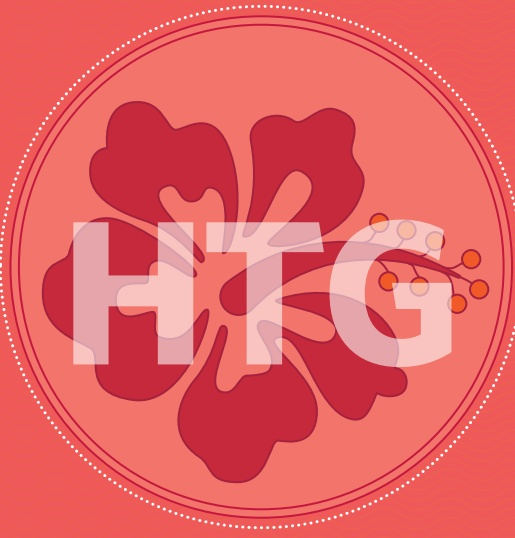

FinScope

Consumer Survey

Highlights

Haiti 2018

<!-- page 2 -->

## Partnering for a common purpose

A Steering Committee was formed with the aim of putting in place technical procedures for the design and implementation of a global and inclusive process according to the local context. FinScope Haiti 2018 represents a partnership between the following Steering Committee members:

1. BRH

2. MEF

3. IHSI

4. DAI / Finance Inclusive

5. APB

6. ACME

7. Fédération Le Levier

8. KNFP

9. Université Quisqueya

10. Group Croissance

11. Digicel / Mon Cash

The FinScope survey is dynamic and the content is evaluated by several stakeholders including the private sector, NGOs and Government to ensure that the most relevant consumer data is collected.

## The cover symbol

Through the FinScope Haiti survey, we hope to effect real change at country level and see the impact of financial inclusion on broader national growth and development. The cover graphic features a flower that symbolizes growth and development while the circle represents inclusive growth. The petals of the flower symbolize the various stakeholders engaged with a common vision – financial inclusion for a broader national growth and development.

<!-- page 3 -->

## Introduction

The Government of Haiti recognises the role played by the financial sector in facilitating economic growth through enhanced access to financial services. In order to strengthen policies that will generate sustainable and inclusive growth and development, the stakeholders and Government of Haiti implemented FinScope Haiti 2018 to help identify and create a roadmap that ultimately secures the realisation of this vision.

The FinScope Haiti 2018 baseline survey will provide credible benchmarks on level of financial inclusion and guide targeted and focused financial inclusion strategies using empirical evidence. FinScope Haiti will also act as a national good for use across private, public sectors, academic backgrounds in order to ensure the lives of the Haitian people are enhanced.

## Methodology

• According to IHSI the total Haitian adult population is estimated to be 7,67 million.

- Nationally representative individual-based sample of the adult population aged 15 years and older at regional and urban/rural level.

• Sampling frame and data weighting conducted by FinMark Trust and IHSI.

• 4 269 completed face-to-face interviews conducted by Group Croissance (May - October 2018).

## Survey objectives

The objectives of FinScope Consumer Survey Haiti 2018 were to understand the adult population in terms of:

• Livelihoods and how they generate their income.

• Their financial needs and demands.

- Their financial perceptions, attitudes, and behaviours.

Their demographic and geographic distribution.

- Current levels of access to, and utilisation of, financial services and products.

Create a credible financial inclusion benchmark for Haiti.

Published April 2019

<!-- page 4 -->

## DEPARTMENTS OF HAITI

<!-- page 5 -->

<!-- page 6 -->

## DEMOGRAPHICS

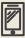

| Category | Percentage |
| --- | --- |
| Bed/mattress | 52% |
| Mobile phone/CT mobile phone | 37% |
| Radio station | 24% |
| Television | 16% |
| Wardrobes/closet | 14% |
| Fridge/refrigerator | 7% |
| Electrical appliances (blender, heater, iron, coffee maker, etc.) | 6% |
| Motorcycle/moped | 6% |
| Gas cookers | 6% |
| Jewelry | 5% |
| Wheelbarrow/rickshaw | 4% |
| Bicycle | 4% |
| Gas plate | 3% |
| Personal car | 3% |
| Sewing machine | 3% |
| VCR/CD/DVD player | 2% |
| Music equipment | 2% |
| Truck/van | 1% |
| Household Owners of ASSETS (%) |   |
| The bed is most owned a household. |   |
| About 60% of household access to a mobile phone |   |

## HOUSEHOLD OWNERSHIP OF ASSETS (%)

The bed is most owned asset in a household.

About 60% of households have access to a mobile phone.

<!-- page 7 -->

| Age Group | Percentage |
| --- | --- |
| 15 - 17 years | 9% |
| 18 - 24 years | 9% |
| 25 - 34 years | 18% |
| 35 - 44 years | 21% |
| 45 - 60 years | 25% |
| 60 years and older | 22% |

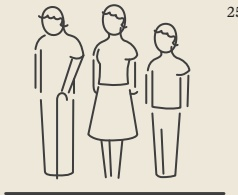

AGE (%)

| Category | Percentage (%) |
| --- | --- |
| EDUCATION | 47 |
| Pre-primary and primary school | 26 |
| Secondary school | 21 |
| More than secondary school | 7 |

| Category | Percentage |
| --- | --- |
| Basic/feature phone | 33% |
| Smartphone | 35% |
| Desktop/laptop/tablet | 12% |
| E-mail | 12% |
| Land line | 1% |
| Fax | 1% |
| Use | 7% |
| Internet | 15% |

## COMMUNICATION TOOLS/CHANNELS (%)

As expected, the mobile phone is the preferred communication device.

About 58% of adults have access to a mobile phone.

<!-- page 8 -->

## UNDERSTANDING PEOPLE'S LIVES

Access to services

2018

| Component | Percentage |
| --- | --- |
| Collective pipe borne water | 8% |
| Unprotected source | 9% |
| Retailer of pipe borne water | 8% |
| Individual pipe borne water (DINEPA) | 10% |
| Well with pump | 9% |
| Water tanker | 9% |

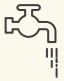

| Category | Percentage (%) |
| --- | --- |
| Connected to latrines | 54 |
| Connected to septic tank | 17 |
| No toilet/bush/fields | 4 |
| Pit latrines without slab/open hole | 16 |

<!-- page 9 -->

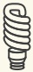

## HOUSEHOLDS WITH ELECTRICITY CONNECTION (%)

| Category | Percentage | Number of cells |
| --- | --- | --- |
| TOTAL | 40% | 1000 |
| Illegal connection | 45% | 450 |
| Individual connection | 35% | 300 |
| EDH / Collective connection | 16% | 100 |
| Other sources | 4% | 40 |
| Solar panels | 1% | 10 |

<!-- page 10 -->

## UNDERSTANDING PEOPLE'S LIVES

## Agriculture

| Category | Percentage |
| --- | --- |
| At market place | 100% |
| Middlemen/agent | 15% |
| Direct to the consumer | 6% |
| Retailer | 6% |
| Agricultural organisations/cooperatives/government agency | 1% |

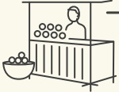

WHOM THEY SELL TO (%)

Farming in Haiti is important with 36% of adults live in households involved in farming – why department shows as Grand Anse (75%), Nippes (64%), South (61%), Centre (54%).

About 20% of farmers are subsistence farmers with 80% both consuming and selling.

| Category | Percentage |
| --- | --- |
| Seed shortage | 44% |
| Water problem | 39% |
| Climatic risks (drought, floods, etc.) | 36% |
| Lack of funding | 34% |
| Not enough land | 25% |
| Lack of pesticides | 23% |
| Lack of fertilizers | 23% |
| Cattle diseases | 22% |
| Lack of tools / materials for production | 22% |
| Plant diseases | 20% |
| Rotten products | 11% |
| Difficult access to markets | 8% |

## FARMING PROBLEMS EXPERIENCED (%)

<!-- page 11 -->

Access to documentation and property

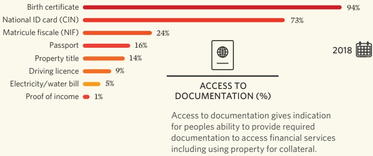

| Category | Occupancy Status (%) |
| --- | --- |
| Owner of the dwelling | 47 |
| Tenant | 25 |
| Another member of house owns the house | 9 |
| Co-owners of house | 9 |
| House is provided for free | 6 |

<!-- page 12 -->

## FINANCIAL CAPABILITY

Managing money

| Category | Percentage (%) |
| --- | --- |
| PLANNING AND TRACKING | 20 |
| How often do you run out of money for food and other important things? | 24 |
| Neighbours can count on you for help in times of difficulties | 49 |
| Your ties with your neighbours are not as strong as they used to be | 48 |
| You can rely on your friends or neighbours to help you out in difficult times | 36 |
| You can count on your church/mosque or religious group for help in times of difficulties | 36 |
| Always | 25 |
| Not often | 24 |
| Reasons FOR RUNNING OUT OF MONEY (%) | 80 |
| Not enough income | 80 |
| Irregular or unreliable income | 80 |
| Has to pay school fees | 33 |
| Unexpected events or paying for necessities | 33 |
| Buying medicines/health care | 33 |
| Yes to pay | 33 |
| Most times | 33 |

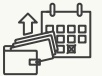

DIFFICULTY WITH KEEPING UP WITH FINANCIAL COMMITMENTS (*THOSE WHO AGREE) (%)

<!-- page 13 -->

Managing money and financial advice

| Category | Percentage (%) |
| --- | --- |
| Total control | 44 |
| Control with others | 10 |
| No control | 11 |
| Do not know | 35 |

| Category | Percentage |
| --- | --- |
| Do not go anywhere for advice | 32% |
| Someone else in your community | 10% |
| Someone else in the family or friend | 8% |
| Elderly person in your community | 7% |
| Your spouse(s) or partner | 5% |
| Bank or other financial professionals | 2% |
| Other sources of advice | 1% |
| Someone in your workplace or your employer | 1% |

<!-- page 14 -->

## FINANCIAL CAPABILITY

## Accessing Information

About 53% of adults felt they needed more information about personal finance.

53%

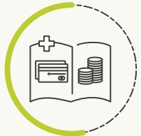

| Category | Percentage |
| --- | --- |
| How to save | 51% |
| How to invest | 50% |
| How to budget | 37% |
| How to obtain a loan | 27% |
| Advantages or disadvantages, the terms and conditions of financial products | 13% |
| What financial products are available | 13% |
| How to use financial products | 12% |
| How to choose financial products | 12% |

DESIRED FINANCIAL EDUCATION (%)

<!-- page 15 -->

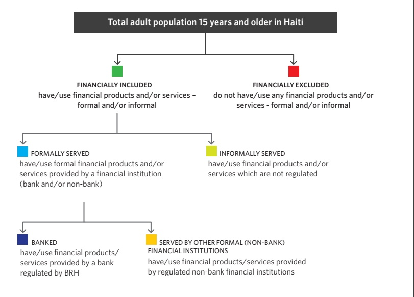

<!-- page 16 -->

'Formal' is a category classifying products or services as regulated or supervised by a formal institution or any other formal regulator/agency. This is also synonymous to 'other formal' or 'other formal (non-bank)' to differentiate it from the banked which are mostly commercial and development banks.

| Category | Value (%) |
| --- | --- |
| Other formal (non-bank) | 26.4 |
| Banked | 1.3 |
| Informal | 10.4 |
| Excluded | 46 |

Note: Due to rounding off numbers of 'Banked' and 'Other formal (non-bank)' the 'Excluded' population is 46%.

## Overlaps

"Consumers generally use a combination of financial products and services to meet their financial needs".

- 1% of adults rely exclusively on banking services yet 26% rely exclusively on other formal mechanisms.

- 16% use a combination of banked, and/or other formal and/or informal mechanisms to manage their financial needs, thus indicating that their needs are not fully met by the formal sector alone.

- 10% of the adult population ONLY rely on informal mechanisms such as informal savings and credit groups to save or borrow money or cover risk.

<!-- page 17 -->

| Category | Percentage |
| --- | --- |
| Formally served | 44% |
| Banked | 11% |
| Other formal (non-bank) | 42% |
| Informal | 19% |
| Excluded | 46% |

If filtered by 18 and plus the banked population sits at 11,5%.

Financial Access Strand 2018

| Category | Percentage |
| --- | --- |
| Banked | 11% |
| Other formal (non-bank) | 33% |
| Informal only | 10% |
| Excluded | 46% |

<!-- page 18 -->

## FINANCIAL INCLUSION CONSUMER ACCESS STRAND (RANKED BY EXCLUDED)

<!-- page 19 -->

|   | Other formal (non-bank) | Informal only | Excluded |
| --- | --- | --- | --- |
| 20% | 4% | 16% | 60% |
| 12% | 24% | 12% | 52% |
| 27% | 7% | 15% | 51% |
| 11% | 33% | 10% | 46% |
| 38% | 10% | 10% | 42% |
| 25% | 13% | 21% | 41% |
| 12% | 17% | 30% | 41% |
| 18% | 27% | 15% | 40% |
| 18% | 22% | 21% | 39% |
| 10% | 39% | 15% | 36% |
| 25% | 23% | 22% | 30% |
| 13% | 52% | 7% | 28% |
| 54% | 10% | 9% | 27% |
| 36% | 11% | 28% | 25% |
| 50% | 18% | 8% | 24% |
| 30% | 39% | 8% | 23% |
| 68% | 5% | 5% | 22% |
| 22% | 36% | 20% | 22% |
| 40% | 21% | 21% | 18% |
| 44% | 39% | 6% | 11% |
| 26% | 42% | 21% | 11% |
| 85% | 80% | 3% | 10% |
| 94% | 94% | 10% | 7% |
| Mozambique 2014 |   |   |   |
| DRC 2014 |   |   |   |
| Malawi 2014 |   |   |   |
| Haiti 2018 |   |   |   |
| Nigeria 2016 |   |   |   |
| Zambia 2015 |   |   |   |
| Madagascar 2016 |   |   |   |
| Togo 2016 |   |   |   |
| Burkina Faso 2016 |   |   |   |
| Cameroon 2017 |   |   |   |
| Myanmar 2018 |   |   |   |
| Tanzania 2017 |   |   |   |
| Eswatini 2014 |   |   |   |
| Laos PDR 2014 |   |   |   |
| Botswana 2014 |   |   |   |
| Zimbabwe 2014 |   |   |   |
| Namibia 2017 |   |   |   |
| Uganda 2017 |   |   |   |
| Nepal 2014 |   |   |   |
| Kenya 2019 |   |   |   |
| Rwanda 2016 |   |   |   |
| Mauritius 2014 |   |   |   |
| South Africa 2018 |   |   |   |
| Seychelles 2015 |   |   |   |

<!-- page 20 -->

## FINANCIAL INCLUSION

## Financial Access Strand 2018

| Category | Banked (%) | Informal only (%) | Excluded (%) |
| --- | --- | --- | --- |
| Access Strands by location, gender and age | 12 | 4 | 44 |
| Female | 9 | 34 | 12 |
| Male | 12 | 47 | 11 |

<!-- page 21 -->

FINANCIAL INCLUSION

|   | Other formal (non-bank) | Informal only | Excluded | Total |
| --- | --- | --- | --- | --- |
| Aire Metropolitanை | 17% | 41% | 6% | 36% |
| Rest-of-West | 15% | 34% | 11% | 40% |
| South East | 8% | 31% | 21% | 40% |
| Nippes | 8% | 32% | 15% | 45% |
| South Artibonite | 8% | 29% | 17% | 46% |
| North East | 7% | 31% | 14% | 47% |
| Grand Anse | 10% | 33% | 9% | 51% |
| North West | 5% | 26% | 9% | 60% |
| Centre | 4% | 21% | 8% | 67% |

<!-- page 22 -->

What products/services are driving the banked?

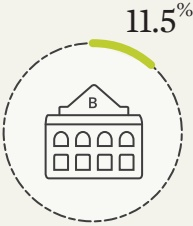

About 11.5% of Haitian adults have a bank account.

| Category | Percentage |
| --- | --- |
| Debit card/ATM card | 23% |
| Current/checking account | 20% |
| Livrets of savings/savings at sight | 20% |
| Trade loan | 3% |
| Personal loan | 2% |
| Loan for enterprise | 1% |
| BANKING PRODUCTS/USAGE (OF THOSE CURRENTLY BANKED (%)) |   |

<!-- page 23 -->

Drivers and barriers

11% of adults are banked in 2018

| Category | Value (%) |
| --- | --- |
| To save | 60 |
| To keep money safe | 16 |
| To receive salary or wages | 15 |
| Other reasons | 4 |
| To get credit or loan | 3 |
| make payments or get money | 2 |

89% of adults are not banked in 2018

<table>
  <thead><tr><th>Category</th><th>Percentage</th></tr></thead>
  <tbody>
    <tr><td>I do not work</td><td>34%</td></tr>
    <tr><td>I have no regular income</td><td>28%</td></tr>
    <tr><td>I have no money to save</td><td>19%</td></tr>
    <tr><td>I do not trust banks</td><td>7%</td></tr>
    <tr><td>I do not need it</td><td>4%</td></tr>
    <tr><td>The bank is too far or transport is too expensive</td><td>4%</td></tr>
    <tr><td>Other reasons</td><td>4%</td></tr>
    <tr><td>I do not understand how it works</td><td>3%</td></tr>
    <tr><td>I do not have the required documents</td><td>3%</td></tr>
    <tr><td>I do not know how to open an account</td><td>1%</td></tr>
    <tr><td>Do not understand the advantages of bank account</td><td>1%</td></tr>
    <tr><td>Additional 86 354 (1.1%) Haitian adults are using someone else's bank account.</td></tr>
  </tbody>
</table>

<!-- page 24 -->

## LANDSCAPE PRODUCTS

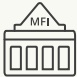

Microfinance institutions

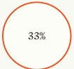

Aire Metropolitaine

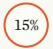

6% Rest-of-West

Artibonite

South

○5% Grand Anse

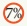

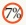

North

North East

○5%

Nippes

Centre

South East

3%

North West

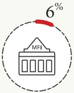

About 6% of Haitian adults are currently using Microfinance institutions.

REGIONS (%)

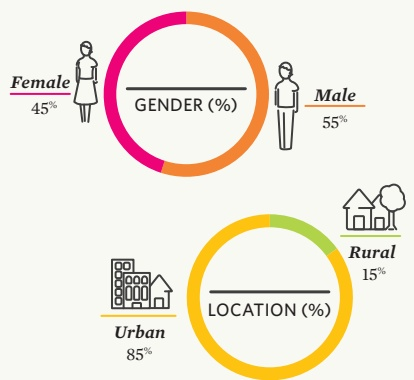

| Age (%) | Under 18 years | 18-24 years | 25-34 years | 35-44 years | 45-60 years | Above 60 years |
| --- | --- | --- | --- | --- | --- | --- |
| Under 18 years | 4% | 4% | 4% | 4% | 4% | 4% |
| 18-24 years | 2% | 2% | 2% | 2% | 2% | 2% |
| 25-34 years | 1% | 1% | 1% | 1% | 1% | 1% |
| 35-44 years | 0.5% | 0.5% | 0.5% | 0.5% | 0.5% | 0.5% |
| 45-60 years | 0.2% | 0.2% | 0.2% | 0.2% | 0.2% | 0.2% |
| Above 60 years | 0.1% | 0.1% | 0.1% | 0.1% | 0.1% | 0.1% |

<!-- page 25 -->

| Category | Overall | Savings and investments |
| --- | --- | --- |
| Formal savings | 11% | 73% |
| Banked | 8% | 4% |
| Other formal (non-bank) | 4% | 7% |

Savings Strands by region

|   | Other formal (non-bank) | Informal | At home/secret place only | Not saving | Banked |
| --- | --- | --- | --- | --- | --- |
| Total | 73% | 73% | 73% | 73% | 73% |
| South East | 26% | 57% | 57% | 57% | 57% |
| South | 24% | 62% | 62% | 62% | 62% |
| Nippes | 19% | 6% | 66% | 66% | 66% |
| Artibonite | 17% | 6% | 70% | 70% | 70% |
| Rest-of-West | 10% | 3% | 70% | 70% | 70% |
| Aire | 4% | 4% | 72% | 72% | 72% |
| Metropolitaine | 8% | 8% | 73% | 73% | 73% |
| Grand Anse | 8% | 5% | 80% | 80% | 80% |
| North East | 3% | 3% | 80% | 80% | 80% |
| North West | 3% | 3% | 81% | 81% | 81% |
| North | 5% | 5% | 83% | 83% | 83% |
| Centre | 8% | 8% | 83% | 83% | 83% |

<!-- page 26 -->

## LANDSCAPE PRODUCTS

## Savings and investments (%)

Inclusive of monetized saving and investment vehicles, does not include saving in kind

| Category | Banked | Informal | At home/secret | Not saving |
| --- | --- | --- | --- | --- |
| Savings by location, gender and age |   |   |   |   |
| Female | 7% | 2% | 11% | 5% |
| Male | 10% | 2% | 14% | 5% |
| 15-34 years and older | 7% | 3% | 11% | 5% |
| Total Savings | **100%** | **9%** | **21%** | **73%** |

<!-- page 27 -->

| Category | Banked | Other formal (non-bank) | Informal | Family/friends only | Not borrowing |
| --- | --- | --- | --- | --- | --- |
| Formal credit | 4% | 0% | 0% | 0% | 0% |
| Banked | 1% | 0% | 0% | 0% | 0% |
| Other formal (non-bank) | 3% | 0% | 0% | 0% | 0% |
| Informal | 0% | 5% | 0% | 0% | 0% |
| Family/friends | 0% | 5% | 0% | 0% | 0% |
| Not borrowing | 0% | 0% | 87% | 0% | 0% |
| Credit Strand | 1% | 2% | 5% | 5% | 87% |

<!-- page 28 -->

## LANDSCAPE PRODUCTS

Borrowing and credit

| Category | Banked (%) | Other formal (non-bank) (%) | Informal (%) | Family/friends only (%) | Not borrowing (%) |
| --- | --- | --- | --- | --- | --- |
| Urban | 2 | 2 | 5 | 5 | 86 |
| Rural | 1 | 3 | 4 | 4 | 88 |
| Female | 1 | 2 | 5 | 5 | 87 |
| Male | 1 | 3 | 5 | 5 | 86 |

<!-- page 29 -->

Borrowing and credit

Drivers and barriers to accessing credit

13% have borrowing/credit products

| Category | Percentage |
| --- | --- |
| Starting or expanding my business or business activities of my household | 21% |
| Living expenses when you do not have money at that time | 10% |
| An emergency other than medical | 10% |
| Medical expenses either planned or emergency | 9% |
| Purchase of agricultural inputs such as fertilizer | 5% |
| Purchase or construction housing for habitation | 1% |

87% do not borrow

| Category | Percentage |
| --- | --- |
| I do not like having debts | 27% |
| I do not work | 19% |
| I do not have a regular income | 11% |
| I do not need it | 8% |
| I can not afford it | 8% |
| I have never thought about it | 6% |
| The interest is too high | 6% |
| I do not have identification papers | 5% |
| Other reasons | 4% |

<!-- page 30 -->

Insurance overalls and overlaps

| Category | Percentage |
| --- | --- |
| Insured | 4% |
| Other formal (non-bank) | 4% |
| Informal |   |
| Not insured | 96% |

Insurance Strand

| Category | Insured (%) | Not insured (%) |
| --- | --- | --- |
| Formally employed - Government | 48 | 52 |
| Formally employed - private | 22 | 77 |
| Informally employed | 7 | 93 |
| Self-employed | 3 | 97 |
| Remittance dependent | 2 | 98 |
| Farming and fishing | 1 | 99 |

<!-- page 31 -->

Drivers and barriers

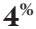

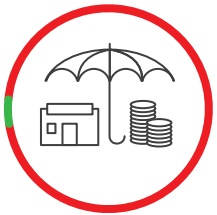

of adults have insurance

Insurance and risk management

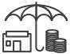

## 96 %

of adults do not have any kind of financial product covering risk

Of those insured uptake of insurance products is driven by:

| Category | Percentage |
| --- | --- |
| Health or Medical insurance | 53% |
| Life assurance | 23% |
| Pension insurance | 13% |
| Accident insurance | 9% |
| Housing insurance | 1% |
| Total vehicle or motorcycle insurance | 20% |

## ance:

| Category | Percentage |
| --- | --- |
| I have no income or regular job | 44% |
| Do not understand how insurance works | 10% |
| Do not have enough knowledge | 9% |
| I don't believe in insurance | 8% |
| I do not need insurance | 7% |

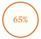

have not heard of life insurance

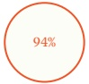

have not heard of education insurance

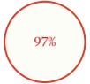

are not aware of property damage insurance

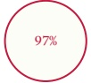

have not heard of agricultural risk insurance

<!-- page 32 -->

Overview of those that claimed to remit in the past 12 months

| Category | Percentage |
| --- | --- |
| Formal remittances | 27% |
| Banked | 1% |
| Other formal (non-bank) | 26% |
| Informal | 2% |
| Remitting via family/friends | 12% |
| Not remitting | 61% |

Remittances Strand

| Category | Percentage |
| --- | --- |
| 1 | 26% |
| 2 | 2% |
| 3 | 10% |
| 4 | 61% |
| 5 |   |
| 6 |   |
| 7 |   |
| 8 |   |
| 9 |   |
| 10 |   |
| 11 |   |
| 12 |   |
| 13 |   |
| 14 |   |
| 15 |   |
| 16 |   |
| 17 |   |
| 18 |   |
| 19 |   |
| 20 |   |
| 21 |   |
| 22 |   |
| 23 |   |
| 24 |   |
| 25 |   |
| 26 |   |
| 27 |   |
| 28 |   |
| 29 |   |
| 30 |   |
| 31 |   |
| 32 |   |
| 33 |   |
| 34 |   |
| 35 |   |
| 36 |   |
| 37 |   |
| 38 |   |
| 39 |   |
| 40 |   |
| 41 |   |
| 42 |   |
| 43 |   |
| 44 |   |
| 45 |   |
| 46 |   |
| 47 |   |
| 48 |   |
| 49 |   |
| 50 |   |
| 51 |   |
| 52 |   |
| 53 |   |
| 54 |   |
| 55 |   |
| 56 |   |
| 57 |   |
| 58 |   |
| 59 |   |
| 60 |   |
| 61 |   |
| 62 |   |
| 63 |   |
| 64 |   |
| 65 |   |
| 66 |   |
| 67 |   |
| 68 |   |
| 69 |   |
| 70 |   |
| 71 |   |
| 72 |   |
| 73 |   |
| 74 |   |
| 75 |   |
| 76 |   |
| 77 |   |
| 78 |   |
| 79 |   |
| 80 |   |
| 81 |   |
| 82 |   |
| 83 |   |
| 84 |   |
| 85 |   |
| 86 |   |
| 87 |   |
| 88 |   |
| 89 |   |
| 90 |   |
| 91 |   |
| 92 |   |
| 93 |   |
| 94 |   |
| 95 |   |
| 96 |   |
| 97 |   |
| 98 |   |
| 99 |   |
| 100 |   |
| 101 |   |
| 102 |   |
| 103 |   |
| 104 |   |
| 105 |   |
| 106 |   |
| 107 |   |
| 108 |   |
| 109 |   |
| 110 |   |
| 111 |   |
| 112 |   |
| 113 |   |
| 114 |   |
| 115 |   |
| 116 |   |
| 117 |   |
| 118 |   |
| 119 |   |
| 120 |   |
| 121 |   |
| 122 |   |
| 123 |   |
| 124 |   |
| 125 |   |
| 126 |   |
| 127 |   |
| 128 |   |
| 129 |   |
| 130 |   |
| 131 |   |
| 132 |   |
| 133 |   |
| 134 |   |
| 135 |   |
| 136 |   |
| 137 |   |
| 138 |   |
| 139 |   |
| 140 |   |
| 141 |   |
| 142 |   |
| 143 |   |
| 144 |   |
| 145 |   |
| 146 |   |
| 147 |   |
| 148 |   |
| 149 |   |
| 150 |   |
| 151 |   |
| 152 |   |
| 153 |   |
| 154 |   |
| 155 |   |
| 156 |   |
| 157 |   |
| 158 |   |
| 159 |   |
| 160 |   |
| 161 |   |
| 162 |   |
| 163 |   |
| 164 |   |
| 165 |   |
| 166 |   |
| 167 |   |
| 168 |   |
| 169 |   |
| 170 |   |
| 171 |   |
| 172 |   |
| 173 |   |
| 174 |   |
| 175 |   |
| 176 |   |
| 177 |   |
| 178 |   |
| 179 |   |
| 180 |   |
| 181 |   |
| 182 |   |
| 183 |   |
| 184 |   |
| 185 |   |
| 186 |   |
| 187 |   |
| 188 |   |
| 189 |   |
| 190 |   |
| 191 |   |
| 192 |   |
| 193 |   |
| 194 |   |
| 195 |   |
| 196 |   |
| 197 |   |
| 198 |   |
| 199 |   |
| 200 |   |
| 201 |   |
| 202 |   |
| 203 |   |
| 204 |   |
| 205 |   |
| 206 |   |
| 207 |   |
| 208 |   |
| 209 |   |
| 210 |   |
| 211 |   |
| 212 |   |
| 213 |   |
| 214 |   |
| 215 |   |
| 216 |   |
| 217 |   |
| 218 |   |
| 219 |   |
| 220 |   |
| 221 |   |
| 222 |   |
| 223 |   |
| 224 |   |
| 225 |   |
| 226 |   |
| 227 |   |
| 228 |   |
| 229 |   |
| 230 |   |
| 231 |   |
| 232 |   |
| 233 |   |
| 234 |   |
| 235 |   |
| 236 |   |
| 237 |   |
| 238 |   |
| 239 |   |
| 240 |   |
| 241 |   |
| 242 |   |
| 243 |   |
| 244 |   |
| 245 |   |
| 246 |   |
| 247 |   |
| 248 |   |
| 249 |   |
| 250 |   |
| 251 |   |
| 252 |   |
| 253 |   |
| 254 |   |
| 255 |   |
| 256 |   |
| 257 |   |
| 258 |   |
| 259 |   |
| 260 |   |
| 261 |   |
| 262 |   |
| 263 |   |
| 264 |   |
| 265 |   |
| 266 |   |
| 267 |   |
| 268 |   |
| 269 |   |
| 270 |   |
| 271 |   |
| 272 |   |
| 273 |   |
| 274 |   |
| 275 |   |
| 276 |   |
| 277 |   |
| 278 |   |
| 279 |   |
| 280 |   |
| 281 |   |
| 282 |   |
| 283 |   |
| 284 |   |
| 285 |   |
| 286 |   |
| 287 |   |
| 288 |   |
| 289 |   |
| 290 |   |
| 291 |   |
| 292 |   |
| 293 |   |
| 294 |   |
| 295 |   |
| 296 |   |
| 297 |   |
| 298 |   |
| 299 |   |
| 300 |   |
| 301 |   |
| 302 |   |
| 303 |   |
| 304 |   |
| 305 |   |
| 306 |   |
| 307 |   |
| 308 |   |
| 309 |   |
| 310 |   |
| 311 |   |
| 312 |   |
| 313 |   |
| 314 |   |
| 315 |   |
| 316 |   |
| 317 |   |
| 318 |   |
| 319 |   |
| 320 |   |
| 321 |   |
| 322 |   |
| 323 |   |
| 324 |   |
| 325 |   |
| 326 |   |
| 327 |   |
| 328 |   |
| 329 |   |
| 330 |   |
| 331 |   |
| 332 |   |
| 333 |   |
| 334 |   |
| 335 |   |
| 336 |   |
| 337 |   |
| 338 |   |
| 339 |   |
| 340 |   |
| 341 |   |
| 342 |   |
| 343 |   |
| 344 |   |
| 345 |   |
| 346 |   |
| 347 |   |
| 348 |   |
| 349 |   |
| 350 |   |
| 351 |   |
| 352 |   |
| 353 |   |
| 354 |   |
| 355 |   |
| 356 |   |
| 357 |   |
| 358 |   |
| 359 |   |
| 360 |   |
| 361 |   |
| 362 |   |
| 363 |   |
| 364 |   |
| 365 |   |
| 366 |   |
| 367 |   |
| 368 |   |
| 369 |   |
| 370 |   |
| 371 |   |
| 372 |   |
| 373 |   |
| 374 |   |
| 375 |   |
| 376 |   |
| 377 |   |
| 378 |   |
| 379 |   |
| 380 |   |
| 381 |   |
| 382 |   |
| 383 |   |
| 384 |   |
| 385 |   |
| 386 |   |
| 387 |   |
| 388 |   |
| 389 |   |
| 390 |   |
| 391 |   |
| 392 |   |
| 393 |   |
| 394 |   |
| 395 |   |
| 396 |   |
| 397 |   |
| 398 |   |
| 399 |   |
| 400 |   |
| 401 |   |
| 402 |   |
| 403 |   |
| 404 |   |
| 405 |   |
| 406 |   |
| 407 |   |
| 408 |   |
| 409 |   |
| 410 |   |
| 411 |   |
| 412 |   |
| 413 |   |
| 414 |   |
| 415 |   |
| 416 |   |
| 417 |   |
| 418 |   |
| 419 |   |
| 420 |   |
| 421 |   |
| 422 |   |
| 423 |   |
| 424 |   |
| 425 |   |
| 426 |   |
| 427 |   |
| 428 |   |
| 429 |   |
| 430 |   |
| 431 |   |
| 432 |   |
| 433 |   |
| 434 |   |
| 435 |   |
| 436 |   |
| 437 |   |
| 438 |   |
| 439 |   |
| 440 |   |
| 441 |   |
| 442 |   |
| 443 |   |
| 444 |   |
| 445 |   |
| 446 |   |
| 447 |   |
| 448 |   |
| 449 |   |
| 450 |   |
| 451 |   |
| 452 |   |
| 453 |   |
| 454 |   |
| 455 |   |
| 456 |   |
| 457 |   |
| 458 |   |
| 459 |   |
| 460 |   |
| 461 |   |
| 462 |   |
| 463 |   |
| 464 |   |
| 465 |   |
| 466 |   |
| 467 |   |
| 468 |   |
| 469 |   |
| 470 |   |
| 471 |   |
| 472 |   |
| 473 |   |
| 474 |   |
| 475 |   |
| 476 |   |
| 477 |   |
| 478 |   |
| 479 |   |
| 480 |   |
| 481 |   |
| 482 |   |
| 483 |   |
| 484 |   |
| 485 |   |
| 486 |   |
| 487 |   |
| 488 |   |
| 489 |   |
| 490 |   |
| 491 |   |
| 492 |   |
| 493 |   |
| 494 |   |
| 495 |   |
| 496 |   |
| 497 |   |
| 498 |   |
| 499 |   |
| 500 |   |
| 501 |   |
| 502 |   |
| 503 |   |
| 504 |   |
| 505 |   |
| 506 |   |
| 507 |   |
| 508 |   |
| 509 |   |
| 510 |   |
| 511 |   |
| 512 |   |
| 513 |   |
| 514 |   |
| 515 |   |
| 516 |   |
| 517 |   |
| 518 |   |
| 519 |   |
| 520 |   |
| 521 |   |
| 522 |   |
| 523 |   |
| 524 |   |
| 525 |   |
| 526 |   |
| 527 |   |
| 528 |   |
| 529 |   |
| 530 |   |
| 531 |   |
| 532 |   |
| 533 |   |
| 534 |   |
| 535 |   |
| 536 |   |
| 537 |   |
| 538 |   |
| 539 |   |
| 540 |   |
| 541 |   |
| 542 |   |
| 543 |   |
| 544 |   |
| 545 |   |
| 546 |   |
| 547 |   |
| 548 |   |
| 549 |   |
| 550 |   |
| 551 |   |
| 552 |   |
| 553 |   |
| 554 |   |
| 555 |   |
| 556 |   |
| 557 |   |
| 558 |   |
| 559 |   |
| 560 |   |
| 561 |   |
| 562 |   |
| 563 |   |
| 564 |   |
| 565 |   |
| 566 |   |
| 567 |   |
| 568 |   |
| 569 |   |
| 570 |   |
| 571 |   |
| 572 |   |
| 573 |   |
| 574 |   |
| 575 |   |
| 576 |   |
| 577 |   |
| 578 |   |
| 579 |   |
| 580 |   |
| 581 |   |
| 582 |   |
| 583 |   |
| 584 |   |
| 585 |   |
| 586 |   |
| 587 |   |
| 588 |   |
| 589 |   |
| 590 |   |
| 591 |   |
| 592 |   |
| 593 |   |
| 594 |   |
| 595 |   |
| 596 |   |
| 597 |   |
| 598 |   |
| 599 |   |
| 600 |   |
| 601 |   |
| 602 |   |
| 603 |   |
| 604 |   |
| 605 |   |
| 606 |   |
| 607 |   |
| 608 |   |
| 609 |   |
| 610 |   |
| 611 |   |
| 612 |   |
| 613 |   |
| 614 |   |
| 615 |   |
| 616 |   |
| 617 |   |
| 618 |   |
| 619 |   |
| 620 |   |
| 621 |   |
| 622 |   |
| 623 |   |
| 624 |   |
| 625 |   |
| 626 |   |
| 627 |   |
| 628 |   |
| 629 |   |
| 630 |   |
| 631 |   |
| 632 |   |
| 633 |   |
| 634 |   |
| 635 |   |
| 636 |   |
| 637 |   |
| 638 |   |
| 639 |   |
| 640 |   |
| 641 |   |
| 642 |   |
| 643 |   |
| 644 |   |
| 645 |   |
| 646 |   |
| 647 |   |
| 648 |   |
| 649 |   |
| 650 |   |
| 651 |   |
| 652 |   |
| 653 |   |
| 654 |   |
| 655 |   |
| 656 |   |
| 657 |   |
| 658 |   |
| 659 |   |
| 660 |   |
| 661 |   |
| 662 |   |
| 663 |   |
| 664 |   |
| 665 |   |
| 666 |   |
| 667 |   |
| 668 |   |
| 669 |   |
| 670 |   |
| 671 |   |
| 672 |   |
| 673 |   |
| 674 |   |
| 675 |   |
| 676 |   |
| 677 |   |
| 678 |   |
| 679 |   |
| 680 |   |
| 681 |   |
| 682 |   |
| 683 |   |
| 684 |   |
| 685 |   |
| 686 |   |
| 687 |   |
| 688 |   |
| 689 |   |
| 690 |   |
| 691 |   |
| 692 |   |
| 693 |   |
| 694 |   |
| 695 |   |
| 696 |   |
| 697 |   |
| 698 |   |

<!-- page 33 -->

| Category | Chart 1 - Dark Blue | Chart 1 - Light Blue | Chart 2 - Dark Blue | Chart 2 - Light Blue | Chart 3 - Dark Blue | Chart 3 - Light Blue |
| --- | --- | --- | --- | --- | --- | --- |
| Aire | 36% | 1% | 52% | 10% | 52% | 10% |
| Metropolitaine | 29% | 3% | 60% | 8% | 60% | 8% |
| Rest-of-West | 23% | 2% | 61% | 14% | 61% | 14% |
| South | 25% | 3% | 62% | 9% | 62% | 9% |
| Artibonite | 28% | 1% | 63% | 8% | 63% | 8% |
| Nippes | 20% | 2% | 63% | 15% | 63% | 15% |
| South East | 22% | 1% | 7% | 7% | 69% | 7% |
| North | 21% | 1% | 9% | 9% | 69% | 9% |
| North West | 14% | 4% | 12% | 12% | 70% | 12% |
| Grand Anse | 2% | 19% | 6% | 73% | 75% | 75% |
| North East | 11% | 2% | 12% | 12% | 75% | 12% |
| Centre | 11% | 2% | 12% | 12% | 75% | 12% |

<!-- page 34 -->

## LANDSCAPE PRODUCTS

## Mobile money

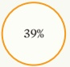

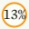

☐ 7%

| Aire Metropolitaine | Artibonite | North | West | South | South East |
| --- | --- | --- | --- | --- | --- |
| ○ 4% | ○ 4% | ○ 3% | ○ 3% | ○ 3% |   |
| GrandAnse | Centre | North West | North East | Nippes |   |

## REGIONS (%)

| Age (%) | Number |
| --- | --- |
| Under 18 years | 18 |
| 18-24 years | 24 |
| 25-34 years | 34 |
| 35-44 years | 44 |
| 45-60 years | 60 |
| Above 60 years | 60 |
| AGE | Percentage |
| 34% | 24% |
| 60% | 34% |

Around 23% of adults are registered mobile money users.

| Category | Percentage (%) |
| --- | --- |
| Female | 48 |
| Male | 52 |
| Urban | 91 |

<!-- page 35 -->

| Category | Percentage | 23% USE MOBILE MONEY SERVICES |
| --- | --- | --- |
| This is the most convenient (takes less time) | 49% | 1% |
| It is not expensive | 45% | 11% |
| This is the only accessible one in my community | 18% | 4% |
| I trust this means | 11% | 1% |

| Category | Percentage |
| --- | --- |
| I don't have enough information about it | 23% |
| I don't have money to send or receive | 13% |
| I have not thought about it | 12% |
| Do not have a cell/mobile phone | 10% |
| I am not interested in mobile money | 10% |
| Do not have a sim card | 6% |
| I don't trust telecom companies | 6% |
| There are no mobile money service providers in my area | 4% |
| I don't have access to a mobile phone/no network coverage | 3% |
| It is complicated | 3% |

<!-- page 36 -->

Landscape of Access (of those with any financial product)

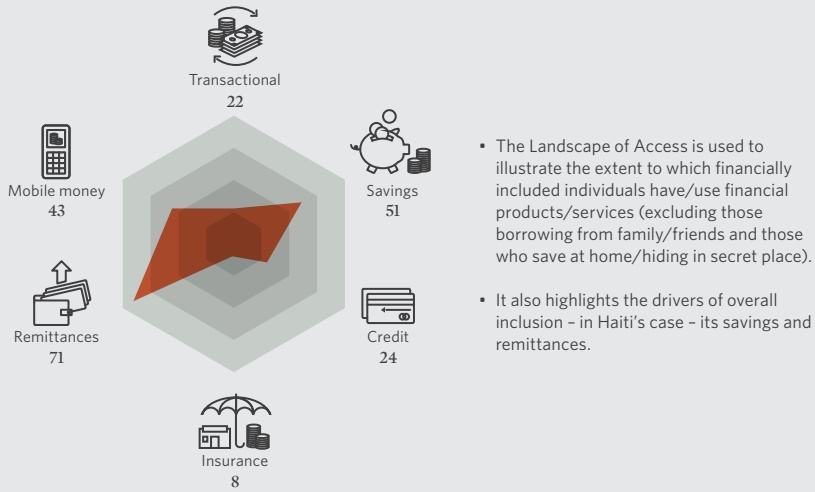

The Landscape of Access is used to illustrate the extent to which financially included individuals have/use financial products/services (excluding those borrowing from family/friends and those who save at home/hiding in secret place).

- It also highlights the drivers of overall inclusion - in Haiti's case - its savings and remittances.

<!-- page 37 -->

## KEY FINDINGS

The study FinScope Haiti 2018, revealed how the Haitians 15 years and older manage their finances and elements that influence their access to financial services. The study also identified the role of formal and informal financial sectors in the financial environment of Haiti. From this study, the following conclusions are drawn:

Linking this with the National FI Strategy Pillar on facilitating access to financial products and services, results below refers:

1. Almost 54% of the population 15 years and over have access to financial services. However there are disparities and levers that should act to enable a broader inclusion of the population. It therefore appears that:

credit (5%). Furthermore, about 5% are accessing credit from their family and friends.

• 44% of 15 years and over are served formally including banks and other non-bank formal products and services;

• 11% of 15 years and over are served by banks;

• 42% of 15 years and over use other non-bank formal products and services;

• 19% of 15 years and older use of non-formal only mechanisms to manage their finances; and

Linking this with the National FI Strategy

Pillar on Credit for economic growth, it can be observed that:

• 46% of 15 years and over are financially excluded.

2. Formal credit (4%) is not used so widely in Haiti, but seems to be a slight preference for informal

• Business owners show pockets of utilising credit to grow or expand their businesses as only 21% of credit is used to start, or grow business - a positive step;

Business owners still have a preference for informal credit (6%).

3. The consumer education and financial literacy are real issues in Haiti - mainly in the area of insurance, where most adults are not financially knowledgeable. In addition,

• About 53% of adults indicated a need for financial education, mainly seeking information on how to save and advantages of financial investments vehicles;

• An additional 45% of adults do not seek financial advice anywhere and are trapped by lack of financial information.

Linking this with the National FI Strategy Pillar on consumer education, the results support a concerted effort to drive financial literacy, especially amongst the youth and informally employed

<!-- page 38 -->

## RECOMMENDATIONS

### 1. Implement a FinScope Small Business Survey

• Significant amount of adults are self-employed and majority excluded, addressing how business owners can utilise access to financial services to grow and expand their businesses will have a higher impact and prospects for economic growth in Haiti. This survey aids in better understanding the business value chain and business owners financial needs to better serve them.

• See here for more details:

https://finmark.org.za/_programme/data-for-financial-markets/finscope/finscope-msme/

### 2. Consumer education/literacy programmes

• In order to create a better value proposition for financial inclusion, Haitian adults need to understand the benefits of using appropriate financial services.

• The results show the barriers to financial inclusion mostly relate to lack of financial awareness.

Visit:

https://www.i2ifacility.org/data-portal/HTI

<!-- page 39 -->

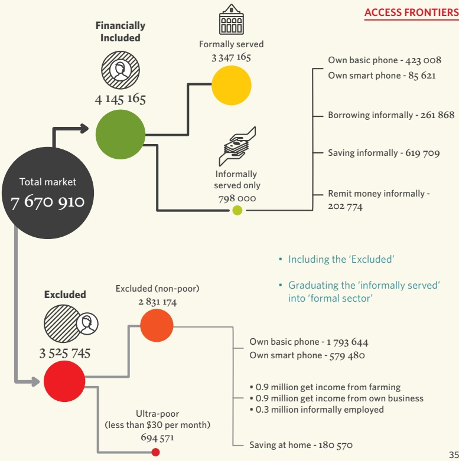

<!-- page 40 -->

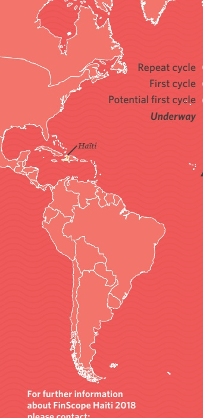

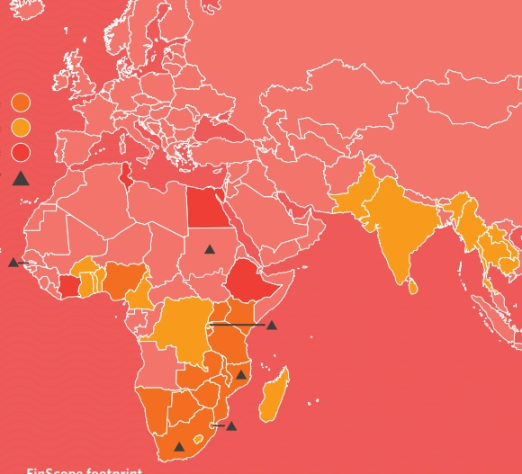

For further information about FinScope Haiti 2018 please contact:

## FinScope footprint

FinScope Consumer Surveys have been completed in 33 countries including Haiti. This allows for cross-country comparison regionally and sharing of findings which are key in assisting on going growth and strengthening the development of financial markets. Surveys are currently underway in 7 countries - 4 in SADC and 3 non-SADC.

FinScope Haiti 2018 contains a wealth of data based on a nationally representative sample of the adult population of Haiti.

Dr Kingstone Mutsonziwa

Finmak.org.za

Tel: +27 11 315 9197

kingstonem@finmark.org.za

www.finmark.org.za
