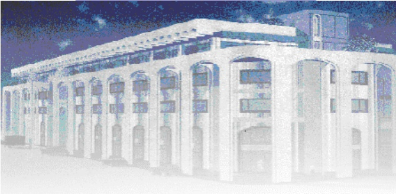

<!-- page 1 -->

Banque de la République d'Haïti

Note mensuelle d'inflation

Mai 2021

<!-- page 2 -->

## Table des matières

I.- Introduction.....2
II.- Évolution de l'inflation globale en mai 2021.....2
III.- Évolution des principales fonctions de consommation en mai 2021.....2
IV.- Évolution de l'inflation selon l'origine des produits et les régions géographiques du pays.....4
V.- Facteurs explicatifs de l'évolution de l'inflation en rythme mensuel .....4
VI.- Prévisions de l'inflation en rythme mensuel .....5

<!-- page 3 -->

### I. - Introduction

Cette note analyse l'évolution de l'Indice des Prix à la Consommation (IPC) en Haïti au cours du mois de mai 2021. Elle apporte quelques éléments explicatifs permettant de comprendre les facteurs qui influencent l'évolution de l'inflation.

### II. - Évolution de l'inflation globale

En mai 2021, l'indice des prix à la consommation (IPC) a été estimé à 168,7 contre 167 en avril 2021 et 147,3 en mai 2020. Au cours du mois sous revue, l'inflation mensuelle s'est portée à 1%, accusant une hausse de 10 points de base par rapport au mois précédent. En glissement annuel, l'inflation poursuit sa baisse entamée depuis septembre 2020 en s'établissant à 14,5% en mai 2021 contre 16% un mois auparavant.

Le taux d'inflation mensuel cumulé d'octobre 2020 à mai 2021 a atteint 5,6 % contre 14,6 % au cours de la même période de l'exercice 2019-2020. Considérée en moyenne mensuelle, l'inflation sur les huits (8) premiers mois de l'exercice s'est établie à 0,7 % contre 1,8 % sur la même période de l'année fiscale antérieure.

Graphique No. 1 Évolution de l'inflation annuelle de mai 2019 à mai 2021 (en %)

| Date | Inflation Annuelle | Inflation Mensuelle |
| --- | --- | --- |
| May-19 | 17.8 | 15.8 |
| Jun-19 | 18.8 | 18.5 |
| Jul-19 | 19.5 | 16.5 |
| Aug-19 | 19.8 | 16.5 |
| Sep-19 | 20.0 | 16.5 |
| Oct-19 | 20.2 | 17.5 |
| Nov-19 | 20.5 | 17.8 |
| Dec-19 | 20.8 | 17.5 |
| Jan-20 | 20.8 | 16.5 |
| Feb-20 | 21.0 | 17.5 |
| Mar-20 | 22.0 | 17.5 |
| Apr-20 | 22.5 | 18.5 |
| May-20 | 23.5 | 20.0 |
| Jun-20 | 24.8 | 24.5 |
| Jul-20 | 25.5 | 22.0 |
| Aug-20 | 27.8 | 32.5 |
| Sep-20 | 25.0 | 0.0 |
| Oct-20 | 21.5 | -8.0 |
| Nov-20 | 20.0 | 5.0 |
| Dec-20 | 19.5 | 10.5 |
| Jan-21 | 19.0 | 11.5 |
| Feb-21 | 18.0 | 11.5 |
| Mar-21 | 17.0 | 11.0 |
| Apr-21 | 15.8 | 9.5 |
| May-21 | 14.5 | 10.5 |

Source : Calculs de la BRH

<!-- page 4 -->

### III. - Évolution des principales fonctions de consommation en mai 2021

La hausse de l'inflation mensuelle en mai 2021 s'est reflétée dans le comportement de l'IPC de la majorité des fonctions de consommation notamment celui des : « Produits alimentaires et boissons non alcoolisées » dont le taux de croissance est passé de 0,9 % à 1 %, « Boissons alcoolisées, tabac et stupéfiants » (0,9 % à 1 %), « Logement, eau, gaz, électricité et autres combustibles » (0,4 % à 1,1 %) et « Meubles, articles de ménage et entretien courant du foyer» (1,2 % à 1,4 %). Ces quatre fonctions de consommation ont contribué à hauteur de 85,65 % à l'évolution de l'inflation globale.

Par ailleurs, en glissement annuel, le ralentissement qui a caractérisé la variation de l'IPC global résulte de la baisse du rythme de progression de celui de principales fonctions de consommation. Les décélérations les plus importantes ont été enregistrées au niveau des groupes suivants : « Restaurants » (-2,7 pp¹ à 14,2 %), « Santé » (-2,6 pp à 23 %), « Boissons alcoolisées, tabac et stupéfiants » (-1,8 pp à 4,8 %), et « Produits alimentaires et boissons alcoolisées » (-1,7 pp à 17,5 %).

Tableau No. 1. Contributions à l'inflation mensuelle et annuelle en mai 2021 (en %)

<table><tr><td>Poste</td><td>Pondération</td><td>Contribution à l'inflation mensuelle</td><td>Contribution à l'inflation annuelle</td></tr><tr><td></td><td>en %</td><td>en %</td></tr><tr><td>Indice Général</td><td>100.00</td><td>100.00</td><td>100.00</td></tr><tr><td>Produits alimentaires et boissons non alcoolisées</td><td>48.50</td><td>68.18</td><td>59.88</td></tr><tr><td>Boissons alcoolisés, tabac et stupéfiants</td><td>1.42</td><td>-0.07</td><td>0.48</td></tr><tr><td>Articles d'habillement et chaussures</td><td>5.55</td><td>-0.85</td><td>6.35</td></tr><tr><td>Logement,eau,gaz, électricité et autres combustibles</td><td>14.14</td><td>0.29</td><td>11.30</td></tr><tr><td>Meubles, articles de ménages et entretien courant du foyer</td><td>5.32</td><td>17.25</td><td>4.80</td></tr><tr><td>Santé</td><td>2.56</td><td>-2.83</td><td>4.15</td></tr><tr><td>Transports</td><td>9.10</td><td>1.01</td><td>2.77</td></tr><tr><td>Communications</td><td>2.23</td><td>9.50</td><td>0.39</td></tr><tr><td>Loisirs</td><td>1.52</td><td>0.76</td><td>0.93</td></tr><tr><td>Enseignement</td><td>3.91</td><td>0.00</td><td>2.53</td></tr><tr><td>Restaurants</td><td>0.49</td><td>0.07</td><td>0.49</td></tr><tr><td>Biens et Services divers</td><td>5.26</td><td>6.69</td><td>5.93</td></tr></table>

Source: Calculs de la BRH/MAE

<!-- page 5 -->

### IV. - Évolution de l'inflation selon l'origine des produits et les régions géographiques du pays

L'inflation annuelle des produits importés ainsi que celle des produits locaux ont affiché un ralentissement en glissement annuel. En effet, en mai 2021, l'inflation des produits importés a diminué de 1,1 point de pourcentage par rapport à avril 2021, se portant à 15,4 %. Pour sa part, la variation annuelle de l'indice des prix des produits locaux a été 14,1 %, soit 1,6 point de pourcentage de moins que celle affichée au mois précédent.

Au niveau des régions géographiques du pays, l'inflation mensuelle au niveau de « l'Aire Métropolitaine », de la région « Reste Ouest » et « Transversale » a augmenté de 10 points de base, se portant à 1 % pour les deux premières zones et 1,1 % pour la dernière. Le rythme de croissance de l'IPC des régions du Nord et du Sud est resté inchangé à 0,9 % et 1 % respectivement. Par ailleurs, en glissement annuel, les plus importantes hausses de l'IPC ont été enregistrées au niveau de « l'Aire Métropolitaine » (14,9 %), de la région « Transversale » (14,8 %), et du « Sud » (14,7 %).

### V. - Facteurs explicatifs de l'évolution de l'inflation mensuelle en mai 2021

L'augmentation des prix observée au cours du mois de mai 2021 découle de la hausse des prix des produits alimentaires en raison d'une baisse de l'offre locale et du renchérissement de ces biens sur le marché international.

En effet, la faible performance de la dernière campagne agricole et l'épuisement des réserves en raison de la période de soudure ont entrainé une diminution de l'offre locale des produits agricoles sur le marché haïtien. Par ailleurs, le renchérissement des produits de base au niveau mondial a aussi eu des impacts sur le niveau général des prix. En effet, au mois de mars 2021, l'indice FAO des prix des produits alimentaires a affiché une hausse mensuelle de 2,3 % pour s'établir à 119,1². De leurs côtés, les cours des produits pétroliers notamment le Brent et le WTI ont accusé des hausses respectives de 2,59 % et 6,77 % en mai 2021 par rapport au mois précédent, lesquelles ont alourdi la facture pétrolière de l'État.

Il importe de souligner que l'impact du rencherissement des produits de base au niveau international sur les prix locaux a été renforcé par la dépreciation continue de la gourde par rapport au dollar

<!-- page 6 -->

américain. Ainsi, le taux de change de la gourde par rapport au dollar, a connu une hausse de 6,45 % par rapport au mois précédent, le portant à 88,63 gourdes³. Cette dépréciation de la gourde a été associée principalement aux pressions de la demande qui ont neutralisé l'effet des interventions à la vente de la Banque Centrale sur le marché des changes (52,55 millions de dollars américains) et de la hausse de 7,37 % des transferts privés sans contrepartie au cours du mois sous étude.

## VI- Prévisions d'inflation

Pour les trois prochains mois, les prévisions d'inflation réalisées par la Direction de la Monnaie et de l'Analyse Économique (MAE) tablent sur une évolution en dents de scie de l'inflation mensuelle qui gardera sa tendance à la hausse et la poursuite du ralentissement du taux d'inflation annuel. En effet, la variation mensuelle de l'IPC augmenterait à 2,3 % en juin 2021 pour ensuite diminuer à 1,4 % en juillet et croître à 2,3 % en août 2021. En glissement annuel, l'inflation devrait continuer sa décélération jusqu'au mois d'août 2021. Ainsi, elle atteindrait 13,8 %, 12,7 % et 11,6 % respectivement en juin, juillet et août 2021

<!-- page 7 -->

Graphique No. 2 Prévisions de l'inflation en variation mensuelle et annuelle sur trois mois (en %, à partir de juin 2021)

| Date | Infl_m | Infl_y |
| --- | --- | --- |
| Aug-17 | 0.7 | 12.5 |
| Oct-17 | 0.9 | 11.5 |
| Dec-17 | 0.9 | 11.0 |
| Feb-18 | 0.9 | 11.0 |
| Apr-18 | 0.9 | 11.5 |
| Jun-18 | 1.0 | 12.0 |
| Aug-18 | 1.2 | 13.0 |
| Oct-18 | 1.4 | 14.0 |
| Dec-18 | 1.3 | 15.0 |
| Feb-19 | 1.5 | 16.0 |
| Apr-19 | 1.7 | 17.0 |
| Jun-19 | 1.4 | 18.0 |
| Aug-19 | 1.6 | 19.0 |
| Oct-19 | 1.7 | 20.0 |
| Dec-19 | 1.6 | 20.5 |
| Feb-20 | 1.8 | 21.0 |
| Apr-20 | 1.7 | 22.0 |
| Jun-20 | 2.5 | 24.0 |
| Aug-20 | 3.2 | 27.0 |
| Oct-20 | -1.2 | 22.0 |
| Dec-20 | 0.5 | 19.0 |
| Feb-21 | 1.0 | 17.0 |
| Apr-21 | 1.0 | 15.0 |
| Jun-21 | 1.0 | 14.0 |
| Aug-21 | 2.3 | 13.8 |

Source : Prévisions du Service de Modélisation et des Prévisions Macroéconomiques de la MAE

<!-- page 8 -->

Tableau No. 2

Indice des prix à la consommation (IPC) par postes de dépenses et Variation mensuelle et annuelle de l'IPC en mai 2021

<table><tr><td>Poste</td><td>IPC</td><td>Variation IPC (%)</td></tr><tr><td>Mai-20</td><td>Avril-21</td><td>Mai-21</td><td>Mensuelle</td><td>Annuelle</td></tr><tr><td>Indice général</td><td>147.3</td><td>167.0</td><td>168.7</td><td>1.0</td><td>14.5</td></tr><tr><td>Produits alimentaires et boissons non alcoolisées</td><td>157.2</td><td>182.8</td><td>184.7</td><td>1.0</td><td>17.5</td></tr><tr><td>Boissons alcoolisés, tabac et stupéfiants</td><td>128.5</td><td>134.2</td><td>134.7</td><td>0.4</td><td>4.8</td></tr><tr><td>Articles d'habillement et chaussures</td><td>153.0</td><td>175.1</td><td>177.8</td><td>1.5</td><td>16.2</td></tr><tr><td>Logement,eau, gaz, électricité et autres combustibles</td><td>139.5</td><td>153.6</td><td>155.3</td><td>1.1</td><td>11.3</td></tr><tr><td>Meubles, articles de ménages et entretien courant du foyer</td><td>147.9</td><td>164.5</td><td>166.8</td><td>1.4</td><td>12.8</td></tr><tr><td>Santé</td><td>184.7</td><td>222.4</td><td>227.1</td><td>2.1</td><td>23.0</td></tr><tr><td>Transports</td><td>118.3</td><td>123.2</td><td>123.4</td><td>0.2</td><td>4.3</td></tr><tr><td>Communications</td><td>108.9</td><td>111.3</td><td>111.6</td><td>0.3</td><td>2.5</td></tr><tr><td>Loisirs</td><td>166.9</td><td>180.3</td><td>181.3</td><td>0.6</td><td>8.6</td></tr><tr><td>Enseignement</td><td>119.1</td><td>130.0</td><td>130.0</td><td>-</td><td>9.2</td></tr><tr><td>Restaurants</td><td>154.1</td><td>175.8</td><td>176.1</td><td>0.2</td><td>14.3</td></tr><tr><td>Biens et Services divers</td><td>135.8</td><td>155.5</td><td>157.5</td><td>1.3</td><td>16.0</td></tr></table>

Sources : IHSI et calculs du Service de la Macrééconomie et Analyse de Conjoncture de la MAE

<!-- page 9 -->

## Glossaire

| Variation mensuelle | : Variation par rapport au mois précédent. |
| --- | --- |
| Glissement annuel | : Variation par rapport au même mois de l'année antérieure. |
| Inflation | : Mouvement persistant à la hausse du niveau général des prix. |
| Désinflation | : Ralentissement de la croissance des prix. |
| Déflation | : Baisse du niveau général des prix associée à une contraction de la masse monétaire et du crédit. |
| Inflation sous-jacente | : Tendance de long terme des prix, tout en excluant la volatilité, les mouvements saisonniers, conjoncturels, et les chocs qui affectent les composantes du panier considéré. |
| Région Nord | : Elle couvre les départementes du Nord, Nord-Est et Nord-Ouest. |
| Région Sud | : Elle comprend les départementes du Sud de la Grand-Anse et des Nippes. |
| Région Reste Ouest | : Y sont incluses les départementes du Sud-Est et de l'Ouest à l'exception de l'aire métropolitaine |
| Région Transversale | : Elle regroupe les départementes du Centre et de l'Artibonite. |
| Aire Métropolitaine | : Elle contient les villes de Port-au-Prince, de Delmas, de Pétion-Ville, de Carrefour et de Croix des Bouquets. |
