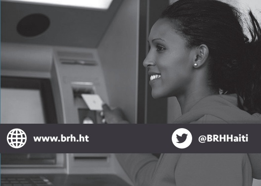
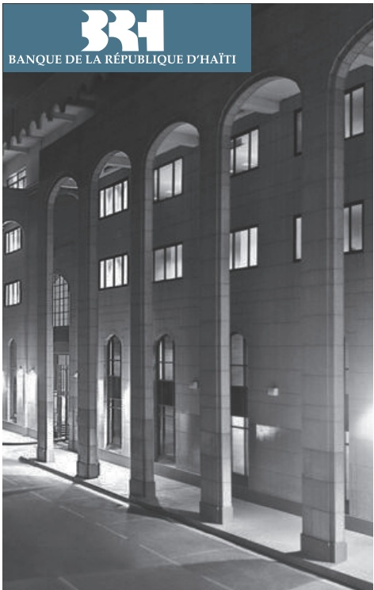
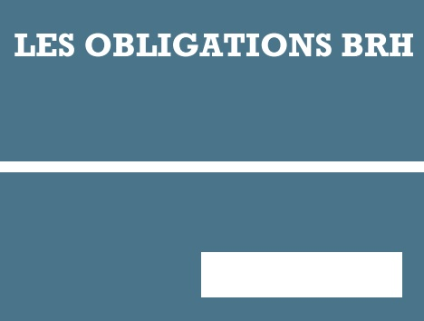
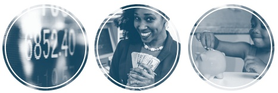

<!-- page 1 -->

Angle des Rues Pavée et du Quai, Port-au-Prince, Haïti

+509 22 99 12 00 / +509 22 99 12 02

www.brh.ht

@BRHHai

LES OBLIGATIONS BRH

<!-- page 2 -->

## LES OBLIGATIONS BRH

Les Obligations BRH sont un nouveau produit financier offert au grand public par l'intermédiaire des banques commerciales, certaines sociétés d'investissement et caisses populaires. Ces institutions sont responsables de la vente du titre pour le compte de la BRH.

## CARACTÉRISTIQUES

Augmenté de la variation du Taux Moyen d'Acquisition bancaire (TMA) de la date d'émission à la date d'échéance (en cas de hausse du taux de change)

Taux d'intérêt de 7 % l'an fixe.

Maturité : 91 jours calendaires

Montant minimal de l'émission: 50,000.00 gourdes.

Possibilité de renouvellement

Possibilité de remboursement anticipé. Seulement dans le cas d'une détention minimale de 31 jours calendaires après la date de l'émission du titre.

Les Obligations BRH ne peuvent être ni cédées, ni données en gage.

## OBJECTIFS

• Rendre la gourde plus attractive conformément à l'objectif des autorités de défendre la valeur interne et externe de la monnaie nationale;

• Offrir un produit financier alternatif permettant aux agents économiques de se prémunir contre la dépréciation de la gourde.

Inciter les banques commerciales à élargir leur gamme de produits financiers.

## PUBLIC CIBLE

Toute personne physique ou morale peut être souscripteur d'une obligation BRH.

À l'exception :

Des institutions bancaires et leurs filiales;

- Des institutions financières non-bancaires notamment les compagnies d'assurance, les caisses populaires, les institutions de microfinance et les agents de change;

Et les entités publiques.

## MODE DE RÈGLEMENT

Les titres acquis seront réglés par des chèques de direction, virements bancaires ou par débit de compte des souscripteurs domiciliés chez l'intermédiaire financier.

## MODE DE REMOURSEMENT

À la date de l'échéance de l'obligation, la BRH alimentera le compte de l'intermédiaire. Le compte du souscripteur sera crédité du montant du capital augmenté des intérêts courus et de la variation du TMA.

