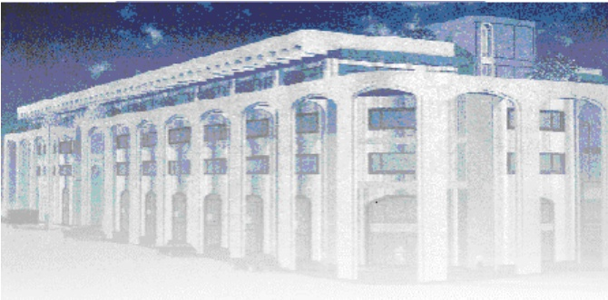

<!-- page 1 -->

Banque de la République d'Haïti

Note mensuelle d'inflation

Mai 2016

<!-- page 2 -->

## Table des matières

I.- Introduction.....2
II.- Évolution de l'inflation courante en mai 2016.....2
III.- Évolution des principales fonctions de consommation en mai 2016.....3
IV.- Évolution de l'inflation selon l'origine des produits.....4
V.- Évolution de l'inflation sous-jacente en mai 2016.....4
VI.- Facteurs explicatifs de l'évolution de l'inflation mensuelle en mai 2016.....5
VII -Prévisions d'inflation .....6

<!-- page 3 -->

### I. - Introduction

Cette note analyse l'évolution de l'Indice des Prix à la Consommation (IPC) en Haïti au cours du mois de mai 2016. Elle apporte quelques éléments explicatifs permettant de comprendre les facteurs qui influencent l'évolution de l'inflation au cours de ce mois. Elle présente également les prévisions pour les trois prochains mois.

### II. - Évolution de l'inflation globale

En mai 2016, l'économie haïtienne a connu un reflux des pressions inflationnistes tant en rythme mensuel qu'en glissement annuel. En effet, la variation annuelle de l'indice des prix à la consommation (IPC) s'est s'inscrite à 15,1 contre 15,2 % un mois auparavant. C'est la deuxième fois que l'inflation annuelle a ralenti au cours des quatre derniers exercices fiscaux, la première remontant à janvier 2013. Parallèlement, sur base mensuelle, le rythme de croissance de l'indice des prix à la consommation (IPC) a poursuivi sa baisse entamée depuis mars 2016 en s'établissant à 0,7 %, soit une réduction de 10 points de base par rapport à avril 2016.

Par contre, au cours des huit (8) premiers mois de l'exercice fiscal 2016, le taux d'inflation mensuel cumulé s'est porté à 7,6 % contre 4,2 % au cours de la même période de l'exercice passé. De plus, l'inflation a oscillé en variation mensuelle autour d'une moyenne de 0,9 % sur la période allant d'octobre 2015 à mai 2016, ce qui correspond à une moyenne supérieure à celle de nos principaux partenaires commerciaux (République Dominicaine : 0,07 % et les États-Unis : 0,1 %).

<!-- page 4 -->

Graphique No. 1

Évolution de l'inflation mensuelle de mai 2015 à mai 2016 (en %)

| Month | Cumulative No. 2 |
| --- | --- |
| May-5 | 0.8 |
| Jun-5 | 1.9 |
| Jul-5 | 2.0 |
| Aug-5 | 1.5 |
| Sep-5 | 1.2 |
| Oct-5 | 1.0 |
| Nov-5 | 0.8 |
| Dec-5 | 1.1 |
| Jan-6 | 1.1 |
| Feb-6 | 1.3 |
| Mar-6 | 0.9 |
| Apr-6 | 0.8 |
| May-6 | 0.7 |

Graphique No. 2

Évolution de l'inflation annuelle de mai 2015 à mai 2016 (en %)

| Date | Value |
| --- | --- |
| May-15 | 6.6 |
| Jun-15 | 8.0 |
| Jul-15 | 9.3 |
| Aug-15 | 10.4 |
| Sep-15 | 11.3 |
| Oct-15 | 11.7 |
| Nov-15 | 12.0 |
| Dec-15 | 12.5 |
| Jan-16 | 13.3 |
| Feb-16 | 14.4 |
| Mar-16 | 14.8 |
| Apr-16 | 15.2 |
| May-16 | 15.1 |

Source : Calculs de la BRH

### III. - Évolution des principales fonctions de consommation en mai 2016

Le ralentissement mensuel du rythme de croissance de l'indice global s'est reflété dans le comportement des prix de presque toutes les fonctions de consommation. En effet, les postes ayant connu une baisse mensuelle de la variation de leurs indices des prix en mai 2016 par apport à avril 2016 (ont été les suivants) : « Habillement et tissus, chaussures » (0,5 % contre 0,8 %), « Loyer du logement, énergie et

<!-- page 5 -->

eau » (0,7 % contre 1,4 %), « Santé » (0,1 % contre 0,2 %) « Transport » (0,2 % contre 0,3 %) et « Autres biens et services » (0,7 % contre 1 %). Cependant, le rythme de progression de l’indice des postes « Alimentation, boissons et tabac » et « Aménagement et entretien du logement » est demeuré inchangé, soient 0,9 % et 0,8 % respectivement. En revanche, la fonction « Loisirs, spectacles, enseignement et culture » a connu une variation à la hausse de 20 points de base.

De même, en glissement annuel, la variation des indices des prix de presque toutes les fonctions de consommation a diminué, exception faite de celle du poste « Loyer du logement, énergie et eau » (13,8 % contre 13,6 %).

### IV. - Évolution de l'inflation selon l'origine des produits

L’inflation des produits importés ainsi que celle des produits locaux ont affiché le même comportement que l’inflation globale tant en rythme mensuel qu’annuel. En effet, l’inflation des produits importés a diminué de 20 points de base à 0,5 % et 12,7 % en rythme mensuel et en glissement annuel respectivement. Pour sa part, l’indice des prix des produits locaux a décéler de 20 points de base à 0,7 % en variation mensuelle et de 10 points de base à 16,3 % en glissement annuel.

### V. - Évolution de l'inflation sous-jacente

L'inflation sous-jacente, estimée à un niveau inférieur à l'inflation observée, a ralenti tant en variation mensuelle qu'en glissement annuel en mai 2016. En effet, sur un an, elle s'est chiffrée à 14,5 % en mai 2016 contre 14,7 % un mois auparavant. En variation mensuelle, l'inflation sous-jacente s'est établie à 0,5 % en mai 2016 contre 0,8 % en avril 2016. C'est pour le septième mois consécutif que l'inflation sous-jacente sur base mensuelle a évolué au-dessous de l'inflation courante; ce qui laisse présumer que les pressions inflationnistes ont été alimentées par les composantes volatiles du panier de consommation.

<!-- page 6 -->

Graphique No. 4 Inflation globale et inflation sous-jacente en variation mensuelle (en %)

| Month | Inflation globale | Inflation sous-jacente |
| --- | --- | --- |
| May-14 | 0.55 | 0.60 |
| Jun-14 | 0.65 | 0.75 |
| Jul-14 | 0.75 | 0.90 |
| Aug-14 | 0.50 | 0.70 |
| Sep-14 | 0.35 | 0.50 |
| Oct-14 | 0.60 | 0.40 |
| Nov-14 | 0.55 | 0.50 |
| Dec-14 | 0.55 | 0.50 |
| Jan-15 | 0.40 | 0.35 |
| Feb-15 | 0.25 | 0.30 |
| Mar-15 | 0.45 | 0.10 |
| Apr-15 | 0.45 | 0.40 |
| May-15 | 0.80 | 0.75 |
| Jun-15 | 1.90 | 1.80 |
| Jul-15 | 2.00 | 1.95 |
| Aug-15 | 1.50 | 1.45 |
| Sep-15 | 1.20 | 1.30 |
| Oct-15 | 1.00 | 0.90 |
| Nov-15 | 0.75 | 0.70 |
| Dec-15 | 1.05 | 0.95 |
| Jan-16 | 1.05 | 0.95 |
| Feb-16 | 1.25 | 1.05 |
| Mar-16 | 0.85 | 0.80 |
| Apr-16 | 0.85 | 0.70 |
| May-16 | 0.70 | 0.50 |

### VI. - Facteurs explicatifs de l'évolution de l'inflation mensuelle en mai 2016

Les principaux facteurs susceptibles d'expliquer la baisse de l'inflation mensuelle sont : le ralentissement de l'inflation chez nos principaux partenaires commerciaux, la stabilité de la dépréciation du taux de change et le repli du financement monétaire en mai 2016.

### 1. - Valentissement de l'inflation mensuelle chez nos principaux partenaires commerciaux

Le ralentissement de l'inflation mensuelle observé chez nos principaux partenaires commerciaux, en l'occurrence les États-Unis et la République Dominicaine, s'est répercuté sur les prix des produits importés et conséquemment sur l'évolution des prix locaux. En effet, en mai 2016, sur base mensuelle, le rythme de progression des prix à la consommation aux États-Unis a diminué de 10 points de base pour s'établir à 0, 4%. En République Dominicaine, l'IPC s'est contracté de 0,09 % en avril 2016 contre 0,01 % un mois auparavant. Conséquemment, il en a découlé un ralentissement de 20 points de base, ramenant à 0,5 % l'inflation des produits importés en variation mensuelle.

<!-- page 7 -->

### 2. - Stabilité du taux de change

Cette baisse de l'inflation mensuelle serait la résultante de la variation stable du taux de change de fin de période en mai 2016. En effet, le taux de conversion du dollar par rapport à la gourde, quoique demeuré à un niveau élevé, a enregistré un même taux de dépréciation comparativement à celui d'avril 2016. Le taux de change du dollar a augmenté de 0,4 % à 62,21 gourdes en mai 2016, enregistrant ainsi une hausse mensuelle de 10 points de base par rapport à sa variation en avril 2016.

### 3. - Repli du financement monétaire

La mise en place du cash management¹ (depuis février 2016) au niveau des finances publiques, conjuguée à d'autres facteurs², a favorisé une réduction du déficit budgétaire en mai 2016. L'État a réduit ses dépenses à 5 824,63 MG en mai 2016 contre 6 502,8 MG un mois auparavant, soit une contraction de 10 %. Cette baisse des dépenses, combinée à la hausse mensuelle de 11 % des recettes effectives³, a entraîné une diminution du déficit budgétaire à 328,17 MG en mai 2016⁴, lequel s'est chiffré à 1 554,02 MG en avril 2016. Conséquement, le financement monétaire a enregistré un repli mensuel de 5 % à 3 520.62 MG en mai 2016. La contraction mensuelle de la base monétaire au sens large en mai 2016 (-0,25 % à 134 415,14 MG) qui en a découlé, est l'un des indicateurs pouvant attester de la baisse de l'offre de monnaie⁵ dans l'économie au cours de la période considérée. Ceci a favorisé un relatif reflux des pressions inflationnistes en rythme mensuel.

### VII. - Prévisions d'inflation

Pour les trois (3) prochains mois, les prévisions d'inflation de la BRH augurent une hausse de l'inflation mensuelle tandis qu'en glissement annuel, le rythme de progression de l'IPC devrait ralentir. En effet, en rythme mensuel, l'inflation pourrait augmenter à 0,8 % en juin pour maintenir ce même taux de variation en juillet 2016 puis croître de 10 points de base à 0,9 % en août 2016. En glissement annuel, l'inflation devrait s'établir à 13,8 %, 12,5 % et 11,8 % en juin, juillet et août 2016 respectivement. Il importe de souligner que d'autres facteurs conjoncturels pourraient affecter la réalisation de ces prévisions.

<!-- page 8 -->

Graphique No. 6 Prévision de l'inflation annuelle (juin, juillet et août 2016)

|   | inflation estimée (inf) | inflation en glissement annuel | inflation estimée (sup) |
| --- | --- | --- | --- |
| Jun-14 | 4.5 |   | 4.5 |
| Jul-14 | 5.0 |   | 5.0 |
| Aug-14 | 5.2 |   | 5.2 |
| Sep-14 | 5.5 |   | 5.5 |
| Oct-14 | 6.0 |   | 6.0 |
| Nov-14 | 6.5 |   | 6.5 |
| Dec-14 | 6.6 |   | 6.6 |
| Jan-15 | 6.7 |   | 6.7 |
| Feb-15 | 6.7 |   | 6.7 |
| Mar-15 | 6.5 |   | 6.5 |
| Apr-15 | 6.3 |   | 6.3 |
| May-15 | 6.5 |   | 6.5 |
| Jun-15 | 8.0 |   | 8.0 |
| Jul-15 | 9.5 |   | 9.5 |
| Aug-15 | 10.5 |   | 10.5 |
| Sep-15 | 11.2 |   | 11.2 |
| Oct-15 | 11.5 |   | 11.5 |
| Nov-15 | 12.0 |   | 12.0 |
| Dec-15 | 12.8 |   | 12.8 |
| Jan-16 | 13.8 |   | 13.8 |
| Feb-16 | 14.5 |   | 14.5 |
| Mar-16 | 14.8 |   | 14.8 |
| Apr-16 | 15.1 |   | 15.1 |
| May-16 | 15.0 | 15.0 | 15.0 |
| Jun-16 | 13.5 | 13.8 | 15.7 |
| Jul-16 | 11.5 | 12.5 | 16.1 |
| Aug-16 | 6.7 | 11.8 | 17.0 |

Tableau #1

Indice des Prix à la Consommation (IPC) par postes de dépenses Variation et Contribution à l'inflation mensuelle et annuelle En mai 2016

<table><tr><td></td><td>Indice des Prix à la Consommation (IPC)</td><td>Variation IPC (en %)</td><td>Contribution à l'inflation (en %)</td></tr><tr><td>Mensuelle</td><td>Annuelle</td><td>Mensuelle</td><td>Annuelle</td></tr><tr><td>Poste</td><td>Pondération (en %)</td><td>Mai 15</td><td>Avril 16</td><td>Mai 16</td><td>Mai 16</td><td>Mai 16</td><td>Mai 16</td><td>Mai 16</td></tr><tr><td>Indice Général</td><td>263.1</td><td>264.9</td><td>230.2</td><td>0.7</td><td>15.1</td><td>100.00</td><td>100.00</td></tr><tr><td>Alimentation, boisson et tabac</td><td>50.35</td><td>276.5</td><td>278.9</td><td>239</td><td>0.9</td><td>16.7</td><td>65.21</td><td>57.47</td></tr><tr><td>Habillement, tissus et chaussures.</td><td>6.86</td><td>287.6</td><td>289.1</td><td>238</td><td>0.5</td><td>21.5</td><td>5.34</td><td>10.07</td></tr><tr><td>Loyer, énergie et eau</td><td>11.05</td><td>307.3</td><td>309.4</td><td>271.8</td><td>0.7</td><td>13.8</td><td>11.27</td><td>10.45</td></tr><tr><td>Aménag. et entretien du logement.</td><td>4.7</td><td>267.2</td><td>269.3</td><td>232.8</td><td>0.8</td><td>15.7</td><td>5.51</td><td>5.04</td></tr><tr><td>Santé</td><td>2.9</td><td>268.4</td><td>268.7</td><td>245</td><td>0.1</td><td>9.7</td><td>0.48</td><td>1.92</td></tr><tr><td>Transport</td><td>13.74</td><td>168</td><td>168.4</td><td>161.7</td><td>0.2</td><td>4.1</td><td>4.88</td><td>3.89</td></tr><tr><td>Lois., spect. Ens., Culture.</td><td>5.84</td><td>268.4</td><td>269.1</td><td>238.5</td><td>0.3</td><td>12.8</td><td>2.27</td><td>5.12</td></tr><tr><td>Autres biens & services.</td><td>4.56</td><td>243.1</td><td>244.9</td><td>205.2</td><td>0.7</td><td>19.3</td><td>5.04</td><td>6.03</td></tr></table>

Sources : IHSI et calculs du Service de la Macrééconomie et Analyse de Conjoncture de la MAE

<!-- page 9 -->

## Glossaire

| Variation mensuelle | : Variation par rapport au mois précédent. |
| --- | --- |
| Glissement annuel | : Variation par rapport au même mois de l'année antérieure. |
| Inflation | : Mouvement persistant à la hausse du niveau général des prix. |
| Désinflation | : Ralentissement du rythme de croissance des prix. |
| Déflation | : Baisse du niveau général des prix associée à une contraction de la masse monétaire et du crédit. |
| Inflation sous-jacente | : Tendance de long terme des prix, tout en excluant la volatilité, les mouvements saisonniers, conjoncturels, et les chocs qui affectent les composantes du panier considéré. |
| Région Nord | : Elle couvre les départementes du Nord, Nord-Est et Nord-Ouest. |
| Région Sud | : Elle comprend les départementes du Sud de la Grand-Anse et des Nippes. |
| Région Reste Ouest | : Y sont inclus les départementes du Sud-Est et de l'Ouest à l'exception de l'aire métropolitaine |
| Région Transversale | : Elle regroupe les départementes du Centre et de l'Artibonite. |
| Aire Métropolitaine | : Elle contient les villes de Port-au-Prince, de Delmas, de Pétion-Ville, de Carrefour et de Croix des Bouquets. |
