<!-- page 1 -->

## REVUE DÉVELOPPEMENT DE CONNAISSANCES & COMPÉTENCES FINANCIÈRES

MARS 2025

RDCCF-VOL.III

<!-- page 2 -->

<!-- page 3 -->

## REVUE DÉVELOPPEMENT DE CONNAISSANCES & COMPÉTENCES FINANCIÈRES

MARS 2025

RDCCF-VOL.III

<!-- page 4 -->

<!-- page 5 -->

## SOMMAIRE

01 VUE D'ENSEMBLE Page 9
DE L'INCLUSION FINANCIÈRE DIGITALE AUX PAIEMENTS
INSTANTANÉS Page 10
AUX COMPORTEMENTS FINANCIERS CHANGEANTS : UNE RÉFLEXION SUR LA PROTECTION DES CONSOMMATEURS
FINANCIERS Page 12
LES TENDANCES DES OPÉRATIONS FINANCIÈRES
RECONFIGURÉES - RATIONALITÉ Page 19
AU RENDEZ-VOUS DÉCISIONNEL AVEC BÉATRICE : UNE LEÇON DE PRUDENCE POUR LES E-INVESTISSEURS Page 21
MOYENS DE PAIEMENT DIGITALISÉS ET INCLUSION NUMÉRIQUE DURABLE - RATIONALITÉ Page 23
DES DÉFIS PERSISTANTS : RENFORCER LA VIGILANCE DES USAGERS FINANCIERS- RENDEZ-VOUS DÉCISIONNEL Page 24
AU RENDEZ-VOUS DÉCISIONNEL AVEC PEDRO : RENFORCER LA VIGILANCE DES USAGERS FINANCIERS Page 26
CONCLUSION Page 28

<!-- page 6 -->

## FIGURES

01 FIGURE 1 : CERTAINS MÉCANISMES DE PAIEMENTS LOCAUX ET INTERNATIONAUX ..... Page 10
02 FIGURE 2 : LES 7 AXES DE LA SMART CAMPAIGN DE LA PROTECTION DES CONSOMMATEURS FINANCIERS ..... Page 12
03 FIGURE 3 : PRINCIPES DU G20 SUR LA PROTECTION DES CONSOMMATEURS DE SERVICES FINANCIERS ..... Page 14
04 FIGURE 4 : LES PRODUITS DÉRIVÉS DE LA FRAUDE ..... Page 15
05 FIGURE 5 : QUELQUES CIRCULAIRES SUR LA PROTECTION DES CONSOMMATEURS FINANCIERS ..... Page 16
06 FIGURE 6 : L'INTERCONNEXION ENTRE LES AGENTS ÉCONOMIQUES ET FINANCIERS ..... Page 19
07 FIGURE 7 : RÉPARTITION RÉGIONALE DE L'UTILISATION DES PORTEFEUILLES ÉLECTRONIQUES EN HAÏTI ..... Page 19
08 FIGURE 8 : APPROCHE RÉFLÉCHIE DE BÉATRICE, SUGGÉRÉE PAR LES PRINCIPES DE LA SMART CAMPAIGN ..... Page 21
09 FIGURE 9 : UTILISATION DES PRODUITS FINANCIERS ..... Page 23
10 FIGURE 10 : TROIS (3) LEÇONS TIRÉES PAR PEDRO GRÂCE AUX SERVICES NUMÉRIQUES ..... Page 27

<!-- page 7 -->

## SIGLES ET ABRÉVIATIONS

| AFI | ALLIANCE POUR L'INCLUSION FINANCIÈRE |
| --- | --- |
| BIC | BUREAU DE L'INFORMATION SUR LE CRÉDIT |
| BRH | BANQUE DE LA RÉPUBLIQUE D'HAITI |
| CGAP | GROUPE D'ASSISTANCE AUX PAUVRES |
| CONATEL | CONSEIL NATIONAL DES TÉLÉCOMMUNICATIONS |
| DCCF | DÉVELOPPEMENT DE CONNAISSANCES ET COMPÉTENCES FINANCIÈRES |
| FINSCOPE | ENQUÊTE SUR LA DEMANDE DES PRODUITS ET SERVICES FINANCIERS |
| FMI | FONDS MONÉTAIRE INTERNATIONAL |
| FSP | FOURNISSEUR DE SERVICES DE PAIEMENT ÉLECTRONIQUE |
| IAFCI | ASSOCIATION INTERNATIONALE DES ENQUÊTEURS SUR LES CRIMES FINANCIERS |
| MFT | MICROFINANCE TRANSPARENCY |
| MPME | MICRO PETITES ET MOYENNES ENTREPRISES |
| MTPTC | MINISTÈRE DES TRAVAUX PUBLICS TRANSPORTS ET COMMUNICATIONS |
| NTIC | NOUVELLES TECHNOLOGIES DE L'INFORMATION ET DE LA COMMUNICATION |
| OCDE | ORGANISATION DE COOPÉRATION ET DE DÉVELOPPEMENT ÉCONOMIQUES |
| RDCCF | REVUE DE DÉVELOPPEMENT DE CONNAISSANCES ET DE COMPÉTENCES FINANCIÈRES |
| UNSGSA | UNITED NATIONS SECRETARY-GENERAL'S SPECIAL ADVOCATE FOR FINANCIAL HEALTH |
| USAID | AGENCE INTERAMÉRICAINE POUR LE DÉVELOPPEMENT |

<!-- page 8 -->

<!-- page 9 -->

## VUE D'ENSEMBLE

Le rapport phare « Doing Business » de la Banque Mondiale a changé de dénomination cette année pour devenir « Business Ready », afin de mieux refléter les évolutions du commerce international et l'impact croissant de la digitalisation de l'économie. Il reconnaît que l'adoption des technologies facilite, sans aucun doute, les échanges commerciaux et permet de rendre les paiements plus rapides et accessibles à une échelle plus large. Cette nouvelle appellation met en lumière l'importance de s'adapter à un environnement économique où les technologies financières numériques jouent un rôle de plus en plus important. Selon la Banque Mondiale, « la digitalisation facilitera l'universalisation de l'accès aux services financiers, d'ici 2030 ». (Banque Mondiale, 2024).

Ce volume III de la revue Développement des Compétences et Connaissances Financières (RDCCF) vise à encourager une plus grande appropriation des innovations financières digitales pour une inclusion financière numérique responsable et une meilleure santé financière des consommateurs financiers. Cependant, malgré les nombreuses opportunités offertes par la digitalisation en matière d'inclusion financière, de traçabilité et d'efficiency, ce changement de paradigme dans l'économie, accéléré par la pandémie de COVID-19, présente également de nouveaux défis.

Au niveau mondial, mais aussi localement, notamment en raison de la crise multidimensionnelle, la protection des données des clients et la sécurité des transactions constituent des défis majeurs. Il est donc essentiel de sensibiliser les utilisateurs de services financiers aux bonnes pratiques en matière de sécurité, afin qu'ils puissent tirer pleinement parti des innovations numériques tout en préservant leur santé financière.

Dans le cadre des initiatives liées à l'éducation financière et à la protection des consommateurs financiers, et dans la continuité des objectifs de la deuxième édition, ce nouveau volume de la RDCCF s'engage à informer et à sensibiliser le public aux risques financiers associés à l'utilisation des technologies financières. L'objectif est de renforcer leur résilience numérique et leur capacité à faire face aux défis actuels, particulièrement en cette période de crise.

En équipant les consommateurs financiers, cette nouvelle parution entend leur offrir les clés pour une gestion plus éclairée de leurs finances personnelles, une meilleure intégration des solutions financières numériques dans leur quotidien. Également intégrée à la 13e édition de la Semaine de l'Éducation Financière du mois de mars 2025, elle a pour objectif de protéger les utilisateurs financiers contre certains risques et de renforcer leur confiance dans l'écosystème.

<!-- page 10 -->

# DE L'INCLUSION FINANCIÈRE DIGITALE INSTANTANÉE

Dans l'agenda des décideurs politiques mondiaux, accélérer l'utilisation des mécanismes financiers numériques pour réduire les coûts, élargir l'échelle et étendre la portée des services financiers est crucial pour atteindre l'inclusion financière universelle d'ici 2030. (CGAP, 2021). Un paiement instantané est une transaction financière qui est réglée et finalisée en temps réel, permettant au bénéficiaire de recevoir les fonds presque immédiatement. Ce type d'opération est traité généralement en moins de 10 secondes. Le niveau de rapidité varie suivant les systèmes de paiement et les infrastructures utilisées.

Selon l'enquête nationale sur les tendances des consommateurs réalisée en 2018, 23 % des personnes interviewées étaient déjà enregistrées en tant qu'utilisateurs de portefeuille électronique. Réagissant sur les motivations de leur choix et les contraintes, 49 % affirment qu'il s'agit d'un moyen de paiement pratique, et 45 % estiment que les transactions ne sont pas coûteuses. Les interviewées souhaitent que ce type d'opération contribue à améliorer l'efficacité des paiements, à réduire les délais de traitement des transactions et soit de plus en plus adopté. (FinScope, 2018).

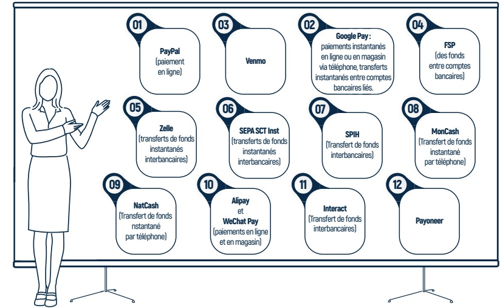

Source : Recherche documentaire, 2024

Le schéma n° 1 ci-dessus met en évidence la tendance, tant au niveau international que local, selon laquelle certaines de ces innovations visent à permettre des transferts de

<!-- page 11 -->

fonds instantanés ( Zelle, Interact...), en quelques secondes, de manière quotidienne et continue. D'autres facilitent les paiements rapides pour les achats en ligne ou entre particuliers, contribuant ainsi à fluidifier les transactions financières.

Les mécanismes de paiement répertoriés

plus haut se ressemblent tous, tout en se

distinguant les uns des autres, en fonction

de nombreux paramètres tels que : les

spécificités infrastructuelles, le cadre

juridique et légal et la régulation financière

de chaque pays. En Haïti, la conformité

des activités financières digitales est

régie par la circulaire 121 émise par la

Banque de la République d'Haïti (BRH).

Soualignons toutefois que le régulateur

des activités de télécommunication est le

Conseil National des Télécommunications

(CONATEL), relevant du Ministère des

Travaux Publics, Transports et Communi-

cations (MTPTC).

Dans ce nouveau paysage financier, les données occupent une place centrale, influencant tous les aspects du secteur financier, de la définition des produits et de l'analyse des préférences des consommateurs, jusqu'à la prévention

Le Saviez Vous?

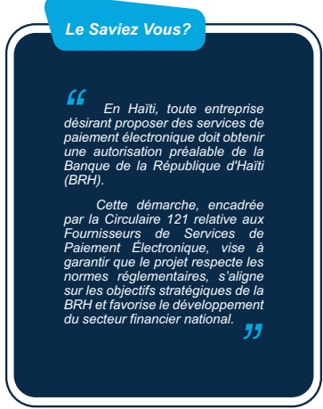

En Haïti, toute entreprise désirant proposer des services de paiement électronique doit obtenir une autorisation préalable de la Banque de la République d'Haïti (BRH).

Cette démarche, encadrée par la Circulaire 121 relative aux Fournisseurs de Services de Paiement Électronique, vise à garantir que le projet respecte les normes réglementaires, s'aligne sur les objectifs stratégiques de la BRH et favorise le développement du secteur financier national.

et la gestion des risques financiers. Bien que les innovations facilitent l'accès aux services financiers, elles soulèvent également des questions cruciales, notamment en ce qui concerne les comportements de consommation, la protection des consommateurs financiers et l'éducation financière numérique.

<!-- page 12 -->

## AUX COMPORTEMENTS FINANCIERS CHANGEANTS : UNE RÉFLEXION SUR LA PROTECTION DES CONSOMMATEURS FINANCIERS

La montée et l'usage croissants des innovations financières, qui simplifient l'accès aux services financiers, exercent un impact important sur la finance comportementale. En effet, elles modifient non seulement les habitudes des consommateurs financiers, mais influencent également leurs comportements financiers en les exposant davantage aux nouvelles opportunités. Selon, Dean Karlan, l'éminent économiste et professeur, « l'accès aux paiements instantanés et mobiles permet aux usagers de mieux gérer leurs finances personnelles, favorisant ainsi des comportements financiers plus responsables et une gestion plus efficace de leurs flux financiers ». (Karlan et al. ; 2016).

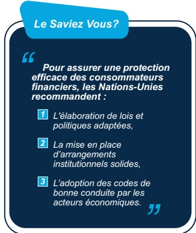

## POUR UN SYSTÈME FINANCIER PLUS TRANSPARENT: LE CFI SOUTIENT LE SMART CAMPAIGN

Les réflexions sur la problématique de transparence dans les services financiers ont commencé à gagner du terrain à partir de 2008. Lancé en 2009, le mouvement « Smart Campaign » de la Microfinance Transparency (MFT) a été l'un des principaux moteurs de la mobilisation en faveur de l'intégration de pratiques plus responsables et éthiques dans la commercialisation des produits financiers. Elle a notamment insisté sur l'importance de prendre en compte la capacité de remboursement des clients, de promouvoir leur éducation financière et de garantir des recours contre les abus. Les principaux axes de la campagne sont résumés dans la figure suivante :

Figure 2 :::::: Les 7 axes de la Smart Campaign de la protection des consommateurs financiers

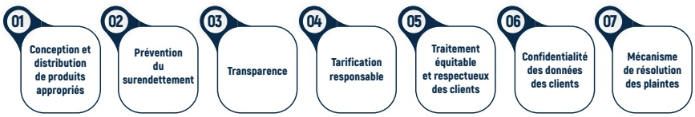

<!-- page 13 -->

Les mesures promues dans le cadre de la campagne plus haut suggèrent que la protection des consommateurs financiers, tout comme l'inclusion financière, reposent sur un ensemble de principes fondamentaux qui impliquent un équilibre entre les responsabilités des autorités de réglementation, les obligations des prestataires de services financiers, ainsi que les droits et comportements des utilisateurs de ces services.

En mettant l'accent sur les droits des consommateurs financiers, la campagne a contribué à protéger les usagers contre les pratiques abusives et à renforcer la confiance envers les institutions financières.

À noter que le mouvement est également soutenu par certaines institutions financières haïtiennes. Par ailleurs, deux des institutions de microfinance agréées par la BRH sont des promoteurs de la "Smart Campaign". Elles font partie de plus de 135 institutions financières dans le monde ayant obtenu la certification du Centre pour l'Inclusion Financière(CFI). Par ailleurs, selon un rapport publié, par le CFI, en 2022, les initiatives de certification en matière de protection des clients financiers ont été, depuis 2020,

Selon la circulaire n°127 de la Banque de la République d'Haïti (BRH), les institutions de microfinance (IMF) souhaitant obtenir un agrément doivent soumettre un dossier complet comprenant notamment : des informations sur leurs principaux actionnaires, des dispositifs de contrôle interne, un rapport d'évaluation et de gestion des risques, un plan de conformité, un système d'audit interne, des détails sur leur infrastructure informatique, des mesures de protection et de conservation des données, le choix de leur système financier, ainsi qu'un plan de contingence et de continuité des activités.

Pour plus d'informations,

veuillez consulter le site de la

BRH : www.brh.ht.

transférées à d'autres organisations, telles que Cerise et le Social Performance Task Force (SPTF), qui continuent de promouvoir des normes élevées en matière de protection des clients financiers dans le domaine de l'inclusion financière. (CFI, 2022).

## PROMOUVOIR UN SYSTÈME FINANCIER PLUS SÉCURISÉ ET INCLUSIF : LES ENGAGEMENTS DES PAYS DU G20

Le changement de paradigme dans la lutte contre la pauvreté, en 2011, axé sur l'inclusion financière, a conduit les décideurs politiques à porter une attention plus accrue sur l'importance d'une régulation et de directives plus strictes en faveur de la protection financière des groupes cibles. Cette évolution a favorisé la mise en place d'un ensemble de principes visant à garantir une approche plus transparente, inclusive et sécurisée des services financiers.

<!-- page 14 -->

La figure ci-après reprend les 10 principes clés relatifs à la protection des consommateurs financiers, soutenus par les 20 pays¹ les plus influents financièrement et vulgarisés par la Banque Mondiale :

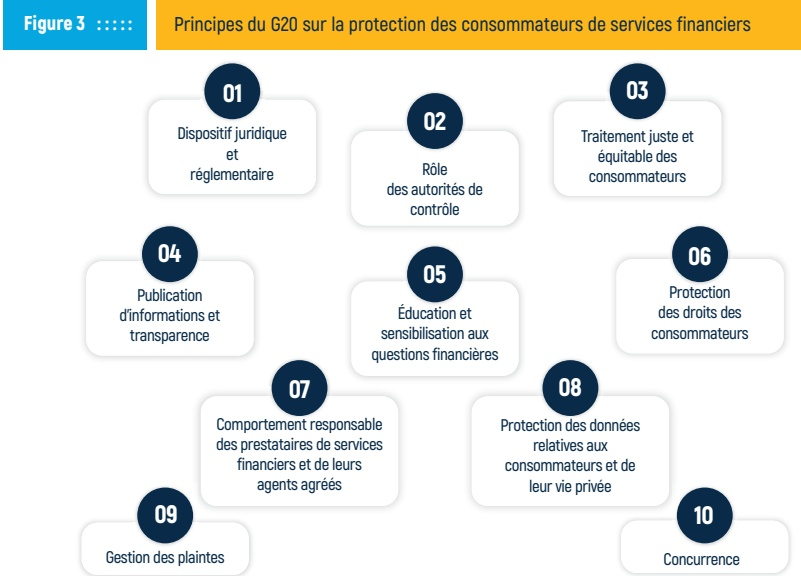

Source : Rapport G20, 2011

L'évolution des solutions numériques, tout en facilitant l'accès aux services financiers, impose une attention particulière à la protection des consommateurs financiers. En effet, bien que ces solutions contribuent à intensifier l'accès à des services financiers plus rapides, elles rendent également les utilisateurs plus vulnérables à divers risques financiers dont le surendettement.

## UNE RESPONSABILITÉ PARTAGÉE POUR LA PROTECTION DES CONSOMMATEURS FINANCIERS : LA BRH S'ENGAGE!

Selon l'Alliance pour l'Inclusion Financière (AFI), la protection des consommateurs financiers est un processus continu. Elle doit permettre aux institutions financières d'identifier les risques susceptibles de nuire directement aux intérêts financiers des consommateurs, tels que les fraudes et le surendettement, entre autres. (AFI, 2023). La position de l'AFI suggère que les institutions financières doivent être en mesure d'évaluer

<!-- page 15 -->

correctement ces risques, en garantissant une transparence adéquate et en mettant en place des mécanismes de prévention et de protection des utilisateurs de produits et services financiers, tout en respectant les régulations en vigueur. Ces mesures visent à maintenir la confiance des consommateurs et à contribuer à leur santé financière.

Selon le professeur Francis Fortin, spécialiste en cybersurveillance, ces risques sont liés aux produits dérivés de la fraude tels que le piratage de données, l'exploitation des informations personnelles, le vol de données bancaires, des campagnes d'hameçonnage, notamment les escroqueries et arnaques en ligne, comme mentionné dans la figure 4 ci-dessous. (Fortin, 2024).

Certains produits dérivés de la fraude

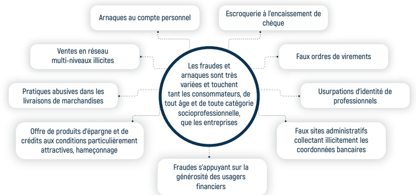

Source : Fortin, 2024

De plus, dans ce cadre, les décisions financières des usagers peuvent être influencées par des biais cognitifs, tels que la surestimation de leurs capacités financières ou la tentation d'un accès immédiat à la consommation financière irréfléchie, souvent accompagnée de l'impulsivité conduisant au surentetlement.

Ces situations de vulnérabilité financière peuvent sérieusement compromettre la santé financière des consommateurs financiers et freiner l'inclusion financière. Selon une étude réalisée par l'OCDE dans 43 pays, environ 16 % des interviewés ont été affectés par des fraudes financières. Ainsi, il devient essentiel de mettre en place des mécanismes de régulation et de transparence appropriés de même que des initiatives de sensibilisation, pour s'assurer que les avantages de l'inclusion financière ne compromettent pas la santé financière des consommateurs financiers. (OCDE,2024).

En Haïti, il n'existe pas encore de cadre légal spécifique pour la protection des consommateurs de services financiers. Un projet de loi élaboré par la BRH avec l'assistance technique de la Banque Mondiale, est toujours en attente, à cause de la crise

<!-- page 16 -->

multidimensionnelle. Néanmoins, la BRH, soucieuse de garantir la stabilité du système financier, de protéger les consommateurs de services financiers, de prévenir les risques et d'assurer une concurrence équitable, émet régulièrement des circulaires dont certaines sont reprises dans la figure ci-dessous.

Circulaire 100-4 : Sur les mesures que les banques doivent prendre dans le cadre de la mise en œuvre de leur programme de prévention du blanchiment de capitaux et de financement du terrorisme.

Circulaire 101-3 : Exige que les cartes de crédit émises en Haïti soient réglées exclusivement en gourdes.

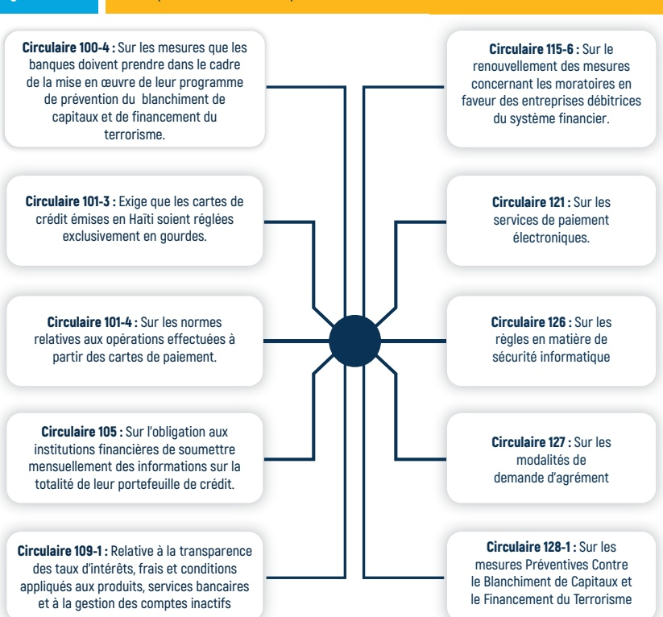

Circulaire 115-6 : Sur le renouvellement des mesures concernant les moratoires en faveur des entreprises débitrices du système financier.

Circulaire 101-4 : Sur les normes relatives aux opérations effectuées à partir des cartes de paiement.

Circulaire 121 : Sur les services de paiement électroniques.

Circulaire 105 : Sur l'obligation aux institutions financières de soumettre mensuellement des informations sur la totalité de leur portefeuille de crédit.

Circulaire 126 : Sur les règles en matière de sécurité informatique

Circulaire 109-1 : Relative à la transparence des taux d'intérêts, frais et conditions appliqués aux produits, services bancaires et à la gestion des comptes inactifs

Circulaire 127 : Sur les modalités de demande d'agrément

Circulaire 128-1 : Sur les mesures Préventives Contre le Blanchiment de Capitaux et le Financement du Terrorisme

Source : https://www.brh.ht/

Aussi, la Banque de la République d'Haïti (BRH) impose une exigence de transparence aux institutions financières, à travers la Circulaire 122, qui les oblige à soumettre régulièrement des rapports statistiques sur les transactions effectuées, ainsi que des états financiers trimestriels et annuels. De plus, la publication des rapports statistiques de la BRH ainsi que des notes de politique monétaire contribue à cet objectif de transparence en fournissant au public et aux acteurs économiques des informations essentielles sur la situation financière du pays.

<!-- page 17 -->

## Le Saviez Vous?

Dans cette même perspective, la mise en place du Bureau d'Informations sur le Crédit (BIC) par la Banque de la République d'Haïti (BRH) vise à adresser favorablement ces préoccupations. En travaillant avec des institutions financières pour garantir la disponibilité et la qualité des informations sur les opérations financières des clients, le BIC les encourage à respecter les principes de la Smart Campaign liés aux questions de transparence et de responsabilité.

En veillant à ce que les informations sur le crédit soient utilisées de manière éthique et transparente et en promouvant la responsabilité des prêteurs, les activités du BIC contribuent à renforcer l'intégrité du secteur financier et à protéger les consommateurs contre le surentement.

## ”

Un système financier conforme aux réglementations et bien pourvu en ressources humaines compétentes est mieux préparé à faire face aux crises économiques et à maintenir sa résilience c'est-à-dire, à préserver ou soutenir sa capacité à résister et à s'adapter face à des perturbations.

Le Bureau des Information sur le Crédit (BIC) est une direction spécialisée de la BRH qui collecte et traite les informations de crédit reçues des institutions financières ou toute autre institution affiliée fournissant du crédit.

Grace a son rappon de crédit, le consommateur de services financiers peut mieux gérer ses finances, améliorer sa solvabilité et faciliter l'octroide crédit ou de prêts.

Pour plus d'informations,

visitez le site de la BRH, https:

www.brh.ht

”

L'année 2021 marque un tournant dans la régulation des Fournisseur de Services de Paiement électronique (FSP) dans le pays. Dans le contexte de la numérisation rapide des services financiers, la BRH doit être capable de surveiller en temps réel les pratiques des fournisseurs de services financiers, d'identifier rapidement les risques émergents et d'intervenir efficacement pour protéger les consommateurs.

La Circulaire 121, émise par la BRH, a été introduite pour réguler le secteur des FSP. Elle adapte la réglementation numérique afin de répondre à l'évolution du paysage financier national, notamment dans le secteur des paiements électroniques. Elle a pour objectif d'encadrer les activités des Fintechs, de garantir leur conformité, de mieux gérer les risques liés aux paiements numériques.

Cette nouvelle réglementation, en favorisant un environnement propice à l'innovation, s'inscrit dans une démarche de modernisation du secteur financier par la BRH, visant à l'élargir et à réduire sa dépendance au cash, tout en garantissant la stabilité du secteur et la confiance des utilisateurs. La circulaire, en mettant l'accent sur la sécurité, la transparence et la protection des consommateurs, prend en compte les défis et les opportunités liés à la digitalisation des services financiers. Destinée à étendre l'accès aux services financiers grâce à des solutions numériques accessibles à un public plus large, la circulaire 121 doit favoriser également l'inclusion financière digitale dans le pays.

<!-- page 18 -->

Selon une étude réalisée par la BRH en 2024, en raison de la crise multidimensionnelle, le secteur financier a été confronté à une fuite de ressources humaines qualifiées dans le domaine de la digitalisation. (BRH, 2024).

Cette année, dans le cadre d'un partenariat avec des institutions locales du secteur universitaire et de la technologie impliquées dans ce domaine, la BRH a introduit une formation pour des jeunes (FRST/BRH-UEH) afin de faciliter une augmentation de plus de ressources locales qualifiées dans des domaines technologiques clés tels que la science des données et la cybersécurité.

Cette approche vise à aider les secteurs public et privé de disposer d'un bassin de ressources humaines qualifiées dans le domaine, favorisant ainsi l'amélioration de la résilience du secteur monétaire et financier et mieux s'adapter à l'évolution constante de la digitalisation et à anticiper certains défis numériques. (BRH, 2025).

## Le Saviez Vous?

## ”

Les Fournisseurs de Services de Paiement Électronique (FSP) en Haïti sont soumis à des réglementations strictes pour garantir la sécurité des transactions électroniques. Voici ce que vous devez retenir pour mieux protéger vos droits :

Identification obligatoire : Votre FSP doit exiger une pièce d'identité valide pour ouvrir un compte. Cela aide à sécuriser vos informations et à prévenir les fraudes.

Protection renforcée pendant les transactions : En cas de prélèvements non autorisés, vous avez droit à un remboursement inconditionnel. Vos données financières doivent aussi être protégées.

Reçu électronique après chaque transaction : Un reçu détaillé avec toutes les informations sur l'opération (montant, frais, date, etc.) doit vous être remis. Gardez-les précieusement !

Droit de recours : Si un problème survient, les FSP sont tenus de traiter vos réclamations pour toute transaction contestée.

Astuce pratique : Choisissez un FSP qui respecte ces mesures pour une expérience plus sécurisée et transparente. N'oubliez pas que vous avez le pouvoir de demander des comptes

<!-- page 19 -->

# LES TENDANCES DES OPÉRATIONS FINANCIÈRES RECONFIGURÉES - RATIONALITÉ

Le groupe des pays du G20 reconnaît que l'inclusion financière digitale, en réduisant les obstacles liés à la géographie, aux coûts de transaction et en renforçant la transparence, est un facteur clé pour favoriser l'interconnexion entre les agents économiques et financiers. (Banque Mondiale, 2016). Selon l'Association mondiale des opérateurs de téléphonie mobile (GSMA), la valeur totale des opérations mondiales en argent mobile a cru de 11,5 %, en 2024. Cette augmentation a été rendue possible grâce à l'application des principes de la Smart Campaign, comme préalablement indiqué dans la figure n° 2.

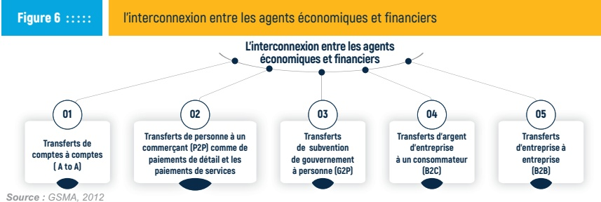

En Haïti, les enquêtes FinScope 2018, sur les ménages révèlent que 58 % de la population disposent d'un téléphone portable de base, 33 % possèdent un smartphone, 15 % ont accès à l'internet, et 7 % disposent d'un ordinateur portable, tandis que 7 % possèdent un ordinateur de bureau. De plus, 43 % de la population utilisent un portefeuille électronique, tandis que plus de 71 % de ces utilisateurs l'utilisent pour effectuer des transferts d'argent. La figure ci-dessous présente les tendances liées à l'adoption des portefeuilles électroniques au niveau régional du pays.

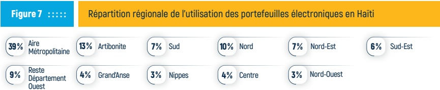

Source : FinScope, 2018

Ces données mettent en évidence un potentiel qui pourrait être exploité pour réduire la circulation du cash dans l'économie haïtienne, faciliter une croissance économique résiliente et soutenir davantage l'inclusion financière numérique dans le cadre d'une reprise économique plus verte.

<!-- page 20 -->

La question de la résilience numérique des ménages à travers l'éducation numérique et la protection des consommateurs est abordée dans plusieurs études réalisées par des organisations partenaires de la BRH, telles que l'AFI, la Banque mondiale, le FMI, l'OCDE et l'UNSGSA. Elles reconnaissent que la vitesse accrue des transactions financières, combinée à l'anonymat offert par les plateformes numériques, expose davantage aux risques de fraudes, d'arnaques et d'activités illicites. Elles insistent toutes, non seulement sur le renforcement des régulations en la matière, mais aussi sur la mise en place de stratégies fiables visant à renforcer la compétence numérique des ménages et leur capacité à se défendre contre les cyberattaques.

Le rapport de l'UNSGSA, qui établit un lien entre les Objectifs de Développement Durable (ODD) et l'inclusion financière digitale, souligne l'importance de renforcer la résilience des acteurs économiques face aux enjeux de la digitalisation des transactions. Il met particulièrement l'accent sur le rôle clé de l'éducation financière, et plus spécifiquement sur l'éducation financière numérique.

Ce levier permet d'aider les micros, petites et moyennes entreprises (MPME) à anticiper les opportunités offertes par le e-commerce, tout en les sensibilisant aux risques associés. Il encourage également l'adoption de pratiques plus agiles et vigilantes dans un environnement numérique en constante évolution. (UNSGSA, 2023).

Dans son rapport “Digitalisation, Consumer Protection and Resilience”, l’Organisation de coopération et de développement économiques (OCDE) met non seulement en évidence les vulnérabilities des ménages face aux risques numériques, notamment en matière de cybersécurité et de gestion des données personnelles, mais promeut également un ensemble de mesures visant à protéger le bien-être financier des utilisateurs contre les escroqueries financières (OCDE, 2020).

Selon Eric Duflos, leader en protection des consommateurs financiers pour le Groupe Consultatif d'Assistance aux Plus Pauvres (CGAP), l'utilisation de la SupTech (technologie de régulation et de supervision) est essentielle pour renforcer la protection des consommateurs dans l'écosystème de l'inclusion financière digitale. Elle permet également d'améliorer l'efficacité et l'efficiency de la surveillance des institutions financières.

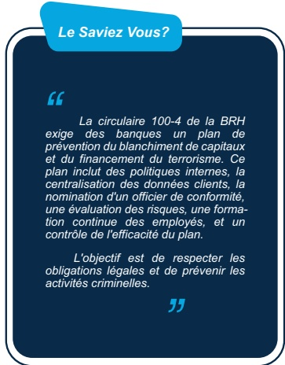

La SupTech, qui inclut des outils technologiques permettant l'automatisation et l'optimisation de la production de rapports et l'analyse de données électroniques, joue un rôle crucial dans l'amélioration de la réglementation et de la supervision des services financiers numériques. (CGAP, 2023).

<!-- page 21 -->

# AU RENDEZ-VOUS DÉCISIONNEL AVEC BÉATRICE : UNE LEÇON DE PRUDENCE POUR LES E-INVESTISSEURS

Après ses démêlés avec son assurance logement, Béatrice cherche à diversifier davantage ses actifs. Suite à une offre avantageuse après des négociations, elle décide de louer sa maison à un Salvadorien. Fascinée par les récits d'expériences en provenance du pays d'origine de son nouveau locataire, elle choisit d'investir une partie du loyer perçu dans les crypto-monnaies. Il convient toutefois de souligner qu'il n'existe aucune législation en Haïti sur les cryptomonnaies.

En parcourant les réseaux sociaux et les forums spécialisés, Béatrice découvre une publicité attrayante vantant une application d'investissement en crypto-monnaies. Cette application promet un rendement hebdomadaire de 10 % sur le capital investi. Offrant un rendement bien supérieur à celui de l'épargne traditionnel ou des investissements immobiliers, et ce, dans un délai extrêmement court, l'offre semble irrésistible!

Pour entamer le processus, l'entreprise lui demande de soumettre sa carte d'identité, ses références bancaires ainsi que son code de sécurité pour l'ouverture de son compte cryptomonnaie. Bien que ces exigences soient courantes dans le domaine des transactions financières en ligne, elles peuvent également être perçues comme des signes d'une demande d'informations personnelles.

## Figure 8 ::::::

Approche réfléchie de Béatrice, suggérée par les principes de la Smart Campaign

## Béatrice commence par évaluer ses possibilités de recours

Elle cherche des informations sur l'affiliation de l'entreprise avec un éventuel régulateur afin de pouvoir projeter ses investissements dans un cadre légal fiable. Le nom de l'entreprise ne figure pas sur la liste de celles agréées officiellement par la BRH

## Elle analyse le niveau de transparence de l'entreprise

L'avis de la BRH sur la demande d'agrément pour les IMF, dans son article 4 relatif à l'actionnariat, impose l'exigence de la communication de l'identité des actionnaires ou associés impliqués dans l'entreprise de microcrédit ou la société de microfinance. (BRH, 2020). Toute entreprise transparente partage avec ses potentiels clients des informations pertinentes sur ses fondateurs, ses managers et leurs activités. Elle scrute minutieusement l'interface de l'application pour collecter des informations fiables.

## Béatrice jauge le niveau de responsabilité de gestion de l'entreprise

Une analyse des derniers rapports financiers de l'entreprise et une comparaison des rendements proposés par la firme à ceux d'autres fintechs légalement reconnues dans le domaine peuvent offrir des indications sur la crédibilité du site en question. Dans le secteur financier, des rendements élevés à court terme peuvent être un hameçon pour attirer les investisseurs dans des pièges.

## Béatrice évalue la réputation de l'application

Les avis négatifs ou une absence de témoignages de clients peuvent être des signaux d’alarme ou éveiller des soupçons. Les témoignages d’autres investisseurs permettent d’obtenir des indicateurs sur les expériences des utilisateurs, notamment sur la fiabilité des transactions et les relations développées récemment avec la clientèle.

<!-- page 22 -->

Consciente des risques liés à la transmission de ses données sensibles en ligne, avant de s'engager, Béatrice décide d'analyser la situation avec précaution en mettant en application ses compétences en éducation financière, acquises au fil des années.

Elle adopte ainsi une approche vigilante avant toute décision, afin de minimiser les dangers potentiels des arnaques en ligne. Elle met en œuvre l'approche réfléchie suggérée par les principes de la Smart Campaign, pour s'assurer de la légitimité et de la sécurité de son investissement.

En prenant un peu de recul, Béatrice a compris que cette plateforme ne se distinguait pas des autres conçues par des arnaqueurs en ligne pour soutirer de l'argent aux non-initiés à l'éducation financière numérique. Ses recherches ont révélé que l'application repose sur un système de Ponzi. D'autres utilisateurs d'une application rançonneuse similaire ont rapporté qu'au début tout fonctionnait rapidement, mais qu'après six mois, les premiers investisseurs se sont retrouvés dans l'impossibilité d'accéder à leur argent, qu'ils n'ont jamais pu récupérer.

Selon les témoignages, le principe est le suivant : les dépôts des nouveaux investisseurs servent à rémunérer les premiers jusqu'à ce que les escrocs disparaissent avec les fonds collectés. En effet, dans un système de Ponzi, seul les premiers utilisateurs récupèrent une partie de leur mise, tandis que la majorité, arrivée plus tard, perd son argent.

L'expérience de Béatrice met en lumière certains risques liés aux investissements dans un monde de plus en plus connecté. Cette démarche illustre concrètement l'importance d'une éducation financière solide et d'une vigilance accrue dans un environnement en ligne de plus en plus complexe. Une éducation financière numérique adaptée peut aider les usagers financiers à développer des réflexes critiques face à des offres trop alléchantes ou voire même suspectes.

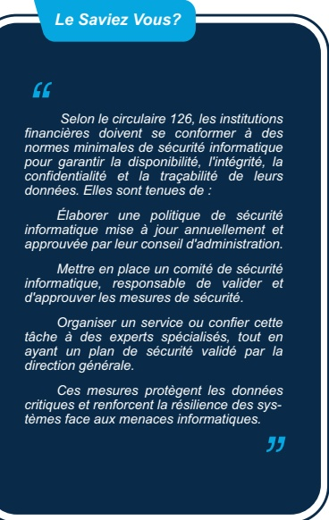

Renforcée par cette expérience, Béatrice continue d'explorer les possibilités d'investissement en ligne, mais s'engage désormais à sensibiliser son entourage aux dangers de certains investissements numériques non protégés et des institutions non agréées par les régulateurs.

<!-- page 23 -->

# MOYENS DE PAIEMENT DIGITALISÉS ET INCLUSION NUMÉRIQUE DURABLE - RATIONALITÉ

Les données mises en évidence par les Nations-Unies en 2023, permettent de confirmer que l'inclusion numérique participe à la réalisation de 13 des 17 ODD. (UNSGSA, 2023). En Haïti, l'adoption de certains instruments digitaux comme le SPIH et les portefeuilles électroniques représente une opportunité majeure pour promouvoir une inclusion financière durable, mais reste encore limitée à certains segments de la population. Selon les données de l'enquête FinScope sur les ménages présentées dans la figure n° 9 ci-dessous, les utilisateurs des services financiers montrent des préférences diversifiées, ce qui reflète des dynamiques importantes dans leurs habitudes financières.

Les analyses des chiffres montrent qu'une proportion significative, soit 71 % de la population, utilisent les produits de transferts d'argent, mettant en évidence le rôle clé de ce service, non seulement dans les interactions quotidiennes, en particulier pour les ménages dépendant des envois de fonds de la diaspora, mais aussi dans la sphère de l'inclusion financière. Par ailleurs, les produits d'épargne occupent une place non négligeable, avec 51 % des utilisateurs, ce qui traduit un intérêt marqué pour la gestion des fonds à moyen et long terme. En revanche, les consommateurs de services financiers liés aux produits de crédit sont estimés à 24 %, et ceux aux produits de transactions courantes à 22 %. Bien que ces derniers chiffres soient relativement moins importants, ils demeurent cruciaux pour le soutien des activités économiques, en particulier pour les entreprises et les travailleurs à revenus modestes.

Utilisation des produits financiers

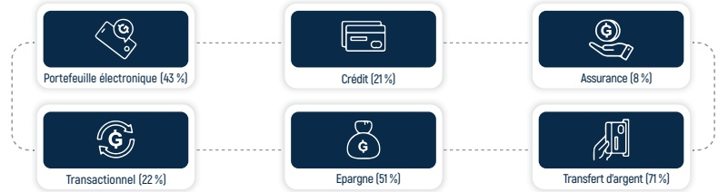

Source : FinScope, 2018

L'adoption progressive des solutions numériques se manifeste également à travers l'utilisation croissante des portefeuilles électroniques, avec un taux de 43 %, qui offre des alternatives modernes aux services financiers traditionnels, même si leur pénétration reste encore inégale. En revanche, les services d'assurance, avec seulement 8 % d'adoption, témoignent d'une sensibilisation limitée à la gestion des risques.

Ces données mettent en lumière les priorités financières des consommateurs de services financiers tout en révélant des opportunités stratégiques pour renforcer l'inclusion financière et promouvoir l'éducation numérique en particulier, afin d'accroître l'adoption des services innovants et de mieux répondre aux besoins variés de la population.

<!-- page 24 -->

# DES DÉFIS PERSISTANTS : RENFORCER LA VIGILANCE DES USAGERS FINANCIERS-RATIONALITÉ

Au cours de ces cinq (5) dernières années, la simplification de certaines contraintes traditionnelles, l'intérêt des groupes cibles pour le e-commerce, ainsi que la situation de la crise multidimensionnelle, favorisent une utilisation plus répandue des services financiers à partir des téléphones mobiles et des Fintechs de paiement. Cette expérience peut contribuer à réduire les risques d'exclusion financière. Cependant, cette adoption croissante de la numérisation expose également les utilisateurs à de nouvelles formes de fraude, et d'escroquerie comme c'est le cas dans de nombreux pays. (IAFCI, 2024).

Il est essentiel que les consommateurs de services financiers soient conscientes que les escrocs peuvent exploiter des outils numériques, tels que certains réseaux sociaux (YouTube, Facebook, Twitter, Instagram, TikTok, etc.), qui sont également utilisés à des fins d'éducation financière, pour cibler des victimes à travers des publicités en ligne et des formulaires internet frauduleux conçus pour recueillir leurs données personnelles sensibles. Ces informations sont ensuite utilisées pour manipuler les consommateurs financiers en essayant même d'établir des liens de familiarité.

En effet, le biais de familiarité, se produit quand un utilisateur financier arrive à faire davantage confiance à une source d'information ou à un outil qu'il croit connaître. Ce qui peut rendre le consommateur financier plus vulnérable aux fraudes et aux escroqueries en ligne. Certains conseils sur les types d'arnaques les plus courants sont résumés dans la rubrique le Saviez vous de cette page.

La finance comportementale montre que les ménages ne prennent pas toujours des décisions financières optimales en raison de certains biais psychologiques, sociaux et émotionnels. Les programmes d'éducation financière doivent permettre aux utilisateurs financiers d'adopter un comportement vigilant permanent et de les sensibiliser aux réflexes indispensables pour déjouer les tentatives d'arnaque ou d'escroquerie dont certains ont été reportés plus haut. Ainsi, une éducation financière efficace doit intégrer des stratégies pour surmonter les biais et encourager des comportements plus rationnels.

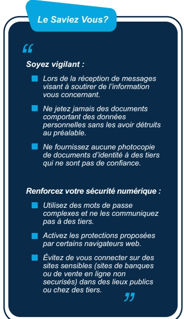

<!-- page 25 -->

Cette sensibilisation peut se matérialiser par la mise en œuvre de campagnes d'information et d'éducation qui non seulement informent les utilisateurs des risques associés à la fraude numérique, mais les aident aussi à développer des réflexes critiques face à des offres trop attrayantes mais douteuses. Des actions concrètes, comme des simulations d'arnaques ou des études de cas sur des fraudes réelles et la cybersécurité, peuvent sensibiliser les consommateurs financiers aux pièges potentiels, les incitant à prendre des décisions plus réfléchies et moins risquées.

Pour répondre à ces défis, la collaboration entre les régulateurs, les institutions financières, les organisations de la société civile et les consommateurs financiers est essentielle pour créer un écosystème numérique agile, plus sûr et inclusif. Les citoyens doivent être formés à identifier les signes d'alerte, à protéger leurs données personnelles, signaler les activités suspectes et à développer des réflexes de grande vigilance financière.

Dans ce contexte de numérisation rapide des services financiers, les régulateurs et les autorités de supervision doivent être capables de surveiller en temps réel les pratiques des fournisseurs de services financiers, d'identifier rapidement les risques émergents et d'intervenir efficacement pour préserver la stabilité du système financier. L'analyse détaillée des rapports automatisés et des données électroniques, en fournissant une vision globale du comportement des institutions financières et des tendances du marché, favorisent la détection rapidez des irrégularités et la prise de décisions réglementaires.

Pour les institutions financières, l'exploitation des données électroniques peut faciliter une surveillance proactive et une réaction rapide face aux menaces. Elle permet de détecter des anomalies suspectes ou des pratiques frauduleuses, notamment les transactions inhabituelles, le blanchiment d'argent ou les tentatives d'escroquerie.

Les consommateurs doivent, à partir d'un canal sécurisé, pouvoir alerter leur institution sur les messages douteux ou appels inopportuns reçus de certains agents non réguliers du système.

<!-- page 26 -->

# AU RENDEZ-VOUS DÉCISIONNEL AVEC PEDRO : RENFORCER LA VIGILANCE DES USAGERS FINANCIERS

L'entreprise agricole de Pedro s'est développée avec l'ouverture de sa boutique en ligne. L'entrepreneur est désormais sollicité par deux hôtels internationaux souhaitant acheter du café biologique. Grâce aux opportunités offertes par l'aéroport du Cap-Haïtien, Pedro commence à exporter vers certains hôtels situés aux Îles Turques-et-Caïcos. Comme beaucoup de ses amis, il a commencé par utiliser son compte bancaire en dollars américains pour les transactions, tout en constatant les longs retards de traitement des opérations. Mais tout a changé lorsqu'un opérateur local a lancé une nouvelle plateforme de paiement mobile, promettant de résoudre les problèmes de transactions internationaux pour les entrepreneurs comme Pedro.

Séduit par l'idée de pouvoir recevoir des paiements directement sur son téléphone, Pedro a rapidement adopté ce service. Il utilisait l'argent mobile pour payer ses fournisseurs, recevoir des paiements de ses clients et même épargner une partie de ses revenus. Cependant, alors que cette transition numérique semblait parfaite, Pedro a rapidement réalisé que l'utilisation de cette technologie pouvait également entraîner certains risques.

Un jour, Pedro a reçu un appel d'un numéro inconnu. L'interlocuteur, se présentant comme un agent de l'opérateur d'argent mobile, lui demandait de confirmer ses informations personnelles pour "mettre à jour son compte". Sans se douter de la fraude, Pedro a partagé des détails sensibles, comme son code PIN. Quelques heures plus tard, il a découvert que l'intégralité de son solde avait disparu.

Leçon apprise : Pedro a compris qu'il devait être vigilant face aux appels non sollicités et éviter de partager des informations personnelles, même avec des "agents officiels". Cette expérience lui a appris à toujours vérifier l'identité des interlocuteurs et à privilégier les points de service agréés. Pedro s'est également retrouvé confronté à un autre problème lorsqu'une panne de réseau a paralysé son activité pendant plusieurs jours. Il ne pouvait ni recevoir de paiements ni accéder à ses fonds. Ses clients, tout aussi frustrés, ont commencé à douter de la fiabilité de son service.

Pour réduire ces risques opérationnels, Pedro a choisi de suivre les recommandations sur la diversification financière présentées dans le volume I de la RDCCF. Il veille ainsi à toujours conserver une petite réserve sur son compte traditionnel afin de faire face aux éventuelles pannes. De plus, il a pris l'habitude de suivre les mises à jour et les alertes de son opérateur mobile pour anticiper toute interruption de service.

<!-- page 27 -->

Lorsqu'il devait retirer de l'argent ou résoudre un problème, Pedro se rendait chez un agent local autorisé. Cependant, il a découvert que certains agents exigeaient des frais supplémentaires non autorisés. Un jour, un agent peu scrupuleux lui a affirmé que son retrait avait échoué, alors qu'il avait en réalité empoché l'argent.

Pedro a commencé à exiger des reçus pour chaque transaction et a appris à signaler les agents malhonnêtes à l'opérateur de son service mobile. Il a également opté pour des agents réputés, même s'ils étaient un peu plus éloignés de son commerce.

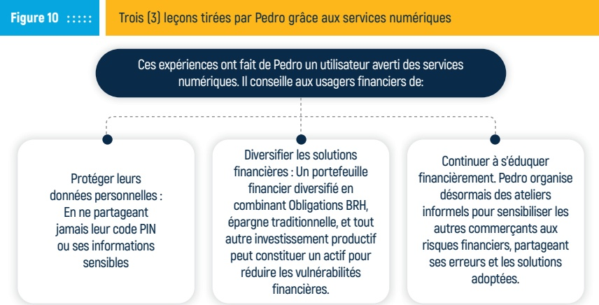

L'objectif est de fournir aux utilisateurs un ensemble d'outils leur permettant de se protéger contre les risques liés à la digitalisation des services financiers, tout en leur donnant les moyens de tirer pleinement parti des innovations technologiques.

L'approfondissement de la culture financière est essentiel pour aider les ménages et les entreprises à mieux comprendre les enjeux de la gestion financière dans un environnement de plus en plus numérisé. Ce volume met en avant les opportunités offertes par les solutions digitales tout en alertant sur les risques, tels que les fraudes, les erreurs de manipulation et les arnaques numériques. Il propose également des solutions pratiques pour sensibiliser les utilisateurs aux pièges potentiels et les encourager à adopter des comportements prudents, afin de prendre des décisions plus réfléchies et d'évoluer en toute sécurité.

<!-- page 28 -->

## CONCLUSION

La protection des consommateurs financiers est une responsabilité partagée entre les législateurs, les régulateurs, les prestataires de services financiers et les utilisateurs de ces services. Chaque acteur est appelé à jouer son rôle pour garantir un environnement financier sûr, inclusif et transparent, favorisant des transactions financières durables et renforçant la confiance dans le système financier.

Dans ce contexte, les initiatives de sensibilisation et de formation sont essentielles pour aider aussi bien les entreprises que les consommateurs à naviguer en toute sécurité dans un système numérique de plus en plus exigeant. L'éducation financière, notamment numérique, doit permettre aux consommateurs financiers de mieux comprendre les outils financiers digitaux, d'adopter les bonnes pratiques financières numériques et de renforcer leur capacité à identifier et prévenir les fraudes, en particulier la cybercriminalité, les escroqueries et tous les autres risques liés aux vols d'identité.

Une meilleure compréhension de leurs droits et responsabilités devra permettre aux consommateurs financiers d'être proactifs envers les Fintechs et les institutions financières traditionnelles. Ils pourront exiger davantage de transparence et d'adopter des comportements prudents et agiles face aux risques numériques. Ces acquis devront favoriser une inclusion financière numérique plus responsable, tout en renforçant la santé financière des entreprises et le bien-être financier des ménages.

Enfin, l'adoption d'un cadre légal inclusif, en intégrant des dispositifs réglementaires claires et en imposant des mesures structurées et systématisées, devra favoriser une culture numérique résiliente au sein des institutions financières. Cette approche est essentielle pour renforcer la protection des consommateurs financiers, prévenir les crises financières, réduire les risques liés à l'adoption et l'utilisation des services financiers digitaux, garantir un accès inclusif aux services financiers et maintenir la stabilité financière.

<!-- page 29 -->

## RÉFÉRENCES

• AFI (2023). Protection de consommateur.

• Banque Mondiale. (n.d.). Doing Business [archive]. Consulté le 5 janvier 2025, sur https://archive.doingbusiness.org/fr/doingbusiness.

• Banque de la République d'Haïti (BRH). (2018). FinScope : Enquête sur la demande des produits et services financiers des ménages.

• Banque de la République d'Haïti (BRH). (2020). Avis pour demande d'agrément-IMF. CGAP (2021).

• Demirguc-Kunt, A., Klapper, L., Singer, D., Ansar, S., & Hess, J. (2018). The Global Findex Database 2017: Measuring Financial Inclusion and the Fintech Revolution. World Bank Group.

• Fortin, (2024). Cyber-sécurité et ses attaques.

• GSMA (2021). The Mobile Gender Gap Report.

• Jack, W., & Suri, T. (2014). “Risk Sharing and Transactions Costs: Evidence from Kenya’s Mobile Money Revolution.” American Economic Review, 104(1), 183–223. Joaquim Levy (2016). Une technologie financière bien encadrée favorise l'inclusion et permet de lutter contre la cybercriminalité, Banque Mondiale.

• Karlan et al. (2016).

• OCDE (2020). Compétences numériques et inclusion sociale.

• Rapport G20, 2011

• Symantec (2020). Rapport sur la cybersécurité : les menaces en ligne pour les consommateurs.

• Smart Campaign $ ^{*} $

• UNESCO (2021). Les compétences numériques et leur impact sur les sociétés modernes.

• UNSGSA (2023). Secrétaire général des Nations Unies pour la promotion de services financiers accessibles à tous qui favorisent le développement.

• USAID (2024). Digital policy 2024-2034.

• World Bank (2021). La transformation numérique et ses impacts sur l'inclusion financière.

• CNUCED (2021). Financial Inclusion for Development: Better Access to Financial Services for Women, the Poor and Migrant Workers. Publication des Nations Unies, Genève.

• Unpacking concepts & definitions – Digital Public Infrastructure, Building Blocks, and Their Relation to Digital Public Goods (May 17, 2022).

<!-- page 30 -->

<!-- page 31 -->

Bureau d'Information sur le Crédit

## Pour solliciter votre rapport de crédit, contactez le BIC aux

28 17 00 00 | 28 17 0001

FAITES CONFIANCE AU BIC !

12, Rue Butte, Bourdon

Tel: 28 17 00 00/28 17 00 01

<!-- page 32 -->

Bureau d'Information sur le Crédit

## Avec votre rapport de crédit, vous pouvez mieux gérer votre crédit et améliorer votre solvabilité à long terme

## FAITES CONFIANCE AU BIC !

12, Rue Butte, Bourdon

Tel: 28 17 00 00/28 17 00 01

<!-- page 33 -->

BANQUE DE LA RÉPUBLIQUE D'HAÎTI

Scannez ce QR Code pour accéder aux informations relatives à la Circulaire 113

INCITATIONS AU FINANCEMENT DU SECTEUR AGRICOLE

CIRCULAIRE No 113

Aux Institutions Financières

<!-- page 34 -->

# 4 raisons de souscrire aux OBLIGATIONS BRH

## 1

TAUX D'INTÉRÊT ATTRACTIF

Les Obligations BRH vous offrent des taux d'intérêt de 7 %, 7,25 %, et 7,50 % par an respectivement pour des maturities de 3, 6, et 12 mois, avec une indexation à la hausse du taux de change.

## 2

ACCESSIBILITÉ

Le montant minimal de souscription est de 50,000.00 gourdes, rendant ce produit financier accessible à une large partie de la population.

## 3

REMOURSEMENT SIMPLE

ET EFFICACE

Deux jours ouvrables après la date d'échéance, les obligations BRH sont rémunérées directement sur votre compte via l'intermédiaire financier, simplifiant ainsi le processus de récupération de votre capital et des intérêts.

## 4

STABILISATION DE LA GOURDE

En investissant dans les obligations BRH, vous contribuez à stabiliser la valeur de la monnaie nationale et à renforcer l'accumulation de l'épargne en gourdes.

<!-- page 35 -->

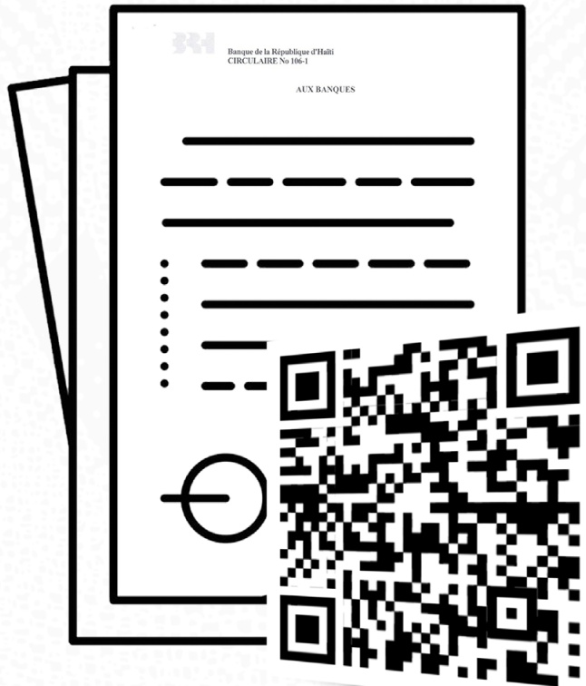

SCANNEZ CE QR CODE POUR ACCÉDER AUX DOCUMENTS RELATIFS AU PROGRAMME PRO-CROISSANCE

<!-- page 36 -->

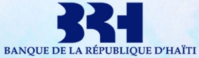

SCANNEZ CE QR CODE POUR CONSULTER TOUTES LES PUBLICATIONS DE LA BANQUE DE LA RÉPUBLIQUE D'HAÎTI

<!-- page 37 -->

Banque de la République d'Haiti ⏰

@BRHHaiti

Banque Centrale d'Haiti qui assure la défense de la #Gourde, le développement du système de paiements, la stabilité financière, l'inclusion financière.

Haiti brh.ht Joined April 2024

6 Following 76 Followers

RESTEZ INFORMÉS DE TOUTES

LES DERNIÈRES MISES À JOUR DE LA BRH !

Scannez ce QR code pour nous suivre sur notre nouveau compte X: @BRHHaiti_

<!-- page 38 -->

<!-- page 39 -->

<!-- page 40 -->

RDCCF-VOL.III
