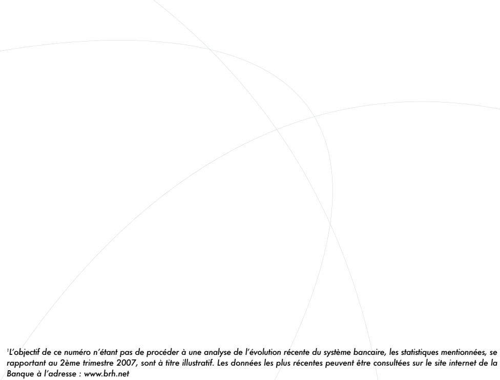
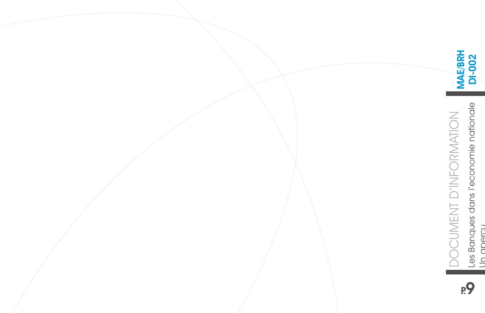

<!-- page 1 -->

Banque de la République D'Haïti

DOCUMENT D'INFORMATION

Les Banques dans l'économie nationale

Un apercu

<!-- page 2 -->

La Banque de la République d'Haïti a le plaisir de vous présenter le second numéro de la série «Document d'Information». Cette dernière a pour but d'informer le public en général, et les opérateurs économiques et financiers en particulier, sur l'action de la banque centrale, les objectifs et l'orientation de sa politique monétaire, l'évolution des différents secteurs de l'économie haïtienne, ainsi que tout sujet et information jugés pertinents.

Cette série de publications répond au souci de réduire l'asymétrie d'information par une plus grande dissémination et de renforcer la transparence en mettant l'emphase sur le bien fondé des choix de politique de l'institution.

Ce numéro présente le système bancaire haïtien, son rôle dans l'économie et sa performance au 31 mars 2007¹. L'accent est mis tant sur le fonctionnement de ce secteur que sur le mécanisme par lequel les décisions de politique monétaire se répercutent sur la sphère réelle de l'économie à partir du comportement des institutions bancaires.

L'objectif de ce numéro n'étant pas de procéder à une analyse de l'évolution récente du système bancaire, les statistiques mentionnées, se rapportant au 2ème trimestre 2007, sont à titre illustratif. Les données les plus récentes peuvent être consultées sur le site internet de la Banque à l'adresse : www.brh.net

<!-- page 3 -->

## Présentation du système bancaire

Après plus d'un siècle d'existence¹, le système bancaire haïtien constitue l'un des piliers de l'économie haïtienne, de par son volume d'activités. L'ensemble des banques détenait, en mars 2007, 74,34 milliards de gourdes.

Aujourd'hui, le système bancaire² comprend deux banques d'État, cinq banques privées nationales et deux succursales de banques étrangères. En fonction de l'orientation de leurs activités principales, ces banques sont réparties en neuf banques commerciales et une banque d'épargne et de logement, toutes coiffées par la banque centrale³.

Au départ, à caractère duopolistique, le marché bancaire s'est développé au cours des années 1920 puis passa par une phase de prédominance des banques étrangères vers les années 1970. En 1994, la libéralisation financière consacra la dynamisation du système et la diversification de l'actionnariat du secteur bancaire au profit des capitaux privés haitiens. (Voir tableau 1)

<table><tr><td>Tableau 1 : Classement des banques de dépôts au 31 Mars 2007 en fonction de l'actif (en milliards de gourdes)</td></tr><tr><td>Sogebank</td><td>23.6</td></tr><tr><td>Unibank</td><td>22</td></tr><tr><td>BNC</td><td>12.2</td></tr><tr><td>CBNA</td><td>3.8</td></tr><tr><td>Capital Bank</td><td>3.7</td></tr><tr><td>BUH</td><td>3.1</td></tr><tr><td>Sogebel</td><td>2.5</td></tr><tr><td>Scotiabank</td><td>2.3</td></tr><tr><td>BPH</td><td>1.1</td></tr><tr><td>BICH</td><td>0</td></tr></table>

Source : Rapport trimestriel de la Supervision bancaire, BRH

## Les activités des institutions bancaires

Les établissements bancaires haïtiens sont par définition des institutions de dépôts. Ils reçoivent les dépôts des épargnants, qu'ils utilisent comme ressources pour financer des prêts qu'ils accordent à l'État haïtien⁴, aux entreprises, et aux particuliers résidant en Haïti. Ces opérations ont 2 implications. En orientant l'argent des déposants vers les demandeurs de crédit, la banque effectue de l'intermédiation financière. De plus, en accordant du crédit à partir des dépôts dont elle dispose, la banque participe à la création monétaire, d'où son qualificatif de banque créatrice de monnaie.

<!-- page 4 -->

En outre, la banque s'adonne à des activités lucratives au profit de ses propriétaires. En somme, elle détient comme ressources principales : 1) l'ensemble des dépôts, dont une partie est gardée comme réserves obligatoires, 2) les autres obligations à court et long termes (les débentures par exemple), 3) les fonds provenant d'autres opérations rentables, telles que les placements à court terme et les prises de participation, 4) les fonds propres issus du capital investi par les actionnaires, et les bénéfices tirés de leurs opérations.

## Gardiennes de l'épargne financière

Les institutions bancaires donnent la possibilité aux agents économiques ayant une capacité de financement, d'épargner en toute sécurité. D'abord non rémunérés, les placements des déposants sont, depuis les années 70, rétribués suivant un pourcentage du montant remboursé par les banques (l'intérêt). Ce dernier varie généralement avec la marge de profit que les banques espèrent tirer de l'utilisation de cette ressource.

Pour répondre aux besoins de leurs clients, les banques offrent 3 types de dépôts : les dépôts à vue, les dépôts d'épargne et les dépôts à terme. Les premiers sont plus liquides que les autres dépôts, dans le sens où ces fonds sont immédiatement mobilisables $ ^{5} $. Cependant, certaines options récentes telles que les cartes-chèques et les cartes de débit rendent les dépôts d'épargne aussi liquides que les dépôts à vue, élargissant ainsi les facilités de transaction dans l'économie.

Ainsi, au 31 mars 2007, le système bancaire compte 1,724,812 comptes de dépôts, soit 227,169 comptes de plus qu'en mars 2006. La majorité de ces dépôts sont constitués de dépôts d'épargne (soit 92,79 % du total des comptes de dépôts), contre 89,142 comptes de dépôts à vue, et 35,271 comptes de dépôts à terme. En valeur, les dépôts d'épargne totalisent 25,2 milliards de gourdes, contre 18,1 et 19 milliards de gourdes respectivement pour les dépôts à vue et à terme.

## Intermédiaires financiers

A l'instar du commerçant², le banquier emprunte (ou achète) à bas prix pour prêter (ou revendre) plus cher, afin de réaliser un bénéfice. Le financement des activités des emprunteurs par les institutions bancaires se fait donc moyennant un coût, le taux d'intérêt débiteur (c'est-à-dire, le taux sur les prêts), qui est toujours supérieur au taux de rémunération des dépôts (taux créditeur).

Ces transferts de fonds des agents excédentaires (les déposants) vers les agents déficitaires (les emprunteurs) constituent ce qu'on appelle l'intermédiation financière. En Haïti, les 60,8 milliards de gourdes de dépôts bancaires recensés en décembre 2006 ont financé 24,2 milliards de prêts (en gourdes et en devises). De ces prêts, 9,47 % ont été alloués au crédit à la consommation, 62,48 % au secteur commercial et 12,66 % ont financé les activités des industries manufacturières.

<!-- page 5 -->

Ces statistiques démontrent, par ailleurs, le faible niveau d'intermédiation financière des institutions de dépôts en Haiti. De 2002 à 2006, le taux d'intermédiation moyen (le rapport crédits sur dépôts) s'élève à 36,70 % ; en d'autres termes, sur chaque dépôt de 100 gourdes effectué à la banque, 36,7 gourdes sont mobilisées pour financer des activités économiques.

## Autres activités bancaires

Par convention, les établissements bancaires sont des sociétés anonymes, dont le capital, subdivisé en actions, revient à leurs propriétaires, les actionnaires, qui fondent ces entreprises pour en tirer un profit. Par conséquent, outre l'intermédiation financière, les institutions bancaires s'adonnent à des activités lucratives, dans le but d'accroître les bénéfices des actionnaires, en l'occurrence, les placements à l'étranger, les prises de participation dans des entreprises commerciales ou d'autres institutions financières, l'acquisition de titres dont ceux émis par la BRH ou le Trésor américain, et des transactions sur le marché de changes. Cependant, qu'il s'agisse d'activités d'intermédiation financière ou d'opérations pour leur propre compte, les banques s'exposent à des risques. En fait, la fonction bancaire est l'une des activités les plus risquées au monde, et de ce fait, chaque institution bancaire est soumise à une supervision relativement stricte, exercée par une autorité de tutelle, afin de vérifier la santé financière de l'établissement financier et de garantir la solidité de l'ensemble du système et la protection de l'avoir des épargnants.

## Les risques du métier bancaire

Risque de crédit. En effectuant de l'intermédiation financière, les banques s'endettent par rapport à un déposant pour accorder du crédit à une personne physique ou morale qui exprime un besoin de financement. Cette opération est d'autant plus admise économiquement que le banquier détient des moyens logistiques, matériels et financiers pour localiser ceux qui détiennent une capacité de financement et les emprunteurs potentiels, et permettre ainsi les transferts de fonds. L'activité bancaire comporte toutefois un risque : celui que l'emprunteur ne rembourse pas sa dettre à l'échéance fixée, plaçant ainsi la banque commerciale en situation de perte nette par rapport à son propre créancier, le déposant. D'où la nécessité pour ces institutions de dépôts d'évaluer scrupuleusement toute demande de crédit afin de s'assurer de la solvabilité du débiteur. Cette évaluation tient compte de la notation du débiteur, de sa capacité d'absorption, du secteur d'activités dans lequel évolue l'emprunteur, de ses sources de revenus, de sa profitabilité et de sa capacité de remboursement. Suite à cette évaluation, les banques disposent ensuite de différents moyens de protection pour minimiser ce risque en exigeant certaines garanties (les hypothèques, les dépôts fongibles, les titres de la Banque Centrale, les provisions pour créances douteuses, etc.). Mais, en dépit d'une demande potentielle forte, le risque de crédit demeure l'un des éléments explicatifs de la réticence des banques commerciales haitiennes en général à accorder du crédit, à la base du faible niveau du taux d'intermédiation bancaire. Ce risque augmente d'autant plus que les demandeurs de crédit offrent en général peu de garantie de leur solvabilité, d'où l'orientation des crédits alloués vers une minorité de la population.

<!-- page 6 -->

Le risque de marché. Le risque de marché implique des pertes résultant des fluctuations des prix des actifs financiers détenus par les banques (les taux d'intérêt, le taux de change). Il est aussi dû à l'évolution de l'ensemble de l'économie (par exemple du taux d'inflation pouvant affecter la valeur réelle des actifs), de la fiscalité, et des problèmes de règlement et de livraison. Les outils utilisés par les banques pour se prémunir contre un tel risque sont, par exemple, la marge d'intermédiation bancaire, c'est-à-dire la marge de profit que se réserve la banque sur les taux d'intérêt créditeurs et débiteurs qu'elle pratique.

Le risque de liquidité. Les établissements bancaires reçoivent majoritairement des dépôts de courte échéance et accordent des crédits à moyen et long termes. Il se crée donc un décalage où les disponibilités des banques peuvent être insuffisantes par rapport aux sommes prêtées (c'est le concept de désappariement entre ressources à court terme et emplois à long terme). D'où la raison pour laquelle les institutions bancaires en général n'utilisent pas leurs ressources à court terme pour accorder du crédit. Toutefois, pour éviter une situation où la banque serait inapte à faire face à ses engagements en cas de retrait général des déposants, la Banque Centrale astreint aux banques à garder un certain pourcentage (actuellement 31 %) des dépôts à titre de réserves obligatoires.

Le risque opérationnel. Le risque opérationnel correspond au risque d'ordre technique, technologique, administratif ou de gestion interne, provenant de tout événement susceptible de perturber le déroulement normal des activités de la banque, d'affecter l'image de celle-ci, et de générer des pertes financières. Il relève par exemple, de défaillances internes (humaines ou systémiques), d'événements externes (terrorisme, vols, etc.), de politiques juridiques (amendes, pénalités ou dommages et intérêts).

Le risque systémique. Compte tenu des relations financières existant entre les banques du système, la faillite d'une banque peut entraîner celles d'autres banques, qui seraient à leur tour incapables de faire face à leurs engagements puisqu'elles n'auraient pas été remboursées par la banque défaillante. Ce scénario induit une contraction immédiate des crédits, avec des répercussions négatives dans la sphère réelle de l'économie. De ce fait, la banque centrale oblige les banques à respecter un niveau de leurs fonds propres supérieur à 5 % du total de leurs actifs, comme coussin de sécurité pour pallier à l'ensemble de ces risques.

En dépit des risques liés à l'intermédiation financière, le système bancaire s'est révélé, de manière historique, l'un des secteurs les plus dynamiques de l'économie haïtienne. Toutefois, les bouleversements récents qu'il a connus ont quelque peu affecté la santé financière de certaines banques, lesquelles, suite aux acquisitions effectuées, devront appliquer des mesures de redressement, de manière à préserver la stabilité du système. En effet, ces banques ont dû hériter des charges, des dettes et des créances improductives d'autres banques. Ceci a eu pour effet d'entamer leur rentabilité et la qualité de leur actif et, par ricochet, celles du système.

<!-- page 7 -->

## Rôle de l'État (Régulation bancaire)

Les banques occupent une place importante dans l'économie, compte tenu de leur rôle dans la gestion des fonds du public. Beaucoup de gens ou d'institutions sont clients, actionnaires ou employés dans ce secteur. Il est alors évident que l'évolution de ce secteur a des influences directes sur la vie des citoyens. Or, les banques sont exposées à d'énormes risques, comme indiqué plus haut. Dans ce contexte, il est normal et impératif que les autorités publiques établissent des règles prudentielles visant au bon fonctionnement et à la stabilité du secteur bancaire. La plupart de ces règles sont établies suivant les recommandations de Bâle (Basel Corps Principles). C'est un ensemble de normes internationales mises en place de façon à uniformiser les pratiques de contrôle dans l'objectif de solidifier les différents systèmes bancaires. Elles ne sont que des exigences minimales, c'est-à-dire qu'elles peuvent être renforcées par chaque entité nationale de contrôle en fonction des risques identifiés. Par exemple, les accords de Bâle l'fixent un ratio minimal de 8 % des fonds propres par rapport à l'ensemble des actifs à risque d'une banque au niveau international, tandis que ce ratio s'établit à 12 % pour les banques haitiennes.

En Haiti, l'organisation et le fonctionnement des banques commerciales reposent sur le décret du 14 novembre 1980, tandis que la loi du 28 août 1984 définit le cadre de fonctionnement des banques d'épargne et de logement. L'organisme de réglementation du système bancaire est la Banque de la République d'Haïti (BRH). Cette dernière effectue régulièrement, par le biais de son département de Supervision Bancaire, des contrôles dont le but principal est de s'assurer que les établissements bancaires mènent leurs activités de manière saine et prudente. Le processus de contrôle contient deux volets : les inspections sur pièces et la surveillance sur place. Dans le premier cas, l'objectif est d'identifier les problèmes financiers des banques à travers les rapports que ces dernières sont obligées d'acheminer périodiquement à la BRH. D'un autre côté, l'inspection sur place vise à apporter un meilleur éclairage et plus de précision sur des situations identifiées lors de la surveillance sur pièces. Elle permet surtout de revoir certains aspects de la gestion de la banque qui ne peuvent être évalués à distance et toute situation qui peut affecter négativement les fonds propres de la banque. Elle n'est pas orientée vers la détection de fraude ou de vol.

Récemment, les autorités ont commencé l'expérimentation d'un autre outil d'analyse destiné à évaluer la robustesse du système bancaire. C'est le test de résistance⁸. Il évalue la sensibilité du portefeuille d'une banque ou de l'ensemble des institutions bancaires à une combinaison de chocs. Les chocs considérés dans l'économie haitienne se réfèrent entre autre au taux de change, au crédit, aux taux d'intérêt. Les simulations essaient de mesurer, par exemple, l'impact sur le portefeuille d'une banque d'une large dépréciation de la gourde par rapport au dollar compte tenu du niveau relativement élevé de la dollarisation de l'économie, d'une baisse drastique des taux d'intérêt sur les bons BRH ou d'une crise de défaut des clients ayant contracté des prêts auprès de cette banque. Donc, ces tests de résistance soumettent le système bancaire à toute une série de scénarios de chocs exceptionnels mais plausibles.

<!-- page 8 -->

Les outils permettent aux autorités de détecter rapidement les banques en difficulté et de décider, s'il y a lieu, de les aider à se redresser. Dans le cas d'une banque de petite taille, comme la MÉTROBANQUE en 1997 ou la PROMOBANK en 2006, elle peut simplement être rachetée, totalement ou partiellement, par une autre banque plus importante en Haiti ou à l'étranger. Ou encore, elle peut être renflouée par le gouvernement dans le cadre d'un plan de redressement approprié, sans grand frais ni risque pour le Trésor Public. La décision n'est pas facile dans le cas d'une banque de grande taille parce que l'effet d'une faillite ou d'une opération de sauvetage peut être néfaste à court terme sur le reste de l'économie.

La faillite non gérée d'une grande banque peut provoquer une ruée des déposants vers les banques, ce qui risque de déstabiliser tout le système. Elle peut en même temps provoquer le dysfonctionnement du système de paiement et une contraction catastrophique des flux de crédit et de la production – avec la montée en flèche des taux d'intérêt et des risques – entraînant des faillites en chaîne et des licenciements massifs dans le secteur réel de l'économie. Pour sa part, une opération de sauvetage sous forme de concours financier (pour rembourser les déposants victimes) peut lancer une spirale d'inflation et de dépréciation de la monnaie à court terme, comme les Dominicains l'ont vécu, il y a quelques années, suite à la faillite de la BANINTER.

Des deux maux, le chômage et l'inflation, il faudra choisir le moindre. Et comme dans notre situation de pauvreté, un tel choix serait toujours difficile, il vaut mieux s'en tenir à un bon système de prévention pour la préservation des banques comme gardiennes de nos économies et piliers du système de paiement.

Outre la supervision bancaire, la BRH entretient aussi d'autres relations avec les institutions bancaires. Ces dernières sont en effet les principales partenaires de la BRH dans la transmission de la politique monétaire, c'est-à-dire le processus par lequel une décision prise par les autorités monétaires influence le reste de l'économie. Les instruments $ ^{9} $ utilisés par la BRH pour effectuer la gestion monétaire concernant, pour le moment, seulement les institutions bancaires. En effet, les bons BRH n'ont été ouverts qu'aux établissements bancaires depuis leur introduction en 1996. Si pour les autorités monétaires cet instrument représente un outil de contrôle de la liquidité bancaire, il constitue plutôt pour les banques une opportunité d'emploi de ressources dans un actif sans risque. En principe, les taux d'intérêt sur les bons BRH devraient orienter les taux sur les prêts et sur les dépôts des banques. Cependant, à cause de certaines rigidités structurelles, la transmission est asymétrique $ ^{10} $ et n'est pas toujours fluide. Par ailleurs, lorsque la BRH intervient sur le marché des changes pour acheter ou vendre des devises, elle réalise les transactions au niveau du système bancaire. Enfin, les autorités monétaires imposent des coefficients de réserves obligatoires sur les passifs des banques, non seulement pour garantir un minimum de protection des dépôts du public, mais aussi pour assurer une meilleure gestion de l'offre monétaire. Actuellement, ce coefficient est fixé à 31% pour les banques commerciales et 19,5 % pour les banques d'épargne et de logement.

<!-- page 9 -->

# Évolution récente du secteur bancaire haïtien

## Performance

En mars 2007, l'actif bancaire (soit le total des avoirs et créances que détiennent les institutions bancaires sur le reste de l'économie) a totalisé 74,34 milliards de gourdes, soit une hausse de 5,78 % par rapport au même mois de l'année précédente. Du côté des résultats, le bénéfice net du système a atteint 374,2 MG, soit une croissance de 29,10 % en glissement annuel, tandis que le produit net bancaire $ ^{11} $, évalué à 1,5 milliard de gourdes, a crû de 9,67 %.

Outre les résultats obtenus à partir des activités bancaires, il existe des indicateurs mesurant la qualité et la viabilité de la performance des institutions bancaires au cours d'une période donnée. Ces indicateurs tiennent compte du niveau de capitalisation de l'entité, i.e. si elle dispose d'un coussin financier assez important pour la prémunir de toute faillite bancaire (l'assise financière) ; la proportion des composantes de l'actif comportant un risque (la qualité de l'actif $ ^{11} $) et le niveau de rentabilité de ses activités (rentabilité).

De manière historique, le secteur bancaire fait montre d'une assez bonne santé financière. Les institutions de dépôt sont pourvues d'une bonne structure financière, avec un ratio d'avoir des actionnaires en pourcentage de l'actif dépassant le niveau recommandé par la banque centrale $ ^{12} $. De plus, le poids des prêts improductifs, c'est-à-dire, comportant un risque élevé de non remboursement, dans le total des prêts accordés, est relativement peu élevé et généralement couvert par les provisions dont la banque se dote à cet effet. Par ailleurs, les activités des établissements bancaires ont été suffisamment rentables, avec un rendement moyen des prêts largement supérieur à la rémunération moyenne des dépôts, des revenus nets d'intérêt élevés, garantissant ainsi la rentabilité de leurs actifs et le rendement des capitaux mobilisés par leurs actionnaires. (Voir le tableau 2)

Cependant, la cession récente de 2 banques commerciales, ainsi que d'une banque d'épargne logement, a quelque peu affecté la santé financière du système, dans la mesure où les engagements de celui-ci ont augmenté par rapport à ses avoirs, et que le poids des prêts improductifs s'est accru, induisant une moindre couverture par les provisions pour créances douteuses. Conséquemment, le rendement moyen des prêts s'est légèrement contracté, ainsi que les revenus nets d'intérêt. Ce qui a eu une répercussion négative sur la rémunération des avoirs des actionnaires. (Tableau 2)

<!-- page 10 -->

<table><tr><td>TABLEAU 2 : Performance récente du système bancaire (ratios financiers en %)</td></tr><tr><td></td><td>2nd trim. 2006</td><td>1er trim. 2007</td><td>2nd trim. 2007</td></tr><tr><td>Structure financière</td><td></td><td></td><td></td></tr><tr><td>Avoirs des actionnaires</td><td>5.42%</td><td>5.84%</td><td>6.96%</td></tr><tr><td>en % de l'actif</td><td></td><td></td><td></td></tr><tr><td>Dépôts en % de l'actif</td><td>85.08%</td><td>82.92%</td><td>83.81%</td></tr><tr><td>Qualité de l'actif</td><td></td><td></td><td></td></tr><tr><td>Prêts improductifs bruts</td><td>13.54%</td><td>10.53%</td><td>11.69%</td></tr><tr><td>en % des prêts bruts</td><td></td><td></td><td></td></tr><tr><td>Provisions pour créances</td><td>52.97%</td><td>88.82%</td><td>64.55%</td></tr><tr><td>douteuses en % des prêts</td><td></td><td></td><td></td></tr><tr><td>improductifs</td><td></td><td></td><td></td></tr><tr><td>Prêts improductifs nets en %</td><td>37.54%</td><td>6.64%</td><td>19.22%</td></tr><tr><td>de l'avoir des actionnaires</td><td></td><td></td><td></td></tr><tr><td>Rentabilité</td><td></td><td></td><td></td></tr><tr><td>ROA (rendement de l'actif)</td><td>1.67%</td><td>1.99%</td><td>2.03%</td></tr><tr><td>ROE (rendement de l'avoir des actionnaires)</td><td>31.19%</td><td>35.72%</td><td>31.65%</td></tr><tr><td>Revenus d'intérêt nets en %</td><td>72.83%</td><td>70.21%</td><td>70.07%</td></tr><tr><td>des revenus d'intérêt renseignés moyen des prêts</td><td>13.67%</td><td>14.63%</td><td>14.18%</td></tr><tr><td>Rémunération moyenne des dépôts</td><td>2.22%</td><td>2.67%</td><td>2.58%</td></tr></table>

Source : Rapport trimestriel de la Supervision bancaire, BRH

<!-- page 11 -->

## Glossaire

Actions : Titres émis par la banque commerciale et dont l'ensemble constitue le capital de la banque. Ces titres sont avant tout des investissements effectués par des personnes physiques ou morales, qui deviennent alors propriétaires de la banque.

Avoir des actionnaires : total cumulatif du capital et des bénéfices. Ce total inclut les gains ou pertes de capital, ainsi que les bénéfices non répartis et les surplus d'apport des actionnaires.

Capitalisation bancaire : Niveau de fonds propres (le capital bancaire) accumulés par une banque. Une banque est bien capitalisée quand le niveau de fonds propres atteint maximise sa valeur de marché et couvre ses engagements à court et à long terme.

Débenture : Titre représentant un emprunt à long terme sans garantie.

Duopolistique : Caractéristique d'un marché duopole, c'est-à-dire, formé de 2 entreprises.

Libéralisation financière : Ensemble de réformes du système bancaire haïtien, qui ont consacré l'ouverture du portefeuille d'actions au secteur privé, et la dissolution du contrôle direct de l'État dans la politique de crédit des banques. Ces réformes devaient promouvoir le développement du marché bancaire, faciliter la concurrence, la réduction des contraintes financières, l'augmentation de l'épargne et l'amélioration de l'allocation du crédit bancaire.

Mécanisme de transmission de la politique monétaire : mécanisme par lequel les décisions et l'utilisation des instruments de politique monétaire se répercutent sur la sphère réelle de l'économie et sur les prix, à travers l'intermédiation financière exercée par les institutions bancaires. Ce mécanisme s'exerce à travers certains canaux, dont les taux d'intérêt sur les bons BRH et les taux de réserves obligatoires.

Personne morale : Terme juridique représentant une entreprise ou une société fondée par un groupe d'individus, qui a une existence juridique propre, et par conséquent, détient des droits et des obligations.

Prise de participation : Détention par l'établissement bancaire d'une part, en général inférieure à 50 %, du capital d'une entreprise commerciale ou d'une autre société financière.

Réserves obligatoires : Un pourcentage des dépôts bancaires que les banques ont pour obligations de garder comme réserves de garantie à la BRH.

<!-- page 12 -->

Banque de la République D'Haïti

www.brh.net

Direction Monnaie et Analyse Économique

Angle rues Pavée et du quai

Port au-Prince, Haiti W.I.

Boîte Postal: BP 1570

Téléphones: (509) 299-1200 à 1210 / 299-1250 à 1253 / Fax: (509) 299-1045 / 299-1145
