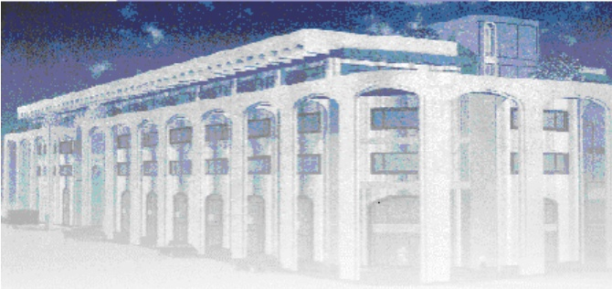

<!-- page 1 -->

Banque de la République d'Haïti

Note mensuelle d'inflation

Décembre 2014

<!-- page 2 -->

## Introduction

Cette note analyse l'évolution de l'Indice des Prix à la Consommation (IPC) en Haïti au cours du mois de décembre 2014. Elle apporte quelques éléments explicatifs permettant de comprendre les facteurs qui influencent l'évolution de l'inflation en variation mensuelle et présente également les prévisions pour les trois prochains mois.

### I. - Évolution de l'inflation globale

En décembre 2014, l'évolution du niveau général des prix s'est caractérisée par le maintien de la tendance à la hausse du rythme de croissance amorcée depuis le mois d'avril dernier. En effet, après avoir atteint 5,8 % et 6,2 % respectivement en octobre et novembre 2014, le taux d'inflation en glissement annuel a augmenté de 20 points de base en s'affichant à 6,4 % en décembre 2014. En variation mensuelle, le niveau de l'inflation s'est établi à 0,6 % en décembre 2014 contre des taux respectifs de 0,6 % et 0,5 % en octobre et novembre. Considérant le taux d'inflation mensuel observé au cours du mois sous étude, l'inflation mensuelle cumulée sur le premier trimestre 2015 s'est portée à 1,7 %, en hausse de 1 point de pourcentage par rapport à celle enregistrée pour le même trimestre un an plus tôt.

Graphique 1 : Évolution de l'inflation annuelle (en %)

| Date | Value |
| --- | --- |
| Oct-13 | 4.2 |
| Nov-13 | 3.4 |
| Dec-13 | 3.4 |
| Jan-14 | 3.4 |
| Feb-14 | 3.2 |
| Mar-14 | 3.2 |
| Apr-14 | 3.5 |
| May-14 | 3.5 |
| Jun-14 | 4.2 |
| Jul-14 | 4.8 |
| Aug-14 | 5.1 |
| Sep-14 | 5.3 |
| Oct-14 | 5.8 |
| Nov-14 | 6.2 |
| Dec-14 | 6.4 |

<!-- page 3 -->

| Date | Value |
| --- | --- |
| Oct-13 | 0.2 |
| Nov-13 | 0.1 |
| Dec-13 | 0.4 |
| Jan-14 | 0.2 |
| Feb-14 | 0.3 |
| Mar-14 | 0.6 |
| Apr-14 | 0.6 |
| May-14 | 0.6 |
| Jun-14 | 0.6 |
| Jul-14 | 0.7 |
| Aug-14 | 0.5 |
| Sep-14 | 0.4 |
| Oct-14 | 0.6 |
| Nov-14 | 0.5 |
| Dec-14 | 0.6 |

La progression de l'inflation mensuelle reflète celle de presque toutes les fonctions de consommation notamment les groupes « Alimentation, boissons et tabac », « Habillement, tissus et chaussures », « Loyer du logement, énergie et eau » et « Autres biens et services » dont les indices ont enregistré des taux de croissance de 0,7 %, 0,8 %, 0,8 % et 0,9 % respectivement. Pour la fonction « Alimentation, boissons et tabacs », l'indice a crû en raison du renchérissement de tous les produits à l'exception des prix du riz, du spaghetti, de la farine de blé, du pain qui ont stagné et de ceux du citron et du sucre qui ont baissé. S'agissant du groupe « Habillement, tissus et chaussures », la hausse de l'indice a été influencée par celle des prix des tissus (1,8 %), de la confection des vêtements (1 %), des sandales (1 %) et des souliers et tennis (0,9 %). La progression du rythme de croissance des indices des fonctions « Loyer du logement, énergie et eau » et « Autres biens et services » est attribuable à la hausse du coût du loyer de logement et des prix du shampoing (1,8 %), de la poudre de toilette (4,6 %) et de la crème pour le corps (2,1 %).

En variation mensuelle, ces groupes ont contribué à la hausse de l'inflation globale à hauteur de 96 % alors qu'en glissement annuel, ils comptent pour environ 78 %.

<!-- page 4 -->

Graphique 3 : Contribution des différents postes de dépenses à l'inflation en décembre 2014

| Poste | Pondération | Contribution à l'inflation mensuelle (en %) | Contribution à l'inflation annuelle (en %) |
| --- | --- | --- | --- |
| Indice Général | 100.0% | 100.00 | 100.00 |
| Alim, boisson, tabac | 50.4% | 62.74 | 45.05 |
| Habil, tissus, chaussures. | 6.9% | 9.28 | 12.43 |
| Loyer, Energie, eau | 11.1% | 16.52 | 12.88 |
| Aménag, Ent Log. | 4.7% | 2.98 | 3.83 |
| Santé | 2.9% | 0.87 | 4.47 |
| Transport | 13.7% | 0.00 | 7.94 |
| Loisirs, Spectacles, Enseignement, Cult. | 5.8% | 0.00 | 5.54 |
| Autres biens & services. | 4.6% | 7.60 | 7.85 |

### II. - Évolution de l'inflation selon l'origine des produits

Pour le mois de décembre 2014, le rythme de progression de l'IPC des produits locaux a augmenté en glissement annuel et a stagné en variation mensuelle alors que celui des produits importés a décéleré. En effet, le taux de croissance de l'IPC des produits locaux a crû de 10 points de base pour s'établir à 6,2 % alors que sur base mensuelle, il a affiché un taux de 0,6 %, soit le même que celui observé le mois dernier. Toutefois, pour l'IPC des produits importés, le taux de croissance a atteint 0,2 % et 5,5 % respectivement en rythme mensuel et en glissement annuel, en baisse de 10 points de base par rapport au mois précédent.

### III. - Évolution de l'inflation sous-jacente

En décembre 2014, l'inflation sous-jacente a affiché la même tendance que l'inflation globale en glissement annuel. En effet, le taux d'inflation sous-jacent, calculé en excluant les produits à prix volatils dans l'IPC, s'est établi à 6,5 % en décembre 2014 contre 6,1 % un mois plus tôt. En variation mensuelle, l'IPC sous-jacent a crû de 0,49 % en décembre 2014, soit une baisse de 2 points de base par rapport à novembre 2014. En comparaison à l'indice global, l'indice sous-jacent a enregistré un taux légèrement inférieur sur base mensuelle. En rythme annuel, il a connu une progression légèrement plus importante que l'IPC global, ce qui implique que les produits volatils ne sont pas les principaux facteurs à l'origine de l'augmentation des pressions inflationnistes enregistrée au cours du mois sous étude.

<!-- page 5 -->

### IV. - Facteurs explicatifs de l'évolution des prix à la consommation en décembre 2014

L'évolution du niveau général des prix au mois de décembre 2014 a été influencée par plusieurs facteurs dont l'augmentation saisonnière de la demande globale et le prolongement des effets rémanents de l'augmentation des prix des produits pétroliers à la pompe.

## 1 - L'augmentation saisonnière de la demande globale

Comme pour les années précédentes, l'activité économique dans le pays s'est amplifiée en raison des festivités de fin d'année au cours du mois de décembre 2014, caractérisant ainsi une augmentation de la demande globale qui a influencé les prix à la hausse, compte tenu de la rigidité de l'offre à court terme. Cette hausse de la demande globale est reflétée dans l'accroissement de 17 % en variation mensuelle de la monnaie en circulation, laquelle a enregistré une progression mensuelle moyenne de 1,2 % sur l'année calendaire 2014. La croissance saisonnière de la circulation fiduciaire a été favorisée par l'augmentation des transferts privés sans contrepartie, des dépenses publiques et du crédit privé en gourdes. En effet, les transferts privés ont augmenté de 47,2 % de novembre à décembre 2014 alors qu'une croissance de 35,8 % et 2,3 % a été enregistrée respectivement pour les dépenses publiques et le crédit en gourdes alloué au secteur privé.

| Date | en millions de gourdes |
| --- | --- |
| Nov-12 | 19400 |
| Dec-12 | 23200 |
| Jan-13 | 20200 |
| Feb-13 | 19800 |
| Mar-13 | 21000 |
| Apr-13 | 20800 |
| May-13 | 20600 |
| Jun-13 | 20800 |
| Jul-13 | 21000 |
| Aug-13 | 21200 |
| Sep-13 | 21300 |
| Oct-13 | 21200 |
| Nov-13 | 21200 |
| Dec-13 | 25000 |
| Jan-14 | 22200 |
| Feb-14 | 22600 |
| Mar-14 | 22500 |
| Apr-14 | 22800 |
| May-14 | 22300 |
| Jun-14 | 22800 |
| Jul-14 | 23200 |
| Aug-14 | 24000 |
| Sep-14 | 23800 |
| Oct-14 | 24000 |
| Nov-14 | 24200 |
| Dec-14 | 28200 |

## 2 - Les effets rémanents de l'augmentation des prix des produits pétroliers à la pompe

En décembre 2014, la progression de toutes les fonctions de consommation à la fois en variation mensuelle qu'en glissement annuel montre que les effets induits de la révision à la hausse des prix à la pompe en octobre dernier continuent d'alimenter le renchérissement des autres biens et services dans l'économie. En effet,

<!-- page 6 -->

sachant l'importance des produits pétroliers dans les coûts de production et de distribution des biens et services, les indices des prix des groupes « Alimentation, boissons et tabac », « Habillement, tissus et chaussures », « Loyer du logement, énergie et eau », « Aménagement et entretien du logement » et « Autres biens et services » ont crû en moyenne de 0,72 % après avoir enregistré des taux de progression moyens mensuels autour de 0,84 % en novembre 2014 et 0,44 % un an plus tôt.

### V. - Prévisions d'inflation

Pour les trois prochains mois de l'exercice 2014-2015, les prévisions d'inflation de la MAE augurent un maintien de la tendance à la hausse du taux d'inflation tant en variation mensuelle qu'en glissement annuel. En effet, en variation mensuelle, les prévisions tablent sur des taux de 0,9 %, 0,0 % et 0,5 % pour les mois de janvier, de février et de mars 2015 respectivement. En variation annuelle, l'inflation devrait se chiffrer à 7,2 % en janvier et 6,9 % en février 2015, pour ensuite se porter à 6,8 % en mars 2015.

Graphique 6 : Prévision de l'inflation annuelle (Janvier et février et mars 2015)

| Date | inflation estimée (inf) | inflation en glissement annuel (inflation estimée (sup)) |
| --- | --- | --- |
| Dec-11 |   | 8.3 |
| Jan-12 |   | 7.8 |
| Feb-12 |   | 6.8 |
| Mar-12 |   | 5.7 |
| Apr-12 |   | 5.4 |
| May-12 |   | 5.2 |
| Jun-12 |   | 4.9 |
| Jul-12 |   | 5.3 |
| Aug-12 |   | 6.1 |
| Sep-12 |   | 6.6 |
| Oct-12 |   | 7.0 |
| Nov-12 |   | 7.5 |
| Dec-12 |   | 7.6 |
| Jan-13 |   | 7.2 |
| Feb-13 |   | 7.5 |
| Mar-13 |   | 7.8 |
| Apr-13 |   | 7.3 |
| May-13 |   | 7.3 |
| Jun-13 |   | 6.6 |
| Jul-13 |   | 6.2 |
| Aug-13 |   | 5.3 |
| Sep-13 |   | 4.5 |
| Oct-13 |   | 4.2 |
| Nov-13 |   | 3.4 |
| Dec-13 |   | 3.4 |
| Jan-14 |   | 3.4 |
| Feb-14 |   | 3.2 |
| Mar-14 |   | 3.2 |
| Apr-14 |   | 3.5 |
| May-14 |   | 3.5 |
| Jun-14 |   | 4.3 |
| Jul-14 |   | 4.8 |
| Aug-14 |   | 5.1 |
| Sep-14 |   | 5.3 |
| Oct-14 |   | 5.8 |
| Nov-14 |   | 6.2 |
| Dec-14 |   | 6.3 |
| Jan-15 |   | 7.6 |
| Feb-15 |   | 7.3 |
| Mar-15 |   | 6.8 |

<!-- page 7 -->

Tableau No.1

Indice des prix à la consommation par postes de dépenses Variation et contribution mensuelle et annuelle En décembre 2014

<table><tr><td></td><td>Indice des Prix à la Consommation (IPC)</td><td>Variation mensuelle En (%)</td><td>Variation annuelle En (%)</td><td>Contribution mensuelle à l'inflation</td><td>Contribution annuelle à l'inflation</td></tr><tr><td>Poste</td><td>Pondération (en %)</td><td>Déc. 13</td><td>Nov. 14</td><td>Déc. 14</td><td>Déc. 14</td><td>Déc. 14</td><td>Déc. 14</td><td>Déc. 14</td></tr><tr><td>Indice Général</td><td>211.10</td><td>223.40</td><td>224.70</td><td>0.6</td><td>6.4</td><td>100.00</td><td>100.00</td></tr><tr><td>Alimentation, boisson et tabac</td><td>50.35</td><td>219.50</td><td>230.40</td><td>232.00</td><td>0.7</td><td>5.7</td><td>62.74</td><td>45.05</td></tr><tr><td>Habillement, tissus et chaus.</td><td>6.86</td><td>203.70</td><td>225.50</td><td>227.20</td><td>0.8</td><td>11.7</td><td>9.28</td><td>12.43</td></tr><tr><td>Loyer, énergie et eau</td><td>11.05</td><td>247.90</td><td>264.10</td><td>266.30</td><td>0.8</td><td>7.4</td><td>16.52</td><td>12.88</td></tr><tr><td>Aménag. et entret. du logem</td><td>4.7</td><td>215.70</td><td>226.10</td><td>226.90</td><td>0.4</td><td>5.2</td><td>2.98</td><td>3.83</td></tr><tr><td>Santé</td><td>2.9</td><td>218.00</td><td>239.00</td><td>239.40</td><td>0.2</td><td>9.8</td><td>0.87</td><td>4.47</td></tr><tr><td>Transport</td><td>13.74</td><td>157.60</td><td>163.40</td><td>163.40</td><td>0.0</td><td>3.7</td><td>0.00</td><td>7.94</td></tr><tr><td>Lois., sp. Ens., Clt.</td><td>5.84</td><td>223.60</td><td>237.10</td><td>237.10</td><td>0.0</td><td>6.0</td><td>0.00</td><td>5.54</td></tr><tr><td>Aut. biens & serv.</td><td>4.56</td><td>176.20</td><td>193.70</td><td>195.50</td><td>0.9</td><td>11.0</td><td>7.60</td><td>7.85</td></tr></table>

Source : IHSI et calcul du Service de la Macrééconomie et de l'Analyse de conjoncture de la MAE

<!-- page 8 -->

## Glossaire

| Variation mensuelle | : Variation par rapport au mois précédent. |
| --- | --- |
| Glissement annuel | : Variation par rapport au même mois de l'année antérieure. |
| Inflation | : Mouvement persistant à la hausse du niveau général des prix. |
| Désinflation | : Talentissement de la croissance des prix. |
| Déflation | : Baisse du niveau général des prix associée à une contraction de la masse monétaire et du crédit. |
| Inflation sous-jacente | : Tendance de long terme des prix, tout en excluant la volatilité, les mouvements saisonniers, conjoncturels, et les chocs qui affectent les composantes du panier considéré. |
| Région Nord | : Elle couvre les départementes du Nord, Nord-Est et Nord-Ouest. |
| Région Sud | : Elle comprend les départementes du Sud de la Grand-Anse et des Nippes. |
| Région Reste Ouest | : Y sont incluses les départementes du Sud-Est et de l'Ouest à l'exception de l'aire métropolitaine |
| Région Transversale | : Elle regroupe les départementes du Centre et de l'Artibonite. |
| Aire Métropolitaine | : Elle contient les villes de Port-au-Prince, de Delmas, de Pétion-Ville, de Carrefour et de Croix des Bouquets. |
