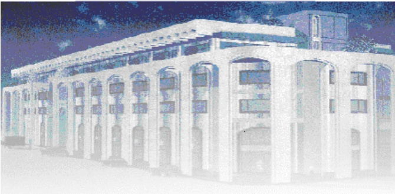

<!-- page 1 -->

Banque de la République d'Haïti

Note mensuelle d'inflation

Février 2017

<!-- page 2 -->

## Tables des matières

I.- Introduction.....2
II.- Évolution de l'inflation globale en février 2017.....2
III.- Évolution des principales fonctions de consommation en février 2017.....2
IV.- Évolution de l'inflation selon l'origine des produits et les régions géographiques du pays.....4
V.- Évolution de l'inflation sous-jacente.....5
VI.- Facteur explicatif de l'évolution de l'inflation mensuelle en février 2017.....5
VII.- Prévisions d'inflation.....5

<!-- page 3 -->

### I. - Introduction

La note mensuelle d'inflation analyse l'évolution de l'Indice des Prix à la Consommation (IPC) en Haïti au cours du mois sous revue. Elle apporte des éléments explicatifs permettant de comprendre les facteurs qui influencent l'évolution de l'inflation et présente les prévisions de cette dernière pour les trois prochains mois.

### II. - Évolution de l'inflation globale en février 2017

En février 2017, l'indice des prix à la consommation (base 100 en août 2004) a été estimé à 294,7 contre 291,6 en janvier 2017 et 258,7 en février 2016, soit une hausse de 1,1 % en rythme mensuel et de 13,9 % en glissement annuel. Il ressort une évolution contrastée de l'inflation avec une décélération en glissement annuel (13,9 % contre 14,1 % en janvier 2017) et une légère hausse en variation mensuelle (20 points de base).

En comparant la moyenne des taux de croissance de l'IPC pour les cinq premiers mois de l'exercice fiscal 2016-2017 avec ceux de l'exercice 2015-2016 on constate que le taux d'inflation moyen est de 1,3 % pour cet exercice. 2017 et de 1 % pour l'exercice antérieur. De même, le taux d'inflation mensuel cumulé s'est porté à 6,5 % contre 5,2 % au cours de la même période de l'exercice passé.

Graphique No. 1

Évolution de l'inflation mensuelle et annuelle en février 2017 (en %)

| Date | Inflation annuelle | Inflation Mensuelle |
| --- | --- | --- |
| Feb-15 | 6.5 | 0.35 |
| Mar-15 | 6.4 | 0.45 |
| Apr-15 | 6.3 | 0.5 |
| May-15 | 6.5 | 0.65 |
| Jun-15 | 7.8 | 1.5 |
| Jul-15 | 9.2 | 2.1 |
| Aug-15 | 10.0 | 1.8 |
| Sep-15 | 11.0 | 1.3 |
| Oct-15 | 11.5 | 1.0 |
| Nov-15 | 11.8 | 0.7 |
| Dec-15 | 12.5 | 0.9 |
| Jan-16 | 13.2 | 1.0 |
| Feb-16 | 14.2 | 1.2 |
| Mar-16 | 14.8 | 0.8 |
| Apr-16 | 15.2 | 0.8 |
| May-16 | 14.8 | 0.7 |
| Jun-16 | 13.8 | 0.8 |
| Jul-16 | 12.8 | 0.9 |
| Aug-16 | 12.2 | 0.8 |
| Sep-16 | 12.4 | 1.0 |
| Oct-16 | 13.5 | 1.7 |
| Nov-16 | 14.2 | 1.4 |
| Dec-16 | 14.2 | 1.1 |
| Jan-17 | 14.0 | 0.9 |
| Feb-17 | 13.8 | 1.0 |

<!-- page 4 -->

### III. - Évolution des principales fonctions de consommation en février 2017

Les fonctions de consommation qui ont connu une hausse mensuelle des prix en février 2017 par rapport à janvier 2017 ont été : « Alimentation, Boisson, Tabac » (1,2 % contre 0,8 %), « Loyer du logement, Énergie et Eau » (2,1 % contre 0,8 %). Par contre, les rythmes de progression des postes « Habillement, Tissus, Chaussures », « Aménagement, Entretien et Logement », « Santé » et « Autres Biens et Services » ont dimininué de quelques points de pourcentage pour s'établir à 1,2 %, 1,1 %, 1 % et 1,6 % respectivement. Quant à la variation de l'indice mensuel des postes « Transport » et « Loisirs, Spectacles, Enseignement et Culture », elle est restée inchangée sur les deux premiers mois de l'année calendaire (0,1 % pour le premier et 0,2 % pour le second).

Par ailleurs, en glissement annuel, la variation des indices des prix des postes « Habillement, Tissus, Chaussures » et « Transport » a diminué de 10 points de base en février 2017 relativement au mois antérieur pour s'établir à 16,3% et 3,4% respectivement. Aussi les fonctions « Aménagement, Entretien, Logement » et « Loisirs, Enseignement, Culture » ont-t-elles enregistré une moindre réduction de leur IPC en variation annuelle (respectivement 13,5% et 16,6% en février 2017 contre 14 % et 17% en janvier 2017). D'autre part, plusieurs fonctions de consommations ont vu leur indice de prix se varier à la hausse en rythme annuel durant le mois de février, notamment les postes « Loyer, Énergie, Eau » (18,5 % contre 17,5 % antérieurement), « Santé » (9,6% contre 9,1 % préalablement) et « Autres Biens et Services » (18 % contre 17,9 %). Pour sa part, la variation annuelle de l'indice des prix du poste « Alimentation., Boisson, Tabac » est restée inchangée à 13,9 %.

De plus, la contribution du poste « Alimentation, Boissons et Tabac », dont la pondération dans le panier de consommation est la plus importante (50,4 %), est passée à 55,09 % en rythme mensuel) et à 52,50 % en glissement annuel contre 49,08 % et 52,01% respectivement le mois précédent.

<!-- page 5 -->

Tableau No. 1

Contributions à l'inflation mensuelle et annuelle (en %) en février 2017

| Poste | Pondération | Contribution à l'inflation mensuelle | Contribution à l'inflation annuelle |
| --- | --- | --- | --- |
|   | en % | en % | en % |
| Indice Général | 100.00 | 100.00 | 100.00 |
| Alim, bois, tab | 50.35 | 55,09 | 52,50 |
| Habil, tis, chs. | 6.86 | 7,48 | 8,38 |
| Loyer, En, eau | 11.05 | 21,03 | 15,33 |
| Aménag, Ent. log. | 4.70 | 4,89 | 4.76 |
| Santé | 2.90 | 2,71 | 2,09 |
| Transport | 13.74 | 1,44 | 3,51 |
| Lois., sp. Ens., Clt. | 5.84 | 0,85 | 7.26 |
| Aut. biens & serv. | 4.56 | 6,52 | 6.16 |

Source: Calculs de la BRH

### IV. - Évolution de l'inflation selon l'origine des produits et les régions géographiques du pays

Enregistrant une diminution de 30 points de base en glissement annuel (12,7 % en février 2017 contre 13 % les deux mois antérieurs), l'inflation des produits importés a augmenté de 10 points de base en glissement mensuel, passant de 1,1 % à 1,2 %. Quant à l'indice des prix des produits locaux, il s'est accru de 20 points de base en variation mensuelle pour se porter à 1 % tandis qu'il a chuté de 20 points de base en rythme annuel pour s'établir à 14,5 % en février 2017. Par ailleurs, le rythme annuel de l'inflation s'est regressé dans toutes les régions géographiques du pays, à l'exception de l'aire métropolitaine où elle reste inchangée à 14,4 %. Tout en continuant à enregistrer un plus fort taux d'inflation annuel suite aux distorsions des prix causées par l'ouragan Matthew, la région Sud¹ connait néanmoins un ralentissement de son taux d'inflation annuel (16 % en février 2017 contre 16,4 % et 16,5 % en décembre 2016 et en janvier 2017 respectivement). En rythme mensuel, l'inflation tend à se stabiliser dans le Sud depuis les deux derniers mois (1,1 % en janvier et en février 2017).

<!-- page 6 -->

### V. - Évolution de l'inflation sous-jacente

L'inflation sous-jacente (c.-à-d. l'inflation de base excluant du panier de consommation les prix des composantes volatiles telles que les produits pétroliers) a évolué de manière contrastée. En variation annuelle, elle a connu une légère diminution (13,65 % en février 2017 contre 13,80 % pour le mois antérieur) tandis qu'elle s'est élevée à 0,97 % en rythme mensuel, soit une augmentation de 5 points de base comparativement au mois antérieur. Depuis le début de cet exercice fiscal, c'est pour le cinquième mois consécutif que l'inflation sous-jacente mensuelle a évolué au-dessous de l'inflation courante.

Graphique No. 4

Inflation globale et inflation sous-jacente en variation mensuelle (en %)

| Date | inflation globale mensuelle | inflation sous-jacente mensuelle |
| --- | --- | --- |
| Feb-15 | 0.28 | 0.40 |
| Mar-15 | 0.45 | 0.10 |
| Apr-15 | 0.50 | 0.55 |
| May-15 | 0.80 | 0.75 |
| Jun-15 | 1.85 | 1.80 |
| Jul-15 | 1.95 | 1.90 |
| Aug-15 | 1.40 | 1.45 |
| Sep-15 | 1.20 | 1.30 |
| Oct-15 | 1.00 | 0.90 |
| Nov-15 | 0.75 | 0.65 |
| Dec-15 | 1.05 | 0.95 |
| Jan-16 | 1.05 | 0.95 |
| Feb-16 | 1.25 | 1.05 |
| Mar-16 | 0.85 | 0.80 |
| Apr-16 | 0.85 | 0.75 |
| May-16 | 0.65 | 0.55 |
| Jun-16 | 0.80 | 0.80 |
| Jul-16 | 1.10 | 1.10 |
| Aug-16 | 0.95 | 1.20 |
| Sep-16 | 1.30 | 1.40 |
| Oct-16 | 1.75 | 1.65 |
| Nov-16 | 1.40 | 1.40 |
| Dec-16 | 1.10 | 1.10 |
| Jan-17 | 0.90 | 0.90 |
| Feb-17 | 1.05 | 0.95 |

### VI. - Facteur explicatif de l'évolution de l'inflation mensuelle en février 2017

L'accélération de l'inflation en variation mensuelle en février 2017 est imputable dans une certaine mesure aux tensions observées sur le marché des changes.

## VII- Prévisions d'inflation

Pour les trois prochains mois, les prévisions d'inflation de la MAE augurent une légère hausse de l'inflation annuelle s'établissant à 14 % en mars puis un ralentissement qui pourrait porter l'inflation annuelle à 13,7 % en avril et 13,3 % en mai 2017. Par ailleurs, en rythme mensuel, l'inflation décélerait pour s'établir à 0,9 %, 0,6 % et 0,3 % pour les mois de mars, avril et mai 2017 respectivement. Ces prévisions sont basées essentiellement sur les récentes évolutions de l'inflation.

<!-- page 7 -->

Graphique No. 6

Prévisions de l'inflation en variation mensuelle et annuelle sur trois mois (en %, à partir de mars 2017)

| Date | inflation mensuelle | Inflation annuelle |
| --- | --- | --- |
| Feb-14 | 0.3 | 0.0 |
| Mar-14 | 0.6 | 0.05 |
| Apr-14 | 0.55 | 0.08 |
| May-14 | 0.55 | 0.1 |
| Jun-14 | 0.7 | 0.2 |
| Jul-14 | 0.7 | 0.3 |
| Aug-14 | 0.5 | 0.35 |
| Sep-14 | 0.4 | 0.35 |
| Oct-14 | 0.6 | 0.45 |
| Nov-14 | 0.5 | 0.5 |
| Dec-14 | 0.55 | 0.55 |
| Jan-15 | 0.4 | 0.55 |
| Feb-15 | 0.35 | 0.55 |
| Mar-15 | 0.5 | 0.55 |
| Apr-15 | 0.5 | 0.55 |
| May-15 | 0.8 | 0.6 |
| Jun-15 | 1.9 | 0.8 |
| Jul-15 | 2.0 | 1.0 |
| Aug-15 | 1.5 | 1.2 |
| Sep-15 | 1.2 | 1.3 |
| Oct-15 | 1.0 | 1.4 |
| Nov-15 | 0.8 | 1.45 |
| Dec-15 | 1.1 | 1.5 |
| Jan-16 | 1.1 | 1.6 |
| Feb-16 | 1.3 | 1.7 |
| Mar-16 | 0.9 | 1.8 |
| Apr-16 | 0.8 | 1.85 |
| May-16 | 0.7 | 1.75 |
| Jun-16 | 1.0 | 1.6 |
| Jul-16 | 1.1 | 1.5 |
| Aug-16 | 1.0 | 1.45 |
| Sep-16 | 1.4 | 1.45 |
| Oct-16 | 1.8 | 1.55 |
| Nov-16 | 1.5 | 1.6 |
| Dec-16 | 1.2 | 1.6 |
| Jan-17 | 0.9 | 1.55 |
| Feb-17 | 1.1 | 1.5 |
| Mar-17 | 1.0 | 1.45 |
| Apr-17 | 0.8 | 1.4 |
| May-17 | 0.3 | 1.33 |

Sources : Prévisions du Service de Modélisation et des Prévisions Macroéconomiques de la MAE

Tableau No. 2

Indice des prix à la consommation (IPC) par postes de dépenses Variation et Contribution à l'inflation mensuelle et annuelle en février 2017

<table><tr><td></td><td></td><td></td><td>Contribution à l'inflation (%)</td></tr><tr><td>Poste</td><td>Indice des Prix à la Consommation</td><td>Variation IPC (%)</td><td>Mensuelle</td><td>Annuelle</td></tr><tr><td></td><td>Ponderation (en %)</td><td>Fév-16</td><td>17-Jan</td><td>Fév-17</td><td>Mensuelle</td><td>Annuelle</td></tr><tr><td>Indice général</td><td>258.7</td><td>291.6</td><td>294.7</td><td>1.1</td><td>13.9</td><td>100</td><td>100</td></tr><tr><td>Alimentation, Boisson, Tabac</td><td>50.35</td><td>271.6</td><td>305.7</td><td>309.4</td><td>1.2</td><td>13.9</td><td>55,09</td><td>52,50</td></tr><tr><td>Habillement, Tissus, Chaussures</td><td>6.86</td><td>281.4</td><td>323.4</td><td>327.3</td><td>1.2</td><td>16.3</td><td>7,48</td><td>8,38</td></tr><tr><td>Loyer, Énergie, Eau</td><td>11.05</td><td>298.7</td><td>346.7</td><td>354</td><td>2.1</td><td>18.5</td><td>21,03</td><td>15,33</td></tr><tr><td>Amenagement, Entretien Logement</td><td>4.7</td><td>263.5</td><td>295.7</td><td>299.1</td><td>1.1</td><td>13.5</td><td>4,89</td><td>4,76</td></tr><tr><td>Santé</td><td>2.9</td><td>267.2</td><td>289.9</td><td>292.9</td><td>1</td><td>9.6</td><td>2,71</td><td>2,09</td></tr><tr><td>Transport</td><td>13.74</td><td>167</td><td>172.5</td><td>172.7</td><td>0.1</td><td>3.4</td><td>1,44</td><td>3,51</td></tr><tr><td>Loisirs, Enseignement, Culture</td><td>5.84</td><td>267.6</td><td>311.5</td><td>312</td><td>0.2</td><td>16.6</td><td>0,85</td><td>7.26</td></tr><tr><td>Autres Biens et Services</td><td>4.56</td><td>239.5</td><td>278.3</td><td>282.7</td><td>1.6</td><td>17</td><td>6,52</td><td>6.16</td></tr></table>

Sources : IHSI et calculs du Service de la Macrééconomie et Analyse de Conjoncture de la MAE

<!-- page 8 -->

## Glossaire

| Variation mensuelle | : Variation par rapport au mois précédent. |
| --- | --- |
| Glissement annuel | : Variation par rapport au même mois de l'année antérieure. |
| Inflation | : Mouvement persistant à la hausse du niveau général des prix. |
| Désinflation | : Ralentissement de la croissance des prix. |
| Déflation | : Baisse du niveau général des prix associée à une contraction de la masse monétaire et du crédit. |
| Inflation sous-jacente | : Tendance de long terme des prix, tout en excluant la volatilité, les mouvements saisonniers, conjoncturels, et les chocs qui affectent les composantes du panier considéré. |
| Région Nord | : Elle couvre les départementes du Nord, Nord-Est et Nord-Ouest. |
| Région Sud | : Elle comprend les départementes du Sud de la Grand-Anse et des Nippes. |
| Région Reste Ouest | : Y sont incluses les départementes du Sud-Est et de l'Ouest à l'exception de l'aire métropolitaine |
| Région Transversale | : Elle regroupe les départementes du Centre et de l'Artibonite. |
| Aire Métropolitaine | : Elle contient les villes de Port-au-Prince, de Delmas, de Pétion-Ville, de Carrefour et de Croix des Bouquets. |
