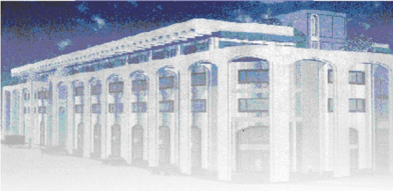

<!-- page 1 -->

Banque de la République d'Haïti

Note mensuelle d'inflation

Juillet 2018

<!-- page 2 -->

## Tables des matières

I.- Introduction.....2
II.- Évolution de l'inflation globale en juillet 2018.....2
III.- Évolution des principales fonctions de consommation en juillet 2018.....2
IV.- Évolution de l'inflation selon l'origine des produits et les régions géographiques du pays.....3
V.- Évolution de l'inflation sous-jacente .....4
VI.- Facteurs explicatifs de l'évolution de l'inflation en rythme mensuel.....5
VII.- Prévisions d'inflation.....5

<!-- page 3 -->

### I. - Introduction

La note mensuelle d'inflation analyse l'évolution de l'Indice des Prix à la Consommation (IPC) en Haïti au cours du mois sous revue. Elle apporte des éléments explicatifs permettant de comprendre les facteurs qui influencent l'évolution de l'inflation. Elle présente également les prévisions d'inflation pour les trois prochains mois.

### II. - Évolution de l'inflation globale en juillet 2018

Au cours du mois de juillet 2018, le taux d'inflation, mesuré par la variation de l'Indice général des Prix à la Consommation (IPC), a été estimé à 1,5 % en variation mensuelle contre 1,3% au mois de juin 2018. Ainsi, d'un mois à l'autre, l'inflation a augmenté de 20 points de base. En glissement annuel, l'inflation a enregistré une hausse de 60 points de base en passant de 13 % à 13,6 %. Ces évolutions confirment les pressions inflationnistes observées depuis le début du second semestre de l'exercice fiscal 2017-2018.

Graphique No. 1 Évolution de l'inflation mensuelle et annuelle en juillet 2018 (en %)

| Date | Inflation annuelle | Inflation Mensuelle |
| --- | --- | --- |
| Jul-16 | 12.9 | 1.1 |
| Aug-16 | 12.4 | 0.95 |
| Sep-16 | 12.4 | 1.2 |
| Oct-16 | 13.4 | 1.62 |
| Nov-16 | 14.2 | 1.4 |
| Dec-16 | 14.2 | 1.35 |
| Jan-17 | 14.0 | 0.95 |
| Feb-17 | 14.0 | 1.05 |
| Mar-17 | 14.4 | 1.18 |
| Apr-17 | 14.8 | 1.1 |
| May-17 | 15.6 | 1.4 |
| Jun-17 | 15.8 | 1.05 |
| Jul-17 | 15.8 | 1.0 |
| Aug-17 | 15.7 | 0.95 |
| Sep-17 | 15.4 | 1.12 |
| Oct-17 | 14.4 | 0.92 |
| Nov-17 | 13.8 | 0.88 |
| Dec-17 | 13.4 | 0.83 |
| Jan-18 | 13.2 | 0.88 |
| Feb-18 | 13.2 | 1.02 |
| Mar-18 | 13.0 | 0.98 |
| Apr-18 | 12.8 | 1.08 |
| May-18 | 12.8 | 1.15 |
| Jun-18 | 13.2 | 1.25 |
| Jul-18 | 13.6 | 1.45 |

Source: IHSI

### III. - Évolution des principales fonctions de consommation en juillet 2018

La hausse mensuelle de l'indice global s'est reflétée dans le comportement de presque toutes les fonctions de consommation : « Alimentation, boissons et tabac » (1,7 %), « Habillement et tissus, chaussures » (1,9 %), « Transport » (0,4 %), « Loisirs, Enseignement et Culture » (1 %) et « Autres biens et services » (1,3 %). Pour leur part, la variation de l'indice des prix des fonctions « Loyer du logement, énergie et eau

<!-- page 4 -->

», « Aménagement et entretien du logement » et « Santé » est restée inchangée à 1,7 %, 1,6 % et 1,6 % respectivement.

En variation annuelle, l'évolution du rythme de croissance de l'IPC est principalement due à la hausse de la plupart des fonctions de consommation à l'exception des postes « Habillement et tissus, chaussures » et « Transport ». En effet, le premier est resté inchangé à 15,8 % alors que le second a connu une baisse de 30 points de base pour s'établir à 3,2 %.

En outre, le poste « Alimentation, Boissons et Tabac » (50,4 % du panier de consommation) a vu sa contribution à l'inflation mensuelle augmenter à 57,54 % en juillet 2018 contre 55,92 % en juin 2018.

Tableau No. 1. Contributions à l'inflation mensuelle et annuelle (en %) en juillet 2018

| POSTE | Pondération | Contribution à l'inflation mensuelle (en %) | Contribution à l'inflation annuelle (en %) |
| --- | --- | --- | --- |
| Indice General | 100.00% | 100.00 | 100.00 |
| Alimentation, Boisson, Tabac | 50.40% | 57.54 | 56.23 |
| Habillement, Tissus, Chaussures | 6.90% | 9.11 | 8.39 |
| Loyer, Energie, Eau | 11.10% | 13.12 | 11.69 |
| Aménagement, Entretien Logement | 4.70% | 5.11 | 5.01 |
| Santé | 2.90% | 3.24 | 4.61 |
| Transport | 13.70% | 3.53 | 3.37 |
| Loisirs, Enseignement, Culture | 5.80% | 4.15 | 7.01 |
| Autres Biens et Services | 4.60% | 4.21 | 3.69 |

Source: Calculs de la BRH/MAE

### IV. - Évolution de l'inflation selon l'origine des produits et les régions géographiques du pays

L’indice des prix des produits locaux pour le mois de juillet 2018 a crû de 20 et 40 points de base pour atteindre 1,5 % et 14,3 % respectivement en variation mensuelle et en glissement annuel. Pour sa part, la variation mensuelle de l’indice des prix des produits importés a connu une hausse passant de 1,2 % à 1,3% en juillet 2018. En glissement annuel, il a augmenté de 60 points de base pour s’établir à 10,9 %.

Par ailleurs, l'inflation a affiché une tendance à la hausse pour l'ensemble des régions géographiques tant sur une base mensuelle que sur une base annuelle. En effet, durant le mois sous revue, le taux annuel d'inflation s'est établi à 14,2 %, 13,2 %, 12,8 %, 14,1 %, et 13,6 % respectivement dans l'Aire

<!-- page 5 -->

métropolitaine, le Reste Ouest, le Nord, le Sud et dans la Région Transversale contre 13,5 %, 12,6 %, 12,3 %, 13,7 % et 13 % durant le mois précédent.

### V. - Évolution de l'inflation sous-jacente

L'inflation sous-jacente, calculée en excluant de l'IPC les produits à prix volatils, a augmenté tant en variation mensuelle qu'en glissement annuel. D'une part, la variation annuelle de l'IPC sous-jacent s'est établie à 13,35 % en juillet 2018 contre 12,90 % en juin 2018. D'autre part, d'un mois à l'autre, l'inflation sous-jacente a atteint 1,46 % en juillet 2018 après une hausse de 1,32 % en juin 2018. L'inflation sous-jacente mensuelle (1,46 %) continue d'évoluer en dessous de l'inflation courante mensuelle (1,55 %), ce qui laisse présumer que l'inflation est alimentée par les composantes volatiles du panier de consommation.

Graphique No. 2. Inflation globale et inflation sous-jacente en glissement annuel (en %)

| Date | Inflation | Inflation sous-jacente |
| --- | --- | --- |
| Jul-16 | 12.90 | 12.40 |
| Aug-16 | 12.30 | 12.10 |
| Sep-16 | 12.40 | 12.10 |
| Oct-16 | 13.00 | 12.70 |
| Nov-16 | 14.10 | 13.60 |
| Dec-16 | 14.20 | 13.80 |
| Jan-17 | 14.00 | 13.80 |
| Feb-17 | 13.90 | 13.60 |
| Mar-17 | 14.30 | 14.10 |
| Apr-17 | 14.80 | 14.60 |
| May-17 | 15.50 | 15.20 |
| Jun-17 | 15.80 | 15.40 |
| Jul-17 | 15.70 | 15.30 |
| Aug-17 | 15.60 | 15.00 |
| Sep-17 | 15.40 | 14.80 |
| Oct-17 | 14.50 | 13.80 |
| Nov-17 | 13.50 | 13.00 |
| Dec-17 | 13.20 | 12.80 |
| Jan-18 | 13.20 | 12.70 |
| Feb-18 | 13.10 | 12.80 |
| Mar-18 | 12.90 | 12.40 |
| Apr-18 | 12.90 | 12.50 |
| May-18 | 12.70 | 12.60 |
| Jun-18 | 13.10 | 13.00 |
| Jul-18 | 13.60 | 13.35 |

Source : Calculs de la BRH/MAE

<!-- page 6 -->

### VI. - Facteurs explicatifs de l'évolution de l'inflation en rythme mensuel

La hausse de l'inflation au cours du mois de juillet 2018 peut être imputée à un ensemble de facteurs : la baisse de la production agricole, la dépréciation de la monnaie nationale et les anticipations pessimistes des agents économiques. Selon la Coordination Nationale de la Sécurité Alimentaire (CNSA), la performance mitigée de la production agricole a favorisé une baisse de l'offre alimentaire locale, ce qui a occasionné une augmentation des importations. En effet, les importations haïtiennes ont crû de 2,34 % passant de 381,54 millions de dollars américains en mai à 390,40 millions de dollars américains au mois de juin 2018. Parallèlement, les exportations ont diminué pour s'établir à 87,19 millions de dollars américains, soit une baisse de 0,49 % par rapport au mois précédent. Cette hausse plus que proportionnelle des importations, combinée aux anticipations négatives des agents associées aux événements des 6 et 7 juillet 2018, a contribué, en dépit de la hausse des transferts privés, à l'amplification des pressions sur le change et par voie de conséquence au rencherissement des prix sur les marchés. En effet, pour ce mois, une dépréciation de 1,19 % de la gourde par rapport au dollar américain a été enregistrée. Le taux de change est passé de 66,46 gourdes pour un dollar ÉU en juin à 67,25 gourdes en juillet 2018.

Enfin, la dégradation du climat des affaires a aussi joué un rôle dans la hausse des prix à la consommation au cours du mois sous revue. Les événements enregistrés dans la capitale suite à l'annonce de l'augmentation des prix de l'essence ont amplement affecté l'offre de biens dans l'économie et alimenté des pressions sur le taux de change. En conséquence, ceci a généré des pressions inflationnistes dans l'économie au cours du mois sous étude.

## VII- Prévisions d'inflation

Selon les prévisions réalisées par la Direction de la Monnaie et de l'Analyse Économique (MAE), pour les trois prochains mois, la tendance haussière de l'inflation devrait être maintenue en rythme mensuel et en glissement annuel. En effet, la variation mensuelle de l'indice des prix à la consommation devrait se maintenir à 1,5 % en août et en septembre 2018 pour ensuite diminuer à 1 % en octobre 2018. En glissement annuel, l'inflation devrait poursuivre sa progression à 14,1 %, 14,5 % et 14,7 % respectivement en août, septembre et octobre 2018. Il convient de noter que ces prévisions sont essentiellement basées sur les valeurs passées de l'inflation.

<!-- page 7 -->

Prévisions de l'inflation en variation mensuelle et annuelle sur trois mois (en %, à partir d'août 2018)

|   | inflation estimée (sup) | inflation estimée (inf) | Inflation en glissement annuel |
| --- | --- | --- | --- |
| Oct-14 | 5.9 |   | 5.8 |
| Dec-14 | 6.5 |   | 6.4 |
| Feb-15 | 6.7 |   | 6.7 |
| Apr-15 | 6.3 |   | 6.3 |
| Jun-15 | 8.0 |   | 8.0 |
| Aug-15 | 10.5 |   | 10.5 |
| Oct-15 | 11.5 |   | 11.5 |
| Dec-15 | 12.5 |   | 12.5 |
| Feb-16 | 14.5 |   | 14.5 |
| Apr-16 | 15.2 |   | 15.2 |
| Jun-16 | 13.5 |   | 13.5 |
| Aug-16 | 12.5 |   | 12.5 |
| Oct-16 | 14.0 |   | 14.0 |
| Dec-16 | 14.5 |   | 14.5 |
| Feb-17 | 14.5 |   | 14.5 |
| Apr-17 | 15.5 |   | 15.5 |
| Jun-17 | 15.8 |   | 15.8 |
| Aug-17 | 15.5 |   | 15.5 |
| Oct-17 | 14.0 |   | 14.0 |
| Dec-17 | 13.2 |   | 13.2 |
| Feb-18 | 13.0 |   | 13.0 |
| Apr-18 | 12.8 |   | 12.8 |
| Jun-18 | 13.5 |   | 13.5 |
| Aug-18 | 15.6 | 15.6 | 15.6 |
| Oct-18 | 18.6 | 18.6 | 18.6 |

Sources : Prévisions du Service de Modélisation et des Prévisions Macroéconomiques de la MAE

<!-- page 8 -->

Tableau No. 2

Indice des prix à la consommation (IPC) par postes de dépenses Variation et Contribution à l'inflation mensuelle et annuelle en juillet 2018

<table><tr><td>Poste</td><td>Indice des Prix à la Consommation</td><td>Variation IPC (%)</td><td>Contribution à l'inflation (%)</td></tr><tr><td>Pondération (%)</td><td>Juillet-17</td><td>Juin-18</td><td>Juillet-18</td><td>Mensuelle</td><td>Annuelle</td><td>Mensuelle</td><td>Annuelle</td></tr><tr><td>Indice général</td><td>312.4</td><td>349.5</td><td>354.9</td><td>1.5</td><td>13.6</td><td>100.00</td><td>100.00</td></tr><tr><td>Alimentation, Boisson, Tabac</td><td>50.35</td><td>326.3</td><td>367.4</td><td>373.5</td><td>1.7</td><td>14.5</td><td>57.54</td><td>56.23</td></tr><tr><td>Habillement, Tissus, Chaussures</td><td>6.86</td><td>360.4</td><td>409.6</td><td>417.5</td><td>1.9</td><td>15.8</td><td>9.11</td><td>8.39</td></tr><tr><td>Loyer, Energie, Eau</td><td>11.05</td><td>389.0</td><td>434.8</td><td>442.3</td><td>1.7</td><td>13.7</td><td>13.12</td><td>11.69</td></tr><tr><td>Aménagement, Entretien Logement</td><td>4.70</td><td>310.6</td><td>348.0</td><td>353.5</td><td>1.6</td><td>13.8</td><td>5.11</td><td>5.01</td></tr><tr><td>Santé</td><td>2.90</td><td>311.7</td><td>369.9</td><td>375.9</td><td>1.6</td><td>20.6</td><td>3.24</td><td>4.61</td></tr><tr><td>Transport</td><td>13.74</td><td>182.5</td><td>187.6</td><td>188.3</td><td>0.4</td><td>3.2</td><td>3.53</td><td>3.37</td></tr><tr><td>Loisirs, Enseignement, Culture</td><td>5.84</td><td>313.2</td><td>358.2</td><td>361.9</td><td>1.0</td><td>15.5</td><td>4.15</td><td>7.01</td></tr><tr><td>Autres Biens et Services</td><td>4.56</td><td>294.1</td><td>320.6</td><td>324.9</td><td>1.3</td><td>10.5</td><td>4.21</td><td>3.69</td></tr></table>

Sources : IHSI et calculs du Service de la Macrééconomie et Analyse de Conjoncture de la MAE

<!-- page 9 -->

<table><tr><td>Glossaire</td></tr><tr><td>Variation mensuelle</td><td>: Variation par rapport au mois précédent.</td></tr><tr><td>Glissement annuel</td><td>: Variation par rapport au même mois de l'année antérieure.</td></tr><tr><td>Inflation</td><td>: Mouvement persistant à la hausse du niveau général des prix.</td></tr><tr><td>Désinflation</td><td>: Ralentissement de la croissance des prix.</td></tr><tr><td>Déflation</td><td>: Baisse du niveau général des prix associée à une contraction de la masse monétaire et du crédit.</td></tr><tr><td>Inflation sous-jacente</td><td>: Tendance de long terme des prix, tout en excluant la volatilité, les mouvements saisonniers, conjoncturels, et les chocs qui affectent les composantes du panier considéré.</td></tr><tr><td>Région Nord</td><td>: Elle couvre les départementes du Nord, Nord-Est et Nord-Ouest.</td></tr><tr><td>Région Sud</td><td>: Elle comprend les départementes du Sud de la Grand-Anse et des Nippes.</td></tr><tr><td>Région Reste Ouest</td><td>: Y sont incluses les départementes du Sud-Est et de l'Ouest à l'exception de l'aire métropolitaine</td></tr><tr><td>Région Transversale</td><td>: Elle regroupe les départementes du Centre et de l'Artibonite.</td></tr><tr><td>Aire Métropolitaine</td><td>: Elle contient les villes de Port-au-Prince, de Delmas, de Pétion-Ville, de Carrefour et de Croix des Bouquets.</td></tr></table>
