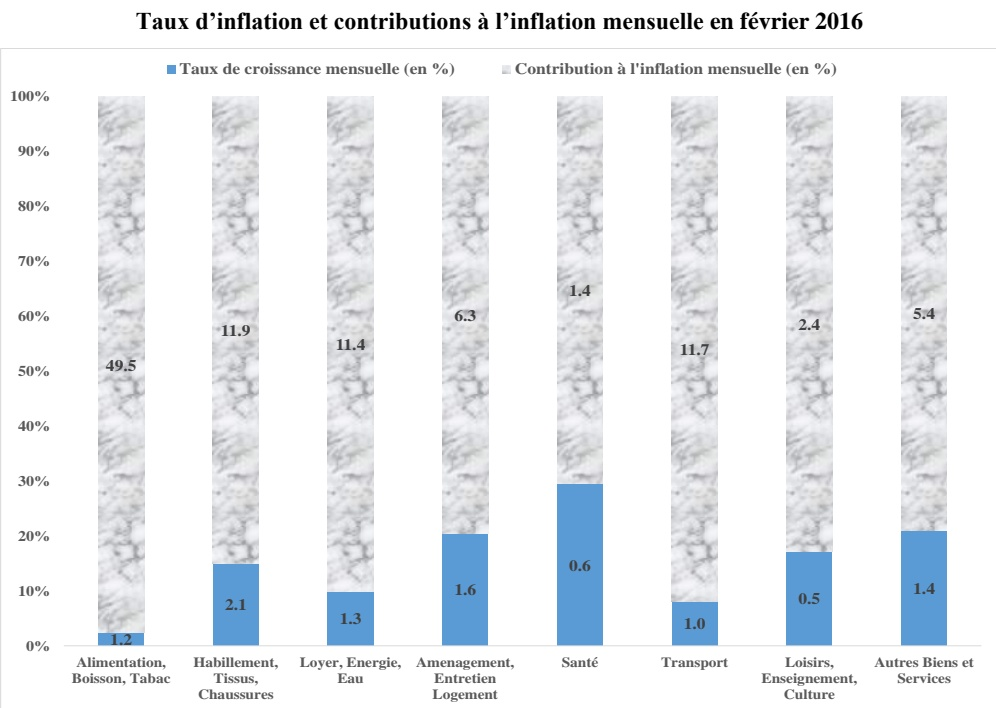

<!-- page 1 -->

Banque de la République d'Haïti

Note mensuelle d'inflation

Février 2016

<!-- page 2 -->

## Table des matières

I.- Introduction.....2
II.- Évolution de l'inflation courante en février 2016.....2
III.- Évolution de l'inflation sous-jacente.....3
IV.- Évolution de l'inflation selon l'origine des produits.....4
V.- Évolution des principales fonctions de consommation en février 2016.....5
VI.- Facteurs explicatifs de l'évolution de l'inflation en février 2016.....5
VII.- Prévisions d'inflation.....5

<!-- page 3 -->

### I. - Introduction

Cette note analyse l'évolution de l'Indice des Prix à la Consommation (IPC) en Haïti au cours du mois de février 2016. Elle apporte quelques éléments explicatifs permettant de comprendre les facteurs qui influencent l'évolution de l'inflation au cours de ce mois. Elle présente également les prévisions pour les trois prochains mois.

### II. - Évolution de l'inflation globale

En février 2016, l'inflation, mesurée par la variation de l'indice des prix à la consommation, s'est établie à 14,4 % en glissement annuel. Progressant de 1,1 point de pourcentage par rapport au mois précédent, l'inflation annuelle a poursuivi sa tendance à la hausse entamée depuis mai 2015. Ce taux d'inflation annuel est le niveau le plus élevé enregistré depuis octobre 2008 (18 %). Paralellement, sur une base mensuelle, le rythme de progression des prix a accéléré de 20 points de base à 1,3 %. L'inflation mensuelle cumulée sur les 5 premiers mois de l'exercice fiscal 2015-2016 a atteint 5,2 % contre 2,4 % au cours de la même période de l'exercice passé.

Graphique No. 1

Évolution de l'inflation mensuelle d'octobre 2014 à février 2016 (en %)

| Date | Value |
| --- | --- |
| Oct-14 | 0.6 |
| Nov-14 | 0.5 |
| Dec-14 | 0.6 |
| Jan-15 | 0.4 |
| Feb-15 | 0.3 |
| Mar-15 | 0.4 |
| Apr-15 | 0.5 |
| May-15 | 0.8 |
| Jun-15 | 1.9 |
| Jul-15 | 2.0 |
| Aug-15 | 1.5 |
| Sep-15 | 1.2 |
| Oct-15 | 1.0 |
| Nov-15 | 0.8 |
| Dec-15 | 1.1 |
| Jan-16 | 1.1 |
| Feb-16 | 1.3 |

<!-- page 4 -->

Évolution de l'inflation annuelle d'octobre 2014 à février 2016 (en %)

| Date | Value |
| --- | --- |
| Sep-14 | 5.3 |
| Oct-14 | 5.8 |
| Nov-14 | 6.2 |
| Dec-14 | 6.4 |
| Jan-15 | 6.6 |
| Feb-15 | 6.6 |
| Mar-15 | 6.4 |
| Apr-15 | 6.3 |
| May-15 | 6.6 |
| Jun-15 | 8.0 |
| Jul-15 | 9.3 |
| Aug-15 | 10.4 |
| Sep-15 | 11.3 |
| Oct-15 | 11.7 |
| Nov-15 | 12.0 |
| Dec-15 | 12.5 |
| Jan-16 | 13.3 |
| Feb-16 | 14.4 |

## Source : Calculs de la BRH

### III. - Évolution de l'inflation sous-jacente

Pour le quatrième mois consécutif, l'inflation globale a évolué au-dessus de l'inflation sous-jacente. En variation mensuelle, l'inflation sous-jacente s'est établie à 1,1 % en février 2016 contre 0,9 % en janvier 2016. En glissement annuel, elle s'est chiffrée à 13,8 % en février contre 13 % un mois auparavant. Cette évolution suggère que les prix des produits volatils seraient parmi les principaux facteurs susceptibles d'expliquer la croissance de l'IPC enregistrée au cours du mois sous étude.

<!-- page 5 -->

Inflation globale et inflation sous-jacente en variation mensuelle (en %)

| Period | Inflation globale | Inflation sous-jacente |
| --- | --- | --- |
| Feb-15 | 0.28 | 0.40 |
| Mar-15 | 0.45 | 0.10 |
| Apr-15 | 0.50 | 0.70 |
| May-15 | 0.85 | 0.80 |
| Jun-15 | 1.90 | 1.85 |
| Jul-15 | 2.00 | 1.95 |
| Aug-15 | 1.50 | 1.45 |
| Sep-15 | 1.25 | 1.40 |
| Oct-15 | 1.00 | 1.10 |
| Nov-15 | 0.75 | 0.65 |
| Dec-15 | 1.08 | 0.98 |
| Jan-16 | 1.08 | 0.95 |
| Feb-16 | 1.25 | 1.10 |

### IV. - Évolution de l'inflation selon l'origine des produits

Les rythmes de progression des indices des prix des produits locaux et importés se sont accélérés en février 2016. En glissement annuel comme en variation mensuelle, l'IPC des produits importés a crû plus rapidement que celui des produits locaux. En effet, le taux d'inflation annuel des produits locaux a atteint 15,5 % en glissement annuel (14,8 % en janvier 2016) et 1,2 % en rythme mensuel (1,1 % en janvier 2016). Celui des produits importés est passé à 11,6 % en glissement annuel (9,7 % en janvier 2016) et à 1,4 % en variation mensuelle (1,1 % au mois précédent).

### V. - Évolution des principales fonctions de consommation en février 2016

À l'exception des fonctions « Alimentation, boissons et tabac » et « Santé », l'accélération mensuelle du rythme de croissance de l'indice global résulte de l'augmentation de l'IPC de toutes les fonctions de consommation. En effet, le taux de croissance mensuel de l'indice de la fonction « Alimentation, boissons et tabac » a décéleré de 10 points de base à 1,2 % et celle de la fonction « Santé », a connu

<!-- page 6 -->

une décélération de 20 points de base à 0,6 %. Ces deux fonctions de consommation ont une contribution à l'inflation mensuelle d'environ 51 % au mois de février 2016.

Graphique No. 4 Taux d'inflation et contributions à l'inflation mensuelle en février 2016

### VI. - Facteurs explicatifs de l'évolution de l'inflation en février 2016

La faiblesse de la production agricole liée aux aléas climatiques et la dépréciation continue de la gourde sont les principaux facteurs susceptibles d'expliquer la hausse de l'inflation au mois de février 2016.

### 1. - Faiblesse de la production agricole

Selon les dernières perspectives de la Coordination Nationale de la Sécurité Alimentaire (CNSA), de longues périodes de sécheresse ont affecté les cultures depuis le début de l'année 2016, entraînant des pertes des cultures de première saison estimées à plus de 50 % par rapport à la moyenne. De plus, cette situation a contribué à une baisse de la demande de main-d'œuvre. Selon les observations de FEWS

<!-- page 7 -->

NET, les haricots et les tubercules dans les montagnes humides accusent des niveaux de production si faibles que la main-d'œuvre nécessaire à leur récolte a significativement été réduite pour cette saison. De plus, la demande de main-d'œuvre demeure importante dans la Vallée de l'Artibonite et dans les autres aires irriguées. Cette situation a entraîné une baisse de la production agricole et, par voie de conséquence, une hausse des prix des produits.

### 2. - Dépréciation continue de la gourde

Au cours du mois de février 2016, la dépréciation de la monnaie locale par rapport au dollar américain s'est poursuivie. En effet, le taux de change moyen est passé de 58,1564 gourdes en janvier 2016 à 60,46 gourdes pour un dollar en février 2016, soit une dépréciation de 4 % par rapport au mois antérieur.

Graphique No. 5

Taux de croissance mensuel du taux de change en moyenne mensuelle (en %)

| Date | Appréciation / Dépréciation |
| --- | --- |
| Sep-14 | 0.3 |
| Oct-14 | 0.4 |
| Nov-14 | 1.1 |
| Dec-14 | 1.2 |
| Jan-15 | 0.1 |
| Feb-15 | 0.5 |
| Mar-15 | 0.3 |
| Apr-15 | 0.3 |
| May-15 | 1.0 |
| Jun-15 | 3.5 |
| Jul-15 | 11.2 |
| Aug-15 | -5.3 |
| Sep-15 | -0.5 |
| Oct-15 | 2.0 |
| Nov-15 | 4.0 |
| Dec-15 | 2.9 |
| Jan-16 | 2.9 |
| Feb-16 | 4.0 |

### VII. -Prévisions d'inflation

Pour les trois prochains mois, les prévisions d'inflation du Service des Statistiques de la BRH augurent d'une évolution à la hausse du taux d'inflation en glissement annuel. En effet, l'inflation annuelle devrait se chiffrer à 15,6 % en mars, 15,9 % en avril et 15,7 % en mai 2016. Cependant, en variation mensuelle, les prévisions tablent sur des taux de 1,5 %, 0,7 % et 0,6 % pour mars, avril et mai 2016 respectivement.

<!-- page 8 -->

Graphique No. 6

Prévision de l'inflation annuelle (mars, avril et mai 2016)

|   | inflation estimée (inf) | Inflation en glissement annuel | inflation estimée (sup) |
| --- | --- | --- | --- |
| Feb-15 |   |   | 6.7 |
| Mar-15 |   |   | 6.5 |
| Apr-15 |   |   | 6.2 |
| May-15 |   |   | 6.8 |
| Jun-15 |   |   | 8.2 |
| Jul-15 |   |   | 9.8 |
| Aug-15 |   |   | 10.8 |
| Sep-15 |   |   | 11.3 |
| Oct-15 |   |   | 11.8 |
| Nov-15 |   |   | 12.3 |
| Dec-15 |   |   | 12.9 |
| Jan-16 |   |   | 13.8 |
| Feb-16 | 14.5 |   | 15.0 |
| Mar-16 | 14.8 | 15.6 | 16.4 |
| Apr-16 | 15.1 | 15.9 | 16.7 |
| May-16 | 14.9 | 15.7 | 16.5 |

Tableau #1

Indice des Prix à la Consommation (IPC) par postes de dépenses

Variation et Contribution à l'inflation mensuelle et annuelle : En février 2016

<table><tr><td></td><td>Indice des Prix à la Consommation (IPC)</td><td>Contribution à l'inflation (en %)</td></tr><tr><td>Mensuelle</td><td>Annuelle</td></tr><tr><td>Poste</td><td>Pondération (en %)</td><td>Feb-15</td><td>Jan-16</td><td>Feb-16</td><td>Feb-16</td><td>Feb-16</td></tr><tr><td>Indice Général</td><td>226.2</td><td>255.5</td><td>258.7</td><td>100.0</td><td>100.0</td></tr><tr><td>Alimentation, boisson et tabac</td><td>50.35</td><td>234</td><td>268.4</td><td>271.6</td><td>49.5</td><td>57.8</td></tr><tr><td>Habillement, tissus et chaus.</td><td>6.86</td><td>231.2</td><td>275.6</td><td>281.4</td><td>11.9</td><td>10.6</td></tr><tr><td>Loyer, énergie et eau</td><td>11.05</td><td>268.7</td><td>295</td><td>298.7</td><td>11.4</td><td>8.8</td></tr><tr><td>Aménag. et entret. du logem</td><td>4.7</td><td>229.4</td><td>259.3</td><td>263.5</td><td>6.3</td><td>5.0</td></tr><tr><td>Santé</td><td>2.9</td><td>240.9</td><td>265.6</td><td>267.2</td><td>1.4</td><td>2.3</td></tr><tr><td>Transport</td><td>13.74</td><td>161.1</td><td>165.3</td><td>167</td><td>11.7</td><td>3.6</td></tr><tr><td>Lois., sp. Ens., Clt.</td><td>5.84</td><td>237.5</td><td>266.3</td><td>267.6</td><td>2.4</td><td>5.3</td></tr><tr><td>Aut. biens & serv.</td><td>4.56</td><td>198.7</td><td>236.1</td><td>239.5</td><td>5.4</td><td>6.7</td></tr></table>

<!-- page 9 -->

Glossaire

<table><tr><td>Glossaire</td></tr><tr><td>Variation mensuelle</td><td>: Variation par rapport au mois précédent.</td></tr><tr><td>Glissement annuel</td><td>: Variation par rapport au même mois de l'année antérieure.</td></tr><tr><td>Inflation</td><td>: Mouvement persistant à la hausse du niveau général des prix.</td></tr><tr><td>Désinflation</td><td>: Talentissement de la croissance des prix.</td></tr><tr><td>Déflation</td><td>: Baisse du niveau général des prix associée à une contraction de la masse monétaire et du crédit.</td></tr><tr><td>Inflation sous-jacente</td><td>: Tendance de long terme des prix, tout en excluant la volatilité, les mouvements saisonniers, conjoncturels, et les chocs qui affectent les composantes du panier considéré.</td></tr><tr><td>Région Nord</td><td>: Elle couvre les départementes du Nord, Nord-Est et Nord-Ouest.</td></tr><tr><td>Région Sud</td><td>: Elle comprend les départementes du Sud de la Grand-Anse et des Nippes.</td></tr><tr><td>Région Reste Ouest</td><td>: Y sont incluses les départementes du Sud-Est et de l'Ouest à l'exception de l'aire métropolitaine</td></tr><tr><td>Région Transversale</td><td>: Elle regroupe les départementes du Centre et de l'Artibonite.</td></tr><tr><td>Aire Métropolitaine</td><td>: Elle contient les villes de Port-au-Prince, de Delmas, de Pétion-Ville, de Carrefour et de Croix des Bouquets.</td></tr></table>
