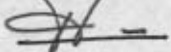

<!-- page 1 -->

# AUX AGENTS DE CHANGE

Conformément au paragraphe premier de l'article 2.1.2 de la loi du 21 février 2001 relative au blanchiment des avoirs provenant du trafic illicite de la drogue et d'autres infractions graves, pour tenir compte de l'évolution du cours de la gourde par rapport aux principales devises étrangères, la Banque de la République d'Haïti (BRH) modifie le seuil établi par la loi ainsi qu'il suit :

Les agents de change sont tenus de recueillir de tous clients, réguliers ou occasionnels, des déclarations de transaction en espèces ou au porteur pour tout montant supérieur ou égal à QUATRE CENT MILLE GOURDES (Gdes 400,000.00) ou son équivalent en monnaies étrangères.

Les formulaires de déclaration de transaction des clients annexés à la présente circulaire devront être transmis à l'Unité Centrale de Renseignements Financier (UCREF) au plus tard trois (3) jours ouvrables pour les agents de change se trouvant dans la zone métropolitaine et cinq (5) jours ouvrables pour les agents de change se trouvant en provinces, après qu'ils ont été rempues. Les copies desdits formulaires doivent être convenablement répertoriées et disponibles pour inspection par la Banque de la République d'Haïti.

En cas de non respect de la présente circulaire, les agents de change s'exposent à des pénalités et à des mesures administratives, ce sans préjudice des autres sanctions dont peut être frappée la personne fautive, en vertu de la loi du 21 février 2001.

## a) Pénalité pour non disponibilité de renseignements pour inspection

A défaut de fournir les copies des formulaires, les agents de change sont assujettis à une pénalité de vingt mille gourdes (Gdes. 20,000.⁰⁰) par jour d'infraction.

La période de pénalité s'étend du jour de l'infraction (demande de renseignements par la BRH) jusqu'à celui où les renseignements sont mis à la disposition des agents de la BRH.

## b) Pénalité pour absence de formulaire

A défaut de remplir le formulaire de transaction, les agents de change encourent une amende de cent mille gourdes (Gdes. 100,000.⁰⁰) par jour d'infraction.

La période de pénalité s'étend du jour où une transaction aurait du faire l'objet d'un report auprès de l'UCREF au jour où la BRH constate l'infraction.

<!-- page 2 -->

## c) Pénalité pour retard de transmission de formulaire

En cas de retard de transmission d'un formulaire, les agents de change encourent une pénalité de cinquante mille gourdes (Gdes. 50,000. $ ^{00} $) par jour d'infraction.

La période de pénalité s'étend du jour où un formulaire aurait du être transmis à l'UCREF au jour où cette dernière le reçoit.

## d) Pénalité pour non transmission de formulaire

En cas de non transmission de formulaire de transactions dûment rempli à l'UCREF, les agents de change encourent une pénalité de cent mille gourdes (Gdes. 100,000.⁰⁰) par jour d'infraction.

La période de pénalité s'étend du jour où un formulaire aurait dû être transmis au jour où la BRH constate l'infraction.

La présente circulaire entre en vigueur le 3 novembre 2008 et remplace la circulaire No 95 du 1 $ ^{er} $ août 2000.

Port-au-Prince, le 30 octobre 2008

Philippe W. Lahens

Vice-Gouverneur

p.j.: Formulaire de déclaration de transactions.

<!-- page 3 -->

# FORMULAIRE DE DECLARATION DE TRANSACTIONS

La circulaire 95-1B de la BRH exige que les agents de change recueillent les informations sur la transaction.

<table><tr><td>SECTION A- L identité de l'Agent de Change</td></tr><tr><td>A1. Nom__________</td><td>A2. Prénom__________</td></tr><tr><td>A.3 adresse__________</td></tr><tr><td>A.4 Date de la Transaction : (jj/mm/aa) ______/______/______</td><td>A.5 No de Patente__________</td></tr><tr><td>A.6 No de téléphone__________</td></tr><tr><td>SECTION B - LA TRANSACTION</td></tr><tr><td>B.1 Type de transaction</td><td>Achat de devise ☐\nVente de devise ☐</td></tr><tr><td>B.3 Instrument de la transaction</td></tr><tr><td>Espèces ☐</td><td>Montant__________</td></tr><tr><td>Chèque ☐</td><td>Montant__________</td></tr><tr><td>Autres__________</td></tr><tr><td>B. 4 Montant total de la transaction :</td></tr><tr><td>B. 5 Monnaie : GDES ☐</td><td>USD ☐</td><td>EURO ☐</td><td>PESO ☐</td></tr><tr><td>SECTION C- L'EXCECUTANT</td></tr><tr><td>C.1. Nom :</td><td>Prénom :</td></tr><tr><td>C.2 Type d'identification :</td></tr><tr><td>CIN ☐</td><td>NIF ☐</td><td>Passeport ☐</td><td>Permis de conduire ☐</td></tr><tr><td>Pays__________</td><td>Autres ☐</td></tr><tr><td>C.3. Numéro d'identification__________</td></tr><tr><td>C.4. Adresse de l'exécutant</td></tr><tr><td>C.5. Numéro de téléphone</td></tr><tr><td>Portable\nRésidence\nBureau</td></tr></table>

<!-- page 4 -->

<table><tr><td>SECTION D – BENEFICIAIRE DE LA TRANSACTION
A remplir au cas où le destinataire n'est pas le bénéficiaire de la transaction</td></tr><tr><td>D.1. Personne Morale ☐</td><td>D.2. Personne Physique ☐</td></tr><tr><td>Nom
Statut Juridique
Secteur d'activité
Adresse
Téléphone
Nom du propriétaire
Téléphone</td><td>Nom
Prénom
Adresse
Téléphone
Profession
NIF</td></tr><tr><td>SECTION E – LA PROVENANCE DES FONDS
Cette section doit être toujours remplile</td></tr><tr><td>E.1. Je soussigné (e) déclare que les fonds objet de la présente transaction proviennent de : ________________ Je m'engage d'ores et déjà à fournir toute les fois où ceci sera sollicité, la preuve de la provenance desdits fonds.
Fait à Port-au-Prince, ce ________________
Signature</td></tr><tr><td>SECTION F – ESPACE RESERVE A L'INSTITUTION FINANCIERE</td></tr><tr><td>F.1. Initié par :
F.2. Autorise par :
F.3 Transaction acceptée
F.4 Transaction refusée
Motif</td></tr><tr><td>G.5 Remarques :</td></tr></table>
