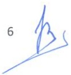

<!-- page 1 -->

# AUX BANQUES ET MAISONS DE TRANSFERT

Conformément aux articles 2 et 3 du décret du 5 juin 2020 modifiant certaines dispositions du décret du 6 juillet 1989 sur les maisons de transfert, à l'article 161 de la loi du 14 mai 2012 sur les banques et autres institutions financières et à l'article 45 du décret du 25 novembre 2020 sur les intermédiaires de change, la présente circulaire définit les normes relatives aux transferts de fonds internationaux sans contrepartie.

### 1. Des modalités de transferts de fonds

#### 1.1. Des transferts reçus

Les banques et les maisons de transfert sont tenues de payer les transferts internationaux en gourdes dans tous leurs points de service (succursale, agence, bureau, kiosque) ou sur un instrument de paiement. En aucun cas, le taux pratiqué pour payer les transferts ne peut être inférieur au taux de référence calculé par la BRH et ne peut dépasser la moyenne entre le taux de référence et le taux moyen d'acquisition.

Les transferts de fonds peuvent également s'effectuer sur les comptes d'épargne libellés en dollars américains des bénéficiaires. Toutefois, les maisons de transfert ne peuvent effectuer des transferts sur compte pour toute somme égale ou supérieure à mille dollars américains (USD 1,000.00). Dans ce cas, l'expéditeur doit effectuer un virement via son institution bancaire.

Lors du paiement d'un transfert, les banques et les maisons de transferts doivent identifier leur client habituel ou occasionnel, conformément aux dispositions des lois et règlements en vigueur, et remettre au client un reçu de la transaction. Le reçu doit contenir, entre autres, le montant et la monnaie dans laquelle le transfert a été payé, le taux de change de la transaction, le nom de la banque ou de la maison de transfert ainsi que l'adresse du point de service ayant effectué l'opération.

Les maisons de transfert sont tenues d'afficher visiblement dans leurs locaux le taux pratiqué par leur institution financière. Elles doivent s'assurer également que ce taux est affiché dans un endroit visible dans tous les points de service gérés par des sous-agents.

#### 1.2. Des transferts expédiés

Les transferts expédiés doivent être effectués conformément aux procédures internes des banques et des maisons de transferts, et aux lois et règlements en vigueur.

<!-- page 2 -->

#### 1.3. De la gestion des ressources

Les opérateurs de transfert opérant à l'étranger sont tenus de remettre en dollars américains à leurs agents autorisés en Haïti (banques et maisons de transfert) ou à leurs filiales en Haïti les fonds reçus des expéditeurs.

La contrepartie dollar des transferts payés en gourdes est répartie, comme suit :

a) Zéro pourcent (0%) à la BRH ;

b) Soixante-dix pourcent (70%), sans majoration de coûts, à une ou plusieurs institutions financières du choix de la banque ou de la maison de transfert dont les comptes en gourdes seront crédités au taux pratiqué par l'institution financière pour le paiement des transferts ;

c) Trente pourcent (30%) à l'agent autorisé (banques et maisons de transfert).

La BRH, en fonction de ses besoins, se réserve le droit d'acquérir auprès des banques, des maisons de transfert et de tout autre intermédiaire de change agréé un montant ne dépassant pas vingt-cinq centimes (USD 0.25) sur tout dollar acheté, à partir des transferts ou d'autres sources, par ces institutions financières. La BRH en notifiera par avis les institutions financières concernées.

En outre, les banques ne peuvent vendre à leurs apparentés (personnes physiques ou morales) plus de 10%, incluant leurs besoins internes, des fonds provenant de la remise de la contrepartie dollar des transferts payés en gourdes par les maisons de transferts.

### 1.4 Modalités de remboursement aux sous-agents

En sus des commissions et autres frais prévus entre les parties, les banques et maisons de transfert doivent rembourser à leurs sous-agents le montant des transferts payés selon la modalité suivante :

- Soixante-dix pourcent (70%) en gourdes, et

- Trente pourcent (30%) en dollars américains.

Les sous-agents sont tenus de négocier les 30% reçus en dollars américains exclusivement avec un intermédiaire de change (banque, bureau de change et toute autre entité désignée par la BRH).

### 2. Des principes liés au service de transfert de fonds

Les banques et les maisons de transfert doivent signer des contrats de représentation avec les sous-agents, à qui elles permettent d'effectuer, pour leur compte et sous leur entière responsabilité, l'envoi de fonds reçu de la clientèle ou le paiement de transferts de fonds.

2

<!-- page 3 -->

Ces contrats doivent préciser entre autres les opérations que les sous-agents peuvent réaliser pour le compte de la banque ou de la maison de transfert, les responsabilités des parties, les modalités opérationnelles relatives au paiement des transferts et à l'envoi de fonds.

Lors de la conclusion des contrats de représentation pour des services de transfert avec des sous-agents, les banques et les maisons de transfert doivent :

a) s'assurer de leur honorabilité et de leur intégrité ;

b) établir leur profil de risque en tenant compte entre autres du secteur d'activités, de leur localisation géographique, de leur chiffre d'affaires mensuel ;

c) contrôler quotidiennement les opérations de transfert qu'ils effectuent en relation avec leur profil de risque ;

d) assumer entièrement la responsabilité de leurs actions ou omissions, tant qu'elles se rapportent aux services de transfert fournis par ledit sous-agent ;

e) s'assurer du respect des règles de conformité relatives à la lutte contre le blanchiment de capitaux et le financement du terrorisme ;

f) contribuer à leur formation notamment en matière de lutte contre le blanchiment des capitaux et le financement du terrorisme.

Les entreprises commerciales fonctionnant dans le secteur des jeux de hasard notamment les loteries, borlettes, casinos, ne peuvent en aucun cas être des sous-agents d'aucune institution financière.

Les sous-agents doivent faire clairement apparaître au niveau de leurs installations commerciales leur qualité et le nom d'une ou des institutions financières pour lesquelles ils opèrent. Ils doivent également afficher de manière visible et lisible à leurs guichets les conditions tarifaires appliquées à la clientèle.

Les banques et les maisons de transfert sont responsables, vis-à-vis des clients, de leur réseau de sous-agents, nonobstant toute disposition contractuelle contraire.

### 3. Du contrôle des sous-agents

Les banques et les maisons de transfert doivent établir pour chaque sous-agent la capacité journalière de paiement de transfert. Elles doivent s'assurer que le montant des transactions effectuées par lesdits sous-agents correspond à leur capacité de paiement.

Les banques et les maisons de transfert doivent déclarer à la BRH le montant total des transferts payés par les sous-agents.

Les banques et les maisons de transfert sont tenues de faire appliquer la présente circulaire par leurs sous-agents. En cas de non-respect par un sous-agent des dispositions de la présente circulaire, elles doivent faire parvenir à la BRH trimestriellement la liste des contrevenants et les mesures prises à leur encontre. En cas de résiliation de contrat, la BRH doit en être informée ainsi que des motifs au plus tard trois (3) jours ouvrables à compter de la date de prise d'effet de la décision. La BRH en avise les banques et les maisons de transfert.

<!-- page 4 -->

Aucun sous-agent dont le contrat a été résilié pour violation des dispositions de la présente circulaire ne peut agir à titre de représentant d'une institution financière pour des services de transfert de fonds.

### 4. Rapport

Les banques et les maisons de transfert sont tenues de compléter et faire parvenir à la BRH, de manière électronique selon le format prédéfini via le logiciel BSA ou via l'utilisation des Interfaces de Programmation d'Application (API), un rapport trimestriel contenant la liste de tous leurs points de services incluant les informations ci-après concernant les représentants : nom, numéro d'identification fiscale (NIF), adresse ou localisation géographique, capacité de paiement mensuel de transfert, volume de transfert payé mensuellement. Ce rapport doit être transmis à la BRH au plus tard quinze (15) jours après la fin du trimestre.

### 5. Sanctions

En cas de non-respect des obligations définies dans la présente circulaire, l'institution concernée s'expose aux pénalités suivantes :

## a) Fiabilité de l'information

En tout temps, les montants déclarés dans le formulaire prévu en annexe doivent être ceux apparaissant dans les livres comptables de l'institution. Si les montants ne concordent pas, la BRH peut, après enquête sur les circonstances et la nature de la violation, imposer une pénalité de 50% de la différence entre les montants déclarés et les montants apparaissant aux livres comptables.

## b) Retard de production de rapport

A défaut de fournir, dans le délai requis, le rapport prévu à la section 4 de la présente circulaire, les institutions concernées encourent une pénalité de cinquante mille gourdes (HTG 50,000.00) par jour d'infraction. La période de pénalité s'étend du jour où le rapport aurait dû être transmis à la BRH au jour où celle-ci les reçoit.

## c) Autres

Pour toute autre infraction constatée, la BRH demandera la cessation immédiate de la pratique incriminée, prendra des sanctions administratives notamment une lettre d'avertissement à l'encontre de l'institution fautive et pourra appliquer une amendeda de deux cent cinquante mille gourdes (HTG 250,000.00) pour chaque fait relevé.

### 6. Modification des seuils

Les seuils et/ou pourcentages indiqués dans la présente circulaire, à l'exception des sanctions administratives, peuvent être modifiés par avis par la BRH, en fonction de la situation du marché.

<!-- page 5 -->

### 7. Abrogation et entrée en vigueur

La présente circulaire abroge la circulaire 114-2 du 18 septembre 2020. Elle entre en vigueur le 5 septembre 2022.

Port-au-Prince, le 23 août 2022.

Jean Baden Dubois

<!-- page 6 -->

# ANNEXE CIRCULAIRE 114-3

# FORMULAIRE D'IDENTIFICATION ET DE DECLARATION DE TRANSACTIONS DE PAIEMENT DES SOUS-AGENTS

# Rapport trimestriel

Nom de l'institution : _____

Période : Du _____ au _____

| Nom du Sous-Agents | NIF du représentant $ ^{{*}} $ | Localisation | Capacité mensuelle de paiement (en HTG) | Volume de paiement Mois 1 | Volume de paiement Mois 2 | Volume de paiement Mois 3 | Volume moyen mensuel du trimestre |
| --- | --- | --- | --- | --- | --- | --- | --- |
|   |   |   |   |   |   |   |   |
|   |   |   |   |   |   |   |   |
|   |   |   |   |   |   |   |   |
|   |   |   |   |   |   |   |   |
|   |   |   |   |   |   |   |   |
|   |   |   |   |   |   |   |   |
|   |   |   |   |   |   |   |   |

*Celui qui a signé le contrat avec l'Agent autorisé

