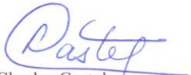

<!-- page 1 -->

## LETTRE-CIRCULAIRE AUX BANQUES

Conformément aux alinéas 5 et 13 de l'article 83 de la loi du 14 mai 2012 sur les banques et autres institutions financières ;

Considérant les risques de détérioration du portefeuille de crédit des établissements bancaires et de leurs filiales ;

Considérant qu'il est du devoir de la Banque de la République d'Haïti de sauvegarder la stabilité et l'équilibre du système bancaire et financier par l'adoption de mesures appropriées ;

La Banque de la République d'Haïti avise tous les établissements bancaires et leurs filiales qu'à partir du 6 juillet 2015, et ce, jusqu'à nouvel ordre, tous les nouveaux crédits à la consommation doivent être octroyés exclusivement en gourdes.

Tout contrevenant à la présente lettre-circulaire sera passible d'une pénalité allant jusqu'à 25% du crédit accordé en dehors de cette disposition.

Les dispositions de la circulaire 101-2 sur les modalités de facturation des opérations effectuées à partir des cartes de paiement demeurent en vigueur.

Port-au-Prince, le  $ 1^{er} $ juillet 2015

Charles Castel

Gouverneur
