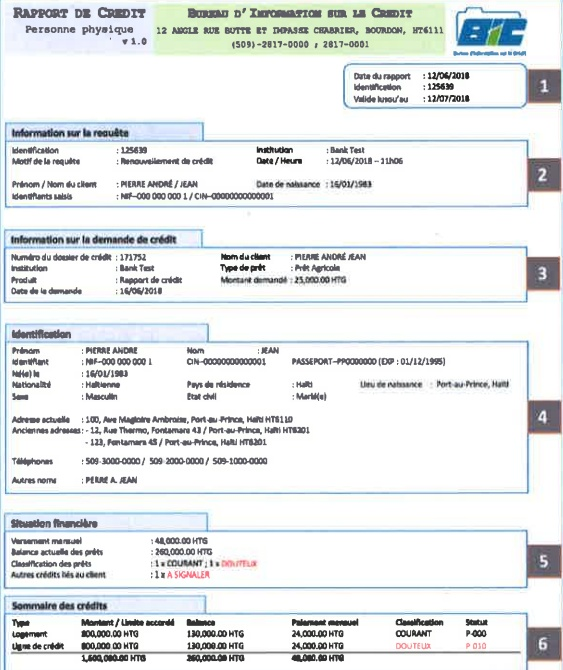
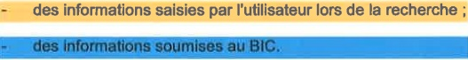
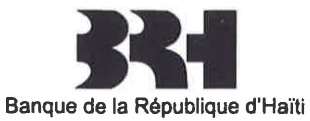

<!-- page 1 -->

## Comment lire le rapport de crédit ?

Le rapport de crédit est constitué d'un ensemble d'informations regroupées en plusieurs segments. Ci-dessous un extrait de la première page d'un rapport type pour une personne physique. Le modèle de rapport de crédit des entreprises est identique à l'exception de deux segments: « information sur la requête » [2] et « identification » [4].

des informations saisies par l'utilisateur lors de la recherche ;

Les principales informations affichées dans le rapport de crédit proviennent :

des informations soumises au BIC.

## [1] Identification du rapport

Ces informations permettent d'identifier le rapport en question : la date à laquelle il a été généré, le numéro d'identification du rapport et la date d'expiration du rapport. Ces informations sont importantes surtout dans la prise en charge des contestations ou pour tout suivi relatif au rapport.

Tout rapport de crédit a une durée de validité d'un mois.

## [2] Information sur la requête

- Institution : L'institution financière ayant sollicité le rapport ;

- Motif de la requête : Cette information indique la raison pour laquelle le rapport de crédit a été sollicité (octroi, renouvellement, suivi, prolongation de crédit, etc.) ;

- Identifiants saisis : Le(s) numéro(s) de pièce d'identification saisis par l'utilisateur au moment de solliciter le rapport de crédit.

Pour une personne physique, le champ « Prénom / Nom du client » affiche le(s) prénom(s) et le nom du client tels que saisis par l'utilisateur.

Pour une personne morale, le champ « Nom » affiche Le nom de l'entreprise tel que saisi par l'utilisateur.

## [3] Information sur la demande de crédit

Cette section affiche les informations fournies par l'institution financière sur la demande de crédit lors de la recherche. Elle contient entre autres :

- le montant demandé : Le montant du crédit demandé par le client le cas échéant.

- le numéro du dossier ou de demande de prêt ;

- le type de prêt : Le type de crédit sollicité par le client ;

## [4] Identification

Les informations affichées sur le client dans ce segment peuvent être différentes de celles saisies par l'utilisateur. Elles proviennent des données transmises au BIC par les institutions financières de la place. Pour les personnes physiques, les principales informations signalétiques sont : prénom, nom, sexe, état civil, identifiants, date et lieu de naissance et adresses. D'autres informations telles que secteur d'activité, forme juridique sont affichées dans le cas d'une personne morale.

- Adresse actuelle : La plus récente adresse du client telle que rapportée par les institutions financières ;

- Anciennes adresses : Toutes les autres adresses contenues dans la base de données concernant ce client ;

- Autres noms : Tous les noms sous lesquels le client est enregistré ;

- Secteur d'activité : Secteur d'activité de l'entreprise.

Avant toute analyse des informations financières contenues dans le rapport, il est important de s'assurer que les informations affichées ici sont cohérentes et correspondent au client en question. En cas de contestation par le client ou d'éventuelle incohérence constatée, utilisez le module de gestion des contestations du logiciel pour en informer le BIC.

## [S] Situation financière

Ce segment présente un résumé de la situation financière du client et indique tout autre crédit auquel il serait lié (garant ou avaliseur).

- Versement mensuel : Une estimation du versement mensuel total calculée à partir des récentes informations sur les obligations de paiement ;

- Balance actuelle des prêts : Le montant total des encours du client ;

- Classification des prêts : La classification des prêts octroyés au client. Ces crédits sont listés dans le segment suivant « Sommaire des crédits » [6].

- Autres crédits liés au client : La classification des autres crédits auxquels le client est lié (ex crédits garantis par le client). Ces crédits, le cas échéant, seront listés dans le segment « Autres crédits liés au client » [7].

## [6] Sommaire des crédits

Ce segment affiche les principales informations sur chaque crédit octroyé au client.

- Type : Le type de crédit (prêt à terme, carte de crédit, ligne de crédit, etc...);

- Type : Le type de credit (pret a terme, carte de credit, ligne de credit, etc...);

- Montant / Limite accordé : Le montant du crédit qui a été autorisé. Il peut être différent du montant effectivement décaissé ;

- Paiement mensuel : Une estimation du versement mensuel obtenue à partir des récentes informations sur les obligations de paiement ;

- Balance : L'encours du crédit ;

- Classification : Cette information présente la classification du crédit telle que soumise au BIC par l'institution financière concernée. La définition des différentes classifications est présentée dans la circulaire 87 de la BRH.

- Statut : Le code indiquant la situation actuelle du crédit. La définition des codes se trouve à la dernière page du rapport dans le segment « Légends et annotations ».

<!-- page 2 -->

## Comment lire le rapport de crédit ?

<table><tr><td>Autres crédits liés au client</td></tr><tr><td>Responsabilité</td><td>Type</td><td>Montant/Unitité accordé</td><td>Balance</td><td>Classification</td><td>Statut</td><td>Appliquant</td></tr><tr><td>Avisable ou parenté à la con仟promotion</td><td>20,548,03 USD</td><td>2,828,12 USD</td><td>A SIGNALER</td><td>0-023</td><td>Pierre MICHEL</td></tr><tr><td>Crédits et l'historique des paiements</td></tr><tr><td>CREDIT 1</td></tr><tr><td>Type de crédit :</td><td>Prêt au logement</td><td>Type deอาติлаire : Principal</td><td>Nombre de jours de grâce :</td></tr><tr><td>Date d'octobre :</td><td>01/01/2008</td><td>Date de fermeture : 01/01/2028</td><td>Friquence de paiement :</td><td>0-</td></tr><tr><td>Métroire du crédit :</td><td>00:00:00/00-HTG</td><td>Responsabilité :</td><td>Classification :</td><td>Mensuel :</td></tr><tr><td>Garnance :</td><td>Départ à Terme (Ref-15548976) / Obligation (Ref-021609482134)</td><td>Courant :</td></tr><tr><td>Statut du crédit :</td><td>P-000 = Normal :</td></tr><tr><td>Balance :</td><td>150,000.00 HTG :</td></tr><tr><td>Historiques des paiements :</td></tr><tr><td>Jeauvis</td><td>Névis</td><td>Nera</td><td>Avril</td><td>Jés</td><td>Jeau</td><td>Jnille</td><td>Adut</td><td>Sept.</td><td>Dot.</td><td>Nova</td></tr><tr><td>2017</td><td>OK</td><td>OK</td><td>OK</td><td>OK</td><td>OK</td><td>OK</td><td>OK</td><td>OK</td><td>OK</td><td>OK</td></tr><tr><td>Remarque : (Aucune remarque)</td></tr><tr><td>Créduisés retournés</td></tr><tr><td>Numéro de complete</td><td>Numéro du chèque</td><td>Monel</td><td>Date retour</td></tr><tr><td>000000000001</td><td>00123</td><td>1,500.00 USD</td><td>03/09/2017</td></tr><tr><td>000000000001</td><td>00134</td><td>2,000.00 USD</td><td>4/02/2017</td></tr><tr><td>Interdit de chèouler</td></tr><tr><td>Statut actuel :</td><td>interdit de chèucler</td></tr><tr><td>Date d'interdiction : 01-01-2018</td><td>Date de réabilitation : 01-01-2018</td></tr><tr><td>Historiques des interdictions de chèuclers (sur les cins dernières années) :</td></tr><tr><td>- interdition : 01-01-2018</td><td>établissement : 01-01-2018</td></tr><tr><td>- interdition : 01-01-2013</td><td>établissement : 01-01-2014</td></tr><tr><td>Historique des requetes</td></tr><tr><td>Date de l'interrogation</td><td>Types de crédit</td><td>Type de demandateur</td><td>Mortant demandé</td><td>Mold</td></tr><tr><td>03/09/2010</td><td>Pêts à la concrétation</td><td>Précipel</td><td>100,000 USD</td><td>Darréda de crédit</td></tr><tr><td>03/02/2010</td><td></td><td>Pêts à la concrétation</td><td></td><td>100,000 HTG</td><td>Résultation</td></tr><tr><td>13/05/2010</td><td></td><td>Pêts à la concrétation</td><td></td><td>100,000 HTG</td><td>Résultation</td></tr><tr><td>01/06/2010</td><td></td><td>Pêts à l'épaule</td><td></td><td>100,000 HTG</td><td>Darréda de crédit</td></tr><tr><td>Lésence et annotations</td></tr><tr><td>Segmentation historique des paiements :</td></tr><tr><td>CIC : Paliement sans défait</td><td>00 : Aucune information rapportée pour ce mois</td><td>01 : Fardard de moins de 31 jours</td></tr><tr><td>02 : Fardard de 51 à 60 jours</td><td>03 : Fardard de 61 à 80 jours</td><td>04 : Fardard de 80 à 170 jours</td></tr><tr><td>05 : Fardard de 280 à 260 jours</td><td>06 : Fardard de 272 à 350 jours</td><td>07 : Fardard de 360 jours ou plus</td></tr><tr><td>Code sur le statut du crédit :</td></tr><tr><td>P-008 : normal</td><td>P-010 : Suspendu car le compte est en défund</td></tr></table>

Ce segment affiche les informations détaillées par crédit octroyé au client :

- Nombre de jours de grâce : Il s'agit de la période de grâce, i.e. le nombre de jours avant le premier amortissement du crédit ;

## [8] Crédits et historique des paiements

## [7] Autres crédits liés aux clients

Ce segment affiche les crédits pour lesquels le client s'est porté garant ou est un utilisateur autorisé*.

- Date de fermeture : Il s'agit de la date de maturité du crédit ou de fermeture si celui-ci est fermé ;

- Montant du crédit : Le montant du crédit qui a été autorisé. Il peut être différent du montant effectivement décaissé ;

- Responsabilité : Cette information renseigne sur la responsabilité du client envers le crédit (individuelle, jointe, solidaire, avaliseur ou garant, etc.) ;

- Garantie : La liste des garanties ou suretés associées à ce crédit ;

- Statut du crédit : Le code, la description de la situation actuelle du crédit ainsi que la date à laquelle cette information a été rapportée ;

- Historique des paiements : Pour chaque mois, un code indique si le paiement a été effectué sans défaut ou en retard. Dans le cas illustré dans cet exemplaire, le mois de février 2017 est renseigné par le code « 01 ». Ce dernier signifie que le paiement dû en février a été versé avec un retard de moins de 31 jours. Le segment légendes du rapport définit les différents codes de retard.

## [9] Chèques retournés

Ce segment affiche la liste des chèques retournés pour insuffisance de fonds sur les 12 derniers mois.

## [10] Interdit de chéquier

Ce segment renseigne sur le statut actuel et historique du client en termes d'interdiction de chéquier ainsi que les dates de réhabilitation.

- Situation actuelle : Ce champ affiche « OK » si le client n'est pas interdit de chéquier. Autrement, le libellé « Interdit de chéquier » est affiché ;

- Historique des interdictions de chéquiers : Cette liste présente l'historique des interdictions de chéquiers sur une période de 24 mois.

## [11] Historique des requêtes

Ce segment affiche la liste des précédentes requêtes de rapport de crédit effectuées par les institutions financières sur ce client. Pour chaque requête, le système affiche : la date de l'interrogation, le type de crédit, le montant sollicité, le type de demandeur ou responsabilité envers le crédit ainsi que le motif de la requête.

* Utilisateur autorisé : Le client est uniquement un utilisateur autorisé. Il ne s'est pas engagé à rembourser le crédit.

Bureau d'Information sur le Crédit (BIC)

12, Angle rue Butte et impasse Chabrier, Bourdon, HT6111

Téléphones : 2817-0000 / 2817-0001

Web : http://www.brh.ht/bic.html

Bureau d'Information sur le Crédit

Banque de la République d'Haïti

## Guide de lecture du rapport de crédit

Ce document constitue un guide pour l'interprétation du contenu d'un rapport de crédit et est adressé aux utilisateurs du logiciel du Bureau d'Information sur le Crédit (BIC).

Le modèle de rapport de crédit de novembre 2018 a été utilisé dans le cadre de la rédaction de ce document. Pour tout changement majeur introduit au niveau du rapport de crédit, une nouvelle version du guide sera publiée.

Novembre 2018
