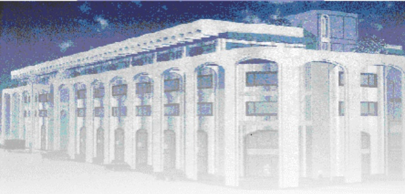

<!-- page 1 -->

Banque de la République d'Haïti

Note mensuelle d'inflation

Novembre 2022

<!-- page 2 -->

## Table des matières

I.- Introduction.....2
II.- Évolution de l'inflation courante en novembre 2022 .....2
III.- Évolution des principales fonctions de consommation en novembre 2022 .....3
IV.- Évolution de l'inflation selon l'origine des produits et les régions géographiques du pays.....4
V.- Facteurs explicatifs de l'évolution de l'inflation en rythme mensuel .....5
VI.- Prévisions d'inflation .....6

<!-- page 3 -->

### I. - Introduction

Cette note analyse l'évolution de l'indice des prix à la consommation (IPC) en Haïti au cours du mois de novembre 2022. Elle apporte quelques éléments explicatifs permettant de comprendre les facteurs qui influencent la variation mensuelle de l'IPC.

### II. - Évolution de l'inflation courante en novembre 2022

En novembre 2022, l'indice des prix à la consommation (IPC) a été estimé à 287,4 contre 277,7 le mois précédent et 197,5 un an plus tôt, ce qui indique une décélération tant en variation mensuelle qu'en glissement annuel. En rythme mensuel, l'inflation a connu un repli de 7,5 points de pourcentage par rapport au mois d'octobre pour se porter à 3,5 % en novembre 2022. Sur base annuelle, le taux d'inflation a ralenti en passant de 47,2 % en octobre 2022 à 45,5 % au cours du mois sous revue.

D’octobre 2022 à novembre 2022, l’inflation mensuelle s’est accrue de 7,2 % contre 4,6 % au cours de la même période de l’exercice fiscal antérieur. Ce taux d’inflation est supérieur à celui de nos principaux partenaires commerciaux. En effet, au cours de la période sous revue, c’est 0,37 % pour la République Dominicaine et 0,25 % pour les États-Unis. Cumulé sur l’exercice en cours, le taux d’inflation mensuel s’est porté à 14,5 %, soit 5,2 points de pourcentage de plus que le niveau (9,3 %) enregistré au cours du même intervalle un an auparavant.

Graphique 1. Évolution de l'inflation annuelle de novembre 2020 à novembre 2022 (en %)

| Month | Inflation Annuelle | Inflation Mansuelle |
| --- | --- | --- |
| Nov/20 | 20.5 | 8.0 |
| Dec/20 | 19.5 | 9.5 |
| Jan/21 | 19.0 | 10.0 |
| Feb/21 | 18.0 | 10.0 |
| Mar/21 | 17.0 | 10.0 |
| Apr/21 | 16.0 | 9.5 |
| May/21 | 15.0 | 9.5 |
| Jun/21 | 13.0 | 10.0 |
| Jul/21 | 12.5 | 13.0 |
| Aug/21 | 11.0 | 13.0 |
| Sep/21 | 12.5 | 11.5 |
| Oct/21 | 20.0 | 24.0 |
| Nov/21 | 24.0 | 24.0 |
| Dec/21 | 24.0 | 9.0 |
| Jan/22 | 23.0 | 6.0 |
| Feb/22 | 24.0 | 13.0 |
| Mar/22 | 25.0 | 12.0 |
| Apr/22 | 26.0 | 12.0 |
| May/22 | 27.0 | 13.0 |
| Jun/22 | 28.0 | 14.0 |
| Jul/22 | 29.0 | 18.0 |
| Aug/22 | 31.0 | 20.0 |
| Sep/22 | 38.0 | 40.0 |
| Oct/22 | 46.0 | 10.5 |
| Nov/22 | 45.0 | 3.0 |

Source : IHSI

<!-- page 4 -->

### III. - Évolution des principales fonctions de consommation en novembre 2022

Le ralentissement du rythme de croissance de l'IPC en variation mensuelle résulte de la baisse observée au niveau de l'indice des prix de la majorité des fonctions de consommation en novembre 2022, exception faite de celui de l'indice du groupe « Transport » qui a atteint 76,3 % contre 5,8 % en octobre. Ainsi, une décélération a été enregistrée au niveau des postes : « Boissons alcoolisées, tabac et stupéfiants » (0 % contre 9,3 %), « Articles d'habillement et chaussures » (0 % contre 10,6 %), « Logement, eau, gaz, électricité » (2,7 % contre 9,8 %), « Meubles, articles de ménage et entretien courant du foyer » (0 % contre 11,1 %), « Santé » (0,1 % contre 10,6 %), « Communication » (0 % contre 9,2 %), « Enseignement » (0 % contre 4,2 %) « Restaurants » (1,8 % contre 8,9 %), et enfin « Biens et services divers » (0 % contre 10,3 %). De même une contraction a été constatée pour l'IPC des groupes « Produits alimentaires et boissons non alcoolisées » (-2,7 % contre 12,3 %) et « Loisirs » (-0,1 % contre 9,4 %).

En glissement annuel, l'évolution de l'inflation a été principalement influencée par la progression de l'IPC de l'ensemble des fonctions, en novembre 2022 à l'exception de celle du poste « Transport » (+108,3 pp à 154,3 %) $ ^{1} $. Ainsi, les variations les plus prononcées ont été observées au niveau de l'indice des fonctions de consommation suivantes: « Produits alimentaires et boissons non alcoolisées » (-12,4 pp à 40,7 %), « Boissons alcoolisées, tabac et stupéfiants » (-5,1 pp à 26,3 %), « Articles d'habillement et chaussures » (-5,8 pp à 43,9 %), « Logement, eau, gaz, électricité » (-2,3 pp à 38,2 %), « Meubles, articles de ménage et entretien courant du foyer » (-6,1 pp à 39,9 %), « Santé » (-2,4 pp à 39,4 %), « Communication » (-0,5 pp à 23,8 %), « Restaurants » (-3,4 pp à 35,4 %) et « Biens et services divers » (-5,5 pp à 36,1 %). Par ailleurs, le poste « Produits alimentaires et boissons non alcoolisées » qui représente 48,5 % du panier de consommation, a contribué à hauteur de -21,54 % à l'inflation mensuelle et 40,68 % à l'évolution de l'IPC en rythme annuel.

<!-- page 5 -->

Tableau 1. Contributions à l'inflation mensuelle et annuelle en novembre (en %)

<table><tr><td>Poste</td><td>Pondération</td><td>Contribution à l'inflation mensuelle</td><td>Contribution à l'inflation annuelle</td></tr><tr><td></td><td>en %</td><td>en %</td></tr><tr><td>Indice Général</td><td>100,00</td><td>100,00</td><td>100,00</td></tr><tr><td>Produits alimentaires et boissons non alcoolisées</td><td>48,50</td><td>-21,54</td><td>40,68</td></tr><tr><td>Boissons alcoolisés, tabac et stupéfiants</td><td>1,42</td><td>0,00</td><td>0,77</td></tr><tr><td>Articles d'habillement et chaussures</td><td>5,55</td><td>0,00</td><td>5,03</td></tr><tr><td>Logement, eau, gaz, électricité et autres combustibles</td><td>14,14</td><td>6,22</td><td>11,15</td></tr><tr><td>Meubles, articles de ménages et entretien courant du foyer</td><td>5,32</td><td>0,00</td><td>4,38</td></tr><tr><td>Santé</td><td>2,56</td><td>0,05</td><td>2,08</td></tr><tr><td>Transports</td><td>9,10</td><td>115,15</td><td>28,97</td></tr><tr><td>Communications</td><td>2,23</td><td>0,00</td><td>1,10</td></tr><tr><td>Loisirs</td><td>1,52</td><td>-0,03</td><td>0,88</td></tr><tr><td>Enseignement</td><td>3,91</td><td>0,00</td><td>0,70</td></tr><tr><td>Restaurants</td><td>0,49</td><td>0,15</td><td>0,36</td></tr><tr><td>Biens et Services divers</td><td>5,26</td><td>0,00</td><td>3,91</td></tr></table>

Source : Calculs de la BRH/MAE

### IV. - Évolution de l'inflation selon l'origine des produits et les régions géographiques du pays

L'inflation annuelle des produits importés ainsi que celle des produits locaux ont affiché le même comportement que l'inflation globale en glissement annuel. En effet, en novembre 2022, l'IPC des produits importés a crû de 59,1 % contre 61 % un mois auparavant. De même, la variation de l'IPC des produits locaux s'est portée à 37,4 %, marquant ainsi un repli de 1,6 pp par rapport à son niveau au mois précédent.

Au niveau des zones géographiques du pays, l'inflation a été caractérisée par un ralentissement tant sur base mensuelle qu'en glissement annuel. En effet, en variation mensuelle, la plus forte décélération a été constatée au niveau de l'Aire Métropolitaine » (-8,5 pp à 3,2 %), la région « Reste Ouest » (-7,8 pp à 3,8 %), la région « Transversale » (-7,2 pp à 3,2 %) et celui de la région « Sud » (-7 pp à 3,7 %). Par ailleurs, l'IPC dans le « Nord » et la « Transversale » a reculé de 6,1 -pp pour s'établir à 3,8 %. En glissement annuel, le taux d'inflation dans l'Aire Métropolitaine » s'est porté à 47,1 % contre 49,1 %,

<!-- page 6 -->

« Reste Ouest » (45,7 % contre 47,1 %), « Nord » (43,9 % contre 44,7 %), « Sud » (47 % contre 49 % et « Transversale » (42,8 % contre 44,5 %).

### V. - Facteurs explicatifs de l'évolution de l'inflation mensuelle en novembre 2022

Le ralentissement du rythme de croissance de l'inflation mensuelle en novembre 2022 peut être attribué à deux principaux facteurs : l'augmentation de l'offre au niveau des marchés publics et le recul des prix des produits de base sur le marché international.

En novembre 2022, l'atténuation des difficultés d'approvisionnement des principaux marchés en produits alimentaires, conséquence de la relative amélioration de la disponibilité des produits pétroliers, a conduit notamment à la baisse des prix de la division de consommation « Produits alimentaires et boissons non alcoolisées », dont la contribution à l'inflation mensuelle sur le mois a été négative (-21,54 %). De plus, la tendance baissière des cours des produits de base sur le marché international s'est reflétée dans la dynamique des prix dans l'économie haïtienne, fortement dépendante des produits importés. En effet, l'indice FAO des denrées alimentaires a décru de 1,2 % par rapport au mois d'août pour s'établir à 136 en septembre 2022².

## VI- Prévisions d'inflation

Les prévisions d'inflation réalisées par les services techniques de la BRH tablent sur une évolution contrastée de l'inflation annuelle et mensuelle pour les trois prochains mois. Considérée sur une base mensuelle, l'inflation devrait ralentir à 2,9 % en décembre 2022 pour se porter à 3,7 % au cours des mois de janvier et de février 2023 respectivement. Parallèlement, en glissement annuel, l'inflation devrait évoluer en dent de scie pour s'établir à 48,3 % en décembre 2022 avant de ralentir à 45,8 % en janvier 2023 et accuser une hausse à 49,6 % en février 2023.

<!-- page 7 -->

Graphique. 2. Prévisions de l'inflation en variation mensuelle et annuelle sur trois mois (en %)

| Date | Infl_m | Infl_a |
| --- | --- | --- |
| déc.-19 | 1.8 | 29.0 |
| févri.-20 | 1.5 | 29.0 |
| avr.-20 | 1.7 | 32.0 |
| juin.-20 | 2.5 | 35.0 |
| août-20 | 3.2 | 40.0 |
| oct.-20 | -1.0 | 30.0 |
| déc.-20 | 1.0 | 25.0 |
| févri.-21 | 1.2 | 22.0 |
| avr.-21 | 1.2 | 20.0 |
| juin-21 | 1.0 | 15.0 |
| août-21 | 2.0 | 10.0 |
| oct.-21 | 4.5 | 25.0 |
| déc.-21 | 4.0 | 28.0 |
| févri.-22 | 2.0 | 29.0 |
| avr.-22 | 1.5 | 30.0 |
| juin-22 | 1.9 | 32.0 |
| août-22 | 3.2 | 38.0 |
| oct.-22 | 11.0 | 47.2 |
| déc.-22 | 3.2 | 48.0 |
| févri.-23 | 3.7 | 45.8 |

Sources : Prévisions du Service de Modélisation et Prévisions Macrééconomiques de la BRH

<!-- page 8 -->

Tableau 2. Indice des prix à la consommation (IPC) par postes de dépenses - Variation et Contribution à l'inflation mensuelle et annuelle en novembre 2022

<table><tr><td>Poste</td><td>IPC</td><td>Variation IPC (%)</td></tr><tr><td>Novembre 2021</td><td>Octobre 2022</td><td>Novembre 2022</td><td>Mensuelle</td><td>Annuelle</td></tr><tr><td>Indice général</td><td>197,5</td><td>277,7</td><td>287,4</td><td>3,5</td><td>45,5</td></tr><tr><td>Produits alimentaires et boissons non alcoolisées</td><td>222,3</td><td>321,3</td><td>312,7</td><td>-2,7</td><td>40,7</td></tr><tr><td>Boissons alcoolisés, tabac et stupéfiants</td><td>150,3</td><td>189,8</td><td>189,8</td><td>0,0</td><td>26,3</td></tr><tr><td>Articles d'habillement et chaussures</td><td>207,4</td><td>298,5</td><td>298,5</td><td>0,0</td><td>43,9</td></tr><tr><td>Logement, eau, gaz, électricité et autres combustibles</td><td>179,2</td><td>241,3</td><td>247,7</td><td>2,7</td><td>38,2</td></tr><tr><td>Meubles, articles de ménages et entretien courant du foyer</td><td>195,4</td><td>273,4</td><td>273,4</td><td>0,0</td><td>39,9</td></tr><tr><td>Santé</td><td>260,1</td><td>362,1</td><td>362,5</td><td>0,1</td><td>39,4</td></tr><tr><td>Transports</td><td>128,7</td><td>185,7</td><td>327,3</td><td>76,3</td><td>154,3</td></tr><tr><td>Communications</td><td>115,5</td><td>143</td><td>143</td><td>0,0</td><td>23,8</td></tr><tr><td>Loisirs</td><td>197,9</td><td>253,9</td><td>253,6</td><td>-0,1</td><td>28,1</td></tr><tr><td>Enseignement</td><td>140,3</td><td>152,4</td><td>152,4</td><td>0,0</td><td>8,6</td></tr><tr><td>Restaurants</td><td>227,4</td><td>302,5</td><td>308</td><td>1,8</td><td>35,4</td></tr><tr><td>Biens et Services divers</td><td>185,7</td><td>252,7</td><td>252,7</td><td>0,0</td><td>36,1</td></tr></table>

Sources : IHSI et calculs du Service Macrééconomie et Analyse de Conjoncture de la MAE

<!-- page 9 -->

Glossaire

| Variation mensuelle | : Variation par rapport au mois précédent. |
| --- | --- |
| Glissement annuel | : Variation par rapport au même mois de l'année antérieure. |
| Inflation | : Mouvement persistant à la hausse du niveau général des prix. |
| Désinflation | : Ralentissement de la croissance des prix. |
| Déflation | : Baisse du niveau général des prix associée à une contraction de la masse monétaire et du crédit. |
| Inflation sous-jacente | : Tendance de long terme des prix, tout en excluant la volatilité, les mouvements saisonniers, conjoncturels, et les chocs qui affectent les composantes du panier considéré. |
| Région Nord | : Elle couvre les départementes du Nord, Nord-Est et Nord-Ouest. |
| Région Sud | : Elle comprend les départementes du Sud de la Grand-Anse et des Nippes. |
| Région Reste Ouest | : Y sont incluses les départementes du Sud-Est et de l'Ouest à l'exception de l'aire métropolitaine |
| Région Transversale | : Elle regroupe les départementes du Centre et de l'Artibonite. |
| Aire Métropolitaine | : Elle contient les villes de Port-au-Prince, de Delmas, de Pétion-Ville, de Carrefour et de Croix des Bouquets. |
