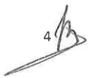

<!-- page 1 -->

# LIGNES DIRECTRICES AUX INSTITUTIONS FINANCIÈRES

Les présentes lignes directrices résument les principales obligations légales auxquelles sont assujetties certaines catégories d'institutions financières, et mettent en évidence les mesures que celles-ci doivent inévitablement prendre, ce conformément aux dispositions du décret du 30 avril 2023 sanctionnant le blanchiment de capitaux, le financement du terrorisme et le financement de la prolifération des armes de destruction massive.

La Banque de la République d'Haïti (BRH) dans le cadre de ses inspections générales ou ponctuelles vérifiera les mécanismes mis en place pour repérer et prévenir le blanchiment de capitaux et le financement du terrorisme et de la prolifération, et prendre toutes les sanctions et mesures en cas de non-respect des obligations légales et réglementaires.

Les présentes lignes directrices s'appliquent aux :

a) sociétés financières de développement ;

b) sociétés de crédit-bail ;

c) sociétés de cartes de crédit ;

d) sociétés de promotion des investissements ; et

e) toute autre entité désignée par la BRH.

### 1. Programme de prévention

Les institutions financières visées par les présentes lignes directrices sont tenues de mettre en œuvre un programme de prévention du blanchiment de capitaux, du financement du terrorisme et de la prolifération.

Le programme de prévention doit refléter la nature, l'ampleur et la complexité des activités de l'institution concernée et doit comprendre les éléments suivants :

1. des politiques, des procédures et des contrôles internes, y compris des dispositifs de contrôle de la conformité, et des procédures appropriées lors de l'embauche des employés, de façon à s'assurer qu'elle s'effectue selon des critères exigeants ;

2. la centralisation des informations sur l'identité des clients, des donneurs d'ordre, des bénéficiaires effectifs, des mandataires et sur les transactions suspectes ;

3. la désignation d'un officier de conformité au niveau de l'administration centrale;

4. l'élaboration d'un programme de formation continue à l'intention des employés ;

5. un dispositif de contrôle interne pour vérifier la conformité, l'observance et l'efficacité des mesures adoptées ;

6. la mise en place d'un dispositif de tests indépendants du contrôle de la conformité à la lutte anti-blanchiment ;

1

<!-- page 2 -->

7. l'évaluation des risques et une classification des risques en fonction des activités de l'institution financière concernée ainsi que de sa clientèle ; et

8. le traitement des opérations suspectes.

Le programme de prévention doit être approuvé par le conseil d'administration de l'institution financière.

#### 1.1. Politiques, procédures et mécanismes de contrôle interne

Les institutions financières sont tenues d'élaborer un programme de prévention comprenant des politiques, procédures et mécanismes de contrôle interne consignés par écrit permettant de prendre en compte les facteurs de risques et d'évaluer les risques de blanchiment de capitaux et de financement des activités terroristes que présentent leurs activités. Avant l'établissement d'une relation d'affaires avec un client, l'institution financière est tenue, en fonction de sa politique d'acceptation des clients, d'examiner les risques de réputation associés au profil du client et à la nature de la relation d'affaires.

Les politiques, procédures et mécanismes doivent être approuvées par le conseil d’administration et tenus à jour. Ils doivent être clairement communiqués à tous les cadres appelés à traiter avec des clients. Les politiques et procédures doivent couvrir toutes les obligations de déclaration, de saisie de documents, de conservation de documents, d’identification des clients, de contrôle, d’évaluation et d’atténuation des risques qui s’appliquent à l’institution financière.

Les politiques, procédures et mécanismes doivent s'appliquer à toutes les succursales et les filiales, s'il s'agit d'un groupe tel que défini à l'article 13 de la loi du 14 mai 2012. Dans ce cas, ces institutions doivent inclure des politiques et des procédures de partage des informations au sein du groupe aux fins du devoir de vigilance relatif à la clientèle et de gestion du risque de blanchiment de capitaux et de financement du terrorisme. Des garanties adéquates en matière de confidentialité et d'utilisation des informations échangées doivent être mises en place.

Les institutions financières sont également tenues d'élaborer des procédures appropriées de sélection garantissant le recrutement des employés selon des critères exigeants.

#### 1.2. Centralisation des informations

Les institutions financières doivent se doter d'un système informatique permettant la centralisation des données sur l'identité des clients, des donneurs d'ordre, des bénéficiaires effectifs, des mandataires et sur les transactions suspectes.

#### 1.3. Nomination d'un officier de conformité

Toute institution financière doit procéder à la nomination d'un officier de conformité. Cet officier doit être un cadre supérieur de l'institution, sélectionné en fonction de sa compétence, de son expérience, de sa probité et de son éthique professionnelle. Il doit connaître les fonctions et la structure de l'institution, et être au fait des risques et des vulnérabilités liées au blanchiment de capitaux et au financement du terrorisme dans son secteur d'activités ainsi que des tendances et

<!-- page 3 -->

des typologies qui caractérisent ces menaces. Il devra dépendre directement du conseil d'administration pour tout ce qui a traité aux questions liées à la lutte contre le blanchiment des capitaux.

L'officier de conformité a pour attributions de :

a) assurer l’application de la législation et de la réglementation ;

b) faire respecter les procédures et méthodes internes de lutte contre le blanchiment de capitaux et le financement du terrorisme ;

c) identifier les carences et faire les recommandations qui s’imposent ;

d) proposer des programmes de formation sur une base périodique ;

e) assurer la liaison avec l’Unité Centrale de Renseignements Financiers (UCREF);

إلى;

g) recevoir et donner suite aux demandes d'informations de l'UCREF et de toute autre autorité agissant dans le cadre de la lutte contre le blanchiment de capitaux et le financement du terrorisme;

h) exercer le devoir de vigilance vis-à-vis des clients.

#### 1.4. Formation continue

Le programme de prévention doit inclure une composante de formation. Tous les employés qui sont en contact avec les clients, qui ont connaissance d'opérations effectuées par des clients ou qui manipulent des fonds de quelque façon que ce soit ou qui sont responsables de la mise en œuvre ou de la surveillance du régime de conformité doivent comprendre les obligations de déclaration, d'identification des clients et de tenue de documents.

Le programme de formation doit être consigné par écrit et tenu à jour. Les modalités entourant la fréquence et la méthodologie de la formation devraient être établies. On doit y indiquer notamment les catégories de participants, les sujets qui seront couverts et la fréquence des séances de formation. Chaque nouvel employé doit être formé avant de commencer à travailler avec des clients. Des mises à jour du programme devraient avoir lieu périodiquement afin de tenir toutes les parties intéressées au courant des modifications législatives et réglementaires. La méthodologie de la formation dépendra de la taille de l'institution financière et de la complexité de ses activités.

#### 1.5. Dispositif de contrôle interne

Les institutions financières doivent faire preuve d'une vigilance constante et se doter d'une organisation et de procédures internes propres à assurer le respect des dispositions prévues par la loi et permettant aux responsables des opérations de prévenir et d'identifier toute tentative de blanchiment de capitaux ou de financement du terrorisme. L'un des rôles de ce contrôle est d'éviter l'utilisation du système financier à des fins de blanchiment, de financement du terrorisme ou du financement de la prolifération et de minimiser les risques auxquels font face les institutions.

Ce système de contrôle interne doit contenir, entre autres:

a) un mécanisme de contrôle des politiques, procédures et méthodes internes de lutte contre le blanchiment de capitaux et le financement du terrorisme;

b) une structure garantissant la confidentialité du traitement des informations;

3

<!-- page 4 -->

c) des mesures d'identification des éléments à risques liés au blanchiment de capitaux et au financement du terrorisme et des systèmes d'évaluation de ces risques;

d) un système de surveillance pouvant garantir la maîtrise des risques relatifs au blanchiment de capitaux, au financement du terrorisme et de la prolifération ;

e) un système centralisé de documentation et d'information ;

f) un système d'informations sur les initiatives prises en matière de conformité, de déficiencies dans ce domaine et des mesures correctives prises.

Le système de contrôle en place doit s'étendre à toutes les composantes de l'institution. Toute institution est donc tenue de prendre les mesures nécessaires pour garantir la stricte application des politiques, procédures et méthodes en vigueur spécialement celles relatives au blanchiment de capitaux, au financement du terrorisme et au financement de la prolifération.

#### 1.6. Dispositif de tests indépendants

Lors des tests indépendants périodiques portant sur le respect des procédures internes ou la bonne surveillance des risques, une vérification spécifique sur le volet blanchiment doit être effectuée par l'audit interne de l'institution.

Les vérifications peuvent notamment s'appliquer aux points suivants :

a) l'évaluation de la qualité de la gestion et du contrôle des risques pour toutes les opérations et dans toutes les succursales, le cas échéant ;

b) des entrevues auprès des employés chargés des opérations et de leurs superviseurs pour évaluer leur degré de connaissance et de respect des procédures de lutte contre le blanchiment et le financement du terrorisme adoptées par l'institution;

c) l'examen d'un échantillon de formulaires d'archivage des documents et de formulaires de renseignements sur les transactions financières douteuses;

d) une vérification du système de tenue des documents;

e) l'existence des justificatifs joints ou référencés aux pièces comptables;

f) la connaissance de la clientèle par les succursales et les responsables des opérations, en tenant compte des éléments suivants : activité professionnelle, situation financière et documentation comptable et financière concordante avec les crédits consentis et les volumes d'affaires traitées. Une attention particulière doit être portée à la justification économique des opérations et leur adéquation avec la situation connue de la clientèle ;

g) des examens périodiques de toutes les relations de correspondants bancaires établies avec des institutions financières étrangères afin de détecter les partenaires à haut risque ;

h) la connaissance par les collaborateurs des règles internes anti-blanchiment.

Les résultats de toute vérification doivent être signalés au conseil d'administration. Suivant la structure hiérarchique de l'institution, les questions relatives aux mesures prises ou à prendre et aux échéanciers prévus à cet égard doivent être connues et divulguées au personnel exécutant.

#### 1.7. Evaluation des risques

Le programme de prévention et de conformité doit comprendre un volet relatif à l'évaluation des risques de blanchiment de capitaux et de financement du terrorisme.

<!-- page 5 -->

L'évaluation des risques est une analyse des menaces et faiblesses en matière de blanchiment de capitaux ou du financement du terrorisme que présentent les activités de l'institution concernée. Cette évaluation varie notamment selon la taille de l'institution financière, son emplacement géographique et selon les activités exercées.

L'évaluation des risques implique que les employés soient bien imbus des activités de l'institution et qu'ils fassent preuve de jugement afin d'évaluer les risques. Cette évaluation ne doit pas être statique et devra être modifiée au moins tous les douze (12) mois.

#### 1.8. Traitement des opérations suspectés

Les institutions financières doivent élaborer et mettre en application des politiques quant à l'identification et au suivi des transactions inhabituelles ou suspectes. Ces politiques devront définir ce qui est considéré comme suspect ou inhabituel, et fournir des exemples à cet égard.

L'identification des transactions inhabituelles ou suspectes peut être fait par la surveillance des transactions, les contacts avec le client (rencontres, visites, discussions, etc.), des informations en provenance de tiers (journaux, internet, etc.), la connaissance qu'à l'institution financière de l'environnement du client.

### 2. Identification de la clientèle

Les institutions financières sont tenues d'identifier leurs clients permanents ou occasionnels, les mandataires de leurs clients, et les bénéficiaires effectifs, de vérifier leur identité au moyen de documents, de sources de données ou de renseignements indépendants et fiables. L'identification des clients a lieu lors :

1) de l'établissement de la relation d'affaires ;

2) des transactions occasionnelles supérieures au seuil réglementaire ;

3) des transactions multiples en espèces, tant en gourdes qu'en devises étrangères, lorsqu'elles dépassent, au total, le seuil établi et sont réalisées par et pour le compte de la même personne en l'espace d'une journée ou dans une fréquence inhabituelle ;

4) de l'existence d'un soupçon de blanchiment de capitaux;

5) de l'existence d'un soupçon de financement du terrorisme ;

6) de l'existence d'un doute quant à la véracité ou la pertinence des données d'identification du client précédemment obtenues.

Avant d'entrer en relation d'affaires avec un client, qu'il s'agisse d'une personne physique ou morale ou d'une construction juridique, les institutions financières doivent recueillir et analyser les éléments d'information nécessaires à la connaissance du client ainsi que l'objet et la nature envisagée de la relation d'affaires. Pour les personnes morales ou les constructions juridiques, les institutions financières doivent comprendre leur structure de propriété et de contrôle.

Les institutions financières doivent accorder une importance particulière aux normes relatives à la connaissance du client pour préserver leur réputation et l'intégrité du système bancaire et financier.

<!-- page 6 -->

Pour ne pas s'exposer au risque d'atteinte à la réputation, au risque opérationnel et au risque juridique, les institutions financières doivent disposer de politiques, mécanismes et procédures en tenant compte entre autres des éléments suivants :

a) des conditions claires d'acceptation de clients ;

b) des règles précises sur l'identification des clients et des bénéficiaires effectifs ;

c) des procédures et moyens appropriés pour la gestion des risques ;

d) des mesures de vigilance pour la clientèle.

L'identification d'une personne physique selon l'article 36 du décret du 30 avril 2023 implique « l'obtention des nom et prénom complets, de la date et du lieu de naissance, de l'adresse de son domicile principal ».

En ce qui a trait à la vérification des informations, l'article 36 du décret susmentionné précise que : « la vérification de l'identité de la personne physique requiert la présentation d'un document officiel original en cours de validité et comportant une photographie, dont il en est pris copie. La vérification de son adresse est effectuée par la présentation d'un document de nature à en rapporter la preuve ou par tout autre moyen ».

Les personnes physiques non résidentes dans le pays doivent être identifiées de la même manière que les résidents.

Lorsque le client est une personne morale ou une construction juridique, l'identification et la vérification de l'identité porte sur « la dénomination sociale, la preuve de sa constitution légale, l'adresse du siège social, l'identité et les pouvoirs des administrateurs et dirigeants sociaux ou de leurs équivalents en droit étranger », selon l'article 38 du décret du 30 avril 2023.

L'identification doit porter également, qu'il s'agisse d'une personne physique ou morale ou d'une construction juridique, sur l'objet et la nature envisagée de la relation d'affaires. Les institutions financières doivent vérifier l'identité des clients au moyen de documents, de données ou informations de sources fiables et indépendants.

Lors de l'identification des clients, une copie de tous les documents doit être faite, classée et centralisée par les institutions financières. Des contrôles formels doivent être effectués quant à la signature, aux éventuelles anomalies sur la photographie et à l'apparence physique du client potentiel.

Les institutions financières doivent prendre des mesures raisonnables pour obtenir des informations sur l'identité véritable des personnes dans l'intérêt desquelles une transaction est effectuée, s'il y a le moindre doute sur le fait que ces clients pourraient ne pas agir pour leur propre compte. En outre, un avocat, un notaire, un comptable, un courtier en valeurs mobilières intervenant en tant qu'intermédiaire financier ne peut pas se prévaloir du secret professionnel pour ne pas divulguer l'identité du client, conformément aux dispositions de l'article 43 du décret du 30 avril 2023.

<!-- page 7 -->

Si les institutions financières ne peuvent pas respecter les dispositions prévues ci-dessus, elles ne peuvent ni nouer ou maintenir une relation d'affaires, ni effectuer une opération pour le client. Elles détermineront, dans ce cas, s'il y a lieu de produire une déclaration de soupçon à l'UCREF ou d'établir un rapport confidentiel interne conformément à l'article 46 du décret du 30 avril 2023.

#### 2.1. Bénéficiaires effectifs

Les institutions financières sont tenues d'identifier l'identité des bénéficiaires effectifs conformément aux dispositions des articles 40 à 42 du décret du 30 avril 2023.

Des mesures adéquates doivent être prises pour la vérification de ces données, ainsi que pour leur mise à jour lorsqu'il apparait que celles-ci ne sont plus actuelles.

Si les institutions financières ne peuvent pas obtenir les informations mentionnées dans la présente section ou leurs clients restent en défaut de les communiquer ou leur communiquer des informations non pertinentes ou invraisemblables, elles ne peuvent ni nouer ou maintenir une relation d'affaires, ni effectuer une opération pour le client. Elles détermineront, dans ce cas, s'il y a lieu d'en informer l'UCREF.

#### 2.2. Les personnes politiquement exposées

Un devoir de vigilance doit s'exercer à l'égard des personnes politiquement exposées (PPE). Elles sont définies par l'article 6 du décret du 30 avril 2023 comme des personnes exerçant ou ayant exercé d'importantes fonctions publiques dans un pays étranger ou en Haïti ou au sein de ou pour le compte d'une organisation internationale ainsi que les membres de la famille de cette personne, ou toutes autres personnes qui lui sont étroitement liées ou associées.

Les institutions financières doivent disposer de systèmes appropriés de gestion de risques permettant de déterminer si le client est une personne politiquement exposée. Dès que le client est identifié comme personne politiquement exposée, il faut :

a) obtenir l'autorisation de la haute direction avant de nouer ou de continuer une relation d'affaires avec le client ;

b) prendre toutes mesures raisonnables pour identifier l'origine des fonds ;

c) assurer une surveillance renforcée et permanente de la relation d'affaires.

En sus des PPE, un contrôle rigoureux doit être appliqué envers toute personne ayant une fortune élevée d'origine incertaine ou douteuse.

### 3. Mesures de vigilance renforcées

Les institutions financières doivent appliquer, en fonction de leur appréciation du risque, des mesures de vigilance renforcées dans des situations qui, de par leur nature, peuvent présenter un risque élevé de blanchiment de capitaux ou de financement du terrorisme.

<!-- page 8 -->

En outre, comme le prescrit l'article 28 du décret du 30 avril 2023, une attention particulière doit être exercée à l'égard des opérations provenant d'établissements ou d'institutions financières qui ne sont pas soumis à des obligations suffisantes en matière d'identification des clients ou de contrôle des transactions. Les institutions financières doivent leur appliquer des mesures de vigilance renforcées, proportionnées aux risques.

### 4. Conservation de documents

Les institutions financières sont tenues de conserver pendant une période de cinq (5) ans au moins, après la clôture des comptes ou la cessation des relations avec le client permanent ou occasionnel, les pièces et documents obtenus dans le cadre des mesures de vigilance relative à la clientèle et aussi les livres de comptes et la correspondance commerciale. De même, les documents relatifs aux opérations effectuées par les clients doivent être gardés dans les archives de l'institution pendant cinq (5) ans au moins après l'exécution de la transaction.

A cette fin, une formule d'archivage des documents sur les opérations doit être utilisée pour la conservation des documents.

Cette conservation des documents, se rapportant aux transactions nationales et/ou internationales effectuées, permettra de répondre rapidement aux demandes d'informations des autorités compétentes et de reconstituer les transactions individuelles (y compris les montants et les types d'espèces en cause, le cas échéant) de façon à fournir, le cas échéant, des preuves en cas de poursuite pour conduite criminelle.

De même, une copie des déclarations faites auprès de l'UCREF doit être gardée et archivée par l'institution financière.

### 5. Mise à jour des renseignements sur la clientèle

La fréquence des mises à jour des renseignements sur les clients varie selon le contexte dans lequel les opérations se déroulent, donc d'une situation à l'autre. Les institutions financières sont responsables du choix de la fréquence qui ne peut dépasser trois (3) ans. Toutefois, pour les situations posant des risques élevés, les mises à jour doivent être effectuées au moins tous les deux (2) ans.

### 6. Des technologies nouvelles

Les institutions financières doivent identifier et évaluer les risques de blanchiment de capitaux et de financement du terrorisme pouvant résulter :

a) du développement de nouveaux produits et de nouvelles pratiques commerciales, y compris de nouveaux mécanismes de distribution ;

b) de l’utilisation de technologies nouvelles ou en développement en lien avec de nouveaux produits ou des produits préexistants.

<!-- page 9 -->

Cette évaluation des risques devrait avoir lieu avant le lancement des nouveaux produits ou des nouvelles pratiques commerciales ou avant l'utilisation de technologies nouvelles ou en développement. Les institutions financières doivent prendre des mesures appropriées pour gérer ces risques.

### 7. Sanctions

En cas de non-respect des obligations définies dans la loi ou les règlements de la BRH, notamment :

a) grave défaut de vigilance ou non-respect des obligations d'identification du client ;

b) non production de déclarations de soupcons ;

c) dénonciation faite aux clients ou à des tiers relative aux actions entreprises en matière de prévention et de détection du blanchiment de capitaux et du financement du terrorisme ;

d) violation des obligations contenues dans le décret du 30 avril 2023 et des règlements de la BRH ;

la BRH se réserve le droit d'engager toute procédure appropriée et/ou de prendre toutes mesures administratives conformément à la loi et à la réglementation en vigueur. Les sanctions peuvent être soit des amendes, soit des sanctions administratives (avertissement, suspension d'activité, retrait d'agrément ou interdiction définitive dans les cas les plus graves) sans préjudice de celles prévues par la loi, et de celles résultant de la responsabilité civile ou pénale de l'institution financière qui peut être engagée en raison de la commission de l'infraction.

### 8. Abrogation et Entrée en vigueur

Les présentes lignes directrices abrogent celles du 27 août 2020 et entrent en vigueur à la date de leur signature.

Port-au-Prince, le 16 août 2023.

Badenf�河

Jean Baden Dubois

Gouverneur
