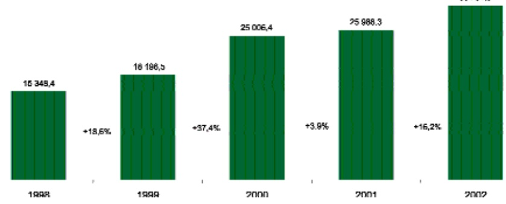
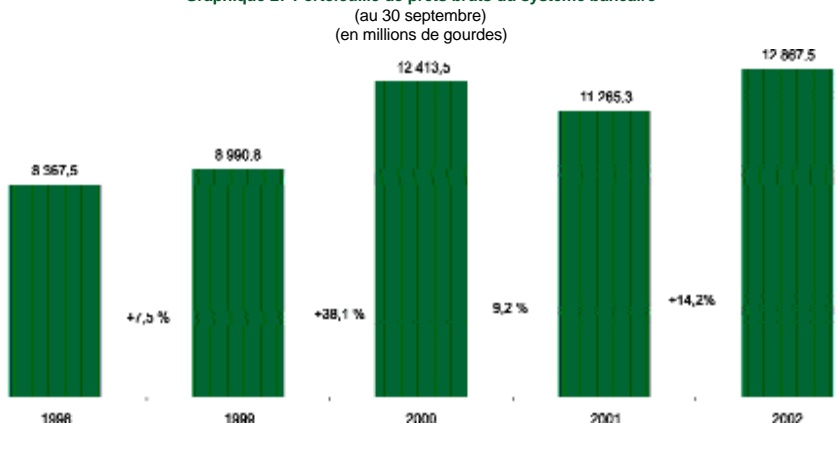

<!-- page 1 -->

# B. ÉVOLUTION DU SYSTÈME BANCAIRE EN 2002

La performance du système bancaire a été, à nouveau, affectée par la persistance de la crise politique et l'affaiblissement de la croissance économique. Les résultats nets sont demeurés positifs avec 326 MG, bien qu'ils aient accusé une baisse de 14 % contre 11 % en 2001.

En dehors des facteurs conjoncturels, la concentration du crédit et la croissance des immobilisations continuent de poser des problèmes majeurs pour la structure financière et la rentabilité des banques commerciales. Le total des bilans s'est accru de 16,6 % contre 0,6 % en 2001, mais cela traduit davantage le poids de la composante devises dans l'actif du système que les effets des innovations destinées à rendre le crédit plus disponible pour les opérateurs économiques.

Profitant de la faible bancarisation de l'économie et de l'accroissement de la population urbaine les établissements bancaires ont créé quinze (15) nouvelles succursales et agences dans le cadre de leur stratégie d'expansion géographique. Cette stratégie a favorisé l'émergence d'un crédit régional, mais les contraintes imposées par les immobilisations et les innovations technologiques sont telles que la progression des dépenses d'exploitation demeure plus rapide que celle du produit net bancaire. Conséquemment, l'effet ciseau s'est maintenu et le système a dépensé en moyenne 79,54 centimes pour chaque gourde de revenu contre 74,43 centimes en 2001.

Sous l'effet du rythme de progression plus soutenu de l'avoir des actionnaires, le niveau du ratio de couverture des immobilisations par les fonds propres s'est amélioré, passant de 99,91 % à 102,15 % de septembre 2001 à septembre 2002, mais il reste très en deçà du ratio standard international qui oscille autour de 133,0 %.

La politique de détente des taux d'intérêt mise en œuvre par la BRH durant l'exercice a permis au système de réduire le taux moyen de rémunération des dépôts tout en améliorant le taux de rendement des prêts compte tenu de la rigidité à la baisse des taux débiteurs. Cependant, le déclin de l'activité économique et le souci de préserver la qualité de l'actif ont amené les banques à adopter une attitude prudente dans la distribution du crédit.

Sur le plan prudentiel, la BRH a modifié la circulaire 81 sur le risque de change en baissant le ratio de position nette de change de 40 % à 8 % des fonds propres. Cette modification a répondu une double préoccupation : d'une part limiter l'exposition des banques au risque de change dans un contexte caractérisé par une plus grande volatilité du taux de change et d'autre part, porter le ratio à un niveau qui soit plus en ligne avec ceux en vigueur sur le plan international.

<!-- page 2 -->

<!-- page 3 -->

### VI. LE SYSTÈME BANCAIRE: VUE D'ENSEMBLE

Le secteur bancaire a encore subi en 2002 les soubresauts d'un environnement mouvant et incertain tant sur le plan macro-économique que sur le plan du climat ayant présidé à la conduite des affaires.

Les conditions d'exercice de la profession bancaire ont été négativement affectées par la résurgence du climat d'insécurité favorisée par la dégradation de l'environnement social et par le maintien l'instabilité politique découlant de la non résolution de la crise électorale de l'année 2000 et, sur le plan externe, par la baisse des taux d'intérêt sur les instruments du marché monétaire américain qui représentent la composante principale du portefeuille de placements en devises des banques haïtiennes.

Ces différentes contraintes internes et externes ont occasionné une baisse au niveau de la performance financière du secteur bancaire tant en termes nominaux qu'en termes réels. Les résultats nets du système se sont contractés, passant de 381,27 MG à 327,79 MG, soit une diminution de 14 % contre - 11,4 % en 2001.

Sur le plan comptable, ces contraintes se sont traduites par un alourdissement des charges d'exploitation qui ont crû de 13,1 %. Toutefois, cet accroissement a été contrebalancé partiellement par l'amélioration de la marge nette (+113,69 MG, +6,6 %) sous l'effet de la diminution des dépenses d'intérêt (- 36,9 %) plus que proportionnelle que celle des revenus d'intérêt (- 13,2 %) ; et par l'accroissement de 5,4 % des autres revenus ayant entraîné la progression de 6,2 % du Produit Net Bancaire (PNB).

Après avoir enregistré une faible progression (+ 0,6 %) au cours de l'exercice précédent, l'actif bancaire (35 milliards de gourdes) a subi une augmentation de 16,6 % en 2002. Compte tenu de l'importance des éléments en devises dans la composition du bilan (environ 43,3 %), ce redressement traduit l'effet amplificateur de la dépréciation du taux de change résultant de la conversion de ces éléments en leur équivalent gourde. En effet, alors que l'actif en devises n'a crûé que de 7,0 %, l'actif en devises converties a progressé de 24,6 % contribuant ainsi à hauteur de 63,0 % à la croissance du bilan.

Les bons BRH, principal instrument de placement pour les banques, ont accusé un ralentissement considérable dans leur rythme de progression qui est passé de 135,3 % en 2001 à 13,5 % en 2002. En dépit de l'augmentation de leur encours moyen (+ 991,1 MG), ces titres ont généré des revenus d'intérêt en baisse de 4,5 % (- 19,06 MG) par rapport à l'exercice précédent en raison de la baisse progressive par la BRH de leur taux de rémunération dont la moyenne pour l'année s'est située à 13,6 % pour les instruments à échéance de 91 jours contre une moyenne de 26,7 % en 2001. Le poids des liquidités (disponibilités et bons BRH) dans la composition de l'actif bancaire s'est stabilisé après une hausse significative (environ 6 points) en 2001 attribuable à l'augmentation de dix points du taux de réserves obligatoires sur les passifs libellés en monnaies étrangères des banques commerciales et de leurs filiales non bancaires. Le rapport des liquidités à l'actif a atteint 47,3 % au 30 septembre 2002 contre 47,0 % à la fin de l'exercice précédent. La composition des liquidités a été affectée par l'évolution du taux de change au cours de l'exercice. Suite à la dépréciation de la gourde, les liquidités en devises converties en gourdes sont passées à 39,2 % du total des liquidités contre 35,3 % à la fin de l'exercice 2001.

L'évolution des opérations d'intermédiation classique a été marquée par la reprise des activités de crédit qui avaient enregistré une nette contraction en 2001. D'un niveau de 12 289,6 MG au 30 septembre 2001, l'encours des prêts bruts à la fin de l'exercice s'est établi à 15 307,8 MG, soit une augmentation de 14,2 %. Si ce regain s'est effectué timidement sur les prêts en gourdes (+ 4,9 %), son impact sur le portefeuille de créances en devises, qui s'est accru de 8,0 %, a été

<!-- page 4 -->

plus sensible en raison des taux débiteurs plus favorables. En effet, le taux d'intérêt moyen sur les créances en devises a diminué plus rapidement que celui sur les prêts en gourdes creusant davantage l'écart de taux moyen entre les deux types de prêts, soit 1 380 points de base $ ^{25} $ contre 1 320 en 2001. L'augmentation plus accélérée du rythme de progression de l'encours des prêts en devises combinée à l'effet de taux de change a contribué au renforcement de la tendance à la dollarisation, comme en témoigne la progression de plus de 4 points de la part de ces prêts dans la composition des prêts totaux, passant de 44,7 % à 49,2 % d'une fin d'exercice à l'autre. Les ressources collectées de la clientèle ont augmenté de 16,2 % (+ 4 216,2 MG) pour atteindre 30 204,5 MG au 30 septembre 2002. Contrairement à son évolution au cours de l'exercice précédent, l'encours des dépôts à terme (Gdes et  ÉU) s'est contracté de 0,16 %. Cette évolution, qui reflète la préférence particulièrement pour les dépôts d'épargne en raison de la baisse du coût d'opportunité associé à leur détention (resserrement de l'écart de taux entre les DAT et les autres types de dépôts), s'est traduite par l'affaiblissement de l'importance des dépôts à terme dans la structure des dépôts totaux, soit 32,2 % contre 37,4 % en 2001.

Tableau 7 Indicateurs financiers clés

(au 30 septembre ou pour l'exercice terminé le 30 septembre)

| (en millions de gourdes) | 2002 | 2001 | 2000 | 1999 | 1998 |
| --- | --- | --- | --- | --- | --- |
| BILAN |   |   |   |   |   |
| Acif | 35 330,05 | 30 293,65 | 30 109,22 | 21 097,18 | 18 210,9 |
| Bons BRH | 3 151,42 | 2 777,00 | 1 180,25 | 3 099,60 | 1 629,0 |
| Prés nots | 12 160,52 | 10 576,88 | 11 888,24 | 8 546,41 | 7 963,4 |
| Depots | 30 204,52 | 25 988,32 | 25 006,40 | 18 196,49 | 15 348,4 |
| Avoir des actionnaires | 2 045,25 | 1 755,82 | 1 536,50 | 1 088,49 | 1 039,4 |
| RÉSULTATS |   |   |   |   |   |
| Revenus nets d'intérêt | 1 846,06 | 1 733,47 | 1 399,97 | 1 056,63 | 1 021,3 |
| Autres revenus | 957,67 | 907,60 | 831,78 | 535,49 | 413,2 |
| Détation à la Provision pour Créances douteuses | 179,42 | 174,05 | 146,92 | 106,29 | 144,4 |
| Frais d'exploitation | 2 230,00 | 1 985,72 | 1 548,99 | 1 229,51 | 1 124,8 |
| Bénéfice net (perte nette) | 321,52 | 381,27 | 430,22 | 196,66 | 96,6 |
| (en pourcentage) |   |   |   |   |   |
| STRUCTURE FINANCIÈRE |   |   |   |   |   |
| Avoir des actionnaires en % de l'actif | 5,79 | 5,80 | 5,10 | 5,16 | 5,71 |
| Depôts en % de l'actif | 85,49 | 85,79 | 83,05 | 86,25 | 84,28 |
| QUALITÉ DE L'ACTIF |   |   |   |   |   |
| Prêts improductifs bruts en % des prêts bruts | 6,51 | 9,22 | 6,76 | 7,93 | 8,59 |
| Provisiones pour créances douleuses en % des prêts improductifs bruts | 84,39 | 66,25 | 62,57 | 62,31 | 56,23 |
| Prêts improductifs nets en % de l'avoir des actionnaires | 6,39 | 19,97 | 20,45 | 24,69 | 30,26 |
| RENTABILITÉ |   |   |   |   |   |
| Rendement de l'actif (ROA) | 0,98 | 1,28 | 1,68 | 1,00 | 0,57 |
| Rendement de l'avoir des actionnaires (ROE) | 16,92 | 23,16 | 32,78 | 18,48 | 10,15 |
| Revenus nets d'intérêts en % des revenues d'intérêt | 66,94 | 54,62 | 60,20 | 60,17 | 55,75 |
| Rendement moyen des prêts | 18,15 | 20,53 | 16,43 | 16,50 | 19,31 |
| Rémunération moyenne des dépôts | 3,25 | 5,65 | 4,28 | 4,17 | 5,71 |
| Dépenses d'exploitation en % du produit net bancaire | 79,54 | 74,43 | 69,41 | 77,22 | 78,40 |
| Produit net bancaire par employé (en millions de gourdes) | 847,54 | 848,67 | 793,37 | 606,52 | 594,61 |
| Nombre d'employés | 3 285 | 3 235 | 2 989 | 2 659 | 2 591 |

a) À partir du mois de mars 1998, les prêts improductifs désignent les prêts dont le principal et/ou les intérêts sont dus et impayés depuis 90 jours ou plus. Avant cette date, les prêts échus de 15 jours et plus étaient considérés comme tels.

b) Dépôts moyens de la période, y compris les dépôts à vue.

c) Le ratio dépenses d'exploitation sur produit net bancaire (81,95 %) apparaissant au rapport annuel de l'exercice 1998 est surévalué étant donné qu'une banque avait, par erreur, enregistré des charges de provisions de 50,9 MG au niveau des dépenses d'exploitation contribuant ainsi à l'amplification de ces dernières. Le ratio révisé est de 78,4 %.

<!-- page 5 -->

Après avoir enregistré un redressement en 2001, la structure financière du système bancaire s'est stabilisée. L'avoir des actionnaires en pourcentage de l'actif s'est maintenu à son niveau de 2001, soit 5,8 %. Toutefois, sous l'effet du rythme de progression plus soutenu de l'avoir des actionnaires, le niveau du ratio de couverture des immobilisations par les fonds propres s'est amélioré, passant de 99,91 % à 102,15 % d'une fin d'exercice à l'autre, mais a continué de se situer très en dessous des standards internationaux qui tournent autour de 133,0 %.

Par ailleurs, la BRH a poursuivi ses efforts sur le plan de la surveillance prudentielle par la mise en application au début de l'exercice d'un avis renfermant un ensemble de critères régissant l'ouverture de nouvelles succursales bancaires. L'adoption de cet ais était dictée par la nécessité de formaliser les procédures relatives aux demandes d'autorisation de nouvelles succursales et de protéger les déposants en portant les banques à financer leurs immobilisations par leurs fonds propres et par des ressources de longue durée. La BRH a aussi procédé à la modification de la circulaire 81 sur le risque de change en baissant le ratio de position nette de change de 40 % à 8 % des fonds propres. Cette modification a répondu une double préoccupation: d'une part limiter l'exposition des banques au risque de change dans un contexte caractérisé par une plus grande volatilité du taux de change et d'autre part, porter le ratio à un niveau qui soit plus en ligne avec ceux en vigueur sur le plan international.

### VI. 1 Le système bancaire

#### VI. 1.1 Établissements et environnement concurrentiel

## Établissements

Le tableau ci-dessous présente la répartition des établissements bancaires suivant l'origine de leurs capitaux et de leurs activités principales $ ^{26} $. Cette répartition indique que le nombre de banques opérant dans le système n'a pas changé par rapport à l'exercice précédent. Au 30 septembre 2002, le système bancaire est composé de treize (13) établissements qui sont répartis de la façon suivante : deux (2) banques commerciales d'État, sept (7) banques commerciales à capitaux privés haïtiens, deux (2) succursales de banques étrangères et deux (2) banques d'épargne et de logement $ ^{27} $ à capitaux privés haïtiens. Même si leur nombre n'a pas varié, il convient de relever les modifications suivantes qui se sont produites au niveau des BELs : la Socabel, filiale de la Socabank, a démarré ses activités au début du mois de novembre 2001 ; en février 2002, la BRH a procédé au dessaisissement de la Banque Haïtienne de Développement (BHD).

<!-- page 6 -->

Tableau 8 Établissements bancaires fonctionnant en Haiti (au 30 septembre 2002)

<table><tr><td>Banques commerciales d'État</td><td>Banque Nationale de Crédit (BNC)</td></tr><tr><td>Banque Populaire Haitienne (RPH)</td></tr><tr><td>Banques commerciales à capitaux privés haïtiens</td><td>Capital Bank</td></tr><tr><td>Banque Industrielle et Commerciale d'Haiti (BICH)</td></tr><tr><td>Banque de l'Union Haitienne (BUH)</td></tr><tr><td>Banque de Promotion Commerciale et Industrielle (Promobank)</td></tr><tr><td>Société Générale (Hailienne de Banque (Socabank))</td></tr><tr><td>Société Générale (Hailienne de Banque (Sogetbank))</td></tr><tr><td>Unibank</td></tr><tr><td>Succursales de banques commerciales étrangères</td><td>Bank of Nova Scotia (Scotiabank)</td></tr><tr><td>Citibank N.A. (CRNA)</td></tr><tr><td>Banques d'épargne et de logement à capitaux privés haitiens</td><td>Société Générale (Hailienne de Banque d'Espargne et de Logement (Socabel))</td></tr><tr><td>Société Générale (Hailienne de Banque d'Espargne et de Logement (Sogebel))</td></tr></table>

a) La Sogebank détient une participation globale de 40% dans le capital-actions de cette banque, soit une participation directe de 20% et une participation indirecte de 20% à travers sa filiale, la Sogefac.

## Environnement concurrentiel

Les principales banques du système ont poursuivi au cours de l'exercice 2002 leur stratégie d'expansion géographique, amorcée déjà depuis quelques années, en vue d'accroître leur part de marché et de réaliser éventuellement des économies d'échelle. En dépit de l'avis du 22 novembre 2001 établissant des critères plus rigoureux d'agrément de demandes d'ouverture de succursales, le nombre de succursales et agences agréées par la BRH au cours de l'exercice a augmenté. Cette évolution tient en partie au nombre relativement élevé de demandes en suspens à la fin de l'exercice précédent auquel s'ajoutent d'autres demandes produites en début d'exercice avant la mise en vigueur de cet avis. Dans le but de ne pas pénaliser indûment certaines banques et étant donné l'absence de provisions relatives à une période de transition au niveau de l'avis du 22 novembre, la BRH a également agréé par la suite certaines demandes pour l'ouverture de succursales dont les travaux d'aménagement étaient déjà en voie d'achèvement au moment où elle informait la communauté bancaire des nouvelles dispositions régissant l'ouverture de succursales.

Au total la BRH a agréé quinze (15) demandes de succursales et d'agences au cours de l'exercice portant ainsi à 153 le nombre de succursales et agences autorisées. Les trois premières banques du système ont été à l'origine de la quasi totalité (14 sur un total de 15) des demandes d'ouverture de succursales au cours de l'exercice.

Tableau 9 Nombre des succursales et agences autorisées

|   | 2002 | 2001 | 2000 | 1999 |
| --- | --- | --- | --- | --- |
| Succursales et agences autorisées | +15 | +12 | +14 | +12 |

Bien que la région métropolitaine de Port-au-Prince et les régions périphériques continuent de bénéficier d'une plus large couverture bancaire, les principales villes de provinces ont enregistré, au cours de cet exercice, une croissance plus soutenue du nombre de nouvelles succursales. En effet, ce nombre s'est accru de 13 % par rapport à 8,6 % pour la zone métropolitaine de Port-au-Prince. Au 30 septembre 2002, environ 66 % (101) des succursales et agences autorisées sont localisées dans cette zone contre 34 % (52) disséminées dans les principales villes de province.

<!-- page 7 -->

L'année 2002 a été aussi caractérisée par les efforts déployés par certaines banques, sur le plan de l'élargissement de la gamme de produits et services offerts. C'est dans ce registre qu'il faut situer les initiatives visant par exemple à l'amélioration des services de transferts / virements de fonds grâce à l'adhésion de plusieurs banques au réseau SWIFT (Society for Worldwide Interbank Financial Telecommunication); à favoriser une meilleure flexibilité dans l'utilisation, par certains segments de la clientèle, des services bancaires en ligne.

Les velléités de regroupement se sont poursuivies au cours de l'exercice. Toutefois, la tentative de la Sogebank de procéder à l'acquisition des actifs de la BUH n'a pu aboutir, l'acquéreur ayant finalement décidé de se retirer.

Tableau 10 Évolution du nombre de succursales autorisées par établissement bancaire

<table><tr><td>Etablissements</td><td>2002\nNombre de succursales\net agences autorisées $ ^{1} $</td><td>2001\nNombre de succursales\net agences autorisées $ ^{2} $</td><td>Variation $ ^{3} $</td></tr><tr><td>P-AU-P\n& environs $ ^{b} $</td><td>Villes de\nprovince</td><td>P-AU-P\n& environs $ ^{b} $</td><td>Villes de\nprovince</td><td>P-AU-P\n& environs $ ^{b} $</td><td>Villes de\nprovince</td></tr><tr><td>BHD</td><td>0</td><td>0</td><td>1</td><td>0</td><td>-1</td><td>-</td></tr><tr><td>BICH</td><td>1</td><td>0</td><td>1</td><td>0</td><td>-</td><td>-</td></tr><tr><td>RNC</td><td>4</td><td>15</td><td>3</td><td>15</td><td>1</td><td>-</td></tr><tr><td>BPH</td><td>4</td><td>0</td><td>4</td><td>0</td><td>-</td><td>-</td></tr><tr><td>BUH</td><td>5</td><td>7</td><td>5</td><td>7</td><td>-</td><td>-</td></tr><tr><td>Capital Bank</td><td>12</td><td>2</td><td>12</td><td>2</td><td>-</td><td>-</td></tr><tr><td>Citibank</td><td>3</td><td>0</td><td>3</td><td>0</td><td>-</td><td>-</td></tr><tr><td>Promobank</td><td>6</td><td>2</td><td>6</td><td>2</td><td>-</td><td>-</td></tr><tr><td>Scolibank</td><td>3</td><td>0</td><td>3</td><td>0</td><td>-</td><td>-</td></tr><tr><td>Socabank</td><td>14</td><td>7</td><td>10</td><td>7</td><td>4</td><td>-</td></tr><tr><td>Socabef</td><td>1</td><td>0</td><td>1</td><td>0</td><td>-</td><td>-</td></tr><tr><td>Sogcbank</td><td>24</td><td>7</td><td>22</td><td>5</td><td>2</td><td>2</td></tr><tr><td>Sogcbcl</td><td>3</td><td>0</td><td>3</td><td>0</td><td>-</td><td>-</td></tr><tr><td>Unibank</td><td>21</td><td>12</td><td>19</td><td>8</td><td>2</td><td>4</td></tr></table>

…ent.

b) Englobe la ville de Port-au-Prince et les régions périphériques : Pétion-ville, Laboule, Delmas, Carrefour, la Plaine du Cul-de-sac et Croix-des-bouquets.

c) La Socabel a démarré ses activités le 5 novembre 2001; cependant, elle a reçu du Ministère de l'économie et des finances l'autorisation de fonctionnement au cours de l'exercice 2001, plus précisément en novembre 2000.

d) La variation nette de 14 du nombre de succursales et agences autorisées se répartit de la façon suivante : 15 succursales et agences agréées moins la BHD pour cause de dessaisissement.

Depuis quelques années le secteur bancaire multiplie les initiatives en vue de mieux diversifier ses sources de revenus. Des efforts ont été engagés notamment sur des secteurs porteurs comme celui du micro-crédit et sur le développement des activités de transferts d'argent et de services connexes par la création de filiales spécialisées (Micro Crédit National, Sogesol, Unitransfer, Socatransfer...).

En plus des problèmes inhérents au fonctionnement de l'industrie bancaire, l'environnement compétitif du secteur a été aussi affecté par la montée en puissance de certaines «coopératives d'épargne de crédit» (CECs) qui utilisant une stratégie commerciale très agressive et des pratiques de gestion peu conformes à l'orthodoxie financière ont pu attirer une frange importante de la clientèle cible des institutions de micro-crédit dont certaines sont des filiales de banque. La non maîtrise des risques, l'absence de transparence et le laxisme en matière de surveillance des activités de ces institutions ont été les principales causes de leur faillite en cascade, mettant ainsi à nu les faiblesses structurelles de ce secteur. En juillet 2002, une nouvelle loi sur les CECs a été promulguée. Cette loi crée, au sein de la BRH, une nouvelle direction dénommée Direction de l'Inspection Générale des Caisses Populaires (DIGCP) chargée du contrôle et de la surveillance des CECs.

<!-- page 8 -->

### VI. 2 Structure du système bancaire

Bien que le secteur bancaire n'ait enregistré aucun regroupement au cours de l'exercice, la tendance à l'accroissement des parts de marché des trois premiers établissements et des banques commerciales privées haïtiennes au niveau de l'actif, du portefeuille de prêts et des dépôts s'est poursuivie. Cette tendance à la concentration de l'activité est aussi reflétée par l'augmentation de l'indicateur de concentration Herfindhal-Hirschman à tous les niveaux au cours de l'exercice.

## Poids des principaux établissements bancaires

Le volume des opérations réalisées par les principaux établissements indique une accentuation de la concentration notamment sur les marchés des prêts et des dépôts totaux. En effet, le poids des trois premières banques, dont la composition n'a pas varié depuis 1999, s'est accru respectivement de 2,9 points et 2,0 points sur ces marchés. Ce renforcement est lié essentiellement à la progression des parts de marché de la Unibank et de la Sogebank, celles de la Socabank étant en baisse depuis l'exercice dernier.

Tableau 11 Poids des principaux établissements bancaires au 30 septembre (en pourcentage)

|   | Actif Total | Portefeuille de prêts | Dépôts totaux | Dépôts en dollars ÉU |
| --- | --- | --- | --- | --- |
| 2002 (13 établissements) |   |   |   |   |
| Les trois premiers établissements | 58,6 | 58,2 | 60,6 | 66,7 |
| Les cinq premiers établissements | 73,4 | 75,3 | 74,1 | 81,0 |
| Les huit premiers établissements | 89,9 | 89,9 | 90,1 | 93,3 |
| 2001 (13 établissements) |   |   |   |   |
| Les trois premiers établissements | 57,4 | 55,3 | 58,6 | 65,5 |
| Les cinq premiers établissements | 72,3 | 73,4 | 72,2 | 82,5 |
| Les huit premiers établissements | 90,2 | 90,1 | 90,3 | 90,5 |
| Variation 2002/2001 |   |   |   |   |
| Les trois premiers établissements | 1,3 | 3,0 | 2,1 | 1,2 |
| Les cinq premiers établissements | 1,1 | 1,9 | 1,9 | -1,5 |
| Les huit premiers établissements | -0,3 | -0,1 | -0,2 | -2,2 |

## Poids des différentes catégories d'établissements bancaires

La tendance à la concentration s'est maintenue au niveau des prêts bruts et des dépôts totaux, les parts de marché des sept banques commerciales privées (BCP) ayant progressé respectivement de 1,4 point et 0,4 point. Ces évolutions se sont effectuées notamment au détriment des succursales de banques étrangères qui ont vu leur parts de marché reculer à tous les niveaux. Par contre, une meilleure dispersion a été opérée au plan de l'actif total et des dépôts en dollar où le poids des BCP a replié respectivement de 0,2 point et de 0,5 point.

Les banques commerciales d'État ont connu une augmentation de leurs parts de marché sur presque tous les plans, en particulier sur le marché des dépôts en dollar ÉU (+1,5 point). L'amélioration de leur position au cours des deux derniers exercices n'a pas cependant permis aux banques commerciales d'État de combler totalement les érosions de parts de marchés survenues au cours des exercices 1997 à 2000, période au cours de laquelle la BNC, principale banque de cette catégorie, était engagée dans un processus de restructuration.

Comme pour l'exercice précédent, la position des deux banques d'épargne et de logement s'est renforcée à tous les niveaux en dépit des modifications ayant affecté la composition de cette catégorie. La progression de parts de marché la

<!-- page 9 -->

plus significative a concerné les dépôts en dollar ÉU (+1,5 point) et a découlé essentiellement de l'accroissement de 66 % du portefeuille de dépôts en devises de la Sogebel. En dépit de la progression régulière de la position des BELs depuis l'exercice 2000, leur poids sur les différents marchés est demeuré relativement faible (entre 3,5 % et 4,5 %).

Tableau 12 Poids des différentes catégories d'établissements bancaires au 30 septembre (en pourcentage)

<table><tr><td>Catégories de banques</td><td>Actif total</td><td>Portefeuille de prêts</td><td>Dépôts totaux</td><td>Dépôts en dollars EU</td></tr><tr><td>2002</td></tr><tr><td>7 Banques commerciales privées haïtiennes</td><td>75,1</td><td>76,1</td><td>77,2</td><td>81,7</td></tr><tr><td>2 Succursales de banques étrangères</td><td>10,1</td><td>13,9</td><td>9,9</td><td>9,4</td></tr><tr><td>2 Banques d'État</td><td>10,8</td><td>5,9</td><td>9,4</td><td>4,3</td></tr><tr><td>2 Banques d'épargne et de logement privées haïtiennes</td><td>3,9</td><td>4,1</td><td>3,5</td><td>4,6</td></tr><tr><td></td><td>100</td><td>100</td><td>100</td><td>100</td></tr><tr><td>2001</td></tr><tr><td>7 Banques commerciales privées haïtiennes</td><td>75,3</td><td>74,7</td><td>76,8</td><td>82,2</td></tr><tr><td>2 Succursales de banques étrangères</td><td>11,1</td><td>15,3</td><td>11,0</td><td>11,6</td></tr><tr><td>2 Banques d'État</td><td>10,2</td><td>5,9</td><td>9,0</td><td>2,8</td></tr><tr><td>2 Banques d'épargne et de logement privées haïtiennes</td><td>3,4</td><td>4,1</td><td>3,2</td><td>3,4</td></tr><tr><td></td><td>100</td><td>100</td><td>100</td><td>100</td></tr><tr><td>2000</td></tr><tr><td>7 Banques commerciales privées haïtiennes</td><td>75,0</td><td>75,5</td><td>77,0</td><td>84,6</td></tr><tr><td>2 Succursales de banques étrangères</td><td>12,6</td><td>14,8</td><td>11,1</td><td>10,8</td></tr><tr><td>2 Banques d'État</td><td>9,8</td><td>5,9</td><td>9,4</td><td>2,3</td></tr><tr><td>2 Banques d'épargne et de logement privées haïtiennes</td><td>2,6</td><td>3,7</td><td>2,5</td><td>2,2</td></tr><tr><td></td><td>100,0</td><td>100,0</td><td>100,0</td><td>100,0</td></tr><tr><td>1999</td></tr><tr><td>7 Banques commerciales privées haïtiennes</td><td>73,4</td><td>73,0</td><td>74,4</td><td>85,0</td></tr><tr><td>2 Succursales de banques étrangères</td><td>11,3</td><td>14,2</td><td>11,5</td><td>11,2</td></tr><tr><td>2 Banques d'État</td><td>12,9</td><td>9,0</td><td>11,7</td><td>2,2</td></tr><tr><td>1 Banque d'épargne et de logement privée haïtienne</td><td>2,4</td><td>3,8</td><td>2,3</td><td>1,7</td></tr><tr><td></td><td>100,0</td><td>100,0</td><td>100,0</td><td>100,0</td></tr><tr><td>1998</td></tr><tr><td>8 Banques commerciales privées haïtiennes</td><td>69,2</td><td>66,2</td><td>71,1</td><td>81,2</td></tr><tr><td>2 Succursales de banques étrangères</td><td>10,2</td><td>13,4</td><td>10,3</td><td>11,4</td></tr><tr><td>2 Banques d'État</td><td>14,4</td><td>12,3</td><td>13,0</td><td>2,0</td></tr><tr><td>2 Banques d'épargne et de logement privées haïtiennes</td><td>6,2</td><td>8,2</td><td>5,7</td><td>5,4</td></tr><tr><td></td><td>100,0</td><td>100,0</td><td>100,0</td><td>100,0</td></tr></table>

## Indicateur de concentration Herfindhal-Hirschman $ ^{28} $

Depuis 1999, l'indice Herfindhal-Hirschman croît de manière régulière sur les différents marchés. Cette évolution s'est poursuivie en 2002. L'indice a progressé plus fortement au niveau des opérations de prêts (+6,3 %) et de collecte de dépôts (+5,7 %) confirmant ainsi les variations observées en considérant le poids des trois premiers établissements. Toutefois, le rythme de croissance de l'indice s'est ralenti en ce qui à trait au total du bilan et des dépôts en dollar ÉU.

L'activité de collecte des dépôts en dollar ÉU a continué de présenter le niveau de concentration le plus élevé en raison du contrôle exercé sur ce marché par les trois premiers établissements (66,7 %) qui détenaient en fin d'exercice un réseau de 84 succursales et de deux maisons de transferts affiliées.

<!-- page 10 -->

Tableau 13 Indicateur de concentration Herfindhal-Hirschman (au 30 septembre)

|   | Actif total | Portefeuille de prêts | Dépôts totaux | Dépôts EU |
| --- | --- | --- | --- | --- |
| 2002 | 1 469,3 | 1 391,2 | 1 540,8 | 1 753,0 |
| 2001 | 1 416,1 | 1 309,2 | 1 457,2 | 1 736,2 |
| 2000 | 1 348,3 | 1 307,1 | 1 420,8 | 1 712,7 |
| 1999 | 1 320,4 | 1 205,7 | 1 355,6 | 1 686,6 |
| 1998 | 1 132,1 | 1 003,6 | 1 189,0 | 1 497,2 |

### VI. 3 Distribution du crédit

La répartition du crédit par secteur d'activité fait apparaître un léger renforcement de la concentration pour les crédits octroyés aux trois secteurs d'activité les plus importants. Analysé sous l'angle de la distribution par tranche et par échéance, le portefeuille de prêts présente également la même tendance à la concentration.

## Répartition de l'encours des prêts par secteur d'activité

La répartition du crédit par secteur d'activité indique que la part du crédit bancaire allouée aux trois secteurs d'activité les plus importants a enregistré une hausse de 0,3 point, passant à 69,5 % au 30 septembre 2002. Le secteur «Services», dont le poids dans la structure du portefeuille de crédit du système s'est accru de 2,3 points, explique essentiellement cette progression. Bien que l'encours de crédit accordé au secteur «Commerce de gros et de détail» se soit accru de 15,6 %, la proportion des prêts totaux destinée à ce secteur s'est amenuissée encore cette année pour se situer à 35,9 % contre 36,2 % au 30 septembre 2001. Malgré cette évolution, ce secteur est demeuré la principale composante du portefeuille de crédit.

Tableau 14 Répartition de l'encours des prêts par secteur d'activité $ ^{29} $ au 30 septembre (en millions de gourdes et en pourcentage)

<table><tr><td>Secteurs d'activité</td><td>2002</td><td>2001</td><td>variation point</td></tr><tr><td>Montant  $ ^{{u}} $</td><td>%</td><td>Montant  $ ^{{u}} $</td><td>%</td></tr><tr><td>Commerce de Gros et Délisil</td><td>5 059,6</td><td>35,9</td><td>4 375,3</td><td>38,2</td><td>-0,3</td></tr><tr><td>Services et autres</td><td>2 433,8</td><td>17,3</td><td>1 764,8</td><td>15,0</td><td>2,3</td></tr><tr><td>Industries manufacturées</td><td>2 300,5</td><td>16,3</td><td>2 170,3</td><td>18,0</td><td>-1,7</td></tr><tr><td>Prêts aux particuliers</td><td>1 648,3</td><td>11,7</td><td>1 209,7</td><td>10,1</td><td>1,6</td></tr><tr><td>Immobilier résidointiel et commercial</td><td>1 624,7</td><td>11,5</td><td>1 685,9</td><td>13,1</td><td>-1,6</td></tr><tr><td>Transport, Entrapel et Communication</td><td>489,7</td><td>3,3</td><td>439,0</td><td>4,0</td><td>-0,7</td></tr><tr><td>Bâtiments et travaux publics</td><td>309,3</td><td>2,2</td><td>292,9</td><td>2,4</td><td>-0,2</td></tr><tr><td>Electricité, Gaz et Cau</td><td>240,2</td><td>1,7</td><td>135,6</td><td>1,0</td><td>0,7</td></tr><tr><td>Agriculture, Sylviculture et Pêche</td><td>19,9</td><td>0,1</td><td>19,0</td><td>0,2</td><td>-0,1</td></tr><tr><td>Total</td><td>14 106,0</td><td>100,0</td><td>12 092,5</td><td>100,0</td><td>-</td></tr></table>

a) Comprend aussi des engagements hors-bilan. N'inclut pas les données de la BHD.

29 À partir de 1999, la répartition présentée au tableau ci-dessus a été élaborée en regroupant les différents secteurs d'activité énumérés dans la circulaire 83 établissant les normes relatives à la concentration du risque de crédit. Ce regroupement repose sur des critères différents de ceux utilisés pour la préparation du même tableau dans le rapport annuel de 1998. En effet, les données figurant dans ce rapport portent uniquement sur les prêts dont l'encours est supérieur à 75 000 gourdes et se basent sur une classification antérieure à la mise en application de la dite circulaire.

<!-- page 11 -->

Le secteur «Immobilier résidentiel et commercial» représente le seul dont l'encours a diminué (-3,6 %). Aussi, son poids dans la composition des crédits totaux à t-il reculé de 1,6 point passant de 13,1 % à 11,5 %. À l'exception des secteurs «Services et autres», «Prêts aux particuliers» et «Électricité, gaz et eau», tous les autres secteurs ont diminué, à des degrés divers, en importance dans la structure des prêts totaux.

## Répartition de l'encours des prêts par tranche

Comme pour l'ensemble du portefeuille de crédit, l'encours des prêts de «75 000 gourdes et plus» a progressé de 14,1 % pour s'établir à 12 160 MG au 30 septembre 2002, soit 94,5 % de l'encours des prêts bruts totaux du système bancaire (12 867,5 MG) à cette date contre 94,6 % au 30 septembre 2001.

Tableau 15 Répartition de l'encours des prêts par tranche (prêts de 75 000 gourdes ou plus) $ ^{30} $ (au 30 septembre)

| Tranches de prêts | Nombre d'emprunteurs | Nombre d'emprunteurs, en % | Encours des prêts, en millions de gourdes | Encours des prêts, en % |
| --- | --- | --- | --- | --- |
| 2002 |   |   |   |   |
| 75 000 à 249 999 | 2 838 | 48 | 373,5 | 3 |
| 250 000 à 499 999 | 1 043 | 17 | 370,8 | 3 |
| 500 000 à 999 999 | 820 | 14 | 586,6 | 5 |
| 1 000 000 à 2 499 999 | 677 | 11 | 1 065,1 | 9 |
| 2 500 000 à 4 999 999 | 298 | 5 | 1 035,6 | 9 |
| 5 000 000 ou plus | 448 | 7 | 8 728,5 | 72 |
| Total | 6 124 | 100 | 12 160,0 | 100 |
| 2001 |   |   |   |   |
| 75 000 à 249 999 | 3 022 | 48 | 397,3 | 4 |
| 250 000 à 499 999 | 1 033 | 17 | 366,4 | 3 |
| 500 000 à 999 999 | 801 | 13 | 570,4 | 5 |
| 1 000 000 à 2 499 999 | 637 | 10 | 998,7 | 9 |
| 2 500 000 à 4 999 999 | 305 | 5 | 1 056,9 | 10 |
| 5 000 000 ou plus | 425 | 7 | 7 264,5 | 68 |
| Total | 6 223 | 100 | 10 654,4 | 100 |
| 2000 |   |   |   |   |
| 75 000 à 249 999 | 2 954 | 46 | 387,9 | 3 |
| 250 000 à 499 999 | 1 133 | 18 | 409,9 | 4 |
| 500 000 à 999 999 | 833 | 13 | 597,1 | 5 |
| 1 000 000 à 2 499 999 | 681 | 11 | 1 059,6 | 9 |
| 2 500 000 à 4 999 999 | 297 | 5 | 1 034,8 | 9 |
| 5 000 000 ou plus | 483 | 8 | 8 333,5 | 70 |
| Total | 6 381 | 100 | 11 822,7 | 100 |
| 1999 |   |   |   |   |
| 75 000 à 249 999 | 2 937 | 49 | 390,4 | 5 |
| 250 000 à 499 999 | 1 107 | 18 | 392,1 | 5 |
| 500 000 à 999 999 | 715 | 12 | 515,6 | 6 |
| 1 000 000 à 2 499 999 | 618 | 10 | 957,6 | 12 |
| 2 500 000 à 4 999 999 | 280 | 4 | 928,8 | 11 |
| 5 000 000 ou plus | 361 | 6 | 5 098,0 | 61 |
| Total | 5 998 | 100 | 8 282,5 | 100 |
| 1998 |   |   |   |   |
| 75 000 à 249 999 | 2 448 | 46 | 346,6 | 5 |
| 250 000 à 499 999 | 1 017 | 19 | 357,3 | 5 |
| 500 000 à 999 999 | 736 | 14 | 523,6 | 7 |
| 1 000 000 à 2 499 999 | 564 | 10 | 882,7 | 11 |
| 2 500 000 à 4 999 999 | 244 | 5 | 850,4 | 11 |
| 5 000 000 ou plus | 334 | 6 | 4 645,2 | 61 |
| Total | 5 343 | 100 | 7 605,8 | 100 |

30 Le tableau suivant porte sur les prêts dont l'encours global est supérieur à 75 000 gourdes. Il indique le taux de concentration par tranche d'emprunteurs pour la population considérée.

<!-- page 12 -->

Le nombre d'emprunteurs total est en baisse de 1,6 % par rapport à son niveau de la fin de l'exercice précédent sous l'effet de la diminution de plus de 6 % du nombre d'emprunteurs bénéficiant d'un encours individuel de crédit compris entre «75 000 et 249 999» gourdes.

Ainsi, le nombre d'emprunteurs de cette catégorie est passé de 48 % à 46 % du total. De plus, le montant des concours attribué à cette catégorie a replié d'environ 6 % passant de 397,3 MG à 373,5 MG. À l'inverse, le nombre d'emprunteurs de la tranche «5 MG et plus» a progressé de 0,5 % alors que le montant des prêts accordés à cette catégorie s'est accru de 20,2 % pour se chiffrer à 8 728,5 MG au 30 septembre 2002. Ces différentes évolutions se sont traduites par un renforcement de la concentration : 7,0 % de la population totale d'emprunteurs bénéficiant de 72,0 % de la distribution de crédits par rapport à 68 % au 30 septembre 2001.

## Répartition de l'encours des prêts par échéance

Au 30 septembre 2002, sur une enveloppe globale de 12,2 milliards de gourdes (prêts dont l'encours est supérieur à 75 000 gourdes) le système bancaire a consenti 7,4 milliards de gourdes de prêts à court terme à 2 254 emprunteurs; 2,0 milliards de gourdes de prêts à moyen terme à 2 191 emprunteurs; et 2,8 milliards de gourdes de prêts à long terme à 1 679 emprunteurs.

Par rapport à l'année dernière, la répartition du crédit par terme laisse apparaître un accroissement d'environ trois points de la proportion des prêts à moyen terme au détriment des prêts à long terme. Les prêts à court terme ont conservé leur prépondérance au niveau de la structure du portefeuille de crédit. Leur poids relatif a progressé d'un point au cours de la période.

Graphique 24 Répartition en pourcentage et selon l'échéance de l'encours des prêts de 75 000 gourdes ou plus $ ^{a} $ (au 30 septembre)

| Category | 2002 | 2002 (%) |
| --- | --- | --- |
| Court term |   | 80 |
| Long term | 23 | 23 |
| Moyen term | 17 | 17 |

| Category | 2001 | 2001 |
| --- | --- | --- |
| Court terme | 59% | 59% |
| Long term | 27% | 27% |
| Moyen terme | 14% | 14% |

a) court terme : prêts ayant une échéance initiale comprise entre 0 et 12 mois ; moyen terme : prêts ayant une échéance initiale comprise entre 13 et 48 mois ; long terme : prêts ayant une échéance initiale supérieure à 48 mois.

### VI. 4 Parts de marché individuelles

La part de l'actif bancaire détenue par la Unibank a connu la progression la plus significative, soit 0,95 point. Toutefois, cette évolution ne s'est pas traduite en une amélioration du classement de la banque qui a continué d'occuper la  $ 2^{e} $ place sur ce marché. L'affaiblissement de la position de la BUH s'est poursuivi, la part de marché détenue par cette banque ayant reculé de 0,93 point. La Unibank (0,95 point), la Sogebank (0,78 point), la Sogebel (0,68 point), la BNC (0,63 point) ont

<!-- page 13 -->

enregistré un accroissement de leur part de marché tandis que les autres banques ont vu la leur régresser. À l'exception de la Promobank qui a progressé d'un rang au détriment de la BUH, de la BHD qui ne figure pas au classement en raison de son dessaisissement par la BRH en février 2002, et de la Socabel qui a démarré ses opérations au début de l'exercice, la position respective des banques n'a pas varié par rapport à la fin de l'exercice précédent.

Tableau 16 Parts de marché et rang Actif total et portefeuille de prêts bruts (au 30 septembre)

<table><tr><td></td><td>Actif total</td><td>Prêts bruts</td></tr><tr><td>2002</td><td>2001</td><td>2000</td><td>2002</td><td>2001</td><td>2000</td></tr><tr><td>Paris de marché (%)</td><td>Rang</td><td>Paris de marché (%)</td><td>Rang</td><td>Paris de marché (%)</td><td>Rang</td><td>Paris de marché (%)</td><td>Rang</td><td>Paris de marché (%)</td><td>Rang</td><td>Paris de marché (%)</td><td>Rang</td></tr><tr><td>Sogebank</td><td>24,44</td><td>1</td><td>23,67</td><td>1</td><td>22,52</td><td>1</td><td>19,68</td><td>2</td><td>18,62</td><td>1</td><td>18,32</td><td>2</td></tr><tr><td>Unibank</td><td>22,12</td><td>2</td><td>21,18</td><td>2</td><td>19,55</td><td>2</td><td>21,54</td><td>1</td><td>18,01</td><td>3</td><td>17,74</td><td>3</td></tr><tr><td>Socabank</td><td>12,08</td><td>3</td><td>12,54</td><td>3</td><td>12,93</td><td>3</td><td>17,00</td><td>3</td><td>18,62</td><td>2</td><td>18,82</td><td>1</td></tr><tr><td>RNC</td><td>8,54</td><td>4</td><td>7,91</td><td>4</td><td>7,08</td><td>6</td><td>3,18</td><td>10</td><td>2,85</td><td>11</td><td>3,30</td><td>10</td></tr><tr><td>CBNA</td><td>6,21</td><td>5</td><td>7,03</td><td>5</td><td>8,66</td><td>4</td><td>8,78</td><td>4</td><td>10,18</td><td>4</td><td>10,30</td><td>4</td></tr><tr><td>Promobank</td><td>6,09</td><td>6</td><td>6,20</td><td>7</td><td>7,03</td><td>7</td><td>8,35</td><td>5</td><td>7,97</td><td>5</td><td>8,15</td><td>5</td></tr><tr><td>RUH</td><td>5,71</td><td>7</td><td>6,61</td><td>6</td><td>8,08</td><td>5</td><td>4,23</td><td>8</td><td>6,02</td><td>6</td><td>6,87</td><td>6</td></tr><tr><td>Capital Bank</td><td>4,68</td><td>8</td><td>5,02</td><td>8</td><td>4,86</td><td>8</td><td>5,30</td><td>6</td><td>5,48</td><td>7</td><td>5,58</td><td>7</td></tr><tr><td>Scoliatbank</td><td>3,92</td><td>9</td><td>4,08</td><td>9</td><td>3,95</td><td>9</td><td>5,08</td><td>7</td><td>5,15</td><td>8</td><td>4,54</td><td>8</td></tr><tr><td>Sogebel</td><td>3,60</td><td>10</td><td>2,92</td><td>10</td><td>2,27</td><td>11</td><td>3,92</td><td>9</td><td>3,76</td><td>9</td><td>3,62</td><td>9</td></tr><tr><td>DPII</td><td>2,25</td><td>11</td><td>2,35</td><td>11</td><td>2,72</td><td>10</td><td>2,78</td><td>11</td><td>3,02</td><td>10</td><td>2,65</td><td>11</td></tr><tr><td>Socabel</td><td>0,33</td><td>12</td><td>-</td><td>-</td><td>-</td><td>-</td><td>0,18</td><td>12</td><td>-</td><td>-</td><td>-</td><td>-</td></tr><tr><td>BICH</td><td>0,03</td><td>13</td><td>0,04</td><td>13</td><td>0,04</td><td>13</td><td>0,02</td><td>13</td><td>0,02</td><td>13</td><td>0,03</td><td>13</td></tr><tr><td>DIID $ ^{b} $</td><td>-</td><td>-</td><td>0,48</td><td>12</td><td>0,32</td><td>12</td><td>-</td><td>-</td><td>0,30</td><td>12</td><td>0,08</td><td>12</td></tr><tr><td></td><td>100,00</td><td></td><td>100,00</td><td></td><td>100,00</td><td></td><td>100,00</td><td></td><td>100,00</td><td></td><td>100,00</td><td></td></tr></table>

a) La Socabel a démarré ses opérations en novembre 2001.

202.

Tableau 17 Parts de marché et rang Dépôts totaux et dépôts en dollars ÉU (au 30 septembre)

<table><tr><td></td><td>Dépôts totaux</td><td>Dépôts en dollars EU</td></tr><tr><td>2002</td><td>2001</td><td>2000</td><td>2002</td><td>2001</td><td>2000</td></tr><tr><td>Parts de manche (%)</td><td>Rang</td><td>Parts de manche (%)</td><td>Rang</td><td>Parts de manche (%)</td><td>Rang</td><td>Parts de manche (%)</td><td>Rang</td><td>Parts de manche (%)</td><td>Rang</td><td>Parts de manche (%)</td><td>Rang</td></tr><tr><td>Sogebank</td><td>25,75</td><td>1</td><td>24,30</td><td>1</td><td>23,99</td><td>1</td><td>25,95</td><td>2</td><td>22,88</td><td>2</td><td>22,55</td><td>2</td></tr><tr><td>Unitbank</td><td>22,89</td><td>2</td><td>21,80</td><td>2</td><td>20,59</td><td>2</td><td>26,79</td><td>1</td><td>28,11</td><td>1</td><td>26,92</td><td>1</td></tr><tr><td>Socabank</td><td>12,00</td><td>3</td><td>12,47</td><td>3</td><td>12,67</td><td>3</td><td>13,94</td><td>3</td><td>14,46</td><td>3</td><td>16,50</td><td>3</td></tr><tr><td>RNC</td><td>7,13</td><td>4</td><td>6,72</td><td>6</td><td>6,69</td><td>6</td><td>2,31</td><td>9</td><td>1,54</td><td>10</td><td>1,08</td><td>11</td></tr><tr><td>Promobank</td><td>6,35</td><td>5</td><td>6,34</td><td>7</td><td>6,33</td><td>7</td><td>7,11</td><td>5</td><td>7,07</td><td>5</td><td>7,22</td><td>5</td></tr><tr><td>CBNA</td><td>5,72</td><td>6</td><td>6,77</td><td>5</td><td>6,84</td><td>5</td><td>7,25</td><td>4</td><td>10,02</td><td>4</td><td>8,90</td><td>4</td></tr><tr><td>RUH</td><td>5,65</td><td>7</td><td>6,86</td><td>4</td><td>6,71</td><td>4</td><td>3,35</td><td>8</td><td>4,06</td><td>7</td><td>5,98</td><td>6</td></tr><tr><td>Capilal Bank</td><td>4,56</td><td>8</td><td>5,03</td><td>8</td><td>4,72</td><td>8</td><td>4,61</td><td>6</td><td>5,60</td><td>6</td><td>5,44</td><td>7</td></tr><tr><td>Scoliatbank</td><td>4,18</td><td>9</td><td>4,26</td><td>9</td><td>4,30</td><td>9</td><td>2,12</td><td>10</td><td>1,58</td><td>9</td><td>1,94</td><td>9</td></tr><tr><td>Sogebel</td><td>3,28</td><td>10</td><td>2,98</td><td>10</td><td>2,35</td><td>11</td><td>4,26</td><td>7</td><td>3,30</td><td>8</td><td>2,06</td><td>8</td></tr><tr><td>BPH</td><td>2,28</td><td>11</td><td>2,25</td><td>11</td><td>2,67</td><td>10</td><td>1,99</td><td>11</td><td>1,26</td><td>11</td><td>1,24</td><td>10</td></tr><tr><td>Socabol</td><td>0,23</td><td>12</td><td>-</td><td>-</td><td>-</td><td>-</td><td>0,32</td><td>12</td><td>-</td><td>-</td><td>-</td><td>-</td></tr><tr><td>BICH</td><td>0,01</td><td>13</td><td>0,02</td><td>13</td><td>0,02</td><td>13</td><td>0,00</td><td>13</td><td>0,00</td><td>13</td><td>0,00</td><td>13</td></tr><tr><td>$ BID^{b} $</td><td>-</td><td>-</td><td>0,20</td><td>12</td><td>0,12</td><td>12</td><td>-</td><td>-</td><td>0,14</td><td>12</td><td>0,18</td><td>12</td></tr><tr><td></td><td>100,00</td><td>100,00</td><td>100,00</td><td>100,00</td><td>100,00</td><td>100,00</td></tr></table>

a) La Socabel a démarré ses opérations en novembre 2001.

b) La BHD a démarré ses opérations en novembre 1999 ; elle fut dessaisie par la BRH en février 2002.

<!-- page 14 -->

S'agissant des prêts bruts, la Unibank (21,5 %) a renforcé sa position par l'accroissement de sa part de marché de 3,5 points devançant ainsi la Sogebank (19,7 %) et la Socabank (17,0 %). La BNC a amélioré sa position d'un rang reprenant ainsi la dixième position qu'elle avait perdu en 2001. La BUH (de  $ 6^{e} $ à  $ 8^{e} $ place), la Sogebank (de  $ 1^{e} $ à  $ 2^{e} $ place), la Socabank (de  $ 2^{e} $ à  $ 3^{e} $ place) et la BPH (de  $ 10^{e} $ à  $ 11^{e} $ place) ont enregistré un affaiblissement de leur position sur ce marché.

Avec une part de marché en progression de 1,5 point, la Sogebank (25,8 %) a maintenu sa prééminence au niveau de l'activité de collecte des dépôts. Elle est suivie de la Unibank (22,9 %) et de la Socabank (12,0 %) qui ont conservé leur position respective par rapport à l'exercice précédent. À l'exception de la BNC dont la position s'est améliorée au détriment de la BUH, de la Promobank qui a devancé d'un rang la Citibank et des changements survenus au niveau des BELs, le classement des banques sur ce marché est analogue à celui de l'exercice précédent.

Les six premiers établissements ont gardé leur position respective sur le marché des dépôts en dollar ÉU. Cependant, le classement s'est légèrement modifié à partir de la septième place. En effet, la BUH et la Scotiabank ont vu leur position reculer d'un rang au profit de la Sogebel et de la BNC respectivement.

## VII LES ACTIVITÉS ET RÉSULTATS DU SYSTÈME BANCAIRE

### VII. 1 Activités bancaires

## Évolution du bilan

Après une faible augmentation de 0,60 % observée en 2001, l'actif du système bancaire a enregistré une hausse de 16,63 % en 2002, passant de 30 302,3 MG à 35 330,0 MG. Cette importante variation de l'actif s'explique davantage par la croissance de 24,60 % des actifs en devises converties sous l'influence de l'accroissement de 7,0 % des actifs en devises et de 16,50 % du taux de change étant donné que les actifs en gourdes ont crû seulement de 11,13 %.

Tableau 18 Bilan du système bancaire (au 30 septembre) (en millions de gourdes)

|   | 2002 | 2001 | 2000 | 1999 | 1998 |
| --- | --- | --- | --- | --- | --- |
| Disponibilities | 13 546,8 | 11 462,8 | 11 196,5 | 5 911,7 | 5 810,7 |
| Bons DRII | 3 151,4 | 2 777,0 | 1 180,2 | 3 099,6 | 1 629,0 |
| Autres placements | 3 242,7 | 2 511,7 | 2 999,2 | 1 369,2 | 1 066,9 |
| Prêts nets | 12 160,5 | 10 576,9 | 11 888,2 | 8 546,4 | 7 963,4 |
| Immobilisations nettes | 1 987,4 | 1 757,4 | 1 504,2 | 1 207,8 | 1 021,3 |
| Autres actifs | 1 241,3 | 1 207,9 | 1 340,8 | 962,5 | 719,6 |
| Actif total | 35 330,0 | 30 293,7 | 30 109,2 | 21 097,2 | 18 210,9 |
| Dépôts | 30 204,5 | 25 988,3 | 25 006,4 | 18 196,5 | 15 348,4 |
| Obligations à vue | 1 618,2 | 1 396,4 | 1 755,2 | 1 259,2 | 1 249,9 |
| Obligations à terme | 742,4 | 575,2 | 1 138,3 | 333,1 | 304,9 |
| Autres passifs | 719,6 | 578,0 | 672,7 | 219,9 | 288,3 |
| Passif total | 33 284,8 | 28 537,9 | 28 572,7 | 20 008,7 | 17 171,5 |
| Avoir des actionnaires | 2 045,3 | 1 755,8 | 1 536,5 | 1 088,5 | 1 039,4 |
| Passif et avoir des actionnaires | 35 330,0 | 30 293,7 | 30 109,2 | 21 097,2 | 18 210,9 |

<!-- page 15 -->

Le niveau de l'actif de toutes les catégories de banques a progressé, mais dans des proportions différentes. En effet, l'actif des banques commerciales privées a augmenté de 16,50 % tandis qu'il a crû de 22,71 %, 35,74 % et 6,33 % respectivement pour les banques commerciales d'État, les banques d'épargne et de logement et les succursales de banques étrangères. Comme en 2001, le bilan des banques d'épargne et de logement a subi la plus importante variation.

La plupart des postes de l'actif ont varié de façon significative au cours de l'exercice. Cependant, si les «Autres placements» (regroupant les placements dans les obligations du gouvernement fédéral américain et autres titres du marché monétaire américain et les placements permanents dans les filiales) ont pu croître de 29,10 % passant de 2 511,7 MG à 3 242,7 MG, les «Autres actifs» ont subi la plus faible augmentation, soit 2,80 %, en raison du recul de 13,58 % des «Autres actifs» en devises.

Tableau 19 Taux de variation en pourcentage des postes du bilan du système bancaire (au 30 septembre)

|   | 2002 | 2001 | 2000 | 1999 | 1998 |
| --- | --- | --- | --- | --- | --- |
| Disponibilities | 18,2 | 2,4 | 89,4 | 1,7 | 19,0 |
| Dons DRII | 13,5 | 135,3 | 61,9 | 90,3 | 70,8 |
| Autres placements | 29,1 | -16,3 | 119,1 | 28,3 | 0,6 |
| Prêts nots | 15,0 | -11,0 | 39,1 | 7,3 | 14,8 |
| Immobilisations nettes | 13,1 | 16,8 | 24,5 | 18,3 | 23,5 |
| Autres actifs | 2,8 | -9,9 | 39,3 | 33,7 | -8,2 |
| Actif total | 16,6 | 0,6 | 42,7 | 15,8 | 16,6 |
| Dépôts | 16,2 | 3,9 | 37,4 | 18,6 | 17,7 |
| Obligations à vue | 15,9 | -20,4 | 39,4 | 0,7 | 14,4 |
| Obligations à terme | 29,1 | 49,5 | 241,7 | 9,2 | 9,2 |
| Autres passifs | 24,5 | -14,1 | 206,0 | -18,0 | -11,8 |
| Passif total | 16,6 | -0,1 | 42,8 | 16,5 | 16,3 |
| Avoir des actionnaires | 16,5 | 14,3 | 41,2 | 4,7 | 22,5 |
| Passif et avoir des actionnaires | 16,6 | 0,6 | 42,7 | 15,8 | 16,6 |

Les postes du passif ont tous, à l'instar des comptes de l'actif, augmenté dans des proportions aussi variées que ces derniers. Cependant, à l'exception des obligations à terme et des autres passifs qui se sont accrus respectivement de 29,10 % et de 24,50 %, les croissances enregistrées par les autres postes se rapprochent de celle constatée au niveau du passif total.

Tableau 20 Composition des postes du bilan du système bancaire (au 30 septembre) (en pourcentage)

|   | 2002 | 2001 | 2000 | 1999 | 1998 |
| --- | --- | --- | --- | --- | --- |
| Disponibilities | 38,3 | 37,8 | 37,1 | 28,0 | 31,8 |
| Dons BRII | 8,9 | 9,2 | 3,9 | 14,7 | 9,0 |
| Autres placements | 9,2 | 8,3 | 10,0 | 6,5 | 5,9 |
| Prêts nots | 34,4 | 34,9 | 39,5 | 40,5 | 43,7 |
| Immobilisations nettes | 5,6 | 5,8 | 5,0 | 5,7 | 5,6 |
| Autres actifs | 3,5 | 4,0 | 4,5 | 4,6 | 4,0 |
| Actif total | 100,0 | 100,0 | 100,0 | 100,0 | 100,0 |
| Dépôts | 85,5 | 85,8 | 83,1 | 86,2 | 84,3 |
| Obligations à vue | 4,6 | 4,6 | 5,8 | 6,0 | 6,9 |
| Obligations à terme | 2,1 | 1,9 | 3,8 | 1,6 | 1,6 |
| Autres passifs | 2,0 | 1,9 | 2,2 | 1,0 | 1,5 |
| Passif total | 94,2 | 94,2 | 94,9 | 94,8 | 94,3 |
| Avoir des actionnaires | 5,8 | 5,8 | 5,1 | 5,2 | 5,7 |
| Passif et avoir des actionnaires | 100,0 | 100,0 | 100,0 | 100,0 | 100,0 |

<!-- page 16 -->

L'avoir des actionnaires (+16,49 %) a subi une hausse quasiment égale à celle du total du passif et de l'actif passant de 1 755,8 MG en septembre 2001 à 2 045,3 MG, en septembre 2002. Par contre, en raison d'une variation plus faible des immobilisations (+13,09 %), le ratio Immobilisations sur Avoir des actionnaires s'est situé à 97,17 %, légèrement en repli par rapport à celui enregistré au 30 septembre 2001 (100,09 %).

Aucun changement important n'a été enregistré au niveau de la structure du bilan. En effet, la part des différents postes du bilan a varié dans une fourchette allant de -0,5 à +0,9 point.

Liquidités

| Emission (in millions de gourdes) | 1998 | 1999 | 2000 | 2001 | 2002 |
| --- | --- | --- | --- | --- | --- |
| Graphique 25 Liquidités du système bancaire (au 30 septembre) | +21.1% | +31.3% | +12376.7 | +14239.8 | +16898.2 |

D'une croissance de 15,05 % en 2001, les liquidités ont augmenté de 17,26 % passant de 14 239,80 MG à 16 698,20 MG. Cet accroissement résulte de la hausse de 18,20 % des disponibilités combinée à celle de 13,50 % des bons BRH. Par ailleurs, les différents postes composant les disponibilités ont tous évolué à la hausse. Cependant, les avoirs dans les banques locales ont enregistré la plus forte croissance, soit 147,10 %, passant de 320,1 MG à 790,9 MG.

Tableau 21 Composition des liquidités du système bancaire (au 30 septembre) (en millions de gourdes et en pourcentage)

<table><tr><td></td><td>2002</td><td>2001</td><td>2000</td><td>1999</td><td>1998</td></tr><tr><td></td><td>MG</td><td>%</td><td>MG</td><td>%</td><td>MG</td><td>%</td><td>MG</td><td>%</td><td>MG</td><td>%</td></tr><tr><td>Fincaisse</td><td>2 196,2</td><td>13,2</td><td>1 561,8</td><td>11,0</td><td>1 552,3</td><td>12,5</td><td>1 059,5</td><td>11,8</td><td>961,2</td><td>12,9</td></tr><tr><td>Avoirs à la BRH</td><td>7 796,4</td><td>46,7</td><td>7 120,5</td><td>50,0</td><td>6 504,9</td><td>52,6</td><td>3 271,7</td><td>36,3</td><td>3 289,3</td><td>44,2</td></tr><tr><td>Avoirs à l'étranger</td><td>2 022,4</td><td>12,1</td><td>1 841,0</td><td>12,9</td><td>2 482,4</td><td>20,1</td><td>872,1</td><td>9,7</td><td>904,6</td><td>12,2</td></tr><tr><td>Avoirs dans bques locales</td><td>790,9</td><td>4,7</td><td>320,1</td><td>2,3</td><td>91,3</td><td>0,7</td><td>240,3</td><td>2,7</td><td>230,3</td><td>3,1</td></tr><tr><td>Autres</td><td>740,8</td><td>4,4</td><td>619,4</td><td>4,4</td><td>565,6</td><td>4,6</td><td>468,1</td><td>5,2</td><td>425,2</td><td>5,7</td></tr><tr><td>Disponibilités</td><td>13 546,8</td><td>81,1</td><td>11 462,8</td><td>80,5</td><td>11 196,5</td><td>90,5</td><td>5 911,7</td><td>65,6</td><td>5 810,6</td><td>78,1</td></tr><tr><td>Bons BRH</td><td>3 151,4</td><td>18,9</td><td>2 777,0</td><td>19,5</td><td>1 180,2</td><td>9,5</td><td>3 099,6</td><td>34,4</td><td>1 629,0</td><td>21,9</td></tr><tr><td>l liquidités</td><td>16 698,2</td><td>100,0</td><td>14 239,8</td><td>100,0</td><td>12 376,7</td><td>100</td><td>9 011,3</td><td>100</td><td>7 439,6</td><td>100</td></tr></table>

<!-- page 17 -->

Bien que les composantes des disponibilités aient subi au cours de l'exercice des modifications, dont les plus significatives concernent les avoirs à la BRH qui ont perdu 3,3 points de leur poids et l'encaisse dont le poids est passé de 11,0 % à 13,2 %, la part des disponibilités dans les liquidités n'a augmenté que de 0,6 point.

Tableau 22 Liquidités du système bancaire, (en pourcentage de l'actif total) (au 30 septembre)

|   | 2002 | 2001 | 2000 | 1999 | 1998 |
| --- | --- | --- | --- | --- | --- |
| Disponibilités | 38,3 | 37,8 | 37,2 | 28,0 | 31,9 |
| Dons DRII | 8,9 | 9,2 | 3,9 | 14,7 | 9,0 |
| Liquidités | 47,2 | 47,0 | 41,1 | 42,7 | 40,9 |

L'importance des liquidités dans la composition de l'actif est restée quasiment stable au cours de l'exercice (+0,2 point). Par contre, la part des bons BRH dans les liquidités a reculé de 0,3 point alors que les disponibilités ont bénéficié d'une hausse de 0,5 point.

## Opérations interbancaires

Au 30 septembre 2002, le solde des opérations interbancaires a été de l'ordre de 479,5 MG, soit le niveau mensuel le plus élevé de l'exercice dont le total a atteint 2 339,5 MG. La moyenne des opérations de fin de mois met en évidence une baisse de 22,8% par rapport à 2001. En effet, elles sont passées de 252,5 MG à 195,0 MG.

Tableau 23 Position nette interbancaire du système $ ^{a} $ (en millions de gourdes et en pourcentage)

|   | Au 30/9/02 | au 30/9/01 | 2002/2001 | Moyenne mensuelle 2002 | Moyenne mensuelle 2001 | 2002/2001 |
| --- | --- | --- | --- | --- | --- | --- |
| Prêts / Emprunts | 479,5 | 71,5 | 570,6 % | 195,0 | 252,5 | -22,8 % |

a) N'inclut pas les avances accordées par la BRH

## Opérations avec la clientèle

Dépôts

Les dépôts ont enregistré une croissance de 16,22 % sensiblement égale à celle du total de l'actif (16,63 %). Les composantes gourdes et devises converties ont toutes évolué à la hausse. En effet, les dépôts en dollars ÉU ont augmenté de 10,39 % alors que les dépôts en devises converties ont crû de 28,60 %, sous l'effet de la dépréciation du taux de change. Parallèlement, les dépôts en gourdes ont enregistré une croissance de 7,36 %.

Les différentes catégories de dépôts ont évolué suivant un rythme et une tendance différents de l'année 2001. En effet, les dépôts à terme, dont la hausse a été de 6,30 % en 2001, ont subi une diminution de 0,16 % en 2002, sous l'influence d'une importante baisse des dépôts à terme en gourdes (-11,02 %) non compensée par l'augmentation de 11,83 % des dépôts en devises converties tandis que les dépôts à vue et d'épargne se sont accrus de 35,8 % et 20,2 % respectivement.

<!-- page 18 -->

Graphique 26 Croissance des dépôts du système bancaire (au 30 septembre) (en millions de gourdes)

À l'instar de l'année dernière, les dépôts d'épargne (41 %) demeurent les plus importants dans la composition des dépôts totaux, suivis des dépôts à terme (32 %) et des dépôts à vue (27 %). Cependant, il convient de souligner que la part des dépôts à terme a diminué de six points passant de 38 % à 32 % des dépôts totaux au profit des dépôts à vue et des dépôts d'épargne dont l'importance s'est accru respectivement de quatre et de deux points.

Tableau 24 Variation en pourcentage des dépôts du système

| Categorie | 2002 | 2001 | 2000 | 1999 |
| --- | --- | --- | --- | --- |
| Dépôts à vue | 35,8% | 4,2% | 28,1 % | 20,3 % |
| Dépôts d'épargne | 20,2% | 1,6% | 29,2 % | 19,6 % |
| Dépôts à terme | -0,2% | 6,3% | 55,5 % | 15,9 % |
|   | 16,2% | 3,9% | 37,4 % | 18,6 % |

Tableau 25 Composition des dépôts du système bancaire (au 30 septembre) (en millions de gourdes et en pourcentage)

<table><tr><td>Categorie</td><td>2002</td><td>2001</td><td>2000</td><td>1999</td><td>1998</td></tr><tr><td>Dépôts à vue</td><td>8 268,7</td><td>27 %</td><td>6 087,0</td><td>23 %</td><td>5 842,4</td><td>23 %</td><td>4 560,7</td><td>25 %</td><td>3 791,2</td><td>25 %</td></tr><tr><td>Dépôts d'épargne</td><td>12 219,2</td><td>41 %</td><td>10 168,7</td><td>39 %</td><td>10 005,0</td><td>40 %</td><td>7 746,8</td><td>43 %</td><td>6 477,2</td><td>42 %</td></tr><tr><td>Dépôts à lenne</td><td>9 716,6</td><td>32 %</td><td>9 732,6</td><td>38 %</td><td>9 159,0</td><td>37 %</td><td>5 888,9</td><td>32 %</td><td>5 080,0</td><td>33 %</td></tr><tr><td></td><td>30 204,5</td><td>100%</td><td>25 988,3</td><td>100%</td><td>25 006,4</td><td>100%</td><td>18 198,5</td><td>100%</td><td>15 348,4</td><td>100 %</td></tr></table>

Les dépôts en devises converties représentent au 30 septembre 2002 46,2 % des dépôts totaux alors qu'en 2001 ils étaient de 41,7 %, soit une hausse de 4,5 points. D'une façon générale, l'encours en devises converties des différentes catégories de dépôts a suivi la même tendance que les dépôts totaux en devises converties, bien que les dépôts à terme en devises aient reculé passant de 181,3 à 174,1 millions de dollars ÉU. Par contre, les dépôts à vue et d'épargne en dollars ÉU sont passés respectivement de 104,5 à 137,9 millions de dollars ÉU et 139,6 à 157,7 millions de dollars ÉU.

<!-- page 19 -->

Tableau 26 Évolution des dépôts en dollars ÉU du système (au 30 septembre) (en millions)

<table><tr><td></td><td>2002</td><td>2001</td></tr><tr><td>Categorie</td><td>Dépôts Dollars EU</td><td>Dépôts dollars EU convertie $ ^{1} $</td><td>Dépôts Taux</td><td>Dépôts Dollars Convertieul Dépôts totenus</td><td>Dépôts dollars EU</td><td>Dépôts Dollars EU Convertieul</td><td>Dépôts totaux</td><td>Dépôts Dollars Convertieul dépôts totenus</td></tr><tr><td>Dépôts à vue</td><td>137,9</td><td>4 093,3</td><td>8 268,7</td><td>49,5 %</td><td>104,5</td><td>2 663,4</td><td>6 087,0</td><td>43,8 %</td></tr><tr><td>Dépôts d'épargne</td><td>197,7</td><td>4 602,9</td><td>12 219,2</td><td>38,3 %</td><td>139,6</td><td>3 550,3</td><td>10 160,7</td><td>35,0 %</td></tr><tr><td>Dépôts à torno</td><td>174,1</td><td>5 169,8</td><td>9 716,6</td><td>53,2 %</td><td>181,3</td><td>4 622,8</td><td>9 737,6</td><td>47,5 %</td></tr><tr><td></td><td>189,8</td><td>13 946,0</td><td>30 201,5</td><td>46,2 %</td><td>425,1</td><td>10 841,5</td><td>25 988,3</td><td>11,7 %</td></tr></table>

a) Le taux de conversion était de 29,6984 et 25,4927 gourdes aux 30 septembre 2002 et 2001 respectivement.

## Emplois du système

Le portefeuille de crédit s'est accru de 14,2 % au cours de l'exercice 2002, atteignant 12 867,5 MG un niveau a peu près égal à celui de 2000, soit 12 413,5 MG et le plus élevé des cinq dernières années. Les composantes gourdes et devises converties ont toutes évolué à la hausse, expliquant ainsi cet accroissement au cours de l'exercice.

Graphique 27 Portefeuille de prêts bruts du système bancaire (au 30 septembre)

## Opérations sur titres $ ^{31} $

## Bons BRH

De 2 777,00 MG au 30 septembre 2001, les bons BRH ont atteint 3 151,42 MG au 30 septembre 2002, soit un niveau supérieur à celui de 1999 (3 099,20 MG), le plus élevé depuis leur adoption comme instrument de politique monétaire.

## Autres placements

D'un repli de 16,26 % au 30 septembre 2001, les «Autres placements» ont crû de 29,10 % au cours de cet exercice, malgré le faible recul de 0,42 % des autres placements en dollars ÉU dont la hausse du taux de change a pu compenser largement.

<!-- page 20 -->

## Opérations de change

Les établissements bancaires interviennent sur le marché des changes tant pour satisfaire les besoins de leurs clients que pour effectuer des transactions pour leur propre compte.

## Transactions avec la clientèle

Les transactions de change se sont intensifiées au cours de l'exercice. En effet, 858,47 millions de dollars ÊU ont été achetés pour 866,92 millions de dollars ÊU vendus, alors qu'en 2001 706,3 millions de dollars ÊU ont été achetés pour 732,7 millions de dollars ÊU vendus. Par ailleurs, le volume de transactions le plus important en terme d'achat et de vente a été enregistré au mois de juillet 2002, soit un montant de 90,02 millions de dollars ÊU achetés pour 90,34 millions de dollars ÊU vendus.

Graphique 28 Volume des achats et des ventes de dollars ÉU (en millions de dollars ÉU)

|   | Achaetis | Ventes |
| --- | --- | --- |
| oct. 01 | 62.5 | 67.2 |
| nov. 01 | 61.4 | 66.0 |
| dec. 01 | 69.2 | 68.2 |
| jan. 02 | 69.8 | 69.5 |
| fev. 02 | 58.6 | 60.1 |
| mars. 02 | 75.0 | 71.9 |
| avr. 02 | 73.8 | 79.3 |
| mai. 02 | 77.6 | 76.4 |
| jun. 02 | 71.0 | 71.5 |
| jul. 02 | 80.0 | 80.3 |
| ac01.02 | 75.3 | 75.4 |
| sept. 02 | 71.3 | 70.6 |

## Transactions des banques pour leur propre compte

Pour limiter l'exposition des banques au risque de change et harmoniser ce ratio avec les pratiques en vigueur sur le plan international, la BRH a ramené à 8,0 % le rapport de la position nette de change sur l'avoir des actionnaires. En effet, la circulaire 81-2 qui fixait à 40,0 % des fonds propres la position de change maximale, a été amendée au début du mois de décembre 2002 par la circulaire 81-3. Ainsi, au 30 septembre 2002, le système bancaire a enregistré un rapport de 5,1 % entre sa position nette de change et ses fonds propres comptables.

Graphique 29 Position nette en devises du système bancaire en pourcentage des fonds propres (au 30 septembre)

| Year | Norm: 40 % | Normc: 8 % |
| --- | --- | --- |
| 1998 | 18.7% | 18.7% |
| 1999 | 15.6% | 15.6% |
| 2000 | 15.3% | 15.3% |
| 2001 | 14.3% | 14.3% |
| 2002 | 5.1% | 5.1% |

<!-- page 21 -->

### VII. 2 Structure financière et qualité de l'actif

## Assise financière et fonds propres

Les fonds propres comptables ont maintenu la tendance à la hausse, avec une augmentation de 16,5 % qui les porte à 2 045,29 MG. Cet accroissement de l'avoir des actionnaires s'explique par la hausse dans des proportions différentes des diverses composantes. En effet, si les réserves et les BNR $ ^{32} $ ont respectivement cru de 33,0 % et 32,3 %, le capital versé et les surplus d'apport ont, de leur côté, respectivement augmenté de 13,2 % et 3,3 %. Par contre, la contribution des fonds propres dans le financement de l'actif n'a pas varié (5,8 %).

Par ailleurs, les immobilisations représentent 97,2 % de l'avoir des actionnaires, un ratio légèrement inférieur à celui de 2001, 100,0 %.

| EvolUTION DES FONDS | (au 30 septembre) (en millions de gourdes) | +18.5% |
| --- | --- | --- |
| 1998 | 1039.4 | +4.7% |
| 1999 | 1088.5 | +41.2% |
| 2000 | 1535.5 | +14.3% |
| 2001 | 1755.8 | +16.5% |
| 2002 | 2045.3 | +20.0% |

Le système bancaire a enregistré au 30 septembre 2002, des ratios de suffisance de fonds propres conformes aux prescrits de la circulaire 88. En effet, l'actif représente 15,5 fois les fonds propres réglementaires pour un maximum de 20,0 fois alors que pour un minimum de 12,0 % entre les fonds propres réglementaires et les actifs pondérés, un ratio de 16,0 % a été enregistré. Prises par catégorie, toutes les banques sont conformes aux normes.

Tableau 27 Respect des normes de suffisance de fonds propres (au 30 septembre)

<table><tr><td>Catégories d'établissement</td><td>Actif / fonds propres\nLimite réglementaire</td><td>Fonds propres / actif à risqué\nLimite réglementaire</td></tr><tr><td></td><td>2002</td><td>2001</td><td>2002</td><td>2001</td></tr><tr><td></td><td>Max: 20 fois</td><td>Min: 12 %</td></tr><tr><td>Banques à capitales privées haïtiens (8 banques, la Promobank n'ayant pas soumis de rapports)</td><td>16,74</td><td>16,66</td><td>14,72</td><td>13,82</td></tr><tr><td>Banques commerciales d'État (2 banques)</td><td>18,54</td><td>30,47</td><td>23,94</td><td>13,77</td></tr><tr><td>Succursales de banques étrangères (2 banques)</td><td>10,64</td><td>12,30</td><td>23,95</td><td>21,79</td></tr><tr><td>Système</td><td>15,54</td><td>16,74</td><td>15,97</td><td>14,65</td></tr></table>

a) Constitué un instrument de mesure de la suffisance des fonds propres compte tenu de l'importance de l'actif et de la croissance de celui-ci.

b) Constituire un instrument de mesure de la suffisance des fonds propres compte tenu du risque de contrepartie de chacun des éléments d'actif au bilan et de hors bilan.

32 Bénéfices non répartis

<!-- page 22 -->

## La réforme du ratio Cooke

En juin 1999, le Comité de Bâle sur le contrôle ba ncaire a publié le premier document consultatif sur la révision de l'Accord de 1988 sur les fonds propres. La réforme des règles en matière de capital, amorcée en 1998 par la création d'un groupe de travail (Capital task force), a été dictée par la nécessité de définir des règles de réglementation du capital qui soient plus adaptées aux mutations opérées dans le paysage financier à l'échelle internationale. En effet, l'Accord de 1988 présentait certaines insuffisances au nombre desquelles en peut citer : une mesure simplificatrice et rigide du risque de contrepartie et, en dépit de son anendement en 1996 pour tenir compte des risques de marché au niveau du portefeuille de négociation, une absence de quantification précise des autres types de risques (risque de taux global, risque opérationnel, risque juridique, risque de réputation, etc).

Le nouveau dispositif propose une architecture plus souple permettant de cerner l'ensemble des risques auxquels les banques peuvent être exposées au niveau de la détermin ation des exigences minimales en fonds propres et repose sur trois piliers se renforçant mutuellement:

Pilier 1. des exigences minimales de fonds propres;

Pilier 2. un processus de surveillance prudentielle;

Pilier 3. l'utilisation de la discipline de marché.

En octobre 2002, le Comité de Bâle a lancé une troisième étude d'impacts quantitatifs (Quantitative Impact Survey) dans le but de permettre aux banques d'apprécier de manière exhaustive les implications de la réforme. Au terme de cette enquête, le Comité déterminera si de nouveaux amondements sont nécessaires avant la publication d'une version révisée au deuxième trimestre de l'année 2003. Initialement prévue pour la fin de l'année 2002, la publication de la version définitive a été reportée au sec onde semestre de l'année 2003. Les banques des pays du G-10 actives sur le plan international commenceront à appliquer le nouvel Accord à la fin de 2006. Cet échéancier pourrait être repoussé pour les pays qui n'ont commencé à appliquer que récemment l'Accord de 1988. Au cours de cette période de transition, les autorités de contrôle bancairo et les banques devront poursuivre leurs efforts en vue d'arriver à la mise en œuvre efficace de tous les aspects du nouveau dispositif.

## Quelques dates importantes :

Juillet 1988 : publication de Bâle I

Fin 1992 : mise en application de Bâle I

2" semestre 1998 : démarrage des travaux de Bâle 2

Julien 1999 : publication du premier document consultatif (CP1)

Janvier 2001 : publication du second document consultatif (CP2)

2" semestre 2001 : analyse des commentaires (plus de 250)

Oct. 2002 : lancement d'une 3° étude d'impact (QIS3)

2° trimestre 2003 : publication du troisième document consultatif (CP3)

2" semestre 2003 : publication de l'accord final

Fin 2006 : mise en application de Bâle II

Pour en savoir plus : http://www.bis.org/bcbs/index.htm

<!-- page 23 -->

## Qualité de l'actif

Après une importante hausse de 23,8% en 2001, les improductifs $ ^{33} $ ont décru de 19,4 % en 2002, passant de 1 039,09 MG à 837,69 MG. Consécutivement à ce repli et à l'augmentation de 14,2 % du portefeuille brut, le ratio des improductifs s'est amélioré en passant de 9,2 % à 6,5 %, un niveau avoisinant celui de 2000.

Tableau 28 Prêts improductifs du système bancaire (au 30 septembre)

<table><tr><td></td><td>2002</td><td>Var.</td><td>2001</td><td>var.</td><td>2000</td><td>Var.</td><td>1999</td><td>var.</td><td>1998</td></tr><tr><td>Prêts improductifs bruts</td><td>837,7</td><td>-19,4%</td><td>1 039,1</td><td>23,8%</td><td>839,5</td><td>17,7%</td><td>713,2</td><td>-0,8%</td><td>718,6</td></tr><tr><td>Prêts bruts totaux</td><td>12 867,5</td><td>14,2%</td><td>11 265,3</td><td>-9,2%</td><td>12 413,5</td><td>38,1%</td><td>8 990,8</td><td>7,5%</td><td>8 367,5</td></tr><tr><td>Taux d'improductions</td><td>6,5%</td><td>9,2 %</td><td>6,8 %</td><td>7,9 %</td><td>8,6 %</td></tr></table>

Au 30 septembre 2002, le taux d'improductifs enregistrés au niveau des prêts commerciaux s'est élevé à 16,3 %, soit le taux le plus élevé, suivis de ceux relatifs aux prêts au logement (15,5 %) et aux prêts à la consommation (4,0 %). Mesurés en fonction des prêts totaux, les prêts improductifs commerciaux occupent encore le premier rang avec un taux de 13,1 %, ils sont suivis des improductifs sur les prêts au logement (1,4 %) et à la consommation (0,4%)

Tableau 29 Taux d'improductifs par catégorie de prêts du système (au 30 septembre 2002)

|   | Consommation | Logement | Commerciaux |
| --- | --- | --- | --- |
| Taux d'improductions (en % du total des prêts de la catégorie) | 4,0% | 15,5% | 16,3% |
| Taux d'improductions (en % des prêts totaux du système) | 0,4% | 1,4% | 13,1% |

La tendance à l'amélioration du taux de couverture amorcée au cours de l'exercice 2001 s'est confirmée au cours de cet exercice avec un taux de 84,4% contre 66,3 % au 30 septembre 2001 et 62,6 % au 30 septembre 2000. L'augmentation quoique faible de 2,7 % des provisions combinée au retrait de 19,4% des improductifs constitue la raison fondamentale du niveau atteint par ce ratio, le plus élevé des cinq dernières années.

Tableau 30 Couverture des prêts improductifs bruts par les provisions pour créances douteuses (au 30 septembre) (en millions de gourdes)

|   | 2002 | 2001 | 2000 | 1999 | 1998 |
| --- | --- | --- | --- | --- | --- |
| Provisions pour |   |   |   |   |   |
| créances douturuses | 706,9 | 688,4 | 525,1 | 444,4 | 404,1 |
| Prêts improductifs bruts | 837,7 | 1 039,1 | 839,5 | 713,2 | 718,6 |
| Taux de couverture | 84,4 % | 66,3 % | 62,6 % | 62,3 % | 56,2 % |

En raison du repli des improductifs, de la sensible augmentation des provisions pour créances douteuses (2,7 %) et d'une significative hausse de 16,5 % des fonds propres de base, d'autre part au dénominateur, le rapport Prêts improductifs nets sur l'avoir des actionnaires s'est nettement amélioré passant de 20,0 % à 6,4 %. Toutefois, les banques étrangères ont présenté le ratio le plus élevé (19,5 %) suivi des banques commerciales d'état (10,7 %). Par contre, les banques commerciales privées et les banques d'épargne et de logement ont présenté les ratios les plus faibles avec respectivement 3,7 % et 1,1 %.

<!-- page 24 -->

Tableau 31 Prêts improductifs nets en pourcentage des fonds propres (au 30 septembre)

|   | 2002 | 2001 | 2000 | 1999 | 1998 |
| --- | --- | --- | --- | --- | --- |
| Prêts improductifs bruts | 837,7 | 1 039,1 | 839,5 | 713,2 | 718,6 |
| moins : provisions pour créances doutouises | 706,9 | 688,4 | 525,1 | 444,4 | 404,1 |
| Prêts improductifs nets | 130,8 | 350,7 | 314,4 | 268,8 | 314,5 |
| Fonds Propres Comptables | 2 045,3 | 1 755,8 | 1 536,5 | 1 088,5 | 1 039,4 |
| Proportion des prêts improductifs nets par rapport aux fonds propres | 6,39 % | 20,0 % | 20,5 % | 24,7 % | 30,2 % |

Au 30 septembre 2002, environ 14,4 % du portefeuille de crédit était alloué aux apparentés contre 12,7 % au 30 septembre 2001. Les banques commerciales privées continuent d'avoir la plus forte concentration de crédit aux apparentés avec un pourcentage de 18,6%, un ratio supérieur à celui de 2001,16,8%. La concentration du crédit au niveau des autres catégories de banques a également évolué à la hausse, tout en demeurant très faible par rapport à la moyenne sectorielle.

Tableau 32 Importance des prêts accordés aux apparentés $ ^{a} $ (au 30 septembre 2002)

|   | Banques Commerciales d'Etat | Banques Commerciales Privées | Banques d'Espargne et de l'ogomont | Succursales de Banques Frangères | Syslème |
| --- | --- | --- | --- | --- | --- |
| Prêts aux apparentés ( MG ) | 16,02 | 1 816,34 | 16,07 | 1,13 | 1 849,55 |
| Portefeuille de crédit ( MG ) | 764,24 | 9 790,91 | 528,37 | 1 783,93 | 12 867,16 |
| En pourcentage du portefeuille de crédit (%) | 2,1 | 18,6 | 3,0 | 0,1 | 14,4 |

a) n'inclut pas la Socabel.

### VII. 3 Résultats

La baisse de rentabilité du système bancaire observée en 2001 s'est poursuivie puisque le bénéfice net est passé de 381,27 MG à 327,89 MG en 2002, soit une diminution de 14,03 %.

| EvolUTION DU Bénéfice net | (en millions de gourdes) | Percentage (%) |
| --- | --- | --- |
| 1998 | 90,8 | 105,7 |
| 1999 | 196,7 | 118,8 |
| 2000 | 430,2 | 114 |
| 2001 | 381,3 | 140 |

<!-- page 25 -->

L'effet ciseaux³⁴ s'est encore manifesté au cours de l'exercice et a provoqué la baisse des bénéfices nets. En effet, la progression du produit net bancaire (6,17 %), favorisée par un spread d'intermédiation d'environ quinze points, a été érodée par l'accroissement plus rapide des dépenses d'exploitation (13,14 %).

| Year | Value |
| --- | --- |
| 1998 | 0.57 |
| 1999 | 1.00 |
| 2000 | 1.88 |
| 2001 | -25.00 |
| 2002 | 1.26 |
| 2003 | 20.60 |

La contraction des bénéfices nets (-14,03 %), conjuguée à la progression de l'actif (+16,63 %) et à l'accroissement des fonds propres (+16,49 %), a provoqué une forte baisse des ratios de rentabilité. Ainsi, le rendement de l'actif (ROA) s'est replié passant de 1,26 % à 1,00 % de même celui de l'avoir des actionnaires (ROE) a chuté de 5,91 points pour s'établir à 17,25 %. Ce dernier ratio a oscillé de manière substantielle suivant la catégorie d'institutions bancaires observée. Ainsi, le ROE des banques commerciales d'État s'est situé à 52,06 % alors que celui des banques commerciales à capitaux privés n'a atteint que 9,69 %.

| Year | Value |
| --- | --- |
| 1608 | 10.13% |
| 1699 | 18.48% |
| 2000 | 32.78% |
| 2001 | 23.16% |
| 2002 | 17.25% |

34 Terme utilisé pour mettre en parallèle le rythme de progression du Produit net bancaire (PNB) et celui des dépenses d'exploitation. L'effet ciseaux peut être favorable ou défavorable. Dans le cadre de ce rapport, il est utilisé surtout pour indiquer les situations où les dépenses d'exploitation s'accroissent plus rapidement que le PNB.

<!-- page 26 -->

## Revenus nets d'intérêt

Les revenus nets d'intérêt ont enregistré une hausse de 6,55 % (113,58 MG), toutefois leur rythme de progression a diminué de manière substantielle (6,55 % contre 23,82 % en 2001) à cause de la contraction de l'écart en volume, de 333,5 MG en 2001 à 113,6 MG en 2002, entre les revenus d'intérêt et les dépenses d'intérêt.

Les revenus d'intérêt sur prêts ont représenté 58,93 % des revenus totaux contre 59,56 % l'exercice précédent. Les taux d'intérêt moyens sur les prêts ayant enregistré une orientation à la baisse (-1,79 point pour les prêts en gourdes et -2,39 pour ceux en dollars ÉU), les banques n'ont pu générer que 2 187,82 MG de revenus d'intérêt, soit 10,00 % de moins qu'en 2001 et ce, en dépit de la progression de 14,22 % du portefeuille brut de crédit. Les placements en bons BRH ont rapporté 401,80 MG au système bancaire soit 4,53 % de moins que l'exercice précédent. Les autres revenus d'intérêt ont diminué de 48,26 % (-155,43 MG).

La baisse de 531,25 MG des dépenses d'intérêt est essentiellement attribuable au fait qu'au cours de l'exercice, les dépôts à terme ont représenté une part moins importante dans la structure des dépôts (32,17 % contre 37,45 % en 2001) dans un contexte de baisse des taux créditeurs.

Tableau 33 Revenus nets d'intérêt pour l'exercice terminé au 30 septembre (en millions de gourdes)

|   | 2002 | 2001 | 2000 | 1999 | 1998 |
| --- | --- | --- | --- | --- | --- |
| Revenue d'intérêt |   |   |   |   |   |
| Prêts | 2 187,8 | 2 431,0 | 1 758,4 | 1 432,0 | 1 504,8 |
| Intérêts sur bons BRIT | 401,8 | 420,9 | 349,8 | 226,3 | 172,8 |
| Autres | 166,6 | 322,1 | 217,2 | 97,6 | 154,2 |
|   | 2 756,2 | 3 173,9 | 2 325,4 | 1 755,9 | 1 831,8 |
| Dépenses d'intérêt | 909,2 | 1 440,5 | 925,4 | 699,3 | 810,6 |
| Revenus nets d'intérêt | 1 847,0 | 1 733,5 | 1 400,0 | 1 056,6 | 1 021,4 |
| Revenus nets d'intérêt en % des revenues d'intérêt | 67,0 % | 54,6 % | 60,2 % | 60,2 % | 55,8 % |

Autres revenus

Le poste Autres revenus s'est amélioré de 5,40 % (49,0 MG). Toutefois, le rythme de progression a diminué par rapport à l'exercice 2001 au cours duquel il avait cru de 9,12 %.

Graphique 34 Évolution des autres revenus pour l'exercice terminé au 30 septembre (en millions de gourdes)

|   | 1998 | 1999 | 2000 | 2001 | 2002 |
| --- | --- | --- | --- | --- | --- |
| Change | 105.6 | 184.5 | 466.4 | 461.2 | 322.0 |
| Commissions | 163.2 | 231.3 | 266.1 | 342.4 | 368.3 |
| Autress | 413.2 | 535.5 | 831.8 | 907.6 | 276.3 |

<!-- page 27 -->

## Produit net bancaire et provisions pour créances douteuses

Les hausses de 6,55 % (113,58 MG) des revenus nets d'intérêt et de 5,40 % (49,0 MG) des autres revenus ont favorisé la progression du produit net bancaire de 6,16 % (162,6 MG) qui s'est établi à 2 803,67 MG pour l'exercice.

En dépit de la baisse du niveau des improductifs (-19,38 % ; - 201,40 MG), la dotation à la provision pour créances douteuses a crû de 3,01 % (5,23 MG) pour se fixer à 179,28 MG.

Tableau 34 Produit net bancaire

pour l'exercice terminé au 30 septembre (en millions de gourdes et en pourcentage)

<table><tr><td></td><td>2002</td><td>2001</td><td>2000</td><td>1999</td><td>1998</td></tr><tr><td></td><td>MG</td><td>%</td><td>MG</td><td>%</td><td>MG</td><td>%</td><td>MG</td><td>%</td><td>MG</td><td>%</td></tr><tr><td>Revenus nets</td><td></td><td></td><td></td><td></td><td></td><td></td><td></td><td></td><td></td><td></td></tr><tr><td>d'intérêt</td><td>1 847,0</td><td>65,9 %</td><td>1 733,5</td><td>65,6 %</td><td>1 399,9</td><td>62,7 %</td><td>1 056,6</td><td>66,4 %</td><td>1 021,3</td><td>71,2 %</td></tr><tr><td>Autres revenus</td><td>956,6</td><td>34,1 %</td><td>907,6</td><td>34,4 %</td><td>831,8</td><td>37,3 %</td><td>535,5</td><td>33,6 %</td><td>413,2</td><td>28,8 %</td></tr><tr><td>Produit net bancaire</td><td>2 803,6</td><td>100 %</td><td>2 641,1</td><td>100,0 %</td><td>2 231,7</td><td>100 %</td><td>1 592,1</td><td>100,0 %</td><td>1 434,5</td><td>100 %</td></tr><tr><td>Déclaration à la Provision pour créances douteuses</td><td>179,3</td><td></td><td>174,1</td><td></td><td>146,9</td><td></td><td>106,3</td><td></td><td>144,4</td><td></td></tr><tr><td>Dénefice avant dépenses d'exploitation et impôts</td><td>2 624,3</td><td></td><td>2 467,0</td><td></td><td>2 084,8</td><td></td><td>1 485,8</td><td></td><td>1 290,1</td><td></td></tr></table>

## Dépenses d'exploitation

Les dépenses d'exploitation (+13,14 %, +257,95 MG) se sont accrues plus rapidement que le produit net bancaire (+6,17 %, +162,60 MG) au cours de l'exercice. L'effet ciseau observé en 2001 s'est maintenu et explique la contraction du résultat brut d'exploitation. Le système a dépensé en moyenne 79,31 centimes en 2002 pour chaque gourde de revenus générés contre 74,43 centimes en 2001.

Tableau 35 Coefficient d'exploitation

pour l'exercice terminé au 30 septembre

|   | 2002 | 2001 | 2000 | 1999 | 1998 |
| --- | --- | --- | --- | --- | --- |
| Coefficient brut d'exploitation(Dépenses d'exploitation / produit net l'ancaire) $ ^{1} $ | 79,3 % | 74,4 % | 69,4 % | 77,2 % | 78,4 % |
| Haiti de couverturedes dispenses d'exploitationpar les revenus nets d'intérêt(Revenus nets d'intérêt / dépenses d'exploitation) | 83,1 % | 88,2 % | 90,4 % | 85,9 % | 90,8 % |

a) Le ratio dépenses d'exploitation sur produit net bancaire (81,95 %) et le ratio de couverture des dépenses d'exploitation (86,9 %) apparaissant au rapport annuel de l'exercice 1998 sont révisés étant donné qu'une banque avait, par erreur, enregistré des charges de provisions de 50,9 MG au niveau des dépenses d'exploitation contribuant ainsi à l'amplification de ces dernières. Les ratios rectifiés sont respectivement de 78,4 % et 90,8 %.

<!-- page 28 -->

L'accroissement des dépenses d'exploitation a découlé principalement de la hausse de 144,30 MG des Autres dépenses d'exploitation (énergie, service de sécurité, pertes et radiation de fin d'exercice etc.). Les salaires et avantages sociaux ont été relevés de 9,35 %, suite à la réduction du personnel au niveau du système (-0,85 %, -28 employés). L'expansion du réseau de succursales a provoqué pour la troisième année consécutive une forte progression (28,73 %) des charges liées aux locaux. Celles-ci se sont élevées à 130,36 MG en 2002 alors qu'elles n'atteignaient que 68,80 MG en 2000.

Graphique 35 Évolution des dépenses d'exploitation et de leurs composantes pour l'exercice terminé au 30 septembre (en millions de gourdes)

|   | Autres | Locaux et amortissement | Salaires et avantages sociaux |
| --- | --- | --- | --- |
| 1998 | 427.4 | 181.2 | 518.0 |
| 1999 | 466.3 | 209.6 | 553.6 |
| 2000 | 616.2 | 277.2 | 655.6 |
| 2001 | 840.2 | 301.4 | 796.1 |
| 2002 | 992.6 | 380.6 | 870.6 |

## Taux de rémunération moyenne des dépôts et de rendement moyen des prêts

Le coût moyen des dépôts a globalement diminué passant de 5,65 % à 3,24 %. Les taux pratiqués sur les comptes de dépôts ont tous évolué à la baisse. Ainsi, les taux créditeurs sur les dépôts d'épargne en devises sont passés en moyenne de 1,77 % à 1,50 % et ceux pratiqués sur les dépôts d'épargne en gourdes, de 3,67 % à 2,56 % ; les taux offerts sur les dépôts à terme en devises sont passés en moyenne de 5,02 % à 3,07 %, ceux sur les dépôts à terme en gourdes de 14,19 % à 9,19 %.

Tableau 36 Rémunération moyenne des dépôts pour l'exercice terminé au 30 septembre (en millions de gourdes et en pourcentage)

|   | $ Dépôts moyens ^{a} $ | $ Dépenses d'intérêt $ | rémunération moyenne des dépôts | variation (point) |
| --- | --- | --- | --- | --- |
| 1998 | 10 610,2 | 810,6 | 7,6 % | - |
| 1999 | 12 596,5 | 699,3 | 5,6 % | -2,0 |
| 2000 | 16 399,9 | 925,4 | 5,8 % | 0,0 |
| 2001 | 19 532,7 | 1 440,6 | 7,4 % | 1,8 |
| 2002 | 20 918,6 | 909,2 | 4,3 % | -3,1 |

a) Les dépôts moyens représentent la moyenne arithmétique des dépôts de fin et de début période. Les dépôts à vue ne sont pas considérés.

Le taux de rendement des prêts a perdu 2,4 points pour s'établir à 18,13 %. La baisse des taux pratiqués sur les bons BRH initiée depuis le début de l'exercice et l'affaiblissement du coût des dépôts qui s'en est suivi ont amené les banques à baisser à leur tour les taux débiteurs. Le spread moyen d'intermédiation s'est amélioré de 0,7 point à la suite de la baisse plus marquée du taux de rémunération moyenne des dépôts.

<!-- page 29 -->

Tableau 37 Rendement moyen des prêts pour l'exercice terminé au 30 septembre (en millions de gourdes et en pourcentage)

|   | Prêts bruts | Revenus | randement | variation |
| --- | --- | --- | --- | --- |
|   | Moyens | d'intérêt sur | moyen des | (point) |
|   |   | prêts |   |   |
| 1998 | 7 791,7 | 1 504,8 | 19,3 % | - |
| 1999 | 8 679,2 | 1 432,0 | 16,5 % | - 2,8 |
| 2000 | 10 702,6 | 1 758,2 | 16,4 % | - 0,1 |
| 2001 | 11 839,4 | 2 431,0 | 20,5 % | +4,1 |
| 2002 | 12 066,4 | 2 187,9 | 18,1 % | -2,4 |

### VII. 4 Effectif des banques et productivité

Au cours de l'exercice, l'effectif du secteur bancaire s'est réduit de 28 employés (-0,85 %) par rapport à l'exercice précédent, pour s'établir à 3 265 au 30 septembre 2002. Environ 53 % de l'effectif de l'industrie bancaire provenait de deux banques commerciales à capitaux privés haïtiens détenant 41 % des succursales en opération. Les deux banques commerciales d'État ont augmenté leur personnel de 13,82 % (+42), les banques commerciales à capitaux privés ont diminué le leur de 2,04 % (-56), les banques d'épargne et de logement et les succursales de banques étrangères ont suivi la même tendance : les effectifs ayant été réduit respectivement de -6,98 % et -5,13 %.

Graphique 36 Évolution du nombre d'employés du système bancaire (au 30 septembre)

| Year | Value |
| --- | --- |
| 1998 | 2591 |
| 1999 | 2659 |
| 2000 | 2989 |
| 2001 | 3293 |
| 2002 | 3285 |

La relative stabilité du personnel conjuguée à la croissance du bilan a permis une amélioration des principaux ratios d'exploitation de l'actif par employé, cependant les résultats concernant les ratios de productivité par employé ont été plus mitigés. Le produit net bancaire par employé s'est amélioré de 7,07 % en raison de la croissance de sa principale composante, les revenus nets d'intérêt, le nombre d'employés ayant faiblement diminué. Cependant, cette amélioration n'a pas empêché la dégradation du ratio bénéfices nets par employé à cause de l'effet ciseaux signalé antérieurement. Les succursales de banques étrangères ont affiché des ratios de productivité par employé nettement supérieurs à la moyenne du secteur.

<!-- page 30 -->

Tableau 38 Productivité par employé (au 30 septembre) (en milliers de gourdes et en pourcentage)

|   | 2002 | var. en % | 2001 | var. en % | 2000 | var. en % | 1999 | var. en % | 1998 |
| --- | --- | --- | --- | --- | --- | --- | --- | --- | --- |
| Actif/employé $ ^{1} $ | 10 820,0 | +17,6 | 9 199,4 | % | -8,7 | 10 073,3 | +27,0 | 7 934,2 | +12,9 |
| Prêts bruts/employé | 3 941,0 | +15,2 | 3 421,0 | -17,6 | 4 153,1 | +22,8 | 3 381,3 | +4,7 | 3 229,5 |
| Déprôts/employé | 9251,0 | +17,2 | 7 892,0 | -5,7 | 8 366,1 | +22,3 | 6 843,4 | +15,5 | 5 923,7 |
| P'NB/employé | 858,7 | +7,1 | 802,0 | +7,4 | 746,7 | +24,7 | 598,8 | +8,2 | 553,6 |
| Réndificos nets/employé | 100,4 | -13,3 | 115,8 | -19,5 | 143,9 | +94,6 | 74,0 | +100,5 | 36,9 |

a) Nombre d'employés au 30 septembre uniquement.

### VIII. LA SURVEILLANCE DES BANQUES

### VIII. 1 Activités de surveillance

Les activités de contrôle menées au cours de l'exercice ont été réalisées selon les deux modes de surveillance en vigueur : inspection sur place et surveillance sur pièces.

## Inspections sur place

Au niveau de la surveillance sur place, la BRH a effectué une tournée d'inspection ponctuelle dans toutes les banques du système en vue de s'assurer notamment du respect par ces dernières des dispositions de la circulaire no. 81-3 relative au risque de change. La BRH a aussi réalisé des interventions ponctuelles à objet plus divers (visite de locaux, contrôle du portefeuille de crédit, respect des normes prudentielles, etc.).

Conformément au cycle d'inspection établi dans le Guide de surveillance, la BRH a procédé, au cours de l'exercice, à l'inspection générale de la Banque de l'Union Haïtienne, de la Banque Haïtienne de Développement, de la Citibank, de la Socabank, et de la Socabel.

Par ailleurs, des tournées d'inspections ont été réalisées tant au niveau du système bancaire qu'au niveau des institutions financières en vue de veiller à l'application des normes édictées dans le cadre de la lutte contre le blanchiment de capitaux et le financement du terrorisme. Les Agents de Change et les Maisons de Transfert ont été inspectés à deux reprises.

## Contrôle sur pièces

La BRH effectue un contrôle sur pièces à partir des formulaires provenant des différents établissements bancaires. Ce contrôle donne lieu à la production de deux types de rapports :

? les rapports externes, dont le Rapport statistiques et indicateurs financiers et le Rapport indicateurs financiers en araphes. produits sur une base trimestrielle et distribués à l'ensemble des décideurs du système financier.

Les autres rapports sont internes à la BRH et constituent des études analytiques des tendances observées tant pour le système bancaire que pour les établissements qui le composent.

<!-- page 31 -->

### VIII. 2 Autres

## Demandes d'agrément

Aucun agrément pour l'ouverture d'une banque, d'une maison de transfert et pour l'exercice de la profession d'agent de change n'a été sollicité de la BRH en 2002.

## Ouverture de succursales ou de comptoirs

La BRH a autorisé les banques suivantes à ouvrir des succursales ou des comptoirs : Socabank (Carrefour-feuilles, Belair, Sans-fil, Turgeau), Sogebank (Truitier, Miragoâne, Portail Léogâne, Petit-Goâve), Unibank (Bel-air, Lathan, Jérémie, Gonaïves, Petit-Goâve, Rue 3 Cap-Haïtien) et BNC (Delmas 2).

## Pénalisation

Le montant des pénalités encourues par les établissements bancaires assujettis au contrôle de la BRH s'est élevé à 22,76 MG contre 18,0 MG en 2001. Les montants prélevés sur les banques à titre de pénalités se répartissent comme suit : 2,31 MG pour violation des normes prudentielles sur la concentration des risques de crédit et la position nette de change; 19,93 MG pour déficit de réserves et 0,52 MG pour soumission de rapports en retard à la BRH. Treize (13) banques ont été touchées par les pénalités relatives à la circulaire 81-3 (gestion du risque de change), huit (8) banques par les pénalités relative à la circulaire 83-4 (gestion des risques de crédit), treize (13) banques par les pénalités prises pour insuffisance de réserves. Les pénalités de retard ont concernées douze (12) banques.

## Intérêts payés $ ^{35} $

La BRH a versé des intérêts s'élevant à 403,21 MG à titre de rémunération des bons BRH, contre 423,07 MG l'année précédente, soit un repli de 4,69 %. Ces dépenses d'intérêt avaient enregistré une augmentation de 17,74 % en 2001.

<!-- page 32 -->

# Chronologie des faits marquants de l'exercice

## Octobre

？ Haïti est admis comme membre du GAFIC (Groupe d'action financière de la caraïbe) au cours de la  $ 7^{e} $ réunion du Conseil des Ministres de cet organisme qui s'est tenue en République Dominicaine au début du mois d'octobre.

## Novembre

La BRH émet un avis aux banques commerciales et aux banques d'épargne et de logement établissant les nouvelles dispositions relatives à l'ouverture de nouvelles succursales.

La BRH procède à la révision de la circulaire régissant le risque de change en établissant une nouvelle limite maximale pour le ratio de la position nette de change qui passe de 40 % à 8 % des fonds propres comptables.

Le 5 novembre 2001, la Socabel, banque d'épargne et de logement et filiale de la Socabank, démarre ses opérations.

La loi du 11 septembre 2001 éliminant le plafond d'émission monétaire est publié au journal officiel Le Moniteur # 91 du lundi 12 novembre 2001

## Décembre

La Sogebank, par lettre du 21 décembre, informe la BRH de sa décision de retirer sa proposition relative à l'acquisition de la majorité des actions de la BUH.

## Février

Le 25 février 2002, la BRH procède au dessaisissement de la Banque Haïtienne de Développement (BHD).

La BRH organise, à l'intention des cadres des banques commerciales et de ceux de la BRH, une semaine de formation sur le Society for Worldwide Interbank Financial Telecommunication (SWIFT) à l'hôtel Montana.

## Mars

Les directions de la Supervision et des Affaires Juridiques font la lumière sur le dossier de la Banque Haïtienne de Développement (BHD) dans un point de presse tenu à la salle de conférence de la BRH.

## Avril

Le 25 avril, la BRH demande au tribunal de première instance de Port-au-Prince la liquidation forcée de la BHD et sa nomination à titre de liquidateur de ladite banque.

## Mai

? Dans le cadre de la lutte contre le blanchiment d'argent et le financement du terrorisme, la BRH a mis sur pied, au cours du mois de mai 2002, un comité ad hoc composé de cadres de la Direction de la Supervision et des Affaires Juridiques ayant pour, entre autres, attributions : la mise en place pour les institutions financières et autres de directives qui tiennent compte des dispositions de la loi sur le blanchiment ; la révision des normes prudentielles en vigueur et l'élaboration de nouvelles normes conformément à la loi sur le blanchiment et aux recommandations du GAfic.

<!-- page 33 -->

Juin

Le 26 juin 2002, le parlement vote une loi sur les coopératives d'épargne et de crédit. Cette loi crée au sein de la BRH une nouvelle Direction dénommée Direction de l'Inspection Générale des Caisses Populaires (DIGCP).

## Août

Le 16 août 2002, la BNC et la BPH ont lancé, conformément à un protocole intervenu entre ces deux banques et le MEF, un programme de crédit au profit des agents de la fonction publique.
