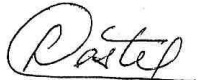
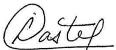
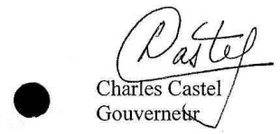

<!-- page 1 -->

## Aux Banques Commerciales Et aux Banques d'Epargne et de Logement

A compter du 4 février 2019, les coefficients de réserves obligatoires sur les passifs libellés en gourdes et en monnaies étrangères ainsi que les taux de constitution des réserves sur les passifs libellés en monnaies étrangères seront modifiés comme suit :

Coefficients de réserves obligatoires

|   | Passifs en Gourdes | Passifs en Monnaies Etrangères |
| --- | --- | --- |
| Banques Commerciales | 45% | 51% |
| Banques d'épargne et De logement | 33.5% | 39.50% |
| Filiales non bancaires | 45% | 51% |

- Taux de Constitution des Réserves sur Passifs en Monnaies Etrangères

| En Gourdes | En Monnaies Etrangères |
| --- | --- |
| 12.5% | 87.5% |

Port-au-Prince, le 29 janvier 2019

<!-- page 2 -->

Réf. : BRH/DCC/CIRC # 002-18

## CIRCULAIRE AUX BANQUES

A compter du 10 décembre 2018, les coefficients de réserves obligatoires sur les passifs libellés en gourdes et en monnaies étrangères ainsi que les taux de constitution des réserves sur les passifs libellés en monnaies étrangères seront modifiés comme suit :

- Coefficients de réserves obligatoires

| Passifs en Gourdes | Passifs en Monnaies Etrangères |
| --- | --- |
| Banques Commerciales | 49.5% |
| Banques d'Epargne et | 38% |
| De Logement |   |
| Filiales non bancaires | 49.5% |

- Taux de Constitution des Réserves sur Passifs en Monnaies Etrangères

En Monnaies Etrangères

Port-au-Prince, le 4 décembre 2018

90%

Baden-Dubuis

<!-- page 3 -->

REF : CIRC-RES # 001-18

## CIRCULAIRE AUX BANQUES

A compter du  $ 1^{er} $ août 2018, le mode de constitution des réserves obligatoires sur les passifs libellés en monnaies étrangères défini par la circulaire # 86-5 du 13 mai 1997 est ainsi établi :

7.5% en monnaie nationale

• 92.5% en monnaies étrangères

Port-au-Prince, le 23 juillet 2018

Braden Club

Jean Baden Dubois

<!-- page 4 -->

# AUX BANQUES

Conformément à l'article 83 de la loi du 14 mai 2012 portant sur les banques et autres institutions financières, la présente circulaire détermine les normes relatives aux éléments constitutifs des réserves obligatoires auxquelles sont assujetties les banques.

### 1. Régime des réserves obligatoires

Les réserves obligatoires sont constituées par : les soldes des comptes ouverts au nom des banques à la Banque de la République d'Haïti (BRH), leur encaisse en monnaies nationale et étrangère et les dépôts détenus par des banques à la Banque Nationale de Crédit (BNC).

#### 1.1. Constitution des réserves obligatoires

Sont sujets aux réserves obligatoires :

A- Tous les passifs du bilan libellés en monnaies nationale et étrangère, à l'exception :

- des engagements envers les banques locales soumises aux mêmes exigences de réserves obligatoires ;

- des engagements envers la BRH :

- des fonds reçus des Sociétés Financières de Développement (SFD) à titre de prêts à des fins de refinancement ;

des revenus différés tels que définis dans la circulaire No. 93 sur la transmission d'états financiers mensuels ;

• de la contrepartie des effets à recouvrement immédiat ;

- des acceptations en circulation telles que définies dans la circulaire No. 93 sur la transmission d'états financiers mensuels ;

- des éléments de fonds propres hybrides considérés comme du quasi-capital tels que définis dans la circulaire No. 88 sur la suffisance des fonds propres ;

• de toute autre déduction prévue dans la réglementation en vigueur.

B- Tous les fonds reçus sous forme de titres, de bons de caisse et autres libellés en gourdes et en devises par les filiales non bancaires.

Sont considérées comme filiales non bancaires les entreprises qui font profession habituelle d'accomplir une ou plusieurs activités assimilables aux opérations de banque.

C- Tous les engagements en monnaie nationale (hors bilan) représentant la contrepartie d'engagement en devises, enregistrés au bilan.

<!-- page 5 -->

#### 1.2. Particularités

Sont exonérés de réserves obligatoires :

a) Les ressources en gourdes captées et utilisées pour octroyer des prêts au logement, c'est-à-dire l'ensemble des prêts et avances octroyés par un établissement bancaire pour l'acquisition, la construction, la réparation ou l'amélioration d'un bien immobilier résidentiel. Les biens immobiliers résidentiels comprennent les résidences unifamiliales, les logements multiples de tout type à des fins résidentiels et les terrains devant servir à la construction résidentielle et conformes aux normes parasimiques internationalement admises.

b) Les ressources en gourdes captées et utilisées pour octroyer des prêts pour l'acquisition, la construction, la réparation ou l'amélioration d'immeubles résidentiels, commerciaux et industriels.

c) Les ressources en gourdes utilisées, à partir du  $ 1^{er} $ aout 2010, pour l'octroi de prêts au logement tels que définis aux paragraphes (a) et (b) de la présente section.

d) Les prêts au logement sains avant le 12 janvier 2010 et restructurés après cette date.

e) Les ressources en gourdes et en dollars de la banque utilisées pour octroyer des prêts à une institution hôtelière à partir du 27 mars 2015 et restructurés après cette date.

f) Les ressources en gourdes de la banque utilisées pour financer des zones franches.

g) Les ressources en gourdes de la banque utilisées pour financer les activités de production des entreprises agricoles et d'élevage.

h) Les ressources provenant des fonds de pension d'entreprises publiques et d'organismes autonomes.

i) Tous les dépôts à terme bonifiés en gourdes portant un intérêt de base supérieur ou égal à 4% l'an augmenté de la variation positive du Taux Moyen d'Acquisition (TMA) du début à la fin de la période de détention dudit dépôt à terme.

Par ailleurs, la BNC doit soustraire le solde des comptes des autres banques (détenus en lieu et place de la BRH) domiciliés chez elle dans le calcul de sa couverture.

### 2. Exigence en matière de réserves obligatoires

Le montant minimum des réserves obligatoires que doit constituer chaque établissement bancaire est calculé en appliquant les coefficients de réserves obligatoires en vigueur aux passifs assujettis décrits à la section 1. Le changement dans les coefficients de réserves obligatoires est fonction de l'orientation de la politique monétaire. La BRH communique aux banques par voie de circulaire les nouveaux coefficients de réserves obligatoires gourdes et dollars applicables ainsi que leur date d'entrée en vigueur.

Le calcul du montant des réserves obligatoires est effectué par les établissements bancaires sur la base de rapport statistique de liquidité qu'ils soumettent quotidiennement à la BRH qui vérifie l'exactitude du montant des réserves soumis par chaque établissement bancaire. Dans la mesure où une divergence est constatée, la BRH intervient pour demander des explications voire une rectification dudit rapport et dispose de quatre-vingt-dix (90) jours pour s'assurer de la validité des rapports de liquidité. Passé ce délai, les banques peuvent considérer les montants rapportés

<!-- page 6 -->

pendant cette période comme étant corrects et doivent veiller au respect de leurs obligations en matière de réserves telles que décrites dans la présente circulaire.

### 3. Rapports

Les banques sont tenues de soumettre à la BRH les rapports suivants :

Rapport quotidien sur la liquidité et sur la couverture (Annexe I)

Délai de soumission : le prochain jour ouvré à midi suivant la date de référence du rapport.

- Rapport quotidien sur le calcul des rubriques déductibles du passif assujetti aux réserves obligatoires (Annexe II)

Délai de soumission : le prochain jour ouvré à midi suivant la date de référence du rapport.

- Liste mensuelle détaillée des bénéficiaires des prêts liés aux programmes incitatifs de la BRH (Annexe III)

Délai de soumission : 3 jours après la fin du mois.

Bilan journalier ayant servi à la préparation du rapport quotidien sur la liquidité et sur la couverture

Délai de soumission : le prochain jour ouvré à midi suivant la date de référence du rapport.

- Liste mensuelle détaillée des comptes de fonds de pension détenus au nom des entreprises publiques et organismes autonomes

Délai de soumission : 3 jours après la fin du mois.

Les banques feront parvenir ces rapports via le module SIF. En cas d'indisponibilité du système ou pour toute autre situation ne permettant pas l'envoi du rapport, celui-ci devra être acheminé à la BRH soit en version papier, soit sur un support électronique sécurisé.

Il est formellement interdit aux banques de modifier le formulaire de déclaration annexé à la présente circulaire.

### 4. Sanctions

En cas de non-respect des obligations définies dans la présente circulaire, les banques s'exposent aux pénalités suivantes :

## a) Pénalité pour retard de soumission du rapport de liquidité et de couverture

A défaut de fournir, dans le délai requis, les rapports de conformité prévu à la section 3 de la présente circulaire, la banque fautive sera assujettie à une pénalité de cinquante mille gourdes

<!-- page 7 -->

(HTG 50,000.00) par jour d'infraction et par rapport. La période de pénalité s'étend du jour de l'infraction jusqu'à celui où les renseignements sont mis à la disposition de la BRH.

## b) Pénalité pour insuffisance de réserves obligatoires

Toute insuffisance de réserves obligatoires sera frappée d'une pénalité de 36% l'an calculée sur une base quotidienne. Ce pourcentage sera appliqué sur la position déficitaire de réserves du jour, ce sans préavis à la banque fautive.

## c) Fiabilité de l'information

Les montants déclarés dans les rapports sur la liquidité et sur la couverture doivent être à tout moment les mêmes que ceux enregistrés dans les livres comptables des banques. Toute différence dument constatée sera frappée d'une pénalité de 10% du montant de cette différence, nonobstant les régularisations des réserves subséquentes et les pénalités y afférentes. La pénalité sera débitée à l'un des comptes de la banque fautive tenus à la BRH.

## d) Pénalité en cas de modification des formulaires

Toute banque qui aura modifié le formulaire de déclaration sera sanctionnée par une lettre de blâme et d'une pénalité de cinquante mille gourdes (HTG 50,000.00). En cas de récidive, la pénalité sera doublée.

## e) Autres

Toute banque qui aura enregistré sous d'autres appellations des opérations sujettes à réserves obligatoires selon cette circulaire, dans le but de les soustraire desdites réserves, sera passible d'une pénalité de 25% du montant de l'opération, nonobstant les régularisations du calcul des réserves et les pénalités y afférentes. Cette pénalité sera déduite du solde de l'un des comptes de la banque fautive à la BRH.

### 5. Abrogation et entrée en vigueur

La présente circulaire abroge les circulaires No. 72-3 du 1 $ ^{er} $ septembre 1998 et 78-1 du 27 mars 2000.

La présente circulaire entre en vigueur le 1 $ ^{er} $ décembre 2017.

Port-au-Prince, le 25 septembre 2017

Jean Baden Dubois

Gbuverneur

<!-- page 8 -->

## Liste des Annexes

Annexe I : Rapport quotidien sur la liquidité et la couverture

Annexe II: Feuille de calcul des rubriques déductibles du passif assujetti aux réserves obligatoires (sur une base journalière)

Annexe III : Liste mensuelle détaillée des bénéficiaires des prêts liés aux programmes incitatifs de la BRH

○ Annexe III.1 : Prêts au logement

○ Annexe III.2 : Prêts au secteur hôtelier

○ Annexe III.3 : prêts au secteur agricole

○ Annexe III.4 : Prêts aux zones franches

○ Annexe III.5 : DAT indexés

○ Annexe III.6 : Autres programmes sujets à exonération

Annexe IV : liste mensuelle détaillée des comptes de fonds de pension détenus au nom des entreprises publiques et organismes autonomes

<!-- page 9 -->

| BANQUE |   |   | DATE SOUMISSION DU RAPPORT |   |
| --- | --- | --- | --- | --- |
| Banque |   |   | DATE soumission du rapport |   |
| Journée du |   |   | Mise à jour |   |
| Taux de référence |   |   |   |   |
|   |   |   |   |   |
|   |   |   |   |   |
|   |   |   |   |   |
| A) Total du passif de la banque |   |   |   |   |
|   |   |   |   |   |
|   |   |   |   |   |
| B) Rubriques déductibles |   |   |   |   |
|   |   |   |   |   |
| B1) Engagements envers autres banques |   |   |   |   |
| B2) Engagements envers la BAH |   |   |   |   |
| B3) Fonds recus des SFD |   |   |   |   |
| B4) Revenus différés (Ref: Circ 93) |   |   |   |   |
| B5) Effets à recouvrement |   |   |   |   |
| B6) Acceptations en circulation (Ref: Circ 93) |   |   |   |   |
| B7) Obligations subordonnées |   |   |   |   |
| B8) Autres produits financiers (dépôts à terme Indexés, ...) |   |   |   |   |
| B9) Programmes spéciaux financés à partir de Fonds propres |   |   |   |   |
| (Prêts au logement, secteur hotellier, secteur agricole, zone franche) |   |   |   |   |
| B10) Fonds de pension |   |   |   |   |
| B11) Autres, à préciser |   |   |   |   |
|   | 11.1 Obligations Psugo |   |   |   |
|   | 11.2 Autres |   |   |   |
|   |   |   |   |   |
|   |   |   |   |   |
| C) Engagements hors bilan sujets à Réserves légales |   |   |   |   |
| C1) Achat à terme de devises |   |   |   |   |
| C2) Autres |   |   |   | Taux de réserves obligatoires |
| D) Total des engagements sujets à Réserve légale (A-B+C) |   |   |   | Gourdes |
| D1) Dépôts des entités publiques non financières |   |   |   |   |
| D2) Autres passifs |   |   |   | Devises |
|   |   |   |   |   |
| E) Taux de réserves |   |   |   |   |
| E1) Taux de réserves sur D1 |   |   |   |   |
| E2) Taux de réserves sur D2 |   |   |   |   |
|   |   |   |   |   |
| F) Réserves obligatoires avant mode de constitution (F1 + F2) |   |   |   |   |
| F1) Réserves Obligatoires sur dépôts des entités publiques (D1*E1) |   |   |   |   |
| F2) Réserves obligatoires sur autres passifs (D2*E2) |   |   |   |   |
| G) Mode de constitution de reserves sur passif en monnaie étrangret |   |   |   |   |
| H) Constitution de reserves sur passif en monnaie etarçgbre (F*G) |   |   |   |   |
|   |   |   |   |   |
| I) Réserves Obligatoires après ajustement (F+H) |   |   |   |   |
|   |   |   |   |   |
| J) Couverture de la Réserve Obligatoire (1+1+2+3+4) |   |   |   |   |
| J1) Billets et Monnaie |   |   |   |   |
| J2) Avoir à la Banque Centrale |   |   |   |   |
| J3) Avoir à la BNC |   |   |   |   |
| J4) Autres, à préciser |   |   |   |   |
|   | 14.1 Obligations du trésor Haitien Post Sandy |   |   |   |
|   | 14.2 Autres |   |   |   |
|   |   |   |   |   |
|   |   |   |   |   |
| K) Excedent ou déficit (I-J) |   |   |   |   |
|   |   |   |   |   |
| Prêts interbancaires |   |   |   |   |
| Emprunts interbancaires |   |   |   |   |
| Crédit au secteur Privé (CT) |   |   |   |   |
| Crédit au secteur Privé (MT, LT) |   |   |   |   |
| Crédit au Secteur Public |   |   |   |   |
| Dépôts à vue |   |   |   |   |
| Dépôts d'Espagne |   |   |   |   |
| Dépôts à terme |   |   |   |   |
|   |   |   |   |   |
|   |   |   |   |   |
|   |   |   |   |   |
| Signature de deux cadres autorisés |   |   |   |   |
|   |   |   |   |   |
|   |   |   |   |   |
| Titre / poste |   |   |   |   |
|   |   |   |   |   |
|   |   |   |   |   |

<!-- page 10 -->

<table><tr><td>ANNEXE I BNC</td></tr><tr><td>RAPPORT QUOTIDIEN SUR LA LIQUIDITÉ ET SUR LA COUVERTURE</td></tr><tr><td></td><td></td><td></td><td></td><td></td><td></td><td></td><td></td></tr><tr><td></td><td></td><td></td><td></td><td></td><td></td><td></td><td></td></tr><tr><td>Banque</td><td></td><td></td><td></td><td>Date soumission du rapport</td><td></td><td></td></tr><tr><td>Journée du</td><td></td><td></td><td></td><td></td><td></td><td></td><td></td></tr><tr><td></td><td></td><td></td><td></td><td>Mise à jour</td><td></td><td></td></tr><tr><td>Taux de référence</td><td></td><td></td><td>Montréal et l'États-Unis
(1990)
(1990)</td><td></td><td></td></tr><tr><td></td><td></td><td></td><td></td><td></td><td></td><td></td><td></td></tr><tr><td>A) Total du passif de la banque</td><td></td><td></td><td></td><td></td><td></td><td></td></tr><tr><td></td><td></td><td></td><td></td><td></td><td></td><td></td><td></td></tr><tr><td>B) Rubriques déductibles</td><td></td><td></td><td></td><td></td><td></td><td></td></tr><tr><td>B1) Engagements envers autres banques</td><td></td><td></td><td></td><td></td><td></td><td></td></tr><tr><td>B2) Engagements envers la BRH</td><td></td><td></td><td></td><td></td><td></td><td></td></tr><tr><td>B3) Fonds recus des SFD</td><td></td><td></td><td></td><td></td><td></td><td></td></tr><tr><td>B4) Revenus différés (Réf. Circ 93)</td><td></td><td></td><td></td><td></td><td></td><td></td></tr><tr><td>B5) Effets à recouvrement</td><td></td><td></td><td></td><td></td><td></td><td></td></tr><tr><td>B6) Acceptations en circulation (Réf. Circ 93)</td><td></td><td></td><td></td><td></td><td></td><td></td></tr><tr><td>B7) Obligations subordonnées</td><td></td><td></td><td></td><td></td><td></td><td></td></tr><tr><td>B8) Autres produits financiers (dépôts à terme Indexés, ...)</td><td></td><td></td><td></td><td></td><td></td><td></td></tr><tr><td>B9) Programmes spéciaux financés à partir de Fonds propres</td><td></td><td></td><td></td><td></td><td></td><td></td></tr><tr><td>(Prêts au logement, secteur hotellier, secteur agricole, zone franche)</td><td></td><td></td><td></td><td></td><td></td><td></td></tr><tr><td>B10) Fonds de pension</td><td></td><td></td><td></td><td></td><td></td><td></td></tr><tr><td>B11) Autres à préciser</td><td></td><td></td><td></td><td></td><td></td><td></td></tr><tr><td></td><td>11.1 Obligations Psugo</td><td></td><td></td><td></td><td></td><td></td></tr><tr><td></td><td>11.2 Autres</td><td></td><td></td><td></td><td></td><td></td></tr><tr><td></td><td></td><td></td><td></td><td></td><td></td><td></td><td></td></tr><tr><td>C) Engagements hors bilan sujets à Réserves légales</td><td></td><td></td><td></td><td></td><td></td><td></td></tr><tr><td>C1) Achat à terme de devises</td><td></td><td></td><td></td><td></td><td></td><td></td></tr><tr><td>C2) Autres</td><td></td><td></td><td></td><td></td><td></td><td>Taux de réserves obligatoires</td></tr><tr><td>D) Total des engagements sujets à Réserve légale (A-B+C)</td><td></td><td></td><td></td><td></td><td></td><td>Gourdes</td></tr><tr><td>D1) Dépôts des entités publiques non financières</td><td></td><td></td><td></td><td></td><td></td><td></td></tr><tr><td>D2) Autres passifs</td><td></td><td></td><td></td><td></td><td></td><td></td></tr><tr><td></td><td></td><td></td><td></td><td></td><td></td><td></td><td>Devises</td></tr><tr><td>E) Taux de réserves</td><td></td><td></td><td></td><td></td><td></td><td></td></tr><tr><td>E1) Taux de réserves sur D1</td><td></td><td></td><td></td><td></td><td></td><td></td></tr><tr><td>E2) Taux de réserves sur D2</td><td></td><td></td><td></td><td></td><td></td><td></td></tr><tr><td>F) Réserves obligatoires avant mode de constitution (F1 + F2)</td><td></td><td></td><td></td><td></td><td></td><td></td></tr><tr><td>F1) Réserves obligatoires sur dépôts des entités publiques (D1*E1)</td><td></td><td></td><td></td><td></td><td></td><td></td></tr><tr><td>F2) Réserves obligatoires sur autres passifs (D2*E2)</td><td></td><td></td><td></td><td></td><td></td><td></td></tr><tr><td>G) Mode de constitution de réserves sur passif en monnaie étrangèreur</td><td></td><td></td><td></td><td></td><td></td><td></td></tr><tr><td>H) Constitution de réserves sur passif en monnaie étrangère (F*G)</td><td></td><td></td><td></td><td></td><td></td><td></td></tr><tr><td></td><td></td><td></td><td></td><td></td><td></td><td></td><td></td></tr><tr><td>I) Réserves Obligatoires après ajustement (F+H)</td><td></td><td></td><td></td><td></td><td></td><td></td></tr><tr><td></td><td></td><td></td><td></td><td></td><td></td><td></td><td></td></tr><tr><td>J) Couverture de la Réserve Obligatoire (1+2+3-J4)</td><td></td><td></td><td></td><td></td><td></td><td></td></tr><tr><td>J1) Billets et Monnaie</td><td></td><td></td><td></td><td></td><td></td><td></td></tr><tr><td>J2) Avolr à la Banque Centrale</td><td></td><td></td><td></td><td></td><td></td><td></td></tr><tr><td>J3) Autres, à préciser</td><td></td><td></td><td></td><td></td><td></td><td></td></tr><tr><td></td><td>J3.1 Obligations du trésor Haitien Post Sandy</td><td></td><td></td><td></td><td></td><td></td></tr><tr><td></td><td>J3.2 Autres</td><td></td><td></td><td></td><td></td><td></td></tr><tr><td>J4)Moins: Dépôts des banques locales</td><td></td><td></td><td></td><td></td><td></td><td></td></tr><tr><td>Banque 1</td><td></td><td></td><td></td><td></td><td></td><td></td></tr><tr><td>Banque 2</td><td></td><td></td><td></td><td></td><td></td><td></td></tr><tr><td></td><td></td><td></td><td></td><td></td><td></td><td></td><td></td></tr><tr><td>K) Excedent ou déficit (I-J)</td><td></td><td></td><td></td><td></td><td></td><td></td></tr><tr><td>Prêts interbancaires</td><td></td><td></td><td></td><td></td><td></td><td></td></tr><tr><td>Emprunts interbancaires</td><td></td><td></td><td></td><td></td><td></td><td></td></tr><tr><td>Crédit au secteur Privé (CT)</td><td></td><td></td><td></td><td></td><td></td><td></td></tr><tr><td>Crédit au secteur Privé (MT, LT)</td><td></td><td></td><td></td><td></td><td></td><td></td></tr><tr><td>Crédit au Secteur Public</td><td></td><td></td><td></td><td></td><td></td><td></td></tr><tr><td>Dépôts à vue</td><td></td><td></td><td></td><td></td><td></td><td></td></tr><tr><td>Dépôts d'Epargne</td><td></td><td></td><td></td><td></td><td></td><td></td></tr><tr><td>Dépôts à terme</td><td></td><td></td><td></td><td></td><td></td><td></td></tr><tr><td></td><td></td><td></td><td></td><td></td><td></td><td></td><td></td></tr><tr><td></td><td></td><td></td><td></td><td></td><td></td><td></td><td></td></tr><tr><td></td><td></td><td></td><td></td><td></td><td></td><td></td><td></td></tr><tr><td>Signature de deux cadres autorisés</td><td></td><td></td><td></td><td></td><td></td><td></td></tr><tr><td>Titre/Poste</td><td></td><td></td><td></td><td></td><td></td><td></td></tr><tr><td></td><td></td><td></td><td></td><td></td><td></td><td></td><td></td></tr></table>

<!-- page 11 -->

# FEUILLE DE CALCUL DES RUBRIQUES DEDUCTIBLES DU PASSIF ASSUJETTI AUX RESERVES OBLIGATOIRES

Etablissement bancaire : ___ Au : ___

<table><tr><td>A - Engagements envers autres banques (B1)</td><td>XXXXXXXX</td></tr><tr><td>Banque 1</td><td>XXXXXXXX</td><td></td></tr><tr><td>Banque 2</td><td>XXXXXXXX</td><td></td></tr><tr><td>Banque 3</td><td>XXXXXXXX</td><td></td></tr><tr><td></td><td></td><td></td></tr><tr><td>B - Engagements envers la BRH / programmes de financement et autres (B2)</td><td>XXXXXXXX</td></tr><tr><td>Zones franches</td><td>XXXXXXXX</td><td></td></tr><tr><td>Prêts au logement de type Kay Pam</td><td>XXXXXXXX</td><td></td></tr><tr><td>Prêts d'escompte</td><td>XXXXXXXX</td><td></td></tr><tr><td>Mise en pension - Bons BRH</td><td>XXXXXXXX</td><td></td></tr><tr><td>Autres</td><td>XXXXXXXX</td><td></td></tr><tr><td></td><td></td><td></td></tr><tr><td>C - Fonds reçus des SFD (B3)</td><td>XXXXXXXX</td></tr><tr><td>Programme de refinancement</td><td>XXXXXXXX</td><td></td></tr><tr><td>Dépôts totaux</td><td>XXXXXXXX</td><td></td></tr><tr><td>Dépôts à terme</td><td>XXXXXXXX</td><td></td></tr><tr><td>Autres</td><td>XXXXXXXX</td><td></td></tr><tr><td></td><td></td><td></td></tr><tr><td>D - Eléments de fonds propres hybrides (B7)</td><td>XXXXXXXX</td></tr><tr><td></td><td></td><td></td></tr><tr><td>E- Autres produits financiers /Dépôts à terme indexés (B8)</td><td>XXXXXXXX</td></tr><tr><td></td><td></td><td></td></tr><tr><td>F - Programmes spéciaux financés à partir de fonds propres (B9)</td><td>XXXXXXXX</td></tr><tr><td>Prêts au logement de type Kay Pam</td><td>XXXXXXXX</td><td></td></tr><tr><td>Prêts au logement à partir du  $ 1^{er} $ aout 2010</td><td>XXXXXXXX</td><td></td></tr><tr><td>Prêts au secteur hôtelier à partir de mars 2015</td><td>XXXXXXXX</td><td></td></tr><tr><td>Prêts au secteur agricole</td><td>XXXXXXXX</td><td></td></tr><tr><td>Prêts aux zones franches</td><td>XXXXXXXX</td><td></td></tr><tr><td></td><td></td><td></td></tr><tr><td>G - Fonds de pension (B10)</td><td>XXXXXXXX</td></tr><tr><td></td><td></td><td></td></tr><tr><td>H - Autres (B11)</td><td>XXXXXXXX</td></tr><tr><td>Obligations PSUGO</td><td>XXXXXXXX</td><td></td></tr><tr><td>Autres</td><td>XXXXXXXX</td><td></td></tr></table>

<!-- page 12 -->

# PRETS AU LOGEMENT RAPPORT MENSUEL

Etablissement bancaire : ___

Au:___

(en milliers de gourdes)

<table><tr><td>Clients</td><td>Montant décaissé</td><td>Date d'approbation du prêt (jj/mm/aaaa)</td><td>Taux d'intérêt</td><td>Durée du prêt (en mois)</td><td>Encours</td><td>Total</td></tr><tr><td>Prêts au logement avant le  $ 1^{er} $ aout 2010</td></tr><tr><td>Client # 1</td><td></td><td></td><td></td><td></td><td></td><td></td></tr><tr><td>Client # 2</td><td></td><td></td><td></td><td></td><td></td><td></td></tr><tr><td>Client # 3</td><td></td><td></td><td></td><td></td><td></td><td></td></tr><tr><td>......</td><td></td><td></td><td></td><td></td><td></td><td></td></tr><tr><td>Sous-total</td><td>XXXXXX</td></tr><tr><td>Prêts au logement après le  $ 1^{er} $ aout 2010</td></tr><tr><td>Client # 1</td><td></td><td></td><td></td><td></td><td></td><td></td></tr><tr><td>Client # 2</td><td></td><td></td><td></td><td></td><td></td><td></td></tr><tr><td>Client # 3</td><td></td><td></td><td></td><td></td><td></td><td></td></tr><tr><td>......</td><td></td><td></td><td></td><td></td><td></td><td></td></tr><tr><td>Sous-total</td><td>XXXXXX</td></tr><tr><td>Prêts restructurés au logement après le  $ 1^{er} $ aout 2010</td></tr><tr><td>Client # 1</td><td></td><td></td><td></td><td></td><td></td><td></td></tr><tr><td>Client # 2</td><td></td><td></td><td></td><td></td><td></td><td></td></tr><tr><td>Client # 3</td><td></td><td></td><td></td><td></td><td></td><td></td></tr><tr><td>......</td><td></td><td></td><td></td><td></td><td></td><td></td></tr><tr><td>Sous-total</td><td>XXXXXX</td></tr><tr><td>GRAND TOTAL</td><td>XXXXXX</td></tr><tr><td>Total portefeuille de prêts au logement</td></tr><tr><td>Prêts au logement financé à partir des avances de la BRH</td><td>XXXXXX</td></tr><tr><td>Prêts au logement financé à partir d'autres ressources</td><td>XXXXXX</td></tr><tr><td>Autres prêts au logement</td><td>XXXXXX</td></tr></table>

Signature de deux cadres autorisés : _____ _____

Poste/Titre : ___

<!-- page 13 -->

# PRETS AU SECTEUR HOTELIER RAPPORT MENSUEL

Etablissement bancaire : _____

Au : _____

(en milliers de gourdes)

<table><tr><td>Clients</td><td>Montant décaissé</td><td>Date d'approbation du prêt (jj/mm/aaaa)</td><td>Taux d'intérêt</td><td>Durée du prêt (en mois)</td><td>Total</td></tr><tr><td>Prêts au secteur hôtelier avant mars 2015</td></tr><tr><td>Client # 1</td><td></td><td></td><td></td><td></td><td></td></tr><tr><td>Client # 2</td><td></td><td></td><td></td><td></td><td></td></tr><tr><td>Client # 3</td><td></td><td></td><td></td><td></td><td></td></tr><tr><td>Client # 4</td><td></td><td></td><td></td><td></td><td></td></tr><tr><td>............</td><td></td><td></td><td></td><td></td><td></td></tr><tr><td>Sous-total</td><td>XXXXXX</td></tr><tr><td>Prêts au secteur hôtelier après mars 2015</td></tr><tr><td>Client # 1</td><td></td><td></td><td></td><td></td><td></td></tr><tr><td>Client # 2</td><td></td><td></td><td></td><td></td><td></td></tr><tr><td>Client # 3</td><td></td><td></td><td></td><td></td><td></td></tr><tr><td>Client # 4</td><td></td><td></td><td></td><td></td><td></td></tr><tr><td>............</td><td></td><td></td><td></td><td></td><td></td></tr><tr><td>Sous-total</td><td>XXXXXX</td></tr><tr><td>Total prêts au secteur hôtelier</td><td>XXXXXX</td></tr></table>

Signature de deux cadres autorisés : _____ _____

Poste /Titre :

___

___

<!-- page 14 -->

# PRETS AU SECTEUR AGRICOLE RAPPORT MENSUEL

Etablissement bancaire : _____

Au : _____

(en milliers de gourdes)

<table><tr><td>Clients</td><td>Activités</td><td>Commune</td><td>Département</td><td>Date d'approbation</td><td>Taux d'intérêt</td><td>Encours</td><td>% des crédits totaux</td></tr><tr><td></td><td>Encours crédits aux entreprises agricoles</td></tr><tr><td>Client #1</td><td></td><td></td><td></td><td></td><td></td><td></td><td></td></tr><tr><td>Client # 2</td><td></td><td></td><td></td><td></td><td></td><td></td><td></td></tr><tr><td>Client # 3</td><td></td><td></td><td></td><td></td><td></td><td></td><td></td></tr><tr><td>Client # 4</td><td></td><td></td><td></td><td></td><td></td><td></td><td></td></tr><tr><td>Client # 5</td><td></td><td></td><td></td><td></td><td></td><td></td><td></td></tr><tr><td>............</td><td></td><td></td><td></td><td></td><td></td><td></td><td></td></tr><tr><td></td><td>Encours crédits aux entreprises d'élevage</td></tr><tr><td>Client # 1</td><td></td><td></td><td></td><td></td><td></td><td></td><td></td></tr><tr><td>Client # 2</td><td></td><td></td><td></td><td></td><td></td><td></td><td></td></tr><tr><td>Client # 3</td><td></td><td></td><td></td><td></td><td></td><td></td><td></td></tr><tr><td>Client # 4</td><td></td><td></td><td></td><td></td><td></td><td></td><td></td></tr><tr><td>Client # 5</td><td></td><td></td><td></td><td></td><td></td><td></td><td></td></tr><tr><td>............</td><td></td><td></td><td></td><td></td><td></td><td></td><td></td></tr></table>

Poste /Titre :

___

___

<!-- page 15 -->

# PRETS AUX ZONES FRANCHES RAPPORT MENSUEL

Etablissement bancaire : _____

Au : _____

(en milliers de gourdes)

<table><tr><td>Clients</td><td>Date de décaissement (jj/mm/aaaa)</td><td>Encours</td><td>Taux d'intérêt</td><td>Durée prêt (en mois)</td><td>% des crédits totaux</td><td>Total</td></tr><tr><td>Client # 1</td><td></td><td></td><td></td><td></td><td></td><td></td></tr><tr><td>Client # 2</td><td></td><td></td><td></td><td></td><td></td><td></td></tr><tr><td>Client # 3</td><td></td><td></td><td></td><td></td><td></td><td></td></tr><tr><td>Client # 4</td><td></td><td></td><td></td><td></td><td></td><td></td></tr><tr><td>Client # 5</td><td></td><td></td><td></td><td></td><td></td><td></td></tr><tr><td>............</td><td></td><td></td><td></td><td></td><td></td><td></td></tr><tr><td>Total</td><td>XXXXXXXXX</td></tr></table>

AUTRES INFORMATIONS

| Clients | Nombre d'unités | Nombre de mètres carrés | Taux d'occupation | Nombre d'employés |
| --- | --- | --- | --- | --- |
| Client # 1 |   |   |   |   |
| Client # 2 |   |   |   |   |
| Client # 3 |   |   |   |   |
| Client # 4 |   |   |   |   |
| Client # 5 |   |   |   |   |
| ............ |   |   |   |   |

Signature de deux cadres autorisés : ___ ___

Poste/Titre :

<!-- page 16 -->

### ANNEXE III.5

## DAT INDEXÉS

## RAPPORT MENSUEL

Etablissement bancaire : ___ Au : ___

(en milliers de gourdes)

<table><tr><td>Clients</td><td>Montant</td><td>Taux d'intérêt</td><td>Date début\n(jj/mm/aaaa)</td><td>Date d'échéance\n(jj/mm/aaaa)</td></tr><tr><td>Client # 1</td><td></td><td></td><td></td><td></td></tr><tr><td>Client # 2</td><td></td><td></td><td></td><td></td></tr><tr><td>Client # 3</td><td></td><td></td><td></td><td></td></tr><tr><td>Client # 4</td><td></td><td></td><td></td><td></td></tr><tr><td>Client # 5</td><td></td><td></td><td></td><td></td></tr><tr><td>............</td><td></td><td></td><td></td><td></td></tr><tr><td></td><td></td><td></td><td></td><td></td></tr><tr><td></td><td></td><td></td><td></td><td></td></tr><tr><td></td><td></td><td></td><td></td><td></td></tr><tr><td></td><td></td><td></td><td></td><td></td></tr><tr><td>Total</td><td>xxxxxxxx</td><td></td></tr></table>

Signature de deux cadres autorisés : _____ _____

Poste/Titre :

<!-- page 17 -->

### ANNEXE III.6

# AUTRES PROGRAMMES SUJETS A EXONERATION RAPPORT MENSUEL

Etablissement bancaire : _____

Au : _____

(en milliers de gourdes)

| Clients | Montant |
| --- | --- |
| Client # 1 |   |
| Client # 2 |   |
| Client # 3 |   |
| Client # 4 |   |
| Client # 5 |   |
| ............ |   |
|   |   |
|   |   |
|   |   |
|   |   |
|   |   |
|   |   |
| Total | XXXXXXXXX |

Signature de deux cadres autorisés : ___ ___

Poste/Titre :

<!-- page 18 -->

# COMPTE DE FONDS DE PENSION DETENUS AU NOM DES ENTREPRISES PUBLIQUES ET ORGANISMES AUTONOMES

# RAPPORT MENSUEL

Etablissement bancaire : ___

Au:___

(en milliers de gourdes)

| COMPTES FONDS DE PENSION | Solde du mois précédent | Solde du mois actuel |
| --- | --- | --- |
| Entreprises publiques # 1 |   |   |
| Entreprises publiques # 2 |   |   |
| Entreprises publiques # 3 |   |   |
| Entreprises publiques # 4 |   |   |
| Entreprises publique # 5 |   |   |
| ............ |   |   |
|   |   |   |
|   |   |   |
|   |   |   |
| Total | XXXXXXXXX | XXXXXXXXXXXX |

Signature de deux cadres autorisés : ___ ___

Poste/Titre : ___

<!-- page 19 -->

REF : CIRC-RES # 95

## AUX BANQUES COMMERCIALES ET AUX BANQUES D'ÉPARGNE ET DE LOGEMENT

A compter du 16 juillet 2015, les coefficients de réserves obligatoires sur les passifs libellés en Gourdes et en monnaies étrangères définis par la circulaire #72-3 du 1er septembre 1998 sont ainsi établis:

Passifs en gourdes Passifs en monnaies étrangères

Coefficients de réserves obligatoires :

Banques commerciales 44% 48%

Banques d'épargne et de logement 32.5% 36.5%

Filiales non bancaires 44% 48%

Port-au-Prince, le 6 juillet 2015

Past

Charles Castel

Gouverneur

<!-- page 20 -->

## AUX BANQUES COMMERCIALES ET AUX BANQUES D'ÉPARGNE ET DE LOGEMENT

A compter du 1erjuillet 2015, les coefficients de réserves obligatoires sur les passifs libellés en Gourdes et en monnaies étrangères définis par la circulaire #72-3 du 1er septembre 1998 sont ainsi établis:

## Passifs en gourdes

Passifs en monnaies étrangères

Coefficients de réserves obligatoires :

| Banques commerciales | 42% | 46% |
| --- | --- | --- |
| Banques d'épargne et de logement | 30.5% | 34.5% |
| Filiales non bancaires | 42% | 46% |

Port-au-Prince, le 25 juin 2015

Charles Castel

Gouverneur

<!-- page 21 -->

REF: CIRC-RES #93

## Aux R commerciales

A compter du  $ 1^{er} $ juin 2015, les coefficients de réserves obligatoires sur les passifs libellés en Gourdes et en monnaies étrangères définis par la circulaire # 72-3 du  $ 1^{er} $ septembre 1998 sont ainsi établis :

## Passifs en Gourdes

Passifs en monnaies étrangères

Coefficients de réserves obligatoires :

Banques Commerciales 40% 43%

Banques d'épargne et 28.5% 31.5%

Filiales non bancaires 40% 43%

Port-au-Prince, le 26 mai 2015.

Past Charles Castel

<!-- page 22 -->

REF : CIRC-RES # 92

# Aux Banques Commerciales Et aux Banques d'Epargne et de Logement

A compter du  $ 1^{er} $ avril 2015, les coefficients de réserves obligatoires sur les passifs libellés en Gourdes et en monnaies étrangères définis par la circulaire #72-3 du  $ 1^{er} $ septembre 1998 sont ainsi établis :

## Passifs en Gourdes Passifs en monnaies étrangères

1) Coefficients de réserves obligatoires :

| Banques Commerciales | 38% | 41% |
| --- | --- | --- |
| Banques d'épargne et De logement | 26.5% | 29.5% |
| Filiales non bancaires | 38% | 41% |

Port-au-Prince, le 26 mars 2015

Charles Castel

<!-- page 23 -->

# Aux Banques Commerciales Et aux Banques d'Epargne et de Logement

A compter du 16 juillet 2014, les coefficients de réserves obligatoires sur les passifs libellés en Gourdes et en monnaies étrangères définis par la circulaire # 72-3 du 1er septembre 1998, et le mode de constitution des réserves obligatoires sur les passifs libellés en monnaies étrangères défini par la circulaire # 86-5 du 13 mai 1997 sont ainsi établis :

## Passifs en Gourdes Passifs en monnaies étrangères

1) Coefficients de réserves obligatoires :

| Banques Commerciales | 37% | 40% |
| --- | --- | --- |
| Banques d'épargne et De logement | 25.5% | 28.5% |
| Filiales non bancaires | 37% | 40% |

2) Constitution des réserves obligatoires sur les passifs en devises :

0% en monnaie nationale

100% en monnaies étrangères

Port-au-Prince, le 10 juillet 2014

Past Charles Castel

P.O

P.O. BOX 1570, Port-au-Prince, Haïti. Téléphone: (509) 2299-1243

<!-- page 24 -->

Réf. : BRH/DCC/LC # 01-14

# LETTRE-CIRCULAIRE AUX BANQUES COMMERCIALES ET AUX BANQUES D'EPARGNE ET DE LOGEMENT

Conformément aux articles 83 et 84 de la loi du 17 juillet 2012 sur les banques et autres institutions financières, et aux conventions en vigueur sur les Bons BRH, les établissements bancaires doivent respecter les dispositions de la présente lettre-circulaire en matière de gestion des réserves obligatoires, et des soumissions aux Bons BRH.

### I. Réserves Obligatoires

A compter du  $ 1^{er} $ avril 2014, les coefficients de réserves obligatoires sur les passifs libellés en Gourdes et en monnaies étrangères ainsi que les taux de constitution des réserves sur les passifs libellés en monnaies étrangères seront modifiés comme suit :

Coefficients de Réserves Obligatoires

|   | Passifs en Gourdes | Passifs en Monnaies Etrangères |
| --- | --- | --- |
| Banques Commerciales | 37% | 39% |
| Banques d'épargne et de logement | 25.5% | 27.5% |
| Filiales non bancaires | 37% | 39% |

- Taux de Constitution des Réserves sur Passifs en Monnaies Etrangères

| $ \underline{\text{En Gourdes}} $ | $ \underline{\text{En Monnaies Etrangères}} $ |
| --- | --- |
| 10% | 90% |

Il demeure entendu que l'exonération accordée aux banques pour les prêts sains au logement suivant lettre-circulaire # 06 du 3 juillet 2010 demeure inchangée.

<!-- page 25 -->

### II. Bons BRH

A compter du 24 mars 2014, les taux d'intérêt sur les Bons BRH seront modifiés comme suit :

| $ \underline{\text{Maturité}} $ | $ \underline{\text{Taux}} $ |
| --- | --- |
| 7 jours | 3 % |
| 28 jours | 4% |
| 91 jours | 5% |

Port-au-Prince, le 21 mars 2014.

<!-- page 26 -->

## AUX BANQUES COMMERCIALES, D'EPARGNE ET DE LOGEMENT

En référence à la circulaire BRH/CIR/95 #72 du 4 juillet 1995 et celle du 20 septembre 95 BRH/CIR/95 #75, la BRH informe les Banques Commerciales, d'Epargne et de Logement que l'article 7 est ainsi modifié:

## Article 7

A- La période de mesure des passifs soumis à réserve ainsi que celle de la constitution des réserves de couverture sont portées à un mois calendaire. Cependant, dans le but de rendre celles-ci non contemporaines un décalage de 15 jours est inséré entre la première et la seconde période en vue de permettre aux banques déficitaires de se rattraper en fin de période. En d'autres termes, une moyenne des Réserves Obligatoires (ROM) sera établie mensuellement du 1er au dernier jour du mois tandis que la moyenne des Réserves Effectives (REM) sera établie du 16 du même mois au 15 du mois suivant. La différence entre la moyenne des REM et celle des ROM indiquera la position de réserves de la banque. (Voir modèle en annexe)

B- Sur la base des données disponibles, les positions potentiellement déficitaires seront communiquées aux banques le premier jour ouvrable après le 7 du mois suivant. Ceci ne décharge pas les banques de leur responsabilité d'établir par anticipation leur position de réserve et de prendre les dispositions nécessaires afin de combler les éventuels déficits à la date limite du 15.

C- Si cette position demeure déficitaire (REM<ROM) à la date limite, une pénalité de 3% sera appliquée sur le montant du déficit et prélevée sur l'un des comptes de la banque tenu à la banque centrale.

Ces nouvelles dispositions entrent en vigueur à partir du mois d'avril 1996.

Le 19 avril 1996

Leslie Delatour

Gouverneur

<!-- page 27 -->

No. 86-5C

# AUX BANQUES COMMERCIALES, AUX BANQUES D'EPARGNE ET DE LOGEMENT

A compter du 16 août 1997, les réserves obligatoires sur les passifs libellés en Monnaies Etrangères seront ainsi constituées:

• 100 % en monnaie nationale.

Le 13 août 1997

Leslie Delatour

<!-- page 28 -->

# AUX INSTITUTIONS FINANCIERES

1. La présente circulaire définit les modalités d'application des réserves obligatoires auxquelles sont assujetties les banques commerciales, les banques d'épargne et de logement et leurs filiales non bancaires conformément au paragraphe 5 de la circulaire No. 92 du 9 avril 1998 relative à la surveillance consolidée des opérations des banques.

2. Sont considérées comme filiales non bancaires, les entreprises qui font profession habituelle d'accomplir une ou plusieurs activités assimilables aux opérations de banque.

3. Les institutions financières susvisées sont tenues de constituer un montant minimum sous forme de dépôts à la Banque de la République d'Haïti et d'encaisses en monnaie nationale, dans les conditions définies ci-dessous.

4. Pour les banques commerciales et les banques d'épargne et de logement, sont sujets à couverture des réserves obligatoires:

A- Tous les passifs du bilan libellés en monnaie nationale et en monnaies étrangères à l'exception:

- des engagements envers les institutions financières soumises aux mêmes obligations de Réserves obligatoires;

• des engagements envers la Banque de la République d'Haïti;

• des engagements envers le FDI:

• des revenus différés tels que définis dans la circulaire # 93;

• de la contrepartie des effets à recouvrement immédiat sur place;

- des acceptations en circulation telles que définies dans la circulaire #93.

B- Tous les engagements en monnaie nationale représentant la contrepartie d'engagement en devises enregistrés au bilan.

5. Pour les filiales non bancaires, sont sujets à couverture des réserves obligatoires tous les fonds reçus du public sous forme de dépôts, de titres, de bons de caisse et autres libellés en gourdes et en devises.

6. Les taux de réserves obligatoires sont fixés par la Banque de la République d'Haïti.

<!-- page 29 -->

7. Les banques feront parvenir chaque jour à la Banque de la République d'Haïti le rapport de liquidité et de couverture selon le modèle annexé et dans le délai prévu par la circulaire du 2 mars 1992 (Réf.: BRH/CT/92 #43). Il est interdit aux banques d'apporter des modifications à ce formulaire sans l'autorisation expresse de la Banque de la République d'Haïti.

8. Les montants déclarés dans les rapports de liquidité et de couverture doivent être à tout moment les mêmes que ceux enregistrés dans les livres comptables des Banques et de leurs filiales. Toute différence constatée sera considérée comme une déclaration fallacieuse et la banque fautive sera frappée d'une pénalité de 10% du montant de cette différence, nonobstant les régularisations des réserves subséquentes et les pénalités y afférentes. La pénalité sera débitée à l'un des comptes de la banque fautive tenu à la Banque de la République d'Haïti.

9. Toute banque qui aura enregistré sous d'autres appellations des opérations sujettes à réserves obligatoires selon cette circulaire, dans le but de les soustraire aux dites réserves, sera passible d'une pénalité de 25% du montant de l'opérations, nonobstant les régularisations du calcul des réserves et les pénalités y afférentes. Cette pénalité sera déduite du solde de l'un des comptes de la banque fautive à la BRH.

10. La présente circulaire entre en vigueur le 16 septembre 1998. Elle abroge la circulaire 72-2 du 13 mars 1997 et la circulaire 72-2A du 26 mai 1997. La circulaire No. 78 du 19 avril 1996 reste et demeure en vigueur.

Le 1er septembre 1998

Fritz Jean

Gouverneur

<!-- page 30 -->

## AUX BANQUES COMMERCIALES AUX BANQUES D'EPARGNE ET DE LOGEMENT

A compter du 16 septembre 1998, les coefficients de réserves obligatoires sur les passifs libellés en monnaie nationale et en monnaies étrangères définis par la circulaire #72-3 du 1er septembre 1998 sont établis ainsi qu'il suit:

|   | Passifs en gourdes | Passifs en monnaies étrangères |
| --- | --- | --- |
| Banques Commerciales | 26,50% | 12,50% |
| Banques d' épargne et de logement | 15% | 12% |
| Filiales non bancaires | 26,50% | 12,50% |

Le 1er septembre 1998

Fritz Jean

Gouverneur

<!-- page 31 -->

## AUX BANQUES COMMERCIALES AUX BANQUES D'ÉPARGNE ET DE LOGEMENT

À compter du 16 avril 2000, les coefficients de réserves obligatoires sur les passifs libellés en monnaie nationale et en monnaie étrangère définis par la circulaire # 72-3 du 1er septembre 1998 sont établis comme suit :

|   | Passifs en gourdes | Passifs en monnaie |
| --- | --- | --- |
| étrangère |   |   |
| Banques commerciales | 28% | 17% |
| Banques d' Épargne et de logement | 16,5% | 16% |
| Filiales non bancaires | 28% | 17% |

Le 27 mars 2000

Henry Cassion

Directeur Général

<!-- page 32 -->

# AUX BANQUES COMMERCIALES AUX BANQUES D'ÉPARGNE ET DE LOGEMENT

En référence aux circulaires BRH/CIR/72 du 4 juillet 1995, du 20 septembre 1995 BRH/CIR/95 #75 et du 19 avril 1996 BRH/CIR/96 #78, la BRH informe les Banques Commerciales, d'Épargne et de Logement que l'article 7 est ainsi modifié:

Le calcul des pénalités pour insuffisance de réserves sera effectué sur une base contemporaine bimensuelle soit du 1er au 15, et du 16 au dernier jour du mois à un taux de 1.5%. Ce pourcentage sera appliqué sur la position de réserves établie en faisant la différence entre la moyenne des Réserves Obligatoires (ROM) et celle des Réserves Effectives (REM) pour chaque période.

Ces dispositions entrent en vigueur à partir du 16 avril 2000.

Le 27 mars 2000

Henry Cassion

Directeur Général

<!-- page 33 -->

# AUX BANQUES COMMERCIALES ET AUX BANQUES D'EPARGNE ET DE LOGEMENT

A compter du 16 juin 2001, les coefficients de réserves obligatoires sur les passifs libellés en monnaies étrangères seront ainsi constituées:

• 30% en monnaie nationale

70% en monnaies étrangères

Le 5 juin 2001

Fritz Jean

<!-- page 34 -->

# AUX BANQUES COMMERCIALES ET AUX BANQUES D'EPARGNE ET DE LOGEMENT

A compter du 16 juin 2001, les coefficients de réserves obligatoires sur les passifs libellés en monnaie nationale et en monnaies étrangères définis par la circulaire # 72-3 du 1er septembre 1998 sont établis comme suit:

|   | Passifs en Gdes | Passifs | en | monnaies |
| --- | --- | --- | --- | --- |
| étrangères |   |   |   |   |
| Banques Commerciales | 31% |   | 31% |   |
| Banques d'épargne et de logement | 19.5% |   | 19.5% |   |
| Filiales non bancaires | 31% |   | 31% |   |

Le 5 juin 2001

Fritz Jean

<!-- page 35 -->

CIRCULAIRE #86-12-C

## AUX BANQUES COMMERCIALES ET AUX BANQUES D'EPARGNE ET DE LOGEMENT

A compter du  $ 1^{er} $ mars 2006, les réserves obligatoires sur les passifs libellés en monnaies étrangères seront ainsi constituées :

• 35% en monnaie nationale

• 65% en monnaies étrangères

Le 22 février 2006

Raymond Magloire

<!-- page 36 -->

CIRCULAIRE #86-12-E

## AUX BANQUES COMMERCIALES ET AUX BANQUES D'EPARGNE ET DE LOGEMENT

A compter du  $ 1^{er} $ mai 2006, les réserves obligatoires sur les passifs libellés en monnaies étrangères seront ainsi constituées :

• 30% en monnaie nationale

• 70% en monnaies étrangères

Le 25 avril 2006

Raymond Magloire

<!-- page 37 -->

CIRCULAIRE #86-12-G

# AUX BANQUES COMMERCIALES ET AUX BANQUES D'EPARGNE ET DE LOGEMENT

A compter du 16 octobre 2007, les coefficients de réserves obligatoires sur les passifs libellés en monnaie nationale et en monnaies étrangères définis par la circulaire #72-3 du  $ 1^{er} $ septembre 1998 et le mode de constitution des réserves obligatoires sur les passifs libellés en monnaies étrangères sont ainsi établis :

## Passifs en gourdes Passifs en monnaies étrangères

1) Coefficients de réserves obligatoires :

| Banques Commerciales | 30% | 31% |
| --- | --- | --- |
| Banques d'épargne et de logement | 18.5% | 19.5% |
| Filiales non bancaires | 30% | 31% |

2) Constitution des réserves obligatoires sur les passifs en devises :

• 27,5% en monnaie nationale

72.5% en monnaies étrangères

Le 11 octobre 2007

Charles Castel

<!-- page 38 -->

CIRCULAIRE # 86-12-I

# Aux Banques Commerciales Et aux Banques d'Epargne et de Logement

A compter du 16 juin 2008, le mode de constitution des réserves obligatoires sur les passifs libellés en monnaies étrangères, défini par la circulaire #86-5 du 13 mai 1997, est ainsi établi :

• 37.50 % en monnaie nationale

• 62.50 % en monnaies étrangères

Port-au-Prince, le 10 juin 2008

Charles Castel

<!-- page 39 -->

CIRCULAIRE # 86-12-J

# Aux Banques Commerciales Et aux Banques d'Epargne et de Logement

A compter du 30 juillet 2008, le mode de constitution des réserves obligatoires sur les passifs libellés en monnaies étrangères, défini par la circulaire #86-5 du 13 mai 1997, est ainsi établi :

• 30 % en monnaie nationale

• 70% en monnaies étrangères

Port-au-Prince, le 25 juillet 2008

Philippe W. Lahens

P.O. Box 1570, Port-au-Prince, Haiti. Téléphone.: (509) 299-1243 / Fax: (509) 299-1095

<!-- page 40 -->

## CIRCULAIRE #87

## Aux Banques Commerciales Et aux Banques d'Epargne et de Logement

A compter du 16 mars 2009, les coefficients de réserves obligatoires sur les passifs libellés en monnaie nationale et en monnaies étrangères définis par la circulaire # 72-3 du 1er septembre 1998 sont établis comme suit :

|   | Passifs en gourdes | Passifs en monnaies étrangères |
| --- | --- | --- |
| Banques Commerciales | 29% | 34% |
| Banques d'Epargne et De Logement | 17.5% | 22.5% |
| Filiales non bancaires | 29% | 34% |

Le 9 mars 2009

Charles Castel

<!-- page 41 -->

CIRCULAIRE # 86-12-K

# Aux Banques Commerciales Et aux Banques d'Epargne et de Logement

A compter du  $ 1^{er} $ janvier 2012, le mode de constitution des réserves obligatoires sur les passifs libellés en monnaies étrangères, défini par la circulaire # 86-5 du 13 mai 1997, est ainsi établi :

• 20% en monnaie nationale

• 80% en monnaies étrangères

Port-au-Prince, le 21 décembre 2011

Charles Castel

<!-- page 42 -->

# Aux Banques Commerciales Et aux Banques d'Epargne et de Logement

A compter du 16 avril 2012, le mode de constitution des réserves obligatoires sur les passifs libellés en monnaies étrangères, défini par la circulaire # 86-5 du 13 mai 1997, est établi selon le calendrier suivant :

* Du 16 avril au 15 mai 2012 ;

• 10% en monnaie nationale

• 90% en monnaies étrangères

* A partir du 16 mai 2012, sauf dispositions contraires de la BRH ;

• 0% en monnaie nationale

100% en monnaies étrangères

Port-au-Prince, le 27 mars 2012

Charles Castel

<!-- page 43 -->

# Aux Banques Commerciales Et aux Banques d'Epargne et de Logement

A compter du  $ 1^{er} $ février 2013, les coefficients de réserves obligatoires sur les passifs libellés en Gourdes et en monnaies étrangères sont ainsi établis :

|   | Passifs en Gourdes | Passifs en monnaies étrangères |
| --- | --- | --- |
| Banque Commerciales | 34% | 39% |
| Banques d'épargne et De logement | 22.5% | 27.5% |
| Filiales non bancaire | 34% | 39% |

Port-au-Prince, le 29 janvier 2013

Charles Castel

<!-- page 44 -->

## CIRCULAIRE # 89

# Aux Banques Commerciales Et aux Banques d'Epargne et de Logement

A compter du 16 juin 2013, les coefficients de réserves obligatoires sur les passifs libellés en Gourdes et en monnaies étrangères sont ainsi établis :

|   | Passifs en Gourdes | Passifs en monnaies étrangères |
| --- | --- | --- |
| Banques Commerciales | 35% | 39% |
| Banques d'épargne et De logement | 23.5% | 27.5% |
| Filiales non bancaires | 35% | 39% |

Port-au-Prince, le 21 mai 2013

Charles Castel
