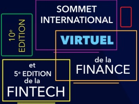
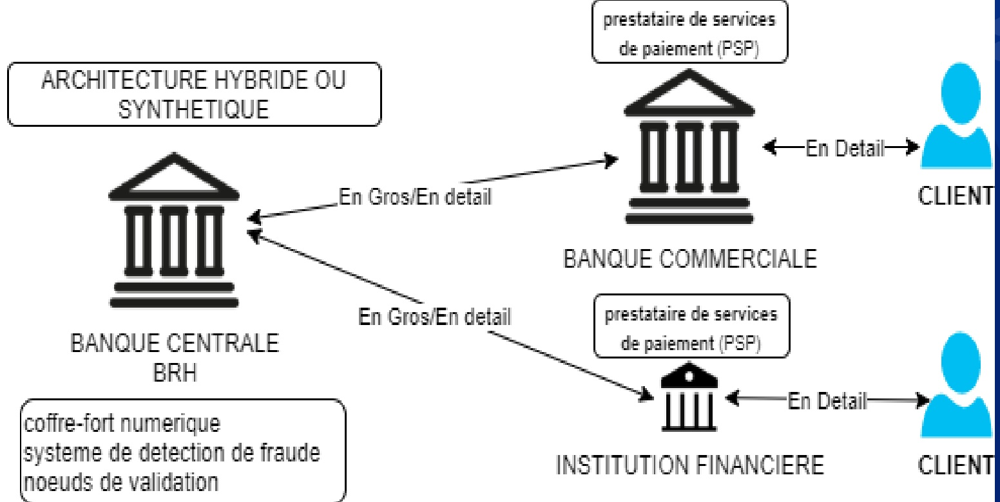
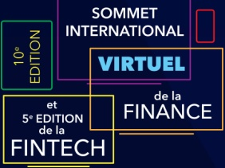
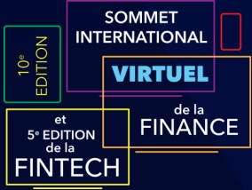
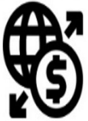
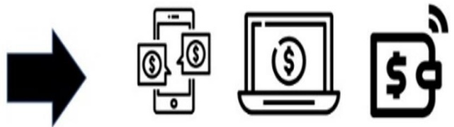
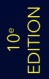
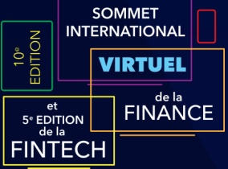

<!-- page 1 -->

## BANQUE DE LA REPUBLIQUE D'HAITI (BRH)

## Vers la GOURDE DIGITALE

## Gouverneur Jean Baden DUBOIS

Avril 2020

<!-- page 2 -->

Les Avantages d'une Monnaie Numérique Banque

Centrale sont nombreuses.

• Réduire les coûts de fabrication des billets (65 MD EU en 4 ans)/les coûts de transactions et les risques financiers pour les consommateurs;

• Nécessité de Moderniser le système de paiement/ Renforcer la confiance des acteurs financiers dans le système de paiement;

Optimiser la vitesse des transactions financières en limitant les chaînes d'intermédiaires;

• Renforcer l'accès aux moyens de paiement à toutes les couches sociale partout en Haïti (Inclusion Financière);

• Dans le Contexte du Covid-19: Une plus grande utilisation de moyen paiement alternatif, d'achat en ligne etc...; Diminution de l'utilisation de vecteur de transmission du virus.

<!-- page 3 -->

## Monnaie Banque Centrale : sa conception

The CBDC pyramid

<table><tr><td>From consumer needs...</td><td>...to CBDC design choices</td></tr><tr><td>Cross-border payments</td><td>Wholesale or retail interlinkages?</td></tr><tr><td>Accessible to all</td><td>Account or token-based access technology?</td></tr><tr><td>Ensure privacy in lawful exchange</td></tr><tr><td>Resilient and robust operations</td><td>DLT-based or conventional central bank infrastructure?</td></tr><tr><td>Convenient real-time payments</td><td>Architecture: indirect or direct claims, and what operational role for the central bank?</td></tr><tr><td>Cash-like with peer-to-peer functionality</td></tr></table>

© Bank for International Settlements

SOMMET INTERNATIONAL

VIRTUEL

de la FINANCE

<!-- page 4 -->

## Architecture Indirecte

<!-- page 5 -->

## Architecture Hybride

prestataire de services

de paiement (PSP)

coffre-fort numérique

systeme de detection de fraude

noeuds de validation

ARCHITECTURE ET RÔLE DE LA BRH dans un tel contexte:

1) Effectuer la compensation bancaire; 2) Émettre les gourdes digita 3) Réguler les entreprises non bancaires ayant accès à la plateforme la gourde digitale.

<!-- page 6 -->

## Le choix de l'infrastructure technologique de la Monnaie digitale doit garantir l'ensemble des exigences ci-dessus

## Exigences

Résistance Et Durabilité

Sécurité

Evolutivité

Transaction en Cours

Confidentialité

L'interopérabilité

L'épreuve du futur

Gouvernance

## Résumé

Accessibilité

Une disponibilité minimale de 99.99% Protection contre tout type d'attaque (Exemple DDOS)

Supporter plusieurs milliers de transactions par seconde

Confirmer Les transactions de détail

instantanément

les détails de la transaction ne sont visibles

que pour les contreparties de cette

transaction

coexister avec le système financier actuel

Evoluer et faire face aux attaques futures.

La banque centrale est le nœud central

« tiers de confiance »

Accessible à tous qu'il s'agit de jetons ou de comptes, par internet ou à travers les réseaux de télécommunications

<!-- page 7 -->

## Les caractéristiques d'accès d'un système de monnaie numérique sont définies ci-dessous

<table><tr><td></td><td>MONNAIE FIDUCIAIRE</td><td>MONNAIE NUMERIQUE</td></tr><tr><td></td><td>En espèces</td><td>jeton</td><td>comptes</td></tr><tr><td>Disponibilité 24/7</td><td>✓</td><td>✓</td><td>✓</td></tr><tr><td>Anonymat vis-à-vis de la banque centrale</td><td>✓</td><td>(✓)</td><td>✗</td></tr><tr><td>Transfert d'égal à égal</td><td>✓</td><td>(✓)</td><td>✗</td></tr><tr><td>Portant intérêt</td><td>✗</td><td>(✓)</td><td>✓</td></tr><tr><td>Limites ou plafonds</td><td>✗</td><td>(✓)</td><td>✓</td></tr></table>

✓ = caractéristique existante ou probable, (✓) = caractéristique possible, X = caractéristique non typique ou possible.

SOMMET INTERNATIONAL

<!-- page 8 -->

## Dans le cas d'Haiti, nous visons une interopérabilité et une interconnexion entre les différentes plateformes

SECTEUR PUBLIC

BRH

PRONAP / HTG DIGITALE

SECTEUR PRIVE FINANCIER HAITIEN

MONCASH

UNIBANK TOUTKOTE

SOGEIZI

NATCASH

LAJAN CASH

!!!

PROPOSITION D'UN MODÈLE HYBRIDE CIL PRÉSENTE CERTAINS AVANTAGES AU NIVEAU DES 4 COUCHES DE LA PYRAMID DANS LE CHOIX DE LA CRÉATION D'UNE MCD.

- Permet d'implémenter un système à deux niveaux (Two-tiers) avec la possibilité d'a-

- Une DLT pour la CBDC de gros avec un registre distribué centralisé et entièrement sous le contrôle de la banque centrale

- Une technologie orientée DLT ou infrastructure conventionnelle pour la CB de détails.

SOMMET INTERNATIONAL

VIRTUEL

de la FINANCE

<!-- page 9 -->

## FINTECH DE PAIEMENT: Courroie très important pour véhiculer la gourde digitale

• Ces dernières années ont donné naissance à plusieurs Fintechs.

• Dans cette optique, la Banque Centrale entreprend des rencontre avec plusieurs Fintechs de paiement afin de pouvoir accorder un cadre favorisant l'innovation, la protection et l'inclusion financière

L'UNE DES LEÇONS DE COVID-19 EST LA PROGRESSION DES Fintech et émergence de nouvelles méthodes de paiement, de nouveaux services en ligne...

SOMMET INTERNATIONAL

VIRTUEL

de la FINANCE

<!-- page 10 -->

## Et depuis 2019, la Banque Centrale s'est positionnée par rapport à la promotion de la banque à distance

Lajancash compte plus de 38,000 clients;

Moncash compte plus de 900,000 clients;

• Sans oublier Unibank ToutKote et Sogelzi ainsi que NatCash qui finalise sa plateforme.

• Plusieurs Rencontres ont été réalisées afin de mieux appréhender la réglementation actuelle et future des BAD...et pourquoi pas également les Fintech. Car la Gourde Digitale devra assurer

<!-- page 11 -->

## Cadre legal

La loi du 17 août 1979 créant la BRH (lui donne pour objet de promouvoir dans le domaine de la monnaie, du crédit et des changes les conditions les plus favorables au développement de l'économie nationale). Loi du 11 Septembre éliminant les plafonds d'émission monétaires.

• Les textes de lois actuels prévoient l'émission de deux types de monnaie : la monnaie fiduciaire (billets de banque, frapper les pièces de monnaie) et la monnaie scripturale.

Pour la monnaie digitale, une nouvelle forme de monnaie, il nous faudra un cadre legal et institutionnel.

• Travaux en cours au niveau du cadre legal : Banque à Distance, Système de paiements....mais, il faut un choix préalable d'un système de diffusion/stockage de la Gourde digitale parmi les systèmes sous étude actuellement à la Banque.

<!-- page 12 -->

## PHASE ACTUELLE DU PROJET GOURDE DIGITALE

• Différentes enquêtes sont programmées auprès des différents acteurs du système financier mais également de la télécommunication et de la fintech.

Le support des banques centrales ayant déjà effectué leur projet pilote telle que la ECCB, les BAHAMAS.

• Premier projet pilote envisagé à différentes échelles (d'abord réduite);

• En absence de cadre légal, des dispositifs incitatifs doivent être pris pour promouvoir l'utilisation de ce moyen de paiement.

• Finalisation de la définition de la gourde digitale en fonction des choix technologiques.

