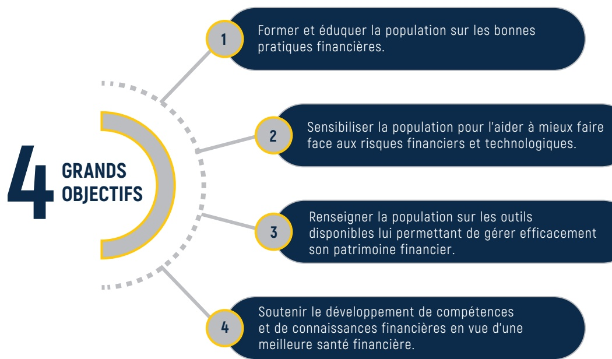
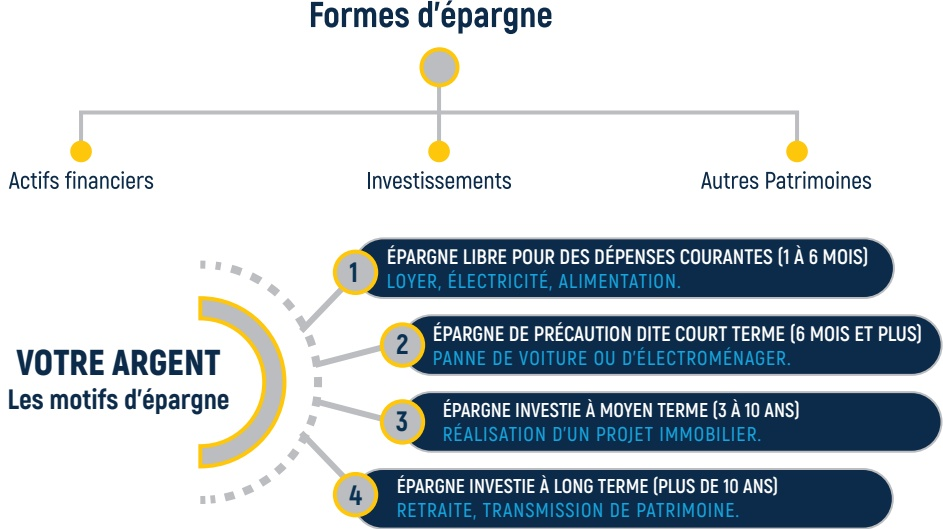
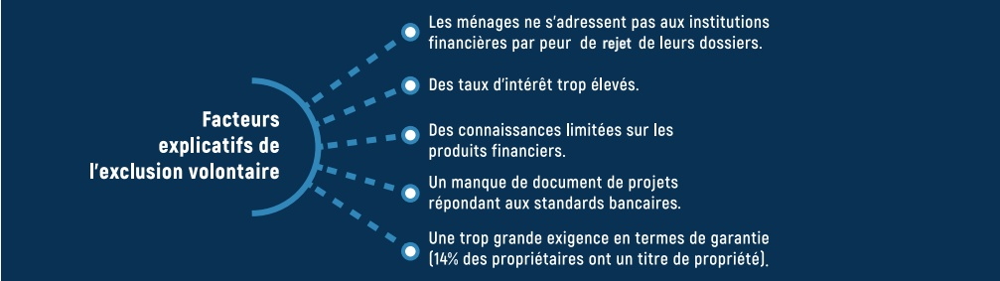
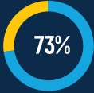
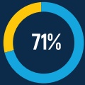
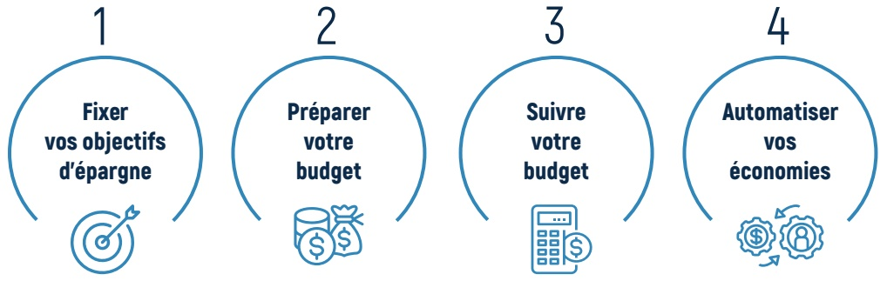
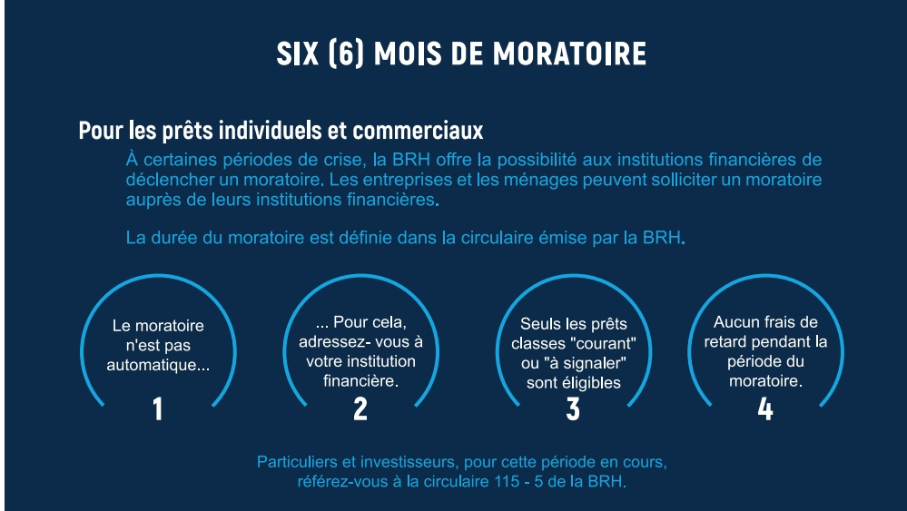

<!-- page 1 -->

## REVUE DÉVELOPPEMENT DE CONNAISSANCES ET COMPÉTENCES FINANCIÈRES

<!-- page 2 -->

<!-- page 3 -->

## SOMMAIRE

VUE D'ENSEMBLE Page 3
LES OBJECTIFS DE LA RDCCF Page 3
POURQUOI UN PLAN NATIONAL D'ÉDUCATION FINANCIÈRE? Page 4
POURQUOI ÉDUQUER FINANCIÈREMENT? Page 5
ÉDUQUER AVEC LES CLÉS DE L'ÉCONOMIE COMPORTEMENTALE Page 6
TESTER VOS CONNAISSANCES SUR L'ÉPARGNE Page 7
AUX RENDEZ-VOUS DÉCISIONNELS AVEC PEDRO Page 9
L'HISTOIRE DE VIE DE BÉATRICE SUR L'INVESTISSEMENT Page 12
AU DELÀ DES DIX (10) ANS DU DSNIF Page 15

<!-- page 4 -->

## SIGLES ET ABBRÉVIATION

| BRH | BANQUE DE LA RÉPUBLIQUE D'HAÎTI |
| --- | --- |
| CFI | CENTRE DE FACILITATION DES INVESTISSEMENTS |
| DGI | DIRECTION GÉNÉRALE DES IMPÔTS |
| DCCF | DÉVELOPPEMENT DE CONNAISSANCES & COMPÉTENCES FINANCIÈRES |
| DSNIF | DOCUMENT DE STRATÉGIE NATIONALE D'INCLUSION FINANCIÈRE |
| FINSCOPE | ENQUÊTE SUR LA DEMANDE DE PRODUITS ET SERVICES FINANCIERS |
| FMI | FONDS MONÉTAIRE INTERNATIONAL (FMI) |
| MCI | MINISTÈRE DU COMMERCE ET DE L'INDUSTRIE |
| MEF | MINISTÈRE DE L'ÉCONOMIE ET DES FINANCES |
| NTIC | NOUVELLES TECHNOLOGIES DE L'INFORMATION ET DE LA COMMUNICATION |
| PNEF | PLAN NATIONAL D'ÉDUCATION FINANCIÈRE |
| OCDE | ORGANISATION DE COOPÉRATION ET DE DÉVELOPPEMENT ÉCONOMIQUES |
| SNIF | STRATÉGIE NATIONALE D'INCLUSION FINANCIÈRE |
| RDCCF | REVUE DÉVELOPPEMENT DE CONNAISSANCES & COMPÉTENCES FINANCIÈRES |

<!-- page 5 -->

## VUE D'ENSEMBLE

La Revue Développement de Connaissances et Compétences Financières (RDCCF), qui s'inscrit dans le cadre des projets d'éducation économique et financière de la Banque de la République d'Haïti (BRH), est destinée à marquer les dix (10) années de la publication du Document de la Stratégie Nationale d'Inclusion Financière (DSNIF). La RDCCF, une publication trimestrielle, vise, entre autres, à sensibiliser les parties prenantes de la SNIF et toute personne intéressée à la promotion de l'éducation financière, sur l'importance du renforcement des capacités financières et la protection des utilisateurs de produits et services financiers, aux fins d'une consommation plus responsable. Selon la représentation ci-dessous, la RDCCF poursuit quatre (4) grands objectifs.

## LES OBJECTIFS DE LA REVUE DÉVELOPPEMENT DE CONNAISSANCES & COMPÉTENCE FINANCIÈRES

Sensibiliser la population pour l'aider à mieux faire face aux risques financiers et technologiques.

Renseigner la population sur les outils

disponibles lui permettant de gérer efficacement

son patrimoine financier.

Soutenir le développement de compétences

et de connaissances financières en vue d'une

meilleure santé financière.

<!-- page 6 -->

## POURQUOI UN PLAN D'ÉDUCATION FINANCIÈRE ?

Les objectifs de la revue sont alignés sur la vision du Plan National d'Éducation Financière (PNEF), tels que définis dans la figure ci-dessous.

Renforcement des activités liées à l'éducation financière.

## Réponse aux demandes formulées par 53% de la population enquêtée

Mise en œuvre d'une stratégie globale d'éducation financière.

Nécessité de coordonner des activités d'éducation financière.

POURQUOI UN PLAN D'ÉDUCATION FINANCIÈRE ?

Recherche d'efficacité dans l'allocation et la gestion des ressources financières disponibles.

Réduction de l'insécurité financière.

<!-- page 7 -->

# POURQUOI ÉDUQUER FINANCIÈREMENT ?

L'éducation financière, de même que la protection des consommateurs de produits et services financiers, sont intégrées au quatrième (4ème) pilier de la Stratégie Nationale d'Inclusion Financière (SNIF). La concrétisation de son déploiement à travers le Plan National d'Éducation Financière (PNEF) initié en Haïti en 2020, marque un tournant crucial dans l'approfondissement de la compréhension et de l'application des principes financiers dans la vie courante des utilisateurs de produits et services financiers.

Selon les données des enquêtes FinScope des ménages réalisées en 2018:

Seulement 35% des adultes estiment avoir le contrôle de leurs dépenses.

96% des adultes ne s'adressent pas à un conseiller financier ou à un professionnel avisé pour obtenir des conseils financiers.

51 % des adultes ne savent pas comment épargner.

50 % des adultes ne savent pas comment investir.

37% des adultes ont le sentiment de ne pas disposer d'informations suffisamment fiables et neutres pour gérer efficacement leurs finances personnelles.

46% des adultes sont exclus financièrement.

53 % des personnes interrogées manifestent le besoin d'acquérir des compétences en éducation financière.

Dix (10) ans après le lancement de la SNIF et dans un contexte marqué par une accélération de l'utilisation des Nouvelles Technologies de l'Information et de la Communication (NTIC), la maîtrise des compétences liées à la finance d'une manière générale s'avère de plus en plus indispensable pour de meilleures prises de décisions économiques et financières.

Aussi, ce processus de renforcement des capacités humaines s'avère fondamental pour une meilleure compréhension et une réactivité plus soutenue du public aux diverses postures de politique monétaire de la Banque Centrale, dépendamment du contexte. Ce renforcement de capacités favorise une anticipation plus éclairée et proactive des citoyens dans le processus de leurs prévisions financières par rapport aux décisions économiques les affectant directement.

<!-- page 8 -->

## SELON L'APPROCHE DE L'ÉCONOMIE COMPORTEMENTALE

Les recherches menées par l'Organisation de Coopération et de Développement Économiques (OCDE) en 2022 soulignent l'impact positif de l'éducation financière. Cette dernière dote les individus, les ménages et les entrepreneurs des connaissances, des compétences et de la confiance nécessaires pour une gestion optimale de leurs finances personnelles. Elle leur facilite également la planification de leur avenir, la réalisation de leurs objectifs financiers et une augmentation de leur niveau de résilience.

Sans une éducation financière adéquate, les particuliers, les ménages et les entreprises peuvent éprouver certaines difficultés à accomplir les tâches de base de gestion financière telles que la budgétisation, l'épargne, l'investissement et aussi de jouir d'une bonne santé financière. Une défaillance dans les connaissances économiques et financières peut entraîner des complications financières, des problèmes de surendettemen et des opportunités manquées liées à la création de richesse. Les données des enquêtes FinScope des ménages¹ en 2018 interpellent sur la situation d'exclusion financière des ménages où un nombre de particuliers et de ménages optent volontairement pour l'exclusion financière.

Par l'adoption d'une approche inspirée des travaux de Richard Thaler, lauréat du prix Nobel d'économie en 2017, il est possible de concevoir des politiques publiques visant à influencer les comportements en matière d'épargne, d'investissements, de dépenses et d'endettement des cibles de nos différentes stratégies de création de richesse. Par conséquent, l'utilisation des principes de l'économie comportementale peut être un outil efficace pour élaborer des référentiels en matière d'éducation financière, adaptés et ciblés, afin de remédier aux phénomènes d'exclusion économique et financière des ménages (Thaler, 2017). En comprenant les motivations, les biais cognitifs et les obstacles comportementaux des ménages, ces politiques peuvent être mieux adaptées aux besoins des usagers des produits et services financiers.

<!-- page 9 -->

## ÉPARGNE ET RATIONALITÉ

L'épargne, au sens courant, correspond aux économies des ménages destinées à des fins de consommation ou d'investissement dans le futur. Les habitudes d'épargne des agents économiques varient selon les pratiques culturelles, le milieu géographique et le niveau d'éducation financière. En fonction du contexte et de la durée, l'épargne peut être constituée pour différents motifs et être réalisée sous différentes formes.

Les experts de l'inclusion financière identifient plusieurs dimensions relatives à l'exclusion financière: géographiques, économiques, culturelles et institutionnelles. Selon le Fonds Monétaire International (FMI), les agents économiques peuvent être exclus du système financier formel, en raison de plusieurs facteurs, tels que : imperfection du marché, manque d'informations, discrimination, revenus insuffisants, risque élevé. Cependant, l'exclusion financière, qu'elle soit volontaire ou non, peut avoir d'importantes répercussions sur une mobilisation effective de l'épargne financière formelle.

<!-- page 10 -->

## AUX RENDEZ-VOUS DÉCISIONNELS

Niveau d'épargne des ménages haitiens FinsCope 2018

Zones Urbaines

73%

En milieu urbain, 73% des adultes

haïtiens ne constituent pas d'épargne

Zones rurales

71%

En milieu rural, 71% des adultes

haïtiens ne constituent pas d'épargne

Ces données résument la situation liée à une faible intégration financière, exacerbée par un manque de connaissances et d'accessibilité aux informations financières. Environ 73 % des Haïtiens vivant en zone urbaine n'épargnent pas, contre 71 % de ceux vivant en zone rurale. Dans un contexte où plus de 70 % des cibles n'épargnent pas, notre stratégie vise à influencer positivement les décisions d'épargne, d'investissement et de gestion financière des groupes cibles.

L'adoption d'une approche basée sur les déterminants de l'économie comportementale combinée à une campagne de sensibilisation à l'éducation financière pourraient avoir des effets d'entraînement significatifs sur certains comportements économiques et financiers des ménages haïtiens. Cette adaptation, orientée vers des objectifs précis d'éducation financière, nous oblige à revoir les messages pour qu'ils résonnent mieux avec les valeurs, les croyances et les priorités des groupes cibles du Plan National d'Éducation Financière (PNEF).

## OUVRIR UN COMPTE BANCAIRE: QU'EST-CE QU'IL VOUS FAUT?

Pièce d'identité valide

Carte d'identité, passeport ou permis de conduire valide, accompagné de deux photos récentes

facture d'électricité, de téléphone, avis d'imposition, etc.

Preuve de domicile

86 354 (1,1%) adultes haïtiens utilisent le compte en banque d'une autre personne

Dépôt initial

Ce montant varie selon l'institution.

## FINSCOPE, 2018

11.5% Adultes haïtiens bancarisés

Adresse email

pour l'accés en ligne et les notifications relatives à vos comptes..

89% Adultes haïtiens non bancarisés

<!-- page 11 -->

# AUX RENDEZ-VOUS DÉCISIONNELS

PEDRO PARTAGE SON HISTOIRE DE VIE AVEC LES LECTEURS DE LA RDCCF : LES BIENFAITS DE L'ÉPARGNE

Pedro, jeune entrepreneur de l'industrie agricole, âgé de 32 ans, anticipe sur l'avenir en épargnant consciencieusement. Il adopte une approche équilibrée, profitant de la vie tout en se préparant pour les aléas financiers du futur. Par conséquent, une fraction de ses revenus est systématiquement épargnée pour répondre à des besoins futurs, attitude qui atteste de sa prudence financière.

Confronté aux biais cognitifs, dans un environnement incitant à privilégier les gratifications immédiates, Pedro opte pour une épargne automatique. Cette propension à l'épargne lui permettra d'accumuler un certain capital pour ses prochains investissements. Grâce à ce comportement discipliné, il arrive à surmonter les tentations de court terme qui le pousseraient à dépenser immédiatement au lieu d'économiser pour plus tard. L'histoire

## LE SAVIEZ VOUS ?

Négliger l'épargne et perdre le contrôle des dépenses équivaut à adopter la stratégie de l'autruche, où l'on évite délibérément les problèmes ou les menaces, espérant ainsi qu'ils disparaîtrent ou n'auront pas d'impact. Il est impératif de revoir périodiquement vos données financières pour une meilleure gestion de vos obligations financières.

de Pedro rappelle qu'il est important de résister à certaines impulsions, privilégiant ainsi des bénéfices à long terme plutôt que des gratifications immédiates.

Selon les perspectives de Thaler, le comportement de Pedro traduit l'attitude d'un planificateur-acteur. Par le contrôle de ses émotions, il aspire à un bien-être durable en choisissant de renoncer à une consommation immédiate en priorisant des investissements futurs. Pedro vous encourage à:

<!-- page 12 -->

# INVESTISSEMENTS ET RATIONALITÉ

Investir, consiste à mettre de l'argent, du temps ou des ressources dans une activité, un projet ou un bien, dans le but de générer un rendement financier à moyen ou long terme. Cela peut inclure la participation dans une entreprise de Booster MPME, l'achat d'un bien immobilier, la souscription aux

Bons du Trésor émis par le Ministère de l'Économie et des Finances (MEF), l'acquisition de bons ou obligations de la Banque de la République d'Haïti (BRH) outont autre actif qui a le potentiel de croître en valeur.

Il est important de noter que tout investissement comporte des risques. La valeur de certains investissements consentis peut-être, dans le temps, affectée par la fluctuation du taux de change, celle des taux d'intérêts, ainsi que les impacts des facteurs externes liés aux changements climatiques et autres catastrophes naturelles. De plus, la technologie évolue tout comme les régulations peuvent subir des modifications. Votre attitude d'investisseur face aux risques, votre culture financière, la gestion de certaines informations et la maîtrise de certains outils de mitigation de risques peuvent vous permettre d'être toujours au contrôle de vos investissements. Toutefois, il est essentiel de consulter un conseiller financier avant de prendre certaines décisions d'investissement.

## Procédure de création d'une entreprise individuelle en Haïti

1. Enregistrement du Nom Commercial de l'Entreprise au MCI

2. Immatriculation l'entreprise à la DGI

3. Obtention de la carte d'identité professionnelle

## Documents obtenus:

1. Certificat d'enregistrement du nom commercial (10 ans)

2. Carte d'Identité Professionnelle (CIP)

3. Certificat de Patente

Durée estimative de la procédure: 10 jours

Les créneaux d'investissement choisis impliquent le respect de critères spécifiques. Par exemple, pour investir dans une entreprise individuelle comme une entreprise de Booster, la réglementation requiert, en plus des documents standards, une Carte d'Identité Professionnelle (C.I.P) comprenant les informations essentielles du propriétaire: signalement descriptif, nom, prénom(s), date et lieu de naissance nationalité et adresse.

<!-- page 13 -->

Dans la perspective de l'économie comportementale, par rapport aux discussions liées aux investissements, le partage d'informations sur les bienfaits de l'investissement s'avère tout aussi important que la mise en évidence des risques. En analysant la rentabilité potentielle de leurs investissements, en termes de gains et de pertes, les investisseurs peuvent faire des choix plus équilibrés et en toute connaissance de cause.

Certaines décisions économiques et financières peuvent simplement être liées à une réaction de foule. Les intervenants en éducation financière doivent être à même de mieux comprendre les schémas de comportement des groupes cibles, pouvoir discuter avec eux, de manière à les inciter à se démarquer du statu quo et à s'engager dans des actions plus rentables.

## LE SAVIEZ VOUS ?

L'État haïtien garantit le droit d'entreprendre et offre des incitations fiscales et douanières aux entreprises, adaptées à leur secteur d'activité. Ces avantages sont définis dans le code des investissements de 2002.

Tout entrepreneur désireux de bénéficier de ces avantages doit soumettre sa demande au Centre de Facilitation des Investissements (CFI), qui agit en tant que point de contact principal pour les demandes d'avantages incitatifs.

Pour des intermédiation financière, financières sont d'inclusion

www.brh.ht

<!-- page 14 -->

# AUX RENDEZ-VOUS DÉCISIONNELS

## Béatrice livre aux lecteurs de la RDCCF son histoire de vie sur l'investissement

Béatrice, une professionnelle de la santé, âgée de 34 ans, épargne régulièrement chaque mois depuis 5 ans. Elle désire investir dans son premier logement. Elle s'adresse à un Développeur du projet de logement « 10-10-20 » supporté par la BRH. Après une première visite, elle est séduite par le voisinage, le design élégant, l'espace, les équipements haut de gamme et l'emplacement pratique près des services.

Consciente qu'elle ne doit pas se fier uniquement à ses émotions et aux aspects positifs, Béatrice consulte un agent immobilier expérimenté et un notaire réputé. Les deux la rassurent sur la qualité des titres de propriété, mais l'avertissent également des éventuels problèmes de plomberie et de fuites possibles dans le réservoir.

Malgré ces avertissements, Béatrice reste confiante car elle estime que ces problèmes peuvent être résolus. Elle prend en compte ces éléments lors des négociations avec le vendeur pour obtenir le meilleur prix possible. Elle voit sa banque pour le financement de l'immeuble. Après l'analyse de son dossier, elle obtient un avis favorable et un taux d'intérêt raisonnable, en raison de son apport de plus de 20 %, de son profil de risque et de la bonne gestion qu'elle a faite de sa carte de crédit auprès de cette même institution.

## SIX (6) MOIS DE MORATOIRE

À certaines périodes de crise, la BRH offre la possibilité aux institutions financières de déclencher un moratoire. Les entreprises et les ménages peuvent solliciter un moratoire auprès de leurs institutions financières.

Le moratoire n'est pas automatique...

... Pour cela,

adressez- vous à

votre institution

financière.

Seuls les prêts classes "courant" ou "à signaler" sont éligibles

Particuliers et investisseurs, pour cette période en cours, référez-vous à la circulaire 115 - 5 de la BRH.

Aucun frais de retard pendant la période du moratoire.

<!-- page 15 -->

Béatrice, consciente des effets des biais de confirmation sur les choix d'investissement, s'efforce activement d'acquérir de nouvelles informations pour parvenir à une décision éclairée et équilibrée. Son excellent profil de risque lui permet de bénéficier d'un taux d'intérêt avantageux.

## PROJETER VOTRE INVESTISSEMENT PAR RAPPORT À L'ÉCONOMIE COMPORTEMENTALE

Béatrice, d'une part, n'a pas été influencée négativement par les avis des autres. Elle a consulté des experts qualifiés avant de prendre ses décisions d'investissement. Ainsi, elle a su éviter l'impact des biais cognitifs. D'autre part, Béatrice a réussi à maîtriser son aversion pour les risques en évaluant de manière objective les problèmes de plomberie et de réparation. Elle profite des opportunités d'investissement tout en tenant compte des risques.

## LE SAVIEZ VOUS ?

Un moratoire n'est pas une annulation de dette mais une révision temporaire des modalités de paiement.

Un moratoire est une mesure prise par un créancier pour reporter temporairement le remboursement d'une dette pour un débiteur. Pendant la période de moratoire, le débiteur est dispensé de faire les paiements mensuels réguliers du principal préétablis dans le contrat. Le débiteur continue de payer les intérêts de son prêt.

Béatrice a contacté sa banque. Elle rencontre son conseiller financier pour des discussions sur la Circulaire 115-5 de la BRH et ses implications sur son flux de trésorerie.

Ayant été éligible au moratoire, elle adhère aux nouvelles conditions de paiement. De plus, elle a su contourner les biais de l'optimisme en limitant les dépenses excessives. Elle démontre une responsabilité financière afin de pouvoir reprendre les paiements normaux (capital et intérêt) de son prêt hypothécaire à l'issue de la période de moratoire.

Soyez comme Béatrice, un plan de contingence financière est important en période de crise!!!

”

<!-- page 16 -->

## Elle vous recommande les stratégies suivantes:

Définir une vision en fonction de vos valeurs.

2

3

Diversifier vos actions pour réduire les risques.

4

Concentrer sur une stratégie de moyen et de long terme en fonction des objectifs fixés.

Continuer à vous former financièrement. Éviter de prendre vos décisions d'investissement sur le coup de l'émotion.

CLASSIFICATION DES PRÊTS (CIRCULAIRE 87 BRH)

## CLASSIFICATION DES PRÊTS

LES PRÊTS COMMERCIAUX

LES PRÊTS AU LOGEMENT

LES PRÊTS À LA CONSOMMATION

PRÊT COURANT

Remboursement principal et intérêts serait normalement

1

PRÊT À SIGNALER

Entre 31 et 89 jours de retard

2

PRÊT

FAIBLE

Entre 90 et 179

jours de retard

3

PRÊT DOUTEUX

Entre 180 et 359 jours de retard

4

PERTE À partir de 360 jours de retard

5

<!-- page 17 -->

## AU-DELÀ DES DIX (10) ANS DU DSNIF

La publication de la Revue Développement de Compétences et de Connaissances Financières (RDCCF) vise à informer et à éduquer le public sur les notions fondamentales en économie et en finance. Cette initiative, lancée pour marquer les dix ans d'efforts collectifs en faveur de l'inclusion financière dans le pays, représente un pilier essentiel de la promotion de l'éducation financière par la Banque de la République d'Haïti. À chaque parution, la revue s'engage à fournir aux utilisateurs des produits et services financiers, des ressources et des orientations adaptées à leurs besoins afin de les aider dans leur planification financière.

La publication de cette première édition, dans le contexte actuel de crise multidimensionnelle, met en lumière les histoires de vie de Pedro et de Béatrice afin d'encourager les intéressés ainsi que tous les acteurs économiques à se soucier de l'aspect émotionnel au moment de réaliser une dépense ou un investissement. Certains biais cognitifs ainsi que les effets de groupe peuvent influencer négativement les décisions financières. Les éducateurs financiers doivent prendre en considération cet aspect lors des campagnes de sensibilisation à l'éducation financière. La prochaine édition de la RDCCF sera consacrée à l'examen des produits et services financiers disponibles sur le marché ainsi qu'à leurs conditions d'accessibilité et d'utilisation.

En participant à l'éducation financière des citoyens à travers la RDCCF, la Banque de la République d'Haïti (BRH), renouvelle son engagement à contribuer à informer les groupes cibles et à former des agents économiques plus résilients sur le plan financier en vue d'une économie plus inclusive.

<!-- page 18 -->

# BIBLIOGRAPHIE

Arrêté fixant les conditions réglementaires de création, d'implantation, de gestion, d'exploitation et de contrôle des zones franches en Haïti.

BRH, Plan Stratégique Global, (2021-2024), BRH, 2021.

BRH, Plan National d'Éducation Financière, PNEF, (2020-2025), BRH, 2020.

BRH, Enquête FinScope sur la consommation des ménages, BRH, 2018.

BRH, Document Programme Pro-croissance, BRH, 2018.

BRH, Stratégie Nationale d'Inclusion Financière, BRH, 2014.

BRH, De l'aménagement des zones franches et des parcs industriels, Circulaire 106, BRH.

Cadet, R. "La réforme de la régulation prudentielle et de la supervision bancaire en Haïti : un transfert de savoir-faire.", 2004.

Damon, Julien. "L'éducation financière : Une innovation sociale en plein développement." Futuribles, p. 43-50, 2010.

FMI,2022, cours en ligne, Développement financier et inclusion financière (FDFIx),Edx.org.

Guérin, I sabelle, “L'éducation financière ou comment apprendre aux pauvres à bien consommer.” In: Guérin, I. (éd.), Selim, M., 2012.

Loi du 26 Novembre 2002 sur le code des investissements modifiant le décret du 30 octobre 1989 relatif au code des investissements.

Le Moniteur, Loi portant sur les Banques et autres institutions financières en 2012.

OCDE, “Évaluation des stratégies Nationales pour la culture financière.”, 2022.

Thaler, H, Richard. “Misbehaving: Les découvertes de l'économie comportementale.” Vuibert. 2015.

Thaler, H, Richard. “Intégrer économie et psychologie.” Cairn. Info, pg.3-56, 2017.

<!-- page 19 -->

<!-- page 20 -->

RDCCF-VOL.I
