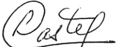

<!-- page 1 -->

# Banque de la République d'Haïti CIRCULAIRE No 106

# AUX BANQUES

Conformément à l'article 83 de la loi du 14 mai 2012 portant sur les banques et autres institutions financières, les banques doivent respecter les dispositions suivantes relatives : a) au plafond en matière de constitution des réserves obligatoires sur toutes les ressources utilisées pour financer le développement et l'aménagement des zones franches et des parcs Industriels, et b) aux taux d'intérêts à appliquer sur ces prêts.

### 1. Régime préférentiel

Dans le but de réduire les coûts liés aux investissements dans des zones franches ou parcs industriels dûment autorisés à fonctionner, les banques sont autorisées à ne pas constituer de réserves obligatoires sur les ressources en gourdes utilisées pour financer des zones franches et des parcs industriels.

Ces crédits visent :

- la construction des immeubles ;

- l'installation de toutes infrastructures essentielles aux opérations adéquates des zones franches et des parcs industriels (routes, drainage, eau, électricité, etc...).

Une fois ces crédits accordés, ils font partie intégrante du portefeuille de prêts des banques avec tous les risques associés et, à ce titre, ils doivent satisfaire à toutes les exigences des normes prudentielles en vigueur notamment la circulaire 87 et la circulaire 83-4.

En vue de faciliter ces crédits, la BRH est disposée à consentir des avances aux banques sur une période pouvant aller jusqu'à quinze (15) ans. Le taux d'intérêt annuel des avances sera compris dans une fourchette de 1% à 3%, à la date de leur octroi et sera maintenu pendant toute la durée de ces avances. En aucun cas, ce taux ne sera inférieur à 1% ou supérieur à 3%, quel que soit le taux applicable pour les bons BRH à 91 jours, à la date de l'avance. Afin de pouvoir bénéficier des avances, les banques doivent donner à la BRH la preuve de la mise en place effective des crédits, c'est-à-dire qu'ils sont disponibles pour décaissement.

Pour ce qui concerne tous les prêts accordés à partir d'un financement de la BRH, les banques doivent appliquer un taux d'intérêt fixe ne dépassant pas 7% l'an pendant une période de quinze (15) années à compter de la date d'octroi du crédit. Passé ce délai, le taux d'intérêt pourra être variable et révisable par la banque selon les conditions du marché.

<!-- page 2 -->

Il demeure entendu que chaque avance fera l'objet d'un contrat distinct entre la BRH et la banque. Par ailleurs, les fonds avancés par la BRH et non encore décaissés par la banque au profit des éventuels emprunteurs ne pourront pas être considérés comme élément constitutif de réserves obligatoires et par conséquent ne sont pas éligibles au titre de placement en bons BRH.

### 2. Rapports

La BRH fait obligation aux banques de lui soumettre à la fin de chaque trimestre, soit les 31 décembre, 31 mars, 30 juin et 30 septembre, un rapport détaillé sur l'évolution du crédit accordé dans les parcs industriels et les zones franches.

Ce rapport dont le modèle est joint à la présente circulaire doit être annexé aux rapports de conformité relatifs à la circulaire 83-4 portant sur la concentration des risques de crédit.

### 3. Sanctions

En cas de non respect de la section 2 de la présente circulaire, la BRH se réserve le droit de prendre les sanctions administratives suivantes :

a) Retard de production des rapports : pénalités conformément à la circulaire en vigueur sur le sujet.

b) Retard de transmission des rapports : pénalités conformément à la circulaire en vigueur sur le sujet.

c) Non soumission des rapports : pénalités conformément à la circulaire en vigueur sur le sujet.

### 3. Entrée en vigueur

La présente circulaire entre en vigueur le 11 décembre 2015.

Charles Castel

Gouverneur

## Annexe

Annexe 1 : Rapport évolution du crédit/Zones Franches et Parcs Industriels

<!-- page 3 -->

# RAPPORT EVOLUTION DU CREDIT/Zones Franches et Parcs Industriels Rapport trimestriel

Etablissement bancaire : _____ Au : _____

Encours de crédit par Zone Franche

| ACTIVITÉ | ENCOURS | % DES CREDITS TOTAUX |
| --- | --- | --- |
|   |   |   |
|   |   |   |
|   |   |   |
|   |   |   |
|   |   |   |

Encours de crédit par Parc Industriel

| ACTIVITÉ | ENCOURS | % DES CREDITS TOTAUX |
| --- | --- | --- |
|   |   |   |
|   |   |   |
|   |   |   |
|   |   |   |

Signature de deux cadres autorisées : _____ _____

Poste/Titre : _____ _____
