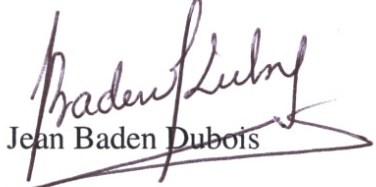

<!-- page 1 -->

# AVIS D'ATTRIBUTION DÉFINITIVE DE MARCHÉ

### Appel d'Offres Restreint International (AORI) No. CSMP/DAORI # 2015-02-DCR-001 Banque de la République d'Haïti (BRH)

Cet Avis d'Attribution définitive du marché s'inscrit dans le cadre de l'Appel d'Offres Restreint International (AORI) lancé par la Banque de la République d'Haïti (BRH), organisme public jouissant de la personnalité juridique et de l'autonomie financière dont le siège principal est à Port-au-Prince.

Conformément aux prescrits de la Loi du 10 juin 2009 fixant les règles générales relatives aux Marchés Publics, la participation à ce marché a été ouverte aux fournisseurs invités par lettre en date du 6 novembre 2015 [Réf. : BRH/CSMP # 041-2015]. Ces Firmes ont été sélectionnées sur la base de leur réputation au niveau mondial et leur capacité à fournir ce type de bien qui doit être fabriqué dans des milieux sécurisés à cause de leur incidence eu égard à la sécurité publique.

Ce marché correspond à l'AORI No. CSMP/DAORI #2015-02-DCR-001 qui a pour objet la réimpression de billets de banque répartis en plusieurs lots.

L'attribution du marché découle de la proposition la mieux-disante retenue suivante le mode de sélection fondé sur la qualité et le coût consistant à obtenir le nombre de points le plus élevé résultant du cumul pondéré des notes accordées à l'offre technique et de celles données à l'offre financière. Une soumission pouvait être faite pour un, plusieurs ou l'ensemble des sept lots et un soumissionnaire pouvait gagner un, plusieurs ou l'ensemble des sept lots.

La BRH informe le public qu'après analyse des dossiers soumis, le LOT 1 du marché, plus précisément l'impression des billets de dix (10) gourdes, a été attribué définitivement à la firme OBERTHUR FIDUCIAIRE S.A.S après avoir obtenue le 29 juin 2016 l'avis de la Cour Supérieur des Comptes et du Contentieux Administratif (CSCCA) et la validation de la Commission Nationale des Marchés Publics (CNMP).

Fait à Port-au-Prince, le Mercredi 6 juillet 2016.

La publication du présent avis est effectuée en application à l'article 66 de la loi du 10 juin 2009 fixant les règles générales relatives aux Marchés Publics.
