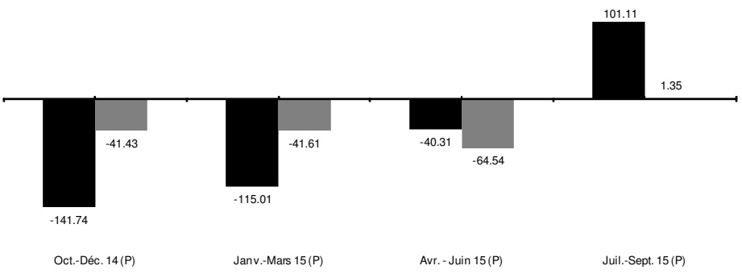

<!-- page 1 -->

Banque de la République d'Haïti

## Bulletin Statistique 96

Juillet- Septembre 2015

<!-- page 2 -->

## Table des matières

Avertissement .....5
I- Statistiques monétaires et financières
Tableau 1.1 Principaux indicateurs monétaires .....10
Tableau 1.2 Situation monétaire .....11
Tableau 1.3 Liquidités du système bancaire .....12
Tableau 1.4 Taux de réserves obligatoires .....12
Tableau 1.5 Spread sur le marché formel des changes .....12
Tableau 1.6 Volume des transactions sur le marché formel des changes .....13
Tableau 1.7 Taux d'intérêt moyens mensuels du système bancaire .....15
Tableau 1.8 Taux d'intérêt moyens mensuels sur le marché monétaire .....15
Tableau 1.9 Dépôts du secteur privé .....16
Tableau 1.10 Dépôts : parts de marché .....17
Tableau 1.11 Crédit au secteur privé .....18
Tableau 1.12 Crédit : parts de marché .....19
Tableau 1.13 Bilan consolidé des banques commerciales (Table 20R) .....20
Tableau 1.14 Bilan monétaire de la BRH (Table 10R) .....21
Tableau 1.15 Encourcs des bons BRH .....22
Tableau 1.16 Avoirs extérieurs nets de la BRH .....23
Tableau 1.17 Résultats des activités de la chambre de compensation .....24

II- Finances publiques
Tableau 2.1 Résumé des opérations financières des administrations publiques .....28
Tableau 2.2 Recettes des administrations publiques .....29
Tableau 2.3 Dépenses des administrations publiques .....30
Tableau 2.4 Endettement total du secteur public .....31
Tableau 2.5 Dette publique externe .....32

III- Balance des paiements
Tableau 3.1 Résumé de la balance des paiements .....34
Tableau 3.2 Principaux produits exportés .....35
Tableau 3.3 Exportations des industries d'assemblage vers les États-Unis d'Amérique à base de matières premières importées .....36
Tableau 3.4 Exportations vers les États-Unis d'Amérique à base de matières premières locales .....37
Tableau 3.5 Importations par grandes catégories de produits .....38
Tableau 3.5a Importations de produits pétroliers .....39
Tableau 3.6 Évolution de l'indice du taux de change réel bilatéral Haïti-États-Unis d'Amérique .....40

<!-- page 3 -->

## Table des matières (suite)

## IV- Prix et autres indicateurs économiques

Tableau 4.1 Indice des prix à la consommation (IPC) pour l'ensemble du pays .....42
Tableau 4.2 Taux d'inflation .....42
Tableau 4.2a Taux d'inflation à trois mois .....43
Tableau 4.2 b Taux d'inflation à six mois .....43
Tableau 4.3 Taux de change .....44
Tableau 4.4 Prix moyen de détail de certains produits sur l'ensemble du pays .....45
Tableau 4.5 Prix moyen des matériaux de construction .....46
Tableau 4.6 Activités du secteur de la construction à Port-au-Prince .....46
Tableau 4.7 Nouvelles entreprises déclarées à Port-au-Prince et nombre correspondant d'employés .....47
Tableau 4.8 Nouvelles entreprises enregistrées à l'ONA et nombre correspondant d'assurés .....47
Tableau 4.9 Production industrielle de certains biens .....48
Tableau 4.10 Consommation d'électricité .....49
Tableau 4.11 Production brute d'électricité .....49
Tableau 4.12 Prix moyen des principaux produits pétroliers et dérivés sur le marché local .....50
Tableau 4.13 Véhicules importés enregistrés au port de Port-au-Prince .....51
Tableau 4.14 Nombre de touristes arrivés au pays .....53
Tableau 4.15 Mouvements migratoires aériens internationaux .....54
Tableau 4.16 Pouvoir d'achat de la gourde .....55
Tableau 4.17 Cours croisé des devises étrangères par rapport à la gourde .....56
Tableau 4.18 Pluviométrie enregistrée dans certaines villes du pays .....57

## Annexe graphique

Graphique 1 Agrégats M1, M2, M3.....60
Graphique 2 Contreparties de M3.....61
Graphique 3 Encours des bons BRH.....62
Graphique 4 Dépôts du secteur privé.....63
Graphique 5 Crédit au secteur privé.....64
Graphique 6 Recettes et dépenses des administrations publiques.....65
Graphique 7 Endettlement total du secteur public.....66
Graphique 8 Balances commerciale et globale.....67
Graphique 9 Indice du taux de change réel bilatéral Haïti-États Unis d'Amérique.....68
Graphique 10 Taux d'inflation (variation mensuelle de l'IPC; août 2004=100).....69
Graphique 11 Taux d'inflation (variation de l'IPC en glissement annuel).....70
Graphique 12 Taux de change (marché informel; moyenne de période).....71

<!-- page 4 -->

# Avertissement

## Statistiques monétaires et financières

Les statistiques monétaires sont présentées selon les critères de classification établis dans le manuel Guide des Statistiques Monétaires et Bancaires publiées dans Statistiques Financières Internationales de 1987 du Fonds Monétaire International (FMI). Elles représentent des données de stock (fin de période) qui sont collectées mensuellement.

## Finances publiques

Les statistiques des finances publiques sont présentées selon les critères de classification établis dans le Manuel de Référence des Finances Publiques (1986) du FMI. Elles représentent des données de flux qui sont collectées mensuellement et sont enregistrées sur la base des encaissements-décaissements. Ces données subissent un traitement qui tient compte de la spécificité du contexte haïtien. Étant donné qu'Haïti ne dispose pas d'un budget général consolidé, les recettes enregistrées sont celles du Trésor excluant celles des unités de production marchande du secteur public. Les dépenses enregistrées sont celles effectuées par le Trésor pour le compte de l'Administration Centrale et comprennent également les dépenses réalisées sur financement externe pour l'ensemble des administrations publiques.

## Balance des paiements

Les statistiques de la balance des paiements sont des données de flux. Elles sont présentées selon les critères établis dans la 5ème Édition du Manuel de la Balance des Paiements du FMI. Les transactions sur les biens sont enregistrées sur une base brute. Les transferts de capital réfèrent surtout à des annulations d'engagements par un ou plusieurs créanciers qui ne reçoivent rien en échange (remise de dette).

Les transferts courants sont ceux qui ne peuvent être dits transferts de capital. Ils comprennent les transferts en espèces entre administrations publiques destinés à financer leurs dépenses courantes, les transferts en nature (tels que dans d'aliments, de médicaments et d'autres biens de consommation), les envois de fonds de travailleurs émigrés, etc.

La variation des avoirs de réserves est présentée sous forme d'avoirs bruts à l'exclusion des engagements envers le FMI et des engagements envers le Fonds d'investissement vénézuélien (FIV) (enregistrés dans les engagements constituant des réserves pour les autorités étrangères). Ceux-ci sont présentés séparément.

L'indice du taux de change réel bilatéral (2000=100) est calculé à partir de l'indice des prix à la consommation (IPC) des États-Unis produit par les Statistiques Financières Internationales du FMI (2000=100). Le changement de base est effectué à partir du rapport de l'IPC 2000 / IPC 1995 multiplié par l'indice mensuel (2000=100). L'indice du taux de change nominal (2000=100) est calculé de la manière suivante : Taux de référence de fin de période du mois X / Taux de référence de fin de période pour l'année 2000.

<!-- page 5 -->

## Avertissement (suite)

## Prix et autres indicateurs économiques

Les informations regroupées sous la dénomination Prix et autres indicateurs économiques réfèrent aux données de production, d'emploi, de prix et aussi d'activités de divers secteurs. Il s'agit dans la plupart des cas de données brutes agrégées et tabulées. Ces données correspondent pour la plupart à des informations statistiques disponibles au moment de la compilation; elles sont donc sujettes à modification éventuelle dans le futur. L'indice des prix à la consommation est un indice de Laspeyres (période de base août 2004 avec pondération de 1986-1987) qui couvre l'ensemble du territoire national.

Le taux de change de la monnaie nationale par rapport au dollar américain (Gde / $) est aussi présenté au niveau de cette section pour les marchés formel (banques et agents de change) et informel. Le taux de référence de la BRH représente une moyenne pondérée des taux de ces marchés.

## Liste des sigles utilisés dans le Bulletin Statistique

| AGD | Administration Générale des Douanes |
| --- | --- |
| AIB | Autres institutions bancaires |
| BEL | Banques d'épargne et de logement |
| BID | Banque Interaméricaine de Développement |
| BNC | Banque Nationale de Crédit |
| BRH | Banque de la République d'Haïti |
| BRI | Banque de Règlements Internationaux |
| CIF | Cost, Insurance and Freight |
| DTS | Droits de Tirage Spéciaux |
| EDH | Électricité d'Haïti |
| ÉU | États-Unis d'Amérique |
| FIV | Fonds d'Investissement Vénézuélien |
| FMI | Fonds Monétaire International |
| FOB | Free on Board |
| IFNB | Institutions financières non bancaires |
| IHSI | Institut Haïtien de Statistique et d'Informatique |
| IPC | Indice des prix à la consommation |
| MEF | Ministère de l'Économie et des Finances |
| MG | Millions de gourdes |
| OEA | Organisation des États Américains |
| OFATMA | Office d'Assurance-Accidents du Travail, Maladie et Maternité |
| OFI | Organisations financières internationales |
| (-) | Indique une valeur nulle |
| (...) | Indique la non-disponibilité de données statistiques au moment de la mise sous presse |
| (0.00) | Indique une valeur presque nulle |

<!-- page 6 -->

## I- Statistiques monétaires et financières

<!-- page 7 -->

Tableau 1.1

<table><tr><td>(en millions de gourdes)</td><td>1er trimestre 2015</td><td>2e trimestre 2015</td><td>3e trimestre 2015</td><td>4e trimestre 2015</td></tr><tr><td>Oct. 14</td><td>Nov. 14</td><td>Déc. 14</td><td>Janv. 15</td><td>Fév. 15</td><td>Mars 15</td><td>Avr. 15</td><td>Mai 15</td><td>Juin 15</td><td>Juil. 15</td><td>Août 15</td><td>Sept. 15</td></tr><tr><td>Monnaie en circulation</td><td>24,021.59</td><td>24,168.06</td><td>28,398.20</td><td>25,230.64</td><td>25,163.49</td><td>25,845.07</td><td>26,188.80</td><td>26,386.25</td><td>27,206.94</td><td>28,829.45</td><td>29,446.67</td><td>28,617.83</td></tr><tr><td>Base monétaire</td><td>100,792.66</td><td>98,338.13</td><td>101,299.88</td><td>100,893.94</td><td>103,464.28</td><td>98,028.57</td><td>100,082.59</td><td>100,437.38</td><td>107,542.02</td><td>110,494.48</td><td>108,131.56</td><td>118,860.13</td></tr><tr><td>M1</td><td>57,785.46</td><td>56,597.30</td><td>59,411.44</td><td>59,135.47</td><td>59,092.11</td><td>57,731.10</td><td>58,497.88</td><td>58,971.62</td><td>58,463.96</td><td>56,924.94</td><td>57,515.98</td><td>58,184.64</td></tr><tr><td>M2</td><td>93,662.19</td><td>92,447.65</td><td>95,543.34</td><td>96,258.98</td><td>96,335.85</td><td>95,384.07</td><td>96,170.08</td><td>97,128.93</td><td>95,794.39</td><td>95,764.59</td><td>97,041.45</td><td>100,227.26</td></tr><tr><td>M3</td><td>177,336.30</td><td>178,127.62</td><td>177,304.02</td><td>183,573.48</td><td>185,520.18</td><td>185,060.28</td><td>185,431.09</td><td>187,628.16</td><td>193,593.74</td><td>202,354.27</td><td>197,456.54</td><td>201,695.21</td></tr><tr><td>Crédit intérieur</td><td>99,091.88</td><td>99,339.32</td><td>95,917.72</td><td>100,630.01</td><td>102,956.32</td><td>100,952.45</td><td>102,220.60</td><td>101,625.41</td><td>101,215.56</td><td>101,326.96</td><td>103,486.39</td><td>103,967.18</td></tr><tr><td>Avoirs extérieurs nets</td><td>93,256.13</td><td>93,289.35</td><td>94,234.50</td><td>96,678.88</td><td>97,627.94</td><td>97,769.02</td><td>96,550.03</td><td>99,193.50</td><td>106,233.34</td><td>116,491.76</td><td>108,072.49</td><td>112,738.00</td></tr><tr><td>Total dépôts en gourdes</td><td>69,640.60</td><td>68,279.59</td><td>67,145.14</td><td>71,028.33</td><td>71,172.36</td><td>69,539.00</td><td>69,981.28</td><td>70,742.68</td><td>68,587.46</td><td>66,935.15</td><td>67,594.78</td><td>71,609.43</td></tr><tr><td>Total dépôts en dollars ÉU $ ^{1} $</td><td>83,674.11</td><td>85,679.97</td><td>81,760.68</td><td>87,314.50</td><td>89,184.33</td><td>89,676.21</td><td>89,261.01</td><td>90,499.23</td><td>97,799.35</td><td>106,589.68</td><td>100,415.09</td><td>101,467.95</td></tr><tr><td>Indice de dollarisation :</td><td></td><td></td><td></td><td></td><td></td><td></td><td></td><td></td><td></td><td></td><td></td><td></td></tr><tr><td>Dépôts en dollars en % de M3</td><td>47.18</td><td>48.10</td><td>46.11</td><td>47.56</td><td>48.07</td><td>48.46</td><td>48.14</td><td>48.23</td><td>50.52</td><td>52.67</td><td>50.85</td><td>50.31</td></tr><tr><td>Pour mémoire:</td><td></td><td></td><td></td><td></td><td></td><td></td><td></td><td></td><td></td><td></td><td></td><td></td></tr><tr><td>Taux de change de référence (Fin de mois)</td><td>45.8381</td><td>46.5991</td><td>46.7477</td><td>46.9277</td><td>47.1441</td><td>47.1789</td><td>47.3801</td><td>48.1113</td><td>51.5866</td><td>55.2174</td><td>51.6674</td><td>52.0717</td></tr></table>

Source : Direction Monnaie et Analyse Économique, BRH.

1/ Convertis en gourdes au taux de référence de fin de mois de la BRH.

<!-- page 8 -->

Tableau 1.2

<table><tr><td></td><td>1er trimestre 2015</td><td>2e trimestre 2015</td><td>3e trimestre 2015</td><td>4e trimestre 2015</td></tr><tr><td></td><td>Oct. 14</td><td>Nov. 14</td><td>Déc. 14</td><td>Janv. 15</td><td>Fév. 15</td><td>Mars 15</td><td>Avr. 15</td><td>Mai 15</td><td>Juin 15</td><td>Juil. 15</td><td>Août 15</td><td>Sept. 15</td></tr><tr><td>Avoirs extérieurs nets</td><td>93,256.13</td><td>93,289.35</td><td>94,234.50</td><td>96,678.88</td><td>97,627.94</td><td>97,769.02</td><td>96,550.03</td><td>99,193.50</td><td>106,233.34</td><td>116,491.76</td><td>108,072.49</td><td>112,738.00</td></tr><tr><td>Avoirs extérieurs  $ ^{{1/}} $</td><td>114,157.28</td><td>114,214.95</td><td>114,229.85</td><td>115,497.92</td><td>116,535.29</td><td>116,245.20</td><td>115,411.60</td><td>118,849.16</td><td>126,936.11</td><td>138,217.67</td><td>129,642.92</td><td>133,008.35</td></tr><tr><td>Engagements extérieurs  $ ^{{1/}} $</td><td>-20,901.15</td><td>-20,925.60</td><td>-19,995.35</td><td>-18,819.04</td><td>-18,907.34</td><td>-18,476.17</td><td>-18,861.57</td><td>-19,655.66</td><td>-20,702.77</td><td>-21,725.91</td><td>-21,570.43</td><td>-20,270.36</td></tr><tr><td>Crédit intérieur</td><td>99,091.88</td><td>99,339.32</td><td>95,917.72</td><td>100,630.01</td><td>102,956.32</td><td>100,952.45</td><td>102,220.60</td><td>101,625.41</td><td>101,215.56</td><td>101,326.96</td><td>103,486.39</td><td>103,967.18</td></tr><tr><td>Créances nettes sur secteur public</td><td>13,960.98</td><td>12,772.88</td><td>8,536.31</td><td>13,636.35</td><td>15,479.75</td><td>13,790.13</td><td>15,951.34</td><td>14,713.97</td><td>11,958.31</td><td>9,643.34</td><td>15,091.87</td><td>16,277.10</td></tr><tr><td>Créances nettes sur gouvernement central</td><td>17,400.85</td><td>16,466.58</td><td>11,811.75</td><td>16,724.78</td><td>18,428.03</td><td>16,809.55</td><td>18,114.29</td><td>17,020.10</td><td>14,988.05</td><td>12,608.66</td><td>17,727.37</td><td>18,642.23</td></tr><tr><td>Créances nettes sur collectivités locales</td><td>-180.99</td><td>-386.53</td><td>-294.32</td><td>-306.15</td><td>-208.58</td><td>-266.99</td><td>-281.32</td><td>-240.66</td><td>-120.40</td><td>-77.65</td><td>-59.70</td><td>-46.84</td></tr><tr><td>Créances nettes sur entreprises publiques</td><td>-3,258.88</td><td>-3,307.17</td><td>-2,981.12</td><td>-2,782.28</td><td>-2,739.70</td><td>-2,752.42</td><td>-1,881.63</td><td>-2,065.47</td><td>-2,909.34</td><td>-2,887.67</td><td>-2,575.80</td><td>-2,318.29</td></tr><tr><td>Créances sur secteur privé</td><td>85,130.89</td><td>86,566.44</td><td>87,381.41</td><td>86,993.65</td><td>87,476.57</td><td>87,162.33</td><td>86,269.26</td><td>86,911.44</td><td>89,257.25</td><td>91,683.62</td><td>88,394.52</td><td>87,690.07</td></tr><tr><td>ACTIF = PASSIF</td><td>192,348.00</td><td>192,628.67</td><td>190,152.22</td><td>197,308.89</td><td>200,584.27</td><td>198,721.47</td><td>198,770.63</td><td>200,818.91</td><td>207,448.90</td><td>217,818.72</td><td>211,558.87</td><td>216,705.17</td></tr><tr><td>M3</td><td>177,336.30</td><td>178,127.62</td><td>177,304.02</td><td>183,573.48</td><td>185,520.18</td><td>185,060.28</td><td>185,431.09</td><td>187,628.16</td><td>193,593.74</td><td>202,354.27</td><td>197,456.54</td><td>201,695.21</td></tr><tr><td>M2</td><td>93,662.19</td><td>92,447.65</td><td>95,543.34</td><td>96,258.98</td><td>96,335.85</td><td>95,384.07</td><td>96,170.08</td><td>97,128.93</td><td>95,794.39</td><td>95,764.59</td><td>97,041.45</td><td>100,227.26</td></tr><tr><td>M1</td><td>57,785.46</td><td>56,597.30</td><td>59,411.44</td><td>59,135.47</td><td>59,092.11</td><td>57,731.10</td><td>58,497.88</td><td>58,971.62</td><td>58,463.96</td><td>56,924.94</td><td>57,515.98</td><td>58,184.64</td></tr><tr><td>Monnaie en circulation</td><td>24,021.59</td><td>24,168.06</td><td>28,398.20</td><td>25,230.64</td><td>25,163.49</td><td>25,845.07</td><td>26,188.80</td><td>26,386.25</td><td>27,206.94</td><td>28,829.45</td><td>29,446.67</td><td>28,617.83</td></tr><tr><td>Dépôts à vue</td><td>33,763.87</td><td>32,429.24</td><td>31,013.24</td><td>33,904.83</td><td>33,928.62</td><td>31,886.02</td><td>32,309.08</td><td>32,585.37</td><td>31,257.03</td><td>28,095.49</td><td>28,069.31</td><td>29,566.81</td></tr><tr><td>Quasi-monnaie</td><td>35,876.73</td><td>35,850.35</td><td>36,131.90</td><td>37,123.51</td><td>37,243.73</td><td>37,652.98</td><td>37,672.20</td><td>38,157.31</td><td>37,330.43</td><td>38,839.66</td><td>39,525.47</td><td>42,042.62</td></tr><tr><td>Dépôts d'épargne</td><td>25,327.72</td><td>25,290.36</td><td>25,545.63</td><td>25,750.23</td><td>25,779.02</td><td>25,824.98</td><td>25,982.81</td><td>26,372.14</td><td>26,713.31</td><td>27,698.94</td><td>27,753.81</td><td>27,816.05</td></tr><tr><td>Dépôts à terme et autres</td><td>10,549.01</td><td>10,559.99</td><td>10,586.27</td><td>11,373.27</td><td>11,464.71</td><td>11,828.00</td><td>11,689.39</td><td>11,785.17</td><td>10,617.12</td><td>11,140.71</td><td>11,771.66</td><td>14,226.58</td></tr><tr><td>Dépôts en dollars ÉU  $ ^{{1/}} $</td><td>83,674.11</td><td>85,679.97</td><td>81,760.68</td><td>87,314.50</td><td>89,184.33</td><td>89,676.21</td><td>89,261.01</td><td>90,499.23</td><td>97,799.35</td><td>106,589.68</td><td>100,415.09</td><td>101,467.95</td></tr><tr><td>Dépôts à vue</td><td>39,301.91</td><td>40,336.01</td><td>35,285.88</td><td>40,317.00</td><td>41,498.27</td><td>39,575.61</td><td>38,092.46</td><td>38,462.70</td><td>42,111.72</td><td>46,443.90</td><td>43,790.53</td><td>44,026.43</td></tr><tr><td>Dépôts d'épargne</td><td>29,285.58</td><td>29,814.24</td><td>30,186.41</td><td>30,556.21</td><td>30,938.06</td><td>31,131.67</td><td>31,567.67</td><td>31,857.35</td><td>33,521.28</td><td>35,418.63</td><td>32,631.34</td><td>32,897.69</td></tr><tr><td>Dépôts à terme et autres</td><td>15,086.62</td><td>15,529.72</td><td>16,288.39</td><td>16,441.29</td><td>16,748.00</td><td>18,968.94</td><td>19,600.87</td><td>20,179.17</td><td>22,166.35</td><td>24,727.15</td><td>23,993.22</td><td>24,543.84</td></tr><tr><td>Autres postes nets</td><td>15,011.70</td><td>14,501.05</td><td>12,848.20</td><td>13,735.41</td><td>15,064.09</td><td>13,661.19</td><td>13,339.54</td><td>13,190.75</td><td>13,855.16</td><td>15,464.45</td><td>14,102.33</td><td>15,009.96</td></tr><tr><td>Comptes de capital</td><td>22,929.69</td><td>24,158.19</td><td>24,205.94</td><td>26,577.82</td><td>24,830.51</td><td>29,828.82</td><td>28,638.14</td><td>28,994.15</td><td>30,034.94</td><td>32,327.80</td><td>29,993.04</td><td>27,451.02</td></tr><tr><td>Créances nettes interbancaires</td><td>3,654.63</td><td>1,464.57</td><td>962.38</td><td>651.84</td><td>2,723.53</td><td>-1,654.04</td><td>-334.99</td><td>-596.16</td><td>-558.90</td><td>929.49</td><td>-2,479.05</td><td>2,594.45</td></tr><tr><td>Autres postes non classés</td><td>-11,572.61</td><td>-11,121.71</td><td>-12,320.12</td><td>-13,494.24</td><td>-12,489.94</td><td>-14,513.59</td><td>-14,963.61</td><td>-15,207.24</td><td>-15,620.88</td><td>-17,792.84</td><td>-13,411.66</td><td>-15,035.51</td></tr></table>

Source : Direction Monnaie et Analyse Économique, BRH.

1 Convertis au taux de référence de fin de mois de la BRH.

<!-- page 9 -->

Tableau 1.3

<table><tr><td></td><td>1er trimestre 2015</td><td>2e trimestre 2015</td><td>3e trimestre 2015</td><td>4e trimestre 2015</td></tr><tr><td></td><td>Oct. 14</td><td>Nov. 14</td><td>Déc. 14</td><td>Janv. 15</td><td>Fév. 15</td><td>Mars 15</td><td>Avr. 15</td><td>Mai 15</td><td>Juin 15</td><td>Juil. 15</td><td>Août 15</td><td>Sept. 15</td></tr><tr><td>Solde des encaisses et dépôts de réserves</td><td>29,063.89</td><td>26,355.83</td><td>26,716.96</td><td>28,196.14</td><td>28,477.43</td><td>25,546.84</td><td>26,000.42</td><td>27,050.49</td><td>32,458.85</td><td>30,763.27</td><td>28,878.87</td><td>34,878.19</td></tr><tr><td>Réserves obligatoires</td><td>24,459.39</td><td>24,100.48</td><td>23,906.31</td><td>25,247.45</td><td>25,081.12</td><td>24,798.65</td><td>25,449.58</td><td>25,900.59</td><td>30,130.44</td><td>30,584.22</td><td>30,964.16</td><td>31,402.48</td></tr><tr><td>Position de réserves</td><td>4,604.51</td><td>2,255.35</td><td>2,810.65</td><td>2,948.70</td><td>3,396.31</td><td>748.20</td><td>550.84</td><td>1,149.90</td><td>2,328.42</td><td>179.05</td><td>-2,085.29</td><td>3,475.72</td></tr></table>

Source : Direction du Contrôlé du Crédit, BRH.

Tableau 1.4

<table><tr><td></td><td>1er trimestre 2015</td><td>2e trimestre 2015</td><td>3e trimestre 2015</td><td>4e trimestre 2015</td></tr><tr><td></td><td>Oct. 14</td><td>Nov. 14</td><td>Déc. 14</td><td>Janv. 15</td><td>Fév. 15</td><td>Mars 15</td><td>Avr. 15</td><td>Mai 15</td><td>Juin 15</td><td>Juil. 15</td><td>Août 15</td><td>Sept. 15</td></tr><tr><td>Passifs des banques commerciales</td><td></td><td></td><td></td><td></td><td></td><td></td><td></td><td></td><td></td><td></td><td></td><td></td></tr><tr><td>Gourdes</td><td>37.00</td><td>37.00</td><td>37.00</td><td>37.00</td><td>37.00</td><td>37.00</td><td>38.00</td><td>38.00</td><td>40.00</td><td>44.00</td><td>44.00</td><td>44.00</td></tr><tr><td>Devises</td><td>40.00</td><td>40.00</td><td>40.00</td><td>40.00</td><td>40.00</td><td>40.00</td><td>41.00</td><td>41.00</td><td>43.00</td><td>48.00</td><td>48.00</td><td>48.00</td></tr><tr><td>Passifs des banques d'épargne et de logement</td><td></td><td></td><td></td><td></td><td></td><td></td><td></td><td></td><td></td><td></td><td></td><td></td></tr><tr><td>Gourdes</td><td>25.50</td><td>25.50</td><td>25.50</td><td>25.50</td><td>25.50</td><td>25.50</td><td>26.50</td><td>26.50</td><td>28.50</td><td>32.50</td><td>32.50</td><td>32.50</td></tr><tr><td>Devises</td><td>28.50</td><td>28.50</td><td>28.50</td><td>28.50</td><td>28.50</td><td>28.50</td><td>29.50</td><td>29.50</td><td>31.50</td><td>36.50</td><td>36.50</td><td>36.50</td></tr></table>

Source : Direction du Co ntrôle du Crédit, BRH.

Tableau 1.5

Spread sur le marché formel des changes

<table><tr><td></td><td>1er trimestre 2015</td><td>2e trimestre 2015</td><td>3e trimestre 2015</td><td>4e trimestre 2015</td></tr><tr><td></td><td>Oct. 14</td><td>Nov. 14</td><td>Déc. 14</td><td>Janv. 15</td><td>Fév. 15</td><td>Mars 15</td><td>Avr. 15</td><td>Mai 15</td><td>Juin 15</td><td>Juil. 15</td><td>Aout 15</td><td>Sept. 15</td></tr><tr><td>Agents de change</td><td>...</td><td>...</td><td>...</td><td>...</td><td>...</td><td>...</td><td>...</td><td>...</td><td>...</td><td>...</td><td>...</td><td>...</td></tr><tr><td>Banques</td><td>0.33</td><td>0.27</td><td>0.11</td><td>0.08</td><td>0.09</td><td>0.09</td><td>0.26</td><td>0.57</td><td>0.85</td><td>0.65</td><td>0.59</td><td>0.62</td></tr></table>

Source: Direction des Affaires Internationales, BRH.

(…) : do nnées no n disponibles

<!-- page 10 -->

Tableau 1.6

<table><tr><td></td><td>1er trimestre 2015</td><td>2e trimestre 2015</td></tr><tr><td></td><td>Oct. 14</td><td>Nov. 14</td><td>Déc. 14</td><td>Janv. 15</td><td>Fév. 15</td><td>Mars 15</td></tr><tr><td></td><td>Achat</td><td>Vente</td><td>Achat</td><td>Vente</td><td>Achat</td><td>Vente</td><td>Achat</td><td>Vente</td><td>Achat</td><td>Vente</td><td>Achat</td><td>Vente</td></tr><tr><td>Agents de change</td><td>...</td><td>...</td><td>...</td><td>...</td><td>...</td><td>...</td><td>...</td><td>...</td><td>...</td><td>...</td><td>...</td><td>...</td></tr><tr><td></td><td>...</td><td>...</td><td>...</td><td>...</td><td>...</td><td>...</td><td>...</td><td>...</td><td>...</td><td>...</td><td>...</td><td>...</td></tr><tr><td>Bayard</td><td>...</td><td>...</td><td>...</td><td>...</td><td>...</td><td>...</td><td>...</td><td>...</td><td>...</td><td>...</td><td>...</td><td>...</td></tr><tr><td>Turnier</td><td>...</td><td>...</td><td>...</td><td>...</td><td>...</td><td>...</td><td>...</td><td>...</td><td>...</td><td>...</td><td>...</td><td>...</td></tr><tr><td>Acra Norman</td><td>...</td><td>...</td><td>...</td><td>...</td><td>...</td><td>...</td><td>...</td><td>...</td><td>...</td><td>...</td><td>...</td><td>...</td></tr><tr><td>Jacques Baudelaire (UCO)</td><td></td><td></td><td></td><td></td><td></td><td></td><td></td><td></td><td></td><td></td><td></td><td></td></tr><tr><td>Banques</td><td>188.92</td><td>185.48</td><td>185.06</td><td>181.94</td><td>231.58</td><td>229.27</td><td>166.23</td><td>160.33</td><td>152.26</td><td>151.12</td><td>192.00</td><td>184.34</td></tr><tr><td>Banque de l'Union Haïtienne</td><td>9.46</td><td>9.58</td><td>8.46</td><td>9.12</td><td>12.56</td><td>13.20</td><td>10.02</td><td>10.61</td><td>12.79</td><td>12.73</td><td>17.01</td><td>17.28</td></tr><tr><td>Banque Nationale de Crédit</td><td>14.42</td><td>15.08</td><td>16.44</td><td>17.02</td><td>27.30</td><td>27.68</td><td>14.54</td><td>15.56</td><td>14.18</td><td>14.39</td><td>19.14</td><td>19.73</td></tr><tr><td>Banque Populaire Haïtienne</td><td>4.51</td><td>4.41</td><td>3.25</td><td>3.38</td><td>3.79</td><td>4.35</td><td>3.25</td><td>1.99</td><td>1.71</td><td>2.68</td><td>2.65</td><td>2.36</td></tr><tr><td>Capital Bank</td><td>24.39</td><td>24.35</td><td>24.32</td><td>23.79</td><td>23.16</td><td>22.24</td><td>20.35</td><td>20.09</td><td>20.66</td><td>21.34</td><td>24.91</td><td>24.93</td></tr><tr><td>Citibank NA</td><td>20.32</td><td>13.28</td><td>15.36</td><td>10.79</td><td>18.77</td><td>12.42</td><td>10.34</td><td>6.07</td><td>7.27</td><td>3.32</td><td>12.95</td><td>3.82</td></tr><tr><td>Promobank</td><td></td><td></td><td></td><td></td><td></td><td></td><td></td><td></td><td></td><td></td><td></td><td></td></tr><tr><td>Scotiabank</td><td>5.77</td><td>5.71</td><td>4.61</td><td>4.73</td><td>7.78</td><td>7.71</td><td>3.65</td><td>3.67</td><td>4.10</td><td>4.03</td><td>4.57</td><td>4.58</td></tr><tr><td>Socabank</td><td></td><td></td><td></td><td></td><td></td><td></td><td></td><td></td><td></td><td></td><td></td><td></td></tr><tr><td>Sogebank</td><td>46.70</td><td>49.56</td><td>43.46</td><td>43.90</td><td>55.14</td><td>57.16</td><td>44.40</td><td>43.55</td><td>34.02</td><td>34.55</td><td>44.14</td><td>44.45</td></tr><tr><td>Sogebel</td><td>2.04</td><td>2.57</td><td>2.89</td><td>3.12</td><td>2.68</td><td>3.01</td><td>2.10</td><td>2.14</td><td>2.21</td><td>2.68</td><td>1.79</td><td>2.15</td></tr><tr><td>Unibank</td><td>61.31</td><td>60.95</td><td>66.27</td><td>66.09</td><td>80.41</td><td>81.50</td><td>57.58</td><td>56.65</td><td>55.30</td><td>55.40</td><td>64.83</td><td>65.03</td></tr><tr><td>Socabel</td><td></td><td></td><td></td><td></td><td></td><td></td><td></td><td></td><td></td><td></td><td></td><td></td></tr><tr><td>Total</td><td>188.92</td><td>185.48</td><td>185.06</td><td>181.94</td><td>231.58</td><td>229.27</td><td>166.23</td><td>160.33</td><td>152.26</td><td>151.12</td><td>192.00</td><td>184.34</td></tr></table>

Source: Direction des Affaires Internationales, BRH.

(..) do nnées no n disponibles

<!-- page 11 -->

Tableau 1.6 (suite)

<table><tr><td></td><td>3e trimestre 2014</td><td>4e trimestre 2014</td></tr><tr><td></td><td>Avril 15</td><td>Mai 15</td><td>Juin 15</td><td>Juillet 15</td><td>Aout 15</td><td>Sept. 15</td></tr><tr><td></td><td>Achat</td><td>Vente</td><td>Achat</td><td>Vente</td><td>Achat</td><td>Vente</td><td>Achat</td><td>Vente</td><td>Achat</td><td>Vente</td><td>Achat</td><td>Vente</td></tr><tr><td>Agents de change</td><td>...</td><td>...</td><td>...</td><td>...</td><td>...</td><td>...</td><td>...</td><td>...</td><td>...</td><td>...</td><td>...</td><td>...</td></tr><tr><td></td><td>...</td><td>...</td><td>...</td><td>...</td><td>...</td><td>...</td><td>...</td><td>...</td><td>...</td><td>...</td><td>...</td><td>...</td></tr><tr><td>Bayard</td><td>...</td><td>...</td><td>...</td><td>...</td><td>...</td><td>...</td><td>...</td><td>...</td><td>...</td><td>...</td><td>...</td><td>...</td></tr><tr><td>Turnier</td><td>...</td><td>...</td><td>...</td><td>...</td><td>...</td><td>...</td><td>...</td><td>...</td><td>...</td><td>...</td><td>...</td><td>...</td></tr><tr><td>Acra Norman</td><td>...</td><td>...</td><td>...</td><td>...</td><td>...</td><td>...</td><td>...</td><td>...</td><td>...</td><td>...</td><td>...</td><td>...</td></tr><tr><td>Jacques Baudelaire (UCO)</td><td></td><td></td><td></td><td></td><td></td><td></td><td></td><td></td><td></td><td></td><td></td><td></td></tr><tr><td>Banques</td><td>182.72</td><td>179.11</td><td>150.50</td><td>145.96</td><td>150.27</td><td>148.20</td><td>181.67</td><td>172.35</td><td>187.61</td><td>182.88</td><td>170.56</td><td>174.93</td></tr><tr><td>Banque de l'Union Haïtienne</td><td>15.69</td><td>17.02</td><td>11.54</td><td>12.04</td><td>13.37</td><td>13.61</td><td>15.55</td><td>16.14</td><td>11.92</td><td>11.83</td><td>25.93</td><td>25.61</td></tr><tr><td>Banque Nationale de Crédit</td><td>15.50</td><td>16.47</td><td>10.63</td><td>11.55</td><td>8.52</td><td>9.05</td><td>15.98</td><td>16.77</td><td>23.53</td><td>23.95</td><td>13.82</td><td>13.89</td></tr><tr><td>Banque Populaire Haïtienne</td><td>3.20</td><td>3.29</td><td>2.36</td><td>2.21</td><td>2.08</td><td>2.05</td><td>4.43</td><td>4.14</td><td>5.38</td><td>5.76</td><td>6.03</td><td>6.04</td></tr><tr><td>Capital Bank</td><td>19.71</td><td>20.06</td><td>15.49</td><td>14.80</td><td>19.19</td><td>19.42</td><td>16.96</td><td>17.37</td><td>24.66</td><td>21.53</td><td>22.67</td><td>25.02</td></tr><tr><td>Citibank NA</td><td>12.44</td><td>5.09</td><td>11.13</td><td>4.21</td><td>6.99</td><td>2.30</td><td>11.75</td><td>4.01</td><td>9.37</td><td>2.54</td><td>12.70</td><td>3.00</td></tr><tr><td>Promobank</td><td></td><td></td><td></td><td></td><td></td><td></td><td></td><td></td><td></td><td></td><td></td><td></td></tr><tr><td>Scotiabank</td><td>5.83</td><td>5.81</td><td>4.39</td><td>4.46</td><td>5.49</td><td>5.35</td><td>5.90</td><td>5.81</td><td>4.41</td><td>4.33</td><td>4.40</td><td>4.57</td></tr><tr><td>Socabank</td><td></td><td></td><td></td><td></td><td></td><td></td><td></td><td></td><td></td><td></td><td></td><td></td></tr><tr><td>Sogebank</td><td>42.43</td><td>42.83</td><td>35.15</td><td>37.47</td><td>27.90</td><td>28.09</td><td>37.31</td><td>37.16</td><td>43.44</td><td>46.32</td><td>33.21</td><td>44.46</td></tr><tr><td>Sogebel</td><td>1.39</td><td>1.70</td><td>1.50</td><td>1.89</td><td>1.08</td><td>1.34</td><td>2.36</td><td>2.58</td><td>2.56</td><td>2.62</td><td>1.89</td><td>1.99</td></tr><tr><td>Unibank</td><td>66.54</td><td>66.85</td><td>58.32</td><td>57.33</td><td>65.65</td><td>66.98</td><td>71.42</td><td>68.37</td><td>62.35</td><td>63.99</td><td>49.92</td><td>50.34</td></tr><tr><td>Socabel</td><td></td><td></td><td></td><td></td><td></td><td></td><td></td><td></td><td></td><td></td><td></td><td></td></tr><tr><td>Total</td><td>182.72</td><td>179.11</td><td>150.50</td><td>145.96</td><td>150.27</td><td>148.20</td><td>181.67</td><td>172.35</td><td>187.61</td><td>182.88</td><td>170.56</td><td>174.93</td></tr></table>

Source: Direction des Affaires Internationales, BRH.

(..) do�nées no n disponibles

<!-- page 12 -->

### Tableau 1.7

<table><tr><td></td><td>1er trimestre 2015</td><td>2e trimestre 2015</td><td>3e trimestre 2015</td><td>4e trimestre 2015</td></tr><tr><td></td><td>Oct. 14</td><td>Nov. 14</td><td>Déc. 14</td><td>Janv. 15</td><td>Fév. 15</td><td>Mars 15</td><td>Avr. 15</td><td>Mai 15</td><td>Juin 15</td><td>Juil. 15</td><td>Aout 15</td><td>Sept. 15</td></tr><tr><td>Prêts</td><td></td><td></td><td></td><td></td><td></td><td></td><td></td><td></td><td></td><td></td><td></td><td></td></tr><tr><td>Gourdes</td><td>18.43</td><td>16.00</td><td>19.80</td><td>19.30</td><td>18.75</td><td>18.58</td><td>19.60</td><td>18.95</td><td>15.88</td><td>19.10</td><td>18.75</td><td>19.50</td></tr><tr><td>Devises</td><td>10.25</td><td>10.00</td><td>14.50</td><td>11.25</td><td>10.50</td><td>11.88</td><td>11.50</td><td>10.38</td><td>12.75</td><td>13.50</td><td>12.38</td><td>12.75</td></tr><tr><td>Dépôts à terme</td><td></td><td></td><td></td><td></td><td></td><td></td><td></td><td></td><td></td><td></td><td></td><td></td></tr><tr><td>Gourdes</td><td>3.03</td><td>2.38</td><td>2.53</td><td>3.25</td><td>2.29</td><td>3.25</td><td>3.52</td><td>3.75</td><td>3.63</td><td>4.38</td><td>3.88</td><td>6.00</td></tr><tr><td>Devises</td><td>0.27</td><td>0.51</td><td>2.07</td><td>0.26</td><td>1.52</td><td>2.52</td><td>1.52</td><td>1.58</td><td>1.83</td><td>1.33</td><td>2.63</td><td>1.63</td></tr><tr><td>Dépôts d'épargne</td><td></td><td></td><td></td><td></td><td></td><td></td><td></td><td></td><td></td><td></td><td></td><td></td></tr><tr><td>Gourdes</td><td>0.09</td><td>0.26</td><td>0.09</td><td>0.76</td><td>0.59</td><td>0.11</td><td>0.11</td><td>0.59</td><td>0.11</td><td>0.26</td><td>0.78</td><td>0.28</td></tr><tr><td>Devises</td><td>0.14</td><td>0.14</td><td>0.14</td><td>0.14</td><td>0.14</td><td>0.14</td><td>0.07</td><td>0.14</td><td>0.09</td><td>0.14</td><td>0.07</td><td>0.07</td></tr></table>

Source : Direction du Contrôle du Crédit, BRH.

1/ M oyenne de fin de période.

Tableau 1.8

<table><tr><td></td><td>1er trimestre 2015</td><td>2e trimestre 2015</td><td>3e trimestre 2015</td><td>4e trimestre 2015</td></tr><tr><td></td><td>Oct. 14  $ \downarrow $ov. 14</td><td>Déc. 14</td><td>Janv. 15</td><td>Fév. 15</td><td>Mars 15</td><td>Avr. 15</td><td>Mai 15</td><td>Juin 15</td><td>Juil. 15</td><td>Août 15</td><td>Sept. 15</td></tr><tr><td>Bons BRH</td><td></td><td></td><td></td><td></td><td></td><td></td><td></td><td></td><td></td><td></td><td></td><td></td></tr><tr><td>7 jours</td><td>3.00</td><td>4.00</td><td>5.00</td><td>5.00</td><td>5.00</td><td>5.00</td><td>6.00</td><td>6.00</td><td>7.00</td><td>10.00</td><td>10.00</td><td>10.00</td></tr><tr><td>28 jours</td><td>4.00</td><td>5.00</td><td>6.50</td><td>6.50</td><td>6.50</td><td>6.50</td><td>7.50</td><td>7.50</td><td>8.50</td><td>12.00</td><td>12.00</td><td>12.00</td></tr><tr><td>91 jours</td><td>5.00</td><td>6.00</td><td>8.00</td><td>8.00</td><td>8.00</td><td>8.00</td><td>9.00</td><td>9.00</td><td>10.00</td><td>16.00</td><td>16.00</td><td>16.00</td></tr><tr><td>182 jours</td><td></td><td></td><td></td><td></td><td></td><td></td><td></td><td></td><td></td><td></td><td></td><td></td></tr><tr><td>Refinancement BRH</td><td></td><td></td><td></td><td></td><td></td><td></td><td></td><td></td><td></td><td></td><td></td><td></td></tr><tr><td>Mise en pension de bons BRH</td><td>12.00</td><td>12.00</td><td>12.00</td><td>12.00</td><td>12.00</td><td>12.00</td><td>15.00</td><td>15.00</td><td>15.00</td><td>20.00</td><td>20.00</td><td>20.00</td></tr></table>

Source : Direction du Contrôle du Crédit, BRH

<!-- page 13 -->

Tableau 1.9

<table><tr><td></td><td>1er trimestre 2015</td><td>2e trimestre 2015</td><td>3e trimestre 2015</td><td>4e trimestre 2015</td></tr><tr><td></td><td>Oct. 14</td><td>Nov. 14</td><td>Déc. 14</td><td>Janv. 15</td><td>Fév. 15</td><td>Mars 15</td><td>Avr. 15</td><td>Mai 15</td><td>Juin 15</td><td>Juil. 15</td><td>Août 15</td><td>Sept. 15</td></tr><tr><td>Total des dépôts</td><td>150,803.72</td><td>150,937.45</td><td>145,769.61</td><td>155,443.89</td><td>156,690.99</td><td>156,430.43</td><td>156,635.56</td><td>158,492.96</td><td>163,533.10</td><td>170,530.65</td><td>165,257.62</td><td>170,220.71</td></tr><tr><td>Dépôts des banques commerciales</td><td>146,692.32</td><td>146,567.64</td><td>141,204.94</td><td>150,801.18</td><td>152,066.54</td><td>151,735.02</td><td>151,935.98</td><td>153,701.72</td><td>158,493.73</td><td>165,179.09</td><td>160,139.89</td><td>164,982.82</td></tr><tr><td>Banque de l'Union Haïtienne</td><td>4,276.53</td><td>4,519.31</td><td>4,838.74</td><td>4,992.89</td><td>5,038.22</td><td>5,062.64</td><td>5,077.78</td><td>5,193.73</td><td>6,156.77</td><td>6,243.59</td><td>6,211.72</td><td>6,615.70</td></tr><tr><td>Banque Nationale de Crédit</td><td>26,854.56</td><td>26,453.92</td><td>20,596.23</td><td>26,458.02</td><td>26,989.17</td><td>27,092.92</td><td>27,124.25</td><td>26,288.14</td><td>26,955.51</td><td>27,897.54</td><td>27,305.07</td><td>28,063.96</td></tr><tr><td>Banque Populaire Haïtienne</td><td>2,182.40</td><td>2,223.48</td><td>2,179.83</td><td>1,959.04</td><td>1,843.55</td><td>1,735.97</td><td>1,796.54</td><td>1,768.00</td><td>1,798.79</td><td>1,838.52</td><td>1,888.61</td><td>1,910.18</td></tr><tr><td>Capital Bank</td><td>10,547.12</td><td>10,752.37</td><td>10,687.10</td><td>11,056.11</td><td>11,065.48</td><td>10,597.54</td><td>10,832.88</td><td>10,765.90</td><td>11,226.90</td><td>12,109.54</td><td>11,547.22</td><td>12,271.93</td></tr><tr><td>Citibank N.A.</td><td>6,309.16</td><td>5,405.39</td><td>5,252.05</td><td>6,148.96</td><td>6,087.34</td><td>6,982.58</td><td>6,048.13</td><td>6,528.97</td><td>6,622.75</td><td>6,889.81</td><td>6,453.94</td><td>5,159.30</td></tr><tr><td>Promobank  $ ^{{1/}} $</td><td>-</td><td>-</td><td>-</td><td>-</td><td>-</td><td>-</td><td>-</td><td>-</td><td>-</td><td>-</td><td>-</td><td>-</td></tr><tr><td>Scotiabank</td><td>5,078.97</td><td>5,124.28</td><td>5,283.01</td><td>5,462.10</td><td>5,041.30</td><td>4,861.88</td><td>5,085.12</td><td>4,868.59</td><td>5,191.11</td><td>5,380.87</td><td>5,031.88</td><td>4,975.01</td></tr><tr><td>Socabank  $ ^{{2/}} $</td><td>-</td><td>-</td><td>-</td><td>-</td><td>-</td><td>-</td><td>-</td><td>-</td><td>-</td><td>-</td><td>-</td><td>-</td></tr><tr><td>Sogebank</td><td>41,376.23</td><td>41,384.22</td><td>41,880.81</td><td>42,701.33</td><td>43,268.38</td><td>42,227.86</td><td>42,275.02</td><td>43,448.23</td><td>43,840.26</td><td>46,040.27</td><td>45,134.75</td><td>45,799.39</td></tr><tr><td>Unibank</td><td>50,067.35</td><td>50,704.66</td><td>50,487.18</td><td>52,022.72</td><td>52,733.11</td><td>53,173.63</td><td>53,696.27</td><td>54,840.17</td><td>56,701.64</td><td>58,778.95</td><td>56,566.71</td><td>60,187.34</td></tr><tr><td>Dépôts des BEL</td><td>4,111.40</td><td>4,369.81</td><td>4,564.67</td><td>4,642.71</td><td>4,624.45</td><td>4,695.41</td><td>4,699.58</td><td>4,791.24</td><td>5,039.37</td><td>5,351.56</td><td>5,117.72</td><td>5,237.89</td></tr><tr><td>Socabel  $ ^{{3/}} $</td><td>-</td><td>-</td><td>-</td><td>-</td><td>-</td><td>-</td><td>-</td><td>-</td><td>-</td><td>-</td><td>-</td><td>-</td></tr><tr><td>Sogebel</td><td>4,111.40</td><td>4,369.81</td><td>4,564.67</td><td>4,642.71</td><td>4,624.45</td><td>4,695.41</td><td>4,699.58</td><td>4,791.24</td><td>5,039.37</td><td>5,351.56</td><td>5,117.72</td><td>5,237.89</td></tr></table>

Source : Direction Monnaie et Analyse Éco nomique, BRH.

1/ A partir de septembre 2006, les données de la Promo bank ne figurent pas dans ce tableau suite à l'acquisition de celle-ci par la Sogebank.

2/ A partir de mars 2007, les données de la Socabank n'apparaissent pas dans ce tableau suite à sa prise en charge par la BNC.

3/ Depuis juin 2006, la Socabel a cessé ses opérations.

<!-- page 14 -->

Tableau 1.10

<table><tr><td></td><td>1er trimestre 2015</td><td>2e trimestre 2015</td><td>3e trimestre 2015</td><td>4e trimestre 2015</td></tr><tr><td></td><td>Oct. 14</td><td>Nov. 14</td><td>Déc. 14</td><td>Janv. 15</td><td>Fév. 15</td><td>Mars 15</td><td>Avr. 15</td><td>Mai 15</td><td>Juin 15</td><td>Juil. 15</td><td>Août 15</td><td>Sept. 15</td></tr><tr><td>Total</td><td>100.00</td><td>100.00</td><td>100.00</td><td>100.00</td><td>100.00</td><td>100.00</td><td>100.00</td><td>100.00</td><td>100.00</td><td>100.00</td><td>100.00</td><td>100.00</td></tr><tr><td>Part de marché des banques commerciales</td><td>97.27</td><td>97.10</td><td>96.87</td><td>97.01</td><td>97.05</td><td>97.00</td><td>97.00</td><td>96.98</td><td>96.92</td><td>96.86</td><td>96.90</td><td>96.92</td></tr><tr><td>Banque de l'Union Haïtienne</td><td>2.84</td><td>2.99</td><td>3.32</td><td>3.21</td><td>3.22</td><td>3.24</td><td>3.24</td><td>3.28</td><td>3.76</td><td>3.66</td><td>3.76</td><td>3.89</td></tr><tr><td>Banque Nationale de Crédit</td><td>17.81</td><td>17.53</td><td>14.13</td><td>17.02</td><td>17.22</td><td>17.32</td><td>17.32</td><td>16.59</td><td>16.48</td><td>16.36</td><td>16.52</td><td>16.49</td></tr><tr><td>Banque Populaire Haïtienne</td><td>1.45</td><td>1.47</td><td>1.50</td><td>1.26</td><td>1.18</td><td>1.11</td><td>1.15</td><td>1.12</td><td>1.10</td><td>1.08</td><td>1.14</td><td>1.12</td></tr><tr><td>Capital Bank</td><td>6.99</td><td>7.12</td><td>7.33</td><td>7.11</td><td>7.06</td><td>6.77</td><td>6.92</td><td>6.79</td><td>6.87</td><td>7.10</td><td>6.99</td><td>7.21</td></tr><tr><td>Citibank N.A.</td><td>4.18</td><td>3.58</td><td>3.60</td><td>3.96</td><td>3.88</td><td>4.46</td><td>3.86</td><td>4.12</td><td>4.05</td><td>4.04</td><td>3.91</td><td>3.03</td></tr><tr><td>Promobank  $ ^{{1/}} $</td><td>-</td><td>-</td><td>-</td><td>-</td><td>-</td><td>-</td><td>-</td><td>-</td><td>-</td><td>-</td><td>-</td><td>-</td></tr><tr><td>Scotiabank</td><td>3.37</td><td>3.39</td><td>3.62</td><td>3.51</td><td>3.22</td><td>3.11</td><td>3.25</td><td>3.07</td><td>3.17</td><td>3.16</td><td>3.04</td><td>2.92</td></tr><tr><td>Socabank  $ ^{{2/}} $</td><td>-</td><td>-</td><td>-</td><td>-</td><td>-</td><td>-</td><td>-</td><td>-</td><td>-</td><td>-</td><td>-</td><td>-</td></tr><tr><td>Sogebank</td><td>27.44</td><td>27.42</td><td>28.73</td><td>27.47</td><td>27.61</td><td>26.99</td><td>26.99</td><td>27.41</td><td>26.81</td><td>27.00</td><td>27.31</td><td>26.91</td></tr><tr><td>Unibank</td><td>33.20</td><td>33.59</td><td>34.63</td><td>33.47</td><td>33.65</td><td>33.99</td><td>34.28</td><td>34.60</td><td>34.67</td><td>34.47</td><td>34.23</td><td>35.36</td></tr><tr><td>Part de marché des BEL</td><td>2.73</td><td>2.90</td><td>3.13</td><td>2.99</td><td>2.95</td><td>3.00</td><td>3.00</td><td>3.02</td><td>3.08</td><td>3.14</td><td>3.10</td><td>3.08</td></tr><tr><td>Socabel  $ ^{{3/}} $</td><td>-</td><td>-</td><td>-</td><td>-</td><td>-</td><td>-</td><td>-</td><td>-</td><td>-</td><td>-</td><td>-</td><td>-</td></tr><tr><td>Sogebel</td><td>2.73</td><td>2.90</td><td>3.13</td><td>2.99</td><td>2.95</td><td>3.00</td><td>3.00</td><td>3.02</td><td>3.08</td><td>3.14</td><td>3.10</td><td>3.08</td></tr></table>

Source : Direction Monnaie et Analyse Économique, BRH.

1 A partir de septembre 2006, les données de la Promobank ne figurent pas dans ce tableau suite à l'acquisition de celle-ci par la Sogebank.

2/ A partir de mars 2007, les données de la Socabank n'apparaissent pas dans ce tableau suite à sa prise en charge par la BNC.

3/ Depuis juin 2006, la Socabel a cessé ses opérations.

<!-- page 15 -->

Tableau 1.11

<table><tr><td></td><td>1er trimestre 2015</td><td>2e trimestre 2015</td><td>3e trimestre 2015</td><td>4e trimestre 2015</td></tr><tr><td></td><td>Oct. 14</td><td>Nov. 14</td><td>Déc. 14</td><td>Janv. 15</td><td>Fév. 15</td><td>Mars 15</td><td>Avr. 15</td><td>Mai 15</td><td>Juin 15</td><td>Juil. 15</td><td>Août 15</td><td>Sept. 15</td></tr><tr><td>Total</td><td>81,985.14</td><td>83,385.97</td><td>84,117.86</td><td>83,701.45</td><td>84,171.65</td><td>83,827.83</td><td>82,889.74</td><td>83,514.58</td><td>85,844.71</td><td>88,260.44</td><td>84,943.49</td><td>84,161.12</td></tr><tr><td>Crédit en gourdes</td><td>44,810.64</td><td>45,111.32</td><td>45,758.02</td><td>45,916.90</td><td>46,728.88</td><td>47,500.11</td><td>48,033.78</td><td>48,988.63</td><td>49,985.24</td><td>51,575.61</td><td>51,394.72</td><td>51,422.13</td></tr><tr><td>Crédit en dollars  $ ^{{1/}} $</td><td>37,174.50</td><td>38,274.65</td><td>38,359.84</td><td>37,784.55</td><td>37,442.77</td><td>36,327.72</td><td>34,855.96</td><td>34,525.95</td><td>35,859.47</td><td>36,684.83</td><td>33,548.77</td><td>32,738.99</td></tr><tr><td>Crédit des banques commerciales</td><td>78,648.61</td><td>79,986.50</td><td>80,639.37</td><td>80,206.76</td><td>80,672.87</td><td>80,269.73</td><td>79,335.45</td><td>79,883.80</td><td>82,170.29</td><td>84,477.17</td><td>81,256.51</td><td>80,421.84</td></tr><tr><td>Banque de l'Union Haïtienne</td><td>2,434.32</td><td>2,401.52</td><td>2,436.97</td><td>2,586.28</td><td>2,721.43</td><td>3,251.60</td><td>3,347.39</td><td>3,483.75</td><td>4,018.39</td><td>4,211.11</td><td>4,014.56</td><td>4,102.01</td></tr><tr><td>Banque Nationale de Crédit</td><td>11,868.10</td><td>11,821.33</td><td>11,278.19</td><td>10,801.30</td><td>10,833.30</td><td>10,600.83</td><td>10,312.35</td><td>10,382.94</td><td>10,577.53</td><td>11,045.69</td><td>11,023.28</td><td>10,727.05</td></tr><tr><td>Banque Populaire Haïtienne</td><td>1,418.15</td><td>1,392.35</td><td>1,414.85</td><td>1,328.13</td><td>1,319.06</td><td>1,373.03</td><td>1,602.79</td><td>1,596.55</td><td>1,595.61</td><td>1,667.05</td><td>1,631.96</td><td>1,604.66</td></tr><tr><td>Capital Bank</td><td>5,606.96</td><td>5,677.98</td><td>5,903.17</td><td>5,833.23</td><td>6,098.87</td><td>5,921.75</td><td>5,864.87</td><td>5,876.53</td><td>6,195.60</td><td>6,305.82</td><td>6,049.64</td><td>5,907.00</td></tr><tr><td>Citibank N.A.</td><td>1,727.77</td><td>1,909.00</td><td>1,905.11</td><td>1,946.06</td><td>1,675.44</td><td>1,709.28</td><td>1,502.60</td><td>1,515.97</td><td>1,580.63</td><td>1,548.71</td><td>1,403.92</td><td>1,281.00</td></tr><tr><td>Promobank  $ ^{{2/}} $</td><td>-</td><td>-</td><td>-</td><td>-</td><td>-</td><td>-</td><td>-</td><td>-</td><td>-</td><td>-</td><td>-</td><td>-</td></tr><tr><td>Scotiabank</td><td>2,174.64</td><td>2,172.94</td><td>2,156.87</td><td>2,178.83</td><td>2,214.14</td><td>2,181.48</td><td>2,213.03</td><td>2,166.66</td><td>2,219.59</td><td>2,267.89</td><td>2,240.23</td><td>2,183.99</td></tr><tr><td>Socabank  $ ^{{3/}} $</td><td>-</td><td>-</td><td>-</td><td>-</td><td>-</td><td>-</td><td>-</td><td>-</td><td>-</td><td>-</td><td>-</td><td>-</td></tr><tr><td>Sogebank</td><td>21,883.10</td><td>21,890.19</td><td>22,459.21</td><td>22,388.89</td><td>22,376.51</td><td>21,753.82</td><td>22,004.15</td><td>22,364.45</td><td>22,898.74</td><td>23,894.61</td><td>23,135.39</td><td>22,441.67</td></tr><tr><td>Unibank</td><td>31,535.57</td><td>32,721.19</td><td>33,085.01</td><td>33,144.04</td><td>33,434.13</td><td>33,477.95</td><td>32,488.26</td><td>32,496.96</td><td>33,084.20</td><td>33,536.29</td><td>31,757.53</td><td>32,174.46</td></tr><tr><td>Crédit des BEL</td><td>3,336.53</td><td>3,399.48</td><td>3,478.49</td><td>3,494.69</td><td>3,498.78</td><td>3,558.10</td><td>3,554.29</td><td>3,630.78</td><td>3,674.42</td><td>3,783.27</td><td>3,686.98</td><td>3,739.28</td></tr><tr><td>Socabel  $ ^{{4/}} $</td><td>-</td><td>-</td><td>-</td><td>-</td><td>-</td><td>-</td><td>-</td><td>-</td><td>-</td><td>-</td><td>-</td><td>-</td></tr><tr><td>Sogebel</td><td>3,336.53</td><td>3,399.48</td><td>3,478.49</td><td>3,494.69</td><td>3,498.78</td><td>3,558.10</td><td>3,554.29</td><td>3,630.78</td><td>3,674.42</td><td>3,783.27</td><td>3,686.98</td><td>3,739.28</td></tr></table>

Source : Direction Monnaie et Analyse Économique, BRH.

1/ Convertis au taux de référence de fin de mois de la BRH.

2/ A partir de septembre 2006, les données de la Promo bank ne figurent pas dans ce tableau suite à l'acquisition de celle-ci par la Sogebank.

3/ A partir de mars 2007, les données de la Socabank n'apparaissent pas dans ce tableau suite à sa prise en charge par la BNC.

4/ Depuis juin 2006, la Socabel a cessé ses opérations.

<!-- page 16 -->

Tableau 1.12

<table><tr><td></td><td>1er trimestre 2015</td><td>2e trimestre 2015</td><td>3e trimestre 2015</td><td>4e trimestre 2015</td></tr><tr><td></td><td>Oct. 14</td><td>Nov. 14</td><td>Déc. 14</td><td>Janv. 15</td><td>Fév. 15</td><td>Mars 15</td><td>Avr. 15</td><td>Mai 15</td><td>Juin 15</td><td>Juil. 15</td><td>Août 15</td><td>Sept. 15</td></tr><tr><td>Total</td><td>100.00</td><td>100.00</td><td>100.00</td><td>100.00</td><td>100.00</td><td>100.00</td><td>100.00</td><td>100.00</td><td>100.00</td><td>100.00</td><td>100.00</td><td>100.00</td></tr><tr><td>Part de marché des banques commerciales</td><td>95.93</td><td>95.92</td><td>95.86</td><td>95.82</td><td>95.84</td><td>95.76</td><td>95.71</td><td>95.65</td><td>95.72</td><td>95.71</td><td>95.66</td><td>95.56</td></tr><tr><td>Banque de l'Union Haïtienne</td><td>2.97</td><td>2.88</td><td>2.90</td><td>3.09</td><td>3.23</td><td>3.88</td><td>4.04</td><td>4.17</td><td>4.68</td><td>4.77</td><td>4.73</td><td>4.87</td></tr><tr><td>Banque Nationale de Crédit</td><td>14.48</td><td>14.18</td><td>13.41</td><td>12.90</td><td>12.87</td><td>12.65</td><td>12.44</td><td>12.43</td><td>12.32</td><td>12.51</td><td>12.98</td><td>12.75</td></tr><tr><td>Banque Populaire Haïtienne</td><td>1.73</td><td>1.67</td><td>1.68</td><td>1.59</td><td>1.57</td><td>1.64</td><td>1.93</td><td>1.91</td><td>1.86</td><td>1.89</td><td>1.92</td><td>1.91</td></tr><tr><td>Capital Bank</td><td>6.84</td><td>6.81</td><td>7.02</td><td>6.97</td><td>7.25</td><td>7.06</td><td>7.08</td><td>7.04</td><td>7.22</td><td>7.14</td><td>7.12</td><td>7.02</td></tr><tr><td>Citibank N.A.</td><td>2.11</td><td>2.29</td><td>2.26</td><td>2.33</td><td>1.99</td><td>2.04</td><td>1.81</td><td>1.82</td><td>1.84</td><td>1.75</td><td>1.65</td><td>1.52</td></tr><tr><td>Promobank  $ ^{{1/}} $</td><td>-</td><td>-</td><td>-</td><td>-</td><td>-</td><td>-</td><td>-</td><td>-</td><td>-</td><td>-</td><td>-</td><td>-</td></tr><tr><td>Scotiabank</td><td>2.65</td><td>2.61</td><td>2.56</td><td>2.60</td><td>2.63</td><td>2.60</td><td>2.67</td><td>2.59</td><td>2.59</td><td>2.57</td><td>2.64</td><td>2.60</td></tr><tr><td>Socabank  $ ^{{2/}} $</td><td>-</td><td>-</td><td>-</td><td>-</td><td>-</td><td>-</td><td>-</td><td>-</td><td>-</td><td>-</td><td>-</td><td>-</td></tr><tr><td>Sogebank</td><td>26.69</td><td>26.25</td><td>26.70</td><td>26.75</td><td>26.58</td><td>25.95</td><td>26.55</td><td>26.78</td><td>26.67</td><td>27.07</td><td>27.24</td><td>26.67</td></tr><tr><td>Unibank</td><td>38.46</td><td>39.24</td><td>39.33</td><td>39.60</td><td>39.72</td><td>39.94</td><td>39.19</td><td>38.91</td><td>38.54</td><td>38.00</td><td>37.39</td><td>38.23</td></tr><tr><td>Part de marché des BEL</td><td>4.07</td><td>4.08</td><td>4.14</td><td>4.18</td><td>4.16</td><td>4.24</td><td>4.29</td><td>4.35</td><td>4.28</td><td>4.29</td><td>4.34</td><td>4.44</td></tr><tr><td>Socabel  $ ^{{3/}} $</td><td>-</td><td>-</td><td>-</td><td>-</td><td>-</td><td>-</td><td>-</td><td>-</td><td>-</td><td>-</td><td>-</td><td>-</td></tr><tr><td>Sogebel</td><td>4.07</td><td>4.08</td><td>4.14</td><td>4.18</td><td>4.16</td><td>4.24</td><td>4.29</td><td>4.35</td><td>4.28</td><td>4.29</td><td>4.34</td><td>4.44</td></tr></table>

Source : Direction Monnaie et Analyse Économique, BRH.

1 A partir de septembre 2006, les données de la Promobank ne figurent pas dans ce tableau suite à l'acquisition de celle-ci par la Sogebank.

2/ A partir de mars 2007, les données de la Socabank n'apparaissent pas dans ce tableau suite à sa prise en charge par la BNC.

3/ Depuis juin 2006, la Socabel a cessé ses opérations.

<!-- page 17 -->

Tableau 1.13

Bilan consolidé des banques commerciales (Table 20R) (en millions de gourdes)

<table><tr><td></td><td>1er trimestre 2015</td><td>2e trimestre 2015</td><td>3e trimestre 2015</td><td>4e trimestre 2015</td></tr><tr><td></td><td>Oct. 14</td><td>Nov. 14</td><td>Déc. 14</td><td>Janv. 15</td><td>Fév. 15</td><td>Mars 15</td><td>Avr. 15</td><td>Mai 15</td><td>Juin 15</td><td>Juil. 15</td><td>Août 15</td><td>Sept. 15</td></tr><tr><td>Avoirs extérieurs nets</td><td>19,283.33</td><td>19,984.03</td><td>19,961.72</td><td>21,663.52</td><td>23,267.23</td><td>24,299.59</td><td>24,538.39</td><td>26,365.30</td><td>29,156.61</td><td>33,995.32</td><td>30,023.83</td><td>32,825.46</td></tr><tr><td>Avoirs extérieurs  $ ^{{1/}} $</td><td>27,149.06</td><td>28,019.89</td><td>27,049.03</td><td>27,787.72</td><td>29,458.12</td><td>30,210.88</td><td>30,619.81</td><td>32,710.53</td><td>35,549.09</td><td>40,546.21</td><td>37,295.01</td><td>38,541.53</td></tr><tr><td>Engagements extérieurs  $ ^{{1/}} $</td><td>-7,865.73</td><td>-8,035.86</td><td>-7,087.31</td><td>-6,124.20</td><td>-6,190.90</td><td>-5,911.28</td><td>-6,081.42</td><td>-6,345.24</td><td>-6,392.48</td><td>-6,550.88</td><td>-7,271.18</td><td>-5,716.07</td></tr><tr><td>Réserves/dépôts & bons BRH</td><td>65,957.75</td><td>64,996.54</td><td>64,258.04</td><td>67,389.37</td><td>67,293.48</td><td>66,350.22</td><td>67,944.98</td><td>68,600.41</td><td>73,968.70</td><td>73,530.70</td><td>73,608.21</td><td>79,342.19</td></tr><tr><td>Réserves/dépôts</td><td>59,397.75</td><td>56,576.54</td><td>57,645.04</td><td>59,578.88</td><td>59,560.48</td><td>58,425.22</td><td>58,533.98</td><td>60,359.41</td><td>68,362.70</td><td>67,705.70</td><td>69,133.21</td><td>74,367.19</td></tr><tr><td>Réserves/dépôts à la BRH</td><td>55,818.03</td><td>52,902.21</td><td>53,558.90</td><td>55,101.54</td><td>55,195.49</td><td>54,640.32</td><td>55,078.41</td><td>56,494.52</td><td>64,085.76</td><td>63,812.14</td><td>64,518.35</td><td>69,918.19</td></tr><tr><td>Encaisses en monnaie nationale</td><td>3,579.72</td><td>3,674.32</td><td>4,086.14</td><td>4,477.34</td><td>4,364.99</td><td>3,784.90</td><td>3,455.57</td><td>3,864.89</td><td>4,276.94</td><td>3,893.56</td><td>4,614.86</td><td>4,449.00</td></tr><tr><td>Bons BRH</td><td>6,560.00</td><td>8,420.00</td><td>6,613.00</td><td>7,810.49</td><td>7,733.00</td><td>7,925.00</td><td>9,411.00</td><td>8,241.00</td><td>5,606.00</td><td>5,825.00</td><td>4,475.00</td><td>4,975.00</td></tr><tr><td>Crédit intérieur</td><td>78,475.28</td><td>79,888.69</td><td>75,235.44</td><td>80,177.86</td><td>80,258.87</td><td>82,264.97</td><td>79,986.86</td><td>79,445.14</td><td>78,540.57</td><td>82,085.45</td><td>79,834.96</td><td>78,803.06</td></tr><tr><td>Créances nettes sur le secteur public  $ ^{{2/}} $</td><td>-3,521.59</td><td>-3,509.10</td><td>-8,894.26</td><td>-3,535.45</td><td>-3,924.65</td><td>-1,574.74</td><td>-2,914.77</td><td>-4,081.41</td><td>-7,316.45</td><td>-6,187.68</td><td>-5,120.86</td><td>-5,370.44</td></tr><tr><td>Créances nettes sur le gouvernement central</td><td>-3,121.94</td><td>-3,080.33</td><td>-8,601.19</td><td>-3,199.00</td><td>-3,565.78</td><td>-1,280.44</td><td>-2,597.54</td><td>-3,741.12</td><td>-6,595.20</td><td>-5,438.15</td><td>-4,373.69</td><td>-4,713.04</td></tr><tr><td>Créances nettes sur les collectivités locales</td><td>-25.33</td><td>-22.84</td><td>-17.60</td><td>-24.15</td><td>-19.62</td><td>-16.39</td><td>-19.80</td><td>-16.76</td><td>-6.62</td><td>-6.67</td><td>-0.74</td><td>-14.80</td></tr><tr><td>Créances nettes sur les entreprises publiques</td><td>-374.32</td><td>-405.94</td><td>-275.47</td><td>-312.29</td><td>-339.25</td><td>-277.91</td><td>-297.43</td><td>-323.52</td><td>-714.63</td><td>-742.85</td><td>-746.43</td><td>-642.59</td></tr><tr><td>Créances sur le secteur privé</td><td>81,985.14</td><td>83,385.97</td><td>84,117.86</td><td>83,701.45</td><td>84,171.65</td><td>83,827.83</td><td>82,889.74</td><td>83,514.58</td><td>85,844.71</td><td>88,260.44</td><td>84,943.49</td><td>84,161.12</td></tr><tr><td>Créances sur les AIB</td><td>11.74</td><td>11.82</td><td>11.84</td><td>11.85</td><td>11.88</td><td>11.88</td><td>11.90</td><td>11.97</td><td>12.32</td><td>12.68</td><td>12.33</td><td>12.38</td></tr><tr><td>Créances sur les IFNB</td><td>-</td><td>-</td><td>-</td><td>-</td><td>-</td><td>-</td><td>-</td><td>-</td><td>-</td><td>-</td><td>-</td><td>-</td></tr><tr><td>ACTIF = PASSIF</td><td>163,716.36</td><td>164,869.26</td><td>159,455.19</td><td>169,230.75</td><td>170,819.58</td><td>172,914.78</td><td>172,470.24</td><td>174,410.85</td><td>181,665.89</td><td>189,611.47</td><td>183,467.00</td><td>190,970.70</td></tr><tr><td>Engagements envers le secteur privé</td><td>152,809.93</td><td>153,464.30</td><td>148,364.24</td><td>158,150.70</td><td>159,303.76</td><td>158,901.97</td><td>158,932.34</td><td>160,889.27</td><td>165,893.38</td><td>172,911.03</td><td>167,590.29</td><td>173,130.88</td></tr><tr><td>Dépôts en gourdes</td><td>66,586.89</td><td>65,216.40</td><td>64,052.58</td><td>68,350.18</td><td>67,622.15</td><td>66,861.80</td><td>67,313.98</td><td>68,022.28</td><td>65,702.96</td><td>63,901.23</td><td>64,792.44</td><td>68,731.18</td></tr><tr><td>Dépôts à vue</td><td>32,484.09</td><td>31,158.97</td><td>29,696.67</td><td>32,937.69</td><td>32,100.70</td><td>30,797.78</td><td>31,224.14</td><td>31,457.73</td><td>29,988.60</td><td>26,706.70</td><td>26,874.73</td><td>28,845.31</td></tr><tr><td>Dépôts d'épargne</td><td>25,327.72</td><td>25,290.36</td><td>25,545.63</td><td>25,750.23</td><td>25,779.02</td><td>25,824.98</td><td>25,982.81</td><td>26,372.14</td><td>26,713.31</td><td>27,698.94</td><td>27,753.81</td><td>27,816.05</td></tr><tr><td>Dépôts à terme</td><td>8,775.08</td><td>8,767.07</td><td>8,810.29</td><td>9,662.25</td><td>9,742.43</td><td>10,239.04</td><td>10,107.03</td><td>10,192.40</td><td>9,001.05</td><td>9,495.59</td><td>10,163.90</td><td>12,069.83</td></tr><tr><td>Autres engagements envers les particulier</td><td>2,548.93</td><td>2,567.93</td><td>2,550.98</td><td>2,486.02</td><td>2,497.28</td><td>2,363.96</td><td>2,357.36</td><td>2,367.77</td><td>2,391.07</td><td>2,420.12</td><td>2,382.76</td><td>2,931.75</td></tr><tr><td>Dépôts en dollars ÉU  $ ^{{1/}} $</td><td>83,674.11</td><td>85,679.97</td><td>81,760.68</td><td>87,314.50</td><td>89,184.33</td><td>89,676.21</td><td>89,261.01</td><td>90,499.23</td><td>97,799.35</td><td>106,589.68</td><td>100,415.09</td><td>101,467.95</td></tr><tr><td>Dépôts à vue</td><td>39,301.91</td><td>40,336.01</td><td>35,285.88</td><td>40,317.00</td><td>41,498.27</td><td>39,575.61</td><td>38,092.46</td><td>38,462.70</td><td>42,111.72</td><td>46,443.90</td><td>43,790.53</td><td>44,026.43</td></tr><tr><td>Dépôts d'épargne</td><td>29,285.58</td><td>29,814.24</td><td>30,186.41</td><td>30,556.21</td><td>30,938.06</td><td>31,131.67</td><td>31,567.67</td><td>31,857.35</td><td>33,521.28</td><td>35,418.63</td><td>32,631.34</td><td>32,897.69</td></tr><tr><td>Dépôts à terme et autres</td><td>15,086.62</td><td>15,529.72</td><td>16,288.39</td><td>16,441.29</td><td>16,748.00</td><td>18,968.94</td><td>19,600.87</td><td>20,179.17</td><td>22,166.35</td><td>24,727.15</td><td>23,993.22</td><td>24,543.84</td></tr><tr><td>Engagements envers la BRH</td><td>212.51</td><td>211.72</td><td>210.93</td><td>207.63</td><td>205.17</td><td>403.55</td><td>648.59</td><td>639.46</td><td>1,529.31</td><td>1,773.39</td><td>1,832.02</td><td>5,674.64</td></tr><tr><td>Autres postes nets</td><td>10,693.92</td><td>11,193.24</td><td>10,880.03</td><td>10,872.42</td><td>11,310.64</td><td>13,609.26</td><td>12,889.30</td><td>12,882.11</td><td>14,243.20</td><td>14,927.05</td><td>14,044.69</td><td>12,165.18</td></tr><tr><td>Comptes de capital</td><td>17,717.04</td><td>18,096.68</td><td>18,279.13</td><td>18,671.09</td><td>18,661.34</td><td>19,038.66</td><td>18,516.11</td><td>18,904.87</td><td>19,723.81</td><td>20,258.80</td><td>20,342.95</td><td>20,739.83</td></tr><tr><td>Créances nettes interbancaires</td><td>-2,665.78</td><td>-2,607.39</td><td>-2,850.00</td><td>-2,494.29</td><td>-2,857.33</td><td>-2,278.87</td><td>-2,601.48</td><td>-2,347.17</td><td>-2,117.46</td><td>-2,009.74</td><td>-2,055.83</td><td>-2,945.35</td></tr><tr><td>Autres postes non classés</td><td>-4,357.34</td><td>-4,296.05</td><td>-4,549.10</td><td>-5,304.39</td><td>-4,493.37</td><td>-3,150.53</td><td>-3,025.33</td><td>-3,675.59</td><td>-3,363.15</td><td>-3,322.01</td><td>-4,242.44</td><td>-5,629.31</td></tr></table>

Source : Direction Monnaie et Analyse Économique, BRH.

1 Convertis en gourdes au taux de référence de fin de mois de la BRH.

2/ Ce poste reflète le crédit net de la BNC au secteur public.

<!-- page 18 -->

Tableau 1.14

<table><tr><td></td><td>1er trimestre 2015</td><td>2e trimestre 2015</td><td>3e trimestre 2015</td><td>4e trimestre 2015</td></tr><tr><td></td><td>Oct. 14</td><td>Nov. 14</td><td>Déc. 14</td><td>Janv. 15</td><td>Fév. 15</td><td>Mars 15</td><td>Avr. 15</td><td>Mai 15</td><td>Juin 15</td><td>Juil. 15</td><td>Août 15</td><td>Sept. 15</td></tr><tr><td>Avoirs extérieurs nets</td><td>73,972.80</td><td>73,305.32</td><td>74,272.79</td><td>75,015.36</td><td>74,360.72</td><td>73,469.43</td><td>72,011.64</td><td>72,828.20</td><td>77,076.73</td><td>82,496.43</td><td>78,048.66</td><td>79,912.54</td></tr><tr><td>Avoirs extérieurs</td><td>87,008.22</td><td>86,195.06</td><td>87,180.82</td><td>87,710.20</td><td>87,077.16</td><td>86,034.32</td><td>84,791.79</td><td>86,138.63</td><td>91,387.02</td><td>97,671.46</td><td>92,347.90</td><td>94,466.83</td></tr><tr><td>Engagements extérieurs</td><td>-13,035.42</td><td>-12,889.74</td><td>-12,908.03</td><td>-12,694.84</td><td>-12,716.44</td><td>-12,564.89</td><td>-12,780.15</td><td>-13,310.42</td><td>-14,310.29</td><td>-15,175.03</td><td>-14,299.25</td><td>-14,554.29</td></tr><tr><td>Crédit intérieur</td><td>54,969.13</td><td>54,375.31</td><td>54,265.57</td><td>52,308.86</td><td>52,544.97</td><td>51,883.61</td><td>51,685.58</td><td>52,172.04</td><td>56,113.10</td><td>54,544.31</td><td>58,394.90</td><td>65,516.75</td></tr><tr><td>Créances sur le gouvernement central</td><td>50,242.64</td><td>49,520.99</td><td>49,637.23</td><td>46,992.59</td><td>47,266.57</td><td>45,948.90</td><td>45,825.08</td><td>46,471.54</td><td>48,944.83</td><td>47,174.91</td><td>50,121.69</td><td>52,532.71</td></tr><tr><td>Créances sur les organismes autonomes  $ ^{{2)} $</td><td>-</td><td>-</td><td>-</td><td>-</td><td>-</td><td>-</td><td>-</td><td>-</td><td>-</td><td>-</td><td>-</td><td>-</td></tr><tr><td>Créances sur les collectivités locales</td><td>-</td><td>-</td><td>-</td><td>-</td><td>-</td><td>-</td><td>-</td><td>-</td><td>-</td><td>-</td><td>-</td><td>-</td></tr><tr><td>Créances sur les entreprises publiques</td><td>200.79</td><td>198.00</td><td>195.11</td><td>188.75</td><td>186.93</td><td>187.11</td><td>186.13</td><td>175.26</td><td>173.33</td><td>174.07</td><td>185.30</td><td>185.22</td></tr><tr><td>Créances sur les banques</td><td>1,299.05</td><td>1,394.95</td><td>1,088.78</td><td>1,754.42</td><td>1,705.64</td><td>2,332.20</td><td>2,213.95</td><td>2,047.49</td><td>3,501.49</td><td>3,691.25</td><td>4,555.99</td><td>9,188.96</td></tr><tr><td>Créances sur les IFNB</td><td>80.90</td><td>80.90</td><td>80.90</td><td>80.90</td><td>80.90</td><td>80.90</td><td>80.90</td><td>80.90</td><td>80.90</td><td>80.90</td><td>80.90</td><td>80.90</td></tr><tr><td>Créances sur les particuliers</td><td>3,145.75</td><td>3,180.47</td><td>3,263.55</td><td>3,292.20</td><td>3,304.93</td><td>3,334.50</td><td>3,379.52</td><td>3,396.86</td><td>3,412.55</td><td>3,423.18</td><td>3,451.03</td><td>3,528.96</td></tr><tr><td>ACTIF = PASSIF</td><td>128,941.93</td><td>127,680.62</td><td>128,538.36</td><td>127,324.22</td><td>126,905.68</td><td>125,353.03</td><td>123,697.22</td><td>125,000.25</td><td>133,189.83</td><td>137,040.75</td><td>136,443.56</td><td>145,429.29</td></tr><tr><td>Base monétaire</td><td>100,792.66</td><td>98,338.13</td><td>101,299.88</td><td>100,893.94</td><td>103,464.28</td><td>98,028.57</td><td>100,082.59</td><td>100,437.38</td><td>107,542.02</td><td>110,494.48</td><td>108,131.56</td><td>118,860.13</td></tr><tr><td>Monnaie en circulation</td><td>24,021.59</td><td>24,168.06</td><td>28,398.20</td><td>25,230.64</td><td>25,163.49</td><td>25,845.07</td><td>26,188.80</td><td>26,386.25</td><td>27,206.94</td><td>28,829.45</td><td>29,446.67</td><td>28,617.83</td></tr><tr><td>Réserves/dépôts & bons BRH</td><td>66,621.81</td><td>64,478.95</td><td>63,671.40</td><td>66,685.63</td><td>68,565.15</td><td>64,189.01</td><td>65,673.94</td><td>66,182.05</td><td>71,879.15</td><td>73,967.14</td><td>70,833.01</td><td>81,953.10</td></tr><tr><td>Réserves/dépôts des banques</td><td>56,307.66</td><td>52,245.11</td><td>52,808.07</td><td>54,150.62</td><td>56,122.21</td><td>52,141.13</td><td>52,433.89</td><td>53,665.64</td><td>61,547.70</td><td>63,769.39</td><td>61,365.49</td><td>72,067.84</td></tr><tr><td>dont : dépôts en dollars ÉU et en Euros  $ ^{{1)} $</td><td>33,528.71</td><td>32,344.61</td><td>32,820.76</td><td>33,083.71</td><td>33,851.32</td><td>32,191.60</td><td>31,631.63</td><td>31,838.82</td><td>34,862.30</td><td>38,402.54</td><td>37,937.57</td><td>41,611.32</td></tr><tr><td>Bons BRH</td><td>6,705.00</td><td>8,539.00</td><td>6,772.00</td><td>8,076.49</td><td>8,076.00</td><td>8,273.00</td><td>9,774.00</td><td>8,658.00</td><td>6,045.00</td><td>6,287.00</td><td>4,851.00</td><td>5,448.00</td></tr><tr><td>Autres engagements (encaisses des banques)</td><td>3,609.16</td><td>3,694.84</td><td>4,091.33</td><td>4,458.52</td><td>4,366.94</td><td>3,774.88</td><td>3,466.05</td><td>3,858.41</td><td>4,286.45</td><td>3,910.76</td><td>4,616.51</td><td>4,437.26</td></tr><tr><td>Dépôts des AIB</td><td>-</td><td>-</td><td>-</td><td>-</td><td>-</td><td>-</td><td>-</td><td>-</td><td>-</td><td>-</td><td>-</td><td>-</td></tr><tr><td>Dépôts des IFNB</td><td>5,628.48</td><td>4,957.93</td><td>4,736.21</td><td>5,069.80</td><td>5,131.39</td><td>3,994.02</td><td>5,103.06</td><td>4,600.34</td><td>4,699.06</td><td>3,919.22</td><td>4,583.67</td><td>5,674.74</td></tr><tr><td>Dépôts des collectivités locales</td><td>155.66</td><td>363.70</td><td>276.73</td><td>282.00</td><td>188.96</td><td>250.60</td><td>261.52</td><td>223.89</td><td>120.40</td><td>70.98</td><td>58.96</td><td>32.04</td></tr><tr><td>Dépôts des entreprises publiques</td><td>3,085.35</td><td>3,099.23</td><td>2,900.76</td><td>2,658.73</td><td>2,587.37</td><td>2,661.62</td><td>1,770.33</td><td>1,917.21</td><td>2,368.05</td><td>2,318.89</td><td>2,014.68</td><td>1,860.92</td></tr><tr><td>Dépôts des particuliers</td><td>1,279.78</td><td>1,270.26</td><td>1,316.57</td><td>967.14</td><td>1,827.93</td><td>1,088.24</td><td>1,084.94</td><td>1,127.63</td><td>1,268.43</td><td>1,388.79</td><td>1,194.57</td><td>721.50</td></tr><tr><td>Dépôts du gouvernement central</td><td>29,719.85</td><td>29,974.08</td><td>29,224.29</td><td>27,068.81</td><td>25,272.77</td><td>27,858.91</td><td>25,113.25</td><td>25,710.32</td><td>27,361.57</td><td>29,128.10</td><td>28,020.62</td><td>29,177.43</td></tr><tr><td>Autres postes nets</td><td>-1,570.59</td><td>-631.59</td><td>-1,985.81</td><td>-638.53</td><td>-1,831.36</td><td>-534.45</td><td>-1,498.62</td><td>-1,147.45</td><td>-1,713.76</td><td>-2,581.83</td><td>-1,756.55</td><td>-4,658.15</td></tr><tr><td>Comptes de capital</td><td>5,212.65</td><td>6,061.50</td><td>5,926.81</td><td>7,906.73</td><td>6,169.17</td><td>10,790.16</td><td>10,122.02</td><td>10,089.29</td><td>10,311.13</td><td>12,069.00</td><td>9,650.09</td><td>6,711.19</td></tr><tr><td>dont : allocations de DTS</td><td>-</td><td>-</td><td>-</td><td>-</td><td>-</td><td>-</td><td>-</td><td>-</td><td>-</td><td>-</td><td>-</td><td>-</td></tr><tr><td>Autres postes non classés</td><td>-6,783.24</td><td>-6,693.09</td><td>-7,912.62</td><td>-8,545.26</td><td>-8,000.53</td><td>-11,324.61</td><td>-11,620.64</td><td>-11,236.74</td><td>-12,024.90</td><td>-14,650.83</td><td>-11,406.64</td><td>-11,369.34</td></tr></table>

Source : Direction Monnaie et Analyse Économique, BRH.

1 Les dépôts en dollars ÉU et Euros des banques doivent être déduits des avoirs extérieurs de la BRH. Ils sont convertis en gourdes au taux de référence de fin de mois de la BRH.

2/ A partir de septembre 2005, on ajoute les créances sur les organismes autonomes pour les isoler du gouvernement central suivant recommandation du FMI

<!-- page 19 -->

Tableau 1.15

<table><tr><td>(en millions de gourdes)</td></tr><tr><td></td><td>1er trimestre 2015</td><td>2e trimestre 2015</td><td>3e trimestre 2015</td><td>4e trimestre 2015</td></tr><tr><td></td><td>Oct. 14</td><td>Nov. 14</td><td>Déc. 14</td><td>Janv. 15</td><td>Fév. 15</td><td>Mars 15</td><td>Avr. 15</td><td>Mai 15</td><td>juin 15</td><td>juil. 15</td><td>Aout 15</td><td>Sept. 15</td></tr><tr><td>Encours total</td><td>6,705</td><td>8,564</td><td>6,797</td><td>8,101</td><td>8,076</td><td>8,273</td><td>9,774</td><td>8,658</td><td>6,045</td><td>6,287</td><td>4,851</td><td>5,448</td></tr><tr><td>7 jours</td><td>1,440</td><td>1,350</td><td>828</td><td>885</td><td>1,288</td><td>1,800</td><td>1,850</td><td>1,785</td><td>340</td><td>750</td><td>-</td><td>1,000</td></tr><tr><td>28 jours</td><td>1,630</td><td>1,805</td><td>700</td><td>1,260</td><td>1,460</td><td>655</td><td>455</td><td>345</td><td>5</td><td>258</td><td>8</td><td>2</td></tr><tr><td>91 jours</td><td>3,635</td><td>5,409</td><td>5,269</td><td>5,956</td><td>5,328</td><td>5,818</td><td>7,469</td><td>6,528</td><td>5,700</td><td>5,279</td><td>4,843</td><td>4,446</td></tr><tr><td>182 jours</td><td></td><td></td><td></td><td></td><td></td><td></td><td></td><td></td><td></td><td></td><td></td><td></td></tr></table>

Source : Direction du Contrôlé du Crédit, BRH

<!-- page 20 -->

Tableau 1.16

<table><tr><td></td><td>1er trimestre 2015</td><td>2e trimestre 2015</td><td>3e trimestre 2015</td><td>4e trimestre 2015</td></tr><tr><td></td><td>Oct. 14</td><td>Nov. 14</td><td>Déc. 14</td><td>Janv. 15</td><td>Fév. 15</td><td>Mars 15</td><td>Avr. 15</td><td>Mai 15</td><td>Juin 15</td><td>Juil. 15</td><td>Aout 15</td><td>Sept. 15</td></tr><tr><td>Avoirs extérieurs nets de la BRH</td><td>73,911.84</td><td>73,232.95</td><td>74,198.19</td><td>74,938.06</td><td>74,280.17</td><td>73,388.36</td><td>71,927.55</td><td>72,733.15</td><td>76,929.56</td><td>82,294.81</td><td>77,900.27</td><td>79,787.97</td></tr><tr><td>Avoirs extérieurs  $ ^{{1/}} $</td><td>87,008.22</td><td>86,195.06</td><td>87,180.82</td><td>87,710.20</td><td>87,077.16</td><td>86,034.32</td><td>84,791.79</td><td>86,138.63</td><td>91,387.02</td><td>97,671.46</td><td>92,347.90</td><td>94,496.65</td></tr><tr><td>Encasse or</td><td>3,203.60</td><td>3,242.87</td><td>3,283.84</td><td>3,466.77</td><td>3,332.46</td><td>3,256.63</td><td>3,255.99</td><td>3,319.54</td><td>3,517.28</td><td>3,529.89</td><td>3,366.35</td><td>3,462.12</td></tr><tr><td>Avoirs liquides</td><td>80,988.15</td><td>80,095.00</td><td>81,046.22</td><td>81,370.70</td><td>80,853.51</td><td>79,885.48</td><td>78,632.92</td><td>79,869.67</td><td>84,710.80</td><td>90,757.91</td><td>85,821.41</td><td>87,782.35</td></tr><tr><td>(dont dépôts en dollars ÉU des BOM à la BRH)  $ ^{{2/}} $</td><td>33,531.14</td><td>32,362.61</td><td>32,823.24</td><td>33,086.20</td><td>33,853.82</td><td>32,210.90</td><td>31,651.01</td><td>31,877.53</td><td>34,883.40</td><td>38,405.47</td><td>37,940.31</td><td>41,614.08</td></tr><tr><td>Devises étrangères</td><td>872.99</td><td>427.30</td><td>933.52</td><td>1,978.86</td><td>1,410.84</td><td>1,367.39</td><td>1,468.03</td><td>1,201.38</td><td>1,447.56</td><td>2,223.71</td><td>3,680.30</td><td>3,587.18</td></tr><tr><td>Oti Institutional Liquid Reserves</td><td>-</td><td>-</td><td>-</td><td>-</td><td>-</td><td>-</td><td>-</td><td>-</td><td>-</td><td>-</td><td>-</td><td>-</td></tr><tr><td>Dépots à vue à l'étranger</td><td>4,102.46</td><td>1,281.11</td><td>4,206.81</td><td>1,634.66</td><td>3,611.95</td><td>2,232.35</td><td>2,066.21</td><td>3,864.35</td><td>4,077.64</td><td>3,149.57</td><td>2,404.06</td><td>3,965.86</td></tr><tr><td>Disponibilités de DTS</td><td>4,654.61</td><td>4,694.98</td><td>4,660.32</td><td>4,552.39</td><td>4,565.41</td><td>4,478.22</td><td>4,585.09</td><td>4,603.02</td><td>4,991.91</td><td>5,298.84</td><td>4,990.41</td><td>5,035.99</td></tr><tr><td>Position de réserve au FM</td><td>4.60</td><td>4.64</td><td>4.61</td><td>4.50</td><td>4.51</td><td>4.43</td><td>4.53</td><td>4.55</td><td>4.94</td><td>5.24</td><td>4.94</td><td>4.97</td></tr><tr><td>Placements à l'étranger</td><td>71,353.50</td><td>73,686.97</td><td>71,240.96</td><td>73,200.28</td><td>71,260.79</td><td>71,803.08</td><td>70,509.06</td><td>70,196.36</td><td>74,188.75</td><td>80,080.54</td><td>74,741.71</td><td>75,188.34</td></tr><tr><td>Autres avoirs extérieurs</td><td>2,816.47</td><td>2,857.19</td><td>2,850.76</td><td>2,872.73</td><td>2,891.19</td><td>2,892.21</td><td>2,902.88</td><td>2,949.42</td><td>3,158.93</td><td>3,383.66</td><td>3,160.14</td><td>3,252.17</td></tr><tr><td>Dépôts à terme à l'étranger</td><td>-</td><td>-</td><td>-</td><td>-</td><td>-</td><td>-</td><td>-</td><td>-</td><td>-</td><td>-</td><td>-</td><td>-</td></tr><tr><td>Valeurs en transit à l'étranger</td><td>24.61</td><td>25.06</td><td>14.21</td><td>14.43</td><td>14.50</td><td>14.44</td><td>14.40</td><td>13.74</td><td>14.82</td><td>15.87</td><td>15.04</td><td>15.16</td></tr><tr><td>Autres valeurs en transit à l'étranger</td><td>15.42</td><td>4.60</td><td>-</td><td>10.83</td><td>16.09</td><td>15.06</td><td>13.55</td><td>16.38</td><td>13.95</td><td>17.33</td><td>10.03</td><td>77.54</td></tr><tr><td>Intérêts à recevoir sur placements à l'étranger</td><td>-</td><td>-</td><td>-</td><td>-</td><td>-</td><td>-</td><td>-</td><td>-</td><td>-</td><td>-</td><td>-</td><td>-</td></tr><tr><td>Participations au capital des OFI</td><td>2,776.45</td><td>2,827.53</td><td>2,836.55</td><td>2,847.47</td><td>2,860.60</td><td>2,862.72</td><td>2,874.92</td><td>2,919.29</td><td>3,130.17</td><td>3,350.47</td><td>3,135.07</td><td>3,159.48</td></tr><tr><td>Autre dépôts(excédent de garantie)</td><td>-</td><td>-</td><td>-</td><td>-</td><td>-</td><td>-</td><td>-</td><td>-</td><td>-</td><td>-</td><td>-</td><td>-</td></tr><tr><td>Engagements extérieurs (-)  $ ^{{1/}} $</td><td>-13,096.38</td><td>-12,962.11</td><td>-12,982.63</td><td>-12,772.14</td><td>-12,796.99</td><td>-12,645.96</td><td>-12,864.23</td><td>-13,405.47</td><td>-14,457.46</td><td>-15,376.66</td><td>-14,447.63</td><td>-14,708.68</td></tr><tr><td>ESAF</td><td>-</td><td>-</td><td>-</td><td>-</td><td>-</td><td>-</td><td>-</td><td>-</td><td>-</td><td>-</td><td>-</td><td>-</td></tr><tr><td>Encours du crédit FM</td><td>-</td><td>-</td><td>-</td><td>-</td><td>-</td><td>-</td><td>-</td><td>-</td><td>-</td><td>-</td><td>-</td><td>-</td></tr><tr><td>Engagements envers OFI</td><td>-3,565.89</td><td>-3,604.13</td><td>-3,568.85</td><td>-3,564.49</td><td>-3,560.63</td><td>-3,560.01</td><td>-3,587.15</td><td>-3,607.40</td><td>-3,847.96</td><td>-4,102.07</td><td>-3,838.48</td><td>-3,879.87</td></tr><tr><td>EFCA (Energ.Post Conflict Ass 12/1/05)</td><td>-</td><td>-</td><td>-</td><td>-</td><td>-</td><td>-</td><td>-</td><td>-</td><td>-</td><td>-</td><td>-</td><td>-</td></tr><tr><td>Fonds de garantie sur lettres de crédit & garantie</td><td>-748.45</td><td>-633.94</td><td>-635.96</td><td>-614.55</td><td>-617.39</td><td>-617.84</td><td>-620.48</td><td>-630.05</td><td>-675.56</td><td>-723.11</td><td>-676.62</td><td>-765.44</td></tr><tr><td>FRGF(Facilités réduction pauvreté et croissance)</td><td>-2,659.23</td><td>-2,682.35</td><td>-2,773.48</td><td>-2,709.25</td><td>-2,717.03</td><td>-2,665.14</td><td>-2,728.74</td><td>-3,209.15</td><td>-3,480.27</td><td>-3,694.26</td><td>-3,479.29</td><td>-3,511.07</td></tr><tr><td>Prêt 990 SF HA renforcement institutionnel BRH</td><td>-</td><td>-</td><td>-</td><td>-</td><td>-</td><td>-</td><td>-</td><td>-</td><td>-</td><td>-</td><td>-</td><td>-</td></tr><tr><td>Intérêts à payer sur prêt 990 SF HA</td><td>-</td><td>-</td><td>-</td><td>-</td><td>-</td><td>-</td><td>-</td><td>-</td><td>-</td><td>-</td><td>-</td><td>-</td></tr><tr><td>Obligations envers firmes d'impression +Engag en</td><td>-</td><td>-</td><td>-</td><td>-</td><td>-</td><td>-</td><td>-</td><td>-</td><td>-</td><td>-</td><td>-</td><td>-</td></tr><tr><td>Autres lettres de garantie</td><td>-124.73</td><td>13.96</td><td>14.01</td><td>14.06</td><td>14.13</td><td>14.14</td><td>14.20</td><td>14.80</td><td>15.86</td><td>16.98</td><td>15.89</td><td>-25.10</td></tr><tr><td>Allocations DTS</td><td>-5,310.61</td><td>-5,356.78</td><td>-5,317.23</td><td>-5,194.09</td><td>-5,209.00</td><td>-5,109.52</td><td>-5,231.46</td><td>-5,252.11</td><td>-5,695.83</td><td>-6,046.05</td><td>-5,694.22</td><td>-5,746.24</td></tr><tr><td>Engagements en devise Hors bilan</td><td>-687.48</td><td>-698.89</td><td>-701.12</td><td>-703.82</td><td>-707.06</td><td>-707.59</td><td>-710.60</td><td>-721.57</td><td>-773.69</td><td>-828.15</td><td>-774.90</td><td>-780.97</td></tr></table>

Source : Direction Monnaie et Analyse Économique, BRH.

1/ Convertis en gourdes au taux de référence de fin de mois de la BRH.

2/ Les dépôts en dollars ÉU des banques doivent être déduits des avoirs extérieurs de la BRH.

Données préparées à partir de la Table 10R BRH selon les dernières recommandations du FMI.

<!-- page 21 -->

Tableau 1.17

<table><tr><td></td><td>1er trimestre 2015</td><td>2e trimestre 2015</td><td>3e trimestre 2015</td><td>4e trimestre 2015</td></tr><tr><td></td><td>Oct. 14</td><td>Nov. 14</td><td>Déc. 14</td><td>Janv. 15</td><td>Fév. 15</td><td>Mars 15</td><td>Avr. 15</td><td>Mai 15</td><td>Juin 15</td><td>Juil. 15</td><td>Août 15</td><td>Sept. 15</td></tr><tr><td>Compensation de chèques en dollars ÉU</td><td></td><td></td><td></td><td></td><td></td><td></td><td></td><td></td><td></td><td></td><td></td><td></td></tr><tr><td>Banque centrale</td><td></td><td></td><td></td><td></td><td></td><td></td><td></td><td></td><td></td><td></td><td></td><td></td></tr><tr><td>Nombre</td><td>549</td><td>496</td><td>496</td><td>332</td><td>297</td><td>366</td><td>345</td><td>292</td><td>412</td><td>342</td><td>318</td><td>335</td></tr><tr><td>Montant</td><td>1,584.30</td><td>1,924.50</td><td>2,055.60</td><td>5,059.70</td><td>1,305.30</td><td>1,267.10</td><td>1,559.10</td><td>1,081.10</td><td>4,771.30</td><td>2,039.20</td><td>1,183.90</td><td>1,751.40</td></tr><tr><td>Banques commerciales</td><td></td><td></td><td></td><td></td><td></td><td></td><td></td><td></td><td></td><td></td><td></td><td></td></tr><tr><td>Nombre</td><td>63,673</td><td>53,743</td><td>70,737</td><td>51,556</td><td>44,506</td><td>60,364</td><td>55,371</td><td>49,256</td><td>57,580</td><td>57,218</td><td>52,077</td><td>57,829</td></tr><tr><td>Montant</td><td>283,502.30</td><td>211,397.80</td><td>276,602.50</td><td>211,094.60</td><td>182,955.00</td><td>259,712.80</td><td>250,937.60</td><td>209,182.20</td><td>239,836.30</td><td>239,963.10</td><td>243,045.50</td><td>261,262.30</td></tr><tr><td>Système bancaire</td><td></td><td></td><td></td><td></td><td></td><td></td><td></td><td></td><td></td><td></td><td></td><td></td></tr><tr><td>Nombre</td><td>64,222</td><td>54,239</td><td>71,233</td><td>51,888</td><td>44,803</td><td>60,730</td><td>55,716</td><td>49,448</td><td>57,992</td><td>57,560</td><td>52,395</td><td>58,164</td></tr><tr><td>Montant</td><td>285,086.60</td><td>213,322.30</td><td>278,658.10</td><td>216,154.30</td><td>184,260.30</td><td>260,979.90</td><td>252,496.70</td><td>210,263.30</td><td>244,607.60</td><td>242,002.30</td><td>244,229.40</td><td>263,013.70</td></tr></table>

Source : Direction de la Caisse, BRH.

N.B Le nombre de chèques compensés correspond au nombre de chèques reçus par les banques.

Les montants en milliers de dollars des chèques compensés correspondent au débit du résultat de la compensation.

<!-- page 22 -->

Tableau 1.17 a

<table><tr><td></td><td>1er trimestre 2015</td><td>2e trimestre 2015</td><td>3e trimestre 2015</td><td>4e trimestre 2015</td></tr><tr><td></td><td>Oct. 14</td><td>Nov. 14</td><td>Déc. 14</td><td>Janv. 15</td><td>Fév. 15</td><td>Mars 15</td><td>Avr. 15</td><td>Mai 15</td><td>Juin 15</td><td>Juil. 15</td><td>Août 15</td><td>Sept. 15</td></tr><tr><td>Compensation de chèques en gourdes Banque centrale</td><td></td><td></td><td></td><td></td><td></td><td></td><td></td><td></td><td></td><td></td><td></td><td></td></tr><tr><td>Nombre</td><td>85,706</td><td>73,217</td><td>143,404</td><td>67,984</td><td>62,055</td><td>86,510</td><td>79,507</td><td>75,396</td><td>81,117</td><td>78,681</td><td>66,138</td><td>71,706</td></tr><tr><td>Montant</td><td>4,048.80</td><td>3,492.20</td><td>4,475.30</td><td>2,187.90</td><td>2,113.00</td><td>3,046.50</td><td>3,110.90</td><td>2,366.90</td><td>2,717.80</td><td>3,155.50</td><td>3,272.40</td><td>3,169.50</td></tr><tr><td>Banques commerciales</td><td></td><td></td><td></td><td></td><td></td><td></td><td></td><td></td><td></td><td></td><td></td><td></td></tr><tr><td>Nombre</td><td>135,916</td><td>112,603</td><td>150,531</td><td>112,355</td><td>94,896</td><td>129,047</td><td>115,801</td><td>105,951</td><td>124,682</td><td>126,732</td><td>108,877</td><td>122,573</td></tr><tr><td>Montant</td><td>18,471.70</td><td>16,102.80</td><td>20,525.30</td><td>16,406.60</td><td>14,302.20</td><td>17,038.40</td><td>16,287.30</td><td>15,471.80</td><td>17,947.00</td><td>18,728.30</td><td>16,669.40</td><td>18,663.80</td></tr><tr><td>Système bancaire</td><td></td><td></td><td></td><td></td><td></td><td></td><td></td><td></td><td></td><td></td><td></td><td></td></tr><tr><td>Nombre</td><td>221,622</td><td>185,820</td><td>293,935</td><td>180,339</td><td>156,951</td><td>215,557</td><td>195,308</td><td>181,347</td><td>205,799</td><td>205,413</td><td>175,015</td><td>194,279</td></tr><tr><td>Montant</td><td>22,520.50</td><td>19,595.00</td><td>25,000.60</td><td>18,594.50</td><td>16,415.20</td><td>20,084.90</td><td>19,398.20</td><td>17,838.70</td><td>20,664.80</td><td>21,883.80</td><td>19,941.80</td><td>21,833.30</td></tr></table>

Source : Direction de la Caisse, BRH.

N.B Le nombre de chèques compensés correspond au nombre de chèques reçus par les banques.

Les montants en millions de gourdes des chèques compensés correspondent au débit du résultat de la compensation.

<!-- page 23 -->

II- Finances publiques

<!-- page 24 -->

Tableau 2.1

<table><tr><td></td><td>1er trimestre 2015</td><td>2e trimestre 2015</td><td>3e trimestre 2015</td><td>4e trimestre 2015</td></tr><tr><td></td><td>Oct. 14</td><td>Nov. 14</td><td>Déc. 14</td><td>Janv. 15</td><td>Fév. 15</td><td>Mars 15</td><td>Avr. 15</td><td>Mai 15</td><td>Juin 15</td><td>Juil. 15</td><td>Aout 15</td><td>Sept. 15</td></tr><tr><td>Recettes totales (incluant les dons)</td><td>4,898.48</td><td>4,120.40</td><td>5,639.99</td><td>5,121.66</td><td>4,840.17</td><td>4,631.29</td><td>4,813.26</td><td>4,478.46</td><td>4,725.69</td><td>5,026.09</td><td>4,397.76</td><td>5,828.49</td></tr><tr><td>Recettes totales</td><td>4,898.48</td><td>4,120.41</td><td>5,639.99</td><td>5,121.66</td><td>4,840.18</td><td>4,631.29</td><td>4,813.26</td><td>4,478.46</td><td>4,725.49</td><td>5,026.09</td><td>4,397.76</td><td>4,423.34</td></tr><tr><td>Recettes courantes</td><td>4,898.48</td><td>4,120.41</td><td>5,639.99</td><td>5,121.66</td><td>4,840.18</td><td>4,631.29</td><td>4,813.26</td><td>4,478.46</td><td>4,725.49</td><td>5,026.09</td><td>4,397.76</td><td>4,423.34</td></tr><tr><td>Recettes internes</td><td>3,571.27</td><td>2,732.96</td><td>3,823.48</td><td>3,606.98</td><td>3,493.96</td><td>3,121.74</td><td>3,284.42</td><td>2,804.99</td><td>2,866.67</td><td>3,336.54</td><td>2,640.32</td><td>2,888.49</td></tr><tr><td>Recettes douanières</td><td>1,317.25</td><td>1,380.02</td><td>1,765.00</td><td>1,498.08</td><td>1,267.57</td><td>1,372.39</td><td>1,521.82</td><td>1,657.14</td><td>1,691.66</td><td>1,674.72</td><td>1,572.97</td><td>1,527.79</td></tr><tr><td>Recettes non classées  $ ^{1/} $</td><td>9.96</td><td>7.43</td><td>51.51</td><td>16.59</td><td>78.65</td><td>137.16</td><td>7.02</td><td>16.34</td><td>167.15</td><td>14.83</td><td>184.47</td><td>7.05</td></tr><tr><td>Transferts des entreprises publiques</td><td>-</td><td>-</td><td>-</td><td>-</td><td>-</td><td>-</td><td>-</td><td>-</td><td>-</td><td>-</td><td>-</td><td>-</td></tr><tr><td>Dons externes au comptant</td><td>-</td><td>-</td><td>-</td><td>-</td><td>-</td><td>-</td><td>-</td><td>-</td><td>-</td><td>-</td><td>-</td><td>1,405.15</td></tr><tr><td>Dépenses totales</td><td>5,391.80</td><td>4,475.50</td><td>6,407.20</td><td>3,855.40</td><td>3,178.20</td><td>4,571.80</td><td>5,461.80</td><td>4,379.20</td><td>6,066.50</td><td>6,679.30</td><td>6,280.00</td><td>7,430.90</td></tr><tr><td>Dépenses courantes</td><td>5,368.80</td><td>4,092.50</td><td>5,720.20</td><td>3,775.40</td><td>3,102.20</td><td>4,331.80</td><td>4,975.80</td><td>4,080.20</td><td>5,243.50</td><td>5,966.30</td><td>5,716.00</td><td>5,584.90</td></tr><tr><td>Dépenses sur biens et services</td><td>4,544.40</td><td>3,519.30</td><td>5,111.80</td><td>3,547.80</td><td>2,756.50</td><td>3,503.00</td><td>4,282.20</td><td>3,755.50</td><td>4,938.60</td><td>5,551.20</td><td>4,806.30</td><td>5,284.70</td></tr><tr><td>Traitements et salaires</td><td>2,454.98</td><td>2,080.26</td><td>3,831.48</td><td>2,125.46</td><td>1,845.96</td><td>1,963.29</td><td>2,664.33</td><td>2,164.36</td><td>1,985.20</td><td>2,910.17</td><td>2,945.78</td><td>2,021.23</td></tr><tr><td>Dépenses de fonction. / Achats de b & s</td><td>-</td><td>-</td><td>-</td><td>-</td><td>-</td><td>-</td><td>-</td><td>-</td><td>-</td><td>-</td><td>-</td><td>-</td></tr><tr><td>Paiements d'intérêts</td><td>59.70</td><td>1.20</td><td>15.50</td><td>2.30</td><td>60.40</td><td>178.00</td><td>193.00</td><td>67.90</td><td>36.70</td><td>97.40</td><td>125.90</td><td>100.90</td></tr><tr><td>Subventions</td><td>764.70</td><td>572.00</td><td>592.90</td><td>225.30</td><td>285.30</td><td>650.80</td><td>500.60</td><td>256.80</td><td>268.20</td><td>317.70</td><td>783.80</td><td>199.30</td></tr><tr><td>Autres dépenses</td><td>-</td><td>-</td><td>-</td><td>-</td><td>-</td><td>-</td><td>-</td><td>-</td><td>-</td><td>-</td><td>-</td><td>-</td></tr><tr><td>Dépenses d'investissement</td><td>23.00</td><td>383.00</td><td>687.00</td><td>80.00</td><td>76.00</td><td>240.00</td><td>486.00</td><td>299.00</td><td>823.00</td><td>713.00</td><td>564.00</td><td>1,846.00</td></tr><tr><td>Solde courant</td><td>-470.32</td><td>27.91</td><td>-80.21</td><td>1,346.26</td><td>1,737.98</td><td>299.49</td><td>-162.54</td><td>398.26</td><td>-518.01</td><td>-940.21</td><td>-1,318.24</td><td>-1,161.56</td></tr><tr><td>Ajustement  $ ^{2/} $</td><td>8,468.40</td><td>-1,549.10</td><td>-6,039.90</td><td>6,963.20</td><td>4,724.60</td><td>-3,872.50</td><td>902.70</td><td>1,498.50</td><td>-213.60</td><td>-301.80</td><td>2,219.80</td><td>-2,694.10</td></tr><tr><td>Solde global  $ ^{3/} $</td><td>-8,961.87</td><td>1,193.98</td><td>5,272.75</td><td>-5,696.81</td><td>-3,062.65</td><td>3,931.95</td><td>-1,551.28</td><td>-1,399.28</td><td>-1,127.31</td><td>-1,351.51</td><td>-4,101.90</td><td>-313.44</td></tr><tr><td>Financement total</td><td>8,961.87</td><td>-1,193.98</td><td>-5,272.75</td><td>5,696.81</td><td>3,062.65</td><td>-3,931.95</td><td>1,551.28</td><td>1,399.28</td><td>1,127.31</td><td>1,351.51</td><td>4,101.90</td><td>-1,091.71</td></tr><tr><td>Financement externe</td><td>983.17</td><td>865.21</td><td>560.41</td><td>789.28</td><td>601.34</td><td>-42.36</td><td>459.77</td><td>1,198.66</td><td>415.74</td><td>769.63</td><td>701.78</td><td>230.72</td></tr><tr><td>Prêts concessionnels</td><td>-</td><td>-</td><td>-</td><td>-</td><td>-</td><td>-</td><td>-</td><td>-</td><td>-</td><td>-</td><td>-</td><td>-</td></tr><tr><td>Autres Prêts</td><td>-</td><td>-</td><td>-</td><td>-</td><td>-</td><td>-</td><td>-</td><td>-</td><td>-</td><td>-</td><td>-</td><td>-</td></tr><tr><td>Amortissements</td><td>-153.58</td><td>-</td><td>-</td><td>-</td><td>-7.86</td><td>-461.79</td><td>-468.12</td><td>-44.25</td><td>-</td><td>-40.63</td><td>-193.72</td><td>-45.58</td></tr><tr><td>Financement interne</td><td>7,978.70</td><td>-2,059.19</td><td>-5,833.17</td><td>4,907.53</td><td>2,461.31</td><td>-3,889.58</td><td>1,091.50</td><td>200.62</td><td>711.58</td><td>581.88</td><td>3,400.12</td><td>-1,322.43</td></tr><tr><td>Financement BRH  $ ^{4/} $</td><td>5,964.25</td><td>-1,118.93</td><td>161.37</td><td>-560.70</td><td>2,933.26</td><td>-4,924.08</td><td>3,398.92</td><td>10.84</td><td>2,667.96</td><td>-690.26</td><td>2,167.48</td><td>-11.37</td></tr><tr><td>Financement BNC</td><td>1,046.34</td><td>-493.37</td><td>-5,994.89</td><td>5,501.98</td><td>-371.80</td><td>1,034.49</td><td>-1,307.42</td><td>-1,210.22</td><td>-2,906.39</td><td>1,272.14</td><td>1,227.06</td><td>88.94</td></tr><tr><td>Autres sources  $ ^{5/} $</td><td>968.11</td><td>-446.89</td><td>0.35</td><td>-33.74</td><td>-100.15</td><td>0.00</td><td>-1,000.00</td><td>1,400.00</td><td>950.00</td><td>0.00</td><td>5.58</td><td>-1,400.00</td></tr></table>

Sources : Direction du Contrôle du Crédit, BRH; Ministère de l'Économie et des Finances.

1 Base : encaissements-décaissements.

2/ Le poste «ajustement» permet de rétablir l'équilibre comptable entre la balance globale et le financement.

3/ Le solde global est déterminé à partir des opérations considérées comme les moyens de son financement.

4/ Exclut les comptes STABEX, PL-480, Farine Canada et Don Japo nais.

5/ Incluant les dépôts du gouvernement dans les banques commerciales publiques et privées.

<!-- page 25 -->

Tableau 2.2

<table><tr><td></td><td>1er trimestre 2015</td><td>2e trimestre 2015</td><td>3e trimestre 2015</td><td>4e trimestre 2015</td><td></td></tr><tr><td></td><td>Oct. 14</td><td>Nov. 14</td><td>Déc. 14</td><td>Janv. 15</td><td>Fév. 15</td><td>Mars 15</td><td>Avr. 15</td><td>Mai 15</td><td>Juin 15</td><td>Juil. 15</td><td>Aout 15</td><td>Sept. 15</td></tr><tr><td></td><td>En millions de gourdes</td></tr><tr><td>Recettes totales (incluant les dons) $ ^{1} $/Dons externes au comptant</td><td>4,898.48</td><td>4,120.40</td><td>5,639.99</td><td>5,121.66</td><td>4,840.17</td><td>4,631.29</td><td>4,813.26</td><td>4,478.46</td><td>4,725.69</td><td>5,026.09</td><td>4,397.76</td><td>5,828.49</td></tr><tr><td>Recettes totales (hors dons)</td><td>4,898.48</td><td>4,120.40</td><td>5,639.99</td><td>5,121.66</td><td>4,840.17</td><td>4,631.29</td><td>4,813.26</td><td>4,478.46</td><td>4,725.69</td><td>5,026.09</td><td>4,397.76</td><td>4,423.34</td></tr><tr><td>Recettes courantes</td><td>4,898.48</td><td>4,120.40</td><td>5,639.99</td><td>5,121.66</td><td>4,840.17</td><td>4,631.29</td><td>4,813.26</td><td>4,478.46</td><td>4,725.69</td><td>5,026.09</td><td>4,397.76</td><td>4,423.34</td></tr><tr><td>Recettes douanières</td><td>1,317.25</td><td>1,380.01</td><td>1,765.00</td><td>1,498.08</td><td>1,267.57</td><td>1,372.39</td><td>1,521.81</td><td>1,657.14</td><td>1,691.86</td><td>1,674.72</td><td>1,572.97</td><td>1,527.79</td></tr><tr><td>Taxes sur les échanges extérieurs</td><td>2,222.91</td><td>2,181.50</td><td>2,953.34</td><td>2,785.19</td><td>2,392.30</td><td>2,494.68</td><td>2,528.89</td><td>2,748.34</td><td>2,637.73</td><td>2,653.49</td><td>2,520.92</td><td>2,649.52</td></tr><tr><td>Taxes à l'importation</td><td>2,028.48</td><td>1,980.32</td><td>2,772.91</td><td>2,598.37</td><td>2,243.36</td><td>2,345.93</td><td>2,340.80</td><td>2,578.95</td><td>2,498.93</td><td>2,525.91</td><td>2,445.48</td><td>2,618.71</td></tr><tr><td>Taxes à l'exportation</td><td>-</td><td>-</td><td>-</td><td>-</td><td>-</td><td>-</td><td>-</td><td>-</td><td>-</td><td>-</td><td>-</td><td>-</td></tr><tr><td>Autres droits</td><td>194.43</td><td>201.18</td><td>180.42</td><td>186.83</td><td>148.94</td><td>148.75</td><td>188.10</td><td>169.39</td><td>138.79</td><td>127.59</td><td>75.44</td><td>30.80</td></tr><tr><td>Moins taxes perçues pour la DGI</td><td>905.67</td><td>801.49</td><td>1,188.34</td><td>1,287.11</td><td>1,124.73</td><td>1,122.30</td><td>1,007.08</td><td>1,091.21</td><td>945.86</td><td>978.77</td><td>947.95</td><td>1,121.72</td></tr><tr><td>Recettes internes</td><td>3,571.27</td><td>2,732.96</td><td>3,823.48</td><td>3,606.98</td><td>3,493.96</td><td>3,121.74</td><td>3,284.42</td><td>2,804.99</td><td>2,866.67</td><td>3,336.54</td><td>2,640.32</td><td>2,888.49</td></tr><tr><td>Droits d'accise</td><td>73.80</td><td>177.44</td><td>316.93</td><td>578.23</td><td>537.20</td><td>456.28</td><td>357.24</td><td>328.44</td><td>205.90</td><td>112.86</td><td>124.33</td><td>316.30</td></tr><tr><td>Impôts sur le revenu</td><td>1,782.59</td><td>867.71</td><td>1,643.25</td><td>983.28</td><td>1,441.72</td><td>1,030.62</td><td>1,221.62</td><td>790.81</td><td>730.33</td><td>1,279.38</td><td>715.22</td><td>707.22</td></tr><tr><td>Taxes sur le chiffre d'affaires</td><td>1,212.81</td><td>1,058.49</td><td>1,248.66</td><td>1,288.73</td><td>999.73</td><td>1,070.89</td><td>1,107.65</td><td>1,202.53</td><td>1,156.14</td><td>1,318.57</td><td>1,283.38</td><td>1,282.33</td></tr><tr><td>Autres recettes internes</td><td>502.06</td><td>629.32</td><td>614.65</td><td>756.75</td><td>515.30</td><td>563.95</td><td>597.92</td><td>483.20</td><td>774.30</td><td>625.73</td><td>517.38</td><td>582.64</td></tr><tr><td>Recettes non classées $ ^{2} $/Transferts des entreprises publiques</td><td>9.96</td><td>7.43</td><td>51.51</td><td>16.59</td><td>78.65</td><td>137.16</td><td>7.02</td><td>16.34</td><td>167.15</td><td>14.83</td><td>184.47</td><td>7.05</td></tr><tr><td>Variation mensuelle en pourcentage</td></tr><tr><td>Recettes totales (incluant les dons)</td><td>0.08</td><td>-0.16</td><td>0.37</td><td>-0.09</td><td>-0.05</td><td>-0.04</td><td>0.04</td><td>-0.07</td><td>0.06</td><td>0.06</td><td>-0.13</td><td>0.33</td></tr><tr><td>Dons externes au comptant</td><td>-</td><td>-</td><td>-</td><td>-</td><td>-</td><td>-</td><td>-</td><td>-</td><td>-</td><td>-</td><td>-</td><td>-</td></tr><tr><td>Recettes totales (hors dons)</td><td>0.31</td><td>-0.16</td><td>0.37</td><td>-0.09</td><td>-0.05</td><td>-0.04</td><td>0.04</td><td>-0.07</td><td>0.06</td><td>0.06</td><td>-0.13</td><td>0.01</td></tr><tr><td>Recettes courantes</td><td>0.31</td><td>-0.16</td><td>0.37</td><td>-0.09</td><td>-0.05</td><td>-0.04</td><td>0.04</td><td>-0.07</td><td>0.06</td><td>0.06</td><td>-0.13</td><td>0.01</td></tr><tr><td>Recettes douanières</td><td>11.50</td><td>4.77</td><td>27.90</td><td>-15.12</td><td>-15.39</td><td>8.27</td><td>10.89</td><td>8.89</td><td>2.10</td><td>-1.01</td><td>-6.08</td><td>-2.87</td></tr><tr><td>Taxes sur les échanges extérieurs</td><td>10.14</td><td>-1.86</td><td>35.38</td><td>-5.69</td><td>-14.11</td><td>4.28</td><td>1.37</td><td>8.68</td><td>-4.02</td><td>0.60</td><td>-5.00</td><td>5.10</td></tr><tr><td>Taxes à l'importation</td><td>0.86</td><td>-2.37</td><td>40.02</td><td>-6.29</td><td>-13.66</td><td>4.57</td><td>-0.22</td><td>10.17</td><td>-3.10</td><td>1.08</td><td>-3.18</td><td>7.08</td></tr><tr><td>Taxes à l'exportation</td><td>-</td><td>-</td><td>-</td><td>-</td><td>-</td><td>-</td><td>-</td><td>-</td><td>21.00</td><td>22.00</td><td>23.00</td><td>24.00</td></tr><tr><td>Autres droits</td><td>2,600.44</td><td>3.47</td><td>-10.32</td><td>3.55</td><td>-20.28</td><td>-0.13</td><td>26.45</td><td>-9.95</td><td>-18.06</td><td>-8.07</td><td>-40.87</td><td>-59.17</td></tr><tr><td>Moins taxes perçues pour la DGI</td><td>8.22</td><td>-11.50</td><td>48.27</td><td>8.31</td><td>-12.62</td><td>-0.22</td><td>-10.27</td><td>8.35</td><td>-13.32</td><td>3.48</td><td>-3.15</td><td>18.33</td></tr><tr><td>Recettes internes</td><td>53.40</td><td>-23.47</td><td>39.90</td><td>-5.66</td><td>-3.13</td><td>-10.65</td><td>5.21</td><td>-14.60</td><td>2.20</td><td>16.39</td><td>-20.87</td><td>9.40</td></tr><tr><td>Droits d'accise</td><td>279.33</td><td>140.43</td><td>78.61</td><td>82.45</td><td>-7.09</td><td>-15.06</td><td>-21.71</td><td>-8.06</td><td>-37.31</td><td>-45.19</td><td>10.16</td><td>154.41</td></tr><tr><td>Impôts sur le revenu</td><td>137.55</td><td>-51.32</td><td>89.38</td><td>-40.16</td><td>46.62</td><td>-28.51</td><td>18.53</td><td>-35.27</td><td>-7.65</td><td>75.18</td><td>-44.10</td><td>-1.12</td></tr><tr><td>Taxes sur le chiffre d'affaires</td><td>205.07</td><td>-12.72</td><td>17.97</td><td>3.21</td><td>-22.42</td><td>7.12</td><td>3.43</td><td>8.57</td><td>-3.86</td><td>14.05</td><td>-2.67</td><td>-0.08</td></tr><tr><td>Autres recettes internes</td><td>-56.74</td><td>25.35</td><td>-2.33</td><td>23.12</td><td>-31.91</td><td>9.44</td><td>6.02</td><td>-19.19</td><td>60.24</td><td>-19.19</td><td>-17.32</td><td>12.61</td></tr><tr><td>Recettes non classées</td><td>-95.83</td><td>-25.42</td><td>593.36</td><td>-67.78</td><td>373.94</td><td>74.40</td><td>-94.88</td><td>132.61</td><td>923.10</td><td>-91.13</td><td>1,144.14</td><td>-96.18</td></tr><tr><td>Transferts des entreprises publiques</td><td>-</td><td>-</td><td>-</td><td>-</td><td>-</td><td>-</td><td>-</td><td>-</td><td>-</td><td>-</td><td>-</td><td>-</td></tr></table>

Sources: Direction du Contrôlé du Crédit, BRH; MEF.

V Les encaissements au titre des recettes totales incluent les recettes fiscales et non fiscales et les dons, mais excluent les emprunts.

2/ Cette rubrique regroupe les recettes non identifiées au niveau des recettes internes et douanières.

<!-- page 26 -->

Tableau 2.3

<table><tr><td></td><td>1er trimestre 2015</td><td>2e trimestre 2015</td><td>3e trimestre 2015</td><td>4e trimestre 2015</td></tr><tr><td></td><td>Oct. 14</td><td>Nov. 14</td><td>Déc. 14</td><td>Jan.v. 15 En millions de gourdes</td><td>Fév. 15</td><td>Mars 15</td><td>Avr. 15</td><td>Mai 15</td><td>Juin 15</td><td>Juil. 15</td><td>Août 15</td><td>Sept. 15</td></tr><tr><td>Dépenses totales  $ ^{{1/}} $</td><td>5,391.80</td><td>4,475.50</td><td>6,407.20</td><td>3,855.40</td><td>3,178.20</td><td>4,571.80</td><td>5,461.80</td><td>4,379.20</td><td>6,066.50</td><td>6,679.30</td><td>6,280.00</td><td>7,430.90</td></tr><tr><td>Dépenses courantes</td><td>5,368.80</td><td>4,092.50</td><td>5,720.20</td><td>3,775.40</td><td>3,102.20</td><td>4,331.80</td><td>4,975.80</td><td>4,080.20</td><td>5,243.50</td><td>5,966.30</td><td>5,716.00</td><td>5,584.90</td></tr><tr><td>Traitements et salaires</td><td>2,454.98</td><td>2,080.26</td><td>3,831.48</td><td>2,125.46</td><td>1,845.96</td><td>1,963.29</td><td>2,664.33</td><td>2,164.36</td><td>1,985.20</td><td>2,910.17</td><td>2,945.78</td><td>2,021.23</td></tr><tr><td>Dépenses de fonction. / Achats de b & s</td><td>2,246.99</td><td>1,746.57</td><td>2,264.32</td><td>1,481.31</td><td>942.39</td><td>1,810.62</td><td>2,088.54</td><td>1,854.66</td><td>4,039.90</td><td>3,222.62</td><td>2,485.66</td><td>4,258.09</td></tr><tr><td>Opérations/comptes courants</td><td>157.59</td><td>307.57</td><td>984.02</td><td>59.01</td><td>31.89</td><td>270.92</td><td>470.64</td><td>263.56</td><td>1,086.50</td><td>581.62</td><td>625.16</td><td>994.59</td></tr><tr><td>Autres achats de biens et services</td><td>2,089.40</td><td>1,439.00</td><td>1,280.30</td><td>1,422.30</td><td>910.50</td><td>1,539.70</td><td>1,617.90</td><td>1,591.10</td><td>2,953.40</td><td>2,641.00</td><td>1,860.50</td><td>3,263.50</td></tr><tr><td>Paiements d'intérêts</td><td>59.70</td><td>1.20</td><td>15.50</td><td>2.30</td><td>60.40</td><td>178.00</td><td>193.00</td><td>67.90</td><td>36.70</td><td>97.40</td><td>125.90</td><td>101.00</td></tr><tr><td>Dette interne</td><td>17.90</td><td>1.20</td><td>15.50</td><td>2.30</td><td>59.30</td><td>61.80</td><td>73.70</td><td>56.30</td><td>36.70</td><td>17.40</td><td>78.60</td><td>78.20</td></tr><tr><td>Dette externe</td><td>41.80</td><td>-</td><td>-</td><td>-</td><td>1.10</td><td>116.20</td><td>119.30</td><td>11.60</td><td>-</td><td>80.00</td><td>47.30</td><td>22.80</td></tr><tr><td>Subventions</td><td>764.65</td><td>572.00</td><td>592.89</td><td>225.32</td><td>285.28</td><td>650.79</td><td>500.55</td><td>256.79</td><td>268.20</td><td>317.67</td><td>783.77</td><td>199.29</td></tr><tr><td>Arriérés de paiements</td><td>-</td><td>-</td><td>-</td><td>-</td><td>-</td><td>-</td><td>-</td><td>-</td><td>-</td><td>-</td><td>-</td><td>-</td></tr><tr><td>Autres dépenses</td><td>-</td><td>-</td><td>-</td><td>-</td><td>-</td><td>-</td><td>-</td><td>-</td><td>-</td><td>-</td><td>-</td><td>-</td></tr><tr><td>Dépenses d'investissement</td><td>23.00</td><td>383.00</td><td>687.00</td><td>80.00</td><td>76.00</td><td>240.00</td><td>486.00</td><td>299.00</td><td>823.00</td><td>713.00</td><td>564.00</td><td>1,846.00</td></tr><tr><td>Variation mensuelle en pourcentage</td></tr><tr><td>Dépenses totales</td><td>-36.86</td><td>-16.99</td><td>43.16</td><td>-39.83</td><td>-17.56</td><td>43.85</td><td>19.47</td><td>-19.82</td><td>38.53</td><td>10.10</td><td>-5.98</td><td>18.33</td></tr><tr><td>Dépenses courantes</td><td>-14.34</td><td>-23.77</td><td>39.77</td><td>-34.00</td><td>-17.83</td><td>39.64</td><td>14.87</td><td>-18.00</td><td>28.51</td><td>13.78</td><td>-4.20</td><td>-2.29</td></tr><tr><td>Traitements et salaires</td><td>53.35</td><td>-15.26</td><td>84.18</td><td>-44.53</td><td>-13.15</td><td>6.36</td><td>35.71</td><td>-18.77</td><td>-8.28</td><td>46.59</td><td>1.22</td><td>-31.39</td></tr><tr><td>Dépenses de fonctionnement</td><td>-36.38</td><td>-22.27</td><td>29.64</td><td>-34.58</td><td>-36.38</td><td>92.13</td><td>15.35</td><td>-11.20</td><td>117.82</td><td>-20.23</td><td>-22.87</td><td>71.31</td></tr><tr><td>Opérations/comptes courants</td><td>-92.26</td><td>95.17</td><td>219.93</td><td>-94.00</td><td>-45.96</td><td>749.50</td><td>73.72</td><td>-44.00</td><td>312.24</td><td>-46.47</td><td>7.49</td><td>59.09</td></tr><tr><td>Achats de biens et services</td><td>39.65</td><td>-31.13</td><td>-11.03</td><td>11.09</td><td>-35.98</td><td>69.10</td><td>5.08</td><td>-1.66</td><td>85.62</td><td>-10.58</td><td>-29.55</td><td>75.41</td></tr><tr><td>Paiements d'intérêts</td><td>558.00</td><td>-97.99</td><td>1,191.67</td><td>-85.16</td><td>2,526.09</td><td>194.70</td><td>8.43</td><td>-64.82</td><td>-45.95</td><td>165.40</td><td>29.26</td><td>-19.78</td></tr><tr><td>Dette interne</td><td>-</td><td>-93.30</td><td>1,191.67</td><td>-85.16</td><td>2,478.26</td><td>4.22</td><td>19.26</td><td>-23.61</td><td>-34.81</td><td>-52.59</td><td>351.72</td><td>-0.51</td></tr><tr><td>Dette externe</td><td>360.71</td><td>-</td><td>-</td><td>-</td><td>-</td><td>10,463.64</td><td>2.67</td><td>-90.28</td><td>-</td><td>-</td><td>-40.88</td><td>-51.80</td></tr><tr><td>Subventions</td><td>-32.08</td><td>-25.19</td><td>3.65</td><td>-62.00</td><td>26.61</td><td>128.13</td><td>-23.09</td><td>-48.70</td><td>4.44</td><td>18.45</td><td>146.72</td><td>-74.57</td></tr><tr><td>Arriérés de paiements</td><td>-</td><td>-</td><td>-</td><td>-</td><td>-</td><td>-</td><td>-</td><td>-</td><td>-</td><td>-</td><td>-</td><td>-</td></tr><tr><td>Autres dépenses</td><td>-</td><td>-</td><td>-</td><td>-</td><td>-</td><td>-</td><td>-</td><td>-</td><td>-</td><td>-</td><td>-</td><td>-</td></tr><tr><td>Dépenses d'investissement</td><td>-98.99</td><td>1,565.22</td><td>79.37</td><td>-88.36</td><td>-5.00</td><td>215.79</td><td>102.50</td><td>-38.48</td><td>175.25</td><td>-13.37</td><td>-20.90</td><td>227.30</td></tr></table>

Sources : Direction du Contrôle du Crédit, BRH; MEF.

1 Les décaissements au titre des dépenses totales incluent les paiements d'intérêts et excluent les amortissements de la dette publique.

<!-- page 27 -->

Tableau 2.4

<table><tr><td>Endetement total du secteur public (en millions de gourdes sauf indications contraires)</td></tr><tr><td></td><td>1er trimestre 2015</td><td>2e trimestre 2015</td><td>3e trimestre 2015</td><td>4e trimestre 2015</td></tr><tr><td></td><td>Oct. 14</td><td>Nov. 14</td><td>Déc. 14</td><td>Janv. 15</td><td>Fév. 15</td><td>Mars 15</td><td>Avr. 15</td><td>Mai 15</td><td>Juin 15</td><td>Juil. 15</td><td>Août 15</td><td>Sept. 15</td><td></td></tr><tr><td>Endetement total  $ ^{{1/}} $</td><td>135,066.80</td><td>136,677.57</td><td>137,474.94</td><td>135,818.38</td><td>136,805.72</td><td>136,172.23</td><td>136,895.73</td><td>140,064.52</td><td>149,619.18</td><td>158,131.38</td><td>154,816.93</td><td>158,345.81</td><td></td></tr><tr><td>Dette interne  $ ^{{2/}} $</td><td>50,443.43</td><td>49,718.99</td><td>49,832.35</td><td>47,181.34</td><td>47,453.51</td><td>46,136.01</td><td>46,011.22</td><td>46,646.81</td><td>49,118.17</td><td>49,739.62</td><td>52,649.81</td><td>55,012.95</td><td></td></tr><tr><td>Gouvernement central</td><td>50,242.64</td><td>49,520.99</td><td>49,637.23</td><td>46,992.59</td><td>47,266.57</td><td>45,948.90</td><td>45,825.08</td><td>46,471.54</td><td>48,944.83</td><td>49,565.54</td><td>52,464.50</td><td>54,827.71</td><td></td></tr><tr><td>Organismes autonomes  $ ^{{4/}} $</td><td>-</td><td>-</td><td>-</td><td>-</td><td>-</td><td>-</td><td>-</td><td>-</td><td>-</td><td>-</td><td>-</td><td>-</td><td>-</td></tr><tr><td>Collectivités locales</td><td>-</td><td>-</td><td>-</td><td>-</td><td>-</td><td>-</td><td>-</td><td>-</td><td>-</td><td>-</td><td>-</td><td>-</td><td>-</td></tr><tr><td>Entreprises publiques</td><td>200.80</td><td>198.00</td><td>195.12</td><td>188.75</td><td>186.93</td><td>187.12</td><td>186.14</td><td>175.27</td><td>173.34</td><td>174.08</td><td>185.31</td><td>185.24</td><td></td></tr><tr><td>Dette externe  $ ^{{3/}} $</td><td>84,623.37</td><td>86,958.58</td><td>87,642.59</td><td>88,637.04</td><td>89,352.21</td><td>90,036.21</td><td>90,884.51</td><td>93,417.71</td><td>100,501.01</td><td>108,391.76</td><td>102,167.12</td><td>103,332.86</td><td></td></tr><tr><td>Gouvernement central</td><td>84,623.37</td><td>86,958.58</td><td>87,642.59</td><td>88,637.04</td><td>89,352.21</td><td>90,036.21</td><td>90,884.51</td><td>93,417.71</td><td>100,501.01</td><td>108,391.76</td><td>102,167.12</td><td>103,332.86</td><td></td></tr><tr><td>Collectivités locales</td><td>-</td><td>-</td><td>-</td><td>-</td><td>-</td><td>-</td><td>-</td><td>-</td><td>-</td><td>-</td><td>-</td><td>-</td><td>-</td></tr><tr><td>Entreprises publiques</td><td>-</td><td>-</td><td>-</td><td>-</td><td>-</td><td>-</td><td>-</td><td>-</td><td>-</td><td>-</td><td>-</td><td>-</td><td>-</td></tr><tr><td>Pour mémoire :</td><td></td><td></td><td></td><td></td><td></td><td></td><td></td><td></td><td></td><td></td><td></td><td></td><td></td></tr><tr><td>Taux de change de référence (gourdes/ ÉU) (Fin de mois)</td><td>45.7572</td><td>46.5991</td><td>46.7477</td><td>46.9277</td><td>47.1441</td><td>47.1789</td><td>47.3801</td><td>48.1113</td><td>51.5866</td><td>55.2174</td><td>51.6674</td><td>52.1417</td><td></td></tr></table>

Sources: Direction des Affaires Internationales, Direction du Contrôle du Crédit, BRH.

1/ L'endettement total n'inclut pas les engagements du secteur public envers les banques commerciales.

2/ La dette interne du secteur public indique la position nette du secteur public vis-à-vis de la BRH.

3/ L'encours de la dette externe a été convertì en gourdes au taux de référence de fin de mois de la BRH.

4/ A partir de septembre 2005, les Organismes Autonomes ne recevant pas de dotation budgétaire sont exclus du Gouvernement Central.

<!-- page 28 -->

Tableau 2.5

<table><tr><td></td><td>1er trimestre 2015</td><td>2e trimestre 2015</td><td>3e trimestre 2015</td><td>4e trimestre 2015</td></tr><tr><td></td><td>Oct. 14</td><td>Nov. 14</td><td>Déc. 14</td><td>Janv. 15</td><td>Fév. 15</td><td>Mars 15</td><td>Avr. 15</td><td>Mai 15</td><td>Juin 15</td><td>Juil. 15</td><td>Aout 15</td><td>Sept. 15</td></tr><tr><td>Décaissements nets  $ ^{{1/}} $</td><td>21.52</td><td>18.57</td><td>11.99</td><td>16.82</td><td>6.72</td><td>10.69</td><td>9.72</td><td>24.91</td><td>8.05</td><td>13.94</td><td>13.61</td><td>4.44</td></tr><tr><td>Décaissements nets de l'État</td><td>21.52</td><td>18.57</td><td>11.99</td><td>16.82</td><td>6.72</td><td>10.69</td><td>9.72</td><td>24.91</td><td>8.05</td><td>13.94</td><td>13.61</td><td>4.44</td></tr><tr><td>Tirages</td><td>24.84</td><td>18.57</td><td>11.99</td><td>16.82</td><td>6.89</td><td>15.92</td><td>19.58</td><td>25.83</td><td>8.06</td><td>14.67</td><td>17.33</td><td>5.31</td></tr><tr><td>Amortissements</td><td>3.32</td><td>-</td><td>-</td><td>-</td><td>0.17</td><td>5.23</td><td>9.86</td><td>0.92</td><td>0.01</td><td>0.73</td><td>3.72</td><td>0.87</td></tr><tr><td>Décaissements nets des entreprises publiques</td><td>-</td><td>-</td><td>-</td><td>-</td><td>-</td><td>-</td><td>-</td><td>-</td><td>-</td><td>-</td><td>-</td><td>-</td></tr><tr><td>Tirages</td><td>-</td><td>-</td><td>-</td><td>-</td><td>-</td><td>-</td><td>-</td><td>-</td><td>-</td><td>-</td><td>-</td><td>-</td></tr><tr><td>Amortissements</td><td>-</td><td>-</td><td>-</td><td>-</td><td>-</td><td>-</td><td>-</td><td>-</td><td>-</td><td>-</td><td>-</td><td>-</td></tr><tr><td>Ajustements  $ ^{{2/}} $</td><td>0.00</td><td>0.00</td><td>-2.69</td><td>-1.82</td><td>0.00</td><td>-2.08</td><td>2.17</td><td>-1.28</td><td>-0.68</td><td>0.94</td><td>0.80</td><td>0.00</td></tr><tr><td>État</td><td>0.00</td><td>0.00</td><td>-2.69</td><td>-1.82</td><td>0.00</td><td>-2.08</td><td>2.17</td><td>-1.28</td><td>-0.68</td><td>0.94</td><td>0.80</td><td>0.00</td></tr><tr><td>Entreprises publiques</td><td>-</td><td>-</td><td>-</td><td>-</td><td>-</td><td>-</td><td>-</td><td>-</td><td>-</td><td>-</td><td>-</td><td>-</td></tr><tr><td>Intérêts</td><td>1.25</td><td>0.00</td><td>0.00</td><td>0.00</td><td>0.00</td><td>0.00</td><td>2.50</td><td>0.24</td><td>0.00</td><td>1.45</td><td>0.91</td><td>0.43</td></tr><tr><td>État</td><td>1.25</td><td>0.00</td><td>0.00</td><td>0.00</td><td>0.00</td><td>0.00</td><td>2.50</td><td>0.24</td><td>0.00</td><td>1.45</td><td>0.91</td><td>0.43</td></tr><tr><td>Entreprises publiques</td><td>-</td><td>-</td><td>-</td><td>-</td><td>-</td><td>-</td><td>-</td><td>-</td><td>-</td><td>-</td><td>-</td><td>-</td></tr></table>

Source : Direction des Affaires Internationales, BRH.

1/Décaissements au titre des prêts.

2/ Cette rubrique reflète les variations du taux de change des devises dans lesquelles sont libellés les engagements extérieurs du secteur public.

<!-- page 29 -->

## Ill- Balance des paiements

<!-- page 30 -->

Tableau 3.1

<table><tr><td>Résumé de la balance des paiements\n(en millions de dollars EU)</td></tr><tr><td></td><td></td><td>Oct.-Déc. 14 (P)</td><td>Janv.-Mars 15 (P)</td><td>Avr. - Juin 15 (P)</td><td>Juil.-Sept. 15 (P)</td></tr><tr><td>A. Compte des transactions courantes</td><td></td><td>-141.74</td><td>-115.01</td><td>-40.31</td><td>101.11</td></tr><tr><td></td><td>Biens et services</td><td>-733.69</td><td>-717.10</td><td>-662.08</td><td>-565.08</td></tr><tr><td></td><td></td><td>402.57</td><td>395.01</td><td>460.61</td><td>496.01</td></tr><tr><td></td><td></td><td>-1,136.26</td><td>-1,112.11</td><td>-1,122.69</td><td>-1061.09</td></tr><tr><td></td><td>Biens</td><td>Balance commerciale</td><td>-647.67</td><td>-667.89</td><td>-497.44</td></tr><tr><td></td><td></td><td>Crédit</td><td>252.95</td><td>215.28</td><td>285.13</td></tr><tr><td></td><td></td><td>Débit</td><td>-900.62</td><td>-883.16</td><td>-782.57</td></tr><tr><td></td><td>Services</td><td>-86.02</td><td>-49.22</td><td>-60.42</td><td>-67.65</td></tr><tr><td></td><td></td><td>149.61</td><td>179.73</td><td>183.29</td><td>210.87</td></tr><tr><td></td><td></td><td>Débit</td><td>-235.64</td><td>-228.95</td><td>-278.52</td></tr><tr><td></td><td>Revenus nets</td><td>11.48</td><td>13.32</td><td>9.89</td><td>10.12</td></tr><tr><td></td><td></td><td>16.04</td><td>17.05</td><td>14.25</td><td>14.46</td></tr><tr><td></td><td></td><td>-4.55</td><td>-3.73</td><td>-4.36</td><td>-4.34</td></tr><tr><td></td><td>Transferts courants nets</td><td>580.47</td><td>588.77</td><td>611.88</td><td>656.08</td></tr><tr><td></td><td></td><td>649.00</td><td>645.87</td><td>670.18</td><td>719.45</td></tr><tr><td></td><td></td><td>-68.53</td><td>-57.10</td><td>-58.30</td><td>-63.37</td></tr><tr><td>B. Compte de capital</td><td></td><td>6.00</td><td>8.00</td><td>-</td><td>4.00</td></tr><tr><td></td><td></td><td>6.00</td><td>8.00</td><td>-</td><td>4.00</td></tr><tr><td></td><td></td><td>-</td><td>-</td><td>-</td><td>-</td></tr><tr><td>C. Comptes d'opérations financières</td><td></td><td>151.12</td><td>-22.74</td><td>44.34</td><td>-0.56</td></tr><tr><td></td><td>Investissements directs</td><td>28.75</td><td>27.75</td><td>32.43</td><td>16.75</td></tr><tr><td></td><td>Autres investissements</td><td>122.37</td><td>-50.49</td><td>11.91</td><td>-17.31</td></tr><tr><td></td><td></td><td>49.10</td><td>29.42</td><td>33.84</td><td>31.99</td></tr><tr><td></td><td></td><td>Secteur des administrations publiques (net)</td><td>57.13</td><td>-82.70</td><td>-49.86</td></tr><tr><td></td><td></td><td>Secteur bancaire (net)</td><td>23.00</td><td>2.00</td><td>-</td></tr><tr><td></td><td></td><td>Secteur non bancaire (net)</td><td>-6.85</td><td>0.79</td><td>-0.54</td></tr><tr><td></td><td></td><td>Autres avoirs et engagements (nets)</td><td>-56.81</td><td>88.14</td><td>-68.58</td></tr><tr><td>D. Erreurs et omissions nettes</td><td></td><td>-41.43</td><td>-41.61</td><td>-64.54</td><td>1.35</td></tr><tr><td>Balance globale</td><td></td><td>41.43</td><td>41.61</td><td>64.54</td><td>-1.35</td></tr><tr><td>E. Financement</td><td></td><td>40.77</td><td>50.68</td><td>51.06</td><td>-1.17</td></tr><tr><td></td><td>Avoirs de réserves  $ ^{{1/}} $</td><td>1.04</td><td>-2.84</td><td>10.97</td><td>-0.04</td></tr><tr><td></td><td>Utilisation des crédits et prêts du FMI</td><td>-1.92</td><td>-0.89</td><td>-0.87</td><td>-0.08</td></tr><tr><td></td><td>Autres engagements  $ ^{{2/}} $</td><td>-2.65</td><td>-5.44</td><td>2.11</td><td>-0.06</td></tr><tr><td></td><td>Allocation de DTS</td><td>1.93</td><td>-</td><td>-</td><td>-</td></tr><tr><td></td><td>Remise de dette</td><td>2.26</td><td>0.10</td><td>1.26</td><td>-</td></tr><tr><td></td><td>Rechébrentement obtenu</td><td>-</td><td>-</td><td>-</td><td>-</td></tr></table>

Source : Direction des Affaires Internationales, BRH; Banque des Règlements internationaux (BRI)

1/ Variation des avoirs de réserves bruts. Le signe (-) signifie une variation positive.

2/ Engagements à court terme envers les OFI.

(P): Données provisoires

<!-- page 31 -->

Tableau 3.2

<table><tr><td></td><td>1er trimestre 2015</td><td>2e trimestre 2015</td><td>3e trimestre 2015</td><td>4e trimestre 2015</td></tr><tr><td></td><td>Oct. 14</td><td>Nov. 14</td><td>Déc. 14</td><td>Janv. 15</td><td>Fév. 15</td><td>Mars 15</td><td>Avr. 15</td><td>Mai 15</td><td>Juin 15</td><td>Juil. 15</td><td>Août 15</td><td>Sept. 15</td></tr><tr><td>Principaux Produits Primaires</td><td>1.58</td><td>0.85</td><td>1.17</td><td>0.66</td><td>0.93</td><td>1.74</td><td>4.23</td><td>7.93</td><td>5.69</td><td>1.98</td><td>1.44</td><td>2.15</td></tr><tr><td>Café</td><td>0.23</td><td>0.23</td><td>0.22</td><td>0.23</td><td>0.28</td><td>0.37</td><td>0.29</td><td>0.23</td><td>0.39</td><td>0.50</td><td>0.56</td><td>0.46</td></tr><tr><td>Cacao</td><td>0.91</td><td>0.23</td><td>0.48</td><td>0.16</td><td>0.11</td><td>0.64</td><td>1.17</td><td>1.60</td><td>1.00</td><td>0.25</td><td>0.47</td><td>1.03</td></tr><tr><td>Mangues</td><td>0.01</td><td>0.01</td><td>0.00</td><td>0.00</td><td>0.00</td><td>0.08</td><td>2.25</td><td>5.80</td><td>3.85</td><td>0.97</td><td>0.08</td><td>0.00</td></tr><tr><td>Langoustes</td><td>0.33</td><td>0.23</td><td>0.35</td><td>0.18</td><td>0.36</td><td>0.28</td><td>0.27</td><td>0.11</td><td>0.26</td><td>0.18</td><td>0.28</td><td>0.28</td></tr><tr><td>Anguilles</td><td>0.00</td><td>0.08</td><td>0.00</td><td>0.00</td><td>0.15</td><td>0.27</td><td>0.07</td><td>0.05</td><td>0.03</td><td>0.00</td><td>0.00</td><td>0.30</td></tr><tr><td>Autres produits primaires</td><td>0.09</td><td>0.07</td><td>0.11</td><td>0.09</td><td>0.03</td><td>0.09</td><td>0.18</td><td>0.13</td><td>0.16</td><td>0.08</td><td>0.06</td><td>0.08</td></tr><tr><td>Produits industriels</td><td>38.50</td><td>30.71</td><td>31.51</td><td>22.02</td><td>31.32</td><td>34.18</td><td>37.17</td><td>31.29</td><td>37.58</td><td>39.62</td><td>39.26</td><td>37.20</td></tr><tr><td>Petite industrie  $ ^{{1/}} $</td><td>0.54</td><td>0.43</td><td>0.48</td><td>0.29</td><td>0.42</td><td>0.48</td><td>0.51</td><td>0.45</td><td>0.56</td><td>0.57</td><td>0.56</td><td>0.50</td></tr><tr><td>Articles manufacturés  $ ^{{2/}} $</td><td>35.10</td><td>26.79</td><td>27.76</td><td>18.06</td><td>26.53</td><td>30.25</td><td>31.28</td><td>28.01</td><td>32.29</td><td>33.63</td><td>32.40</td><td>31.99</td></tr><tr><td>Huiles essentielles</td><td>1.48</td><td>1.28</td><td>0.33</td><td>2.05</td><td>1.93</td><td>2.29</td><td>3.66</td><td>1.49</td><td>2.83</td><td>2.20</td><td>1.49</td><td>0.90</td></tr><tr><td>Autres produits industriels</td><td>0.06</td><td>0.08</td><td>0.08</td><td>0.03</td><td>0.32</td><td>0.17</td><td>0.06</td><td>0.10</td><td>0.16</td><td>0.22</td><td>0.13</td><td>0.25</td></tr><tr><td>Déchets métalliques et plastiques</td><td>1.31</td><td>2.13</td><td>2.86</td><td>1.59</td><td>2.13</td><td>0.99</td><td>1.65</td><td>1.23</td><td>1.76</td><td>3.00</td><td>4.68</td><td>3.56</td></tr><tr><td>Ajustements pour évaluation</td><td>3.32</td><td>2.51</td><td>2.55</td><td>1.81</td><td>2.57</td><td>2.97</td><td>3.40</td><td>3.25</td><td>3.55</td><td>3.30</td><td>3.08</td><td>3.04</td></tr><tr><td>Exportations nettes (F.O.B.)</td><td>43.40</td><td>34.07</td><td>35.24</td><td>24.48</td><td>34.82</td><td>38.89</td><td>44.79</td><td>42.46</td><td>46.82</td><td>44.91</td><td>43.79</td><td>42.38</td></tr><tr><td>Ajustements pour classification</td><td>54.91</td><td>41.91</td><td>43.42</td><td>28.25</td><td>41.49</td><td>47.32</td><td>48.93</td><td>43.82</td><td>50.50</td><td>52.60</td><td>50.68</td><td>50.04</td></tr><tr><td>Exportations brutes (F.O.B.)</td><td>98.30</td><td>75.98</td><td>78.66</td><td>52.73</td><td>76.31</td><td>86.21</td><td>93.72</td><td>86.28</td><td>97.32</td><td>97.51</td><td>94.47</td><td>92.42</td></tr></table>

Sources : Administration Générale des Douanes; Direction des Affaires Internationales, BRH.

1 Chiffres obtenus à partir du tableau 3.4.

2/ Valeur ajoutée des industries d'assemblage.

<!-- page 32 -->

### Tableau 3.3

Exportations des industries d'assemblage vers les États-Unis d'Amérique à base de matières premières importées (en milliers de dollars ÉU)

<table><tr><td></td><td>1er trimestre 2015</td><td>2e trimestre 2015</td><td>3e trimestre 2015</td><td>4e trimestre 2015</td></tr><tr><td></td><td>Oct. 14</td><td>Nov. 14</td><td>Déc. 14</td><td>Janv. 15</td><td>Fév. 15</td><td>Mars 15</td><td>Avr. 15</td><td>Mai 15</td><td>Juin 15</td><td>Juil. 15</td><td>Août 15</td><td>Sept. 15</td></tr><tr><td>Tulles, dentelles et rubans, ouvrages brodés</td><td>-</td><td>-</td><td>-</td><td>-</td><td>-</td><td>2.08</td><td>1.33</td><td>-</td><td>0.92</td><td>-</td><td>-</td><td>-</td></tr><tr><td>Appareils et matériels électriques et électroniques</td><td>141.54</td><td>6.55</td><td>302.38</td><td>250.36</td><td>121.17</td><td>225.71</td><td>312.49</td><td>157.16</td><td>327.28</td><td>819.86</td><td>233.60</td><td>234.02</td></tr><tr><td>Machinerie et accesoires</td><td>-</td><td>-</td><td>-</td><td>-</td><td>-</td><td>-</td><td>-</td><td>-</td><td>-</td><td>-</td><td>-</td><td>-</td></tr><tr><td>Articles de voyage et sacs à main, art. en cuir, bijouterie</td><td>136.66</td><td>125.90</td><td>152.12</td><td>6.46</td><td>134.37</td><td>119.46</td><td>164.15</td><td>132.91</td><td>165.08</td><td>116.17</td><td>148.42</td><td>185.26</td></tr><tr><td>Vêtements et articles pour vêtements</td><td>88,885.26</td><td>67,636.55</td><td>70,176.25</td><td>45,207.86</td><td>67,091.73</td><td>76,524.65</td><td>78,980.59</td><td>70,521.18</td><td>81,906.51</td><td>85,155.10</td><td>81,933.00</td><td>81,040.88</td></tr><tr><td>Chaussures</td><td>-</td><td>-</td><td>0.56</td><td>5.89</td><td>-</td><td>3.56</td><td>-</td><td>-</td><td>-</td><td>1.50</td><td>-</td><td>-</td></tr><tr><td>Jouets, ornements et articles de sport</td><td>91.19</td><td>129.77</td><td>217.64</td><td>221.42</td><td>97.43</td><td>163.28</td><td>249.26</td><td>179.99</td><td>27.36</td><td>58.98</td><td>26.26</td><td>115.20</td></tr><tr><td>Articles manufacturés en caoutchouc et en plastique</td><td>62.16</td><td>56.63</td><td>46.57</td><td>91.09</td><td>113.25</td><td>22.89</td><td>111.31</td><td>44.39</td><td>65.18</td><td>74.61</td><td>122.41</td><td>48.83</td></tr><tr><td>Autres: appareils optiques et d'enregistrement de sons</td><td>-</td><td>-</td><td>-</td><td>13.67</td><td>3.60</td><td>-</td><td>-</td><td>3.12</td><td>-</td><td>-</td><td>-</td><td>6.72</td></tr><tr><td>Total  $ ^{{1/}} $</td><td>89,316.80</td><td>67,955.40</td><td>70,895.53</td><td>45,796.74</td><td>67,561.54</td><td>77,061.62</td><td>79,819.14</td><td>71,038.76</td><td>82,492.33</td><td>86,226.22</td><td>82,463.69</td><td>81,630.90</td></tr></table>

Sources : Département du Commerce des États-Unis d'Amérique; Direction des Affaires Internationales, BRH.

1 Valeur brute permettant de déterminer les exportations nettes des industries d'assemblage figurant au tableau 3.2 sous la rubrique «Articles manufacturés».

<!-- page 33 -->

### Tableau 3.4

Exportations vers les États-Unis d'Amérique à base de matières premières locales (en milliers de dollars ÉU)

<table><tr><td></td><td>1er trimestre 2015</td><td>2e trimestre 2015</td><td>3e trimestre 2015</td><td>4e trimestre 2015</td></tr><tr><td></td><td>Oct. 14</td><td>Nov. 14</td><td>Déc. 14</td><td>Janv. 15</td><td>Fév. 15</td><td>Mars 15</td><td>Avr. 15</td><td>Mai 15</td><td>Juin 15</td><td>Juil. 15</td><td>Août 15</td><td>Sept. 15</td></tr><tr><td>Articles manufacturés en cuir</td><td>-</td><td>-</td><td>2.10</td><td>-</td><td>-</td><td>2.26</td><td>1.22</td><td>0.91</td><td>0.00</td><td>0.37</td><td>0.97</td><td>1.73</td></tr><tr><td>Articles manufacturés en bois, bois pour meubles</td><td>7.72</td><td>2.64</td><td>2.17</td><td>-</td><td>-</td><td>-</td><td>3.09</td><td>8.66</td><td>17.08</td><td>7.43</td><td>3.13</td><td>-</td></tr><tr><td>Articles pour vêtements et autres ouvrages, produits textiles</td><td>536.53</td><td>408.27</td><td>423.60</td><td>272.88</td><td>404.98</td><td>461.92</td><td>476.74</td><td>425.68</td><td>494.41</td><td>514.01</td><td>494.57</td><td>487.76</td></tr><tr><td>Tapis, articles pour tapis, couvertures</td><td>-</td><td>-</td><td>-</td><td>-</td><td>-</td><td>-</td><td>-</td><td>-</td><td>-</td><td>-</td><td>-</td><td>-</td></tr><tr><td>Travaux d'art, objets de collection, antiquités</td><td>-</td><td>-</td><td>-</td><td>-</td><td>-</td><td>-</td><td>-</td><td>-</td><td>-</td><td>-</td><td>-</td><td>-</td></tr><tr><td>Balais, brosses, ficelles</td><td>12.48</td><td>-</td><td>9.19</td><td>-</td><td>18.87</td><td>-</td><td>22.49</td><td>0.00</td><td>21.94</td><td>-</td><td>21.94</td><td>21.44</td></tr><tr><td>Articles déclarés et non déclarés</td><td>-</td><td>-</td><td>-</td><td>-</td><td>-</td><td>-</td><td>3.76</td><td>6.45</td><td>7.30</td><td>-</td><td>2.21</td><td>3.36</td></tr><tr><td>Autres : articles en verre et en céramique</td><td>-</td><td>30.50</td><td>55.90</td><td>24.78</td><td>13.18</td><td>31.05</td><td>23.24</td><td>25.17</td><td>35.17</td><td>70.44</td><td>55.50</td><td>59.12</td></tr><tr><td>Sous-total</td><td>556.72</td><td>441.41</td><td>492.95</td><td>297.67</td><td>437.03</td><td>495.23</td><td>530.53</td><td>466.87</td><td>575.89</td><td>592.25</td><td>578.31</td><td>573.41</td></tr><tr><td>Marchandises retournées</td><td>-16.70</td><td>-13.24</td><td>-14.79</td><td>-8.93</td><td>-13.11</td><td>-14.86</td><td>-15.92</td><td>-14.01</td><td>-17.28</td><td>-17.78</td><td>-17.35</td><td>-17.20</td></tr><tr><td>Total net  $ ^{{1/}} $</td><td>540.02</td><td>428.17</td><td>478.16</td><td>288.74</td><td>423.92</td><td>480.38</td><td>514.62</td><td>452.87</td><td>558.62</td><td>574.48</td><td>560.96</td><td>556.21</td></tr></table>

Sources : Département du Commerce des États-Unis d'Amérique; Direction des Affaires Internationales, BRH.

1/ Ce total sert de base pour le calcul de la rubrique « Petite Industrie » du tableau 3.2.

<!-- page 34 -->

Tableau 3.5

<table><tr><td></td><td>1er trimestre 2015</td><td>2e trimestre 2015</td><td>3e trimestre 2015</td><td>4e trimestre 2015</td></tr><tr><td></td><td>Oct. 14</td><td>Nov. 14</td><td>Déc. 14</td><td>Janv. 15</td><td>Fév. 15</td><td>Mars 15</td><td>Avr. 15</td><td>Mai 15</td><td>Juin 15</td><td>Juil. 15</td><td>Aout 15</td><td>Sept. 15</td></tr><tr><td>Produits alimentaires</td><td>85.47</td><td>82.98</td><td>72.44</td><td>111.63</td><td>75.61</td><td>70.71</td><td>86.30</td><td>82.53</td><td>71.04</td><td>71.85</td><td>73.90</td><td>70.53</td></tr><tr><td>Boissons et tabac</td><td>3.61</td><td>3.83</td><td>5.43</td><td>5.47</td><td>3.37</td><td>3.01</td><td>3.21</td><td>3.44</td><td>3.15</td><td>2.55</td><td>2.64</td><td>3.12</td></tr><tr><td>Matières brutes non comestibles</td><td>5.33</td><td>5.25</td><td>5.42</td><td>2.68</td><td>3.99</td><td>4.84</td><td>4.12</td><td>4.02</td><td>5.40</td><td>3.22</td><td>3.41</td><td>3.48</td></tr><tr><td>Combustibles minéraux</td><td>105.17</td><td>43.40</td><td>55.57</td><td>65.50</td><td>24.71</td><td>54.84</td><td>46.21</td><td>68.44</td><td>59.12</td><td>51.19</td><td>45.66</td><td>52.33</td></tr><tr><td>dont produits pétroliers  $ ^{{1/}} $</td><td>87.69</td><td>39.93</td><td>51.12</td><td>60.26</td><td>22.73</td><td>50.45</td><td>42.51</td><td>62.97</td><td>54.39</td><td>47.10</td><td>42.01</td><td>48.15</td></tr><tr><td>Huiles et graisses animales et végétales</td><td>10.47</td><td>8.05</td><td>14.53</td><td>9.76</td><td>12.17</td><td>5.39</td><td>16.54</td><td>12.49</td><td>11.41</td><td>11.57</td><td>12.09</td><td>8.29</td></tr><tr><td>Produits chimiques</td><td>26.21</td><td>18.95</td><td>16.97</td><td>21.43</td><td>14.21</td><td>49.60</td><td>26.27</td><td>21.46</td><td>23.11</td><td>22.35</td><td>17.37</td><td>17.84</td></tr><tr><td>Articles manufacturés</td><td>50.57</td><td>44.61</td><td>58.54</td><td>51.27</td><td>45.07</td><td>63.04</td><td>52.20</td><td>46.44</td><td>51.01</td><td>47.56</td><td>39.68</td><td>58.86</td></tr><tr><td>Machine et matériel de transport</td><td>54.80</td><td>43.02</td><td>57.55</td><td>57.03</td><td>30.76</td><td>48.39</td><td>50.42</td><td>39.74</td><td>69.02</td><td>45.70</td><td>37.61</td><td>49.91</td></tr><tr><td>Articles manufacturés divers</td><td>29.39</td><td>28.81</td><td>28.45</td><td>31.23</td><td>33.66</td><td>48.36</td><td>26.66</td><td>26.30</td><td>30.29</td><td>23.40</td><td>24.11</td><td>35.90</td></tr><tr><td>Articles divers non définis ailleurs</td><td>2.18</td><td>0.84</td><td>0.56</td><td>0.81</td><td>0.35</td><td>0.76</td><td>0.65</td><td>3.56</td><td>0.61</td><td>0.50</td><td>1.07</td><td>3.78</td></tr><tr><td>Total importations (C.I.F.)</td><td>373.21</td><td>279.74</td><td>315.46</td><td>356.81</td><td>243.89</td><td>348.94</td><td>312.58</td><td>308.42</td><td>324.15</td><td>279.88</td><td>257.53</td><td>304.05</td></tr><tr><td>Ajustement</td><td>-26.12</td><td>-19.58</td><td>-22.08</td><td>-24.98</td><td>-17.07</td><td>-24.43</td><td>-21.88</td><td>-21.59</td><td>-22.69</td><td>-19.59</td><td>-18.03</td><td>-21.28</td></tr><tr><td>Importations nettes (F.O.B.)</td><td>347.08</td><td>260.16</td><td>293.38</td><td>331.83</td><td>226.82</td><td>324.51</td><td>290.70</td><td>286.83</td><td>301.46</td><td>260.29</td><td>239.50</td><td>282.77</td></tr></table>

Sources: Administration Générale des Douanes; Direction des Affaires Internationales, BRH.

 $ ^{1}/ $ Voir Tableau 3.5a.

<!-- page 35 -->

### Tableau 3.5a

<table><tr><td></td><td>1er trimestre 2015</td><td>2e trimestre 2015</td></tr><tr><td></td><td>Oct. 14</td><td>Nov. 14</td><td>Déc. 14</td><td>Janv. 15</td><td>Fév. 15</td><td>Mars 15</td></tr><tr><td></td><td>Volume</td><td>Valeur</td><td>Volume</td><td>Valeur</td><td>Volume</td><td>Valeur</td><td>Volume</td><td>Valeur</td><td>Volume</td><td>Valeur</td><td>Volume</td><td>Valeur</td></tr><tr><td>Gazoline</td><td>129.57</td><td>15,230.05</td><td>64.25</td><td>6,606.24</td><td>128.63</td><td>10,887.98</td><td>267.32</td><td>19,523.08</td><td>65.08</td><td>5,577.86</td><td>131.43</td><td>11,680.81</td></tr><tr><td>Kérosène</td><td>44.21</td><td>5,194.24</td><td>24.24</td><td>2,587.30</td><td>38.99</td><td>3,623.81</td><td>65.19</td><td>5,127.57</td><td>12.36</td><td>1,090.51</td><td>75.30</td><td>6,230.28</td></tr><tr><td>Gasoil</td><td>372.73</td><td>42,133.49</td><td>241.74</td><td>25,724.06</td><td>360.86</td><td>34,587.12</td><td>393.25</td><td>30,333.24</td><td>129.20</td><td>11,290.55</td><td>346.29</td><td>28,724.30</td></tr><tr><td>Fuel-oil (Mazout)</td><td>45.10</td><td>3,383.34</td><td>44.55</td><td>3,016.55</td><td>-</td><td>-</td><td>40.22</td><td>1,905.34</td><td>35.37</td><td>1,926.47</td><td>40.77</td><td>2,079.11</td></tr><tr><td>Lubrifiants et autres</td><td>0.33</td><td>114.41</td><td>0.10</td><td>28.34</td><td>0.37</td><td>128.83</td><td>-</td><td>-</td><td>0.22</td><td>88.82</td><td>-</td><td>-</td></tr><tr><td>Bitume</td><td>260.64</td><td>29,867.00</td><td>13.61</td><td>1,540.00</td><td>7.31</td><td>827.00</td><td>24.04</td><td>2,720.00</td><td>15.95</td><td>1,805.00</td><td>9.11</td><td>1,031.00</td></tr><tr><td>Gaz de pétrole liquéfié</td><td>14.05</td><td>837.90</td><td>8.01</td><td>424.45</td><td>16.56</td><td>1,065.42</td><td>15.48</td><td>649.32</td><td>16.39</td><td>950.59</td><td>15.56</td><td>706.65</td></tr><tr><td>Total</td><td>866.63</td><td>96,760.43</td><td>396.49</td><td>39,926.94</td><td>552.72</td><td>51,120.16</td><td>805.50</td><td>60,258.55</td><td>274.57</td><td>22,729.80</td><td>618.46</td><td>50,452.15</td></tr></table>

Sources : Ministère de l'Économie et des Finances; Compagnies Pétrolières; Direction des Affaires Internationales, BRH.

1/1baril = 42 Gallons

### Tableau 3.5a (suite)

Importations de produits pétroliers
(volume : en milliers de barils)  $ ^{1} $
(valeur : en milliers de dollars ÉU)

<table><tr><td></td><td>3e trimestre 2015</td><td>4e trimestre 2015</td></tr><tr><td></td><td>Avril 15</td><td>Mai 15</td><td>Juin 15</td><td>Juil. 15</td><td>Août 15</td><td>Sept. 15</td></tr><tr><td></td><td>Volume</td><td>Valeur</td><td>Volume</td><td>Valeur</td><td>Volume</td><td>Valeur</td><td>Volume</td><td>Valeur</td><td>Volume</td><td>Valeur</td><td>Volume</td><td>Valeur</td></tr><tr><td>Gazoline</td><td>161.68</td><td>14781.86</td><td>125.80</td><td>12432.49</td><td>132.21</td><td>13564.72</td><td>131.28</td><td>13399.45</td><td>131.55</td><td>11959.61</td><td>199.77</td><td>16156.02</td></tr><tr><td>Kérosène</td><td>44.32</td><td>3480.25</td><td>222.30</td><td>3701.50</td><td>43.12</td><td>3729.02</td><td>45.21</td><td>3541.50</td><td>42.10</td><td>2890.70</td><td>39.34</td><td>2812.44</td></tr><tr><td>Gasoil</td><td>255.02</td><td>19804.92</td><td>309.85</td><td>27091.41</td><td>379.93</td><td>33113.16</td><td>337.98</td><td>26496.42</td><td>320.86</td><td>21793.22</td><td>257.50</td><td>17923.57</td></tr><tr><td>Fuel-oil (Mazout)</td><td>41.01</td><td>2295.31</td><td>40.96</td><td>2353.50</td><td>41.37</td><td>2391.88</td><td>22.07</td><td>2080.46</td><td>20.19</td><td>1889.48</td><td>21.13</td><td>1984.97</td></tr><tr><td>Lubrifiants et autres</td><td>0.06</td><td>65.66</td><td>0.10</td><td>191.94</td><td>0.00</td><td>62.88</td><td>0.40</td><td>43.28</td><td>2.51</td><td>255.68</td><td>2.26</td><td>219.56</td></tr><tr><td>Bitume</td><td>12.61</td><td>1143.00</td><td>182.40</td><td>16535.00</td><td>9.50</td><td>891.00</td><td>8.55</td><td>799.00</td><td>21.82</td><td>1959.00</td><td>89.77</td><td>7797.00</td></tr><tr><td>Gaz de pétrole liquéfié</td><td>16.41</td><td>940.67</td><td>16.26</td><td>659.79</td><td>12.88</td><td>636.22</td><td>11.64</td><td>737.31</td><td>16.00</td><td>1260.64</td><td>15.53</td><td>1252.96</td></tr><tr><td>Total</td><td>531.11</td><td>42511.67</td><td>897.67</td><td>62965.63</td><td>619.01</td><td>54388.88</td><td>557.13</td><td>47097.42</td><td>555.03</td><td>42008.33</td><td>625.29</td><td>48146.51</td></tr></table>

Sources : Ministère de l'Économie et des Finances; Compagnies Pétrolières; Direction des Affaires Internationales, BRH.

1/1baril = 42 Gallons

<!-- page 36 -->

Tableau 3.6

<table><tr><td></td><td>1er trimestre 2015</td><td>2e trimestre 2015</td><td>3e trimestre 2015</td><td>4e trimestre 2015</td></tr><tr><td></td><td>Oct. 14</td><td>Nov. 14</td><td>Déc. 14</td><td>Janv. 15</td><td>Fév. 15</td><td>Mars 15</td><td>Avr. 15</td><td>Mai 15</td><td>Juin 15</td><td>Juil. 15</td><td>Aout 15</td><td>Sept. 15</td></tr><tr><td>Indice des prix à la consommation d'Haiti</td><td>483.65</td><td>486.26</td><td>489.09</td><td>491.05</td><td>492.36</td><td>494.54</td><td>496.93</td><td>501.70</td><td>510.64</td><td>520.87</td><td>528.49</td><td>534.80</td></tr><tr><td>Indice des prix à la consommation des États-Unis  $ ^{{1/}} $</td><td>137.87</td><td>137.13</td><td>136.35</td><td>135.71</td><td>136.30</td><td>137.11</td><td>137.39</td><td>138.09</td><td>138.57</td><td>138.58</td><td>138.38</td><td>138.17</td></tr><tr><td>Indice de taux de change nominal  $ ^{{3/}} $</td><td>211.50</td><td>215.39</td><td>216.08</td><td>216.91</td><td>217.91</td><td>218.07</td><td>219.00</td><td>222.38</td><td>238.45</td><td>255.23</td><td>238.82</td><td>241.01</td></tr><tr><td>Indice de taux de change réel bilateral  $ ^{{2/}} $</td><td>60.29</td><td>60.74</td><td>60.24</td><td>59.95</td><td>60.32</td><td>60.46</td><td>60.55</td><td>61.21</td><td>64.71</td><td>67.90</td><td>62.53</td><td>62.27</td></tr><tr><td>Rapport des prix relatifs (ÉU/Haiti)</td><td>0.29</td><td>0.28</td><td>0.28</td><td>0.28</td><td>0.28</td><td>0.28</td><td>0.28</td><td>0.28</td><td>0.27</td><td>0.27</td><td>0.26</td><td>0.26</td></tr></table>

Sources: Direction des Affaires Internationales, BRH; International Financial Statistics; www.inflation.data.com/Bureau américain des statistiques du travail

1 Base (2000 = 100) en moyenne (de janvier à décembre)

2/ Indice de taux de change nominal * (rapport des prix relatifs ÉU/Haiti).

3/ Base août 2000 = 100

<!-- page 37 -->

# IV- Prix et autres indicateurs économiques

<!-- page 38 -->

Tableau 4.1

<table><tr><td>Indice des prix à la consommation (IPC) - ensemble du pays</td></tr><tr><td>(Août 2004=100)</td></tr><tr><td></td><td>1er trimestre 2015</td><td>2e trimestre 2015</td><td>3e trimestre 2015</td><td>4e trimestre 2015</td></tr><tr><td></td><td>Oct. 14</td><td>Nov. 14</td><td>Déc. 14</td><td>Janv. 15</td><td>Fév. 15</td><td>Mars 15</td><td>Avr. 15</td><td>Mai 15</td><td>Juin 15</td><td>Juil. 15</td><td>Août 15</td><td>Sept. 15</td></tr><tr><td>Indice général (pondération: 100%)</td><td>222.20</td><td>223.40</td><td>224.70</td><td>225.60</td><td>226.20</td><td>227.20</td><td>228.30</td><td>230.20</td><td>234.60</td><td>239.30</td><td>242.80</td><td>245.70</td></tr><tr><td>Alimentation, boissons et tabacs (50,35%)</td><td>229.30</td><td>230.40</td><td>232.00</td><td>232.90</td><td>234.00</td><td>235.40</td><td>236.80</td><td>239.00</td><td>244.50</td><td>250.60</td><td>255.10</td><td>257.30</td></tr><tr><td>Habillement et tissus, chaussures 6,86%)</td><td>224.10</td><td>225.50</td><td>227.20</td><td>229.90</td><td>231.20</td><td>232.50</td><td>234.10</td><td>238.00</td><td>244.60</td><td>252.30</td><td>256.30</td><td>258.60</td></tr><tr><td>Loyer du logement, énergie et eau (11,05%)</td><td>261.40</td><td>264.10</td><td>266.30</td><td>267.50</td><td>268.70</td><td>269.50</td><td>270.60</td><td>271.80</td><td>276.20</td><td>278.40</td><td>281.20</td><td>283.30</td></tr><tr><td>Aménagement et entretien du logement (4,70%)</td><td>224.20</td><td>226.10</td><td>226.90</td><td>228.20</td><td>229.40</td><td>230.20</td><td>230.70</td><td>232.80</td><td>236.10</td><td>240.50</td><td>244.40</td><td>246.90</td></tr><tr><td>Santé (2,90%)</td><td>238.50</td><td>239.00</td><td>239.40</td><td>239.90</td><td>240.90</td><td>241.50</td><td>242.10</td><td>245.00</td><td>249.70</td><td>255.00</td><td>256.60</td><td>257.90</td></tr><tr><td>Transport (13,74%)</td><td>163.40</td><td>163.40</td><td>163.40</td><td>163.50</td><td>161.10</td><td>161.40</td><td>161.40</td><td>161.70</td><td>162.00</td><td>162.40</td><td>162.70</td><td>163.00</td></tr><tr><td>Loisirs, spectacles, enseignement et culture (5,84%)</td><td>237.10</td><td>237.10</td><td>237.10</td><td>237.40</td><td>237.50</td><td>237.70</td><td>237.80</td><td>238.50</td><td>239.60</td><td>241.00</td><td>242.70</td><td>261.40</td></tr><tr><td>Autres biens et services (4,56%)</td><td>191.40</td><td>193.70</td><td>195.50</td><td>197.30</td><td>198.70</td><td>199.00</td><td>201.10</td><td>205.20</td><td>211.20</td><td>219.20</td><td>224.10</td><td>226.60</td></tr></table>

Source : Institut Haïtien de Statistique et d'Informatique (IHSI).

Tableau 4.2

<table><tr><td></td><td>1er trimestre 2015</td><td>2e trimestre 2015</td><td>3e trimestre 2015</td><td>4e trimestre 2015</td></tr><tr><td></td><td>Oct. 14</td><td>Nov. 14</td><td>Déc. 14</td><td>Janv. 15</td><td>Fév. 15</td><td>Mars 15</td><td>Avr. 15</td><td>Mai 15</td><td>Juin 15</td><td>Juil. 15</td><td>Août 15</td><td>Sept. 15</td></tr><tr><td>Indice général\n(variation mensuelle de l'IPC en pourcentage)</td><td>0.63</td><td>0.54</td><td>0.58</td><td>0.40</td><td>0.27</td><td>0.44</td><td>0.48</td><td>0.83</td><td>1.91</td><td>2.00</td><td>1.46</td><td>1.19</td></tr><tr><td>Alimentation, boissons et tabacs</td><td>0.35</td><td>0.48</td><td>0.69</td><td>0.39</td><td>0.47</td><td>0.60</td><td>0.59</td><td>0.93</td><td>2.30</td><td>2.49</td><td>1.80</td><td>0.86</td></tr><tr><td>Habillement, tissus et chaussures</td><td>0.45</td><td>0.62</td><td>0.75</td><td>1.19</td><td>0.57</td><td>0.56</td><td>0.69</td><td>1.67</td><td>2.77</td><td>3.15</td><td>1.59</td><td>0.90</td></tr><tr><td>Loyer du logement, énergie et eau</td><td>0.97</td><td>1.03</td><td>0.83</td><td>0.45</td><td>0.45</td><td>0.30</td><td>0.41</td><td>0.44</td><td>1.62</td><td>0.80</td><td>1.01</td><td>0.75</td></tr><tr><td>Aménagement et entretien du logement</td><td>0.27</td><td>0.85</td><td>0.35</td><td>0.57</td><td>0.53</td><td>0.35</td><td>0.22</td><td>0.91</td><td>1.42</td><td>1.86</td><td>1.62</td><td>1.02</td></tr><tr><td>Santé</td><td>0.17</td><td>0.21</td><td>0.17</td><td>0.21</td><td>0.42</td><td>0.25</td><td>0.25</td><td>1.20</td><td>1.92</td><td>2.12</td><td>0.63</td><td>0.51</td></tr><tr><td>Transport</td><td>2.45</td><td>-</td><td>-</td><td>0.06</td><td>-1.47</td><td>0.19</td><td>0.00</td><td>0.19</td><td>0.19</td><td>0.25</td><td>0.18</td><td>0.18</td></tr><tr><td>Loisirs, spectacles, enseignement et culture</td><td>0.08</td><td>-</td><td>-</td><td>0.13</td><td>0.04</td><td>0.08</td><td>0.04</td><td>0.29</td><td>0.46</td><td>0.58</td><td>0.71</td><td>7.70</td></tr><tr><td>Autres biens et services</td><td>0.31</td><td>1.20</td><td>0.93</td><td>0.92</td><td>0.71</td><td>0.15</td><td>1.06</td><td>2.04</td><td>2.92</td><td>3.79</td><td>2.24</td><td>1.12</td></tr><tr><td>Indice général\n(variation de l'IPC en glissement annuel en pource</td><td>5.76</td><td>6.23</td><td>6.44</td><td>6.62</td><td>6.60</td><td>6.42</td><td>6.33</td><td>6.62</td><td>7.96</td><td>9.32</td><td>10.36</td><td>11.28</td></tr></table>

Source : Direction de la Monnaie et de l'Analyse Économique, BRH.

<!-- page 39 -->

Tableau 4.2a

<table><tr><td></td><td>1er trimestre 2015</td><td>2e trimestre 2015</td><td>3e trimestre 2015</td><td>4e trimestre 2015</td></tr><tr><td></td><td>Oct. 14</td><td>Nov. 14</td><td>Déc. 14</td><td>Janv. 15</td><td>Fév. 15</td><td>Mars 15</td><td>Avr. 15</td><td>Mai 15</td><td>Juin 15</td><td>Juil. 15</td><td>Aout 15</td><td>Sept. 15</td></tr><tr><td>Indice général\n(variation en pourcentage)</td><td>1.51</td><td>1.55</td><td>1.77</td><td>1.53</td><td>1.25</td><td>1.11</td><td>1.20</td><td>1.77</td><td>3.26</td><td>4.82</td><td>5.47</td><td>4.73</td></tr><tr><td>Alimentation, boissons et tabacs</td><td>0.70</td><td>0.70</td><td>1.53</td><td>1.57</td><td>1.56</td><td>1.47</td><td>1.67</td><td>2.14</td><td>3.87</td><td>5.83</td><td>6.74</td><td>5.24</td></tr><tr><td>Habillement, tissus et chaussures</td><td>3.03</td><td>1.53</td><td>1.84</td><td>2.59</td><td>2.53</td><td>2.33</td><td>1.83</td><td>2.94</td><td>5.20</td><td>7.77</td><td>7.69</td><td>5.72</td></tr><tr><td>Loyer du logement, énergie et eau</td><td>1.75</td><td>2.32</td><td>2.86</td><td>2.33</td><td>1.74</td><td>1.20</td><td>1.16</td><td>1.15</td><td>2.49</td><td>2.88</td><td>3.46</td><td>2.57</td></tr><tr><td>Aménagement et entretien du logement</td><td>0.81</td><td>1.25</td><td>1.48</td><td>1.78</td><td>1.46</td><td>1.45</td><td>1.10</td><td>1.48</td><td>2.56</td><td>4.25</td><td>4.98</td><td>4.57</td></tr><tr><td>Santé</td><td>1.53</td><td>1.06</td><td>0.55</td><td>0.59</td><td>0.79</td><td>0.88</td><td>0.92</td><td>1.70</td><td>3.40</td><td>5.33</td><td>4.73</td><td>3.28</td></tr><tr><td>Transport</td><td>2.70</td><td>2.57</td><td>2.45</td><td>0.06</td><td>-1.41</td><td>-1.22</td><td>-1.28</td><td>0.37</td><td>0.37</td><td>0.62</td><td>0.62</td><td>0.62</td></tr><tr><td>Loisirs, spectacles, enseignement et culture</td><td>4.82</td><td>4.59</td><td>0.08</td><td>0.13</td><td>0.17</td><td>0.25</td><td>0.17</td><td>0.42</td><td>0.80</td><td>1.35</td><td>1.76</td><td>9.10</td></tr><tr><td>Autres biens et services</td><td>1.70</td><td>2.70</td><td>2.46</td><td>3.08</td><td>2.58</td><td>1.79</td><td>1.93</td><td>3.27</td><td>6.13</td><td>9.00</td><td>9.21</td><td>7.29</td></tr></table>

Source : Direction de la Monnaie et de l'Analyse Économique, BRH.

Tableau 4.2b

<table><tr><td></td><td>1er trimestre 2015</td><td>2e trimestre 2015</td><td>3e trimestre 2015</td><td>4e trimestre 2015</td></tr><tr><td></td><td>Oct. 14</td><td>Nov. 14</td><td>Déc. 14</td><td>Janv. 15</td><td>Fév. 15</td><td>Mars 15</td><td>Avr. 15</td><td>Mai 15</td><td>Juin 15</td><td>Juil. 15</td><td>Août 15</td><td>Sept. 15</td></tr><tr><td>Indice général\n(variation en pourcentage)</td><td>3.49</td><td>3.47</td><td>3.41</td><td>3.06</td><td>2.82</td><td>2.90</td><td>2.75</td><td>3.04</td><td>4.41</td><td>6.07</td><td>7.34</td><td>8.14</td></tr><tr><td>Alimentation, boissons et tabacs</td><td>2.37</td><td>2.45</td><td>2.61</td><td>2.28</td><td>2.27</td><td>3.02</td><td>3.27</td><td>3.73</td><td>5.39</td><td>7.60</td><td>9.02</td><td>9.30</td></tr><tr><td>Habillement, tissus et chaussures</td><td>7.74</td><td>6.77</td><td>6.17</td><td>5.70</td><td>4.10</td><td>4.21</td><td>4.46</td><td>5.54</td><td>7.66</td><td>9.74</td><td>10.86</td><td>11.23</td></tr><tr><td>Loyer du logement, énergie et eau</td><td>4.10</td><td>4.06</td><td>4.47</td><td>4.13</td><td>4.11</td><td>4.09</td><td>3.52</td><td>2.92</td><td>3.72</td><td>4.07</td><td>4.65</td><td>5.12</td></tr><tr><td>Aménagement et entretien du logement</td><td>2.80</td><td>3.29</td><td>2.62</td><td>2.61</td><td>2.73</td><td>2.95</td><td>2.90</td><td>2.96</td><td>4.05</td><td>5.39</td><td>6.54</td><td>7.25</td></tr><tr><td>Santé</td><td>6.28</td><td>6.13</td><td>3.37</td><td>2.13</td><td>1.86</td><td>1.43</td><td>1.51</td><td>2.51</td><td>4.30</td><td>6.29</td><td>6.52</td><td>6.79</td></tr><tr><td>Transport</td><td>3.22</td><td>2.90</td><td>2.90</td><td>2.77</td><td>1.13</td><td>1.19</td><td>-1.22</td><td>-1.04</td><td>-0.86</td><td>-0.67</td><td>0.99</td><td>0.99</td></tr><tr><td>Loisirs, spectacles, enseignement et culture</td><td>5.52</td><td>5.28</td><td>4.96</td><td>4.95</td><td>4.76</td><td>0.34</td><td>0.30</td><td>0.59</td><td>1.05</td><td>1.52</td><td>2.19</td><td>9.97</td></tr><tr><td>Autres biens et services</td><td>6.04</td><td>6.25</td><td>5.50</td><td>4.84</td><td>5.36</td><td>4.30</td><td>5.07</td><td>5.94</td><td>8.03</td><td>11.10</td><td>12.78</td><td>13.87</td></tr></table>

Source : Direction de la Monnaie et de l'Analyse Économique, BRH.

<!-- page 40 -->

Tableau 4.3

<table><tr><td></td><td>1er trimestre 2015</td><td>2e trimestre 2015</td><td>3e trimestre 2015</td><td>4e trimestre 2015</td></tr><tr><td></td><td>Oct. 14</td><td>Nov. 14</td><td>Déc. 14</td><td>Janv. 15</td><td>Fév. 15</td><td>Mars 15</td><td>Avr. 15</td><td>Mai 15</td><td>Juin 15</td><td>Juil. 15</td><td>Août 15</td><td>Sept. 15</td></tr><tr><td>Marché informel  $ ^{{1/}} $</td><td></td><td></td><td></td><td></td><td></td><td></td><td></td><td></td><td></td><td></td><td></td><td></td></tr><tr><td>À l'achat</td><td>45.4579</td><td>45.9406</td><td>46.5576</td><td>46.7857</td><td>46.9649</td><td>47.0580</td><td>47.2857</td><td>47.6857</td><td>49.3840</td><td>54.8173</td><td>51.8229</td><td>51.7178</td></tr><tr><td>À la vente</td><td>45.9197</td><td>46.2768</td><td>46.8276</td><td>47.3108</td><td>47.5699</td><td>47.6441</td><td>47.7760</td><td>48.0925</td><td>49.8374</td><td>55.6017</td><td>52.8424</td><td>52.8207</td></tr><tr><td>Marché bancaire  $ ^{{1/}} $</td><td></td><td></td><td></td><td></td><td></td><td></td><td></td><td></td><td></td><td></td><td></td><td></td></tr><tr><td>À l'achat</td><td>45.8498</td><td>46.4040</td><td>46.8330</td><td>46.9010</td><td>47.0314</td><td>47.2035</td><td>47.2487</td><td>47.7985</td><td>49.8253</td><td>55.2580</td><td>51.9576</td><td>51.9171</td></tr><tr><td>À la vente</td><td>46.1762</td><td>46.7208</td><td>46.9469</td><td>46.9846</td><td>47.1330</td><td>47.2935</td><td>47.5272</td><td>48.4548</td><td>50.7192</td><td>55.9071</td><td>52.6017</td><td>52.5647</td></tr><tr><td>Taux de référence</td><td></td><td></td><td></td><td></td><td></td><td></td><td></td><td></td><td></td><td></td><td></td><td></td></tr><tr><td>Moyen</td><td>45.6810</td><td>46.1764</td><td>46.7145</td><td>46.7771</td><td>46.9993</td><td>47.1302</td><td>47.2568</td><td>47.7292</td><td>49.4114</td><td>54.9476</td><td>52.0505</td><td>51.8112</td></tr><tr><td>Fin de période</td><td>46.0616</td><td>46.5126</td><td>46.8906</td><td>47.0369</td><td>47.3050</td><td>47.4207</td><td>47.6084</td><td>48.2684</td><td>50.1794</td><td>55.6546</td><td>52.8617</td><td>52.1417</td></tr></table>

Source : Direction des Affaires Internationales, BRH.

1/mo yenne arithmétique de la période.

<!-- page 41 -->

Tableau 4.4

<table><tr><td></td><td></td><td>1er trimestre 2015</td><td>2e trimestre 2015</td><td>3e trimestre 2015</td><td>4e trimestre 2015</td></tr><tr><td></td><td></td><td>Oct. 14</td><td>Nov. 14</td><td>Déc. 14</td><td>Janv. 15</td><td>Fév. 15</td><td>Mars 15</td><td>Avr. 15</td><td>Mai 15</td><td>Juin 15</td><td>Juil. 15</td><td>Août 15</td><td>Sept. 15</td></tr><tr><td>Produits</td><td>Unité de mesure</td><td></td><td></td><td></td><td></td><td></td><td></td><td></td><td></td><td></td><td></td><td></td><td></td></tr><tr><td>Riz</td><td>livre</td><td>43.47</td><td>43.56</td><td>43.58</td><td>43.56</td><td>43.56</td><td>43.58</td><td>43.58</td><td>43.65</td><td>44.21</td><td>44.56</td><td>44.48</td><td>43.60</td></tr><tr><td>Maïs moulu</td><td>livre</td><td>27.84</td><td>27.84</td><td>27.87</td><td>27.83</td><td>27.83</td><td>27.83</td><td>27.83</td><td>27.68</td><td>28.17</td><td>28.55</td><td>28.92</td><td>29.18</td></tr><tr><td>Farine de blé</td><td>livre</td><td>20.84</td><td>20.81</td><td>20.81</td><td>20.80</td><td>20.80</td><td>20.81</td><td>20.81</td><td>20.93</td><td>21.32</td><td>21.91</td><td>22.74</td><td>23.39</td></tr><tr><td>Pain</td><td>livre</td><td>28.66</td><td>28.68</td><td>28.68</td><td>28.67</td><td>28.71</td><td>28.71</td><td>28.73</td><td>28.77</td><td>29.22</td><td>29.65</td><td>30.14</td><td>30.59</td></tr><tr><td>Viande de boeuf</td><td>livre</td><td>106.08</td><td>106.86</td><td>108.04</td><td>108.30</td><td>109.21</td><td>110.04</td><td>111.04</td><td>112.17</td><td>115.16</td><td>117.82</td><td>119.51</td><td>120.90</td></tr><tr><td>Viande de cabri</td><td>livre</td><td>126.76</td><td>127.78</td><td>129.47</td><td>129.87</td><td>130.32</td><td>130.99</td><td>131.50</td><td>132.91</td><td>135.57</td><td>138.90</td><td>141.66</td><td>142.11</td></tr><tr><td>Poulets</td><td>livre</td><td>124.12</td><td>126.25</td><td>131.00</td><td>133.84</td><td>134.88</td><td>137.33</td><td>138.59</td><td>141.97</td><td>146.88</td><td>152.94</td><td>156.27</td><td>158.84</td></tr><tr><td>Poissons frais</td><td>livre</td><td>162.00</td><td>164.30</td><td>165.46</td><td>166.67</td><td>167.25</td><td>168.08</td><td>170.13</td><td>173.14</td><td>178.40</td><td>183.78</td><td>188.33</td><td>189.48</td></tr><tr><td>Lait évaporé non sucré</td><td>boîte de 6 oz</td><td>30.53</td><td>30.55</td><td>30.55</td><td>30.55</td><td>30.53</td><td>30.55</td><td>30.55</td><td>30.55</td><td>30.59</td><td>30.64</td><td>30.64</td><td>30.59</td></tr><tr><td>Huile</td><td>gallon</td><td>361.99</td><td>361.99</td><td>362.56</td><td>363.53</td><td>363.72</td><td>363.72</td><td>363.72</td><td>369.31</td><td>376.06</td><td>382.22</td><td>386.08</td><td>387.43</td></tr><tr><td>Banane</td><td>livre</td><td>16.47</td><td>16.76</td><td>17.28</td><td>17.72</td><td>18.14</td><td>18.62</td><td>19.08</td><td>19.33</td><td>20.16</td><td>21.11</td><td>21.84</td><td>22.66</td></tr><tr><td>Pois sec</td><td>livre</td><td>47.20</td><td>47.22</td><td>47.22</td><td>47.18</td><td>47.29</td><td>47.61</td><td>47.61</td><td>48.94</td><td>51.88</td><td>54.86</td><td>57.32</td><td>58.64</td></tr><tr><td>Sucre</td><td>livre</td><td>45.07</td><td>44.92</td><td>44.56</td><td>44.12</td><td>44.12</td><td>43.47</td><td>43.54</td><td>42.65</td><td>41.98</td><td>41.47</td><td>41.16</td><td>40.47</td></tr><tr><td>Cola</td><td>bouteille de 33 cl</td><td>17.36</td><td>17.36</td><td>17.36</td><td>17.36</td><td>17.36</td><td>17.24</td><td>17.06</td><td>16.98</td><td>17.05</td><td>16.99</td><td>17.20</td><td>17.17</td></tr><tr><td>Savon de toilette</td><td>140 gr</td><td>25.31</td><td>25.31</td><td>25.31</td><td>25.31</td><td>25.31</td><td>25.31</td><td>25.31</td><td>25.31</td><td>25.38</td><td>25.38</td><td>25.60</td><td>25.60</td></tr><tr><td>Savon de lessive</td><td>barre</td><td>22.61</td><td>22.61</td><td>22.61</td><td>22.61</td><td>22.61</td><td>22.61</td><td>22.61</td><td>22.61</td><td>22.68</td><td>22.94</td><td>23.12</td><td>23.22</td></tr><tr><td>Charbon de bois</td><td>«gros sac»</td><td>576.91</td><td>580.34</td><td>581.71</td><td>583.54</td><td>586.05</td><td>586.05</td><td>586.05</td><td>586.05</td><td>599.52</td><td>599.52</td><td>598.38</td><td>601.12</td></tr></table>

Source : Institut Haïtien de Statistique et d'Informatique (IHSI).

N.B. A partir de décembre 2001, les prix moyens sont dérivés de calculs effectués à l'aide des données fournies par l'HSI sur l'ensemble des variétés des produits.

<!-- page 42 -->

### Tableau 4.5

<table><tr><td></td><td>1er trimestre 2015</td><td>2e trimestre 2015</td><td>3e trimestre 2015</td><td>4e trimestre 2015</td></tr><tr><td></td><td>Oct. 14</td><td>Nov. 14</td><td>Déc. 14</td><td>Janv. 15</td><td>Fév. 15</td><td>Mars 15</td><td>Avril 15</td><td>Mai 15</td><td>Juin 15</td><td>Juil. 14</td><td>Août 15</td><td>Sept. 15</td></tr><tr><td>Ciment (sac)</td><td>330.00</td><td>335.00</td><td>335.00</td><td>335.00</td><td>335.00</td><td>335.00</td><td>335.00</td><td>345.00</td><td>370.00</td><td>365.00</td><td>400.00</td><td>375.00</td></tr><tr><td>Eau (3 000 gallons)</td><td>2038.23</td><td>2038.23</td><td>2038.23</td><td>2038.23</td><td>2038.23</td><td>2038.23</td><td>2038.23</td><td>2038.23</td><td>2038.23</td><td>2038.23</td><td>2038.23</td><td>2038.23</td></tr><tr><td>Sable (camion  $ 5m^{{3}} $)</td><td>4026.00</td><td>4026.00</td><td>4026.00</td><td>4026.00</td><td>4026.00</td><td>4026.00</td><td>4026.00</td><td>4026.00</td><td>4026.00</td><td>4026.00</td><td>4026.00</td><td>4026.00</td></tr><tr><td>Fer ( $ \frac{1}{2} \times 30 $) (barre)</td><td>345.00</td><td>365.00</td><td>365.00</td><td>365.00</td><td>365.00</td><td>365.00</td><td>365.00</td><td>365.00</td><td>365.00</td><td>400.00</td><td>400.00</td><td>375.00</td></tr><tr><td>Blocs 10</td><td>21.67</td><td>21.67</td><td>21.67</td><td>21.67</td><td>21.67</td><td>21.67</td><td>20.00</td><td>20.00</td><td>20.83</td><td>20.83</td><td>25.00</td><td>26.00</td></tr><tr><td>Blocs 15</td><td>27.00</td><td>26.00</td><td>26.00</td><td>26.00</td><td>26.00</td><td>26.00</td><td>26.00</td><td>25.83</td><td>26.25</td><td>26.25</td><td>29.17</td><td>31.00</td></tr></table>

Sources : Entreprises de matériaux de construction; Direction de la Monnaie et de l'Analyse Économique, BRH.

Tableau 4.6

Activités du secteur de la construction à Port-au-Prince

<table><tr><td></td><td>3e trimestre 2009</td><td>4e trimestre 2009</td><td>1er trimestre 2010</td><td>2e trimestre 2010</td><td>3e trimestre 2010</td></tr><tr><td></td><td>Avril 09</td><td>Mai 09</td><td>Juin 09</td><td>Juil. 09</td><td>Aout 09</td><td>Sept. 09</td><td>Oct. 09</td><td>Nov. 09</td><td>Déc. 09</td><td>Janv. 10</td><td>Fév. 10</td><td>Mars 10</td><td>Avr. 10</td><td>Mai 10</td><td>Juin 10</td></tr><tr><td>Constructions</td><td>68</td><td>21</td><td>31</td><td>...</td><td>...</td><td>...</td><td>...</td><td>...</td><td>...</td><td>...</td><td>...</td><td>...</td><td>...</td><td>...</td><td>...</td></tr><tr><td>Travailleurs</td><td>544</td><td>168</td><td>248</td><td>...</td><td>...</td><td>...</td><td>...</td><td>...</td><td>...</td><td>...</td><td>...</td><td>...</td><td>...</td><td>...</td><td>...</td></tr></table>

Source : Office Assurance Accidents du Travail, Maladie et Maternité (OFATMA).

(…) : données non disponibles

<!-- page 43 -->

Tableau 4.7

<table><tr><td>Nouvelles entreprises déclarées à Port-au-Prince et nombre correspondant d'employés</td></tr><tr><td></td><td>3e trimestre 2009</td><td>4e trimestre 2009</td><td>1er trimestre 2010</td><td>2e trimestre 2010</td></tr><tr><td></td><td>Avril 09</td><td>Mai 09</td><td>Juin 09</td><td>Juil. 09</td><td>Aout 09</td><td>Sept. 09</td><td>Oct. 09</td><td>Nov. 09</td><td>Déc. 09</td><td>Janv. 10</td><td>Fév. 10</td><td>Mars 10</td></tr><tr><td>Nouvelles entreprises</td><td>6</td><td>14</td><td>9</td><td>...</td><td>...</td><td>...</td><td>...</td><td>...</td><td>...</td><td>...</td><td>...</td><td>...</td></tr><tr><td>Produits alimentaires, boissons et tabac</td><td>-</td><td>-</td><td>-</td><td>...</td><td>...</td><td>...</td><td>...</td><td>...</td><td>...</td><td>...</td><td>...</td><td>...</td></tr><tr><td>Industries textiles et habillements</td><td>-</td><td>-</td><td>-</td><td>...</td><td>...</td><td>...</td><td>...</td><td>...</td><td>...</td><td>...</td><td>...</td><td>...</td></tr><tr><td>Fabrication de produits chimiques</td><td>-</td><td>-</td><td>-</td><td>...</td><td>...</td><td>...</td><td>...</td><td>...</td><td>...</td><td>...</td><td>...</td><td>...</td></tr><tr><td>Imprimeries, édition et industries annexes</td><td>-</td><td>-</td><td>-</td><td>...</td><td>...</td><td>...</td><td>...</td><td>...</td><td>...</td><td>...</td><td>...</td><td>...</td></tr><tr><td>Autres activités de fabrication</td><td></td><td>1</td><td></td><td>...</td><td>...</td><td>...</td><td>...</td><td>...</td><td>...</td><td>...</td><td>...</td><td>...</td></tr><tr><td>Gaz et eau</td><td>1</td><td>3</td><td>3</td><td>...</td><td>...</td><td>...</td><td>...</td><td>...</td><td>...</td><td>...</td><td>...</td><td>...</td></tr><tr><td>Commerce, restaurants et hôtels</td><td>-</td><td>1</td><td>1</td><td>...</td><td>...</td><td>...</td><td>...</td><td>...</td><td>...</td><td>...</td><td>...</td><td>...</td></tr><tr><td>Construction</td><td>-</td><td>-</td><td>-</td><td>...</td><td>...</td><td>...</td><td>...</td><td>...</td><td>...</td><td>...</td><td>...</td><td>...</td></tr><tr><td>Transports, postes et communications</td><td>-</td><td>-</td><td>-</td><td>...</td><td>...</td><td>...</td><td>...</td><td>...</td><td>...</td><td>...</td><td>...</td><td>...</td></tr><tr><td>Intermédiation financière</td><td>-</td><td>-</td><td>-</td><td>...</td><td>...</td><td>...</td><td>...</td><td>...</td><td>...</td><td>...</td><td>...</td><td>...</td></tr><tr><td>Immobilier, location et services aux entreprises</td><td>-</td><td>-</td><td>-</td><td>...</td><td>...</td><td>...</td><td>...</td><td>...</td><td>...</td><td>...</td><td>...</td><td>...</td></tr><tr><td>Autres services</td><td>5</td><td>9</td><td>5</td><td>...</td><td>...</td><td>...</td><td>...</td><td>...</td><td>...</td><td>...</td><td>...</td><td>...</td></tr><tr><td>Nombre de salariés</td><td>91</td><td>488</td><td>37</td><td>...</td><td>...</td><td>...</td><td>...</td><td>...</td><td>...</td><td>...</td><td>...</td><td>...</td></tr></table>

Source : Office Assurance Accidents du Travail, Maladie et Maternité (OFATMA).

### Tableau 4.8

Nouvelles entreprises enregistrées à l'ONA et nombre correspondant d'assurés $ ^{1} $

<table><tr><td></td><td>3e trimestre 2005</td><td>4e trimestre 2004</td><td>1er trimestre 2006</td><td>2e trimestre 2006</td></tr><tr><td></td><td>Avr. 05</td><td>Mai 05</td><td>Juin 05</td><td>Juil. 05</td><td>Aout 05</td><td>Sept. 05</td><td>Oct. 05</td><td>Nov. 05</td><td>Déc. 05</td><td>Janv. 06</td><td>Fév. 06</td><td>Mars 06</td></tr><tr><td>Nouvelles entreprises</td><td>16</td><td>8</td><td>7</td><td>...</td><td>...</td><td>...</td><td>...</td><td>...</td><td>...</td><td>...</td><td>...</td><td>...</td></tr><tr><td>Produits alimentaires, boissons et tabac</td><td>1</td><td>-</td><td>-</td><td>...</td><td>...</td><td>...</td><td>...</td><td>...</td><td>...</td><td>...</td><td>...</td><td>...</td></tr><tr><td>Industries textiles et habillements</td><td>1</td><td>1</td><td>-</td><td>...</td><td>...</td><td>...</td><td>...</td><td>...</td><td>...</td><td>...</td><td>...</td><td>...</td></tr><tr><td>Fabrication de produits chimiques</td><td>-</td><td>-</td><td>-</td><td>...</td><td>...</td><td>...</td><td>...</td><td>...</td><td>...</td><td>...</td><td>...</td><td>...</td></tr><tr><td>Imprimeries, édition et industries annexes</td><td>-</td><td>-</td><td>-</td><td>...</td><td>...</td><td>...</td><td>...</td><td>...</td><td>...</td><td>...</td><td>...</td><td>...</td></tr><tr><td>Autres activités de fabrication</td><td>-</td><td>-</td><td>-</td><td>...</td><td>...</td><td>...</td><td>...</td><td>...</td><td>...</td><td>...</td><td>...</td><td>...</td></tr><tr><td>Gaz et eau</td><td>-</td><td>-</td><td>-</td><td>...</td><td>...</td><td>...</td><td>...</td><td>...</td><td>...</td><td>...</td><td>...</td><td>...</td></tr><tr><td>Commerce, restaurants et hôtels</td><td>1</td><td>-</td><td>-</td><td>...</td><td>...</td><td>...</td><td>...</td><td>...</td><td>...</td><td>...</td><td>...</td><td>...</td></tr><tr><td>Transports, postes et communications</td><td>1</td><td>1</td><td>-</td><td>...</td><td>...</td><td>...</td><td>...</td><td>...</td><td>...</td><td>...</td><td>...</td><td>...</td></tr><tr><td>Intermédiation financière</td><td>-</td><td>-</td><td>-</td><td>...</td><td>...</td><td>...</td><td>...</td><td>...</td><td>...</td><td>...</td><td>...</td><td>...</td></tr><tr><td>Immobilier, location et services aux entreprises</td><td>1</td><td>-</td><td>1</td><td>...</td><td>...</td><td>...</td><td>...</td><td>...</td><td>...</td><td>...</td><td>...</td><td>...</td></tr><tr><td>Autres services</td><td>11</td><td>6</td><td>6</td><td>...</td><td>...</td><td>...</td><td>...</td><td>...</td><td>...</td><td>...</td><td>...</td><td>...</td></tr><tr><td>Nombre d'assurés</td><td>150</td><td>30</td><td>59</td><td>...</td><td>...</td><td>...</td><td>...</td><td>...</td><td>...</td><td>...</td><td>...</td><td>...</td></tr></table>

Source : Office National d'Assurance Vieillesse (ONA).

1/ Données enregistrées au bureau central de Port-au-Prince et aux annexes de l'institution.

(…) : données non disponibles

<!-- page 44 -->

Tableau 4.9

<table><tr><td></td><td></td><td>1er trimestre 2015</td><td>2e trimestre 2015</td><td>3e trimestre 2015</td><td>4e trimestre 2015</td></tr><tr><td>Produits</td><td>Unité de mesure</td><td>Oct. 14</td><td>Nov. 14</td><td>Déc. 14</td><td>Janv. 15</td><td>Fév. 15</td><td>Mars 15</td><td>Avr. 15</td><td>Mai 15</td><td>Juin 15</td><td>Juil. 15</td><td>Août 15</td><td>Sept. 15</td></tr><tr><td>Huiles comestibles</td><td>tonnes métriques</td><td>...</td><td>...</td><td>...</td><td>...</td><td>...</td><td>...</td><td>...</td><td>...</td><td>...</td><td>...</td><td>...</td><td>...</td></tr><tr><td>Saindoux (mantèque)</td><td>tonnes métriques</td><td>...</td><td>...</td><td>...</td><td>...</td><td>...</td><td>...</td><td>...</td><td>...</td><td>...</td><td>...</td><td>...</td><td>...</td></tr><tr><td>Beurre de cuisine</td><td>tonnes métriques</td><td>...</td><td>...</td><td>...</td><td>...</td><td>...</td><td>...</td><td>...</td><td>...</td><td>...</td><td>...</td><td>...</td><td>...</td></tr><tr><td>Margarine</td><td>tonnes métriques</td><td>...</td><td>...</td><td>...</td><td>...</td><td>...</td><td>...</td><td>...</td><td>...</td><td>...</td><td>...</td><td>...</td><td>...</td></tr><tr><td>Farine de blé</td><td>tonnes métriques  $ ^{{1/}} $</td><td>...</td><td>...</td><td>...</td><td>...</td><td>...</td><td>...</td><td>...</td><td>...</td><td>...</td><td>...</td><td>...</td><td>...</td></tr><tr><td>Son de blé</td><td>tonnes métriques  $ ^{{1/}} $</td><td>...</td><td>...</td><td>...</td><td>...</td><td>...</td><td>...</td><td>...</td><td>...</td><td>...</td><td>...</td><td>...</td><td>...</td></tr><tr><td>Savon</td><td>tonnes métriques</td><td>...</td><td>...</td><td>...</td><td>...</td><td>...</td><td>...</td><td>...</td><td>...</td><td>...</td><td>...</td><td>...</td><td>...</td></tr><tr><td>Détergent</td><td>tonnes métriques</td><td>...</td><td>...</td><td>...</td><td>...</td><td>...</td><td>...</td><td>...</td><td>...</td><td>...</td><td>...</td><td>...</td><td>...</td></tr><tr><td>Bière (Prestige)</td><td>milliers de caisses  $ ^{{2/}} $</td><td>...</td><td>...</td><td>...</td><td>...</td><td>...</td><td>...</td><td>...</td><td>...</td><td>...</td><td>...</td><td>...</td><td>...</td></tr><tr><td>Malta</td><td>milliers de caisses</td><td>...</td><td>...</td><td>...</td><td>...</td><td>...</td><td>...</td><td>...</td><td>...</td><td>...</td><td>...</td><td>...</td><td>...</td></tr><tr><td>Guiness</td><td>milliers de caisses</td><td>...</td><td>...</td><td>...</td><td>...</td><td>...</td><td>...</td><td>...</td><td>...</td><td>...</td><td>...</td><td>...</td><td>...</td></tr><tr><td>Boissons gazeuses</td><td>milliers de caisses</td><td>...</td><td>...</td><td>...</td><td>...</td><td>...</td><td>...</td><td>...</td><td>...</td><td>...</td><td>...</td><td>...</td><td>...</td></tr><tr><td>Jus de fruits</td><td>milliers de gallons</td><td>...</td><td>...</td><td>...</td><td>...</td><td>...</td><td>...</td><td>...</td><td>...</td><td>...</td><td>...</td><td>...</td><td>...</td></tr><tr><td>Eau traitée</td><td>milliers de sachets</td><td>...</td><td>...</td><td>...</td><td>...</td><td>...</td><td>...</td><td>...</td><td>...</td><td>...</td><td>...</td><td>...</td><td>...</td></tr><tr><td>Eau traitée</td><td>milliers de bouteilles  $ ^{{3/}} $</td><td>...</td><td>...</td><td>...</td><td>...</td><td>...</td><td>...</td><td>...</td><td>...</td><td>...</td><td>...</td><td>...</td><td>...</td></tr><tr><td>Rhum</td><td>milliers de bouteilles</td><td>...</td><td>...</td><td>...</td><td>...</td><td>...</td><td>...</td><td>...</td><td>...</td><td>...</td><td>...</td><td>...</td><td>...</td></tr><tr><td></td><td>de 750 ml</td><td>...</td><td>...</td><td>...</td><td>...</td><td>...</td><td>...</td><td>...</td><td>...</td><td>...</td><td>...</td><td>...</td><td>...</td></tr><tr><td>Électricité</td><td>millions de kw/h</td><td>37.59</td><td>34.17</td><td>39.51</td><td>38.82</td><td>33.69</td><td>38.82</td><td>33.83</td><td>32.55</td><td>35.15</td><td>40.40</td><td>41.96</td><td>39.07</td></tr></table>

Sources : Entreprises industrielles haïtiennes; Direction de la Monnaie et de l'Analyse Économique, BRH.

1/ Données correspondant aux ventes en tonnes métriques de l'entreprise productrice de ces biens.

2/ Caisse de 24 bouteilles.

3/ Bouteilles de 5 gallons

(..) do nnées non disponibles

<!-- page 45 -->

Tableau 4.10

<table><tr><td></td><td>1er trimestre 2015</td><td>2e trimestre 2015</td><td>3e trimestre 2015</td><td>4e trimestre 2015</td></tr><tr><td></td><td>Oct. 14</td><td>Nov. 14</td><td>Déc. 14</td><td>Janv. 15</td><td>Fév. 15</td><td>Mars 15</td><td>Avr. 15</td><td>Mai 15</td><td>Juin 15</td><td>Juil. 15</td><td>Août 15</td><td>Sept. 15</td></tr><tr><td>Résidences</td><td>11.27</td><td>14.21</td><td>14.04</td><td>14.01</td><td>10.28</td><td>14.13</td><td>13.23</td><td>14.71</td><td>13.36</td><td>14.54</td><td>15.62</td><td>14.85</td></tr><tr><td>Commerçants et industriels</td><td>13.05</td><td>13.50</td><td>13.97</td><td>13.50</td><td>9.90</td><td>13.61</td><td>13.02</td><td>14.48</td><td>13.15</td><td>13.58</td><td>14.59</td><td>13.87</td></tr><tr><td>Éclairage de rue</td><td>1.43</td><td>1.73</td><td>1.93</td><td>1.82</td><td>1.33</td><td>1.83</td><td>2.11</td><td>2.34</td><td>2.13</td><td>1.96</td><td>2.10</td><td>2.00</td></tr><tr><td>Services publics et communaux</td><td>5.04</td><td>5.02</td><td>6.93</td><td>5.01</td><td>3.68</td><td>5.05</td><td>5.27</td><td>5.87</td><td>5.33</td><td>5.66</td><td>6.07</td><td>5.77</td></tr><tr><td>Total</td><td>30.79</td><td>34.45</td><td>36.87</td><td>34.33</td><td>25.19</td><td>34.61</td><td>33.63</td><td>37.40</td><td>33.96</td><td>35.74</td><td>38.38</td><td>36.49</td></tr></table>

Sources : Électricité d'Haïti ; IHSI et calculs effectués par la BRH.

Tableau 4.11

<table><tr><td></td><td>1er trimestre 2015</td><td>2e trimestre 2015</td><td>3e trimestre 2015</td><td>4e trimestre 2015</td></tr><tr><td></td><td>Oct. 14</td><td>Nov. 14</td><td>Déc. 14</td><td>Janv. 15</td><td>Fév. 15</td><td>Mars 15</td><td>Avr. 15</td><td>Mai 15</td><td>Juin 15</td><td>Juil. 15</td><td>Aout 15</td><td>Sept. 15</td></tr><tr><td>Hydraulique</td><td>7.33</td><td>6.91</td><td>9.85</td><td>8.11</td><td>7.22</td><td>7.06</td><td>6.92</td><td>5.12</td><td>7.85</td><td>7.67</td><td>7.85</td><td>6.79</td></tr><tr><td>Port-au-Prince et environs</td><td>...</td><td>...</td><td>...</td><td>...</td><td>...</td><td>...</td><td>...</td><td>...</td><td>...</td><td>...</td><td>...</td><td>...</td></tr><tr><td>Provinces</td><td>...</td><td>...</td><td>...</td><td>...</td><td>...</td><td>...</td><td>...</td><td>...</td><td>...</td><td>...</td><td>...</td><td>...</td></tr><tr><td>Thermique</td><td>30.26</td><td>27.26</td><td>29.66</td><td>30.71</td><td>26.47</td><td>31.76</td><td>26.91</td><td>27.43</td><td>27.3</td><td>32.73</td><td>34.11</td><td>32.28</td></tr><tr><td>Port-au-Prince et environs</td><td>...</td><td>...</td><td>...</td><td>...</td><td>...</td><td>...</td><td>...</td><td>...</td><td>...</td><td>...</td><td>...</td><td>...</td></tr><tr><td>Provinces</td><td>...</td><td>...</td><td>...</td><td>...</td><td>...</td><td>...</td><td>...</td><td>...</td><td>...</td><td>...</td><td>...</td><td>...</td></tr><tr><td>Total</td><td>37.59</td><td>34.17</td><td>39.51</td><td>38.82</td><td>33.69</td><td>38.82</td><td>33.83</td><td>32.55</td><td>35.15</td><td>40.40</td><td>41.96</td><td>39.07</td></tr></table>

Source : Électricité d'Haïti.

(..) do�nées non disponibles

<!-- page 46 -->

### Tableau 4.12

Prix moyen des principaux produits pétroliers et dérivés sur le marché local (en gourdes)

<table><tr><td></td><td>1er trimestre 2015</td><td>2e trimestre 2015</td><td>3e trimestre 2015</td><td>4e trimestre 2015</td></tr><tr><td></td><td>Oct. 14</td><td>Nov. 14</td><td>Déc. 14</td><td>Janv. 15</td><td>Fév. 15</td><td>Mars 15</td><td>Avr. 15</td><td>Mai 15</td><td>Juin 15</td><td>Juil. 15</td><td>Août 15</td><td>Sept. 15</td></tr><tr><td>Gasoline avec plomb (gallon) $ ^{{*}} $</td><td>...</td><td>...</td><td>...</td><td>...</td><td>...</td><td>...</td><td>...</td><td>...</td><td>...</td><td>...</td><td>...</td><td>...</td></tr><tr><td>Gasoline sans plomb (gallon)</td><td>210.65</td><td>215.00</td><td>215.00</td><td>215.00</td><td>196.43</td><td>195.00</td><td>195.00</td><td>195.00</td><td>195.00</td><td>195.00</td><td>195.00</td><td>195.00</td></tr><tr><td>Diesel (gallon)</td><td>172.65</td><td>177.00</td><td>177.00</td><td>177.00</td><td>159.14</td><td>157.00</td><td>157.00</td><td>157.00</td><td>157.00</td><td>157.00</td><td>157.00</td><td>157.00</td></tr><tr><td>Kérosène (gallon)</td><td>168.10</td><td>171.00</td><td>171.00</td><td>171.00</td><td>157.25</td><td>156.00</td><td>156.00</td><td>156.00</td><td>156.00</td><td>156.00</td><td>156.00</td><td>156.00</td></tr><tr><td>Propane</td><td>1,152.11</td><td>1,152.11</td><td>1,152.11</td><td>1,152.11</td><td>1,152.11</td><td>1,152.11</td><td>1,152.11</td><td>1,152.11</td><td>1,162.27</td><td>1,160.92</td><td>1,162.27</td><td>1,154.14</td></tr></table>

Sources : Compagnies pétrolières; IHSI.

*: Depuis le mois septembre 2013, la gazoline sans plomb est la seule disponible à la pompe.

(..) do�nées no n disponibles

<!-- page 47 -->

Tableau 4.13

<table><tr><td></td><td>4e trimestre 2007</td><td>1er trimestre 2008</td></tr><tr><td></td><td>Juil. 07</td><td>Août 07</td><td>Sept. 07</td><td>Oct. 07</td><td>Nov. 07</td><td>Déc. 07</td><td>Usagés</td><td></td></tr><tr><td></td><td>Neufs</td><td>Usagés</td><td>Neufs</td><td>Usagés</td><td>Neufs</td><td>Usagés</td><td>Neufs</td><td>Usagés</td><td>Neufs</td><td>Usagés</td><td>Neufs</td><td>Usagés</td><td>Neufs</td><td>Usagés</td></tr><tr><td>Tracteurs, engins agricoles et du BTP  $ ^{{1/}} $</td><td>-</td><td>3</td><td>-</td><td>-</td><td>-</td><td>-</td><td>-</td><td>-</td><td>-</td><td>-</td><td>-</td><td>-</td><td>-</td><td>...</td></tr><tr><td>- à chenilles</td><td>-</td><td>-</td><td>-</td><td>-</td><td>-</td><td>-</td><td>-</td><td>-</td><td>-</td><td>-</td><td>-</td><td>-</td><td>...</td><td>...</td></tr><tr><td>- agricoles</td><td>-</td><td>-</td><td>-</td><td>-</td><td>-</td><td>-</td><td>-</td><td>-</td><td>-</td><td>-</td><td>-</td><td>-</td><td>...</td><td>...</td></tr><tr><td>- routiers</td><td>-</td><td>3</td><td>-</td><td>-</td><td>-</td><td>-</td><td>-</td><td>-</td><td>-</td><td>-</td><td>-</td><td>-</td><td>...</td><td>...</td></tr><tr><td>Camions</td><td>-</td><td>-</td><td>-</td><td>-</td><td>-</td><td>-</td><td>-</td><td>-</td><td>-</td><td>-</td><td>-</td><td>-</td><td>...</td><td>...</td></tr><tr><td>- Camions-grues</td><td>-</td><td>-</td><td>-</td><td>-</td><td>-</td><td>-</td><td>-</td><td>-</td><td>-</td><td>-</td><td>-</td><td>-</td><td>...</td><td>...</td></tr><tr><td>- Camions-bétonnières</td><td>-</td><td>-</td><td>-</td><td>-</td><td>-</td><td>-</td><td>-</td><td>-</td><td>-</td><td>-</td><td>-</td><td>-</td><td>...</td><td>...</td></tr><tr><td>Bus, autobus et mini-bus</td><td>-</td><td>-</td><td>-</td><td>-</td><td>-</td><td>-</td><td>-</td><td>-</td><td>-</td><td>-</td><td>-</td><td>-</td><td>...</td><td>...</td></tr><tr><td>- de 10 à 24 places</td><td>-</td><td>-</td><td>-</td><td>-</td><td>-</td><td>-</td><td>-</td><td>-</td><td>-</td><td>-</td><td>-</td><td>-</td><td>...</td><td>...</td></tr><tr><td>- essence</td><td>-</td><td>-</td><td>-</td><td>-</td><td>-</td><td>-</td><td>-</td><td>-</td><td>-</td><td>-</td><td>-</td><td>-</td><td>-</td><td>...</td></tr><tr><td>- diesel</td><td>-</td><td>-</td><td>-</td><td>-</td><td>-</td><td>-</td><td>-</td><td>-</td><td>-</td><td>-</td><td>-</td><td>-</td><td>...</td><td>...</td></tr><tr><td>- de 25 places et plus</td><td>-</td><td>-</td><td>-</td><td>-</td><td>-</td><td>-</td><td>-</td><td>-</td><td>-</td><td>-</td><td>-</td><td>-</td><td>...</td><td>...</td></tr><tr><td>- essence</td><td>-</td><td>-</td><td>-</td><td>-</td><td>-</td><td>-</td><td>-</td><td>-</td><td>-</td><td>-</td><td>-</td><td>-</td><td>...</td><td>...</td></tr><tr><td>- diesel</td><td>-</td><td>-</td><td>-</td><td>-</td><td>-</td><td>-</td><td>-</td><td>-</td><td>-</td><td>-</td><td>-</td><td>-</td><td>...</td><td>...</td></tr><tr><td>Véhicules</td><td>177</td><td>172</td><td>157</td><td>215</td><td>152</td><td>217</td><td>230</td><td>115</td><td>174</td><td>185</td><td>...</td><td>...</td><td>...</td><td>...</td></tr><tr><td>- utilitaires</td><td>4</td><td>70</td><td>20</td><td>62</td><td>44</td><td>60</td><td>8</td><td>52</td><td>39</td><td>72</td><td>...</td><td>...</td><td>...</td><td>...</td></tr><tr><td>- essence</td><td>2</td><td>24</td><td>7</td><td>17</td><td>13</td><td>8</td><td>8</td><td>15</td><td>4</td><td>15</td><td>...</td><td>...</td><td>...</td><td>...</td></tr><tr><td>- diesel</td><td>2</td><td>46</td><td>13</td><td>45</td><td>31</td><td>52</td><td>-</td><td>37</td><td>35</td><td>57</td><td>...</td><td>...</td><td>...</td><td>...</td></tr><tr><td>- tourisme</td><td>10</td><td>43</td><td>29</td><td>51</td><td>7</td><td>45</td><td>32</td><td>30</td><td>10</td><td>51</td><td>...</td><td>...</td><td>...</td><td>...</td></tr><tr><td>- essence</td><td>7</td><td>28</td><td>24</td><td>28</td><td>-</td><td>32</td><td>29</td><td>23</td><td>10</td><td>39</td><td>...</td><td>...</td><td>...</td><td>...</td></tr><tr><td>- diesel</td><td>3</td><td>15</td><td>5</td><td>23</td><td>7</td><td>13</td><td>3</td><td>7</td><td>-</td><td>12</td><td>...</td><td>...</td><td>...</td><td>...</td></tr><tr><td>- pick up</td><td>-</td><td>-</td><td>-</td><td>-</td><td>-</td><td>-</td><td>-</td><td>-</td><td>-</td><td>-</td><td>-</td><td>...</td><td>...</td><td>...</td></tr><tr><td>- essence</td><td>-</td><td>-</td><td>-</td><td>-</td><td>-</td><td>-</td><td>-</td><td>-</td><td>-</td><td>-</td><td>-</td><td>...</td><td>...</td><td>...</td></tr><tr><td>- diesel</td><td>-</td><td>-</td><td>-</td><td>-</td><td>-</td><td>-</td><td>-</td><td>-</td><td>-</td><td>-</td><td>-</td><td>...</td><td>...</td><td>...</td></tr><tr><td>- tout terrain</td><td>163</td><td>59</td><td>108</td><td>102</td><td>101</td><td>112</td><td>190</td><td>33</td><td>125</td><td>62</td><td>...</td><td>...</td><td>...</td><td>...</td></tr><tr><td>- essence</td><td>86</td><td>50</td><td>35</td><td>80</td><td>7</td><td>105</td><td>51</td><td>29</td><td>55</td><td>49</td><td>...</td><td>...</td><td>...</td><td>...</td></tr><tr><td>- diesel</td><td>77</td><td>9</td><td>73</td><td>22</td><td>94</td><td>7</td><td>139</td><td>4</td><td>70</td><td>13</td><td>...</td><td>...</td><td>...</td><td>...</td></tr><tr><td>Autres véhicules utilisaires</td><td>1</td><td>-</td><td>-</td><td>-</td><td>3</td><td>-</td><td>-</td><td>-</td><td>-</td><td>-</td><td>-</td><td>...</td><td>...</td><td>...</td></tr><tr><td>- ambulances</td><td>-</td><td>-</td><td>-</td><td>-</td><td>-</td><td>-</td><td>-</td><td>-</td><td>-</td><td>-</td><td>-</td><td>...</td><td>...</td><td>...</td></tr><tr><td>- corbillards</td><td>-</td><td>-</td><td>-</td><td>-</td><td>-</td><td>-</td><td>-</td><td>-</td><td>-</td><td>-</td><td>-</td><td>...</td><td>...</td><td>...</td></tr><tr><td>- autres</td><td>1</td><td>-</td><td>-</td><td>-</td><td>3</td><td>-</td><td>-</td><td>-</td><td>-</td><td>-</td><td>-</td><td>...</td><td>...</td><td>...</td></tr><tr><td>Motos et motoculteurs</td><td>-</td><td>-</td><td>-</td><td>-</td><td>-</td><td>-</td><td>-</td><td>-</td><td>-</td><td>-</td><td>-</td><td>...</td><td>...</td><td>...</td></tr><tr><td>Total</td><td>178</td><td>175</td><td>157</td><td>215</td><td>155</td><td>217</td><td>230</td><td>115</td><td>174</td><td>185</td><td>...</td><td>...</td><td>...</td><td>...</td></tr></table>

Source: Administration Générale des Douanes; Direction Monnaie et Analyse Economique, BRH

1/ BTP = bâtiments et travaux publics

(…) : données non disponibles

<!-- page 48 -->

Tableau 4.13 (suite)

<table><tr><td>Nombre de véhicules importés enregistrés au port de Port-au-Prince (en unités)</td></tr><tr><td></td><td></td><td>2e trimestre 2008</td><td>3e trimestre 2008</td></tr><tr><td></td><td>Janv. 08</td><td>Fév. 08</td><td>Mars 08</td><td>Avr. 08</td><td>Mai 08</td><td>Juin 08</td><td>Usagés</td></tr><tr><td></td><td>Neufs</td><td>Usagés</td><td>Neufs</td><td>Usagés</td><td>Neufs</td><td>Usagés</td><td>Neufs</td><td>Usagés</td><td>Neufs</td><td>Usagés</td><td>Neufs</td><td>Usagés</td><td></td></tr><tr><td>Tracteurs, engins agricoles et du BTP  $ ^{{1/}} $</td><td>-</td><td>-</td><td>...</td><td>...</td><td>...</td><td>...</td><td>...</td><td>...</td><td>...</td><td>...</td><td>...</td><td>...</td><td>...</td></tr><tr><td>- à chenilles</td><td>-</td><td>-</td><td>...</td><td>...</td><td>...</td><td>...</td><td>...</td><td>...</td><td>...</td><td>...</td><td>...</td><td>...</td><td>...</td></tr><tr><td>- agricoles</td><td>-</td><td>-</td><td>...</td><td>...</td><td>...</td><td>...</td><td>...</td><td>...</td><td>...</td><td>...</td><td>...</td><td>...</td><td>...</td></tr><tr><td>- routiers</td><td>-</td><td>-</td><td>...</td><td>...</td><td>...</td><td>...</td><td>...</td><td>...</td><td>...</td><td>...</td><td>...</td><td>...</td><td>...</td></tr><tr><td>Camions</td><td>-</td><td>-</td><td>...</td><td>...</td><td>...</td><td>...</td><td>...</td><td>...</td><td>...</td><td>...</td><td>...</td><td>...</td><td>...</td></tr><tr><td>- Camions-grues</td><td>-</td><td>-</td><td>...</td><td>...</td><td>...</td><td>...</td><td>...</td><td>...</td><td>...</td><td>...</td><td>...</td><td>...</td><td>...</td></tr><tr><td>- Camions-bétonnières</td><td>-</td><td>-</td><td>...</td><td>...</td><td>...</td><td>...</td><td>...</td><td>...</td><td>...</td><td>...</td><td>...</td><td>...</td><td>...</td></tr><tr><td>Bus, autobus et mini-bus</td><td>1</td><td>2</td><td>...</td><td>...</td><td>...</td><td>...</td><td>...</td><td>...</td><td>...</td><td>...</td><td>...</td><td>...</td><td>...</td></tr><tr><td>- de 10 à 24 places</td><td>-</td><td>-</td><td>...</td><td>...</td><td>...</td><td>...</td><td>...</td><td>...</td><td>...</td><td>...</td><td>...</td><td>...</td><td>...</td></tr><tr><td>- essence</td><td>-</td><td>-</td><td>...</td><td>...</td><td>...</td><td>...</td><td>...</td><td>...</td><td>...</td><td>...</td><td>...</td><td>...</td><td>...</td></tr><tr><td>- diesel</td><td>-</td><td>-</td><td>...</td><td>...</td><td>...</td><td>...</td><td>...</td><td>...</td><td>...</td><td>...</td><td>...</td><td>...</td><td>...</td></tr><tr><td>- de 25 places et plus</td><td>1</td><td>2</td><td>...</td><td>...</td><td>...</td><td>...</td><td>...</td><td>...</td><td>...</td><td>...</td><td>...</td><td>...</td><td>...</td></tr><tr><td>- essence</td><td>...</td><td>...</td><td>...</td><td>...</td><td>...</td><td>...</td><td>...</td><td>...</td><td>...</td><td>...</td><td>...</td><td>...</td><td>...</td></tr><tr><td>- diesel</td><td>1</td><td>2</td><td>...</td><td>...</td><td>...</td><td>...</td><td>...</td><td>...</td><td>...</td><td>...</td><td>...</td><td>...</td><td>...</td></tr><tr><td>Véhicules</td><td>216</td><td>153</td><td>...</td><td>...</td><td>...</td><td>...</td><td>...</td><td>...</td><td>...</td><td>...</td><td>...</td><td>...</td><td>...</td></tr><tr><td>- utilitaires</td><td>47</td><td>70</td><td>...</td><td>...</td><td>...</td><td>...</td><td>...</td><td>...</td><td>...</td><td>...</td><td>...</td><td>...</td><td>...</td></tr><tr><td>- essence</td><td>-</td><td>25</td><td>...</td><td>...</td><td>...</td><td>...</td><td>...</td><td>...</td><td>...</td><td>...</td><td>...</td><td>...</td><td>...</td></tr><tr><td>- diesel</td><td>47</td><td>45</td><td>...</td><td>...</td><td>...</td><td>...</td><td>...</td><td>...</td><td>...</td><td>...</td><td>...</td><td>...</td><td>...</td></tr><tr><td>- tourisme</td><td>35</td><td>35</td><td>...</td><td>...</td><td>...</td><td>...</td><td>...</td><td>...</td><td>...</td><td>...</td><td>...</td><td>...</td><td>...</td></tr><tr><td>- essence</td><td>33</td><td>23</td><td>...</td><td>...</td><td>...</td><td>...</td><td>...</td><td>...</td><td>...</td><td>...</td><td>...</td><td>...</td><td>...</td></tr><tr><td>- diesel</td><td>2</td><td>12</td><td>...</td><td>...</td><td>...</td><td>...</td><td>...</td><td>...</td><td>...</td><td>...</td><td>...</td><td>...</td><td>...</td></tr><tr><td>- pick up</td><td>-</td><td>-</td><td>...</td><td>...</td><td>...</td><td>...</td><td>...</td><td>...</td><td>...</td><td>...</td><td>...</td><td>...</td><td>...</td></tr><tr><td>- essence</td><td>-</td><td>-</td><td>...</td><td>...</td><td>...</td><td>...</td><td>...</td><td>...</td><td>...</td><td>...</td><td>...</td><td>...</td><td>...</td></tr><tr><td>- diesel</td><td>-</td><td>-</td><td>...</td><td>...</td><td>...</td><td>...</td><td>...</td><td>...</td><td>...</td><td>...</td><td>...</td><td>...</td><td>...</td></tr><tr><td>- tout terrain</td><td>134</td><td>48</td><td>...</td><td>...</td><td>...</td><td>...</td><td>...</td><td>...</td><td>...</td><td>...</td><td>...</td><td>...</td><td>...</td></tr><tr><td>- essence</td><td>66</td><td>31</td><td>...</td><td>...</td><td>...</td><td>...</td><td>...</td><td>...</td><td>...</td><td>...</td><td>...</td><td>...</td><td>...</td></tr><tr><td>- diesel</td><td>68</td><td>17</td><td>...</td><td>...</td><td>...</td><td>...</td><td>...</td><td>...</td><td>...</td><td>...</td><td>...</td><td>...</td><td>...</td></tr><tr><td>Autres véhicules utilitaires</td><td>-</td><td>-</td><td>...</td><td>...</td><td>...</td><td>...</td><td>...</td><td>...</td><td>...</td><td>...</td><td>...</td><td>...</td><td>...</td></tr><tr><td>- ambulances</td><td>-</td><td>-</td><td>...</td><td>...</td><td>...</td><td>...</td><td>...</td><td>...</td><td>...</td><td>...</td><td>...</td><td>...</td><td>...</td></tr><tr><td>- corbillards</td><td>-</td><td>-</td><td>...</td><td>...</td><td>...</td><td>...</td><td>...</td><td>...</td><td>...</td><td>...</td><td>...</td><td>...</td><td>...</td></tr><tr><td>- autres</td><td>-</td><td>-</td><td>...</td><td>...</td><td>...</td><td>...</td><td>...</td><td>...</td><td>...</td><td>...</td><td>...</td><td>...</td><td>...</td></tr><tr><td>Motos et motoculteurs</td><td>-</td><td>-</td><td>...</td><td>...</td><td>...</td><td>...</td><td>...</td><td>...</td><td>...</td><td>...</td><td>...</td><td>...</td><td>...</td></tr><tr><td>Total</td><td>217</td><td>155</td><td>...</td><td>...</td><td>...</td><td>...</td><td>...</td><td>...</td><td>...</td><td>...</td><td>...</td><td>...</td><td>...</td></tr></table>

Source: Administration Générale des Douanes; Direction Monnaie et Analyse Economique, BRH

1/ BTP = bâtiments et travaux publics

(…) : données non disponibles

<!-- page 49 -->

Tableau 4.14

<table><tr><td>Nombre de touristes arrivés au pays</td></tr><tr><td></td><td>1er trimestre 2006</td><td>2e trimestre 2006</td><td>3e trimestre 2006</td><td>4e trimestre 2006</td></tr><tr><td></td><td>Oct. 05</td><td>Nov. 05</td><td>Déc. 05</td><td>Janv. 06</td><td>Fév. 06</td><td>Mars 06</td><td>Avr. 06</td><td>Mai 06</td><td>Juin 06</td><td>Juil. 06</td><td>Août 06</td><td>Sept. 06</td></tr><tr><td>Clientèle touristique</td><td></td><td></td><td></td><td></td><td></td><td></td><td></td><td></td><td></td><td></td><td></td><td></td></tr><tr><td>Croisiéristes (site Labadie)</td><td>33,721</td><td>25,124</td><td>39,963</td><td>...</td><td>...</td><td>...</td><td>...</td><td>...</td><td>...</td><td>...</td><td>...</td><td>...</td></tr><tr><td>Touristes internationaux de séjour</td><td>10,843</td><td>8,049</td><td>12,965</td><td>...</td><td>...</td><td>...</td><td>...</td><td>...</td><td>...</td><td>...</td><td>...</td><td>...</td></tr><tr><td>Autres excursionnistes  $ ^{{1/}} $</td><td>2,167</td><td>2,167</td><td>2,167</td><td>...</td><td>...</td><td>...</td><td>...</td><td>...</td><td>...</td><td>...</td><td>...</td><td>...</td></tr><tr><td>Total</td><td>46,731</td><td>35,340</td><td>55,095</td><td>...</td><td>...</td><td>...</td><td>...</td><td>...</td><td>...</td><td>...</td><td>...</td><td>...</td></tr></table>

Source : Office National du Tourisme / Secrétairerie d'État du Tourisme

1/ Données estimées pour les excursionnistes venant de la République Dominicaine (...) : données non disponibles

<!-- page 50 -->

Tableau 4.15

<table><tr><td>Mouvements migratoires aériens internationaux</td></tr><tr><td></td><td>1er trimestre 2015</td><td>2e trimestre 2015</td><td>3e trimestre 2015</td><td>4e trimestre 2015</td></tr><tr><td></td><td>Oct. 14</td><td>Nov. 14</td><td>Déc. 14</td><td>Janv. 15</td><td>Fév. 15</td><td>Mars 15</td><td>Avr. 15</td><td>Mai 15</td><td>Juin 15</td><td>Juil. 15</td><td>Août 15</td><td>Sept. 15</td></tr><tr><td>Départ</td><td></td><td></td><td></td><td></td><td></td><td></td><td></td><td></td><td></td><td></td><td></td><td></td></tr><tr><td>Nombre de vols</td><td></td><td></td><td></td><td></td><td></td><td></td><td></td><td></td><td></td><td></td><td></td><td></td></tr><tr><td>Aéroport de Port-au-Prince (Mais Gâté)</td><td>559</td><td>559</td><td>764</td><td>726</td><td>653</td><td>827</td><td>673</td><td>729</td><td>700</td><td>674</td><td>736</td><td>628</td></tr><tr><td>Aéroport du Cap-Haïtien</td><td>...</td><td>...</td><td>...</td><td>...</td><td>...</td><td>...</td><td>...</td><td>...</td><td>...</td><td>...</td><td>...</td><td>...</td></tr><tr><td>Passagers embarqués</td><td>48,400</td><td>46,148</td><td>49,610</td><td>62,654</td><td>48,187</td><td>59,325</td><td>58,499</td><td>54,982</td><td>56,100</td><td>71,544</td><td>75,424</td><td>57,087</td></tr><tr><td>Arrivée</td><td></td><td></td><td></td><td></td><td></td><td></td><td></td><td></td><td></td><td></td><td></td><td></td></tr><tr><td>Nombre de vols</td><td></td><td></td><td></td><td></td><td></td><td></td><td></td><td></td><td></td><td></td><td></td><td></td></tr><tr><td>Aéroport de Port-au-Prince (Mais Gâté)</td><td>559</td><td>559</td><td>764</td><td>726</td><td>653</td><td>827</td><td>673</td><td>729</td><td>700</td><td>674</td><td>736</td><td>628</td></tr><tr><td>Aéroport du Cap-Haïtien</td><td>...</td><td>...</td><td>...</td><td>...</td><td>...</td><td>...</td><td>...</td><td>...</td><td>...</td><td>...</td><td>...</td><td>...</td></tr><tr><td>Passagers débarqués</td><td>44,201</td><td>44,678</td><td>67,484</td><td>50,692</td><td>46,562</td><td>56,168</td><td>49,777</td><td>48,951</td><td>61,859</td><td>75,501</td><td>65,540</td><td>46,292</td></tr><tr><td>Vacanciers (touristes)</td><td>...</td><td>...</td><td>...</td><td>...</td><td>...</td><td>...</td><td>...</td><td>...</td><td>...</td><td>...</td><td>...</td><td>...</td></tr><tr><td>Résidents locaux  $ ^{{1/}} $</td><td>43,956</td><td>44,204</td><td>67,256</td><td>50,350</td><td>46,562</td><td>56,168</td><td>49,777</td><td>48,951</td><td>61,839</td><td>75,501</td><td>65,540</td><td>46,292</td></tr><tr><td>Autres  $ ^{{1/}} $</td><td>245</td><td>474</td><td>228</td><td>342</td><td>-</td><td>-</td><td>-</td><td>-</td><td>20</td><td>-</td><td>-</td><td>-</td></tr><tr><td>Diplomates</td><td>18</td><td>18</td><td>-</td><td>-</td><td>-</td><td>-</td><td>-</td><td>-</td><td>20</td><td>-</td><td>-</td><td>-</td></tr><tr><td>Rapatriés</td><td>227</td><td>456</td><td>228</td><td>342</td><td>-</td><td>-</td><td>-</td><td>-</td><td>-</td><td>-</td><td>-</td><td>-</td></tr></table>

Source : Autorité Aéroportuaire Nationale, Office National du Tourisme / Secrétairerie d'État du Tourisme

1 Données provisoires

(…) : données non disponibles

<!-- page 51 -->

Tableau 4.16

<table><tr><td></td><td>1er trimestre 2015</td><td>2e trimestre 2015</td><td>3e trimestre 2015</td><td>4e trimestre 2015</td></tr><tr><td></td><td>Oct. 14</td><td>Nov. 14</td><td>Déc. 14</td><td>Janv. 15</td><td>Fév. 15</td><td>Mars 15</td><td>Avril 15</td><td>Mai 15</td><td>Juin 15</td><td>juil. 15</td><td>Août 15</td><td>Sept. 15</td></tr><tr><td>A.- En référence au mois précédent</td><td></td><td></td><td></td><td></td><td></td><td></td><td></td><td></td><td></td><td></td><td></td><td></td></tr><tr><td>Valeur en gourdes actuelles</td><td>99.37</td><td>99.46</td><td>99.42</td><td>99.60</td><td>99.73</td><td>99.56</td><td>99.52</td><td>99.17</td><td>98.09</td><td>98.00</td><td>98.54</td><td>98.81</td></tr><tr><td>Valeur en dollars  $ ^{{2)} $</td><td>2.17</td><td>2.13</td><td>2.13</td><td>2.12</td><td>2.12</td><td>2.11</td><td>2.10</td><td>2.06</td><td>1.90</td><td>1.77</td><td>1.91</td><td>1.89</td></tr><tr><td>B.- En glissement annuel</td><td></td><td></td><td></td><td></td><td></td><td></td><td></td><td></td><td></td><td></td><td></td><td></td></tr><tr><td>Valeur en gourdes actuelles</td><td>94.24</td><td>93.77</td><td>93.56</td><td>93.38</td><td>93.40</td><td>93.58</td><td>93.67</td><td>93.38</td><td>92.04</td><td>90.68</td><td>89.64</td><td>88.72</td></tr><tr><td>Valeur en dollars  $ ^{{2)} $</td><td>2.06</td><td>2.01</td><td>2.00</td><td>1.99</td><td>1.98</td><td>1.98</td><td>1.98</td><td>1.94</td><td>1.78</td><td>1.64</td><td>1.73</td><td>1.70</td></tr><tr><td>C.- En référence à septembre dernier</td><td></td><td></td><td></td><td></td><td></td><td></td><td></td><td></td><td></td><td></td><td></td><td></td></tr><tr><td>Valeur en gourdes actuelles</td><td>99.37</td><td>98.82</td><td>98.23</td><td>97.83</td><td>97.55</td><td>97.10</td><td>96.60</td><td>95.74</td><td>93.75</td><td>91.62</td><td>90.04</td><td>88.72</td></tr><tr><td>Valeur en dollars  $ ^{{2)} $</td><td>2.17</td><td>2.11</td><td>2.10</td><td>2.08</td><td>2.07</td><td>2.06</td><td>2.04</td><td>1.99</td><td>1.82</td><td>1.66</td><td>1.74</td><td>1.70</td></tr><tr><td>Pour mémoire:</td><td></td><td></td><td></td><td></td><td></td><td></td><td></td><td></td><td></td><td></td><td></td><td></td></tr><tr><td>Variation mensuelle de l'IPC en pourcentage</td><td>0.63</td><td>0.54</td><td>0.58</td><td>0.40</td><td>0.27</td><td>0.44</td><td>0.48</td><td>0.83</td><td>1.91</td><td>2.00</td><td>1.46</td><td>1.19</td></tr><tr><td>Variation de l'IPC en glissement annuel</td><td>5.76</td><td>6.23</td><td>6.44</td><td>6.62</td><td>6.60</td><td>6.42</td><td>6.33</td><td>6.62</td><td>7.96</td><td>9.32</td><td>10.36</td><td>11.28</td></tr><tr><td>Variation de l'IPC par rapport à septembre dernier</td><td>0.63</td><td>1.18</td><td>1.77</td><td>2.17</td><td>2.45</td><td>2.90</td><td>3.40</td><td>4.26</td><td>6.25</td><td>8.38</td><td>9.96</td><td>11.28</td></tr><tr><td>Taux de référence BRH (fin de période)  $ ^{{3)} $</td><td>45.7572</td><td>46.7477</td><td>46.7477</td><td>46.9277</td><td>47.1441</td><td>47.1789</td><td>47.3801</td><td>48.1113</td><td>51.5866</td><td>55.2174</td><td>51.6674</td><td>52.1417</td></tr></table>

Source : Direction de la Monnaie et de l'Analyse Économique, BRH.

1 Coefficient de transformation de 100 gourdes d'une période antérieure en gourdes actuelles.

2/ Sur la base du taux de référence de la BRH (fin de période).

3/ Ce taux représente une moyenne pondérée à l'achat du taux de change (du marché informel et du marché bancaire) de la monnaie nationale par rapport au dollar américain.

<!-- page 52 -->

Tableau 4.17

<table><tr><td></td><td></td><td>1er trimestre 2015</td><td>2e trimestre 2015</td><td>3e trimestre 2015</td><td>4e trimestre 2015</td></tr><tr><td></td><td></td><td>Oct. 14</td><td>Nov. 14</td><td>Déc. 14</td><td>Janv. 15</td><td>Fév. 15</td><td>Mars 15</td><td>Avr. 15</td><td>Mai 15</td><td>Juin 15</td><td>Juil. 15</td><td>Août 15</td><td>Sept. 15</td></tr><tr><td>Pays</td><td>Unité monétaire</td><td></td><td></td><td></td><td></td><td></td><td></td><td></td><td></td><td></td><td></td><td></td><td></td></tr><tr><td>Argentine</td><td>Peso = ARS</td><td>5.3805</td><td>5.4642</td><td>5.5221</td><td>5.4339</td><td>5.4043</td><td>5.4393</td><td>5.3184</td><td>5.3436</td><td>5.6702</td><td>6.0027</td><td>5.5563</td><td>5.5317</td></tr><tr><td>Brésil</td><td>Real = BRL</td><td>18.5282</td><td>18.1616</td><td>17.662</td><td>17.4953</td><td>16.5111</td><td>14.7568</td><td>15.7184</td><td>15.136</td><td>16.6205</td><td>16.1393</td><td>14.27</td><td>13.2075</td></tr><tr><td>Canada</td><td>Dollar = CAD</td><td>40.6117</td><td>40.8227</td><td>40.2338</td><td>38.3531</td><td>37.6671</td><td>37.1897</td><td>38.9703</td><td>38.625</td><td>41.2891</td><td>42.1797</td><td>39.3207</td><td>39.166</td></tr><tr><td>Colombie</td><td>Peso = COB</td><td>0.2325</td><td>0.2236</td><td>0.2449</td><td>0.208</td><td>0.2132</td><td>0.2086</td><td>0.2079</td><td>0.209</td><td>0.2088</td><td>0.1987</td><td>0.2038</td><td>0.2085</td></tr><tr><td>Corée du Sud</td><td>Won = KRW</td><td>0.0426</td><td>0.0419</td><td>0.0427</td><td>0.0426</td><td>0.0428</td><td>0.0425</td><td>0.0439</td><td>0.0432</td><td>0.046</td><td>0.0473</td><td>0.0437</td><td>0.044</td></tr><tr><td>Danemark</td><td>Couronne = DKK</td><td>7.6992</td><td>7.7985</td><td>7.5938</td><td>7.1174</td><td>7.0737</td><td>6.7764</td><td>7.1066</td><td>7.0815</td><td>7.7042</td><td>8.1275</td><td>7.7604</td><td>7.8106</td></tr><tr><td>Euro</td><td>XEU</td><td>57.3069</td><td>58.0252</td><td>56.5554</td><td>52.9767</td><td>57.7825</td><td>50.6277</td><td>53.0705</td><td>52.8599</td><td>57.5036</td><td>60.6508</td><td>57.9243</td><td>58.2788</td></tr><tr><td>Grande Bretagne</td><td>Livre = GBP</td><td>73.1978</td><td>72.9043</td><td>72.8236</td><td>70.6637</td><td>72.7811</td><td>69.905</td><td>71.7619</td><td>73.5622</td><td>81.058</td><td>86.2717</td><td>79.2836</td><td>78.8747</td></tr><tr><td>Hong Kong</td><td>Dollar = HKD</td><td>5.9005</td><td>6.0095</td><td>6.0278</td><td>6.0539</td><td>6.0781</td><td>6.0858</td><td>6.1129</td><td>6.2053</td><td>6.655</td><td>7.122</td><td>6.6668</td><td>6.7277</td></tr><tr><td>Japon</td><td>Yen = JPY</td><td>0.4074</td><td>0.3928</td><td>0.3906</td><td>0.3994</td><td>0.3941</td><td>0.3928</td><td>0.3943</td><td>0.3876</td><td>0.4211</td><td>0.4457</td><td>0.4262</td><td>0.4349</td></tr><tr><td>Mexique</td><td>Peso = MXN</td><td>3.3914</td><td>3.3454</td><td>3.1671</td><td>3.1336</td><td>3.1532</td><td>3.0906</td><td>3.0868</td><td>3.1283</td><td>3.2779</td><td>3.4282</td><td>3.0849</td><td>3.0827</td></tr><tr><td>Norvège</td><td>Couronnée = NOK</td><td>6.7767</td><td>6.6275</td><td>6.2767</td><td>6.0727</td><td>6.1499</td><td>5.8524</td><td>6.2326</td><td>6.186</td><td>6.5609</td><td>6.7644</td><td>6.2398</td><td>6.1228</td></tr><tr><td>République Dominicaine</td><td>Peso = DOP</td><td>1.0358</td><td>1.0568</td><td>1.0558</td><td>1.0492</td><td>1.0523</td><td>1.0551</td><td>1.0577</td><td>1.0712</td><td>0.1453</td><td>1.2228</td><td>1.151</td><td>1.1522</td></tr><tr><td>Suisse</td><td>Franc = CHF</td><td>47.5301</td><td>48.2742</td><td>47.011</td><td>50.9696</td><td>49.4069</td><td>48.5085</td><td>50.7989</td><td>51.1605</td><td>55.1433</td><td>57.7431</td><td>53.414</td><td>53.5776</td></tr><tr><td>Taiwan</td><td>Nit  = TWD</td><td>1.5017</td><td>1.5028</td><td>1.4773</td><td>1.4812</td><td>1.4992</td><td>1.5096</td><td>1.5476</td><td>1.5606</td><td>1.6698</td><td>1.7432</td><td>1.5901</td><td>1.5812</td></tr><tr><td>Vénezuela</td><td>Bolivar = VEB</td><td>0.0073</td><td>0.0074</td><td>0.0074</td><td>0.0075</td><td>0.0075</td><td>0.0075</td><td>0.0075</td><td>0.0076</td><td>0.0082</td><td>0.0088</td><td>0.0082</td><td>0.0083</td></tr><tr><td>Pour mémoire:</td><td></td><td></td><td></td><td></td><td></td><td></td><td></td><td></td><td></td><td></td><td></td><td></td><td></td></tr><tr><td>Taux de référence (fin de période)</td><td></td><td>45.7572</td><td>46.5991</td><td>46.7477</td><td>46.92766</td><td>47.1441</td><td>47.1789</td><td>47.3801</td><td>48.1113</td><td>51.5866</td><td>55.2174</td><td>51.6674</td><td>52.1417</td></tr><tr><td>Droit de tirage spécial $ ^{1} $/</td><td></td><td>67.6442</td><td>68.2323</td><td>67.7285</td><td>66.1587</td><td>66.3501</td><td>65.0828</td><td>66.6363</td><td>66.8988</td><td>72.5509</td><td>77.0117</td><td>72.5307</td><td>73.191304</td></tr><tr><td>Droit de tirage spécial</td><td></td><td>1.4783291</td><td>1.4642407</td><td>1.4488092</td><td>1.4098018</td><td>1.4073893</td><td>1.3794896</td><td>1.4064196</td><td>1.3905008</td><td>1.4063904</td><td>1.3946999</td><td>1.4038001</td><td>1.4037</td></tr></table>

Sources: Bloomberg; Direction des Affaires Internationales, BRH; Journal The New York Times; Fonds Monétaire International.

1/ La valeur du droit de tirage spécial (DTS) exprimée en gourdes, fournie par le Fonds Monétaire International, est calculée à partir du taux de change de la gourde par rapport au dollar ÉUet de la valeur du DTS exprimée en dollar ÉU.

<!-- page 53 -->

Tableau 4.18

<table><tr><td></td><td>4e trimestre 2014</td><td>1er trimestre 2015</td><td>2e trimestre 2015</td><td>3e trimestre 2015</td></tr><tr><td></td><td>juil. 14</td><td>Août 14</td><td>Sept. 14</td><td>Oct. 14</td><td>Nov. 14</td><td>Déc. 14</td><td>Janv. 15</td><td>Fév. 15</td><td>Mars 15</td><td>Avril 15</td><td>Mai 15</td><td>Juin 15</td></tr><tr><td>Région Nord</td><td></td><td></td><td></td><td></td><td></td><td></td><td></td><td></td><td></td><td></td><td></td><td></td></tr><tr><td>Cap-Haïtien</td><td>...</td><td>...</td><td>...</td><td>...</td><td>...</td><td>...</td><td>...</td><td>...</td><td>...</td><td>...</td><td>...</td><td>...</td></tr><tr><td>Ouanaminthe</td><td></td><td></td><td></td><td></td><td></td><td></td><td></td><td></td><td></td><td></td><td></td><td></td></tr><tr><td>Port-de-Paix</td><td>...</td><td>...</td><td>...</td><td>...</td><td>...</td><td>...</td><td>...</td><td>...</td><td>...</td><td>...</td><td>...</td><td>...</td></tr><tr><td>Jean-Rabel</td><td>...</td><td>...</td><td>...</td><td>...</td><td>...</td><td>...</td><td>...</td><td>...</td><td>...</td><td>...</td><td>...</td><td>...</td></tr><tr><td>Bassin-Bleu</td><td>...</td><td>...</td><td>...</td><td>...</td><td>...</td><td>...</td><td>...</td><td>...</td><td>...</td><td>...</td><td>...</td><td>...</td></tr><tr><td>Bombardopolis</td><td>...</td><td>...</td><td>...</td><td>...</td><td>...</td><td>...</td><td>...</td><td>...</td><td>...</td><td>...</td><td>...</td><td>...</td></tr><tr><td>Région Artibonite</td><td></td><td></td><td></td><td></td><td></td><td></td><td></td><td></td><td></td><td></td><td></td><td></td></tr><tr><td>Gonaïves</td><td>...</td><td>...</td><td>...</td><td>...</td><td>...</td><td>...</td><td>...</td><td>...</td><td>...</td><td>...</td><td>...</td><td>...</td></tr><tr><td>Saint-Marc</td><td>...</td><td>...</td><td>...</td><td>...</td><td>...</td><td>...</td><td>...</td><td>...</td><td>...</td><td>...</td><td>...</td><td>...</td></tr><tr><td>La Vallée de l'Artibonite</td><td>...</td><td>...</td><td>...</td><td>...</td><td>...</td><td>...</td><td>...</td><td>...</td><td>...</td><td>...</td><td>...</td><td>...</td></tr><tr><td>Région métropolitaine de Port-au-Prince</td><td></td><td></td><td></td><td></td><td></td><td></td><td></td><td></td><td></td><td></td><td></td><td></td></tr><tr><td>Centre-Ville</td><td>...</td><td>...</td><td>...</td><td>...</td><td>...</td><td>...</td><td>...</td><td>...</td><td>...</td><td>...</td><td>...</td><td>...</td></tr><tr><td>Damien</td><td>325.00</td><td>...</td><td>...</td><td>...</td><td>...</td><td>...</td><td>...</td><td>...</td><td>...</td><td>...</td><td>...</td><td>...</td></tr><tr><td>Delmas</td><td>...</td><td>...</td><td>...</td><td>...</td><td>...</td><td>...</td><td>...</td><td>...</td><td>...</td><td>...</td><td>...</td><td>...</td></tr><tr><td>Juvénat</td><td>...</td><td>...</td><td>...</td><td>...</td><td>...</td><td>...</td><td>...</td><td>...</td><td>...</td><td>...</td><td>...</td><td>...</td></tr><tr><td>Grenier/Laboule 12</td><td>158.00</td><td>98.00</td><td>...</td><td>...</td><td>...</td><td>...</td><td>...</td><td>...</td><td>...</td><td>...</td><td>...</td><td>...</td></tr><tr><td>Région Sud</td><td></td><td></td><td></td><td></td><td></td><td></td><td></td><td></td><td></td><td></td><td></td><td></td></tr><tr><td>Cayes</td><td>...</td><td>...</td><td>...</td><td>...</td><td>...</td><td>...</td><td>...</td><td>...</td><td>...</td><td>...</td><td>...</td><td>...</td></tr><tr><td>Jérémie</td><td>...</td><td>...</td><td>...</td><td>...</td><td>...</td><td>...</td><td>...</td><td>...</td><td>...</td><td>...</td><td>...</td><td>...</td></tr><tr><td>Jacmel</td><td>...</td><td>...</td><td>...</td><td>...</td><td>...</td><td>...</td><td>...</td><td>...</td><td>...</td><td>...</td><td>...</td><td>...</td></tr><tr><td>La Vallée de Jacmel</td><td>...</td><td>...</td><td>...</td><td>...</td><td>...</td><td>...</td><td>...</td><td>...</td><td>...</td><td>...</td><td>...</td><td>...</td></tr><tr><td>Thiotte (Marie Madeleine)</td><td>...</td><td>...</td><td>...</td><td>...</td><td>...</td><td>...</td><td>...</td><td>...</td><td>...</td><td>...</td><td>...</td><td>...</td></tr></table>

Sources : Ministère de l'Agriculture, des Ressources Naturelles et du Développement Rural; CARE-Haïti; BRH.

1/ Données de chutes de pluie enregistrées par station

(..) : données non disponibles

<!-- page 54 -->

Annexe graphique

<!-- page 55 -->

|   | Green | Blue | Orange | Red |
| --- | --- | --- | --- | --- |
| Oct. 14 | 178.00 | 96.00 | 54.00 | 96.00 |
| Nov. 14 | 178.00 | 95.00 | 55.00 | 95.00 |
| Dec. 14 | 178.00 | 98.00 | 56.00 | 98.00 |
| Janv. 15 | 185.00 | 98.00 | 56.00 | 98.00 |
| Fév. 15 | 188.00 | 98.00 | 56.00 | 98.00 |
| Mars 15 | 188.00 | 98.00 | 55.00 | 98.00 |
| Avr. 15 | 188.00 | 98.00 | 55.00 | 98.00 |
| Mai 15 | 189.00 | 99.00 | 55.00 | 99.00 |
| Juin 15 | 195.00 | 98.00 | 55.00 | 98.00 |
| Juli. 15 | 205.00 | 98.00 | 54.00 | 98.00 |
| Août 15 | 200.00 | 99.00 | 55.00 | 99.00 |
| Sept. 15 | 202.00 | 100.00 | 55.00 | 100.00 |

<!-- page 56 -->

| Month | Value |
| --- | --- |
| Oct. 14 | 99.09 |
| Nov. 14 | 99.34 |
| Dec. 14 | 95.92 |
| Jan. 15 | 100.63 |
| Feb. 15 | 102.96 |
| Mar. 15 | 100.95 |
| Apr. 15 | 102.22 |
| May. 15 | 101.63 |
| Jun. 15 | 101.22 |
| Jul. 15 | 106.09 |
| Aug. 15 | 116.29 |
| Sep. 15 | 105.83 |
| Oct. 15 | 107.92 |
| Nov. 15 | 106.26 |
| Dec. 15 | 112.61 |

Crédit intérieur

☐ Avoirs extérieurs nets

<!-- page 57 -->

Graphique 3

Encours des bons BRH

(en millions de gourdes)

<!-- page 58 -->

Graphique 4

Dépôts du secteur privé

(en milliards de gourdes)

| Month | Dark Blue | Light Blue | Total |
| --- | --- | --- | --- |
| Oct. 14 | 66.59 | 83.67 | 102.35 |
| Nov. 14 | 65.22 | 85.68 | 101.45 |
| Dec. 14 | 64.05 | 81.76 | 100.00 |
| Jan. 15 | 68.35 | 87.31 | 107.66 |
| Feb. 15 | 67.62 | 89.18 | 108.00 |
| Mar. 15 | 66.86 | 89.68 | 108.54 |
| Apr. 15 | 67.31 | 89.26 | 107.55 |
| May 15 | 68.02 | 90.50 | 108.50 |
| Jun. 15 | 65.70 | 97.80 | 113.50 |
| Jul. 15 | 63.90 | 106.59 | 120.49 |
| Aug. 15 | 64.79 | 100.42 | 121.19 |
| Sept. 15 | 68.73 | 101.47 | 129.20 |

<!-- page 59 -->

Graphique 5

Crédit au secteur privé

(en milliards de gourdes)

<!-- page 60 -->

| Date | Value |
| --- | --- |
| Oct. 14 | 4898.46 |
| Nov. 14 | 4120.41 |
| Dec. 14 | 5639.99 |
| Jan. 15 | 6407.20 |
| Feb. 15 | 3855.40 |
| Mar. 15 | 8178.20 |
| Apr. 15 | 4631.29 |
| May. 15 | 4571.80 |
| Jun. 15 | 4813.26 |
| Jul. 15 | 5461.80 |
| Aug. 15 | 4478.46 |
| Sep. 15 | 4379.20 |
| Oct. 15 | 6066.50 |
| Nov. 15 | 5026.09 |
| Dec. 15 | 6679.30 |
| Jan. 16 | 4397.76 |
| Feb. 16 | 6280.00 |
| Mar. 16 | 4423.34 |
| Apr. 16 | 7430.90 |

Recettes totales (incluant les dons) Dépenses totales

<!-- page 61 -->

| Month | Dette interne | Dette extreme |
| --- | --- | --- |
| Oct. 14 | 50.44 | 84.00 |
| Nov. 14 | 49.72 | 86.90 |
| Dec. 14 | 49.83 | 87.60 |
| Jan. 15 | 47.18 | 88.00 |
| Feb. 15 | 47.45 | 89.30 |
| Mar. 15 | 46.14 | 90.00 |
| Apr. 15 | 46.01 | 90.88 |
| May. 15 | 46.65 | 93.40 |
| Jun. 15 | 49.12 | 100.50 |
| Jul. 15 | 49.74 | 108.30 |
| Aug. 15 | 52.65 | 102.17 |
| Sept. 15 | 55.01 | 103.33 |

<!-- page 62 -->

Graphique 8

Balances commerciale et globale

(en millions de dollars ÉU)

Balance commerciale

Balance globale

<!-- page 63 -->

## Graphique 9

Indice du taux de change réel bilatéral Haïti-États-Unis d'Amérique

<!-- page 64 -->

| Date | Value |
| --- | --- |
| Oct. 14 | 0.63 |
| Nov. 14 | 0.54 |
| Dec. 14 | 0.58 |
| Jan. 15 | 0.40 |
| Feb. 15 | 0.27 |
| Mar. 15 | 0.44 |
| Apr. 15 | 0.48 |
| May 15 | 0.83 |
| Jun. 15 | 1.91 |
| Jul. 15 | 1.98 |
| Aug. 15 | 1.46 |
| Sept. 15 | 1.19 |

<!-- page 65 -->

| Date | Value |
| --- | --- |
| Oct. 14 | 5.76 |
| Nov. 14 | 6.23 |
| Dec. 14 | 6.44 |
| Jan. 15 | 6.62 |
| Feb. 15 | 6.60 |
| Mar. 15 | 6.42 |
| Apr. 15 | 6.33 |
| May 15 | 6.62 |
| Jun. 15 | 7.96 |
| Jul. 15 | 9.32 |
| Aug. 15 | 10.36 |
| Sept. 15 | 11.28 |

<!-- page 66 -->

|   | Ål'achat | Åla vente |
| --- | --- | --- |
| Oct. 14 | 45.4000 | 45.8000 |
| Nov. 14 | 45.9000 | 46.2000 |
| Déc. 14 | 46.5000 | 46.8000 |
| Janv. 15 | 46.7000 | 47.3000 |
| Fév. 15 | 46.9000 | 47.5000 |
| Mars 15 | 47.0000 | 47.6000 |
| Avr. 15 | 47.2000 | 47.8000 |
| Mai 15 | 47.6000 | 48.2000 |
| Juin 15 | 49.4000 | 50.0000 |
| Juli. 15 | 54.8000 | 55.6000 |
| Août 15 | 51.8000 | 52.8000 |
| Sept. 15 | 51.7000 | 52.8000 |

<!-- page 67 -->

ISSN: 1683-2876

Dépôt légal : 4ème trimestre

Coordination et mise en page : Direction Monnaie et Analyse Économique - BRH

Pour toutes informations, s'adresser à: Banque de la République d'Haïti

Direction Monnaie et Analyse Économique

Port-au-Prince, Haïti

Boîte Postale: BP 1570

Téléphone: 299-1164

Télécopieur: (Fax) 299-1192

Internet: http://www.brh.net

E-mail: brh_mae@brh.net
