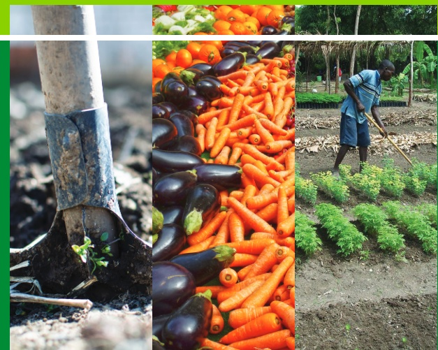
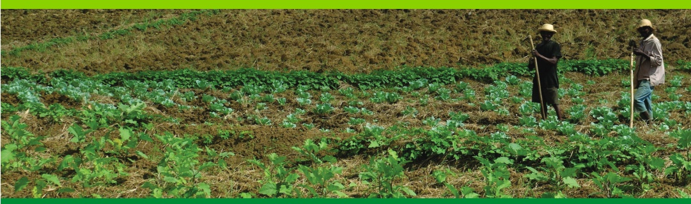

<!-- page 1 -->

INCITATIONS

AU FINANCEMENT

DU SECTEUR

AGRICOLE

CIRCULAIRE NO 113

Aux institutions financières

<!-- page 2 -->

Conformément aux articles 83 et 161 de la loi du 14 mai 2012 portant sur les banques et autres institutions financières et à l'article 14 de la loi du 26 juin 2002 relative aux coopératives d'épargne et de crédit, la Banque de la République d'Haïti édicte la présente circulaire visant à fournir des incitations au financement du secteur agricole.

La présente circulaire s'applique aux banques, aux sociétés financières de développement, aux sociétés de crédit-bail, aux coopératives d'épargne et de crédit et à toutes institutions financières que la BRH aura désignées.

En vue de contribuer à la relance de l'agriculture et au développement de l'agro-business, la présente circulaire définit un mécanisme de facilitation du crédit agricole destiné à inciter les institutions financières à pourvoir sous forme de prêts aux besoins de crédit

des acteurs de toute la chaîne de valeur du secteur agricole. Ce mécanisme vise à faciliter l'accès au crédit aux entrepreneurs agricoles, à toute personne physique ou morale entreprenant des activités agricoles ou agro-industrielles ou agro-alimentaires, à toute coopérative agricole et à tout concessionnaire ou utilisateur de zones franches agricoles.

Dans le cadre de ce mécanisme, les prêts qui seront octroyés par les institutions financières ciblées par la présente circulaire visent le financement des initiatives suivantes :

1. L'intégration et l'organisation des espaces agricoles en « zones franches agricoles » dûment délimitées et autorisées ;

2. L'installation, les travaux d'aménagement et/ou d'amélioration : des infrastructures essentielles au fonctionnement adéquat des exploitations agricoles (forage de puits, irrigation et drainage, arrosage, etc.) et de zones franches agricoles ;

3. L'acquisition, l'installation, les travaux d'aménagement et/ou d'amélioration de machines et d'équipements agricoles tels que : tracteur, charrue, broyeur, pompe, semoir, moissonneuse, faucheuse, etc. ;

4. L'acquisition, l'installation, les travaux d'aménagement et/ou d'amélioration et l'exploitation d'usines ou d'unités de conservation et de transformation de denrées ou de produits agricoles ;

5. L'installation, les travaux d'aménagement et/ou d'amélioration, et l'exploitation de systèmes d'élevage (volailles, mammifères, poissons, et autres) et la production de produits dérivés (œufs, fourrures, lait, produits laitiers, etc.) ;

6. La production de tout type de denrées agricoles, et de produits d'élevage, de pêche, d'aquaculture et de sylviculture, apiculture, etc. ainsi que de produits issus de tous autres secteurs afférents à l'agriculture et à l'agro-industrie.

7. L'offre de services agricoles tels que le labourage, la vente d'intrants, de semences et de matériels et d'équipements agricoles, la commercialisation de services de récolte et post-récolte, et celle de services de conditionnement de denrées agricoles, ainsi que les services de logistique agricole, de consultation, de standardisation, de marketing, de courtage d'assurance lorsqu'appliqués aux activités agricoles, agroindustrielles et agroalimentaires.

<!-- page 3 -->

### 1. Définitions

Dans le cadre de cette circulaire, les défitions suivantes s'appliquent :

## a) Agriculteur

Personne dont l'activité, exercée le plus souvent de façon indépendante, est principalement consacrée (1) à la culture du sol de façon à produire des plantes bénéfiques pour l'homme et propices à l'élevage d'animaux (production végétale) et (2) éventuellement à l'élevage d'animaux (production animale).

## b) Agriculture

Ensemble des activités de production végétale et animale. Les activités de production végétale incluent, entre autres : la culture des fruits et légumes, la culture des céréales, des oléagineux, des légumineuses, des tubercules, la viticulture, l'arboriculture fruitière, la floriculture, la sylviculture, etc. Les activités de production animale incluent, entre autres : l'élevage du gros et du menu bétail, l'embouche, l'apiculture, la pêche, la pisciculture, etc.

## c) Agriculture sous serre

Production agricole réalisée à l'intérieure d'une serre, c'est-à-dire d'une construction en verre ou en plastique, fixe ou démontable où les conditions optimales de culture sont réunies afin de cultiver les plantes fragiles ou exotiques, de protéger les semis délicats et d'accélérer la production de certains fruits ou légumes et de certaines fleurs.

## d) Agroalimentaire (industrie alimentaire ou secteur de l'agro-alimentaire)

Ensemble des activités industrielles, de transformation et d'élaboration des productions alimentaires provenant de l'agriculture ou de la pêche et du conditionnement de celles-ci en aliments industriels voués principalement à la consommation humaine, en général à travers les circuits de distribution et de commercialisation appropriés.

## e) Agrobusiness

Secteur qui en plus de l'agro-alimentaire, inclut l'ensemble des entreprises industrielles qui approvisionnent le secteur agricole en produits comme les pesticides, les engrais et les machines. Il comprend des entreprises qui transforment des productions provenant de l'agriculture, de la pêche et de la foresterie en produits non-alimentaires, tels que les biocarburants (ou agro-carburant élaborés à partir de matériaux organiques non fossiles) et les biotechnologies industrielles (qui utilisent des biotechnologies agricoles nouvelles au fin de protection de l'environnement.

## f) Aquaculture

Culture de plantes aquatiques et élevage d'animaux vivant en milieu aquatique (eau douce, eau saumâtre, milieu marin).

## g) Bloc de production agricole ou ferme associative

Exploitation agricole constituée à partir d'un regroupement de terrains appartenant à plusieurs personnes dans une même zone géographique en vue d'optimiser les activités de production agricole sous la gestion d'un entrepreneur agricole.

## h) Concessionnaire de zone franche

Personne physique ou morale ayant obtenu par concession de l'État le statut de zone franche.

<!-- page 4 -->

## i) Coopérative agricole

Coopérative qui entreprend des activités de production agricole (végétale et/ou animale) de commercialisation de produits agricoles ou de vente de services agricoles dont les membres anticipent un avantage économique. C'est un regroupement de personnes et non de capitaux. Pour être habilitée à fonctionner la coopérative agricole doit être agréée par le Conseil National des Coopératives (CNC).

## j) Crédit de campagne agricole

Crédit agricole à court terme contracté pour subvenir aux besoins en liquidité survenus pendant une campagne agricole. Il est généralement affecté aux opérations suivantes : labour/préparation de sol, achat d'intrants (semences, engrais, pesticides), opérations de semis/sarclage, de cueillette ou de récolte, de vendange, etc.

Dans le cas de la production animale, le crédit de campagne agricole est destiné spécifiquement à l'achat de bétail pour l'embouche et l'achat d'aliments pour bétail, au financement d'un cycle de production de poulet de chair ou au financement de tout cycle de production animale de moins d'un an.

## k) Culture hydroponique

Technique de culture hors-sol (sans terre naturel) qui utilise un environnement spécialisé (constitué de solutions nutritives renouvelées) pour la production, entre autres, de fruits, de légumes et de fleurs.

## l) Culture maraîchère

Culture de légumes, de certains fruits, de certaines fines herbes et fleurs à usage alimentaire. C'est une culture organisée de manière professionnelle, souvent dans une optique de profit.

## m) Cultures permanentes ou pérennes

Cultures qui ont un cycle de végétation de plusieurs années. A titre d'exemple, les plantations de café, bananes et de figue bananes, grenade, grenadia (fruit de la passion), cacao et la floriculture sont considérés comme des cultures pérennes.

## n) Embouche

Engraissement et mise à l'herbage de certains types d'animaux pour la boucherie.

## o) Entrepreneur agricole

Personne physique ayant obtenu une licence du Ministère du Commerce et de l'Industrie pour entreprendre des activités de production agricole dans un contexte de ferme associative ou de gestion de bloc de production agricole.

## p) Exploitation agricole

Unité économique et de production agricole (végétale ou animale) remplissant les critères suivants : (1) elle comprend « tous les animaux qui s'y trouvent et toute la terre utilisée, entièrement ou en partie, pour la production agricole, indépendamment du type de possession, du mode juridique ou de la taille » ; (2) elle représente une exploitation qui « peut contenir un ou plusieurs blocs, situés dans une ou plusieurs régions distinctes ou dans une ou plusieurs régions territoriales ou administratives à condition qu'il partagent les mêmes moyens de production tels que main-d'œuvre, bâtiments agricoles, machine ou animaux de trait utilisés sur l'exploitation » ; et (3) elle est soumise à une direction unique qui « peut être exercée par un particulier, par un ménage, conjointement par deux ou plusieurs particuliers ou ménages... ou par une personne morale telle que société, entreprise collective, coopérative ou organisme d'État »

<!-- page 5 -->

## q) Utilisateur de zone franche

Personne physique ou morale habilitée à développer une activité à l'intérieur d'une zone franche.

r) Verger

Terrain de plus ou moins grande contenance planté d'arbres fruitiers d'une ou de plusieurs variétés.

## s) Zone franche agricole

Ensemble d'espaces agricoles clairement délimités et entièrement clôturé où s'applique, sous surveillance de l'Administration Générale des Douanes, un régime douanier et fiscal spécial en vue de promouvoir la production et la transformation de denrées agricoles, l'élevage et la production de produits dérivés, l'installation de toutes infrastructures essentielles à la production ou à la transformation de denrées agricoles. Les investissements effectués dans les zones franches agricoles visent la production agricole pour l'exportation.

### 2. Mécanisme de facilitation du crédit agricole

Les institutions financières qui auront approuvé, selon leurs politiques et procédures, une demande de crédit agricole, tels que définis dans la présente circulaire, seront éligibles au financement de la BRH pour ledit crédit. Pour la mise en œuvre de ce mécanisme de facilitation, les éléments ci-après sont à considérer :

La BRH consentira à l'institution financière, selon sa catégorie, des avances en gourdes dont la durée pourra être :

- de court terme (moins d'un an) pour le financement des campagnes agricoles ;

- de moyen terme (de un an à 5 ans) pour le financement d'activités agricoles, de mise en place d'infrastructures de base nécessaires au bon fonctionnement des exploitations agricoles, à l'acquisition d'équipements et de matériels agricoles;

- et de long terme (plus de 5 ans) pour le financement de prêts aux projets agroindustriels, de zones franches agricoles, de production agricole sous serre, d'agriculture hydroponique, de développement de vergers et de cultures saisonnières ou pérennes, de mise en place d'infrastructures sur les exploitations agricoles, etc.

Le volume de crédit accordé à un client dans le cadre de ce programme à partir des avances de la BRH ne doit pas dépasser l'équivalent en gourdes de quatre (4) millions dollars américains (USD 4,000,000.00). Il demeure entendu que les institutions financières doivent respecter en tout temps les ratios prudentiels.

• Les avances de la BRH pour le financement des crédits de campagne de production agricole se feront sur une base de portefeuille dont le montant minimum sera de un (1) million de gourdes (HTG 1,000,000.00) par avance.

Pour le financement des projets à long terme, l'institution financière devra soumettre à la BRH les documents de projets sur lesquels elle s'est appuyée pour approuver la demande de crédit.

<!-- page 6 -->

Les institutions financières doivent s'assurer que les exploitations agricoles disposent des infrastructures de base nécessaires à la production avant d'exécuter le financement de toute campagne de production. Par conséquent, le premier refinancement pour lequel un entrepreneur agricole (au sens de la présente circulaire) ou un agriculteur sera éligible dans le cadre de ce mécanisme de facilitation, sera obligatoirement destiné à l'installation des infrastructures de base (forage de puits pour irrigation, de systèmes d'irrigation, et d'espaces de conditionnement et/ou de stockage des denrées, etc.) au cas où celles-ci n'existent pas encore. L'emprunteur devra alors bénéficier d'une période de grâce avant remboursement d'une durée à déterminer.

### 3. Modalités de participation selon la catégorie d'institution financière

#### 3.1. Banques et sociétés financières de développement (SFD)

3.1.1 Prêts à moyen et long terme : Les banques et les SFD sont éligibles aux avances, selon les conditions susmentionnées pour les prêts à moyen et long terme destinés au financement de l'offre de services agricoles, aux entreprises agro-industrielles ou à des projets visant :

a) l'établissement de zones franches agricoles.

b) la production agricole sous serre ou hors sol.

c) le développement de vergers ou de cultures pérennes,

d) l'élevage industriel, et

e) la mise en place d'entreprises agricoles de moyen et long terme.

Le taux d'intérêt annuel des avances de la BRH sera compris entre 1% et 2% à la date de leur octroi et sera maintenu pendant toute la durée desdites avances.

Les banques et les SFD utiliseront les avances de la BRH pour financer les activités agricoles de moyen et long terme à des taux d'intérêt ne dépassant pas 6% l'an.

3.1.2 Prêts de court terme ou crédit de campagne (de production agricole) : les banques et les SFD peuvent utiliser les avances de la BRH pour financer directement tout prêt de campagne agricole supérieur à cinq cent mille goures (HTG 500,000.00). Le taux d'intérêt ne doit pas alors dépasser 6% l'an.

Les banques et les SFD peuvent aussi utiliser les avances de la BRH pour prêter aux institutions de microfinances non mutualistes (IMF) qui financent les activités de campagne de production agricole. Les informations concernant la liste et la localisation de ces activités ainsi que la durée des campagnes de production à financer doivent être soumises à la BRH lors de la demande de refinancement. Celle-ci sera agréée sur une base de portefeuille selon les conditions définies à la Section 2 de la présente circulaire. Dans ce cas, les banques et les SFD doivent passer un accord formel avec les IMF non mutualistes à l'effet d'assurer (1) l'application de taux d'intérêt ne dépassant pas 15% l'an aux crédits de campagne de production agricole et (2) le respect des autres termes et conditions de la présente circulaire.

Le taux d'intérêt qui sera chargé par la BRH aux banques et aux SFD dans le cadre d'un financement aux IMF ne dépassera pas 4% l'an.

#### 3.2. Coopératives d'Epargne et de Crédit (CEC)

Les CEC peuvent également obtenir de la BRH des avances qu'elles affecteront au refinancement des crédits de campagne alloués spécifiquement aux agriculteurs et aux entrepreneurs agricoles. Dans ce cas, les avances de la BRH aux CEC se feront sur une base de portefeuille et le montant minimum de chaque avance sera d'un (1) million de gourdes (HTG 1,000,000.00). Les CEC doivent en tout temps respecter les ratios prudentiels.

<!-- page 7 -->

Les CEC peuvent de même affecter les avances de la BRH aux crédits de moyen terme destinés à financer l'offre de services agricoles ainsi qu'aux projets de transformation de denrées agricoles.

Le taux d'intérêt annuel des avances de la BRH sera compris entre 1% et 2% à la date de leur octroi et sera maintenu pendant toute la durée desdites avances.

Les sociétés de crédit-bail ou « leasing » peuvent spécifiquement intervenir dans le financement d'acquisition d'équipements et de matériels agricoles de moyen terme sans dépasser cinq (5) ans.

Le taux d'intérêt à charger aux emprunteurs par les CEC ne doit pas dépasser 12% l'an.

#### 3.3. Sociétés de crédit-bail

Les avances de la BRH aux sociétés de crédit-bail se feront à un taux d'intérêt de 5% et seront utilisées pour financer des prêts sans dépasser 12%. Il demeure évident que la société de crédit-bail doit garder, en tout temps, un ratio de capitalisation minimum de 20%.

Compte tenu de l'importance en coût de capital de certains équipements agricoles lourds, de leur durée de vie, et de l'existence probable d'un marché de revente, les institutions financières sont autorisées à déduire, au cours de la première année seulement, à titre de garantie déductible, 20% de la valeur de dudit équipement dans le cadre du calcul des provisions générales.

### 4. Modalités d'utilisation du refinancement des crédits de campagne agricole

Pour le refinancement des campagnes de production agricole, la BRH consentira des avances aux institutions financières sur une base de portefeuille et le montant minimum de chaque avance sera d'un (1) million de gourdes (HTG 1,000,000.00) décaissable en une seule tranche.

Les institutions financières, à leur tour, avanceront des liquidités aux entreprises agricoles selon leurs modalités habituelles. Toutefois, quand une banque finance directement une campagne de production lancée par un entrepreneur agricole ou par un agriculteur, elle peut ouvrir une ligne de crédit en faveur de ce dernier pour financer les opérations de production.

A la maturité de toute avance consentie par la BRH au titre du financement des crédits de campagne agri-

cole, les institutions financières effectueront le paiement des intérêts et le remboursement du principal en

un seul versement.

A la maturité de tout prêt de campagne agricole consenti par les institutions financières, l'entrepreneur agricole ou l'agriculteur effectuera le paiement des intérêts et le remboursement du capital en un seul versement.

### 5. Dispositions particulières

Chaque avance de fonds fera l'objet d'un contrat distinct entre la BRH et l'institution financière concernée.

Les avances de fonds octroyées par la BRH et non encore décaissées par une banque au profit d'emprunteurs en attente ne pourront pas être considérées comme éléments constitutifs de réserves obligatoires. Ces fonds ne seront pas non plus éligibles aux fins de placement en bons BRH.

Après avoir reçu les décaissements de la BRH au titre de financement ou de refinancement de projets agricoles ou agro-industriels, les institutions financières disposent d'un délai de trois (3) jours ouvrables pour allouer ces fonds.

<!-- page 8 -->

### 6. Rapports

Au terme du trimestre, soit les 31 mars, 30 juin, 30 septembre et 31 décembre de chaque année, les institutions financières visées par la présente circulaire sont tenues de soumettre à la BRH via la Direction de la Supervision des Banques et autres Institutions Financières un rapport trimestriel qui devra être dressé en date des 31 mars, 30 juin, 30 septembre et 31 décembre de chaque année. Elles devront fournir des informations sur les nouveaux crédits agricoles et agro-industriels approuvés et/ou décaissés pendant la période couverte ainsi que la situation du portefeuille de crédit agricole et agro-industriel. Le rapport devra être présenté conformément au modèle annexé.

S'agissant des banques, ce rapport doit être annexé aux rapports de conformité relatifs à la circulaire 83.4 portant sur la concentration des risques de crédit.

### 7. Sanctions

En cas de non-respect des dispositions de la présente circulaire, les institutions financières s'exposent aux pénalités suivantes :

## a) Pénalité relative à la fiabilité de l'information

En tout temps, les montants déclarés dans le rapport prévu au point 6 de la présente circulaire doivent être ceux apparaissant aux livres comptables et auxiliaires de l'institution financière. A défaut de se conformer à cette directive, la BRH peut, après enquête sur les circonstances et la nature de la violation, imposer une pénalité de 10 % de la différence entre les montants déclarés dans les rapports et les montants apparaissant aux livres comptables et auxiliaires de l'institution financière.

## b) Pénalité relative à tout retard de production des rapports de conformité

Tout retard dans la production du rapport mentionné au point 6 de la présente circulaire sera sanctionné par une pénalité de cinquante mille gourdes (HTG 50,000.00) par jour de retard.

Toute amende imposée à une banque fautive sera déduite du solde de l'un de ses comptes domiciliés à la BRH. Dans le cas d'une amende imposée à une SFD, à une CEC ou à une société de crédit-bail, le paiement se fera par chèque de direction libellé à l'ordre de la Banque de la République d'Haïti, au plus tard cinq (5) jours ouvrables, après réception de l'avis informant l'institution fautive de son obligation de paiement. En cas de non-paiement dans les délais, des pénalités additionnelles de retard seront appliquées, soit deux mille cinq cents gourdes (HTG 2,500.00) par jour de retard et l'institution fautive sera suspendue temporairement du mécanisme de financement jusqu'au paiement intégral des pénalités cumulées.

### 8. Entrée en vigueur

La présente circulaire entre en vigueur le 1er octobre 2018.

<!-- page 9 -->

<!-- page 10 -->

Port-au-Prince, le 20 septembre 2018

Jean Baden Dubois

Gouverneur

Annexe : Format du Rapport trimestriel

Nouveaux crédits agricoles et agro-industriels approuvés et/ou décaissés

Situation du portefeuille de crédit agricole et agro-industriel

<!-- page 11 -->

Annexe 1 de 2

Institution Financière : ___

## RAPPORT TRIMESTRIEL

NOUVEAUX CRÉDITS AGRICOLES ET AGRO-INDUSTRIELS APPROUVÉS ET/OU DECAISSÉS

Du : _____ (jj/mm/aaaa) Au : _____ (jj/mm/aaaa)

| NOMDU CLIENT | MONTANTAPPROUVÉ | MONTANTDECAISSÉ | DATE DEDECAISSEMENT | TAUXD'INTÉRÊT | DURÉEDU PRÊT |
| --- | --- | --- | --- | --- | --- |
|   |   |   |   |   |   |
|   |   |   |   |   |   |
|   |   |   |   |   |   |
|   |   |   |   |   |   |
|   |   |   |   |   |   |
|   |   |   |   |   |   |
|   |   |   |   |   |   |

<!-- page 12 -->

Annexe 2 de 2

# Institution Financière : ___ RAPPORT TRIMESTRIEL SITUATION DU PORTEFEUILLE DE CREDIT AGRICOLE ET AGRO-INDUSTRIEL

Du : _____ (jj/mm/aaaa) Au : _____ (jj/mm/aaaa)

| NOMDU CLIENT | LOCALISATION(DÉPARTEMENT/COMMUNE) | NOMBRED'HECTARES(cas de production agricole au sol) | NOMBRED'EMPLOYÉS(cas d'une entreprise) | TYPES D'ACTIVITÉAGRICOLE | DURÉE INITIALEDU CRÉDIT | ENCOURSOUSOLDEDU CRÉDIT | QUALITÉ DUCREDIT * |
| --- | --- | --- | --- | --- | --- | --- | --- |
|   |   |   |   |   |   |   |   |
|   |   |   |   |   |   |   |   |
|   |   |   |   |   |   |   |   |
|   |   |   |   |   |   |   |   |
|   |   |   |   |   |   |   |   |
|   |   |   |   |   |   |   |   |

*C= courant ; AS= A Signaler ; F= Faible ; Douteux ; P= Perte

Signature de deux cadres autorisés : ___ ___

Postes/Titre : ___ ___

<!-- page 13 -->

<!-- page 14 -->

BANQUE DE LA RÉPUBLIQUE D'HAÎTI

www.brh.ht

Angle rues Pavée et du Quai / Port-au-Prince, Haiti W.I.

Boite Postale 1570

Téléphone: (509) 22.99.11.64

Fax: (509)22.99.11.92
