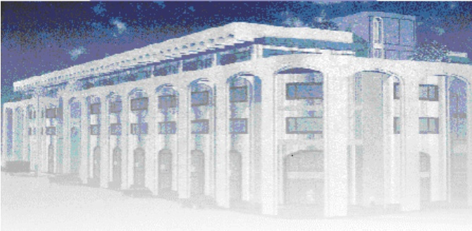

<!-- page 1 -->

Banque de la République d'Haïti

Note mensuelle d'inflation

Janvier 2022

<!-- page 2 -->

## Table des matières

I.- Introduction.....2
II.- Évolution de l'inflation courante en janvier 2022.....2
III.- Évolution des principales fonctions de consommation en janvier 2022.....3
IV.- Évolution de l'inflation selon l'origine des produits et les régions géographiques du pays.....4
V.- Facteurs explicatifs de l'évolution de l'inflation en rythme mensuel.....5
VI.- Prévisions de l'inflation en rythme mensuel.....6

<!-- page 3 -->

### I. - Introduction

Cette note analyse l'évolution de l'Indice des Prix à la Consommation (IPC) en Haïti au cours du mois de janvier 2022. Elle apporte quelques éléments explicatifs permettant de comprendre les facteurs qui influencent la variation mensuelle de l'IPC.

### II. - Évolution de l'inflation courante en janvier 2022

L’indice des prix à la consommation (IPC), (base 100 en 2017-2018), a été évalué à 200,8 en janvier 2022 contre 199,5 le mois précédent et 162 au mois de janvier 2021. Ainsi, en rythme mensuel, l’inflation a connu un ralentissement dans son rythme de progression en passant de 1 % en décembre 2021 à 0,6 % en janvier 2022. De même, en glissement annuel, l’inflation a légèrement ralenti, en atteignant 24 % au cours du mois de janvier contre 24,7 % le mois précédent.

Au cours de la période octobre 2021 à janvier 2022, le taux d'inflation moyen mensuel a été estimé à 2,7 % contre 0,4 % au cours de la même période de l'exercice fiscal 2020-2021. Ce taux moyen d'inflation mensuel demeure supérieur à celui de nos principaux partenaires commerciaux au cours de la même période (République Dominicaine : 1,18 % et les États-Unis : 0,6 %). De plus, au cours des quatre premiers mois de l'exercice fiscal en cours, le taux d'inflation mensuel cumulé s'est porté à 10,9 % contre 1,5 % au cours de la même période de l'exercice passé.

Graphique 1. Évolution de l'inflation annuelle de janvier 2020 à janvier 2022 (en %)

| Month | Inflation annuelle | Inflation Annuelle | Inflation Mensuelle |
| --- | --- | --- | --- |
| Jan-20 | 20.9 | 21.0 | 14.8 |
| Feb-20 | 20.9 | 21.0 | 15.2 |
| Mar-20 | 21.8 | 21.9 | 15.5 |
| Apr-20 | 22.0 | 22.2 | 15.8 |
| May-20 | 22.5 | 23.0 | 17.0 |
| Jun-20 | 23.0 | 23.8 | 18.5 |
| Jul-20 | 23.8 | 24.8 | 17.8 |
| Aug-20 | 24.8 | 26.2 | 21.2 |
| Sep-20 | 23.8 | 25.0 | 0.8 |
| Oct-20 | 21.5 | 22.0 | -0.8 |
| Nov-20 | 20.5 | 21.0 | 0.5 |
| Dec-20 | 19.8 | 20.5 | 1.0 |
| Jan-21 | 19.0 | 19.8 | 1.2 |
| Feb-21 | 18.2 | 19.0 | 1.2 |
| Mar-21 | 17.5 | 18.0 | 1.1 |
| Apr-21 | 16.5 | 17.0 | 1.0 |
| May-21 | 15.5 | 16.0 | 1.0 |
| Jun-21 | 14.0 | 14.5 | 1.2 |
| Jul-21 | 13.0 | 13.5 | 1.8 |
| Aug-21 | 11.0 | 12.5 | 1.8 |
| Sep-21 | 12.5 | 13.5 | 1.5 |
| Oct-21 | 18.0 | 19.0 | 4.5 |
| Nov-21 | 24.0 | 25.0 | 4.6 |
| Dec-21 | 24.5 | 25.2 | 0.8 |
| Jan-22 | 23.8 | 24.8 | 0.5 |

Source: IHSI

<!-- page 4 -->

### III. - Évolution des principales fonctions de consommation en janvier 2022

Le ralentissement de l'inflation mensuelle résulte, dans une large mesure, de l'évolution de l'indice des prix des fonctions suivantes : « Articles d'habillement et chaussures » (0,3 % en janvier 2022 contre 1,4 % en décembre 2021), « Logement, gaz, électricité et autres combustibles » (0,5 % contre 5,2 %), « Transport » (0,3 % contre 16,1 %). Parallèlement, il a été constaté une accélération du rythme de croissance de l'IPC de certains postes de consommation tels que : « Produits alimentaires et boissons non alcoolisées » (0,8 % contre -1,2 % un mois plus tôt), « Meubles, articles de ménage et entretien courant du foyer » (0,3 % contre -0,4 %), « Santé » (0,8 % contre 0,6 %). Au cours des mois de décembre 2021 et janvier 2022, les indices des fonctions de consommation : « Enseignement » et « Restaurant » sont restés inchangés.

En glissement annuel, la croissance de l'indice des prix de la majorité des fonctions de consommation a ralenti pour le mois sous revue. Ces ralentissements ont été observés au niveau de l'indice des fonctions de consommation suivantes : « Produits alimentaires et boissons non alcoolisées » (-0,8 pp à 25,5 %), « Articles d'habillement et chaussures » (-1,1 pp à 24,7 %), « Meubles, articles de ménage et entretien courant du foyer » (-1,1 pp à 22,8 %), « Santé » (-1,2 pp à 25,5 %) $ ^{1} $. Le poste « Produits alimentaires et boissons non alcoolisées » qui représente 48,5 % du panier de consommation, a contribué à hauteur de 64,59 % à l'inflation mensuelle et 52,44 % à l'inflation annuelle.

<!-- page 5 -->

Tableau 1. Contributions à l'inflation mensuelle et annuelle en janvier 2022 (en %)

<table><tr><td>Poste</td><td>Pondération</td><td>Contribution à l'inflation mensuelle</td><td>Contribution à l'inflation annuelle</td></tr><tr><td></td><td>en %</td><td>en %</td></tr><tr><td>Indice Général</td><td>100.00</td><td>100.00</td><td>100.00</td></tr><tr><td>Produits alimentaires et boissons non alcoolisées</td><td>48.50</td><td>64.59</td><td>52.44</td></tr><tr><td>Boissons alcoolisés, tabac et stupéfiants</td><td>1.42</td><td>0.00</td><td>0.72</td></tr><tr><td>Articles d'habillement et chaussures</td><td>5.55</td><td>0.00</td><td>5.73</td></tr><tr><td>Logement, eau, gaz, électricité et autres combustibles</td><td>14.14</td><td>12.91</td><td>15.58</td></tr><tr><td>Meubles, articles de ménages et entretien courant du foyer</td><td>5.32</td><td>2.82</td><td>5.13</td></tr><tr><td>Santé</td><td>2.56</td><td>3.37</td><td>2.76</td></tr><tr><td>Transports</td><td>9.10</td><td>5.24</td><td>8.82</td></tr><tr><td>Communications</td><td>2.23</td><td>0.66</td><td>0.44</td></tr><tr><td>Loisirs</td><td>1.52</td><td>2.11</td><td>0.90</td></tr><tr><td>Enseignement</td><td>3.91</td><td>0.00</td><td>1.49</td></tr><tr><td>Restaurants</td><td>0.49</td><td>0.00</td><td>0.61</td></tr><tr><td>Biens et Services divers</td><td>5.26</td><td>8.29</td><td>5.39</td></tr></table>

Source: Calculs de la BRH/MAE

### IV. - Évolution de l'inflation selon l'origine des produits et les régions géographiques du pays

L'analyse de l'évolution de l'inflation selon l'origine des produits a montré qu'en glissement annuel, la décélération qui a caractérisé le rythme de progression de l'IPC global s'est reflétée aussi bien dans celui des produits importés que des produits locaux. En effet, en janvier 2022, tout en demeurant assez élevé, le taux de croissance de l'IPC des produits importés a ralenti à 33 % après avoir atteint 33,7 % un mois auparavant. De même, celui de l'indice des prix des produits locaux a baissé de 60 points de base (pb) par rapport à décembre 2021 pour s'établir à 19,1 %.

En janvier 2022, la baisse des pressions inflationnistes a été ressentie au niveau de la plupart des régions géographiques telles que définies par l'IHSI. En effet, sur base mensuelle, l'inflation s'est repliée de 40 pb dans l'Aire Métropolitaine et dans les régions Nord et Transversale pour se chiffrer à 0,6 %. De même, au niveau des régions Reste Ouest et Sud, elle a baissé de 30 pb pour se porter à 0,8 % en janvier 2022.

<!-- page 6 -->

En glissement annuel, le rythme de progression de l'IPC a ralenti au niveau de toutes les régions. L'inflation annuelle s'est chiffrée dans l'« Aire Métropolitaine » à 23,2 % contre 24 % un mois plus tôt, « Transversale » (23,4 % contre 24,1 %), « Nord » (22,8 % contre 23,4), « Sud » (25,9 % contre 26,5 %) et « Reste Ouest » (25,6 % contre 26,1 %).

### V. - Facteurs explicatifs de l'évolution de l'inflation mensuelle en janvier 2022

Le ralentissement de l'inflation mensuelle en janvier 2022 est imputable à un ensemble de facteurs. D'un côté, il reflète la poursuite de l'atténuation des effets des chocs liés à la faible disponibilité des produits pétroliers en novembre et à l'ajustement des prix à la pompe en décembre. D'un autre côté, il traduit l'impact de la modération de la dépréciation de la gourde par rapport au dollar américain ainsi que le ralentissement de la hausse des cours des produits de base sur le marché international sur les trois derniers mois.

En effet, entre décembre 2021 et janvier 2022, la variation du taux de change de référence a légèrement ralenti à 1,1 %, contre 1,41 % le mois précédent. Parallèlement, la progression mensuelle de l'indice FAO des prix des produits alimentaires a décéleré pour se chiffrer à une moyenne de 0,56 % de novembre 2021 à janvier 2022, contre 1,16 % au cours des trois mois précédents.

## VI- Prévisions d'inflation

Pour les trois prochains mois, les prévisions d'inflation réalisées par la Direction de la Monnaie et de l'Analyse Économique (MAE) tablent sur une augmentation de l'inflation tant en rythme mensuel qu'en glissement annuel. En effet, l'inflation mensuelle devrait atteindre 1,9 % en février 2022, pour ensuite se porter à 2,1 % pour les mois de mars et avril 2022. Parallèlement, en glissement annuel, le taux d'inflation devrait s'établir à 25,1 %, 26,3 % et 27,8 % respectivement pour les mois de février, mars et avril 2022.

<!-- page 7 -->

Graphique 2. Prévisions de l'inflation en variation mensuelle et annuelle sur trois mois (en %, à partir de janvier 2019)

| Date | Infl_m | Infl_y |
| --- | --- | --- |
| Jan-19 | 1.6 | 2.1 |
| Feb-19 | 1.6 | 2.5 |
| Mar-19 | 0.7 | 2.4 |
| Apr-19 | 1.7 | 2.6 |
| May-19 | 1.4 | 2.8 |
| Jun-19 | 1.8 | 3.0 |
| Jul-19 | 1.6 | 3.1 |
| Aug-19 | 1.6 | 3.2 |
| Sep-19 | 1.6 | 3.3 |
| Oct-19 | 1.7 | 3.4 |
| Nov-19 | 1.8 | 3.5 |
| Dec-19 | 1.6 | 3.5 |
| Jan-20 | 1.7 | 3.6 |
| Feb-20 | 1.8 | 3.7 |
| Mar-20 | 1.7 | 3.8 |
| Apr-20 | 1.8 | 3.9 |
| May-20 | 2.0 | 4.1 |
| Jun-20 | 2.9 | 4.5 |
| Jul-20 | 2.4 | 4.8 |
| Aug-20 | 3.2 | 5.3 |
| Sep-20 | -0.8 | 4.5 |
| Oct-20 | -1.2 | 3.8 |
| Nov-20 | 0.5 | 3.2 |
| Dec-20 | 1.1 | 2.9 |
| Jan-21 | 1.1 | 2.7 |
| Feb-21 | 1.1 | 2.5 |
| Mar-21 | 1.1 | 2.3 |
| Apr-21 | 1.0 | 2.0 |
| May-21 | 1.0 | 1.8 |
| Jun-21 | 1.2 | 1.5 |
| Jul-21 | 1.9 | 1.2 |
| Aug-21 | 2.1 | 1.0 |
| Sep-21 | 2.1 | 1.3 |
| Oct-21 | 4.6 | 2.1 |
| Nov-21 | 4.7 | 2.5 |
| Dec-21 | 19.7 | 2.4 |
| Jan-22 | 0.6 | 2.4 |
| Feb-22 | 1.0 | 2.4 |
| Mar-22 | 1.9 | 2.5 |
| Apr-22 | 2.1 | 2.7 |

Sources : Prévisions du Service de Modélisation et Prévisions Macrééconomiques de la BRH

<!-- page 8 -->

Tableau 2. Indice des prix à la consommation (IPC) par postes de dépenses Variation et Contribution à l'inflation mensuelle et annuelle en janvier 2022

<table><tr><td>Poste</td><td>IPC</td><td>Variation IPC (%)</td></tr><tr><td>Janvier 2021</td><td>Décembre 2021</td><td>Janvier 2022</td><td>Mensuelle</td><td>Annuelle</td></tr><tr><td>Indice général</td><td>161.9</td><td>199.5</td><td>200.8</td><td>0.7</td><td>24.0</td></tr><tr><td>Produits alimentaires et boissons non alcoolisées</td><td>176.3</td><td>219.6</td><td>221.3</td><td>0.8</td><td>25.5</td></tr><tr><td>Boissons alcoolisés, tabac et stupéfiants</td><td>133.8</td><td>149.8</td><td>149.8</td><td>0.0</td><td>12.0</td></tr><tr><td>Articles d'habillement et chaussures</td><td>169.1</td><td>210.3</td><td>210.3</td><td>0.3</td><td>24.7</td></tr><tr><td>Logement, eau, gaz, électricité et autres combustibles</td><td>150.3</td><td>188.4</td><td>189.4</td><td>0.5</td><td>26.0</td></tr><tr><td>Meubles, articles de ménages et entretien courant du foyer</td><td>159.1</td><td>194.7</td><td>195.3</td><td>0.3</td><td>22.8</td></tr><tr><td>Santé</td><td>210</td><td>261.5</td><td>263.5</td><td>0.8</td><td>25.5</td></tr><tr><td>Transports</td><td>122</td><td>149.4</td><td>149.9</td><td>0.3</td><td>22.9</td></tr><tr><td>Communications</td><td>110.6</td><td>115.5</td><td>115.7</td><td>0.2</td><td>4.6</td></tr><tr><td>Loisirs</td><td>175.3</td><td>198.1</td><td>199.7</td><td>0.8</td><td>13.8</td></tr><tr><td>Enseignement</td><td>128.7</td><td>140.3</td><td>140.3</td><td>0.0</td><td>9.0</td></tr><tr><td>Restaurants</td><td>175.8</td><td>227.4</td><td>227.4</td><td>0.0</td><td>29.4</td></tr><tr><td>Biens et Services divers</td><td>150.8</td><td>185.6</td><td>187.3</td><td>0.9</td><td>24.2</td></tr></table>

Sources : IHSI et calculs du Service de la Macrééconomie et Analyse de Conjoncture de la MAE

<!-- page 9 -->

## Glossaire

| Variation mensuelle | : Variation par rapport au mois précédent. |
| --- | --- |
| Glissement annuel | : Variation par rapport au même mois de l'année antérieure. |
| Inflation | : Mouvement persistant à la hausse du niveau général des prix. |
| Désinflation | : Ralentissement de la croissance des prix. |
| Déflation | : Baisse du niveau général des prix associée à une contraction de la masse monétaire et du crédit. |
| Inflation sous-jacente | : Tendance de long terme des prix, tout en excluant la volatilité, les mouvements saisonniers, conjoncturels, et les chocs qui affectent les composantes du panier considéré. |
| Région Nord | : Elle couvre les départementes du Nord, Nord-Est et Nord-Ouest. |
| Région Sud | : Elle comprend les départementes du Sud de la Grand-Anse et des Nippes. |
| Région Reste Ouest | : Y sont incluses les départementes du Sud-Est et de l'Ouest à l'exception de l'aire métropolitaine |
| Région Transversale | : Elle regroupe les départementes du Centre et de l'Artibonite. |
| Aire Métropolitaine | : Elle contient les villes de Port-au-Prince, de Delmas, de Pétion-Ville, de Carrefour et de Croix des Bouquets. |
