<!-- page 1 -->

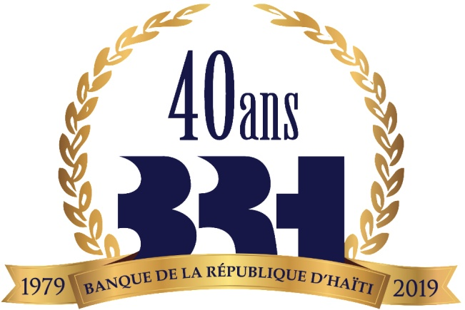

SOMMET INTERNATIONAL SUR LA FINANCE 2019

Financer

l'Agritourisme –

Le rôle de la BRH

Jean Baden DUBOIS

<!-- page 2 -->

## SOMMAIRE

1. La problématique de la politique monétaire et cadre de

mise en œuvre

3. Tourisme, Agriculture et croissance économique

2. La croissance économique de 1981 à nos jours

4. Le binôme agriculture-tourisme: Evidences empiriques et effets attendus

5. La politique monétaire pro-croissance

6. La BRH et le financement de l'agritourisme

7. Conclusion

<!-- page 3 -->

## La problématique de la politique monétaire et cadre de mise en œuvre

En 2019, les défis sont de taille pour combler le déficit de croissance accumulé depuis près de quarante ans.

Les déséquilibres internes et externes que reflètent nos

fondamentaux ne font que nous écarter du sentier de

croissance durable et soutenue.

De ce fait, compte tenu de leur grande transversalité et des specificités de notre système de production, un secteur agricole dynamique et une industrie touristique florissante constituent les éléments clés de politiques publiques pour contrer la paupérisation notamment dans le milieu rural.

<!-- page 4 -->

# La problématique de la politique monétaire et cadre de mise en œuvre

En dépit des contraintes liées à la maitrise de la liquidité induite par les chocs internes et externes qui ont affecté l'économie, la politique monétaire a eu une posture relativement accommodante :

- En maintenant essentiellement des taux d'intérêt quasiment inchangés en termes nominaux, malgré une progression du taux d'inflation, d'où des taux d'intérêt réels négatifs.

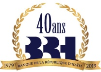

<!-- page 5 -->

## La problématique de la politique monétaire et cadre de mise en œuvre

Cette posture s'est accompagnée de mesures de stabilisation dans le souci de réduire l'instabilité du marché des changes en limitant la volatilité du taux dont les répercussions sur l'évolution des prix à la consommation se reflètent souvent sans retard. Au nombre de ces mesures on cite:

• l'augmentation des taux de réserves obligatoires;

- la modification du mode de constitution des réserves sur les passifs en devises;

les interventions sur le marché des changes;

• les opérations de swap;

• les circulaires relatives à la position de change.

<!-- page 6 -->

## La problématique de la politique monétaire et cadre de mise en œuvre

De même pour sauvegarder le potentiel de croissance de l'économie, la BRH a également adopté des mesures d'orientation de la liquidité vers les secteurs tels que :

• Agriculture

• Hôtellerie et Tourisme

• Logement résidentiel

• Logement commercial

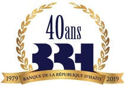

<!-- page 7 -->

## La croissance économique de 1981 à nos jours (Rappel)

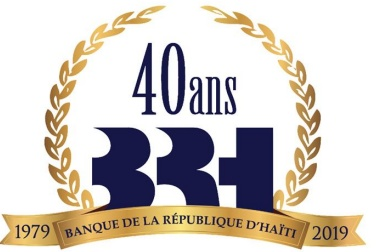

- Toutefois, dans un environnement marqué par des incertitudes et des chocs tant internes qu'externes, il est particulièrement difficile de concilier les objectifs de croissance à long terme et les déséquilibres de court terme, notamment ceux du compte extérieur et des finances publiques.

• En effet, la croissance comme vous le savez, a affiché un profil trop faible et trop volatil au cours des dernières années.

L'analyse des statistiques macroéconomiques montre que de 1981 à 2018, la croissance économique du pays a tourné autour d'une moyenne de 0,49 %, reflétant particulièrement la tendance observée pendant les dix (10) dernières années.

<!-- page 8 -->

## Croissance du PIB

| Year | Value |
| --- | --- |
| 1981 | -3.6 |
| 1982 | -3.6 |
| 1983 | 0.3 |
| 1984 | 0.3 |
| 1985 | 0.6 |
| 1986 | 0.6 |
| 1987 | 0.6 |
| 1988 | 1.5 |
| 1989 | -2.9 |
| 1990 | 1.0 |
| 1991 | 1.9 |
| 1992 | -5.4 |
| 1993 | -5.4 |
| 1994 | -11.9 |
| 1995 | 9.9 |
| 1996 | 4.1 |
| 1997 | 2.2 |
| 1998 | 2.2 |
| 1999 | 2.2 |
| 2000 | 0.9 |
| 2001 | -1.0 |
| 2002 | -1.0 |
| 2003 | -0.3 |
| 2004 | -3.5 |
| 2005 | 1.8 |
| 2006 | 2.3 |
| 2007 | 3.3 |
| 2008 | 0.8 |
| 2009 | 3.1 |
| 2010 | -5.5 |
| 2011 | 5.5 |
| 2012 | 2.9 |
| 2013 | 4.3 |
| 2014 | 2.8 |
| 2015 | 1.2 |
| 2016 | 1.5 |
| 2017 | 1.2 |
| 2018 | 1.5 |

<!-- page 9 -->

# La croissance économique de 1981 à nos jours

• Parallèlement, le secteur agricole joue un rôle important dans l'économie tant du point de vue de la croissance que de la création d'emplois

• Toutefois, la contribution du secteur agricole à la croissance économique en Haïti n'a pas cessé de diminuer au cours des dernières années en raison notamment des contraintes de financement du secteur.

• En effet, la part de la valeur ajoutée du secteur agricole dans le PIB global est passée de 26,5% en 2010, à 22,01% en 2018.

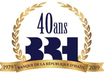

<!-- page 10 -->

## Poids de l'agriculture dans le PIB

| Year | Value |
| --- | --- |
| 2013 | 24.4 |
| 2014 | 23.33 |
| 2015 | 21.85 |
| 2016 | 22.17 |
| 2017 | 22.16 |
| 2018 | 22.05 |

<!-- page 11 -->

## Croissance du PIB et du secteur agricole

| Period | TAUX DE CROISSANCE ECONOMIQUE | TAUX DE CROISS AGRIC |
| --- | --- | --- |
| 2010-2011 | 5.60 | -1.20 |
| 2011-2012 | 2.90 | -1.40 |
| 2012-2013 | 4.20 | 4.20 |
| 2013-2014 | 2.80 | -1.00 |
| 2014-2015 | 1.20 | -5.50 |
| 2015-2016 | 1.40 | 3.00 |
| 2016-2017 | 1.20 | 0.80 |
| 2017-2018 | 1.50 | 0.50 |

<!-- page 12 -->

## La politique monétaire pro-croissance

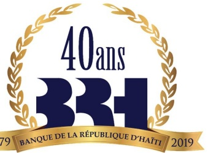

• Dans le but de réduire l'impact de cette inadéquation sur la stabilisation à court terme, la BRH a mis en place des mécanismes que l'on pourrait qualifier de non conventionnels qui vise la croissance à long terme.

• Traduisant la forme concrète de l'agenda monétaire pro-croissance, ces mécanismes accordent la priorité entre autres, à l'agriculture et au tourisme.

<!-- page 13 -->

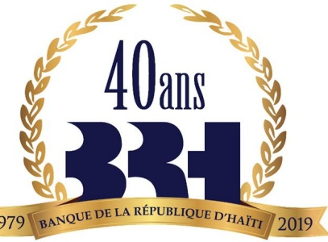

Le binôme agriculture-tourisme: Evidences empiriques et effets attendus

• Déjà en 1991, l'évidence aux Bahamas montrait que le fait de remplacer 1 dollar d'importation par 1 dollar de biens produits localement créait 43 centimes additionnels de valeur ajoutée dans le reste de l'économie.

Une illustration d'un tel effet multiplicateur peut être tiré de l'expérience de la région caribéenne:

En République Dominicaine, le secteur touristique contribue de manière substantielle à la croissance et à l'emploi. Lange (2011) estime à moins de 25% les importations de produits alimentaires consommés dans les centres de villageature tout-compris (all-inclusive resorts) dominicains.

<!-- page 14 -->

## Le binôme agriculture-tourisme: Evidences empiriques et effets attenus

Le développement de l'agritourisme pourrait donc:

• Contribuer à une réduction des importations de produits agricoles

- Favoriser l'augmentation de l'offre des devises et une amélioration du solde de la balance commerciale

Améliorer le niveau de vie des travailleurs agricoles

• Réduire les déséquilibres macroéconomiques.

<!-- page 15 -->

## Le binôme agriculture-tourisme: Evidences empiriques et effets attenus

Le tourisme entraîne une demande accrue et souvent plus stable pour certains produits agricoles, créant ainsi la possibilité d'économies d'échelle et de renforcement des chaînes de valeur.

- Les agriculteurs peuvent bénéficier d'intrants, de lignes de crédit ainsi que de l'assistance technique de la part d'hôtels et de restaurants.

- Les exploitations agricoles peuvent être transformées en sites visités par des touristes désireux de découvrir des paysages, des pratiques sociales, le savoir-faire local, des destinations gastronomiques (spécialités culinaires), des espaces de transformation, etc.. C'est l'agritourisme.

Le tourisme et l'agriculture peuvent faire partie du même circuit de préservation de l'environnement

<!-- page 16 -->

## Le binôme agriculture-tourisme: Evidences empiriques et effets attenus

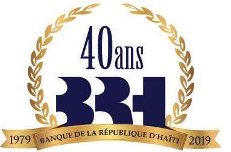

- Une hausse de l'offre agroalimentaire locale à destination des opérateurs touristiques rend le tourisme moins dépendant des importations, et les opérateurs touristiques moins sujets aux aléas du taux de change.

• Il en résulte le renforcement de la compétitivité du pays par rapport aux autres destinations touristiques.

Certaines filières agricoles peuvent fournir à des secteurs connexes au tourisme, comme l'artisanat, des intrants tels que cuir, bois, bambou, etc.

L'expansion de filières agricoles peut permettre de varier l'offre touristique : visite d'exploitations agricoles, d'espaces de transformation, etc.; valorisation des atouts gastronomiques d'une destination, etc.

L'agritourisme peut servir de catalyseur à l'essor du secteur agricole. Pour cela, il convient de redéfinir les conditions de la production agricole afin d'établir des passerelles synergiques vers le secteur touristique.

Il en ressort finalement un effet induit de toute la chaîne de valeurs liée à ces secteurs.

<!-- page 17 -->

## La BRH et le financement de L'AGRITOURISME

La BRH, à travers les mécanismes mis en place, a orienté le financement du secteur bancaire vers ces secteurs. Le résultat attendu serait un effet multiplicateur sur la croissance économique.

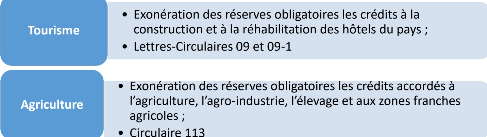

<!-- page 18 -->

## Mécanismes financiers / Tourisme/ Résultats non exhaustifs

• Sur le plan des résultats...

| Nombre de Crédois | Valeur de 10000 et 250 en 2014 | Valeur de Port-au-Prince en 2014 | Équivalent écédois (millions de dollars) |
| --- | --- | --- | --- |
| Ouest | 69.1 | 69.1 | 100000.0 |
| Nord | 25.2 |   | 25.2 |
| Arribonite | 2.2 |   | 25.2 |

<!-- page 19 -->

# Mécanismes financiers / Agriculture / Circulaire 113

La circulaire 113 vise à Renforcer et attirer de nouveaux investissements dans les différentes filières agricoles et agro-industrielles en facilitant :

- Des prêts de court, moyen et long terme au secteur à des taux préférentiels ;

Le renforcement des structures évoluant dans le secteur agricole (zones franches, coopératives agricoles, etc.);

Le diversification des stratégies de financement (crédit-bail)

En termes de résultats, deux projets de grande envergure ont été approuvés et financés par les banques du système.

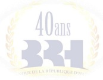

<!-- page 20 -->

## Rapatriement des fonds du Projet SYFAAH

Le SYFAAH est issu de l'effort d'orientation stratégique du secteur agricole que l'État haïtien avait entrepris au cours des dernières années. Le projet a pris forme en 2011 comme résultante du cofinancement de l'État haïtien et des coopérations suisse, française et, surtout, canadienne.

Le SYFAAH visait l'amélioration de la sécurité alimentaire, la création d'emplois et la relance de l'économie agricole et rurale, y compris via un système de financement et d'assurances agricoles.

• En mars 2019, les fonds du projet furent transférés par le Canada au Fonds de Développement Industriel (FDI). Cela facilitera l'institutionnalisation du mécanisme de garantie agricole instauré par le SYFAAH.

- La BRH reste très proactive dans le processus, jouant un rôle central dans le renforcement des mécanismes conçus grâce au SYFAAH, comme, par exemple, la mise en place de la Circulaire 113.

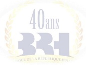

<!-- page 21 -->

# BRH : partie prenante des réflexions autour de l'agritourisme

La BRH est partie prenante de ces réflexions et stratégies

Réalisation de tables sectorielles sur l'agriculture. Ceci a permis un accompagnement adapté au secteur grâce à :

• une meilleure connaissance des filières agricoles, et

- un diagnostic global du secteur (de concert avec la Banque Mondiale).

Collaboration étroite au processus de développement de la stratégie de relance du tourisme:

• Proposition de stratégies pour l'identification et le développement de pôles de croissance pour le secteur touristique.

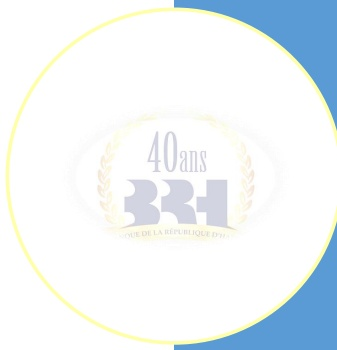

<!-- page 22 -->

## En conclusion

La stabilisation macroéconomique a permis de limiter les dérapages inflationnistes mais les effets positifs sur la croissance économique n'ont pas été suffisants. L'économie haïtienne s'est retrouvée coincée dans une trappe à la croissance faible et erratique qui a renforcé les déséquilibres aux niveaux social, économique et environnemental.

L'agritourisme peut jouer le rôle de locomotive pour tirer la croissance. Car ce secteur se prête au développement d'un écosystème dont les éléments se déclinent aisément :

Un domaine de production diversifiée de biens et services catégorisables qui en garantit une offre soutenable.

Un potentiel important de demande locale et internationale initialement supportée par une diaspora solvable.

Un espace privilégié qui donne contenu à un label territorial : le milieu rural

<!-- page 23 -->

## En conclusion

La création soutenue de valeurs marchandes dans ce nouvel espace de multiplication des échanges devrait avoir des retombées positives sur l'environnement, la dynamisation des chaines de valeurs et la réduction de la pauvreté.

• En un mot, une dynamique plus large capable de porter les germes d'une croissance endogène et moins vulnérable aux chocs externes

<!-- page 24 -->

## En conclusion

40ans

BOUE DE LA RÉPUBLIQUE D'H

Il convient donc de redéfinir les conditions de production agricole tout en favorisant la création des liens de synergie avec le secteur touristique pour permettre à cette combinaison de jouer son rôle de moteur de croissance étant donné son importance dans la formation du PIB, ceci dans un contexte d'articulation des politiques publiques.

<!-- page 25 -->

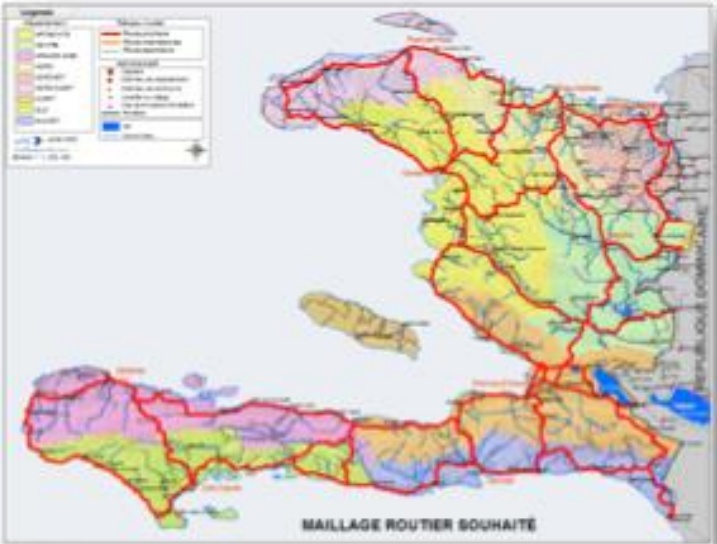

## Haiti - 2030

Name Branding : Haiti??

• Agriculture BIO

Tourisme Culture

<!-- page 26 -->

## MERCI
