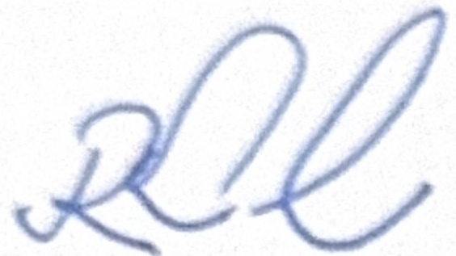

<!-- page 1 -->

## AVIS

## AUX INSTITUTIONS FINANCIÈRES

La Banque de la République d'Haïti (BRH) attire l'attention des institutions financières sur le fait que le Groupe d'Action Financière (GAFI) publie régulièrement des listes de juridictions présentant des déficiencies stratégiques majeures en matière de lutte contre le blanchiment de capitaux, le financement du terrorisme et de la prolifération.

Ces juridictions, considérées comme « Juridictions à haut risque », sont soumises à un appel à l'application de contre-mesures renforcées en raison des risques significatifs qu'elles présentent pour l'intégrité du système financier international.

Au 19 juin 2026, les juridictions inscrites sur la liste noire du GAFI sont :

1. Iran

2. République populaire démocratique de Corée (Corée du Nord)

3. Myanmar

Dans ce contexte, les institutions financières sont tenues de mettre en œuvre une approche basée sur les risques, portée à son niveau le plus élevé, à l'égard de toute relation d'affaires, opération ou transaction ayant un lien direct ou indirect avec ces juridictions.

À ce titre, elles doivent s'efforcer de mettre en place les mesures de vigilance renforcée et les contre-mesures appropriées, notamment :

• le déploiement de dispositifs efficaces de filtrage (screening) des clients, des bénéficiaires effectifs, des contreparties et des transactions, à travers la confrontation des informations disponibles avec ces juridictions et les listes de sanctions disponibles ;

le renforcement des mesures de connaissance de la clientèle, notamment en collectant des informations détaillées relatives à l'identité des clients et des bénéficiaires effectifs, aux origines des fonds, aux structures de propriété, ainsi que des objets et nature des opérations ;

l'adoption d'une surveillance renforcée des relations d'affaires et des flux financiers, notamment lorsque ceux-ci sont complexes ou impliquent des juridictions multiples ;

- l'application, le cas échéant, de mesures de restriction appropriées, qui peuvent aller jusqu'à la limitation, la suspension ou la cessation de la relation d'affaires.

Les institutions financières doivent notamment s'abstenir d'entrer en relation d'affaires ou de maintenir des relations existantes lorsque les risques identifiés ne peuvent pas être atténués efficacement par les mesures de vigilance renforcée.

<!-- page 2 -->

Par ailleurs, une attention particulière doit être accordée aux situations présentant des indicateurs de risque élevé, notamment :

1. l'utilisation de structures juridiques complexes, comme de sociétés de façade (société écran) n'ayant aucune activité économique apparente ;

2. des opérations financières inhabituelles, incohérentes par rapport au profil du client, ou dépourvues de justification économique ;

3. des mouvements de capitaux rapides, fractionnés ou circulaires entre plusieurs juridictions à haut risque, susceptible de dissimuler l'origine ou la destination des fonds ;

4. l'implication d'intermédiaires ou de tiers agissant pour le compte de clients sans transparence suffisante ;

5. la présence de personnes politiquement exposées, ainsi que des liens avec des environnements à forte corruption et instabilité institutionnelles.

Les institutions financières sont encouragées à utiliser les outils de filtrage automatiques et les bases de données spécialisées pour croiser efficacement les informations sur leurs clients avec les principales listes de sanctions, les données sur des personnes politiquement exposées, ainsi que les médias défavorables.

Cependant, il est expressément rappelé que lesdits outils ne doivent pas remplacer une analyse humaine approfondie. Les alertes générées doivent faire l'objet d'un examen rigoureux afin de distinguer les correspondances réelles de faux positifs, et de fonder toute décision sur une appréciation éclairée du risque.

En l'absence de tels outils, il est nécessaire de mettre en place des procédures de vérification manuelle structurées, y compris la consultation des sources officielles et des bases de données publiques pertinentes.

À cette fin, il est recommandé aux institutions financières de consulter de manière continue les sources suivantes :

1. le site officiel du GAFI :  $ \underline{\text{https://www.fatf-gafi.org/fr/home.html}} $, en particulier les rubriques : Juridictions à haut risque visées par un appel à action, la « liste noire », et Juridictions soumises à une surveillance renforcée, la « liste grise » ;

2. le site des Nations Unies consacré aux sanctions :

https://main.un.org/securitycouncil/en/sanctions/information;

3. les publications du Fonds monétaire international (FMI) et de la Banque mondiale relatives à l'intégrité financière ;

4. les orientations du Groupe Wolfsberg et du Groupe Egmont en matière de gestion des risques de criminalité financière.

Il est également rappelé que certaines situations peuvent relever de régimes de sanctions internationales contraignants, notamment ceux de Conseil de Sécurité des Nations Unies, impliquant des obligations juridiques spécifiques, y compris des interdictions strictes de transaction.

<!-- page 3 -->

Les institutions financières sont tenues d'intégrer l'ensemble de ces exigences dans leurs dispositifs internes de gestion des risques, de conformité et de contrôle interne, conformément au Décret du 30 avril 2023 sanctionnant le blanchiment de capitaux, le financement du terrorisme et le financement de la prolifération des armes de destruction massive, à la circulaire 129-1 de la BRH, ainsi qu'aux standards internationaux du GAFI.

La BRH invite les institutions concernées à assurer une mise en œuvre rigoureuse, cohérente et traçable de ces obligations, compte tenu des enjeux liés à la protection de l'intégrité du système financier national et au renforcement de la crédibilité internationale du pays.

Port-au-Prince, le 22 juin 2026

Ronald Gabriel

Gouverneur
