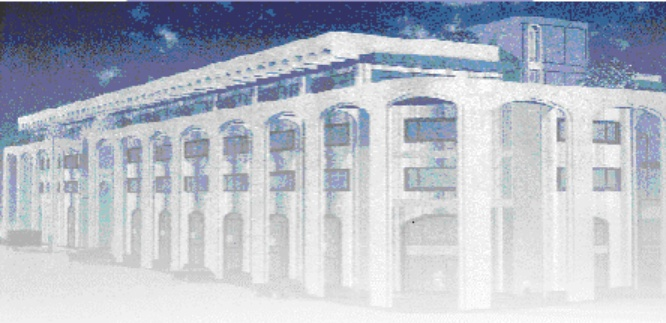

<!-- page 1 -->

Banque de la République d'Haïti

Note mensuelle d'inflation

Juin 2022

<!-- page 2 -->

## Table des matières

I.- Introduction.....2
II.- Évolution de l'inflation globale en juin 2022.....2
III.- Évolution des principales fonctions de consommation en juin 2022.....3
IV.- Évolution de l'inflation selon l'origine des produits et les régions géographiques du pays .....4
V.- Évolution de l'inflation sous-jacente.....5
V.- Facteurs explicatifs de l'évolution de l'inflation mensuelle en juin 2022.....6

<!-- page 3 -->

### I. - Introduction

Cette note analyse l'évolution de l'indice des prix à la consommation (IPC) en Haïti au cours du mois de juin 2022. Elle apporte quelques éléments explicatifs permettant de comprendre les facteurs qui influencent la variation mensuelle de l'IPC.

### II. - Évolution de l'inflation globale en juin 2022

L’indice des prix à la consommation (IPC) a été estimé à 220,4 en juin 2022 contre 215,6 en mai 2022 et 170,8 en juin 2021. Il en est ainsi ressorti un taux d’inflation mensuel de 2,2 % soit, 30 points de base de plus que celui du mois de mai 2022. En glissement annuel, l’inflation s’est établie à 29% accusant une hausse de 1,2 point de pourcentage par rapport au mois antérieur.

Par ailleurs, cumulé d'octobre 2021 à juin 2022, le taux d'inflation mensuel a atteint 20,3 % contre 6,8 % sur la même période un an plus tôt. Considérée en moyenne mensuelle, l'inflation a évolué au-dessus du niveau observé sur le même intervalle de l'exercice précédent, soit 2,3 % contre 0,8 %. Ce taux moyen demeure supérieur à celui enregistré chez nos principaux partenaires commerciaux (États-Unis : 0,83 %, République Dominicaine : 0,81 %).

Graphique 1. Évolution de l'inflation mensuelle et annuelle en juin 2022 (en pourcentage)

| Month | Inflation Annuelle | Inflation Mensuelle |
| --- | --- | --- |
| Jun/20 | 24.8 | 20.8 |
| Jul/20 | 25.8 | 20.2 |
| Aug/20 | 27.5 | 21.5 |
| Sep/20 | 24.5 | 5.5 |
| Oct/20 | 21.5 | 1.8 |
| Nov/20 | 20.5 | 8.0 |
| Dec/20 | 19.5 | 11.5 |
| Jan/21 | 19.0 | 12.0 |
| Feb/21 | 18.0 | 12.0 |
| Mar/21 | 17.0 | 11.8 |
| Apr/21 | 15.8 | 11.0 |
| May/21 | 14.5 | 11.2 |
| Jun/21 | 12.5 | 12.0 |
| Jul/21 | 12.0 | 14.5 |
| Aug/21 | 11.0 | 14.0 |
| Sep/21 | 13.5 | 14.5 |
| Oct/21 | 20.0 | 4.6 |
| Nov/21 | 24.5 | 4.6 |
| Dec/21 | 24.5 | 1.0 |
| Jan/22 | 23.5 | 0.5 |
| Feb/22 | 24.5 | 1.8 |
| Mar/22 | 25.5 | 1.5 |
| Apr/22 | 26.0 | 1.5 |
| May/22 | 27.0 | 1.7 |
| Jun/22 | 28.5 | 1.9 |

Source : IHSI

<!-- page 4 -->

## III- Évolution des principales fonctions de consommation en juin 2022

La progression de l'inflation en rythme mensuel a été tributaire de l'augmentation de la majorité des postes de consommation notamment : « Articles d'habillement et chaussures » dont le taux de croissance s'est accéléré de 20 points de base (pb) au cours du mois de juin 2022 pour s'inscrire à 2,8 %, « Produits alimentaires et boissons non alcoolisées » et « Meubles, articles de ménages et entretien courant du foyer » (+50 pb et +10 pb respectivement à 2,6 % chacun), « Loisirs » (+40 pb à 1,8 %), « Santé » (+30 pb à 2,7 %). Par ailleurs, l'IPC du poste « Enseignement » est resté inchangé à 140,3 depuis avril 2022.

En ce qui a trait à l'inflation annuelle, hormis le poste « Restaurants » dont le rythme de croissance a baissé de 3,5 points de pourcentage (pp) à 33,1 % en juin 2022, l'IPC de toutes les autres fonctions de consommation a connu une évolution haussière. Les progressions les plus significatives ont été observées au niveau de l'IPC des groupes suivants : « Produits alimentaires et boissons non alcoolisées » (+1,6 pp à 30,7 %), « Boissons alcoolisés, tabac et stupéfiants » (+1,4 pp à 17,1 %), « Articles d'habillement et chaussures » (+1,2 pp à 32 %), « Logement, eau, gaz, électricité et autres combustibles » (+0,9 pp à 30 %). Ces quatre divisions ont contribué à hauteur de 73,77 % à l'inflation annuelle et de 76,84 % à l'inflation mensuelle.

<!-- page 5 -->

Tableau 1. Contributions des divisions de consommation à l'inflation mensuelle et annuelle en juin 2022 (en %)

<table><tr><td>Poste</td><td>Pondération</td><td>Contribution à l'inflation mensuelle</td><td>Contribution à l'inflation annuelle</td></tr><tr><td></td><td>en %</td><td>en %</td></tr><tr><td>Indice Général</td><td>100,00</td><td>100,00</td><td>100,00</td></tr><tr><td>Produits alimentaires et boissons non alcoolisées</td><td>48,50</td><td>60,39</td><td>51,93</td></tr><tr><td>Boissons alcoolisés, tabac et stupéfiants</td><td>1,42</td><td>1,16</td><td>0,85</td></tr><tr><td>Articles d'habillement et chaussures</td><td>5,55</td><td>7,31</td><td>6,20</td></tr><tr><td>Logement, eau, gaz, électricité et autres combustibles</td><td>14,14</td><td>7,98</td><td>14,79</td></tr><tr><td>Meubles, articles de ménages et entretien courant du foyer</td><td>5,32</td><td>6,63</td><td>5,22</td></tr><tr><td>Santé</td><td>2,56</td><td>3,21</td><td>2,31</td></tr><tr><td>Transports</td><td>9,10</td><td>4,22</td><td>10,38</td></tr><tr><td>Communications</td><td>2,23</td><td>1,49</td><td>0,65</td></tr><tr><td>Loisirs</td><td>1,52</td><td>1,27</td><td>0,88</td></tr><tr><td>Enseignement</td><td>3,91</td><td>0,00</td><td>1,08</td></tr><tr><td>Restaurants</td><td>0,49</td><td>0,52</td><td>0,57</td></tr><tr><td>Biens et Services divers</td><td>5,26</td><td>5,82</td><td>5,15</td></tr></table>

Source : Calculs de la BRH/MAE

IV.- Évolution de l'inflation selon l'origine des produits et les régions géographiques du pays

Au cours du mois de juin 2022, le rythme de progression de l'IPC des produits importés et locaux

a affiché la même tendance que l'indice global en glissement annuel. En effet, le taux de croissance

de l'IPC des produits importés s'est accéléré de 1,7 point de pourcentage pour atteindre 41,7 %,

soit l'une de ses plus fortes variations sur l'exercice fiscal 2022. Parallèlement, l'IPC des produits

locaux s'est accru de 21,8 %, en hausse de 80 points de base par rapport à mai 2022.

Au mois de juin 2022, les données ont montré une accélération de l'inflation au niveau des différentes zones géographiques définies par l'IHSI tant sur base mensuelle qu'en glissement annuel. En effet, en variation mensuelle les plus importantes variations ont été enregistrées au niveau de la région Sud (+50 pb à 2,5 %), l'Aire Métropolitaine (+40 points de base à

<!-- page 6 -->

2,4 %), s’ensuivent les zones Transversale et Reste Ouest (+20 pb à 2 % et 1,9 % respectivement), et le Nord (+10 pb à 2,1 %). De même, en glissement annuel, l’inflation enregistrée au niveau des différentes régions par rapport à un mois plutôt à présenté le profil suivant : Sud (31,4 % contre 29,8 %), Reste Ouest (29,8 % contre 29 %), Aire Métropolitaine (29,1 % contre 27,6 %), Transversale (27,4 % contre 26,5 %) et Nord (27,7 % contre 26,8 %).

### V. - Évolution de l'inflation sous-jacente

Au cours du mois sous étude, l'inflation sous-jacente a suivi la même tendance que l'inflation globale tant en rythme mensuel qu'annuel. En effet, sur base annuelle, elle s'est établie à 27,5 % contre 26,23 % en mai 2022. En variation mensuelle, l'indice sous-jacent a crû de 2,24 %, soit une hausse de 34 points de base par rapport au mois antérieur. Ainsi, la variation mensuelle de l'indice sous-jacent a été légèrement plus prononcée que celle de l'indice global, ce qui sous-tend que des facteurs monétaires semblent avoir contribué relativement plus à l'accélération de l'inflation mensuelle.

Graphique 2. Évolution de l'inflation globale et de l'inflation sous-jacente en juin 2022 (en rythme mensuel en pourcentage)

| Date | Inflation globale | Inflation sous-jacente |
| --- | --- | --- |
| Jun-20 | 2.9 | 2.9 |
| Aug-20 | 3.4 | 3.5 |
| Sep-20 | -0.5 | -0.5 |
| Oct-20 | -1.2 | -1.2 |
| Dec-20 | 0.8 | 0.8 |
| Feb-21 | 1.1 | 1.1 |
| Apr-21 | 0.9 | 0.9 |
| Jun-21 | 1.2 | 1.2 |
| Aug-21 | 2.1 | 2.2 |
| Sep-21 | 1.4 | 1.4 |
| Oct-21 | 4.5 | 4.5 |
| Nov-21 | 4.5 | 4.5 |
| Dec-21 | 0.8 | -0.3 |
| Feb-22 | 1.8 | 2.1 |
| Apr-22 | 1.5 | 1.5 |
| Jun-22 | 2.1 | 2.2 |

Sources : Données ISHI et Calculs de la BRH

### VI. - Facteurs explicatifs de l'évolution de l'inflation mensuelle en juin 2022

En juin 2022, l'accélération du rythme de progression de l'inflation peut être principalement attribuée à la dépréciation de la gourde. En effet, l'accentuation des tensions sur le marché des

<!-- page 7 -->

changes a influencé la dynamique des prix, particulièrement ceux des produits importés. Les tensions constatées au niveau du marché des changes ont porté le taux de référence moyen mensuel à 112,62 gourdes pour un dollar en juin 2022, soit une croissance de 3,1 % par rapport au mois antérieur. Ainsi, en dépit d'une relative baisse des prix des produits de base (hormis le pétrole) sur le marché international, la variation annuelle de l'indice des prix des produits importés a été significative (41,7 %), soit près le double de celle de l'IPC des produits importés $ ^{1} $.

## VII- Prévisions d'inflation

Les prévisions d'inflation réalisées par la Direction Monnaie et Analyse Économique (MAE) pour les trois derniers mois de l'exercice fiscal 2021-2022 tablent sur une évolution contrastée de l'inflation mensuelle et une accélération de l'inflation annuelle. En effet, le rythme de croissance de l'IPC devrait s'accélérer en atteignant 2,9 % en juillet 2022 pour ensuite ralentir à 2,6 % et 2,4 % respectivement en août et septembre 2022. Parallèlement, en glissement annuel, le taux d'inflation poursuivrait sa tendance haussière en se chiffrant à 30,1 %, 30,9 % et 32,2 % en juillet, août et septembre 2022 respectivement.

Graphique 3. Prévisions de l'inflation annuelle et mensuelle (en pourcentage)

| Date | Infl. Mens. | Infl. Ann |
| --- | --- | --- |
| Oct-20 | -1.2 | 2.3 |
| Nov-20 | 0.4 | 2.0 |
| Dec-20 | 1.1 | 1.8 |
| Jan-21 | 1.1 | 1.7 |
| Feb-21 | 1.1 | 1.6 |
| Mar-21 | 1.1 | 1.4 |
| Apr-21 | 0.9 | 1.1 |
| May-21 | 1.0 | 0.9 |
| Jun-21 | 1.3 | 0.6 |
| Jul-21 | 2.0 | 0.5 |
| Aug-21 | 2.1 | 0.2 |
| Sep-21 | 1.4 | 0.6 |
| Oct-21 | 4.6 | 1.9 |
| Nov-21 | 4.8 | 2.9 |
| Dec-21 | 1.0 | 2.9 |
| Jan-22 | 0.6 | 2.8 |
| Feb-22 | 2.1 | 3.0 |
| Mar-22 | 1.6 | 3.1 |
| Apr-22 | 1.6 | 3.2 |
| May-22 | 1.8 | 3.4 |
| Jun-22 | 2.1 | 3.6 |
| Jul-22 | 2.9 | 3.9 |
| Aug-22 | 2.6 | 4.0 |
| Sep-22 | 2.4 | 3.9 |

<!-- page 8 -->

Tableau 2. Indice des prix à la consommation (IPC) par postes de dépenses - Variation mensuelle et annuelle

<table><tr><td>Poste</td><td>IPC</td><td>Variation IPC (%)</td></tr><tr><td>Juin 2021</td><td>Mai 2022</td><td>Juin 2022</td><td>Mensuelle</td><td>Annuelle</td></tr><tr><td>Indice général</td><td>170,8</td><td>215,6</td><td>220,4</td><td>2,2</td><td>29,0</td></tr><tr><td>Produits alimentaires et boissons non alcoolisées</td><td>187,3</td><td>238,5</td><td>244,8</td><td>2,6</td><td>30,7</td></tr><tr><td>Boissons alcoolisés, tabac et stupéfiants</td><td>135,4</td><td>155,9</td><td>158,6</td><td>1,7</td><td>17,1</td></tr><tr><td>Articles d'habillement et chaussures</td><td>181,1</td><td>232,6</td><td>239,1</td><td>2,8</td><td>32,0</td></tr><tr><td>Logement, eau, gaz, électricité et autres combustibles</td><td>156,1</td><td>200,5</td><td>202,9</td><td>1,2</td><td>30,0</td></tr><tr><td>Meubles, articles de ménages et entretien courant du foyer</td><td>169,7</td><td>211,8</td><td>217,4</td><td>2,6</td><td>28,1</td></tr><tr><td>Santé</td><td>232,6</td><td>285,3</td><td>292,9</td><td>2,7</td><td>25,9</td></tr><tr><td>Transports</td><td>123,8</td><td>162,7</td><td>164,3</td><td>1,0</td><td>32,7</td></tr><tr><td>Communications</td><td>112,1</td><td>119,7</td><td>121,4</td><td>1,4</td><td>8,3</td></tr><tr><td>Loisirs</td><td>182,6</td><td>209,3</td><td>213</td><td>1,8</td><td>16,6</td></tr><tr><td>Enseignement</td><td>130</td><td>140,3</td><td>140,3</td><td>0,0</td><td>7,9</td></tr><tr><td>Restaurants</td><td>184,8</td><td>240,5</td><td>245,9</td><td>2,2</td><td>33,1</td></tr><tr><td>Biens et Services divers</td><td>160,1</td><td>200,3</td><td>205</td><td>2,3</td><td>28,0</td></tr></table>

Sources : IHSI et calculs du Service de la Macrééconomie et Analyse de Conjoncture de la MAE

<!-- page 9 -->

## Glossaire

| Variation mensuelle | : Variation par rapport au mois précédent. |
| --- | --- |
| Glissement annuel | : Variation par rapport au même mois de l'année antérieure. |
| Inflation | : Mouvement persistant à la hausse du niveau général des prix. |
| Désinflation | : Ralentissement de la croissance des prix. |
| Déflation | : Baisse du niveau général des prix associée à une contraction de la masse monétaire et du crédit. |
| Inflation sous-jacente | : Tendance de long terme des prix, tout en excluant la volatilité, les mouvements saisonniers, conjoncturels, et les chocs qui affectent les composantes du panier considéré. |
| Région Nord | : Elle couvre les départementes du Nord, Nord-Est et Nord-Ouest. |
| Région Sud | : Elle comprend les départementes du Sud de la Grand-Anse et des Nippes. |
| Région Reste Ouest | : Y sont incluses les départementes du Sud-Est et de l'Ouest à l'exception de l'aire métropolitaine |
| Région Transversale | : Elle regroupe les départementes du Centre et de l'Artibonite. |
| Aire Métropolitaine | : Elle contient les villes de Port-au-Prince, de Delmas, de Pétion-Ville, de Carrefour et de Croix des Bouquets. |
