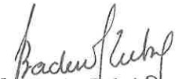

<!-- page 1 -->

# AUX MAISONS DE TRANSFERT

La présente circulaire détermine certaines mesures préventives proportionnelles à la nature des risques de blanchiment de capitaux et de financement du terrorisme.

### 1. Devoir de vigilance et identification des clients

Les maisons de transfert doivent accorder une importance particulière aux normes relatives à la connaissance du client pour préserver leur réputation et l'intégrité du système financier. A cet effet, les maisons de transfert doivent élaborer et mettre en place des politiques et procédures, et prendre des mesures permettant d'établir l'identité des clients permanents ou occasionnels, des bénéficiaires effectifs, des donneurs d'ordre et des bénéficiaires.

Les maisons de transfert sont donc tenues d'identifier les clients, les donneurs d'ordre et les bénéficiaires, de vérifier leur identité au moyen de documents, de sources de données ou de renseignements indépendants et fiables. Lorsqu'elles disposent de sous-agents, les maisons de transfert doivent également s'assurer que leurs agents mettent en œuvre des mesures préventives similaires, conformément à la section 6 de la présente circulaire.

## L'identification des clients a lieu lors :

1) de l'établissement de la relation d'affaires ;

2) des transactions occasionnelles supérieures au seuil réglementaire ou en cas de répétition d'opérations distinctes pour un montant individuel inférieur au seuil réglementaire ou lorsque la provenance licite des fonds n'est pas certaine ou s'il s'agit d'un transfert de fonds au niveau national ou international;

3) des transactions, en gourdes ou en devises étrangères, réalisées en une seule opération ou en plusieurs opérations entre lesquelles semble exister un lien et dont le total est égal ou supérieur au seuil établi par la loi et les règlements ;

4) de l'existence d'un soupçon de blanchiment de capitaux ou de financement du terrorisme, indépendamment de toute exemption ou seuil prévu dans les lois et règlements ;

5) de l'existence d'un doute quant à la véracité ou la pertinence des données d'identification du client précédemment obtenues.

L’identification d’une personne physique selon l’article 36 du décret du 30 avril 2023 sanctionnant le blanchiment de capitaux, le financement du terrorisme et le financement de la prolifération des armes de destruction massive implique « l’obtention des nom et prénom complets, de la date et du lieu de naissance et de l’adresse de son domicile principal ».

1

<!-- page 2 -->

En ce qui a trait à la vérification des informations, l'article 36 du décret susmentionné précise que : « la vérification de l'identité d'une personne physique requiert la présentation d'un document officiel original en cours de validité et comportant une photographie, dont il en est pris copie. La vérification de son adresse est effectuée par la présentation d'un document de nature à en rapporter la preuve ou par tout autre moyen ».

Lorsque le client est une personne morale ou une construction juridique, l'identification et la vérification de l'identité porte sur « la dénomination sociale, l'adresse du siège social, l'identité et les pouvoirs des administrateurs et dirigeants sociaux ou de leurs équivalents en droit étranger, la preuve de sa constitution légale, », selon l'article 38 du décret du 30 avril 2023.

Lors de l'identification des clients, une copie de tous les documents doit être faite, classée et centralisée par la maison de transfert. Des contrôles formels doivent être effectués quant à la signature, aux éventuelles anomalies sur la photographie et à l'apparence physique du client potentiel.

Les maisons de transfert doivent prendre des mesures raisonnables pour obtenir des informations sur l'identité véritable des personnes dans l'intérêt desquelles une transaction est effectuée, s'il y a le moindre doute sur le fait que ces clients pourraient ne pas agir pour leur propre compte.

Les maisons de transfert doivent s'assurer que les transferts contiennent toutes les informations requises sur le donneur d'ordre et le bénéficiaire et prendre des mesures appropriées dans le cas contraire, ce conformément aux articles 47 à 54 du décret du 30 avril 2023. Le donneur d'ordre et le bénéficiaire peuvent être une seule et même personne. Le transfert peut être transfrontalier ou national.

Les pièces et renseignements servant à l'identification des clients doivent être exigés lors des remises et transmissions de fonds pour une somme globalement égale ou supérieure au seuil réglementaire établi ou l'équivalent en devise étrangère, pour une opération occasionnelle de montant élevé, pour toute transaction effectuée dans des conditions de complexité inhabituelles ou injustifiées.

Les maisons de transfert doivent exercer une vigilance constante et procéder à un examen attentif des opérations en veillant à ce qu'elles soient cohérentes avec la connaissance actualisée qu'elles ont de leurs clients. Elles doivent faire preuve d'une connaissance étendue et actualisée du client pour être à même de déceler d'éventuelles incohérences ou anomalies dans leurs opérations.

Si les maisons de transfert ne peuvent pas respecter les dispositions prévues ci-dessus, elles ne peuvent ni nouer ou maintenir une relation d'affaires, ni effectuer une opération pour le client. Elles détermineront, dans ce cas, s'il y a lieu de produire une déclaration de soupçon à l'Unité Centrale de Renseignements Financiers (UCREF) ou d'établir un rapport confidentiel interne conformément à l'article 46 du décret du 30 avril 2023.

Lorsque les clients n'agissent pas pour leur propre compte, les maisons de transfert sont tenues d'obtenir des informations nécessaires sur l'identité des personnes dans l'intérêt desquelles une transaction est effectuée. En outre, un avocat, un notaire, un comptable, un courtier en valeurs

2

<!-- page 3 -->

mobilières intervenant en tant qu'intermédiaire financier ne peut pas se prévaloir du secret professionnel pour ne pas divulguer l'identité du bénéficiaire effectif, conformément aux dispositions de l'article 49 du décret du 30 avril 2023.

### 2. Bénéficiaires effectifs

Les maisons de transfert sont tenues d'identifier les bénéficiaires effectifs conformément aux dispositions des articles 40 à 42 du décret du 30 avril 2023.

Si les maisons de transfert ne peuvent pas obtenir les informations mentionnées dans la présente section ou leurs clients restent en défaut de les communiquer ou leur communiquer des informations non pertinentes ou invraisemblables, elles ne peuvent ni nouer ou maintenir une relation d'affaires, ni effectuer une opération pour le client. Elles détermineront, dans ce cas, s'il y a lieu d'en informer l'UCREF.

### 3. Les personnes politiquement exposées

Un devoir de vigilance renforcée doit s'exercer à l'égard des personnes politiquement exposées (PPE), qui sont définies par l'article 6 du décret du 30 avril 2023 comme des personnes qui exercent ou ont exercé d'importantes fonctions publiques dans un pays étranger ou en Haïti ou au sein de ou pour le compte d'une organisation internationale, ainsi que les membres de la famille de cette personne, ou toutes autres personnes qui lui sont étroitement liées ou associées.

Les maisons de transfert doivent disposer de systèmes appropriés de gestion de risques adéquats permettant de déterminer si le client ou le bénéficiaire effectif est une personne politiquement exposée. Dès que le client est identifié comme personne politiquement exposée, il faut :

a) obtenir l'autorisation de la haute direction avant de nouer ou de continuer une relation d'affaires avec le client ;

b) prendre toute mesures appropriées pour établir l’origine du patrimoine et l’origine des fonds des clients identifiés comme PPE;

c) assurer une surveillance continue renforcée de la relation d'affaires.

### 4. Mesures de vigilance renforcées

Les maisons de transfert doivent appliquer, en fonction de leur appréciation du risque, des mesures de vigilance renforcées dans des situations qui, de par leur nature, peuvent présenter un risque élevé de blanchiment de capitaux ou de financement du terrorisme et, à tout le moins, dans les cas suivants (liste non limitative) :

a) le bénéficiaire effectif est une personne politiquement exposée résidant à l'étranger ;

b) les opérations effectuées avec des personnes physiques ou morales de pays qui n'appliquent pas ou appliquent insuffisamment les normes internationales en matière de lutte contre le blanchiment de capitaux et contre le financement du terrorisme.

3

<!-- page 4 -->

En outre, comme le prescrit l'article 28 du décret du 30 avril 2023, une attention particulière doit être exercée à l'égard des opérations provenant de pays qui n'appliquent pas ou appliquent insuffisamment les normes internationales en matière de lutte contre le blanchiment de capitaux et contre le financement du terrorisme. Les maisons de transferts doivent leur appliquer des mesures de vigilance renforcées, proportionnées aux risques.

### 5. Technologies nouvelles

Les maisons de transfert doivent identifier et évaluer les risques de blanchiment de capitaux pouvant résulter : (a) du développement de nouveaux produits et de nouvelles pratiques commerciales, y compris de nouveaux mécanismes de distribution ; (b) de l'utilisation de technologies nouvelles ou en développement en lien avec de nouveaux produits ou des produits préexistants. Cette évaluation de risques devrait avoir lieu avant le lancement des nouveaux produits ou des nouvelles pratiques commerciales ou avant l'utilisation de technologies nouvelles ou en développement. Les maisons de transfert doivent prendre des mesures appropriées pour gérer ces risques.

### 6. Conservation de documents

Les maisons de transfert sont tenues de conserver pendant une période de cinq (5) ans au moins, après la cessation des relations avec le client, toute la documentation relative à l'identité du client, les informations collectées sur les donneurs d'ordre et les bénéficiaires lors des transferts internationaux et nationaux, les livres de comptes et la correspondance commerciale. De même, les pièces et documents relatifs aux opérations effectuées par les clients doivent être gardés dans les archives de l'institution pendant cinq (5) ans au moins après l'exécution de la transaction.

A cette fin, une formule d'archivage des documents sur les opérations doit être utilisée pour la conservation des documents.

Cette conservation des documents, se rapportant aux transactions nationales et/ou internationales effectuées, permettra de répondre rapidement aux demandes d'informations des autorités compétentes et de reconstituer les transactions individuelles (y compris les montants et les types d'espèces en cause, le cas échéant) de façon à fournir, le cas échéant, des preuves en cas de poursuite pour conduite criminelle.

De même, une copie des déclarations de transactions et des déclarations de soupcons doit être gardée et archivée par la maison de transfert.

### 7. Recours à des sous-agents

Les maisons de transfert sont tenues de veiller au respect par leurs sous-agents des lois et règlements relatifs à la lutte contre le blanchiment des capitaux et le financement du terrorisme.

Elles doivent s'assurer que les sous-agents sont en mesure de fournir sur demande et sans retard des copies des données d'identification et autres documents qui ont traité à l'obligation de vigilance.

合

<!-- page 5 -->

### 8. Programme de prévention

Les maisons de transfert doivent mettre en place un programme de prévention qui comprend les éléments suivants :

1) des politiques, des procédures et des contrôles internes, y compris des dispositifs de contrôle de la conformité, et des procédures appropriées lors de l'embauche des employés, de façon à s'assurer qu'elle s'effectue selon des critères exigeants ;

2) la centralisation des informations sur l'identité des clients, donneurs d'ordre, bénéficiaires, bénéficiaires effectifs et sur les transactions suspectes ;

3) la désignation d'un officier de conformité et la désignation de responsables de conformité au niveau de chaque succursale ou agence le cas échéant ;

4) une évaluation des risques en matière de blanchiment de capitaux et de financement du terrorisme et une classification des risques en fonction des activités et du profil de la clientèle ;

5) l'élaboration d'un programme de formation continue à l'intention des employés et des sous-agents ;

6) un dispositif de contrôle interne pour vérifier la conformité, l'observance et l'efficacité des mesures adoptées ;

7) la mise en place d'un dispositif de tests indépendants du contrôle de la conformité ; et

8) le traitement des opérations suspectes.

Le programme de prévention doit être approuvé par le conseil d'administration de la maison de transfert ou par le correspondant étranger au cas où elle est un agent représentant.

### a. Politiques, procédures et méthodes

Les maisons de transfert sont tenues d'élaborer un programme de prévention comprenant des politiques, procédures et méthodes consignées par écrit et permettant d'identifier les facteurs de risques et d'évaluer les risques de blanchiment de capitaux et de financement des activités terroristes que présentent leurs activités.

Les politiques, procédures et méthodes doivent être approuvées par le conseil d'administration et tenues à jour. Elles doivent être clairement communiquées à tous les cadres appelés à traiter avec des clients.

Les politiques et procédures doivent couvrir toutes les obligations de déclaration, de tenue de documents, de conservation de documents, d'identification des clients, de contrôle, d'évaluation et d'atténuation des risques qui s'appliquent à la maison de transfert.

Les politiques, procédures et méthodes doivent s'appliquer à toutes les succursales ou agences. En outre, les maisons de transferts qui jouent le rôle d'agent doivent veiller à ce que leurs sous-agents mettent en application leur programme de prévention du blanchiment de capitaux et du financement du terrorisme.

Les maisons de transfert sont également tenues d'élaborer des procédures appropriées de sélection garantissant le recrutement des employés selon des critères exigeants.

5

<!-- page 6 -->

### b. Centralisation des informations

Les maisons de transfert doivent se doter d'un système informatique permettant la centralisation des données.

### c. Désignation d'un officier de conformité

Toute maison de transfert doit procéder à la nomination d'un officier de conformité. Cet officier doit être un cadre supérieur de l'institution, sélectionné en fonction de sa compétence, de son expérience, de sa probité et de son éthique professionnelle. Il doit connaître les fonctions et la structure de l'institution, et être au fait des risques et des vulnérabilités liées au blanchiment de capitaux et au financement du terrorisme dans le secteur ainsi que des tendances et des typologies qui caractérisent ces menaces. Il devra dépendre directement de la haute direction pour tout ce qui a trait aux questions liées au blanchiment de capitaux et au financement du terrorisme.

L'officier de conformité a notamment pour attributions de :

a) assurer l’application de la législation et de la réglementation ;

b) faire respecter les procédures et méthodes internes de lutte contre le blanchiment de capitaux et le financement du terrorisme ;

c) identifier les carences et faire les recommandations qui s’imposent ;

d) proposer des programmes de formation sur une base périodique ;

e) assurer la liaison avec les sous-agents ;

f) assurer la liaison avec l'UCREF ;

g) préparer et acheminer les déclarations de soupçons à l'UCREF ;

h) s'assurer que les déclarations de transactions sont complétées et acheminées à l'UCREF dans les délais requis ;

i) recevoir et donner suite aux demandes d'informations de l'UCREF et de toute autorité agissant dans le cadre de la lutte contre le blanchiment de capitaux et le financement du terrorisme.

Les maisons de transfert doivent désigner, dans chaque succursale ou agence, un cadre chargé de faire respecter les lois et réglementations anti-blanchiment et d'assurer la coordination avec l'officier de conformité. En aucun cas, la désignation de ce cadre ne dispense l'officier de conformité de ses responsabilités par rapport à la loi.

### d. Evaluation des risques

Le programme de prévention et de conformité doit comprendre une évaluation des risques de blanchiment de capitaux et de financement du terrorisme.

L'évaluation des risques est une analyse des menaces et faiblesses en matière de blanchiment de capitaux ou du financement du terrorisme que présentent les activités de la maison de transfert et qui tient compte des facteurs de risques tels que les clients, les pays ou zones géographiques, les services, les canaux de distributions, etc. Cette évaluation varie notamment selon la taille de la

6

<!-- page 7 -->

maison de transfert, son emplacement géographique et selon les activités exercées. Une classification des risques doit être effectuée en fonction des services offerts, des canaux de distribution utilisés, des caractéristiques des clients, du pays ou du territoire d'origine ou de destination des fonds.

L'évaluation des risques implique que les employés soient bien imbus des activités de l'institution et qu'ils fassent preuve de jugement afin d'évaluer les risques de blanchiment de capitaux et de financement du terrorisme. Cette évaluation ne doit pas être statique et devra être modifiée au moins tous les douze (12) mois.

### e. Formation continue

Le programme de prévention doit inclure une composante de formation. Tous les employés qui sont en contact avec les clients, qui ont connaissance d'opérations effectuées par des clients ou qui manipulent des espèces ou des fonds de quelque façon que ce soit ou qui sont responsables de la mise en œuvre ou de la surveillance du régime de conformité doivent comprendre les obligations de déclaration, d'identification des clients et de tenue de documents.

Tous les sous-agents appartenant à un réseau d'une maison de transfert doivent également comprendre les obligations de déclaration, d'identification des clients et de tenue de documents.

Le programme de formation doit être consigné par écrit et tenu à jour. Les modalités entourant la fréquence et la méthode de formation devraient être établies. On doit y indiquer notamment les catégories de participants, les sujets qui seront couverts et la fréquence des séances de formation. Chaque nouvel employé de la maison de transfert et nouveau sous-agent doit être formé avant de commencer à travailler avec des clients. Des mises à jour du programme devraient avoir lieu périodiquement afin de tenir toutes les parties intéressées au courant des modifications législatives et réglementaires.

### f. Dispositif de contrôle interne

Les maisons de transfert doivent faire preuve d'une vigilance constante et se doter d'une organisation et de procédures internes propres à assurer le respect des dispositions prévues par la loi et permettant aux responsables des opérations de prévenir et d'identifier toute tentative de blanchiment de capitaux ou de financement du terrorisme. L'un des rôles de ce contrôle est d'éviter l'utilisation du système financier à des fins de blanchiment de capitaux ou de financement du terrorisme et de minimiser les risques auxquels font face les institutions.

Ce système de contrôle interne doit contenir, entre autres :

a) un mécanisme de contrôle des politiques, procédures et méthodes internes de lutte contre le blanchiment de capitaux et le financement du terrorisme;

b) une structure garantissant la confidentialité du traitement des informations;

c) des mesures d'identification des éléments à risques liés au blanchiment de capitaux et au financement du terrorisme et des systèmes d'évaluation de ces risques;

7

<!-- page 8 -->

d) un système de surveillance pouvant garantir la maîtrise des risques relatifs au blanchiment de capitaux et au financement du terrorisme;

e) un système centralisé de documentation et d'information ;

f) un système d'informations sur les initiatives prises en matière de conformité, de déficiencies dans ce domaine et des mesures correctives prises.

### g. Dispositif de tests indépendants

Des tests indépendants périodiques portant sur le respect des procédures internes ou la bonne surveillance des risques, une vérification spécifique sur le volet blanchiment de capitaux et financement du terrorisme doivent être effectués par l'audit interne de la maison de transfert.

Les vérifications peuvent notamment s'appliquer aux points suivants :

a) l'évaluation de la qualité de la gestion et du contrôle des risques pour toutes les opérations et dans toutes les succursales ;

b) des entrevues auprès des employés chargés des opérations et de leurs superviseurs pour évaluer leur degré de connaissance et de respect des procédures de lutte contre le blanchiment de capitaux et le financement du terrorisme adoptées par l'institution;

c) l'examen d'un échantillon de formulaires d'archivage des documents et de formulaires de renseignements sur les transactions financières douteuses;

d) une vérification du système de tenue des documents;

e) l'existence des justificatifs joints ou référencés aux pièces comptables;

f) des examens périodiques de toutes les relations de correspondants bancaires établies avec des banques étrangères afin de détecter les partenaires à haut risque ;

g) la connaissance par les collaborateurs des règles internes anti-blanchiment.

Les résultats de toute vérification doivent être signalés au conseil d'administration.

### h. Traitement des transactions suspectés

Les maisons de transfert doivent élaborer et mettre en application des politiques quant à l'identification et au suivi des transactions inhabituelles ou suspectes. Ces politiques devront définir ce qui est considéré comme suspect ou inhabituel, et fournir des exemples à cet égard.

L'identification des transactions inhabituelles ou suspectes peut être fait par la surveillance des transactions, des informations en provenance de tiers (journaux, internet, etc.), la connaissance qu'a la maison de transfert de l'environnement du client.

### 9. Sanctions

Par suite d'une carence constatée dans l'organisation de procédures internes de prévention du blanchiment de capitaux et de financement du terrorisme, conformément à l'article 116 du décret du 30 avril 2023 et à l'article 109 de la loi du 14 mai 2012, la BRH se réserve le droit de prendre toutes sanctions administratives allant de l'avertissement jusqu'au retrait d'agrément dans les cas les plus graves, sans préjudice de celles prévues par la loi.

8

<!-- page 9 -->

En cas de non-respect des obligations définies dans la présente circulaire ou de constat de défaut de vigilance de la part des maisons de transfert, la BRH se réserve le droit de prendre toutes sanctions administratives allant de l'avertissement au retrait de l'agrément dans les cas les plus graves, et/ou d'appliquer une amendeda de cinq cent mille gourdes (HTG 500,000.00) par violation constatée.

La BRH peut exiger d'une maison de transfert qu'elle apporte les corrections nécessaires quant aux violations relatives à la présente circulaire. A défaut de se conformer aux actions de redressement requises par la BRH, la maison de transfert est assujettie à une pénalité de trois cent mille gourdes (HTG 300,000.00) par jour d'infraction à compter de la date à laquelle l'infraction lui est notifiée par la BRH, sans dépasser trente (30) jours.

Toute pénalité sera déduite du solde du compte de la maison de transfert fautive à la BRH.

### 10. Abrogation et entrée en vigueur

La présente circulaire abroge la circulaire 107-2 et entre en vigueur le  $ 1^{er} $ septembre 2023.

Port-au-Prince, le 16 août 2023.

Jean Baden Dubois

Gouverneur
