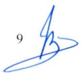
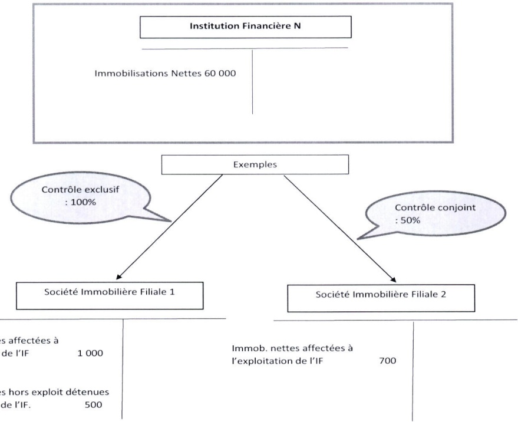

<!-- page 1 -->

# AUX BANQUES AUX SOCIÉTÉS FINANCIÈRES DE DÉVELOPPEMENT ET AUX SOCIÉTÉS DE CRÉDIT-BAIL

En application des articles 44, 83, 89 et 161 de la loi du 14 mai 2012 portant sur les banques et autres institutions financières, les banques, les sociétés financières de développement et les sociétés de crédit-bail ci-après dénommées « institutions financières » sont tenues de respecter les présentes normes : (1) en matière de couverture des immobilisations et des emplois à moyen et long terme, et (2) sur les limites de participations dans les sociétés non financières.

### 1. Définitions

Les défitions suivantes s'appliquent à la présente circulaire :

a) Emplois à moyen et long terme : tout élément d'actif dont le temps de recouvrement ou le temps de réalisation est supérieur ou égal à un (1) an, à l'exception de ceux qui sont déduits des fonds propres réglementaires en application de la circulaire sur les exigences minimales de fonds propres en regard de la couverture des risques, et à hauteur, pour les actifs amortissables, du capital restant dû au terme des douze (12) prochains mois. Ces éléments comprennent :

1) les immobilisations nettes des amortissements et provisions, hors biens donnés en location dans le cadre d'opérations de crédit-bail, et y compris les immobilisations détenues au travers de sociétés immobilières portant des immobilisations d'exploitation ou hors-exploitation de l'institution financière ;

2) les titres de participation, hors participations déductibles des fonds propres réglementaires ;

3) la fraction remboursable à plus d'un an des titres de placement, des effets publics et titres d'Etat détenus, à l'exception des titres négociables sur des marchés liquides ;

4) la fraction des prêts non productifs, au sens de la circulaire relative à la classification des prêts, la constitution des provisions pour créances douteuses et la comptabilisation des intérêts courus sur prêts, non couverte par des provisions ;

5) 100% de l'encours résiduel à plus d'un an des crédits classés courants et à signaler ;

6) 75 % de l'encours résiduel à plus d'un an des opérations de crédit-bail ;

<!-- page 2 -->

7) la fraction remboursable à plus d'un an des concours aux banques et autres institutions :

8) tous autres actifs dont le recouvrement ne peut être obtenu avant un délai d'un (1) an au moins.

b) Fonds propres réglementaires : ensemble des éléments de fonds propres de base (catégories 1a et 1b) et des fonds propres complémentaires (catégorie 2) tels que définis par la circulaire sur les exigences minimales de fonds propres en regard de la couverture des risques.

c) Immobilisations : ensemble des immobilisations physiques (exploitation et hors exploitation), corporelles et incorporelles, des titres de participations et des autres instruments financiers à caractère de fonds propres au sens de la circulaire sur les exigences minimales de fonds propres en regard de la couverture des risques.

d) Immobilisations d'exploitation : ensemble des biens acquis par l'institution financière pour le fonctionnement de ses opérations.

e) Immobilisations hors exploitation : ensemble des biens détenus par l'institution financière et qui ne sont pas utilisés pour le fonctionnement de ses opérations. Les biens reçus en dation de paiement font partie des immobilisations hors exploitation.

f) Ressources stables : ressources constituées de :

1) fonds propres réglementaires ;

2) 50% des dépôts à vue et d'épargne ;

3) 100% des dépôts à terme dont la durée résiduelle est supérieure ou égale à un

(1) an ;

4) 25 % des dépôts à terme de durée résiduelle inférieure à un (1) an ;

5) la fraction des ressources obtenues des banques et autres institutions financières ayant une durée résiduelle supérieure à un (1) an ;

6) l'encours remboursable à plus d'un (1) an d'échéance en durée résiduelle des emprunts obligataires et autres emprunts ;

7) toutes autres ressources dont la durée résiduelle est supérieure à un (1) an.

g) Société non financière : société dont l'activité principale consiste à produire des biens et des services marchands non financiers.

### 2. Ratios de couverture des immobilisations et des emplois à moyen et long terme

Les institutions financières sont tenues de respecter les ratios ci-après sur base individuelle et sur base consolidée :

## a) Ratio de couverture des immobilisations

Les immobilisations ne doivent pas excéder 100% des fonds propres réglementaires.

 $$  Couverture~immobilisations~=\frac{ Immobilisations }{Fonds~propres~réglementaires}\leq100\% $$

<!-- page 3 -->

Les immobilisations incorporelles, les titres de participations et les autres instruments financiers détenus par une institution financière et qui sont déduits de ses fonds propres réglementaires ne sont pas pris en compte dans les immobilisations pour le calcul du ratio. Sont également exclus les biens donné en location dans le cadre d'opérations de crédit-bail.

Sont incluses également dans les immobilisations celles détenues par des sociétés immobilières dont l'institution financière a le contrôle exclusif ou conjoint, au sens de la circulaire sur les limites régissant la concentration des risques de crédit. Ces sociétés immobilières doivent exercer principalement une activité qui consiste en la détention d'immobilisations affectées à l'exploitation de l'institution financière ou au portage pour le compte de celle-ci d'immobilisations hors exploitation.

Ces immobilisations sont prises en compte dans le calcul du ratio pour leur valeur nette au bilan desdites sociétés, en totalité en cas de contrôle exclusif et pour la quote-part de l'institution financière dans la société en cas de contrôle conjoint (voir exemple à l'Annexe IV).

## b) Ratio de couverture des emplois à moyen et à long terme

Un ratio minimum de 75% entre les ressources stables (numérateur) et les emplois à moyen et long terme (dénominateur) doit être respecté en tout temps.

 $$ \begin{aligned}Couverture~emplois&\text{à moyen et long terme}=\frac{Ressources~stables}{Emplois\text{à Moyen et Long Terme}}\\&\geq75\%\end{aligned} $$

### 3. Limites de prise de participations dans des sociétés non financières existantes ou en création

3.1. La participation d'une institution financière dans une société non financière ne peut excéder 15% de ses fonds propres réglementaires de base.

 $$ \begin{aligned}&\text{Limite de participation au capital de sociétés non financières}\\ &\\ &\quad=\frac{\text{Participation dans une société non financière}}{\text{Fonds propres réglementaires de base}}\leq15\%\\ \end{aligned} $$

Toutefois, la participation de l'institution financière ne doit pas excéder 25% du capital de la société non financière, à l'exception des sociétés œuvrant dans le secteur agricole et agro-industriel, de l'assainissement, et de la santé.

La limite ci-dessus s'applique à l'ensemble des participations détenues dans des sociétés non financières appartenant à un même groupe au sens de la circulaire régissant la concentration des risques de crédit.

3.2.Le cumul des participations d'une institution financière dans des sociétés non financières ne peut excéder 45% de ses fonds propres réglementaires de base.

<!-- page 4 -->

Ratio des participations cumulées au capital de sociétés non financières

 $$ =\frac{Cumul~des~participations~dans~des~sociétés~non~financières}{Fonds~propres~réglementaires~de~base}\leq45\% $$

Les participations prises en compte pour le calcul des ratios ci-dessus sont les titres de capital et tous les autres instruments financiers à caractère de fonds propres détenus par l'institution financière. Elles sont retenues pour leur valeur nette comptable au bilan de celle-ci.

Sont exclues les participations dans des sociétés contrôlées exclusivement ou conjointement par l'institution financière et dont l'activité consiste : soit en la détention d'immobilisations affectées à l'exploitation de l'institution financière ; soit en la fourniture de services nécessaires à son exploitation.

Les limites fixées ci-dessus sont à observer sur base individuelle et sur base consolidée.

3.3. Dans le cadre de l'application de la présente section, les institutions financières doivent informer la BRH de tout projet de prise de participation directe ou indirecte dans une société non financière à hauteur de 5% ou plus de leurs fonds propres réglementaires.

A cet effet, elles doivent acheminer à la BRH les informations et documents suivants :

1) une note de présentation de la société non financière et une présentation de la transaction en précisant son objectif et l'intérêt qu'elle représente ;

2) les modalités de prise de participation, notamment le prix d'acquisition, le financement de la transaction et le pacte d'actionnaires, le cas échéant, ainsi que les impacts sur la situation financière de l'institution requérate ;

3) un document décrivant le dispositif de surveillance des activités et des risques induits par l'opération de prise de participation.

### 4. Rapports

Les institutions financières doivent faire parvenir à la BRH, sous forme électronique, les rapports suivants, établis sur base individuelle et le cas échéant sur base consolidée :

- Rapport trimestriel de couverture des immobilisations (Annexe I)

Délai de soumission : 28 jours suivant la fin du trimestre

- Rapport trimestriel de couverture des emplois à moyen et long terme (Annexe II)

Délai de soumission : 28 jours suivant la fin du trimestre

- Rapport semestriel sur la limite de prise de participations dans des sociétés non financières (Annexe III)

Délai de soumission : 28 jours suivant la fin du semestre

<!-- page 5 -->

### 5. Disponibilité de renseignements

Les institutions financières doivent tenir à la disposition de la BRH les informations relatives à la détermination des ratios de couverture établis dans le cadre des présentes, notamment :

• tout document permettant d'identifier les biens d'exploitation et hors exploitation ;

- tout document permettant d'identifier les différentes participations dans les différentes entreprises ;

• les documents relatifs aux biens reçus en dation de paiement.

### 6. Sanctions

En cas de non-respect des obligations définies dans la présente circulaire, les institutions financières s'exposent aux pénalités suivantes :

## a) Fiabilité de l'information

En cas de non fiabilité des informations fournies dans les rapports prévus à la section 4, la BRH peut, après enquête sur les circonstances et la nature de la violation, imposer une pénalité de 10 % de la différence entre les montants déclarés dans les rapports et les montants apparaissant aux livres comptables et auxiliaires de l'institution financière.

## b) Dépassement du ratio de couverture des immobilisations

Tout dépassement du ratio de couverture des immobilisations entraîne une pénalité correspondant à 1/10 de 1% du montant des fonds propres réglementaires nécessaires pour ramener le ratio à l'intérieur de la limite autorisée.

Un délai de quatre-vingt-dix (90) jours, à partir du moment de la notification par la BRH, est accordé à l'institution financière pour ramener le ratio à l'intérieur de la limite permise.

## c) Non-respect du ratio requis pour la couverture des emplois à moyen et long terme

Le non-respect du ratio minimum pour la couverture des emplois à moyen et long terme entraîne une pénalité correspondant à 1/10 de 1% du montant des ressources nécessaires pour ramener le ratio au niveau minimum requis.

Un délai de quatre-vingt-dix (90) jours, à partir du moment de la notification par la BRH, est accordé à l'institution pour ramener le ratio au niveau minimum requis.

## d) Disponibilité de renseignements pour la BRH

A défaut de fournir les renseignements énoncés à la section 5 de la présente circulaire, une institution financière est assujettie à une pénalité de cinquante mille gourdes (HTG 50,000.00) par jour d'infraction. La période de pénalité s'étend du jour de l'infraction (demande de renseignements par la BRH) jusqu'à celui où les renseignements sont mis à la disposition des agents de la BRH.

## e) Retard de production des rapports

A défaut de fournir, dans le délai requis, les rapports de conformité prévus à la section 4 de la présente circulaire, l'institution financière est assujettie à une pénalité de cinquante

<!-- page 6 -->

mille gourdes (HTG 50,000.00) par jour d'infraction. La période de pénalité s'étend du jour de l'infraction jusqu'à celui où les renseignements sont mis à la disposition de la BRH. Toute amende sera déduite du solde de l'un des comptes de toute institution fautive à la BRH.

### 7. Dispositions transitoires

Les institutions financières qui détiennent des participations supérieures aux limites fixées à la section 3 doivent prendre les dispositions appropriées pour respecter ces limites au plus tard le 30 septembre 2021.

### 8. Entrée en vigueur

La présente circulaire entre en vigueur le 3 novembre 2020.

Braden Lubby

Jean Baden Dubois

Gouverneur

## Liste des annexes

Annexe I : Rapport de couverture des immobilisations

Annexe II : Rapport des emplois à moyen et long terme

Annexe III : Rapport sur la limite de prise de participations dans des sociétés non

financières

Annexe IV : Exemple de calcul des immobilisations dans le cas d'une institution financière contrôlant des sociétés immobilières

<!-- page 7 -->

Institution financière : ___

Au : ___

# RAPPORT DE COUVERTURE DES IMMOBILISATIONS

Rapport trimestriel

(sur base individuelle / sur base consolidée) $ ^{1} $

(En milliers de gourdes)

|   | Montant |
| --- | --- |
| Immobilisations |   |
| Immobilisations nettes au bilan hors crédit-bail $ ^{{2}} $ |   |
| Titres de participation et autres instruments financiers à caractère de fonds propres détenus |   |
| Immobilisations nettes détenues indirectement ( $ § $ 2.a de la circulaire) |   |
| (A)- Immobilisations Totales |   |
| Immobilisations déduites des fonds propres réglementaires |   |
| Immobilisations incorporelles |   |
| Participations sous forme de fonds propres dans d'autres établissements assujettis |   |
| (B)- Total des Déductions |   |
| (C)-Immobilisations nettes des déductions = (A)-(B) |   |
| (D)-Fonds propres réglementaires (Circulaire 88-1, Annexe VI, 1/4, ligne LL) |   |
| RATIO PRUDENTIEL (C) / (D) |   |

<!-- page 8 -->

ANNEXE II

Institution Financière : ___ Au : ___

# RAPPORT DE COUVERTURE DES EMPLOIS A MOYEN ET LONG TERME

Rapport trimestriel

(sur base individuelle/ sur base consolidée) $ ^{3} $

(En milliers de gourdes)

<table><tr><td></td><td></td><td>Encours</td><td>Quotité</td><td>Montant retenu</td></tr><tr><td>Ligne</td><td>Ressources Stables</td></tr><tr><td></td><td>Fonds propres réglementaires\n(Circulaire 88-1, Annexe VI, 1/4, ligne LL)</td><td></td><td>100 %</td><td></td></tr><tr><td>1</td><td>Dépôts à vue et d'épargne</td><td></td><td>50 %</td><td></td></tr><tr><td>2</td><td>Dépôts à terme de durée résiduelle supérieure à 1 an</td><td></td><td>100 %</td><td></td></tr><tr><td>3</td><td>Dépôts à terme de durée résiduelle inférieure à 1 an</td><td></td><td>25 %</td><td></td></tr><tr><td>4</td><td>Ressources provenant d'autres banques et institutions financières de durée résiduelle > 1 an</td><td></td><td>100 %</td><td></td></tr><tr><td>5</td><td>Emprunts obligataires et autres emprunts – encours remboursable à plus d'un an en durée résiduelle</td><td></td><td>100 %</td><td></td></tr><tr><td>6</td><td>Autres Ressources (à spécifier) de durée résiduelle > 1 an</td><td></td><td>100 %</td><td></td></tr><tr><td>7</td><td>(A)- Total des ressources stables</td><td></td><td></td><td></td></tr><tr><td>8</td><td>Emplois à moyen et long terme</td><td></td></tr><tr><td>9</td><td>Immobilisations nettes (Annexe 1, total C)</td><td></td><td>100 %</td><td></td></tr><tr><td>10</td><td>Titres de participation (ligne 11 – ligne 12)</td><td></td><td></td><td></td></tr><tr><td>11</td><td>Montant net comptable</td><td></td><td></td><td></td></tr><tr><td>12</td><td>Participations déductibles des fonds propres réglementaires</td><td></td><td></td><td></td></tr><tr><td>13</td><td>Titres de placement, effets publics et titres d'État\n(ligne 14 – ligne 15 – ligne 16)</td><td></td><td>100 %</td><td></td></tr><tr><td>14</td><td>Encours total</td><td></td><td></td><td></td></tr><tr><td>15</td><td>Titres négociables sur un marché liquide</td><td></td><td></td><td></td></tr><tr><td>16</td><td>Autres titres - Fraction remboursable dans un délai maximum d'un an</td><td></td><td></td><td></td></tr><tr><td>17</td><td>Prêts non productifs nets des provisions pour créances douteuses</td><td></td><td>100 %</td><td></td></tr><tr><td>18</td><td>Prêts courants et à signaler (ligne 19 – ligne 20)</td><td></td><td>100 %</td><td></td></tr><tr><td>19</td><td>Encours net comptable</td><td></td><td></td><td></td></tr><tr><td>20</td><td>Encours à un an maximum d'échéance</td><td></td><td></td><td></td></tr><tr><td>21</td><td>Opérations de crédit-bail (ligne 22 – ligne 23)</td><td></td><td>75 %</td><td></td></tr><tr><td>22</td><td>Encours net comptable</td><td></td><td></td><td></td></tr></table>

<!-- page 9 -->

| 23 | Encours à un an maximum d'échéance |   |   |   |
| --- | --- | --- | --- | --- |
| 24 | Concours aux banques et autres institutions financières (ligne 25 – ligne 26) |   | 100 % |   |
| 25 | Encours net comptable |   |   |   |
| 26 | Encours à un an maximum d'échéance |   |   |   |
| 27 | Autres actifs (à spécifier) de durée résiduelle > 1 an |   | 100 % |   |
| 28 | (B)- Total des Emplois à moyen et long terme |   |   |   |
| 29 | Ratio prudentiel : (A)/(B) |   |   |   |

<!-- page 10 -->

Institution financière : ___ Au : ___

# RAPPORT SUR LA LIMITE DE PRISE DE PARTICIPATIONS DANS DES SOCIÉTÉS NON FINANCIÈRES

Rapport semestriel

(sur base individuelle / sur base consolidée) $ ^{4} $

(En milliers de gourdes)

<table><tr><td>Désignation de la Société</td><td>Montant du capital (1)</td><td>Montant net de la participation (2)</td><td>% des fonds propres de base (2 / B)</td><td>% du capital de la société (2 / 1)</td></tr><tr><td>1-</td><td></td><td></td><td></td><td></td></tr><tr><td>2-</td><td></td><td></td><td></td><td></td></tr><tr><td>3-</td><td></td><td></td><td></td><td></td></tr><tr><td>4-</td><td></td><td></td><td></td><td></td></tr><tr><td>......</td><td></td><td></td><td></td><td></td></tr><tr><td>(A)- Total des participations</td><td></td><td></td><td></td><td></td></tr><tr><td></td><td></td></tr><tr><td>(B)-Fonds Propres réglementaires de base (Circulaire 88-1, Annexe VI, 1/4, ligne GG)</td><td></td><td></td><td></td><td></td></tr></table>

<!-- page 11 -->

Exemple de calcul des immobilisations dans le cas d'une institution financière

contrôlant des sociétés immobilières

Immob. nettes affectées à

l'exploitation de l'IF

1 000

Immob. nettes hors exploit détenues pour compte de l'IF. 500

|   | Exemple filiale 1 | Exemple filiale 2 |
| --- | --- | --- |
| Immobilisations nettes dans les livres de l'IF | 60 000 | 60 000 |
| I. Plus Immobilisations nettes détenues par la filiale et affectées à l'exploitation de l'IF | 1 000 | 350 (50% de 700) |
| II. Plus immobilisations hors exploitations portées par la filiale pour le compte de l'IF | 500 | 0 |
| Immobilisations totales pour le calcul du ratio indiqué à la section 2.a | 61 500 | 60 350 |

11
